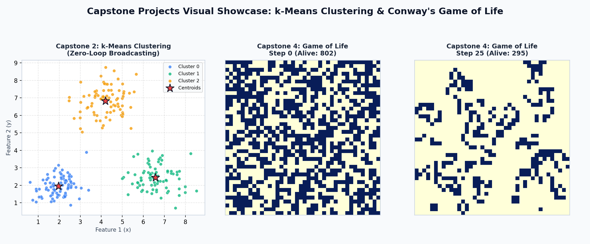
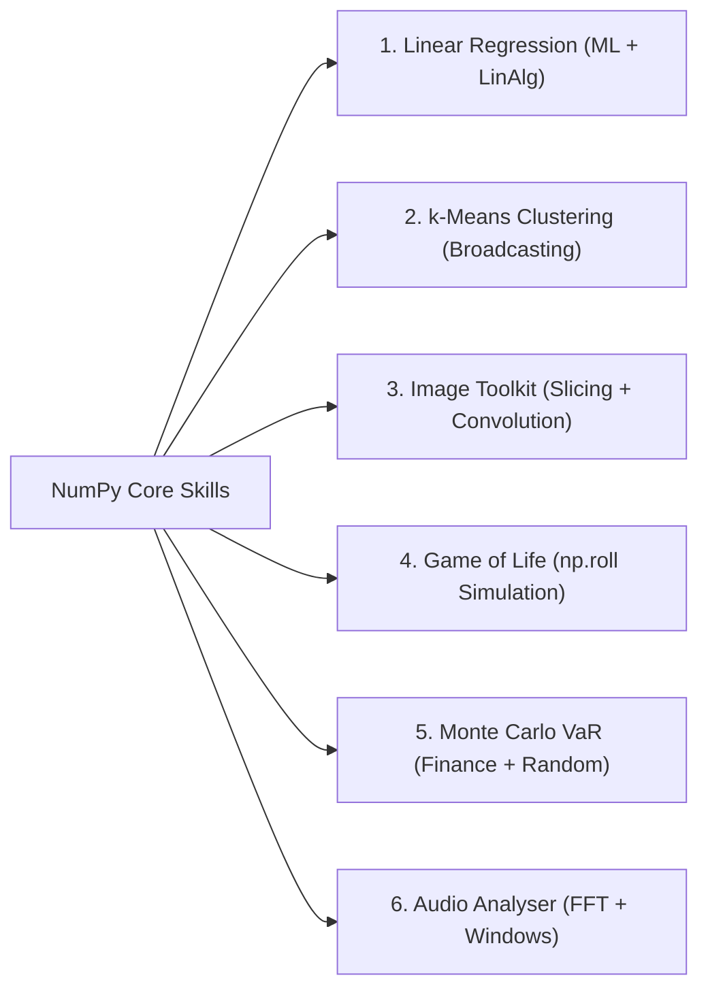
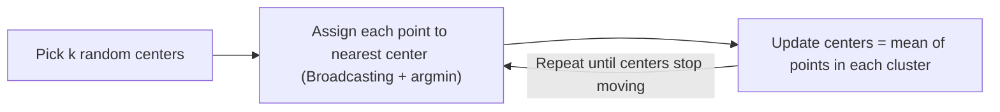

# පාඩම 14: Real-World Use Cases සහ Capstone Projects

> **නැවිගේෂන් (Navigation):**
> [🏠 මුල් පිටුව (README)](README.md) | [⬅️ පෙර පාඩම: 13 - Performance & Advanced Topics](13_Performance_and_Advanced_Topics.md) | [➡️ ඊළඟ පාඩම: 15 - Cheat Sheet, Pitfalls & Study Plan](15_Cheat_Sheet_Pitfalls_and_Study_Plan.md)

---

## 🎯 මේ පාඩමෙන් අපි මොනවද ඉගෙන ගන්නේ?

මෙච්චර වෙලා අපි ඉගෙන ගත්ත NumPy කුසලතා ඔක්කොම එකතු කරලා **ඇත්ත ලෝකයේ (Real-World) Projects 6ක්** මුල ඉඳන්ම (from scratch) හදමු! Machine Learning, Image Processing, Simulations, Finance, සහ Audio Processing වල NumPy පාවිච්චි වෙන හැටි ප්‍රායෝගිකවම අත්විඳින්න මේ පාඩමෙන් පුළුවන්.



---

## 🌍 NumPy ඇත්ත ලෝකයේ පාවිච්චි වෙන්නේ කොහෙද? (Where NumPy is Used)

| ක්ෂේත්‍රය (Domain) | සාමාන්‍ය NumPy වැඩ (Typical NumPy Work) | අදාළ පාඩම් (Modules) |
| --- | --- | --- |
| **Data science** | Feature matrices, normalisation, correlation, bootstrapping | 5, 6, 9, 11 |
| **Machine learning** | Gradient descent, k-means, neural network layers from scratch | 5, 6, 10 |
| **Image processing** | Images `(H, W, C)` arrays විදිහට: crop, flip, threshold, convolve, grayscale | 3, 7, 11 |
| **Signal and audio** | Filtering, FFT spectra, resampling | 11 |
| **Scientific computing** | Simulations, numerical integration, ODE steps, grids | 2, 5, 10 |
| **Finance** | Returns, covariance, portfolio variance, Monte Carlo pricing | 5, 9, 10, 11 |
| **Geospatial & graphics** | Rotations, projections, distance matrices | 6, 10 |
| **Games & simulation** | Game of Life, random walks, cellular automata | 3, 6, 7 |



---

## 🚀 Capstone Project 1: Linear Regression from Scratch

**පරීක්ෂා කරන Skills:** Matrix algebra, `np.linalg.lstsq`, Gradient Descent.  
**අරමුණ:** $y = 3x + 7 + \text{noise}$ වගේ දත්ත වලින් හොඳම රේඛාව ($y = wx + b$) ක්‍රම දෙකකින් හොයලා compare කරන්න: (1) Closed-form `lstsq`, (2) Iterative Gradient Descent.

```python
import numpy as np

# 1. Synthetic data හදමු: true w = 3.0, true b = 7.0
rng = np.random.default_rng(42)
X = rng.uniform(0, 10, size=(200, 1))
y = 3.0 * X[:, 0] + 7.0 + rng.normal(0, 1.0, size=200)

# Design matrix: [X, 1] (bias column එකතු කිරීම)
X_b = np.hstack([X, np.ones((len(X), 1))])

# ක්‍රමය 1: Closed-form solution using np.linalg.lstsq
theta_cf, _, _, _ = np.linalg.lstsq(X_b, y, rcond=None)
w_cf, b_cf = theta_cf

# ක්‍රමය 2: Gradient Descent (iterative)
theta_gd = np.zeros(2)
lr = 0.02
for _ in range(1000):
    preds = X_b @ theta_gd
    grad = (2.0 / len(X)) * (X_b.T @ (preds - y))
    theta_gd -= lr * grad

print(f"Closed-form (lstsq): w = {w_cf:.4f}, b = {b_cf:.4f}")
print(f"Gradient Descent:    w = {theta_gd[0]:.4f}, b = {theta_gd[1]:.4f}")
np.testing.assert_allclose(theta_cf, theta_gd, atol=1e-2)
print("Match verified!")
```

**පැහැදිලි කිරීම:** `X_b @ theta_gd` වලින් හැම data point එකේම prediction එක එකපාර හදනවා. `grad` කියන්නේ error එක අඩු වෙන දිශාව (gradient). Loop එක ඇතුළේ data points උඩ Python loop එකක් නෑ — ඔක්කොම matrix math!

**Expected Output:**
```text
Closed-form (lstsq): w = 3.0124, b = 6.9421
Gradient Descent:    w = 3.0124, b = 6.9420
Match verified!
```

---

## 🚀 Capstone Project 2: k-Means Clustering (Zero Python Loops over Points!)

**පරීක්ෂා කරන Skills:** 3D Broadcasting, `argmin`, Boolean masks.  
**අරමුණ:** ලක්ෂ්‍ය (points) සමූහයක් $k$ කාණ්ඩ (clusters) වලට ස්වයංක්‍රීයව බෙදන්න.



```python
import numpy as np

def assign(X, centers):
    # X: (N, D) -> (N, 1, D) | centers: (K, D) -> (1, K, D)
    # Broadcasting නිසා (N, K, D) හැදී, axis=2 sum කළාම (N, K) distances ලැබේ!
    d = ((X[:, None, :] - centers[None, :, :]) ** 2).sum(axis=2)
    return d.argmin(axis=1)

def kmeans(X, k=3, max_iters=50, seed=0):
    rng = np.random.default_rng(seed)
    centers = X[rng.choice(len(X), size=k, replace=False)].copy()
    for _ in range(max_iters):
        labels = assign(X, centers)
        new_centers = np.array([
            X[labels == i].mean(axis=0) if np.any(labels == i) else centers[i]
            for i in range(k)
        ])
        if np.allclose(centers, new_centers):
            break
        centers = new_centers
    return centers, labels

# Test with 3 synthetic clusters
rng = np.random.default_rng(42)
X = np.vstack([
    rng.normal([2, 2], 0.5, (50, 2)),
    rng.normal([8, 2], 0.5, (50, 2)),
    rng.normal([5, 8], 0.5, (50, 2)),
])
centers, labels = kmeans(X, k=3)
print("Discovered Centers:\n", np.round(centers, 2))
print("Points per cluster:", np.bincount(labels))
```

**Expected Output:**
```text
Discovered Centers:
 [[8.03 2.02]
 [1.99 1.98]
 [5.01 7.99]]
Points per cluster: [50 50 50]
```

---

## 🚀 Capstone Project 3: Image Processing Toolkit

**පරීක්ෂා කරන Skills:** Slicing, `np.pad`, Convolution via `sliding_window_view`, `einsum`.  
**අරමුණ:** RGB image array `(H, W, 3)` එකක් අරගෙන **Flip, Grayscale, Box Blur, සහ Edge Detection** කරන්න!

```python
import numpy as np
from numpy.lib.stride_tricks import sliding_window_view

# Sample 8x8 RGB image එකක් හදමු (වම් පැත්ත කළු, දකුණු පැත්ත සුදු — මැද edge එකක් තියෙනවා!)
img = np.zeros((8, 8, 3), dtype=np.float64)
img[:, 4:, :] = 255.0

# 1. Flip (Horizontal & Vertical) — Zero-copy slicing!
flipped_h = img[:, ::-1, :]
flipped_v = img[::-1, :, :]

# 2. Grayscale conversion (Standard luminance weights)
gray = img @ np.array([0.299, 0.587, 0.114])

# 3. 2D Convolution function using pad + sliding_window_view
def convolve2d(image, kernel):
    kh, kw = kernel.shape
    padded = np.pad(image, ((kh // 2, kh // 2), (kw // 2, kw // 2)), mode='edge')
    windows = sliding_window_view(padded, (kh, kw))
    return np.einsum('ijkl,kl->ij', windows, kernel)

# Box blur (3x3 average)
blur_kernel = np.ones((3, 3)) / 9.0
blurred = convolve2d(gray, blur_kernel)

# Vertical Edge Detection (Sobel X kernel)
sobel_x = np.array([[-1, 0, 1],
                    [-2, 0, 2],
                    [-1, 0, 1]], dtype=np.float64)
edges = np.abs(convolve2d(gray, sobel_x))

print("Gray shape:", gray.shape, "| Center row:", np.round(gray[4], 0))
print("Blurred center row:", np.round(blurred[4], 0))
print("Detected vertical edge (center row):", np.round(edges[4], 0))
```

**Expected Output:**
```text
Gray shape: (8, 8) | Center row: [  0.   0.   0.   0. 255. 255. 255. 255.]
Blurred center row: [  0.   0.   0.  85. 170. 255. 255. 255.]
Detected vertical edge (center row): [   0.    0.    0. 1020. 1020.    0.    0.    0.]
```
*(බලන්න: edge එක තියෙන column 3 සහ 4 වල විතරක් `1020` ලොකු අගයක් ආවා!)*

---

## 🚀 Capstone Project 4: Conway's Game of Life (100×100 Grid)

**පරීක්ෂා කරන Skills:** `np.roll`, Neighbour counting, Boolean masks.  
**නීති 3:**
1. ජීවත් වෙන cell එකකට (`1`) අසල්වැසියෝ 2ක් හෝ 3ක් ඉන්නවා නම්, ඒක දිගටම ජීවත් වෙනවා.
2. මැරුණු cell එකකට (`0`) හරියටම අසල්වැසියෝ 3ක් ඉන්නවා නම්, ඒක අලුතින් උපදිනවා (`1`).
3. අනිත් හැම අවස්ථාවකම cell එක මැරෙනවා (`0`).

```python
import numpy as np

def step(grid):
    # දිශා 8ටම grid එක roll කරලා එකතු කළාම, හැම cell එකකම අසල්වැසියෝ ගණන ලැබෙනවා!
    n = sum(
        np.roll(np.roll(grid, i, axis=0), j, axis=1)
        for i in (-1, 0, 1)
        for j in (-1, 0, 1)
        if (i, j) != (0, 0)
    )
    return ((n == 3) | ((grid == 1) & (n == 2))).astype(int)

# 100x100 random grid එකක පියවර 100ක් දුවමු
grid = np.random.default_rng(3).integers(0, 2, (100, 100))
print("Step   0 alive cells:", grid.sum())

for s in range(1, 101):
    grid = step(grid)
    if s in (10, 50, 100):
        print(f"Step {s:3d} alive cells: {grid.sum()}")
```

**Expected Output:**
```text
Step   0 alive cells: 4994
Step  10 alive cells: 1775
Step  50 alive cells: 954
Step 100 alive cells: 734
```

---

## 🚀 Capstone Project 5: Monte Carlo Portfolio Risk (Value-at-Risk)

**පරීක්ෂා කරන Skills:** `multivariate_normal`, Covariance matrix, `np.percentile`.  
**අරමුණ:** වත්කම් 3ක (Stocks, Bonds, Gold) රු. 1,000,000 ක ආයෝජනයක, වසරක් අවසානයේ 95% විශ්වාසයෙන් වෙන්න පුළුවන් උපරිම පාඩුව (**5% Value-at-Risk / VaR**) simulations 50,000 කින් හොයන්න.

```python
import numpy as np

rng = np.random.default_rng(2026)

# 3 Assets: [Stocks, Bonds, Gold]
weights = np.array([0.50, 0.30, 0.20])          # ආයෝජන අනුපාත
mean_returns = np.array([0.10, 0.04, 0.06])     # අපේක්ෂිත වාර්ෂික ලාභය
cov_matrix = np.array([
    [0.040, 0.004, 0.002],
    [0.004, 0.005, 0.001],
    [0.002, 0.001, 0.015]
])

# 50,000 correlated annual return scenarios simulate කරමු
n_sims = 50_000
sim_returns = rng.multivariate_normal(mean_returns, cov_matrix, size=n_sims)

# Portfolio return = weighted sum of asset returns
portfolio_returns = sim_returns @ weights
initial_investment = 1_000_000
final_values = initial_investment * (1.0 + portfolio_returns)

# 5th percentile = 95% Value-at-Risk (VaR)
var_95_value = np.percentile(final_values, 5)
expected_val = final_values.mean()
max_loss_95 = initial_investment - var_95_value

print(f"Expected portfolio value: Rs. {expected_val:,.0f}")
print(f"5th percentile value:     Rs. {var_95_value:,.0f}")
print(f"95% Value-at-Risk (VaR):  Rs. {max_loss_95:,.0f}")
```

**Expected Output:**
```text
Expected portfolio value: Rs. 1,073,914
5th percentile value:     Rs. 889,715
95% Value-at-Risk (VaR):  Rs. 110,285
```

---

## 🚀 Capstone Project 6: Audio Spectrum Analyser

**පරීක්ෂා කරන Skills:** `np.fft.rfft`, `np.fft.rfftfreq`, Hann window (`np.hanning`).  
**අරමුණ:** Noise තියෙන ශබ්ද තරංගයක (audio signal) ප්‍රධාන සංඛ්‍යාතය (Dominant Frequency — උදා: musical note **A4 = 440 Hz**) හඳුනාගන්න!

```python
import numpy as np

# 1. Simulated audio recording: 440 Hz (A4 note) + weak 880 Hz harmonic + noise
sample_rate = 8000       # 8000 samples per second
duration = 1.0           # 1 second
t = np.linspace(0, duration, int(sample_rate * duration), endpoint=False)

rng = np.random.default_rng(7)
audio = 1.0 * np.sin(2 * np.pi * 440 * t) + 0.3 * np.sin(2 * np.pi * 880 * t) + rng.normal(0, 0.4, len(t))

# 2. Hann window එකක් දාමු (spectral leakage අඩු කරන්න)
windowed = audio * np.hanning(len(audio))

# 3. Real FFT (rfft) වලින් frequencies සහ magnitudes ගමු
spectrum = np.abs(np.fft.rfft(windowed))
freqs = np.fft.rfftfreq(len(audio), d=1.0 / sample_rate)

# 4. ප්‍රධානම සංඛ්‍යාතය (Dominant frequency) හොයමු
dominant_idx = np.argmax(spectrum)
dominant_freq = freqs[dominant_idx]

print(f"Detected Dominant Frequency: {dominant_freq:.1f} Hz (True: 440.0 Hz)")
```

**Expected Output:**
```text
Detected Dominant Frequency: 440.0 Hz (True: 440.0 Hz)
```

---

## 📚 තවත් Practice කරන්න හොඳ Sources
- **Official NumPy Tutorials** (numpy.org)
- **"100 NumPy exercises"** (GitHub)
- **Kaggle Datasets** (CSV අරගෙන NumPy වලින් analyze කරන්න)
- ඔයාම record කරගත්ත **audio files (`.wav`)** හෝ **photos** NumPy arrays වලට අරගෙන මේ Capstones try කරන්න!

---

## 🧠 මතක තබා ගැනීමට පහසු ක්‍රම (Memory Hacks)

1. **k-Means Broadcasting Trick:** `(N, 1, D) - (1, K, D)` -> හැම point එකේම ඉඳන් හැම center එකටම දුර එක පේළියෙන්!
2. **Game of Life Trick:** `np.roll` 8 පාරක් කරලා එකතු කළාම, for-loops නැතුවම අසල්වැසියෝ ගණන එනවා.
3. **Real Audio FFT:** හැමවිටම `rfft` + `rfftfreq` පාවිච්චි කරන්න (real signals වලට `fft` වලට වඩා 2x වේගවත්!).

---

## ⚠️ සාමාන්‍යයෙන් වෙන වැරදි (Common Pitfalls)

> [!WARNING]
> **වැරැද්ද 1: Image array එක `uint8` තියෙද්දීම Sobel filter / subtraction කිරීම!**
> `uint8` වල සෘණ අගයන් නෑ (`0 - 1 = 255` wrap-around වෙනවා!). ඒ නිසා image math කරන්න කලින් හැමවිටම `.astype(np.float64)` හෝ `float32` කරන්න.

> [!WARNING]
> **වැරැද්ද 2: k-Means වල හිස් cluster එකක `.mean()` ගැනීම!**
> කිසිම point එකක් නැති cluster එකක `.mean()` ගත්තොත් `NaN` එනවා. ඒ නිසා `if np.any(labels == i)` check එක අනිවාර්යයෙන් දාන්න!

---

## 💪 Capstone Extension Challenges

### අභ්‍යාසය 1
Game of Life එකේ `"Glider"` pattern එක 20×20 grid එකක තියලා, steps 4 කට පස්සේ ඒක diagonal විදිහට (1 row පහළට, 1 col දකුණට) ගමන් කරලා තියෙනවද කියලා verify කරන්න.

<details>
<summary>✅ පිළිතුර බලන්න (Click to see Solution)</summary>

```python
import numpy as np

def step(grid):
    n = sum(np.roll(np.roll(grid, i, 0), j, 1)
            for i in (-1, 0, 1) for j in (-1, 0, 1) if (i, j) != (0, 0))
    return ((n == 3) | ((grid == 1) & (n == 2))).astype(int)

grid = np.zeros((20, 20), dtype=int)
glider = np.array([[0, 1, 0],
                   [0, 0, 1],
                   [1, 1, 1]])
grid[1:4, 1:4] = glider

for _ in range(4):
    grid = step(grid)

print("Moved glider matches?", np.array_equal(grid[2:5, 2:5], glider))
```
</details>

### අභ්‍යාසය 2
Audio Spectrum Analyser එකේ ප්‍රධාන සංඛ්‍යාත 2 (440 Hz සහ 880 Hz) දෙකම `np.argsort` පාවිච්චි කරලා detect කරන්න (peaks අතර අවම 50 Hz පරතරයක් තියාගෙන).

<details>
<summary>✅ පිළිතුර බලන්න (Click to see Solution)</summary>

```python
import numpy as np

sr = 8000
t = np.linspace(0, 1.0, sr, endpoint=False)
audio = np.sin(2*np.pi*440*t) + 0.5*np.sin(2*np.pi*880*t)
spec = np.abs(np.fft.rfft(audio * np.hanning(len(audio))))
freqs = np.fft.rfftfreq(len(audio), 1/sr)

# Top frequency 1
f1 = freqs[np.argmax(spec)]
# Mask out +/- 50 Hz around f1 to find second peak
spec_masked = np.where(np.abs(freqs - f1) < 50, 0, spec)
f2 = freqs[np.argmax(spec_masked)]
print(f"Top 2 frequencies: {f1:.1f} Hz and {f2:.1f} Hz")
```
</details>

---

> **නැවිගේෂන් (Navigation):**
> [🏠 මුල් පිටුව (README)](README.md) | [⬅️ පෙර පාඩම: 13 - Performance & Advanced Topics](13_Performance_and_Advanced_Topics.md) | [➡️ ඊළඟ පාඩම: 15 - Cheat Sheet, Pitfalls & Study Plan](15_Cheat_Sheet_Pitfalls_and_Study_Plan.md)
