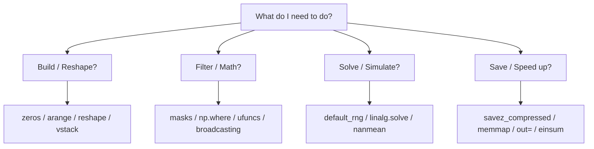
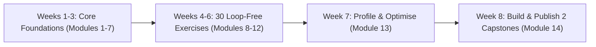

# පාඩම 15: Cheat Sheet, 11 Common Pitfalls, 8-Week Study Plan & Mastery Checklist

> **නැවිගේෂන් (Navigation):**
> [🏠 මුල් පිටුව (README)](README.md) | [⬅️ පෙර පාඩම: 14 - Use Cases & Capstone Projects](14_Use_Cases_and_Capstone_Projects.md)

---

## 🎯 මේ අවසාන පාඩමේ මොනවද තියෙන්නේ?

මේක ඔයාගේ **NumPy Pocket Reference Guide** එක! ඕනෑම project එකක් කරද්දී ඉක්මනින් බලාගන්න පුළුවන් **Quick Reference Cheat Sheet** එක, ගොඩක් අය අතින් වෙන **වැරදි 11 (11 Common Pitfalls)** සහ ඒවා හදාගන්න විදිහ, **සති 8ක ප්‍රායෝගික අධ්‍යයන සැලැස්ම (8-Week Practice Plan)**, **Mastery Checklist** එක, සහ ඉදිරියට ඉගෙන ගන්න හොඳම **Resources** මෙතන තියෙනවා.

---

## ⚡ 1. Quick Reference Cheat Sheet (කාර්යය අනුව ඉක්මන් මාර්ගෝපදේශය)

| මට ඕනේ... (I want to...) | පාවිච්චි කරන්න (Use) | කෙටි උදාහරණය (Quick Snippet) |
| --- | --- | --- |
| **Make an array** | `array`, `zeros`, `ones`, `full`, `arange`, `linspace`, `eye`, `meshgrid` | `np.linspace(0, 1, 5)` |
| **Change shape** | `reshape`, `ravel`, `T`, `transpose`, `expand_dims`, `squeeze` | `a.reshape(-1, 2)` |
| **Join or split** | `concatenate`, `stack`, `vstack`, `hstack`, `split` | `np.vstack([a, b])` |
| **Select** | slices, boolean masks, fancy indexing, `where`, `take` | `np.where(a > 0, a, 0)` |
| **Compute** | ufuncs, `sum`, `mean`, `std`, `cumsum`, `diff`, `clip` | `a.mean(axis=0)` |
| **Combine shapes** | broadcasting, `newaxis`, `broadcast_to` | `a[:, None] + b[None, :]` |
| **Order and find** | `sort`, `argsort`, `argpartition`, `searchsorted`, `unique`, `isin` | `np.argsort(a)[::-1]` |
| **Random data** | `default_rng`, `random`, `integers`, `normal`, `choice`, `permutation` | `rng = np.random.default_rng(0)` |
| **Linear algebra** | `@`, `linalg.solve`, `lstsq`, `eigh`, `svd`, `norm`, `einsum` | `np.linalg.solve(A, b)` |
| **Handle missing values** | `isnan`, `nanmean`, `nan_to_num`, `ma.masked_invalid` | `np.nanmean(a)` |
| **Save and load** | `save`, `load`, `savez_compressed`, `loadtxt`, `memmap` | `np.load('x.npy', mmap_mode='r')` |

### 🧭 ඉක්මන් තීරණ ගැනීමේ සටහන (Quick Decision Tree)



---

## ⚠️ 2. සාමාන්‍යයෙන් වෙන වැරදි 11 (The 11 Common Pitfalls)

NumPy ඉගෙන ගන්න හැමෝම වගේ කරන මේ වැරදි 11 දැනගත්තොත්, bugs ගොඩකින් ඔයාට බේරෙන්න පුළුවන්!

> [!WARNING]
> **Pitfall 1: Slice එකක් copy එකක් කියලා හිතීම!**
> Basic slicing වලින් එන්නේ **view** එකක්. View එක වෙනස් කළොත් original array එකත් වෙනස් වෙනවා. ස්වාධීන copy එකක් ඕනේ නම් `.copy()` දාන්න.
> ```python
> sub = a[:3]          # ❌ View (edits affect 'a')
> sub = a[:3].copy()   # ✅ Independent copy
> ```

> [!WARNING]
> **Pitfall 2: Arrays වලට `and` / `or` පාවිච්චි කිරීම!**
> Python වල `and`/`or` වැඩ කරන්නේ single booleans වලට විතරයි. Arrays වලට `&` / `|` දාලා, හැම condition එකක් වටේම වරහන් `(...)` දාන්න.
> ```python
> mask = a > 0 and a < 10       # ❌ ValueError!
> mask = (a > 0) & (a < 10)     # ✅ Correct!
> ```

> [!WARNING]
> **Pitfall 3: පොඩි integer dtypes (`uint8`) වල Integer Overflow / Wrap-around!**
> `uint8` වල උපරිමය `255`. `np.uint8(250) + np.uint8(10)` කළොත් `260` නෙවෙයි, silent විදිහට `4` වෙනවා! ගණන් හදන්න කලින් `int32` හෝ `float32` වලට cast කරන්න.

> [!WARNING]
> **Pitfall 4: Floats `==` වලින් compare කිරීම!**
> පරිගණක වල `0.1 + 0.2 == 0.3` කියන්නේ `False` (`0.30000000000000004` නිසා). හැමවිටම `np.isclose(a, b)` හෝ `np.allclose(a, b)` පාවිච්චි කරන්න.

> [!WARNING]
> **Pitfall 5: Shape `(n,)` vs `(n, 1)` පටලවා ගැනීම!**
> 1D array `(3,)` එකකට 2D column `(3, 1)` එකක් එකතු කළොත්, broadcasting නිසා නොහිතපු `(3, 3)` matrix එකක් හැදෙනවා! හැමවිටම `.shape` check කරන්න.

> [!WARNING]
> **Pitfall 6: Loop එකක් ඇතුළේ දිගටම `np.append` කිරීම!**
> `np.append` කරන හැම පාරම මුළු array එකම අලුතින් copy වෙනවා ($O(N^2)$ slow!). ඒ වෙනුවට කලින් `np.empty(N)` වලින් ඉඩ වෙන් කරන්න (preallocate) හෝ Python list එකකට `append` කරලා අන්තිමට `np.array()` කරන්න.

> [!WARNING]
> **Pitfall 7: සමීකරණ විසඳන්න Matrix Inverse (`inv(A) @ b`) ගැනීම!**
> `np.linalg.inv(A) @ b` කියන්නේ slow සහ numerical accuracy අඩු ක්‍රමයක්. හැමවිටම `np.linalg.solve(A, b)` පාවිච්චි කරන්න.

> [!WARNING]
> **Pitfall 8: අලුත් code වල පරණ global `np.random.seed()` පාවිච්චි කිරීම!**
> ඒක legacy ක්‍රමයක්. අලුත්, වේගවත් සහ reproducible ක්‍රමය වන `rng = np.random.default_rng(42)` පාවිච්චි කරන්න.

> [!WARNING]
> **Pitfall 9: `np.vectorize` වේගවත් කියලා බලාපොරොත්තු වීම!**
> ඒක convenience wrapper එකක් විතරයි — යටින් දුවන්නේ Python loop එකක්. ඇත්ත speed එකට ufuncs, `np.where`, හෝ Numba `@njit` ගන්න.

> [!WARNING]
> **Pitfall 10: Sample standard deviation හොයද්දී `ddof=1` අමතක වීම!**
> NumPy වල `np.std(x)` default ගන්නේ population std (`ddof=0`). Sample එකක std හොයනවා නම් `np.std(x, ddof=1)` දෙන්න!

> [!WARNING]
> **Pitfall 11: NumPy 2.x වල අයින් කරපු පරණ aliases පාවිච්චි කිරීම!**
> `np.float_`, `np.NaN`, `np.trapz` වගේ පරණ නම් NumPy 2.0 වලින් අයින් කරලා. ඒ වෙනුවට `np.float64`, `np.nan`, `np.trapezoid` පාවිච්චි කරන්න.

---

## 📅 3. සති 8ක ප්‍රායෝගික අධ්‍යයන සැලැස්ම (8-Week Practice Plan)

| සති (Weeks) | දිනපතා පුරුද්ද (Daily Habit: 45–60 minutes) | අරමුණ (Milestone) |
| --- | --- | --- |
| **Weeks 1 to 3** | පාඩමක් කියවන්න, හැම code example එකක්ම අතින් type කරලා run කරන්න, අභ්‍යාස ඔක්කොම ඉවර කරන්න | Modules 1–7 (Basics, Indexing, Ufuncs, Broadcasting, Reshaping) |
| **Weeks 4 to 6** | "100 NumPy exercises" වලින් සතියකට ගැටලු 10 බැගින් **for-loops නැතුව** විසඳන්න | Modules 8–12 (Sorting, Random, LinAlg, Stats/FFT, File I/O) |
| **Week 7** | ඔයා කලින් ලියපු විසඳුමක් අරගෙන `timeit` සහ `tracemalloc` වලින් profile කරලා speed & memory optimize කරන්න | Module 13 (Performance, `out=`, `einsum`, strides) |
| **Week 8** | පාඩම 14න් Capstone Projects 2ක් සම්පූර්ණ කරලා GitHub / portfolio එකේ publish කරන්න! | Module 14 (2 Completed Capstones) |



---

## ✅ 4. Mastery Checklist (ඔයා NumPy Master කළාද?)

පහළ තියෙන හැම එකක්ම ඔයාට තනියම කරන්න පුළුවන් නම් tick (`[x]`) කරන්න:

- [ ] **Broadcasting:** ඕනෑම operation එකක result shape එක broadcasting rule එකෙන් හිතෙන්ම කියන්න පුළුවන්.
- [ ] **Views vs Copies:** කොයි operations ද views දෙන්නේ, කොයි ඒවද copies දෙන්නේ කියලා හරියටම දන්නවා.
- [ ] **Vectorisation:** ඕනෑම සරල Python loop එකක් vectorised NumPy code එකකට හරවන්න පුළුවන්.
- [ ] **Dtypes:** නිවැරදි බව (correctness) සහ memory ඉතිරි කරගන්න සුදුසු `dtype` තෝරන්න පුළුවන්.
- [ ] **Linear Algebra:** `np.linalg` පාවිච්චි කරලා linear systems විසඳන්න සහ models fit කරන්න පුළුවන්.
- [ ] **Random Simulations:** `default_rng()` (`Generator`) පාවිච්චි කරලා reproducible random simulations දුවන්න පුළුවන්.
- [ ] **Large Files & I/O:** Arrays save/load කරන්න සහ RAM එකට වඩා ලොකු files memory-map (`memmap`) කරන්න පුළුවන්.
- [ ] **Profiling & Speed:** Slow code එකක් profile කරලා bottlenecks හොයලා වේගවත් කරන්න පුළුවන්.

---

## 📚 5. ඉදිරියට ඉගෙන ගන්න හොඳම Resources

1. **Official NumPy Documentation** — User Guide, Absolute Beginners Guide, සහ API Reference ([numpy.org](https://numpy.org))
2. ***Guide to NumPy*** — Travis Oliphant (NumPy නිර්මාණය කරපු මුල් කතුවරයාගේ පොත)
3. ***From Python to NumPy*** — Nicolas Rougier (නොමිලේ online කියවන්න පුළුවන් සුපිරි පොතක්!)
4. **"100 NumPy exercises"** (GitHub) සහ **Kaggle Learn**
5. **ඊළඟ පියවර (Next Steps):** මේ පාඨමාලාවේ ඊළඟ අදියර විදිහට **pandas** (tabular data analysis), ඊට පස්සේ **SciPy** (scientific computing) සහ **scikit-learn** (machine learning) ඉගෙන ගන්න!

---

## 🧠 මතක තබා ගැනීමට පහසු ක්‍රම (Final Memory Hacks)

1. **The Golden Rule of NumPy:** *"If you're writing a Python `for` loop over array elements, pause — there is almost always a faster NumPy way!"*
2. **Debug Trio:** Bug එකක් ආවොත් මුලින්ම මේ 3 print කරලා බලන්න: `arr.shape`, `arr.dtype`, `np.isnan(arr).any()`.

---

## 💪 අවසාන Self-Check Mini-Quiz

මේ code snippet එකේ **වැරදි 4ක්** තියෙනවා (Pitfalls වලින්). ඒ 4 හොයලා නිවැරදි කරන්න!

```python
import numpy as np

np.random.seed(0)
x = np.array([250, 255], dtype=np.uint8)
y = x + 10
mask = y > 0 and y < 300
is_same = (0.1 + 0.2) == 0.3
```

<details>
<summary>✅ පිළිතුර බලන්න (Click to see Solution)</summary>

1. `np.random.seed(0)` -> `rng = np.random.default_rng(0)` පාවිච්චි කරන්න (Pitfall 8).
2. `uint8` overflow -> `x.astype(np.int32) + 10` කරන්න, නැත්නම් `250 + 10 = 4` වෙනවා (Pitfall 3).
3. `and` on array -> `(y > 0) & (y < 300)` දාන්න (Pitfall 2).
4. Float `==` -> `np.isclose(0.1 + 0.2, 0.3)` පාවිච්චි කරන්න (Pitfall 4).

```python
import numpy as np

rng = np.random.default_rng(0)
x = np.array([250, 255], dtype=np.uint8)
y = x.astype(np.int32) + 10
mask = (y > 0) & (y < 300)
is_same = np.isclose(0.1 + 0.2, 0.3)
print("y:", y, "| mask:", mask, "| is_same:", is_same)
```
</details>

---

> 🎉 **සුභ පැතුම්!** ඔයා **Master NumPy Complete Course** එකේ සම්පූර්ණ පාඩම් 15ම අවසන් කළා! දැන් Capstone Projects දෙකක් හදලා ඔයාගේ දැනුම ලෝකයට පෙන්නන්න!
>
> **නැවිගේෂන් (Navigation):**
> [🏠 මුල් පිටුව (README)](README.md) | [⬅️ පෙර පාඩම: 14 - Use Cases & Capstone Projects](14_Use_Cases_and_Capstone_Projects.md)
