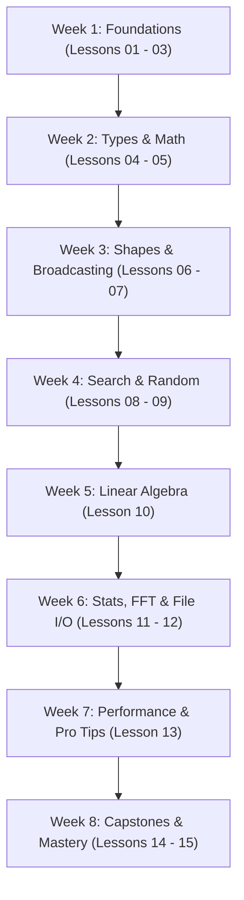

# 🐍 Master NumPy: සම්පූර්ණ සිංහල ස්වයං-අධ්‍යයන පාඨමාලාව (Complete Self-Study Course)

ආයුබෝවන්! 👋  
මේ **සති 8ක (8-Week) සම්පූර්ණ NumPy පාඨමාලාව** හදලා තියෙන්නේ, ඔයාගේ පළවෙනි `ndarray` එක හදන තැන ඉඳන්, වේගවත් (vectorised), memory-efficient numerical code ලියන මට්ටම දක්වාම **සරල, එදිනෙදා කතා කරන සිංහලෙන්** ඉගෙන ගන්න පුළුවන් විදිහටයි.

---

## 🎯 මේ පාඨමාලාව කාටද? (Course Overview)

- **කාටද සුදුසු?** මූලික Python දන්න students ලා, data analysts ලා, engineers ලා, සහ Machine Learning ඉගෙන ගන්න අයට. **pandas, SciPy, scikit-learn, Matplotlib, PyTorch, TensorFlow** වගේ හැම library එකකම පදනම NumPy නිසා, මේක ඉගෙන ගන්න එක හැම තැනකදීම ගොඩක් වටිනවා!
- **අවසානයේ ඔයාට මොනවද කරන්න පුළුවන් වෙන්නේ?** N-dimensional arrays හදන්න/reshape කරන්න, නිවැරදිව index/slice කරන්න, loops නැතුව ufuncs සහ broadcasting වලින් ගණන් හදන්න, Linear Algebra සහ Statistics කරන්න, Random simulations දුවන්න, ලොකු files save/load/memmap කරන්න, සහ code එකේ speed & memory optimize කරන්න.
- **පාවිච්චි කරන විදිහ:** හැම පාඩමකම සරල පැහැදිලි කිරීම්, visual diagrams, runnable Python code + expected output, memory hacks, common pitfalls, සහ උත්තර සහිත ප්‍රායෝගික අභ්‍යාස තියෙනවා. හැම code එකක්ම අතින් type කරලා run කරලා බලන්න!

### ⚡ ඉක්මනින් පටන් ගමු (Quick Start)
```python
import numpy as np

print("NumPy version:", np.__version__)
```

---

## 🗺️ සම්පූර්ණ ඉගෙනුම් සිතියම (Complete Learning Path)



---

## 📚 සම්පූර්ණ පාඩම් මාලාව (All 15 Lessons Index)

| # | පාඩම (Lesson Link) | ආවරණය කරන ප්‍රධාන මාතෘකා (Key Topics) | සතිය (Week) |
| :-: | --- | --- | :-: |
| 01 | [01 - Setup & ndarray Basics](01_Setup_and_ndarray_Basics.md) | Why NumPy, `ndarray`, lists vs arrays, axes, NumPy 2.x notes | Week 1 |
| 02 | [02 - Creating Arrays](02_Creating_Arrays.md) | `zeros`, `ones`, `arange`, `linspace`, `eye`, `meshgrid`, `tile` | Week 1 |
| 03 | [03 - Indexing, Slicing, Views vs Copies](03_Indexing_Slicing_Views_vs_Copies.md) | Slicing, boolean masks, fancy indexing, views vs copies | Week 1 |
| 04 | [04 - Data Types & Array Attributes](04_Data_Types_and_Array_Attributes.md) | `dtype`, `astype`, overflow, `shape`, `strides`, `nbytes` | Week 2 |
| 05 | [05 - Math, Ufuncs & Aggregation](05_Math_Ufuncs_and_Aggregation.md) | Vectorised ufuncs, `sum`, `mean`, `cumsum`, `where`, `clip` | Week 2 |
| 06 | [06 - Broadcasting](06_Broadcasting.md) | Broadcasting rules, `np.newaxis`, outer operations, pitfalls | Week 3 |
| 07 | [07 - Shape Manipulation, Stacking & Splitting](07_Shape_Manipulation_Stacking_Splitting.md) | `reshape`, `ravel`, `transpose`, `vstack`, `hstack`, `split` | Week 3 |
| 08 | [08 - Sorting, Searching & Set Operations](08_Sorting_Searching_and_Set_Operations.md) | `sort`, `argsort`, `argpartition`, `searchsorted`, `unique`, `isin` | Week 4 |
| 09 | [09 - Random Numbers](09_Random_Numbers.md) | `default_rng`, distributions, `choice`, `permutation`, bootstrapping | Week 4 |
| 10 | [10 - Linear Algebra](10_Linear_Algebra.md) | `@`, `linalg.solve`, `lstsq`, `eigh`, `svd`, `norm`, `det` | Week 5 |
| 11 | [11 - Statistics, Missing Data, Polynomials & FFT](11_Statistics_Missing_Data_Polynomials_FFT.md) | `nanmean`, masked arrays, `corrcoef`, `Polynomial`, `rfft` | Week 6 |
| 12 | [12 - File I/O, Structured Arrays & Datetimes](12_File_IO_Structured_Arrays_Datetimes.md) | `.npy`/`.npz`, `memmap`, CSV, structured arrays, `datetime64`, `busday` | Week 6 |
| 13 | [13 - Performance & Advanced Topics](13_Performance_and_Advanced_Topics.md) | Profiling, `out=`, C vs F layout, strides, `einsum`, Numba, testing | Week 7 |
| 14 | [14 - Use Cases & Capstone Projects](14_Use_Cases_and_Capstone_Projects.md) | 6 Full Capstones: LinReg, k-Means, Image, Game of Life, VaR, Audio FFT | Week 8 |
| 15 | [15 - Cheat Sheet, Pitfalls & Study Plan](15_Cheat_Sheet_Pitfalls_and_Study_Plan.md) | Quick cheat sheet, 11 common pitfalls, 8-week plan, checklist, resources | Week 8 |

---

## 📅 සති 8ක මාර්ග සිතියම (8-Week Roadmap)

| සතිය (Week) | පාඩම් (Modules) | ප්‍රධාන ඉලක්කය (Milestone) |
| :-: | :-: | --- |
| **1** | 1 සිට 3 දක්වා | Arrays හදන්න, index/slice කරන්න; views vs copies හරියටම තේරුම් ගන්න |
| **2** | 4 සිට 5 දක්වා | Dtypes පාලනය කරන්න; ufuncs සහ aggregations වලින් ගණන් හදන්න |
| **3** | 6 සිට 7 දක්වා | Broadcasting පාවිච්චි කරන්න; reshape, stack සහ split කරන්න |
| **4** | 8 සිට 9 දක්වා | Sort, search, set operations; reproducible random sampling කරන්න |
| **5** | 10 | Linear equations විසඳන්න, matrix decompositions (SVD/Eigen) කරන්න |
| **6** | 11 සිට 12 දක්වා | Statistics, missing data, FFT; File I/O, `memmap`, structured arrays, dates |
| **7** | 13 | Speed සහ memory optimize කරන්න; `einsum`, strides, Numba |
| **8** | 14 සිට 15 දක්වා | Capstone projects 2ක් ඉවර කරලා, Mastery Checklist එක සම්පූර්ණ කරන්න! |

---

> 🚀 **පටන් ගන්න සූදානම්ද?** දැන්ම [පාඩම 01: Setup & ndarray Basics](01_Setup_and_ndarray_Basics.md) වෙත යන්න!
