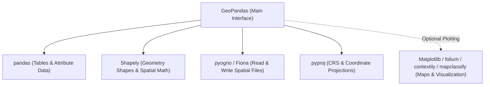
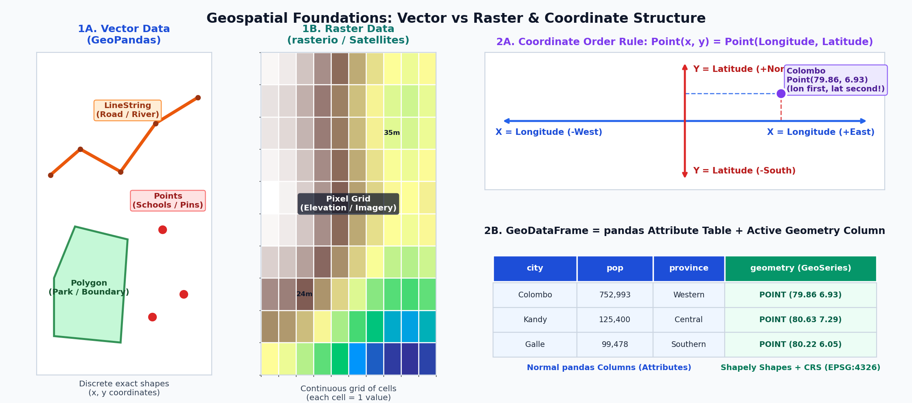
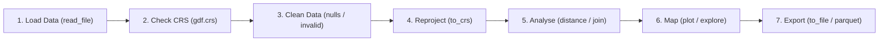

[🏠 Course Home](README.md) | [ඊළඟ පාඩම: GeoSeries, GeoDataFrame & Geometries ➡️](02_GeoSeries_GeoDataFrame_and_Geometries.md)

---

# 📘 පාඩම 01: Setup සහ Geospatial Foundations (GeoPandas මූලික පදනම)

ඔයා දැනටමත් Python සහ `pandas` ගැන මූලික දැනුමක් තියෙන කෙනෙක් නම්, **GeoPandas** ඉගෙන ගන්න එක හරිම ලේසියි! සරලවම කිව්වොත්, `pandas` වල තියෙන DataFrame (වගු) වලට **සිතියම් (Maps) සහ ස්ථාන (Locations)** එකතු කරලා වැඩ කරන්න පුළුවන් super-powered library එක තමයි **GeoPandas**.

අද මේ පළවෙනි පාඩමෙන් අපි GeoPandas install කරන හැටි, ඒක පිටිපස්සේ වැඩ කරන libraries මොනවද, Vector vs Raster කියන්නේ මොකක්ද, Coordinates සහ CRS කියන්නේ මොනවද කියලා සරලවම ඉගෙන ගමු.

---

## 🎯 මේ පාඩමෙන් ඔයා ඉගෙන ගන්න දේවල්

- GeoPandas සහ ඒකට අවශ්‍ය geospatial libraries හරියට install කරන හැටි
- GeoPandas stack එකේ ඉන්න main libraries (`pandas`, `Shapely`, `pyogrio`, `pyproj`) මොනවද කරන්නේ කියලා
- **Vector data** සහ **Raster data** අතර වෙනස
- ප්‍රධාන **Geometry types** (`Point`, `LineString`, `Polygon`, Multi-geometries)
- **Coordinates** (Longitude / Latitude) නිවැරදි පිළිවෙළ (`x = lon, y = lat`)
- **CRS (Coordinate Reference System)** සහ `EPSG:4326` / `EPSG:3857` ගැන මූලික අවබෝධය
- `geodatasets` පාවිච්චි කරලා ඔයාගේ පළවෙනි සිතියම (Map) Python වලින් අඳින හැටි

---

## 1. Installation (GeoPandas Install කරගන්න හැටි)

GeoPandas කියන්නේ සාමාන්‍ය Python library එකක් විතරක් නෙවෙයි; ඒක යටින් **GDAL**, **GEOS**, සහ **PROJ** කියන C/C++ geospatial engines වැඩ කරනවා. ඒ නිසා install කරද්දී හොඳම සහ කරදර අඩුම ක්‍රමය තමයි **conda-forge** පාවිච්චි කරන එක.

```bash
# 1. හොඳම ක්‍රමය (Recommended) — conda-forge හරහා
conda create -n geo_env python=3.11
conda activate geo_env
conda install -c conda-forge geopandas geodatasets matplotlib

# 2. pip පාවිච්චි කරනවා නම් (නවීන OS වල pre-built wheels ලේසියෙන් වැඩ කරනවා)
pip install geopandas geodatasets matplotlib
```

> [!TIP]
> ඔයාට interactive web maps හදන්න ඕනේ නම් `folium`, `mapclassify`, සහ `contextily` කියන optional libraries ටිකත් පස්සේ install කරගන්න පුළුවන් (`pip install folium mapclassify contextily`).

### පළවෙනි Import එක සහ Version Check එක

```python
import geopandas as gpd
import pandas as pd
import matplotlib.pyplot as plt
from shapely.geometry import Point, LineString, Polygon

print("GeoPandas version:", gpd.__version__)
```

**Expected Output:**
```text
GeoPandas version: 1.0.1
```

---

## 2. The Geospatial Stack (GeoPandas පිටිපස්සේ ඉන්න Team එක)

GeoPandas තනියම හැමදේම කරන්නේ නැහැ. ඒක හරියට ක්‍රිකට් ටීම් එකක් වගේ — හැම library එකකටම වෙනම වැඩක් තියෙනවා:



| Library | කරන ප්‍රධාන වැඩේ | සරල උදාහරණය |
| --- | --- | --- |
| **`pandas`** | සාමාන්‍ය වගු (rows & columns) හසුරුවනවා | නගරයේ නම, ජනගහනය (population) filter කරන එක |
| **`Shapely`** | ජ්‍යාමිතික හැඩතල (Points, Lines, Polygons) හදනවා සහ ගණනය කරනවා | දුර (distance), වර්ගඵලය (area), intersection හොයන එක |
| **`pyogrio` / `Fiona`** | Spatial files (`.gpkg`, `.shp`, `.geojson`) read/write කරනවා | GeoPandas 1.x වල default engine එක `pyogrio` (පරණ version වල `Fiona`) |
| **`pyproj`** | Coordinate Reference Systems (CRS) මාරු කරනවා | GPS coordinates (degrees) වලින් meters වලට හරවන එක |
| **`Matplotlib` / `folium` / `mapclassify` / `contextily`** | Static maps, interactive web maps, choropleth classes, basemaps අඳිනවා | ලංකාවේ දිස්ත්‍රික්ක පාට කරලා map එකක් පෙන්නන එක |

---

## 3. Vector Data vs Raster Data (දත්ත වර්ග දෙක)

Geospatial ලෝකයේ සිතියම් දත්ත ප්‍රධාන වශයෙන් වර්ග දෙකයි: **Vector** සහ **Raster**.

1. **Vector Data (GeoPandas වල වැඩ කරන්නේ මේවා එක්ක!):**
   - නිශ්චිත හැඩතල (discrete features) විදිහට data store කරනවා.
   - **Point** (ලක්ෂ්‍යයක්): Google Maps pin එකක්, පාසලක්, ATM එකක්.
   - **LineString** (රේඛාවක්): කොළඹ-නුවර පාර, මහවැලි ගඟ, දුම්රිය මාර්ගය.
   - **Polygon** (වැසුණු ප්‍රදේශයක්): පාසල් ක්‍රීඩා පිට්ටනිය, කොළඹ දිස්ත්‍රික්කයේ මායිම, වැවක්.
2. **Raster Data (`rasterio` library එක පාවිච්චි කරනවා):**
   - සම්පූර්ණ ප්‍රදේශයම කුඩා කොටු (pixel grid / cells) වලට බෙදලා, හැම කොටුවකටම අගයක් (value) දෙනවා.
   - උදාහරණ: Satellite photos, උෂ්ණත්ව සිතියම් (temperature map), උස පෙන්නන DEM (elevation) maps.



---

## 4. Geometry Types (Shapely හැඩතල වර්ග)

Shapely හරහා GeoPandas වලට පහත හැඩතල 8ම පාවිච්චි කරන්න පුළුවන්:

| Geometry Type | සරල තේරුම | ලංකාවේ උදාහරණය |
| --- | --- | --- |
| **`Point`** | තනි `(x, y)` ස්ථානයක් | කොළඹ කොටුව දුම්රිය ස්ථානය |
| **`LineString`** | ලක්ෂ්‍ය කිහිපයක් යා කරන රේඛාවක් | Southern Expressway (දක්ෂිණ අධිවේගී මාර්ගය) |
| **`LinearRing`** | ආරම්භක සහ අවසාන ලක්ෂ්‍යය එකම වෙන වැසුණු රේඛාවක් (Polygon එකක වටේ දාරය) | පිට්ටනියක වටේ තාප්පය |
| **`Polygon`** | ඇතුළත පිරුණු වැසුණු ප්‍රදේශයක් (මැද සිදුරු/holes තියෙන්නත් පුළුවන්) | විහාරමහාදේවී උද්‍යානය (හෝ මැද දූපතක් තියෙන වැවක්) |
| **`MultiPoint`** | Point කිහිපයක එකතුවක් (එකම row එකේ) | එකම බැංකුවක සියලුම ATM ස්ථාන |
| **`MultiLineString`** | LineString කිහිපයක එකතුවක් | ගඟක ප්‍රධාන මාර්ගය සහ ඒකේ අතු ගංගා |
| **`MultiPolygon`** | Polygon කිහිපයක එකතුවක් | යාපනය දිස්ත්‍රික්කය (ප්‍රධාන ගොඩබිම + කයිට්ස්, ඩෙල්ෆ්ට් වගේ දූපත්) |
| **`GeometryCollection`** | විවිධ geometry වර්ග එකට මිශ්‍ර කරපු එකතුවක් | Point + LineString + Polygon එකම feature එකක |

---

## 5. Coordinates සහ CRS (Coordinate Reference System)

### Coordinates — පිළිවෙළ හරිම වැදගත්!

අපි සාමාන්‍යයෙන් Google Maps වල බලද්දී කොළඹට කියන්නේ `6.9271° N, 79.8612° E` (Latitude ඉස්සෙල්ලා, Longitude පස්සේ).
**නමුත් GeoPandas සහ Shapely වල හැමවෙලේම `(x, y)` පිළිවෙළට දෙන්න ඕනේ:**
- **`x` = Longitude** (නැගෙනහිර - බටහිර / East-West)
- **`y` = Latitude** (උතුර - දකුණ / North-South)

ඒ නිසා කොළඹ Point එක හදන්නේ `Point(79.8612, 6.9271)` විදිහටයි!

### CRS (Coordinate Reference System) කියන්නේ මොකක්ද?

පෘථිවිය කියන්නේ ගෝලයක් (3D). අපේ පරිගණක තිරය පැතලි (2D). මේ ගෝලයේ තියෙන ස්ථානයක් හරියටම පැතලි සිතියමකට ගන්න ක්‍රමය (ගණිතමය නීතිය) තමයි **CRS** කියන්නේ. හැම CRS එකකටම **EPSG code** එකක් තියෙනවා:

- **`EPSG:4326` (WGS 84):** GPS වල පාවිච්චි කරන Geographic CRS එක. මනින්නේ **degrees (අංශක)** වලින් (Longitude / Latitude).
- **`EPSG:3857` (Web Mercator):** Google Maps, OpenStreetMap වගේ web maps වල පාවිච්චි කරන Projected CRS එක. මනින්නේ **meters (මීටර්)** වලින්.

`gdf.crs` කියලා type කළාම ඕනෑම GeoDataFrame එකක CRS එක බලාගන්න පුළුවන්.

---

## 6. Attributes + Geometry = `GeoDataFrame`

සාමාන්‍ය `pandas.DataFrame` එකක තියෙන්නේ සාමාන්‍ය columns (උදා: `city`, `pop`, `province`).
`GeoDataFrame` එකක මේ සාමාන්‍ය columns (Attributes) වලට අමතරව, **එක active `geometry` column එකක්** තියෙනවා. හැම row එකක්ම සිතියමේ එක **feature** එකක් නියෝජනය කරනවා.

---

## 7. Sample Data, Data Sources සහ Typical Workflow

### Sample Data (GeoPandas 1.0 වෙනස!)

> [!IMPORTANT]
> පරණ tutorials වල තියෙන `gpd.datasets.get_path('naturalearth_lowres')` ක්‍රමය **GeoPandas 1.0 වලින් ඉවත් කරලා තියෙනවා!** ඒ වෙනුවට දැන් අපි **`geodatasets`** package එක පාවිච්චි කරනවා (උදා: `geodatasets.get_path('nybb')`) හෝ Natural Earth වෙබ් අඩවියෙන් කෙලින්ම download කරනවා.

### Real Projects වලට Data ගන්න ජනප්‍රිය තැන් (Common Data Sources)
- **Natural Earth:** ලෝකයේ රටවල්, ගංගා, නගර (නොමිලේ).
- **OpenStreetMap (OSM):** ලෝකයේ ඕනෑම තැනක පාරවල්, ගොඩනැගිලි, කඩසාප්පු (ලංකාවේ data හොඳටම තියෙනවා!).
- **National Statistics Offices:** ලංකාවේ ජනලේඛන හා සංඛ්‍යාලේඛන දෙපාර්තමේන්තුව, Survey Department data.
- **Open Data Portals & Overture Maps:** නවීන global open geospatial datasets.

### Typical Geospatial Workflow (සාමාන්‍ය වැඩ පිළිවෙළ)



---

## 8. සම්පූර්ණ Code උදාහරණය (Your First Map!)

අපි දැන් `geodatasets` වල තියෙන New York City Boroughs (`nybb`) dataset එක load කරලා, ඒකේ විස්තර බලලා, සිතියමක් අඳිමු.

```python
import geopandas as gpd
import geodatasets
import matplotlib.pyplot as plt

# 1. geodatasets හරහා New York Boroughs සිතියම load කරන්න
nyc = gpd.read_file(geodatasets.get_path('nybb'))

# 2. මුල් පේළි 5 බලන්න (Attributes + geometry column)
print(nyc.head())

# 3. Coordinate Reference System (CRS) එක බලන්න
print("\nCRS:", nyc.crs)

# 4. හැම row එකකම Geometry type එක මොකක්ද බලන්න
print("\nGeometry Types:")
print(nyc.geometry.geom_type)

# 5. මුළු සිතියමේම සීමාව (Bounding Box: [minx, miny, maxx, maxy])
print("\nTotal Bounds:", nyc.total_bounds)

# 6. BoroName අනුව පාට කරලා සිතියම අඳින්න
ax = nyc.plot(column='BoroName', legend=True, figsize=(6, 6))
ax.set_title("New York City Boroughs")
plt.show()
```

### Line-by-Line පැහැදිලි කිරීම
- `geodatasets.get_path('nybb')`: `nybb` (New York Borough Boundaries) file එකේ path එක (අවශ්‍ය නම් download කරලා) අපිට දෙනවා.
- `gpd.read_file(...)`: ඒ spatial file එක කියවලා `GeoDataFrame` එකක් හදනවා.
- `nyc.crs`: මේ දත්ත තියෙන්නේ කුමන coordinate system එකේද කියලා පෙන්නනවා (`EPSG:2263` — feet වලින් තියෙන projected CRS එකක්).
- `nyc.geometry.geom_type`: හැම row එකක්ම `Polygon` ද `MultiPolygon` ද කියලා පෙන්නනවා (New York වල දූපත් තියෙන නිසා ගොඩක් ඒවා `MultiPolygon`).
- `nyc.total_bounds`: සිතියමේ අවම සහ උපරිම `x, y` අගයන් `[minx, miny, maxx, maxy]` array එකක් විදිහට දෙනවා.
- `nyc.plot(column='BoroName', legend=True, figsize=(6, 6))`: `BoroName` column එකට අනුව හැම borough එකකටම වෙනම පාටක් දීලා සිතියම අඳිනවා.

### Expected Output
```text
   BoroCode       BoroName     Shape_Leng    Shape_Area                                           geometry
0         5  Staten Island  330470.010332  1.623820e+09  MULTIPOLYGON (((970217.022 145643.332, 970227...
1         4         Queens  896344.047763  3.045213e+09  MULTIPOLYGON (((1029606.077 156073.814, 10295...
2         3       Brooklyn  741080.523166  1.937479e+09  MULTIPOLYGON (((1021176.479 151374.797, 10210...
3         1      Manhattan  359299.096471  6.364715e+08  MULTIPOLYGON (((981219.056 188655.316, 980940...
4         2          Bronx  464392.991824  1.186925e+09  MULTIPOLYGON (((1012821.806 229228.265, 10127...

CRS: EPSG:2263

Geometry Types:
0    MultiPolygon
1    MultiPolygon
2    MultiPolygon
3    MultiPolygon
4    MultiPolygon
dtype: object

Total Bounds: [ 913175.10900879  120121.88125434 1067382.50840516  272844.29364014]
```

---

## 🧠 මතක තබා ගැනීමට පහසු ක්‍රම (Memory Hacks)

1. **Coordinate Order (`x, y` = `lon, lat`):** ඉංග්‍රීසි හෝඩියේ **X** එන්නේ **Y** ට කලින්. ඒ වගේම **Lon** කියන්නේ තිරස් (හරහට — X axis), **Lat** කියන්නේ සිරස් (උඩට-පහළට — Y axis). *"Lat = Ladder (ඉණිමග වගේ උඩට-පහළට යනවා = Y)"* කියලා මතක තියාගන්න!
2. **Vector vs Raster:** **V**ector = **V**ertices (ලක්ෂ්‍ය/රේඛා/කොටු), **R**aster = **R**ows & columns of pixels (ෆෝන් කැමරා photo එකක් වගේ).
3. **GeoPandas = pandas + Shapely:** `pandas` වලට කරන හැමදේම (`head()`, `shape`, `filter`) GeoPandas වලත් ඒ විදිහටම වැඩ!

## ⚠️ සාමාන්‍යයෙන් වෙන වැරදි (Common Pitfalls)

> [!WARNING]
> **1. Latitude සහ Longitude මාරු කරලා දාන එක (Swapped Coordinates):**
> `Point(6.93, 79.86)` කියලා ලිව්වොත් කොළඹ වැටෙන්නේ ලංකාවේ නෙවෙයි, උතුරු ධ්‍රැවය පැත්තේ (Arctic Ocean එකේ)! හැමවෙලේම `Point(lon, lat)` = `Point(79.86, 6.93)` විදිහට ලියන්න.

> [!WARNING]
> **2. `EPSG:4326` වලින් Area හෝ Distance මනින එක:**
> `EPSG:4326` කියන්නේ අංශක (degrees) වලින් තියෙන system එකක්. ඒකෙන් area මැන්නොත් ලැබෙන්නේ "square degrees" කියන තේරුමක් නැති අගයක්! දුර සහ වර්ගඵලය මනින්න කලින් හැමවෙලේම Projected CRS එකකට (meters) මාරු කරන්න ඕනේ (Module 4 වලදී අපි මේක ගැඹුරින් ඉගෙන ගන්නවා).

> [!WARNING]
> **3. පරණ `gpd.datasets.get_path(...)` code copy කරන එක:**
> GeoPandas 1.0+ වල මේක `AttributeError` එකක් දෙනවා. හැමවෙලේම `import geodatasets` පාවිච්චි කරන්න.

---

## 🏋️ ප්‍රායෝගික අභ්‍යාස (Practical Exercises)

### Warm-up Exercise: ඔයාගේ ගෙදර/නගරය Point එකක් විදිහට හදන්න
Shapely `Point` පාවිච්චි කරලා කොළඹ (`lon=79.8612, lat=6.9271`) සඳහා Point එකක් හදලා ඒකේ `geom_type`, `x`, සහ `y` print කරන්න.

<details>
<summary>✅ පිළිතුර බලන්න (Click to see Solution)</summary>

```python
from shapely.geometry import Point

colombo = Point(79.8612, 6.9271)  # (lon, lat) = (x, y)
print("Type:", colombo.geom_type)
print("Longitude (x):", colombo.x)
print("Latitude (y):", colombo.y)
```

**Output:**
```text
Type: Point
Longitude (x): 79.8612
Latitude (y): 6.9271
```
</details>

### Exercise 1: Stack Versions Check කරන්න
Clean environment එකක GeoPandas stack එක install කරලා, GeoPandas, Shapely, pyproj සහ I/O engine (`pyogrio`) වල versions print කරන Python script එකක් ලියන්න.

<details>
<summary>✅ පිළිතුර බලන්න (Click to see Solution)</summary>

```python
import geopandas as gpd
import shapely
import pyproj

print("GeoPandas:", gpd.__version__)
print("Shapely  :", shapely.__version__)
print("pyproj   :", pyproj.__version__)
print("I/O Engine:", gpd.options.io_engine)

# සියලුම geospatial versions එකවර බලන්න GeoPandas වල built-in function එකක් තියෙනවා!
gpd.show_versions()
```
</details>

### Exercise 2: Boundary Dataset එකක් Inspect කරන්න
`geodatasets` වලින් boundary dataset එකක් (`nybb`) load කරලා, ඒකේ: (a) CRS එක, (b) Features (rows) ගණන, (c) Geometry types ටික, සහ (d) Total bounds ටික print කරන්න.

<details>
<summary>✅ පිළිතුර බලන්න (Click to see Solution)</summary>

```python
import geopandas as gpd
import geodatasets

nyc = gpd.read_file(geodatasets.get_path('nybb'))

print("1. CRS:", nyc.crs)
print("2. Feature count:", len(nyc))
print("3. Geometry types:", nyc.geometry.geom_type.unique().tolist())
print("4. Total bounds [minx, miny, maxx, maxy]:", nyc.total_bounds)
```
</details>

### Exercise 3: EPSG:4326 වල Area මැනීම වැරදි ඇයි?
`EPSG:4326` වලින් වර්ගඵලය (area) මැන්නොත් ලැබෙන "square degrees" අගය තේරුමක් නැති (meaningless) එකක් වෙන්නේ ඇයි කියලා ඔයාගේ වචනයෙන් පැහැදිලි කරන්න.

<details>
<summary>✅ පිළිතුර බලන්න (Click to see Solution)</summary>

1. **`EPSG:4326` මනින්නේ දුර (meters) නෙවෙයි, කෝණ (degrees/අංශක) වලින්.**
2. පෘථිවිය ගෝලයක් නිසා, **Longitude අංශක 1ක දුර හැමතැනම සමාන නැහැ!** සමකය (Equator) ලඟදී Longitude 1° කියන්නේ ~111 km වුණාට, උතුරු/දකුණු ධ්‍රැව (Poles) වලට යද්දී ඒක 0 km දක්වා කුඩා වෙනවා.
3. ඒ නිසා `degrees × degrees` ගුණ කරලා ගන්න "square degrees" වලින් ඇත්ත වර්ග කිලෝමීටර් (km²) හෝ වර්ග මීටර් (m²) කියන්න බැහැ. හරියට area මනින්න නම් අනිවාර්යයෙන්ම Projected CRS එකකට (උදා: UTM හෝ Sri Lanka Grid `EPSG:5235`) මාරු කරන්න ඕනේ.
</details>

---

## 📋 Cheat Sheet Summary (කෙටි සටහන)

| සංකල්පය / API | කරන වැඩේ | උදාහරණය |
| --- | --- | --- |
| Install (Best) | Conda හරහා සියලු binaries සමඟ install කිරීම | `conda install -c conda-forge geopandas` |
| Standard Import | GeoPandas import කිරීම | `import geopandas as gpd` |
| Load Sample Data | GeoPandas 1.0+ sample dataset path ගැනීම | `geodatasets.get_path('nybb')` |
| Read Spatial File | සිතියම් file එකක් `GeoDataFrame` එකකට ගැනීම | `gdf = gpd.read_file(path)` |
| Check CRS | Coordinate Reference System එක බැලීම | `gdf.crs` |
| Geometry Types | හැම feature එකේම හැඩතල වර්ගය බැලීම | `gdf.geometry.geom_type` |
| Bounding Box | මුළු layer එකේම `[minx, miny, maxx, maxy]` | `gdf.total_bounds` |
| Quick Map | පාට කරපු සිතියමක් ඇඳීම | `gdf.plot(column='col', legend=True)` |
| Coordinate Order | හැමවෙලේම `x` ඉස්සෙල්ලා, `y` පස්සේ | `Point(lon, lat)` → `Point(79.86, 6.93)` |

---

[🏠 Course Home](README.md) | [ඊළඟ පාඩම: GeoSeries, GeoDataFrame & Geometries ➡️](02_GeoSeries_GeoDataFrame_and_Geometries.md)
