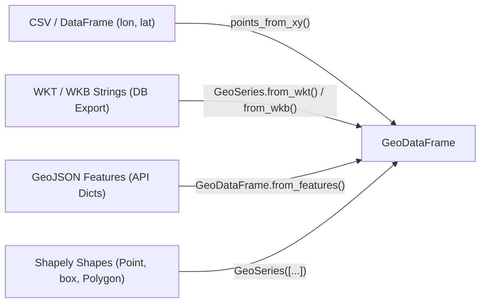
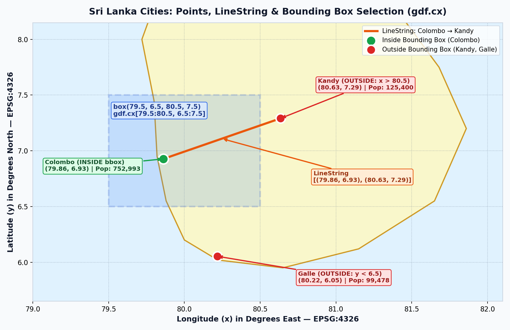
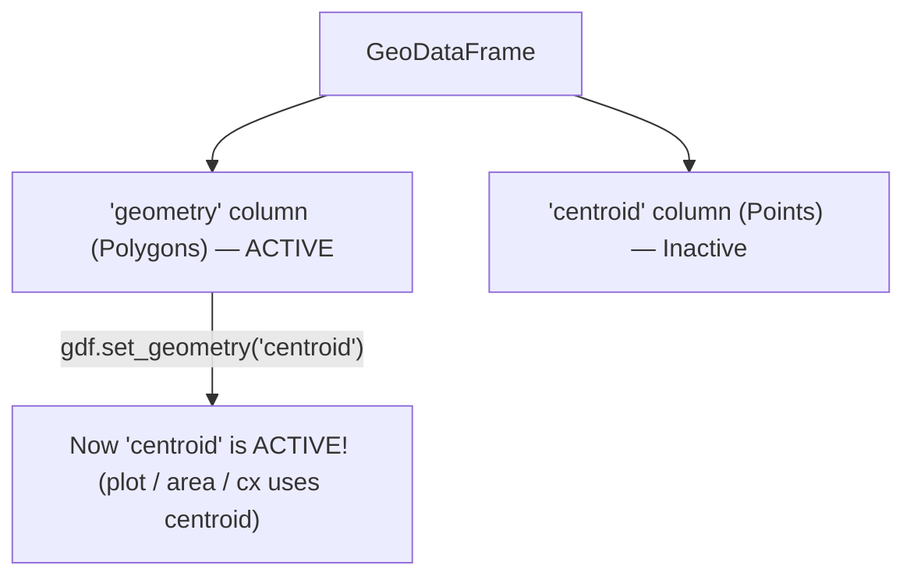

[⬅️ කලින් පාඩම: Setup & Foundations](01_Setup_and_Geospatial_Foundations.md) | [🏠 Course Home](README.md) | [ඊළඟ පාඩම: Reading & Writing Data ➡️](03_Reading_and_Writing_Spatial_Data.md)

---

# 📘 පාඩම 02: `GeoSeries`, `GeoDataFrame` සහ Geometries හදන හැටි

පළවෙනි පාඩමෙන් අපි සිතියම් දත්ත වල මූලික දේවල් ඉගෙන ගත්තා. දැන් අපි අතින්ම **Shapely geometries** හදලා, ඒවා **`GeoSeries`** සහ **`GeoDataFrame`** ඇතුළට දාලා වැඩ කරන්නේ කොහොමද කියලා ඉගෙන ගමු!

ගොඩක් වෙලාවට අපිට ලැබෙන්නේ ready-made map file එකක් නෙවෙයි — සාමාන්‍ය CSV එකක් (කඩසාප්පු වල `lon`, `lat` තියෙන), database එකකින් ආපු `WKT` text column එකක්, නැත්නම් web API එකකින් ආපු `GeoJSON` dictionary එකක්. ඒ හැම එකක්ම GeoDataFrame එකක් කරගන්න හැටි මේ පාඩමෙන් සම්පූර්ණයෙන්ම ආවරණය කරනවා.

---

## 🎯 මේ පාඩමෙන් ඔයා ඉගෙන ගන්න දේවල්

- Shapely වලින් `Point`, `LineString`, `Polygon`, `MultiPoint`, සහ `box` හදන හැටි
- `GeoSeries` සහ `GeoDataFrame` අතර වෙනස
- `gpd.points_from_xy()` පාවිච්චි කරලා CSV/DataFrame එකක `lon`/`lat` වලින් GeoDataFrame හදන හැටි
- `WKT`, `WKB`, සහ `GeoJSON` features වලින් geometries load කරන හැටි
- Active geometry column එක මාරු කරන හැටි (`set_geometry`, `rename_geometry`) සහ geometry columns කිහිපයක් තියාගන්න හැටි
- `set_crs()` වලින් CRS එක label කරන හැටි
- Coordinates ගන්න හැටි (`.x`, `.y`, `.get_coordinates()`), `gdf.cx` bounding-box indexing, සහ empty/missing geometries clean කරන හැටි

---

## 1. Shapely Geometries හදන හැටි

Shapely කියන්නේ තනි තනි ජ්‍යාමිතික හැඩතල හදන library එක:

```python
from shapely.geometry import Point, LineString, Polygon, MultiPoint, box

# 1. Point(x, y) -> (Longitude, Latitude)
colombo = Point(79.8612, 6.9271)

# 2. LineString([(x1, y1), (x2, y2), ...]) -> පාරක් / රේඛාවක්
colombo_to_kandy = LineString([(79.8612, 6.9271), (80.6337, 7.2906)])

# 3. Polygon([(x1, y1), ...]) -> වැසුණු ප්‍රදේශයක් (delivery zone එකක් වගේ)
triangle_zone = Polygon([(79.8, 6.8), (80.2, 6.8), (80.0, 7.2), (79.8, 6.8)])

# 4. MultiPoint -> ලක්ෂ්‍ය කිහිපයක එකතුවක්
three_cities = MultiPoint([(79.86, 6.93), (80.63, 7.29), (80.22, 6.05)])

# 5. box(minx, miny, maxx, maxy) -> සෘජුකෝණාස්‍රාකාර Bounding Box එකක්
western_box = box(79.5, 6.5, 80.5, 7.5)
```

---

## 2. `GeoSeries` vs `GeoDataFrame`

`pandas` වල `Series` සහ `DataFrame` වගේම තමයි:
- **`GeoSeries`:** geometries විතරක් තියෙන තනි column එකක් (spatial methods එක්ක).
- **`GeoDataFrame`:** සාමාන්‍ය attribute columns (නම, ජනගහනය වගේ) + අවම වශයෙන් එක `GeoSeries` (active `geometry` column) එකක් තියෙන සම්පූර්ණ වගුවක්.



---

## 3. සම්පූර්ණ උදාහරණය: ලංකාවේ නගර, LineString සහ Bounding Box (`gdf.cx`)

අපි කොළඹ, නුවර සහ ගාල්ල නගර තුනේ data වලින් `GeoDataFrame` එකක් හදලා, කොළඹ-නුවර `LineString` එකක් සහ `box(79.5, 6.5, 80.5, 7.5)` කලාපයක් හදලා, `gdf.cx` වලින් ඒ කොටුව ඇතුළේ ඉන්න නගර තෝරමු.

```python
import pandas as pd
import geopandas as gpd
from shapely.geometry import LineString, box

# 1. සාමාන්‍ය pandas DataFrame එකක් හදන්න
cities = pd.DataFrame({
    'city': ['Colombo', 'Kandy', 'Galle'],
    'lon':  [79.8612, 80.6337, 80.2170],
    'lat':  [6.9271,  7.2906,  6.0535],
    'pop':  [752993,  125400,  99478],
})

# 2. lon, lat columns වලින් Points හදලා GeoDataFrame එකක් ගොඩනගන්න
gdf = gpd.GeoDataFrame(
    cities,
    geometry=gpd.points_from_xy(cities['lon'], cities['lat']),
    crs='EPSG:4326',
)

# 3. GeoSeries විදිහට LineString එකක් සහ Bounding Box එකක් හදන්න
line = gpd.GeoSeries([LineString([(79.86, 6.93), (80.63, 7.29)])], crs=4326)
zone = gpd.GeoSeries([box(79.5, 6.5, 80.5, 7.5)], crs=4326)

# 4. Bounding-box selection (xmin:xmax, ymin:ymax) -> 79.5..80.5, 6.5..7.5
selected = gdf.cx[79.5:80.5, 6.5:7.5]
print("Selected inside bounding box:")
print(selected[['city', 'pop', 'geometry']])

# 5. Point geometries වලින් කෙලින්ම Longitude (x) ගන්න
print("\nLongitudes (x):")
print(gdf.geometry.x)
```

### Line-by-Line පැහැදිලි කිරීම
- `gpd.points_from_xy(cities['lon'], cities['lat'])`: `lon` සහ `lat` columns දෙක එකතු කරලා `Point` objects list එකක් ඉක්මනින්ම හදනවා (loop ලියන්න ඕනේ නැහැ!).
- `crs='EPSG:4326'`: මේ අගයන් GPS degrees (WGS 84) බව GeoPandas වලට කියනවා.
- `box(79.5, 6.5, 80.5, 7.5)`: `minx=79.5, miny=6.5, maxx=80.5, maxy=7.5` කොටුව හදනවා.
- `gdf.cx[79.5:80.5, 6.5:7.5]`: Coordinate indexer (`cx`) එකෙන් ඒ සෘජුකෝණාස්‍රය ඇතුළේ හෝ ඒකට ගෑවෙන rows විතරක් තෝරා ගන්නවා. කොළඹ `(79.86, 6.93)` විතරයි මේ කොටුව ඇතුළේ ඉන්නේ! නුවර `x=80.63 > 80.5` නිසා පිටත, ගාල්ල `y=6.05 < 6.5` නිසා පිටත.
- `gdf.geometry.x`: හැම Point එකකම `x` (Longitude) අගය plain numeric Series එකක් විදිහට දෙනවා.

### Expected Output
```text
Selected inside bounding box:
      city     pop                  geometry
0  Colombo  752993  POINT (79.86120 6.92710)

Longitudes (x):
0    79.8612
1    80.6337
2    80.2170
dtype: float64
```



---

## 4. වෙනත් Sources වලින් Geometries හදන ක්‍රම

### A. WKT (Well-Known Text) සහ WKB (Well-Known Binary) වලින්
Database (SQL/PostGIS) හෝ CSV exports වල geometries එන්නේ `"POINT (79.86 6.93)"` වගේ text (WKT) විදිහටයි.

```python
import shapely.wkt

df_wkt = pd.DataFrame({
    'name': ['Colombo', 'Kandy'],
    'wkt': ['POINT (79.8612 6.9271)', 'POINT (80.6337 7.2906)']
})

# ක්‍රමය 1: මුළු column එකම එකවර parse කරන්න (Fast & Recommended)
geom_series = gpd.GeoSeries.from_wkt(df_wkt['wkt'], crs='EPSG:4326')
gdf_wkt = gpd.GeoDataFrame(df_wkt, geometry=geom_series)

# ක්‍රමය 2: තනි WKT string එකක් parse කරන්න
single_pt = shapely.wkt.loads('POINT (80.2170 6.0535)')

# Binary WKB තියෙනවා නම්:
# gpd.GeoSeries.from_wkb(df['wkb_col'], crs='EPSG:4326')

# GeoSeries.from_xy shortcut එක:
pts = gpd.GeoSeries.from_xy([79.86, 80.63], [6.93, 7.29], crs='EPSG:4326')
```

### B. GeoJSON-like Dictionaries (API Responses) වලින්
Web API එකකින් එන GeoJSON `features` list එකක් කෙලින්ම `GeoDataFrame` එකක් කරන්න `from_features()` පාවිච්චි කරනවා:

```python
features = [
    {
        'type': 'Feature',
        'properties': {'city': 'Colombo', 'pop': 752993},
        'geometry': {'type': 'Point', 'coordinates': [79.8612, 6.9271]},
    },
    {
        'type': 'Feature',
        'properties': {'city': 'Galle', 'pop': 99478},
        'geometry': {'type': 'Point', 'coordinates': [80.2170, 6.0535]},
    },
]

gdf_api = gpd.GeoDataFrame.from_features(features, crs='EPSG:4326')
print(gdf_api)
```

---

## 5. Active Geometry Column & Multiple Geometry Columns

එකම `GeoDataFrame` එකේ geometry columns කිහිපයක් තියාගන්න පුළුවන්! උදාහරණයකට, දිස්ත්‍රික්ක වල මායිම් (`Polygon`) එක column එකකත්, ඒ දිස්ත්‍රික්ක වල මැද ලක්ෂ්‍ය (`centroid` `Point`) තව column එකකත් තියාගන්න පුළුවන්. හැබැයි **එක වෙලාවකට Active වෙලා තියෙන්නේ එක geometry column එකක් විතරයි**.



```python
# අලුත් geometry column එකක් එකතු කරන්න (උදා: centroids)
gdf_zones = gpd.GeoDataFrame(
    {'zone': ['Zone A']},
    geometry=[box(79.5, 6.5, 80.5, 7.5)],
    crs='EPSG:4326'
)
gdf_zones['centroid'] = gdf_zones.centroid

print("Active geometry name:", gdf_zones.geometry.name)  # 'geometry'

# Active geometry එක 'centroid' වලට මාරු කරන්න
gdf_points = gdf_zones.set_geometry('centroid')
print("New active name:", gdf_points.geometry.name)      # 'centroid'

# Geometry column එක rename කරන්න
gdf_renamed = gdf_zones.rename_geometry('boundary_poly')
print("Renamed active name:", gdf_renamed.geometry.name) # 'boundary_poly'
```

---

## 6. CRS Label කිරීම, pandas Operations, Coordinates සහ Cleaning

### Setting CRS (`set_crs`)
`GeoDataFrame` එකක් හදද්දී `crs` දෙන්න අමතක වුණොත්, `gdf = gdf.set_crs('EPSG:4326')` වලින් ඒක label කරන්න පුළුවන්.
*(මතක තියාගන්න: `set_crs` වලින් coordinates වෙනස් වෙන්නේ නැහැ — ඒකෙන් කරන්නේ "මේ දැනට තියෙන numbers අයිති EPSG:4326 වලට" කියලා ලේබල් අලවන එක විතරයි!)*

### pandas Operations තාමත් ඒ විදිහටම වැඩ!
```python
# Filtering (geometry column එක auto රැකෙනවා!)
big_cities = gdf[gdf['pop'] > 100000]

# Sorting, merging, groupby ඔක්කොම සාමාන්‍ය pandas වගේමයි
extra = pd.DataFrame({'city': ['Colombo', 'Kandy'], 'province': ['Western', 'Central']})
merged = gdf.merge(extra, on='city', how='left')
```

### Coordinates Extract කිරීම & Plain Table එකකට Convert කිරීම
```python
# Point coordinates ගන්න
lons = gdf.geometry.x
lats = gdf.geometry.y

# ඕනෑම geometry (Point, LineString, Polygon) එකක සියලුම vertices ගන්න
coords_df = gdf.get_coordinates()   # x, y columns තියෙන DataFrame එකක්

# Plain pandas DataFrame එකකට හරවන්න (non-spatial tools වලට export කරන්න)
plain_df = pd.DataFrame(gdf.drop(columns='geometry'))

# WKT text හෝ GeoJSON string විදිහට ගන්න
wkt_strings = gdf.geometry.to_wkt()
geojson_str = gdf.to_json()
```

### Empty සහ Missing Geometries Clean කිරීම
සැබෑ ලෝකයේ datasets වල සමහර rows වල geometry එක `None` (missing) හෝ `POINT EMPTY` (empty) වෙලා තියෙන්න පුළුවන්.

```python
from shapely.geometry import Point

messy = gpd.GeoDataFrame({
    'place': ['Colombo', 'Unknown', 'Broken'],
    'geometry': [Point(79.86, 6.93), None, Point()]  # Point() = POINT EMPTY
}, crs='EPSG:4326')

print("Is missing (None):", messy.geometry.isna().tolist())      # [False, True, False]
print("Is empty:", messy.geometry.is_empty.tolist())             # [False, False, True]

# Missing සහ Empty දෙකම ඉවත් කරලා clean කරන්න
clean = messy.dropna(subset=['geometry'])
clean = clean[~clean.geometry.is_empty]
print("Clean rows:", len(clean))  # 1
```

---

## 🧠 මතක තබා ගැනීමට පහසු ක්‍රම (Memory Hacks)

1. **`cx` = Coordinate Indexer:** `pandas` වල `loc` / `iloc` වගේ, සිතියමක කොටුවකින් filter කරන්න තියෙන shortcut එක තමයි `gdf.cx[xmin:xmax, ymin:ymax]`.
2. **`set_crs` vs `to_crs`:** `set_crs` = සීනි බෝතලේ උඩ "සීනි" කියලා ලේබල් අලවනවා (ඇතුළේ දේ වෙනස් වෙන්නේ නැහැ). `to_crs` = සැබැවින්ම coordinates ගණනය කරලා වෙන projection එකකට හරවනවා (Module 4).
3. **`gdf.geometry`:** ඔයාගේ geometry column එකේ නම `'geom'` හෝ `'boundary'` වුණත්, `gdf.geometry` කිව්වොත් හැමවෙලේම දැනට **Active** වෙලා තියෙන geometry column එක ලැබෙනවා!

## ⚠️ සාමාන්‍යයෙන් වෙන වැරදි (Common Pitfalls)

> [!WARNING]
> **1. `points_from_xy(df.lat, df.lon)` කියලා මාරු කරලා ලියන එක:**
> Function එකේ නමම `points_from_xy`! ඉස්සෙල්ලා `x` (`lon`), දෙවෙනියට `y` (`lat`). හැමවෙලේම `gpd.points_from_xy(df['lon'], df['lat'])` ලියන්න.

> [!WARNING]
> **2. `isna()` විතරක් check කරලා `is_empty` අමතක කරන එක:**
> `POINT EMPTY` කියන එක `None` නෙවෙයි — ඒ නිසා `dropna()` වලින් ඒක අයින් වෙන්නේ නැහැ! හැමවෙලේම `~gdf.geometry.is_empty` එකත් check කරන්න.

> [!WARNING]
> **3. `gdf.merge(...)` කරද්දී වම් පැත්තට plain `DataFrame` එක දාන එක:**
> `df.merge(gdf)` කළොත් return වෙන්නේ සාමාන්‍ය `DataFrame` එකක්! හැමවෙලේම `GeoDataFrame` එක වම් පැත්තේ තියලා `gdf.merge(df)` කරන්න.

---

## 🏋️ ප්‍රායෝගික අභ්‍යාස (Practical Exercises)

### Warm-up Exercise: GeoJSON Dictionary එකකින් GeoDataFrame හදන්න
පහත `features` list එක `GeoDataFrame.from_features()` පාවිච්චි කරලා `EPSG:4326` GeoDataFrame එකක් කරලා, `x` සහ `y` columns දෙකක් එකතු කරන්න.

```python
features = [
    {'type': 'Feature', 'properties': {'town': 'Matara'}, 'geometry': {'type': 'Point', 'coordinates': [80.5550, 5.9549]}},
    {'type': 'Feature', 'properties': {'town': 'Jaffna'}, 'geometry': {'type': 'Point', 'coordinates': [80.0255, 9.6615]}},
]
```

<details>
<summary>✅ පිළිතුර බලන්න (Click to see Solution)</summary>

```python
import geopandas as gpd

gdf_towns = gpd.GeoDataFrame.from_features(features, crs='EPSG:4326')
gdf_towns['lon'] = gdf_towns.geometry.x
gdf_towns['lat'] = gdf_towns.geometry.y
print(gdf_towns)
```
</details>

### Exercise 1: CSV එකකින් GeoDataFrame එකක් හදලා CRS Verify කරන්න
`lon` සහ `lat` columns තියෙන CSV data එකක් (හෝ `io.StringIO` පාවිච්චි කරලා mock CSV එකක්) `pd.read_csv()` වලින් කියවලා, `GeoDataFrame` එකක් බවට පත් කරලා, CRS එක `EPSG:4326` බව verify කරන්න.

<details>
<summary>✅ පිළිතුර බලන්න (Click to see Solution)</summary>

```python
import io
import pandas as pd
import geopandas as gpd

csv_text = """shop,lon,lat
Shop_Colombo,79.8612,6.9271
Shop_Negombo,79.8358,7.2008
Shop_Galle,80.2170,6.0535
"""

df = pd.read_csv(io.StringIO(csv_text))
gdf_shops = gpd.GeoDataFrame(
    df,
    geometry=gpd.points_from_xy(df['lon'], df['lat']),
    crs='EPSG:4326'
)

print(gdf_shops)
assert gdf_shops.crs.to_epsg() == 4326, "CRS is not EPSG:4326!"
print("CRS Verified:", gdf_shops.crs)
```
</details>

### Exercise 2: Delivery Zone Polygon එකක් හදලා Points ඇතුළේද බලන්න
කොළඹ අවට delivery zone එකක් සඳහා `Polygon` (හෝ `box`) එකක් හදලා, ඔයාගේ `gdf_shops` වල තියෙන මොන කඩ ඒ delivery zone එක ඇතුළේ වැටෙනවද කියලා `.within()` පාවිච්චි කරලා check කරන්න.

<details>
<summary>✅ පිළිතුර බලන්න (Click to see Solution)</summary>

```python
from shapely.geometry import Polygon

# කොළඹ-මීගමුව අවට delivery zone polygon එකක්
delivery_zone = Polygon([
    (79.75, 6.80),
    (80.05, 6.80),
    (80.05, 7.30),
    (79.75, 7.30),
    (79.75, 6.80),
])

gdf_shops['in_zone'] = gdf_shops.geometry.within(delivery_zone)
print(gdf_shops[['shop', 'in_zone']])
# Shop_Colombo: True, Shop_Negombo: True, Shop_Galle: False
```
</details>

### Exercise 3: WKT Strings Parse කරලා Invalid හෝ Empty ඒවා හොයන්න
WKT strings තියෙන column එකක් geometries බවට parse කරලා, ඒ අතරින් **empty** (`is_empty`) හෝ **invalid** (`~is_valid`) geometries මොනවද කියලා හොයන්න.

<details>
<summary>✅ පිළිතුර බලන්න (Click to see Solution)</summary>

```python
import pandas as pd
import geopandas as gpd

df_wkt = pd.DataFrame({
    'id': [1, 2, 3],
    'wkt': [
        'POLYGON ((0 0, 2 0, 2 2, 0 2, 0 0))',       # Valid square
        'POLYGON ((0 0, 2 2, 2 0, 0 2, 0 0))',       # Invalid bowtie (self-intersecting!)
        'POINT EMPTY',                                # Empty geometry
    ]
})

gdf_check = gpd.GeoDataFrame(
    df_wkt,
    geometry=gpd.GeoSeries.from_wkt(df_wkt['wkt']),
    crs='EPSG:4326'
)

gdf_check['is_empty'] = gdf_check.geometry.is_empty
gdf_check['is_valid'] = gdf_check.geometry.is_valid

problem_rows = gdf_check[gdf_check['is_empty'] | ~gdf_check['is_valid']]
print(problem_rows[['id', 'is_empty', 'is_valid']])
```
</details>

---

## 📋 Cheat Sheet Summary (කෙටි සටහන)

| කාර්යය | Key API |
| --- | --- |
| Shapely shapes හදන්න | `Point(x, y)`, `LineString([...])`, `Polygon([...])`, `MultiPoint([...])`, `box(minx, miny, maxx, maxy)` |
| `lon`/`lat` වලින් Points | `gpd.points_from_xy(df['lon'], df['lat'], crs='EPSG:4326')` |
| WKT / WKB වලින් | `gpd.GeoSeries.from_wkt(s)`, `from_wkb(s)`, `shapely.wkt.loads(txt)` |
| GeoJSON features වලින් | `gpd.GeoDataFrame.from_features(features, crs='EPSG:4326')` |
| Active geometry මාරු / rename | `gdf.set_geometry('col')`, `gdf.rename_geometry('new')`, `gdf.geometry.name` |
| CRS ලේබල් කරන්න | `gdf.set_crs('EPSG:4326')` |
| Coordinates ගන්න | `gdf.geometry.x`, `gdf.geometry.y`, `gdf.get_coordinates()` |
| Bounding-box subset | `gdf.cx[xmin:xmax, ymin:ymax]` |
| Empty / Missing check | `gdf.geometry.is_empty`, `gdf.geometry.isna()`, `gdf.dropna(subset=['geometry'])` |
| Plain DataFrame / Export | `pd.DataFrame(gdf.drop(columns='geometry'))`, `gdf.geometry.to_wkt()`, `gdf.to_json()` |

---

[⬅️ කලින් පාඩම: Setup & Foundations](01_Setup_and_Geospatial_Foundations.md) | [🏠 Course Home](README.md) | [ඊළඟ පාඩම: Reading & Writing Data ➡️](03_Reading_and_Writing_Spatial_Data.md)
