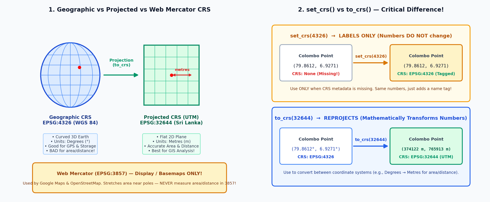
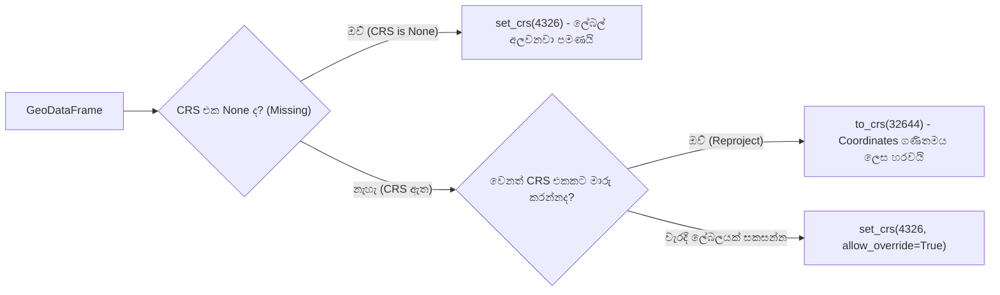
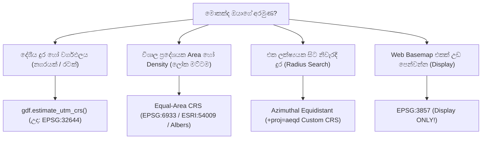

[⬅️ Previous: Reading & Writing Spatial Data](03_Reading_and_Writing_Spatial_Data.md) | [🏠 Course Index](README.md) | [Next: Geometry Attributes, Measurements & Validity ➡️](05_Geometry_Attributes_Measurements_and_Validity.md)

---

# Module 4: Coordinate Reference Systems (CRS) සහ Projections 🗺️🌍

GIS සහ GeoPandas වලදී වැරදි පිළිතුරු එන්න තියෙන **ලොකුම හේතුව** තමයි `CRS` (Coordinate Reference System) එක නැති වීම හෝ වැරදි `CRS` එකක් පාවිච්චි කිරීම. ඔයා මේ Module එක හරියටම තේරුම් ගත්තොත්, GIS වල එන ලොකුම ප්‍රශ්න 80%ක්ම විසඳගන්න පුළුවන්!

---

## 1. මොකක්ද මේ CRS සහ Map Projection කියන්නේ? 🍊

හිතන්න ඔයා අතේ **දොඩම් ගෙඩියක් (Orange)** තියෙනවා කියලා. අපේ පෘථිවියත් ඒ වගේ 3D බෝලයක් (Sphere / Ellipsoid).
දැන් ඔයාට ඕනේ ඒ දොඩම් ගෙඩියේ ලෙල්ල ගලවලා **මේසයක් උඩ පැතලියට (2D Flat Map)** තියන්න.
- ඔයා දොඩම් ලෙල්ල පැතලි කරන්න හදද්දී, ඒක ටිකක් **ඉරෙනවා** හෝ **ඇදෙනවා (Distortion)** නේද?
- අන්න ඒ 3D පෘථිවිය 2D පැතලි සිතියමකට හරවන ගණිතමය ක්‍රමයට තමයි **Map Projection** කියන්නේ!
- ඒ වගේම, සිතියමක තියෙන `(x, y)` ඉලක්කම් දෙකෙන් පෘථිවියේ හරියටම මොන තැනද කියන්නේ කියලා හඳුනාගන්න නීති පද්ධතියට තමයි **CRS (Coordinate Reference System)** කියන්නේ.



---

## 2. Geographic CRS vs Projected CRS 🌐 vs 📏

GeoPandas වලදී ඔයාට ප්‍රධාන වශයෙන් CRS වර්ග 2ක් හමුවෙනවා:

| ලක්ෂණය | Geographic CRS (භූගෝලීය CRS) | Projected CRS (ප්‍රක්ෂේපිත CRS) |
| --- | --- | --- |
| **හැඩය** | වක්‍ර 3D පෘථිවිය (Curved Earth) | පැතලි 2D තලය (Flat 2D Plane) |
| **ඒකකය (Units)** | අංශක (**Degrees** — Longitude / Latitude) | මීටර් (**Metres**) හෝ අඩි (**Feet**) |
| **උදාහරණ** | `EPSG:4326` (WGS 84 — GPS coordinates) | `EPSG:32644` (UTM Zone 44N), `EPSG:5235` (SLD99) |
| **පරීක්ෂා කරන API** | `gdf.crs.is_geographic` (`True`) | `gdf.crs.is_projected` (`True`) |
| **හොඳ මොනවටද?** | GPS data ගබඩා කරන්න, ලෝක මට්ටමේ data share කරන්න | **දුර (Distance), වර්ගඵලය (Area), Buffer** ගණනය කරන්න |

> [!WARNING]
> **⚠️ සාමාන්‍යයෙන් වෙන වැරදි (Common Pitfall):**
> කවදාවත් `EPSG:4326` (Degrees) වල තියෙන DataFrame එකකින් `.area` හෝ `.distance()` ගණනය කරන්න එපා! එතකොට උත්තරේ එන්නේ "වර්ග අංශක (Square Degrees)" වලින් — ඒකට කිසිම ප්‍රායෝගික තේරුමක් නැහැ! මිනුම් ගන්න කලින් හැමවෙලේම **Projected CRS** එකකට මාරු කරන්න.

---

## 3. වැදගත් EPSG Codes (හැම GIS කෙනෙක්ම දැනගත යුතු Codes) 🏷️

හැම CRS එකකටම ID අංකයක් තියෙනවා. ඒකට කියන්නේ **EPSG Code** කියලා:

- **`EPSG:4326` (WGS 84):** ලෝකයේ ජනප්‍රියම Geographic CRS එක. ඔයාගේ ෆෝන් එකේ GPS එකෙන්, Google Earth වලින් එන්නේ මේක (Units: Degrees).
- **`EPSG:3857` (Web Mercator):** Google Maps, OpenStreetMap, Leaflet වගේ **Web Maps** පෙන්වන්න (Display) පාවිච්චි කරන Projected CRS එක.
  - **වැදගත්:** මේකේ ධ්‍රැව (Poles) ළඟ රටවල් ගොඩක් ලොකුවට ඇදිලා පේනවා (උදා: Greenland අප්‍රිකාව තරම්ම ලොකුවට පේනවා, ඇත්තටම අප්‍රිකාව 14 ගුණයක් ලොකුයි!). ඒ නිසා **`EPSG:3857` පාවිච්චි කරන්නේ Web Basemaps පෙන්වන්න විතරයි (`to_crs(3857)`)** — මේකේ ඉඳන් Area හෝ Distance මනින්න එපා!
- **`EPSG:326xx` / `EPSG:327xx` (UTM Zones):** පෘථිවිය තීරු 60කට බෙදලා හදපු අතිශය නිවැරදි Projected CRS පද්ධතිය.
  - උතුරු අර්ධගෝලය (Northern Hemisphere): `32601` සිට `32660` දක්වා. (ශ්‍රී ලංකාව තියෙන්නේ Zone 44N වල -> **`EPSG:32644`**).
  - දකුණු අර්ධගෝලය (Southern Hemisphere): `32701` සිට `32760` දක්වා.
- **ශ්‍රී ලංකාවේ ජාතික CRS Codes (National Grids):**
  - **`EPSG:5235`**: SLD99 / Sri Lanka Grid 1999 (නවීන මිනින්දෝරු දෙපාර්තමේන්තු දත්ත සඳහා).
  - **`EPSG:5234`**: Kandawala / Sri Lanka Grid (පැරණි සිතියම් සඳහා).

---

## 4. CRS එකක් පරීක්ෂා කිරීම (Inspecting a CRS) 🔍

ඔයාගේ `GeoDataFrame` එකේ CRS එක මොකක්ද කියලා බලාගන්න මේ properties පාවිච්චි කරන්න පුළුවන්:

```python
print(gdf.crs)               # සම්පූර්ණ CRS විස්තරය පෙන්වයි
print(gdf.crs.to_epsg())     # EPSG අංකය විතරක් ගනී (උදා: 4326)
print(gdf.crs.is_geographic) # Degrees ද? (True / False)
print(gdf.crs.is_projected)  # Metres / Feet ද? (True / False)
print(gdf.crs.axis_info)     # X, Y අක්ෂ වල නම් සහ ඒකක (Units)
print(gdf.crs.area_of_use)   # මේ CRS එක නිවැරදිව වැඩ කරන ලෝකයේ ප්‍රදේශය
print(gdf.crs.to_wkt())      # WKT (Well-Known Text) සම්මත ආකෘතිය
```

---

## 5. `set_crs()` vs `to_crs()` — කවදාවත් පටලවාගන්න එපා! 🚨

මේ දෙක තමයි ආධුනිකයන් වැඩිපුරම පටලවාගන්න දේ:



- **`gdf.set_crs(4326)` (ලේබල් කිරීම / Declaring):**
  - ඔයාගේ CSV එකකින් හෝ පරණ Shapefile එකකින් data ගත්තම `gdf.crs` එක `None` වෙලා තියෙන්න පුළුවන්. හැබැයි ඇතුළේ තියෙන ඉලක්කම් `(79.86, 6.92)` දැනටමත් WGS 84 Degrees.
  - එතකොට `set_crs(4326)` කියන්නේ *"මේ තියෙන ඉලක්කම් Degrees කියලා පොතේ ලියාගන්න"* කියන එකයි. ඉලක්කම් පොඩ්ඩක්වත් වෙනස් වෙන්නේ නැහැ!
  - දැනටමත් CRS එකක් තියෙන එකක ලේබලය බලෙන් මාරු කරන්න ඕන නම් `allow_override=True` දෙන්න පුළුවන් (නමුත් ඒක කරන්නේ ලේබලය ඇත්තටම වැරදියට වැදිලා තියෙන වෙලාවක විතරයි).
- **`gdf.to_crs(32644)` (පරිවර්තනය කිරීම / Reprojecting):**
  - මේකෙන් කරන්නේ `(79.86°, 6.92°)` වගේ ඉලක්කම් ගණිතමය සූත්‍ර පාවිච්චි කරලා මීටර් වලින් `(374122 m, 765913 m)` බවට **ඇත්තටම පරිවර්තනය** කරන එක!
  - ඔයාට `gdf.to_crs(epsg=32644)`, `gdf.to_crs('EPSG:3857')`, හෝ වෙනත් layer එකකට ගැලපෙන්න `gdf.to_crs(other.crs)` කියලා දෙන්න පුළුවන්.

> [!TIP]
> **🧠 මතක තබා ගැනීමට පහසු ක්‍රම (Memory Hacks):**
> - **`set_crs`** = **S**ticker (ලේබල් ස්ටිකර් එකක් අලවනවා විතරයි — ඇතුළේ බඩු වෙනස් වෙන්නේ නැහැ).
> - **`to_crs`** = **T**ransform (ඇත්තටම coordinates අලුත් පද්ධතියකට **T**ransform කරනවා).
> - 4326 වල `4` සහ `3` තියෙනවා -> GPS Degrees (3D Earth). `3857` -> Web Maps Only!

---

## 6. හොඳම CRS එක තෝරාගැනීමේ ක්‍රම (Choosing the Right CRS) 🎯



1. **ස්වයංක්‍රීයව UTM Zone එක සොයාගැනීම (`estimate_utm_crs()`):**
   ඔයාට මොන UTM Zone එකද ගැලපෙන්නේ කියලා මතක නැත්නම්, GeoPandas වලින්ම අහන්න පුළුවන්!
   ```python
   utm_crs = gdf.estimate_utm_crs()
   gdf_m = gdf.to_crs(utm_crs)
   ```
2. **Layers දෙකක් එකතු කිරීමට පෙර CRS සමාන කිරීම (Matching CRS):**
   Spatial join, clip, හෝ overlay කරන්න කලින් හැමවෙලේම layers දෙකේ CRS සමාන කරන්න:
   ```python
   parks = parks.to_crs(cities.crs)
   assert parks.crs == cities.crs   # සමාන නැත්නම් error එකක් පෙන්වා නවත්වයි!
   ```
3. **Equal-Area Projections (වර්ගඵලය නිවැරදිව තබාගන්න):**
   රටවල් කිහිපයක හෝ මුළු ලෝකයේම Area හෝ ජනගහන ඝනත්වය (Density) මනිනකොට **Equal-Area** projection එකක් ගන්න:
   - `EPSG:6933` (WGS 84 / NSIDC EASE-Grid 2.0 Global)
   - `ESRI:54009` (World Mollweide)
   - Albers Equal Area
4. **Distance-Preserving & Custom CRS (`pyproj.CRS`):**
   එක නගරයක සිට හැම දිශාවටම නිවැරදි දුර (Radius Search) මනින්න ඕන නම් Azimuthal Equidistant (`+proj=aeqd`) custom CRS එකක් `pyproj` හරහා හදන්න පුළුවන්:
   ```python
   import pyproj
   # කොළඹ කේන්ද්‍ර කරගත් Distance-preserving Custom CRS එකක්
   aeqd_colombo = pyproj.CRS.from_proj4("+proj=aeqd +lat_0=6.9271 +lon_0=79.8612 +units=m")
   # නැත්නම් from_user_input පාවිච්චි කරන්න පුළුවන්:
   crs_obj = pyproj.CRS.from_user_input("EPSG:32644")
   ```

---

## 7. Pandas නැතුව Transform කිරීම, Axis Order සහ Special Cases ⚙️

- **Axis Order ප්‍රශ්නය (`always_xy=True`):**
  සමහර CRS වල coordinates ලියන්නේ `(Latitude, Longitude)` පිළිවෙළට (`Y, X`). හැබැයි GIS වල අපි පුරුදු වෙලා ඉන්නේ `(Longitude, Latitude)` හෙවත් `(X, Y)` පිළිවෙළට. `pyproj.Transformer` පාවිච්චි කරද්දී හැමවෙලේම **`always_xy=True`** දෙන්න — එතකොට කවදාවත් X සහ Y මාරු වෙන්නේ නැහැ!
- **Pandas/GeoDataFrame නැතුව Raw Coordinates Transform කිරීම:**
  ```python
  from pyproj import Transformer

  transformer = Transformer.from_crs(4326, 3857, always_xy=True)
  x_m, y_m = transformer.transform(79.8612, 6.9271)
  print(f"Web Mercator X: {x_m:.2f}, Y: {y_m:.2f}")
  ```
- **Antimeridian (180° රේඛාව) සහ ධ්‍රැව (Polar Cases):**
  ලෝක මට්ටමේ datasets වල 180° දේශාංශය (පැසිෆික් සාගරය මැද, ෆීජී/රුසියාව ළඟ) හරහා යන polygons තියෙනවා නම්, 2D map එකේදී ඉරක් ඇදිලා වගේ කැඩෙන්න පුළුවන්. ඒ වෙලාවට geometries 180° දී **split** කිරීම හෝ longitudes shift කිරීම කරන්න වෙනවා. ධ්‍රැව ප්‍රදේශ (Arctic/Antarctica) සඳහා Polar Stereographic CRS (උදා: `EPSG:3031`) පාවිච්චි කරනවා.

---

## 8. සම්පූර්ණ කේත උදාහරණය (Complete Code Example — Colombo to Kandy) 💻

```python
import geopandas as gpd

# 1. කොළඹ සහ නුවර සඳහා GPS coordinates (EPSG:4326) වලින් GeoDataFrame එකක් සෑදීම
cities = gpd.GeoDataFrame(
    {'city': ['Colombo', 'Kandy']},
    geometry=gpd.points_from_xy([79.8612, 80.6337], [6.9271, 7.2906]),
    crs='EPSG:4326',
)

# 2. CRS එක Geographic (Degrees) දැයි පරීක්ෂා කිරීම
print("Is Geographic?:", cities.crs.is_geographic)   # True

# 3. දත්ත වලට හොඳම local UTM CRS එක ස්වයංක්‍රීයව සොයාගැනීම
utm = cities.estimate_utm_crs()
print("Estimated UTM CRS:", utm.to_epsg())           # 32644 (UTM Zone 44N)

# 4. Degrees වල සිට Metres (UTM) වලට Reproject කිරීම
cities_m = cities.to_crs(utm)

# 5. කොළඹ සහ නුවර අතර සෘජු දුර මීටර් වලින් මැන කිලෝමීටර් වලට හැරවීම
d = cities_m.geometry.iloc[0].distance(cities_m.geometry.iloc[1])
print(f"Colombo to Kandy straight-line distance: {round(d / 1000, 1)} km")

# 6. වෙනත් layer එකක් (parks) සමඟ එකතු කිරීමට පෙර CRS සමාන කිරීම
# parks = parks.to_crs(cities.crs)
# assert parks.crs == cities.crs
```

### පේළියෙන් පේළිය පැහැදිලි කිරීම (Line-by-Line Explanation):
1. `gpd.points_from_xy([lon1, lon2], [lat1, lat2])` මඟින් X (Longitude) සහ Y (Latitude) වලින් Point geometries සාදා `crs='EPSG:4326'` ලෙස නම් කරයි.
2. `cities.crs.is_geographic` මඟින් මෙය Degrees භාවිතා කරන Geographic CRS එකක් බව `True` ලෙස තහවුරු කරයි.
3. `cities.estimate_utm_crs()` මඟින් කොළඹ සහ නුවර පිහිටි ස්ථානය බලා ශ්‍රී ලංකාවට අදාළ `EPSG:32644` (UTM Zone 44N) තෝරා දෙයි.
4. `cities.to_crs(utm)` මඟින් අංශක (Degrees) මීටර් (Metres) වලට ගණිතමය ලෙස පරිවර්තනය කර අලුත් `cities_m` GeoDataFrame එකක් සාදයි.
5. `.distance()` මඟින් ලක්ෂ්‍ය දෙක අතර දුර මීටර් වලින් ගණනය කර, `1000` න් බෙදා කිලෝමීටර් (km) වලින් පෙන්වයි.
6. `assert parks.crs == cities.crs` යනු ආරක්ෂිත පුරුද්දකි — CRS නොගැලපේ නම් වැරදි පිළිතුරු එන්න නොදී එතනම නවත්වයි.

### බලාපොරොත්තු වන ප්‍රතිදානය (Expected Output):
```text
Is Geographic?: True
Estimated UTM CRS: 32644
Colombo to Kandy straight-line distance: 94.3 km
```

---

## 9. ප්‍රායෝගික අභ්‍යාස (Practical Exercises) 🏋️‍♂️

### Warm-up Exercise: CRS Inspection
ශ්‍රී ලංකාවේ ගාල්ල (`lon=80.2210, lat=6.0535`) සඳහා GeoDataFrame එකක් `EPSG:4326` වලින් සාදා එහි `is_geographic`, `to_epsg()`, සහ `estimate_utm_crs()` print කරන්න.

<details>
<summary>✅ පිළිතුර බලන්න (Click to see Solution)</summary>

```python
import geopandas as gpd

galle = gpd.GeoDataFrame(
    {'city': ['Galle']},
    geometry=gpd.points_from_xy([80.2210], [6.0535]),
    crs='EPSG:4326'
)
print("Geographic:", galle.crs.is_geographic)
print("EPSG:", galle.crs.to_epsg())
print("Best UTM:", galle.estimate_utm_crs().to_epsg())
```
</details>

---

### Exercise 1: Missing CRS හඳුනාගෙන `set_crs()` කිරීම
CRS එකක් නැති (`crs=None`) layer එකක් load කර (හෝ සාදා), එහි coordinate අගයන් බලා නිවැරදි CRS එක තීරණය කර `set_crs()` කරන්න.

<details>
<summary>✅ පිළිතුර බලන්න (Click to see Solution)</summary>

```python
import geopandas as gpd

# CRS නැති dataset එකක් (උදාහරණයක් ලෙස)
raw = gpd.GeoDataFrame(
    {'place': ['Colombo', 'Galle']},
    geometry=gpd.points_from_xy([79.8612, 80.2210], [6.9271, 6.0535])
)
print("Before:", raw.crs)        # None
print("Bounds:", raw.total_bounds)  # [79.86, 6.05, 80.22, 6.92] -> -180..180 & -90..90 අතර නිසා EPSG:4326!

# නිවැරදි CRS එක ලේබල් කිරීම
fixed = raw.set_crs(epsg=4326)
print("After:", fixed.crs.to_epsg())  # 4326
```
</details>

---

### Exercise 2: රටක වර්ගඵලය ගණනය කර ප්‍රකාශිත අගය සමඟ සැසඳීම
රටක සීමාවක් (Country boundary) local projected CRS එකකට (හෝ Equal-Area CRS එකකට) reproject කර එහි වර්ගඵලය (km²) ගණනය කරන්න.

<details>
<summary>✅ පිළිතුර බලන්න (Click to see Solution)</summary>

```python
import geopandas as gpd
import geodatasets

# NYC boroughs උදාහරණය හෝ Natural Earth country dataset එකක් ගන්න පුළුවන්
world = gpd.read_file("https://naciscdn.org/naturalearth/110m/cultural/ne_110m_admin_0_countries.zip")
sri_lanka = world[world['NAME'] == 'Sri Lanka']

# Local UTM (EPSG:32644) වලට reproject කිරීම
sl_utm = sri_lanka.to_crs(epsg=32644)
area_km2 = sl_utm.area.iloc[0] / 1e6
print(f"Calculated Area: {area_km2:,.0f} km² (Published value: ~65,610 km²)")
```
</details>

---

### Exercise 3: EPSG:4326 vs EPSG:3857 vs UTM දුර සැසඳීම
නගර දෙකක් (උදා: Colombo සහ Kandy, නැත්නම් London සහ Edinburgh) අතර දුර `EPSG:4326`, `EPSG:3857`, සහ `UTM` වලින් ගණනය කර වෙනස පැහැදිලි කරන්න.

<details>
<summary>✅ පිළිතුර බලන්න (Click to see Solution)</summary>

```python
import geopandas as gpd

# London & Edinburgh (උතුරු අක්ෂාංශ වැඩි නිසා Web Mercator distortion එක හොඳටම පේනවා!)
uk = gpd.GeoDataFrame(
    {'city': ['London', 'Edinburgh']},
    geometry=gpd.points_from_xy([-0.1276, -3.1883], [51.5074, 55.9533]),
    crs='EPSG:4326'
)

d_4326 = uk.geometry.iloc[0].distance(uk.geometry.iloc[1])
uk_3857 = uk.to_crs(3857)
d_3857 = uk_3857.geometry.iloc[0].distance(uk_3857.geometry.iloc[1]) / 1000
uk_utm = uk.to_crs(uk.estimate_utm_crs())
d_utm = uk_utm.geometry.iloc[0].distance(uk_utm.geometry.iloc[1]) / 1000

print(f"EPSG:4326 (Degrees - අර්ථශූන්‍යයි): {d_4326:.3f} degrees")
print(f"EPSG:3857 (Web Mercator - ඇදිලා වැඩියි!): {d_3857:.1f} km")
print(f"UTM (නිවැරදි සැබෑ දුර): {d_utm:.1f} km")
# පැහැදිලි කිරීම: 4326 අංශක වලින් එන නිසා වැරදියි. 3857 ධ්‍රැව දෙසට ඇදෙන නිසා දුර ~65% කින් වැඩියෙන් පෙන්වයි!
```
</details>

---

### Exercise 4: ලෝකයේ ප්‍රදේශ 3කට `estimate_utm_crs()` පාවිච්චි කිරීම
ලෝකයේ විවිධ ප්‍රදේශ 3ක (උදා: Colombo, New York, Sydney) ලක්ෂ්‍ය සඳහා `estimate_utm_crs()` ක්‍රියාත්මක කර ලැබෙන EPSG codes බලන්න.

<details>
<summary>✅ පිළිතුර බලන්න (Click to see Solution)</summary>

```python
import geopandas as gpd

places = {
    'Colombo (SL)': (79.8612, 6.9271),
    'New York (US)': (-74.0060, 40.7128),
    'Sydney (AU)': (151.2093, -33.8688),
}

for name, (lon, lat) in places.items():
    gdf = gpd.GeoDataFrame(geometry=gpd.points_from_xy([lon], [lat]), crs=4326)
    utm = gdf.estimate_utm_crs()
    print(f"{name:15s} -> EPSG:{utm.to_epsg()} ({utm.name})")
# Colombo -> 32644 (North), New York -> 32618 (North), Sydney -> 32756 (South - 327xx!)
```
</details>

---

## 10. Cheat Sheet Summary 📋

| අවශ්‍යතාවය (Task) | GeoPandas / PyProj Code | සටහන |
| --- | --- | --- |
| CRS බලාගැනීම | `gdf.crs`, `gdf.crs.to_epsg()` | Degrees ද බලන්න `is_geographic` |
| CRS ලේබල් කිරීම | `gdf.set_crs(4326)` | Coordinates වෙනස් නොවේ |
| CRS පරිවර්තනය | `gdf.to_crs(32644)` | Coordinates ගණිතමය ලෙස වෙනස් වේ |
| හොඳම UTM සෙවීම | `gdf.estimate_utm_crs()` | දේශීය දුර/වර්ගඵලය සඳහා |
| CRS සමාන කිරීම | `b = b.to_crs(a.crs)` | Join/Overlay වලට පෙර අනිවාර්යයි |
| Equal-Area CRS | `gdf.to_crs(6933)` / `ESRI:54009` | විශාල ප්‍රදේශවල Area/Density සඳහා |
| Web Map Display | `gdf.to_crs(3857)` | Display පමණයි — මිනුම් ගන්න එපා! |
| Raw X, Y Transform | `Transformer.from_crs(4326, 3857, always_xy=True).transform(x, y)` | Pandas නැතුව transform කිරීමට |

---

[⬅️ Previous: Reading & Writing Spatial Data](03_Reading_and_Writing_Spatial_Data.md) | [🏠 Course Index](README.md) | [Next: Geometry Attributes, Measurements & Validity ➡️](05_Geometry_Attributes_Measurements_and_Validity.md)
