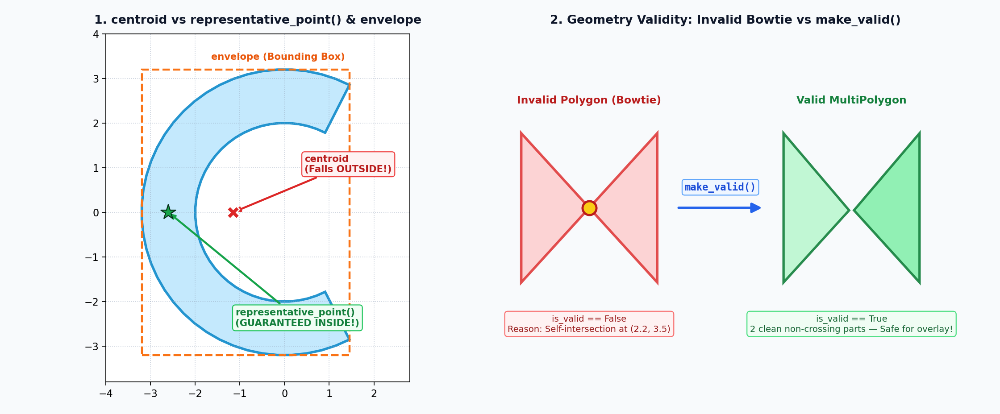
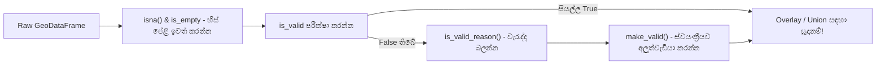

[⬅️ Previous: CRS and Projections](04_CRS_and_Projections.md) | [🏠 Course Index](README.md) | [Next: Geometry Operations ➡️](06_Geometry_Operations.md)

---

# Module 5: Geometry Attributes, Measurements සහ Validity 📐🔍

ඔයාගේ සිතියම් දත්ත නිවැරදි **Projected CRS** එකකට ගත්තට පස්සේ, ඊළඟට කරන්නේ ඒ හැඩතල (Geometries) වලින් වැදගත් තොරතුරු මැනගන්න එක: ඉඩමක වර්ගඵලය (`area`), පාරක දිග (`length`), නගරයක මැද ලක්ෂ්‍යය (`centroid` / `representative_point`), සහ කැඩුණු හැඩතල (`is_valid`) හොයලා අලුත්වැඩියා කරන එක (`make_valid`).

GeoPandas වල තියෙන ලොකුම වාසිය තමයි මේ හැමදේම **Vectorised** වීම — ඒ කියන්නේ `for` loop ලියන්නේ නැතුව, එකම line එකකින් මුළු `GeoSeries` හෝ `GeoDataFrame` එකටම (පේළි ලක්ෂයක් තිබුණත්) එකපාර ගණනය කරන්න පුළුවන්!

---

## 1. වර්ගඵලය, දිග, සහ සීමාවන් (Area, Length, Boundary & Bounds) 📏

- **Area & Length (වර්ගඵලය සහ දිග):**
  - `gdf.area`: Polygon වල වර්ගඵලය ලබා දෙයි (CRS එකේ ඒකක වලින් — උදා: මීටර් නම් m², අඩි නම් sq ft).
  - `gdf.length` (හෝ `gdf.geometry.length`): LineString වල දිග, සහ Polygon වල නම් **පරිමිතිය (Perimeter)** ලබා දෙයි!
- **Boundary & Exterior (මායිම / පිටත රේඛාව):**
  - `gdf.boundary`: Polygon එකක පිටත සහ ඇතුළත සිදුරු (holes) වල රේඛා (LineString/MultiLineString) ලබා දෙයි.
  - `gdf.exterior`: Polygon එකේ පිටතම රේඛාව (LinearRing) විතරක් ලබා දෙයි.
- **Bounds & Bounding Shapes (සීමා පෙට්ටි):**
  - `gdf.bounds`: හැම feature එකකම `minx, miny, maxx, maxy` තීරු 4ක DataFrame එකක් ලබා දෙයි.
  - `gdf.total_bounds`: මුළු layer එකටම අදාළ `[minx, miny, maxx, maxy]` array එක (Map එක zoom කරන්න හරිම ප්‍රයෝජනවත්!).
  - `gdf.envelope`: හැම shape එකම වටකරන සෘජුකෝණාස්‍රය (Axis-aligned Bounding Box).
  - `gdf.minimum_rotated_rectangle()`: හැඩයට අනුව ඇල කරලා හදපු කුඩාම සෘජුකෝණාස්‍රය.
  - `gdf.minimum_bounding_circle()`: මුළු හැඩයම ඇතුළට ගන්න කුඩාම වෘත්තය.

---

## 2. මැද ලක්ෂ්‍යය: `centroid` vs `representative_point()` 🎯

හිතන්න ඔයාට සිතියමේ **හඳක් (Crescent)** හෝ **U-හැඩයේ** දූපතක් මැද නම (Label) ලියන්න ඕනේ කියලා.
- **`centroid`** කියන්නේ ඒ හැඩයේ ගණිතමය ගුරුත්ව කේන්ද්‍රය (Center of mass). හැඩය වක්‍රාකාර නම්, **`centroid` එක Polygon එකෙන් පිටතට (හිස් තැනට / මුහුදට) වැටෙන්න පුළුවන්!**
- **`representative_point()`** කියන්නේ **අනිවාර්යයෙන්ම Polygon එක ඇතුළේම පිහිටන** නියෝජිත ලක්ෂ්‍යයක්. සිතියම් වල නම් (Labels) දාන්න හොඳම මේක!



---

## 3. දුර මැනීම සහ රේඛා දිගේ මැනීම (Distance & Linear Referencing) 🛣️

### දුර මැනීම (Distance)
- `gdf.distance(other)`: ලක්ෂ්‍යයක්, පාරක් හෝ තවත් layer එකක් අතර කෙටිම දුර (Euclidean distance).
- `gdf.hausdorff_distance(other)`: හැඩතල දෙකක් කොච්චර සමානද කියලා මනින දුර (ප්‍රධාන වශයෙන් shapes දෙකක උපරිම වෙනස).
- `gdf.frechet_distance(other)`: පාරවල් (Lines) දෙකක ගමන් මාර්ගය සහ දිශාව සලකලා සමානකම මනිනවා ("බල්ලෙක්ව ලණුවකින් අල්ලගෙන ඇවිදින මිනිහෙක්" වගේ!).

### රේඛාවක් දිගේ මැනීම (Along Lines)
පාරක් දිගේ කිලෝමීටර් කණු (Mile markers) හදන්න හෝ පාරේ මැද ලක්ෂ්‍යය හොයන්න:
- `line.project(point)`: ඒ ලක්ෂ්‍යය, පාරේ ආරම්භයේ සිට කොච්චර දුරකින්ද පිහිටන්නේ කියලා දෙනවා.
- `line.interpolate(d)`: පාරේ ආරම්භයේ සිට `d` දුරකින් පිහිටි ලක්ෂ්‍යය (Point) හදලා දෙනවා.
- `line.interpolate(0.5, normalized=True)`: `normalized=True` දුන්නම `0.0` (ආරම්භය) සිට `1.0` (අවසානය) දක්වා ප්‍රතිශතයක් විදිහට ගන්න පුළුවන් (`0.5` = පාරේ හරියටම මැද!).

---

## 4. Coordinates, Geometry Types සහ Emptiness Checks 🔎

- **Coordinates ලබාගැනීම:**
  - `gdf.get_coordinates()`: හැම vertex (කොන්) එකකම `x, y` coordinates තියෙන DataFrame එකක් දෙනවා.
  - `gdf.count_coordinates()`: හැම shape එකකම කොන් (vertices) කීයක් තියෙනවද කියලා ගණන් කරනවා.
  - `gdf.count_geometries()`: MultiPolygon එකක කොටස් කීයක් තියෙනවද කියලා ගණන් කරනවා.
  - Point layers සඳහා කෙලින්ම `gdf.geometry.x`, `gdf.geometry.y`, `gdf.geometry.z` ගන්න පුළුවන්.
- **Geometry Type Checks:**
  - `gdf.geom_type` (`'Point'`, `'Polygon'`, `'MultiPolygon'`, ...)
  - `gdf.has_z` (3D උස / elevation තියෙනවද?)
  - `gdf.is_ring`, `gdf.is_closed`, `gdf.is_simple` (තමන්වම කපාගෙන නැති සරල රේඛාවක්ද?)
- **හිස් දත්ත සෙවීම (Emptiness):**
  - `gdf.is_empty`: Geometry එකක් තියෙනවා, ඒත් ඇතුළේ coordinates නැහැ (උදා: `POLYGON EMPTY`).
  - `gdf.isna()`: Geometry එක සම්පූර්ණයෙන්ම `None` / `NaN`.

---

## 5. Geometry Validity — කැඩුණු Shapes හොයලා හදමු! 🛠️

සමහරවිට polygon එකක දාර දෙකක් එකිනෙක කපාගෙන **Bowtie (ටයි පටියක්)** වගේ හැදිලා තියෙන්න පුළුවන්. ඒකට කියන්නේ **Invalid Geometry** කියලා.
මේ වගේ කැඩුණු shapes තියෙද්දී `overlay()` හෝ `union_all()` කළොත් **TopologicalError** ඇවිත් කේතය crash වෙනවා!



- `gdf.is_valid`: හැම geometry එකක්ම නිවැරදිද (`True`/`False`) කියලා බලනවා.
- `gdf.is_valid_reason()`: වැරදි නම් **ඇයි වැරදි** කියලා ඉංග්‍රීසියෙන් හේතුව කියනවා (උදා: `Self-intersection[2.2 3.5]`).
- `gdf.make_valid()`: කැඩුණු geometries ස්වයංක්‍රීයව නිවැරදි කරන නවීන සහ හොඳම ක්‍රමය! (පරණ කාලේ මේකට `gdf.buffer(0)` පාවිච්චි කළා, ඒත් දැන් හැමවෙලේම `make_valid()` පාවිච්චි කරන්න).

---

## 6. Compactness, Density සහ Spherical Alternatives 🌍

1. **Compactness Metrics (හැඩය කොච්චර වටකුරුද? — Polsby-Popper Score):**
   $$\text{Compactness} = \frac{4 \pi \times \text{Area}}{\text{Perimeter}^2}$$
   - සම්පූර්ණ වෘත්තයකට මේ අගය **`1.0`**.
   - ගොඩක් දිගැති, ඇඹරුණු හැඩයකට (උදා: Gerrymandering ඡන්ද කොට්ඨාස) මේ අගය `0` ට ආසන්නයි.
2. **Densities and Ratios (ඝනත්වය):**
   ```python
   # ජනගහන ඝනත්වය (වර්ග කිලෝමීටරයකට පුද්ගලයින්)
   gdf['pop_density'] = gdf['pop'] / (gdf.area / 1e6)
   ```
3. **Spherical / Geodesic Alternatives (Reproject නොකර ලෝක මට්ටමේ මිනුම්):**
   මුළු ලෝකය පුරාම විහිදුණු දත්ත (උදා: ගුවන් ගමන් මාර්ග) තියෙනකොට එක UTM Zone එකක් මදි. එතකොට `pyproj.Geod` පාවිච්චි කරලා කෙලින්ම වක්‍ර පෘථිවිය උඩ (Ellipsoid) නිවැරදි Geodesic area/length මනින්න පුළුවන්:
   ```python
   from pyproj import Geod
   geod = Geod(ellps="WGS84")
   # poly යනු EPSG:4326 වල තියෙන shapely polygon එකක්
   area_m2, perim_m = geod.geometry_area_perimeter(poly)
   ```

---

## 7. සම්පූර්ණ කේත උදාහරණය (Complete Code Example — NYC Boroughs) 💻

```python
from math import pi
import geopandas as gpd
import geodatasets
from shapely.geometry import Point

# 1. NYC Boroughs සිතියම load කර Feet ඒකක ඇති Projected CRS (EPSG:2263) වලට හැරවීම
nyc = gpd.read_file(geodatasets.get_path('nybb')).to_crs(2263)

# 2. වර්ග අඩි (sq ft) -> වර්ග මීටර් (0.092903) -> වර්ග කිලෝමීටර් (1e6)
nyc['area_km2'] = nyc.area * 0.092903 / 1e6

# 3. පරිමිතිය අඩි (ft) -> මීටර් (0.3048) -> කිලෝමීටර් (1000)
nyc['perimeter_km'] = nyc.length * 0.3048 / 1000

# 4. මැද ලක්ෂ්‍යය (centroid) සහ අනිවාර්යයෙන්ම ඇතුළේ පිහිටන ලක්ෂ්‍යය (representative_point)
nyc['centroid'] = nyc.centroid
nyc['label_pt'] = nyc.representative_point()

# 5. කැඩුණු geometries පරීක්ෂා කර make_valid() මඟින් සකස් කිරීම
bad = nyc[~nyc.is_valid]
print("Invalid geometries count:", len(bad))
nyc['geometry'] = nyc.make_valid()

# 6. හැඩයේ වටකුරු බව (Compactness) ගණනය කිරීම
nyc['compactness'] = 4 * pi * nyc.area / nyc.length ** 2

print(nyc[['BoroName', 'area_km2', 'perimeter_km', 'compactness']].round(3))

# 7. ලක්ෂ්‍ය දෙකක් අතර සරල Euclidean දුර (3-4-5 ත්‍රිකෝණය -> දුර = 5.0)
pts = gpd.GeoSeries([Point(0, 0), Point(3, 4)], crs=3857)
print("Distance between (0,0) and (3,4):", pts.iloc[0].distance(pts.iloc[1]))
```

### පේළියෙන් පේළිය පැහැදිලි කිරීම (Line-by-Line Explanation):
1. `EPSG:2263` යනු New York State Plane (US Survey Feet) projected CRS එකකි.
2. `nyc.area` මඟින් වර්ග අඩි වලින් වර්ගඵලය දෙන නිසා `0.092903` න් වැඩි කර වර්ග මීටර් කර, `1e6` න් බෙදා km² ගනී.
3. `nyc.length` මඟින් Polygon වල පරිමිතිය අඩි වලින් දෙන නිසා `0.3048 / 1000` න් වැඩි කර km වලට හරවයි.
4. `~nyc.is_valid` මඟින් `is_valid == False` ඇති පේළි පෙරා ගනී. `nyc.make_valid()` මඟින් ඒවා අලුත්වැඩියා කරයි.
5. `4 * pi * area / length**2` මඟින් Polsby-Popper compactness අගය ගණනය කරයි.
6. `Point(0, 0)` සිට `Point(3, 4)` දක්වා පයිතගරස් ප්‍රමේයයෙන් $\sqrt{3^2 + 4^2} = 5.0$ ලැබේ.

### බලාපොරොත්තු වන ප්‍රතිදානය (Expected Output):
```text
Invalid geometries count: 0
        BoroName  area_km2  perimeter_km  compactness
0  Staten Island   150.858       100.680        0.187
1         Queens   282.587       272.735        0.048
2       Brooklyn   180.025       225.736        0.044
3      Manhattan    58.651       109.254        0.062
4          Bronx   110.228       141.320        0.069
Distance between (0,0) and (3,4): 5.0
```

> [!WARNING]
> **⚠️ සාමාන්‍යයෙන් වෙන වැරදි (Common Pitfalls):**
> 1. **CRS Units අමතක වීම:** හැම Projected CRS එකක්ම මීටර් නෙවෙයි! `EPSG:2263` තියෙන්නේ **Feet** වලින්. හැමවෙලේම `gdf.crs.axis_info` බලන්න.
> 2. **Polygon වල `length` කියන්නේ Perimeter එක!** ගොඩක් අය හිතනවා polygon වලට `perimeter` කියලා attribute එකක් ඇති කියලා — නෑ, GeoPandas වල පරිමිතිය ගන්නේ `.length` වලින්!
> 3. **Invalid Geometry නොබලා Overlay කිරීම:** `make_valid()` කරන්නේ නැතුව ලොකු shapefile එකක් overlay කළොත් අතරමගදී error එන්න පුළුවන්.

> [!TIP]
> **🧠 මතක තබා ගැනීමට පහසු ක්‍රම (Memory Hacks):**
> - **C**entroid = **C**an be outside! (පිටතට වැටෙන්න පුළුවන්)
> - **R**epresentative point = **R**eliably inside! (අනිවාර්යයෙන්ම ඇතුළේ!)
> - Clean Pipeline: **`isna()` → `is_empty` → `is_valid` → `make_valid()`**.

---

## 8. ප්‍රායෝගික අභ්‍යාස (Practical Exercises) 🏋️‍♂️

### Warm-up Exercise: Line `interpolate` & `project`
`(0, 0)` සිට `(100, 0)` දක්වා යන සරල පාරක (LineString) හරියටම මැද ලක්ෂ්‍යය (`normalized=True`) සහ `(25, 10)` ලක්ෂ්‍යය පාරේ ආරම්භයේ සිට කොපමණ දුරකින්ද (`project`) කියා සොයන්න.

<details>
<summary>✅ පිළිතුර බලන්න (Click to see Solution)</summary>

```python
from shapely.geometry import LineString, Point

road = LineString([(0, 0), (100, 0)])
midpoint = road.interpolate(0.5, normalized=True)
dist_along = road.project(Point(25, 10))

print("Midpoint:", midpoint)          # POINT (50 0)
print("Projected distance:", dist_along)  # 25.0
```
</details>

---

### Exercise 1: දිස්ත්‍රික්ක වල වර්ගඵලය (km²) සහ ජනගහන ඝනත්වය
දිස්ත්‍රික්ක layer එකක එක් එක් දිස්ත්‍රික්කයේ වර්ගඵලය km² වලින් සහ ජනගහන ඝනත්වය (people / km²) ගණනය කරන්න.

<details>
<summary>✅ පිළිතුර බලන්න (Click to see Solution)</summary>

```python
import geopandas as gpd
from shapely.geometry import box

districts = gpd.GeoDataFrame(
    {'district': ['Colombo', 'Gampaha'], 'population': [2324349, 2304833]},
    geometry=[box(365000, 750000, 395000, 775000), box(370000, 775000, 415000, 805000)],
    crs='EPSG:32644'
)

districts['area_km2'] = districts.area / 1e6
districts['pop_density'] = districts['population'] / districts['area_km2']
print(districts[['district', 'area_km2', 'pop_density']].round(1))
```
</details>

---

### Exercise 2: Invalid Polygons සොයා, හේතුව බලා, `make_valid()` කිරීම
Bowtie self-intersecting polygon එකක් ඇතුළත් GeoDataFrame එකක් සාදා, invalid polygons සොයා, `is_valid_reason()` print කර, `make_valid()` මඟින් නිවැරදි කරන්න.

<details>
<summary>✅ පිළිතුර බලන්න (Click to see Solution)</summary>

```python
import geopandas as gpd
from shapely.geometry import Polygon

bowtie = Polygon([(0, 0), (2, 2), (2, 0), (0, 2)])   # Self-intersecting!
good_sq = Polygon([(5, 0), (7, 0), (7, 2), (5, 2)])

gdf = gpd.GeoDataFrame({'name': ['BadBowtie', 'GoodSquare']}, geometry=[bowtie, good_sq], crs=32644)

invalid_rows = gdf[~gdf.is_valid]
print("Invalid:", invalid_rows['name'].tolist())
print("Reason:", gdf.is_valid_reason().tolist())

gdf['geometry'] = gdf.make_valid()
print("All valid now?:", gdf.is_valid.all())   # True
```
</details>

---

### Exercise 3: එක් එක් පාසලේ සිට ළඟම රෝහලට ඇති දුර ගණනය කිරීම
පාසල් සහ රෝහල් ලක්ෂ්‍ය (Projected CRS වල) ඇති විට, එක් එක් පාසලට ළඟම රෝහලට ඇති දුර (මීටර් වලින්) සොයන්න.

<details>
<summary>✅ පිළිතුර බලන්න (Click to see Solution)</summary>

```python
import geopandas as gpd
from shapely.geometry import Point

schools = gpd.GeoDataFrame(
    {'school': ['Royal', 'Ananda', 'Visakha']},
    geometry=[Point(375000, 764000), Point(376200, 766500), Point(374800, 762500)],
    crs=32644
)
hospitals = gpd.GeoDataFrame(
    {'hospital': ['National Hospital', 'Asiri']},
    geometry=[Point(375800, 765800), Point(375100, 762200)],
    crs=32644
)

# සියලුම රෝහල් එකට union_all() කර ළඟම දුර මැනීම
all_hospitals = hospitals.union_all()
schools['nearest_hospital_m'] = schools.distance(all_hospitals).round(1)
print(schools[['school', 'nearest_hospital_m']])
```
</details>

---

### Exercise 4: අක්‍රමවත් (Irregular) Polygon එකක් ඇතුළේ `representative_point()` තැබීම
C-හැඩයේ (Crescent/U-shaped) polygon එකක් සාදා, `centroid` එක ඇතුළේ තියෙනවද සහ `representative_point()` එක ඇතුළේ තියෙනවද කියා `.within()` වලින් තහවුරු කරන්න.

<details>
<summary>✅ පිළිතුර බලන්න (Click to see Solution)</summary>

```python
import geopandas as gpd
from shapely.geometry import Polygon

# U-හැඩයේ polygon එකක්
u_shape = Polygon([(0, 0), (4, 0), (4, 4), (3, 4), (3, 1), (1, 1), (1, 4), (0, 4)])
gdf = gpd.GeoDataFrame({'name': ['U-Park']}, geometry=[u_shape], crs=32644)

c = gdf.centroid
r = gdf.representative_point()

print("Centroid inside polygon?:", c.within(gdf.geometry).iloc[0])           # False!
print("Representative point inside?:", r.within(gdf.geometry).iloc[0])       # True!
```
</details>

---

## 9. Cheat Sheet Summary 📋

| අවශ්‍යතාවය (Task) | Key API | ප්‍රතිඵලය |
| --- | --- | --- |
| වර්ගඵලය / දිග (පරිමිතිය) | `gdf.area`, `gdf.length` | CRS ඒකක වලින් (Projected CRS ගන්න) |
| මායිම / Bounding Box | `gdf.boundary`, `gdf.bounds`, `gdf.total_bounds`, `gdf.envelope` | Lines / Min-Max / Rectangles |
| මැද ලක්ෂ්‍යය | `gdf.centroid`, `gdf.representative_point()` | `representative_point()` හැමවෙලේම ඇතුළේ! |
| දුර මැනීම | `gdf.distance(other)`, `hausdorff_distance`, `frechet_distance` | කෙටිම දුර / හැඩ සමානකම |
| රේඛාවක් දිගේ මැනීම | `line.project(pt)`, `line.interpolate(d, normalized=True)` | දුර / නව ලක්ෂ්‍යය |
| Coordinates & Types | `get_coordinates()`, `count_coordinates()`, `geom_type`, `has_z` | Vertex තොරතුරු සහ වර්ගය |
| Validity & Repair | `is_valid`, `is_valid_reason()`, `make_valid()` | කැඩුණු polygons අලුත්වැඩියා කිරීම |
| හිස් දත්ත පරීක්ෂාව | `is_empty`, `isna()` | දත්ත පිරිසිදු කිරීම |
| Compactness & Density | `4 * pi * area / length**2`, `pop / (area / 1e6)` | හැඩ මිනුම් සහ ඝනත්වය |
| Geodesic (ලෝක මට්ටමේ) | `pyproj.Geod(ellps="WGS84").geometry_area_perimeter(poly)` | Reproject නොකර නිවැරදි area/length |

---

[⬅️ Previous: CRS and Projections](04_CRS_and_Projections.md) | [🏠 Course Index](README.md) | [Next: Geometry Operations ➡️](06_Geometry_Operations.md)
