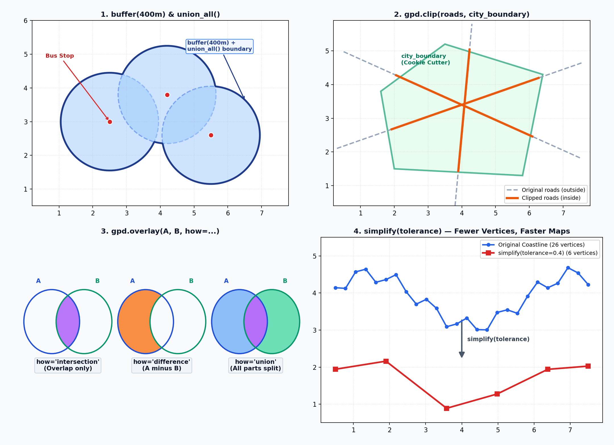
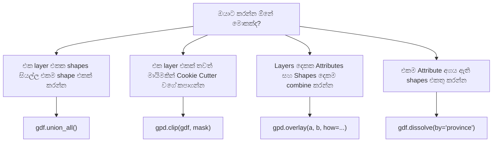
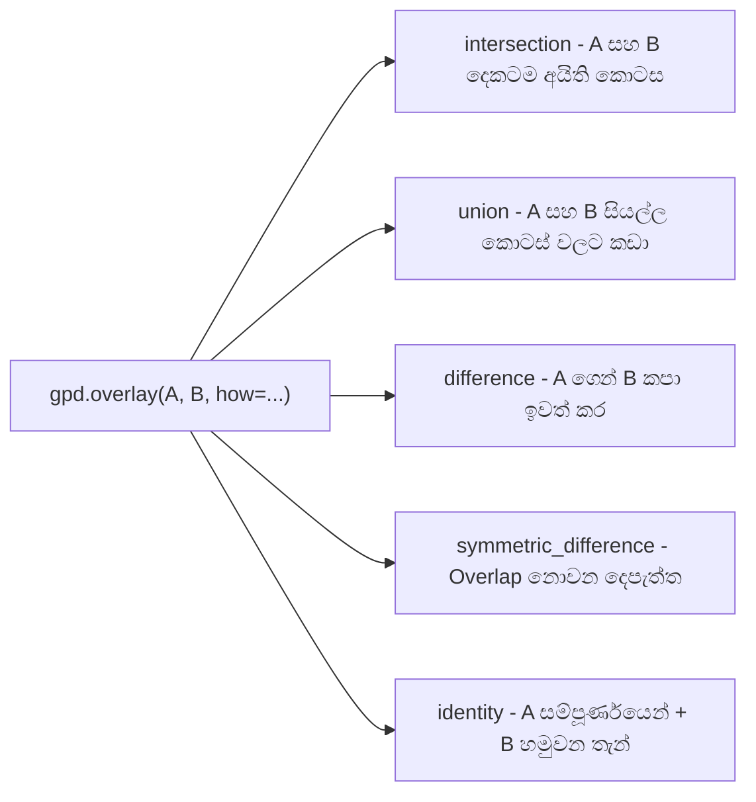

[⬅️ Previous: Geometry Attributes, Measurements & Validity](05_Geometry_Attributes_Measurements_and_Validity.md) | [🏠 Course Index](README.md) | [Next: Spatial Relationships and Joins ➡️](07_Spatial_Relationships_and_Joins.md)

---

# Module 6: Geometry Operations (ජ්‍යාමිතික මෙහෙයුම්) ✂️🫧🧩

මේ Module එකෙන් අපි ඉගෙනගන්නේ දැනට තියෙන සිතියම් හැඩතල (Geometries) වලින් **අලුත් හැඩතල නිර්මාණය කරන** හැටි! උදාහරණයක් විදිහට:
- බස් නැවතුමක් වටේට මීටර් 400ක ඇවිදින කලාපයක් (`buffer`) හදන හැටි,
- මුළු ලංකාවේම පාරවල් වලින් කොළඹ නගරය ඇතුළේ පාරවල් විතරක් කුකී කටර් එකකින් වගේ කපලා ගන්න (`clip`) හැටි,
- ගංවතුර කලාප සහ ඉඩම් පාවිච්චිය එක උඩ එක තියලා හරියටම යටවෙන ප්‍රදේශ හොයන (`overlay`) හැටි!



---

## 1. මූලික තනි-Layer මෙහෙයුම් (Buffer, Simplify, Hulls & Bounds) 🫧

### 1.1 Buffer (වටේට කලාපයක් සෑදීම)
ලක්ෂ්‍යයක්, පාරක් හෝ ගඟක් වටේට නිශ්චිත දුරකින් කලාපයක් (Service area / Safety zone) හදන්න `buffer()` පාවිච්චි කරනවා. **අනිවාර්යයෙන්ම Projected CRS (මීටර්) වල තියෙන්න ඕනේ!**
```python
zones = stops.buffer(
    500,                # මීටර් 500ක අරයක් (ඍණ අගයක් දුන්නොත්, උදා: -50, polygon එක ඇතුළට හැකිළෙනවා!)
    cap_style='round',  # රේඛා කෙළවර: 'round', 'flat', 'square'
    join_style='round', # කොන් වල හැඩය: 'round', 'mitre', 'bevel'
    resolution=16       # වක්‍රයේ සුමට බව (කොන් ගණන)
)
```

### 1.2 Simplify (හැඩය සරල කිරීම)
ලොකු මුහුදු වෙරළක් හෝ ගඟක කොන් (vertices) ලක්ෂ ගාණක් තියෙන්න පුළුවන්. Web map එකක් වේගවත් කරන්න ඒ හැඩය පොඩ්ඩක්වත් කැඩෙන්නේ නැතුව vertices අඩු කරන්න `simplify()` පාවිච්චි කරනවා:
```python
light_coast = coast.simplify(tolerance=100, preserve_topology=True)
```
> `preserve_topology=True` දැම්මම polygon එක තමන්වම කපාගෙන invalid වෙන එක වළක්වනවා!

### 1.3 Convex Hull, Concave Hull සහ Bounding Shapes
ලක්ෂ්‍ය සමූහයක් (උදා: වන අලි දැකපු තැන්) වටේට මායිමක් අඳින්න:
- **`convex_hull`**: රබර් පටියක් (Rubber band) ලක්ෂ්‍ය වටේට දැම්මා වගේ පිටතම ලක්ෂ්‍ය යා කරන polygon එක.
- **`concave_hull(ratio=0.3)`**: රබර් පටිය ටිකක් ඇතුළට හිර කරලා, සැබෑ හැඩයට තවත් ළං කරලා අඳින polygon එක (`ratio` අඩු වෙන තරමට හැඩය තවත් තදට වටකරනවා).
- **Bounding Shapes**: `envelope` (සරල කොටුව), `minimum_rotated_rectangle()` (ඇල කළ කුඩාම කොටුව), `minimum_bounding_circle()` (වටකරන කුඩාම වෘත්තය).

---

## 2. එකතු කිරීම, කැපීම සහ Overlay (`union_all`, `clip`, `overlay`) ✂️



### 2.1 Union & Element-wise Set Operations
- **`gdf.union_all()`** *(පරණ නම: `unary_union`)*: Layer එකේ තියෙන හැම geometry එකක්ම එකම giant geometry එකකට පාස්සලා (merge) දෙනවා! (උදා: බස් නැවතුම් buffer 100ක් එකම coverage zone එකක් කරන්න).
- **Row-by-row Set Operations (එකම index ඇති පේළි දෙකක් අතර):**
  - `a.union(b)`: දෙකම එකතු කිරීම.
  - `a.intersection(b)`: දෙකම overlap වෙන කොටස විතරක්.
  - `a.difference(b)`: `a` ගෙන් `b` අඩු කළාම ඉතිරි කොටස.
  - `a.symmetric_difference(b)`: Overlap වෙන මැද කොටස අයින් කරලා දෙපැත්ත විතරක්.

### 2.2 `gpd.clip(gdf, mask)` — Cookie Cutter (බිස්කට් අච්චුව) 🍪
මුළු රටේම පාරවල් තියෙන layer එකක් අරන්, කොළඹ දිස්ත්‍රික් මායිම (`mask`) ඇතුළේ තියෙන පාරවල් විතරක් කපලා ගන්න හරියට බිස්කට් අච්චුවක් තියලා කපනවා වගේ!
- **`clip` වලදී `mask` එකේ attributes එකතු වෙන්නේ නැහැ** — `gdf` එකේ තිබ්බ columns ටික විතරයි ඉතිරි වෙන්නේ. ඒ නිසා `clip` හරිම වේගවත්!

### 2.3 `gpd.overlay(a, b, how=...)` — Layer-on-Layer සම්පූර්ණ විශ්ලේෂණය 🧩
Layers දෙකේම **geometries කපාගෙන**, ඒ දෙකේම **attribute columns එකතු කරගන්න** ඕන නම් `overlay()` පාවිච්චි කරනවා!



---

## 3. Multi-part Shapes, Dissolve, Voronoi & Delaunay 🏝️

- **`gdf.explode(ignore_index=True)`:**
  සමහරවිට රටක් (උදා: ජපානය හෝ මාලදිවයින) තියෙන්නේ එකම `MultiPolygon` පේළියක් විදිහට. ඒකේ තියෙන හැම දූපතක්ම **වෙන වෙනම rows** බවට කඩාගන්න `explode(ignore_index=True)` පාවිච්චි කරනවා!
- **`gdf.dissolve(by='province')`:**
  දිස්ත්‍රික්ක polygons ටික `province` නම අනුව එකතු කරලා පළාත් මායිම් හදන්න පුළුවන් (මේ ගැන අපි Module 8 වලදී තවත් ගැඹුරින් ඉගෙනගන්නවා).
- **`voronoi_polygons()` & `delaunay_triangles()` (GeoPandas 1.x):**
  - `gdf.voronoi_polygons()`: රෝහල් හෝ පාසල් ලක්ෂ්‍ය සමූහයක් දුන්නම, හැම රෝහලකටම "ළඟම ප්‍රදේශය (Catchment area)" මොකක්ද කියලා proximity polygons ස්වයංක්‍රීයව හදලා දෙනවා!
  - `gdf.delaunay_triangles()`: ලක්ෂ්‍ය සමූහය ත්‍රිකෝණ ජාලයකින් (Triangulation — TIN) යා කරනවා.

---

## 4. උසස් ජ්‍යාමිතික මෙහෙයුම් (Affine, Line Ops, Snapping, Sampling & More) ⚙️

1. **Affine Transforms (චලනය, භ්‍රමණය, විශාලනය):**
   - `gdf.translate(xoff=100, yoff=50)` (එහාට මෙහාට ගෙනියන්න)
   - `gdf.rotate(angle=45, origin='centroid')` (කරකවන්න)
   - `gdf.scale(xfact=2.0, yfact=2.0)` (ලොකු/පොඩි කරන්න)
   - `gdf.skew(xs=15)` (ඇල කරන්න)
   - `gdf.affine_transform(matrix)` (Custom matrix පරිවර්තනය)
2. **Line Operations (මාර්ග ජාල මෙහෙයුම්):**
   - `shapely.ops.linemerge(lines)`: කැඩුණු පාරක කෑලි ටික එක දිග LineString එකකට අමුණනවා.
   - `shapely.ops.substring(line, start_dist, end_dist)`: පාරක නිශ්චිත කොටසක් කපාගන්නවා.
   - `gdf.offset_curve(distance)`: පාරකට සමාන්තරව වම් හෝ දකුණු පැත්තෙන් අලුත් රේඛාවක් අඳිනවා (උදා: පාරේ මංතීරු).
3. **Snapping & Precision (කුඩා හිඩැස් වැසීම):**
   - `shapely.ops.snap(geom1, geom2, tolerance=1.0)`: දාර දෙකක් අතර තියෙන මීටර් 1ට අඩු පොඩි හිඩැස් (slivers/gaps) එකට අලවනවා.
   - `gdf.set_precision(grid_size=0.01)`: Coordinates නිශ්චිත grid එකකට වටයලා (round) topology පිරිසිදු කරනවා.
4. **Polygon → Points / Lines & Sampling:**
   - `boundary`, `exterior`, `get_coordinates()` මඟින් polygon එකක් lines හෝ points බවට හරවන්න පුළුවන්.
   - `parks.sample_points(10)`: හැම උද්‍යානයක් ඇතුළෙම **අහඹු ලක්ෂ්‍ය (Random points) 10 බැගින්** නිර්මාණය කරනවා (Field surveys / sampling සඳහා සුපිරි!).
5. **Segmentize (Densify) & Orientation:**
   - `gdf.segmentize(max_segment_length=1000)`: දිග සෘජු රේඛාවක මැදට අමතර vertices එකතු කරනවා — දිග රේඛා වෙනත් CRS එකකට reproject කරද්දී වක්‍ර හැඩය නිවැරදිව එන්න මේක හරිම වැදගත්!
   - `gdf.reverse()`: රේඛාවක දිශාව ආපස්සට හරවයි.
   - `shapely.geometry.polygon.orient(poly, sign=1.0)`: Polygon ring එකේ දිශාව (Counter-clockwise exterior, clockwise holes) GeoJSON සම්මතයට සකස් කරයි.

---

## 5. සම්පූර්ණ කේත උදාහරණය (Complete Code Example) 💻

```python
import geopandas as gpd
from shapely.geometry import Point, LineString, Polygon, MultiPolygon

# --- 1. Bus Stops 400m Walking Zone (Buffer + Union All) ---
stops = gpd.GeoDataFrame(
    {'stop': ['Fort', 'Maradana', 'Pettah']},
    geometry=gpd.points_from_xy([79.850, 79.865, 79.855], [6.934, 6.929, 6.936]),
    crs='EPSG:4326'
).to_crs(32644)                           # Projected CRS (Metres!)

catchment = stops.buffer(400)             # 400m ඇවිදින කලාපය
coverage = catchment.union_all()          # සියලුම කලාප එකම shape එකකට
print(f"Total bus coverage area: {coverage.area / 1e6:.2f} km²")

# --- 2. Clip Roads to City Boundary ---
city = gpd.GeoDataFrame(
    {'name': ['Central City']},
    geometry=[Polygon([(372000, 765000), (376000, 765000), (376000, 768000), (372000, 768000)])],
    crs=32644
)
roads = gpd.GeoDataFrame(
    {'road': ['Galle Rd', 'Kandy Rd']},
    geometry=[
        LineString([(370000, 766000), (378000, 766000)]),
        LineString([(374000, 763000), (374000, 770000)])
    ],
    crs=32644
)
city_roads = gpd.clip(roads, city)
print("Clipped road lengths (m):", city_roads.length.tolist())

# --- 3. Overlay: Districts vs Flood Zones ---
districts = city.rename(columns={'name': 'district'})
flood_zones = gpd.GeoDataFrame(
    {'risk': ['High']},
    geometry=[Polygon([(374000, 765000), (377000, 765000), (377000, 767000), (374000, 767000)])],
    crs=32644
)
flooded = gpd.overlay(districts, flood_zones, how='intersection')
flooded['flood_km2'] = flooded.area / 1e6
print(flooded[['district', 'risk', 'flood_km2']])

# --- 4. Explode MultiPolygon & Sample Random Points ---
coast = gpd.GeoDataFrame(
    {'region': ['Islands']},
    geometry=[MultiPolygon([
        Polygon([(0, 0), (10, 0), (10, 10), (0, 10)]),
        Polygon([(20, 0), (30, 0), (30, 10), (20, 10)])
    ])],
    crs=32644
)
islands = coast.explode(ignore_index=True)
print("Exploded island rows:", len(islands))

random_pts = islands.sample_points(10)    # හැම දූපතකම අහඹු ලක්ෂ්‍ය 10 බැගින්
print("Sampled geometry type:", random_pts.geom_type.iloc[0])
```

### පේළියෙන් පේළිය පැහැදිලි කිරීම (Line-by-Line Explanation):
1. `stops.to_crs(32644)` මඟින් මීටර් වලට හරවා, `buffer(400)` වලින් මීටර් 400 වෘත්ත සාදා `union_all()` වලින් overlap වෙන කොටස් දෙපාරක් ගණන් නොවී එකම coverage shape එකක් හදයි.
2. `gpd.clip(roads, city)` මඟින් නගර සීමාවෙන් පිටත පාරවල් කෑලි කපා ඉවත් කරයි (මුලින් මීටර් 8000 සහ 7000 තිබ්බ පාරවල් නගරය ඇතුළේ මීටර් 4000 සහ 3000 බවට කැපේ!).
3. `gpd.overlay(districts, flood_zones, how='intersection')` මඟින් නගරය සහ ගංවතුර කලාපය හමුවන කොටස (2 km × 2 km = 4.0 km²) වෙන් කර attributes දෙකම තබාගනී.
4. `explode(ignore_index=True)` මඟින් MultiPolygon පේළි 1, තනි Polygon පේළි 2ක් බවට පත් කරයි. `sample_points(10)` මඟින් එක් එක් polygon එක ඇතුළේ අහඹු ලක්ෂ්‍ය 10ක් ඇති MultiPoint එකක් සාදයි.

### බලාපොරොත්තු වන ප්‍රතිදානය (Expected Output):
```text
Total bus coverage area: 1.48 km²
Clipped road lengths (m): [4000.0, 3000.0]
       district  risk  flood_km2
0  Central City  High        4.0
Exploded island rows: 2
Sampled geometry type: MultiPoint
```

> [!WARNING]
> **⚠️ සාමාන්‍යයෙන් වෙන වැරදි (Common Pitfalls):**
> 1. **Degrees වලින් Buffer කිරීම:** `EPSG:4326` වල ඉඳන් `buffer(400)` දුන්නොත් මුළු පෘථිවියටම වඩා ලොකු අංශක 400ක buffer එකක් හැදේවි! හැමවෙලේම Projected CRS එකකට හරවන්න.
> 2. **CRS නොගැලපෙන layers `clip` හෝ `overlay` කිරීම:** දෙකම එකම CRS එකේ තියෙන්න ඕනේ (`b = b.to_crs(a.crs)`).
> 3. **Overlapping buffers වල area කෙලින්ම එකතු කිරීම:** බස් නැවතුම් 2ක buffers එකිනෙක ගැටෙනවා නම් `catchment.area.sum()` ගත්තොත් මැද කොටස දෙපාරක් ගණන් වෙනවා! නිවැරදි ක්‍රමය: **`catchment.union_all().area`**.

> [!TIP]
> **🧠 මතක තබා ගැනීමට පහසු ක්‍රම (Memory Hacks):**
> - **`clip`** = **Cookie Cutter** (වේගවත්, mask එකේ columns එන්නේ නැහැ).
> - **`overlay`** = **Venn Diagram + Table Merge** (layers දෙකේම columns එනවා).
> - **`explode`** = බෝම්බයක් පිපිරිලා MultiPolygon එක තනි කෑලි (rows) වලට කැඩෙනවා!

---

## 6. ප්‍රායෝගික අභ්‍යාස (Practical Exercises) 🏋️‍♂️

### Warm-up Exercise: Negative Buffer (Setback)
100m × 100m සමචතුරස්‍ර ඉඩමක වටේටම මීටර් 10ක ඉඩක් (building setback) තියලා ගොඩනැගිල්ලක් හදන්න පුළුවන් ඇතුළත ප්‍රදේශය negative buffer (`buffer(-10)`) වලින් සොයා එහි වර්ගඵලය ගණනය කරන්න.

<details>
<summary>✅ පිළිතුර බලන්න (Click to see Solution)</summary>

```python
import geopandas as gpd
from shapely.geometry import box

parcel = gpd.GeoSeries([box(0, 0, 100, 100)], crs=32644)
buildable = parcel.buffer(-10)
print("Original area (m²):", parcel.area.iloc[0])      # 10000.0
print("Buildable area (m²):", buildable.area.iloc[0])  # 6400.0 (80m x 80m)
```
</details>

---

### Exercise 1: රෝහල් වටා 1 km Buffers සහ ජනගහන ප්‍රතිශතය
රෝහල් වටා 1 km (1000 m) buffers සාදා, `union_all()` කර, ඒ තුළ ජීවත් වන ජනගහන ප්‍රතිශතය ගණනය කරන්න.

<details>
<summary>✅ පිළිතුර බලන්න (Click to see Solution)</summary>

```python
import geopandas as gpd
from shapely.geometry import Point

hospitals = gpd.GeoDataFrame(
    {'name': ['H1', 'H2']},
    geometry=[Point(375000, 765000), Point(376200, 765500)],
    crs=32644
)
homes = gpd.GeoDataFrame(
    {'pop': [500, 800, 1200, 600]},
    geometry=[Point(375300, 765200), Point(376000, 765300), Point(380000, 770000), Point(375800, 765100)],
    crs=32644
)

# 1 km buffer සාදා එකම coverage polygon එකක් කිරීම
hosp_zone = hospitals.buffer(1000).union_all()
inside_mask = homes.within(hosp_zone)

pop_inside = homes.loc[inside_mask, 'pop'].sum()
share_pct = (pop_inside / homes['pop'].sum()) * 100
print(f"Population inside 1 km of hospitals: {pop_inside} ({share_pct:.1f}%)")
```
</details>

---

### Exercise 2: පළාත් සීමාවකට ජාතික මාර්ග Clip කර මුළු දිග සෙවීම
ජාතික මාර්ග layer එකක් පළාත් මායිමකට `gpd.clip()` කර එහි මුළු මාර්ග දිග කිලෝමීටර් වලින් ගණනය කරන්න.

<details>
<summary>✅ පිළිතුර බලන්න (Click to see Solution)</summary>

```python
import geopandas as gpd
from shapely.geometry import LineString, box

province = gpd.GeoDataFrame({'prov': ['Western']}, geometry=[box(360000, 740000, 400000, 790000)], crs=32644)
nat_roads = gpd.GeoDataFrame(
    {'road': ['A1', 'A2']},
    geometry=[
        LineString([(350000, 765000), (420000, 765000)]),
        LineString([(375000, 730000), (375000, 810000)])
    ],
    crs=32644
)

prov_roads = gpd.clip(nat_roads, province)
total_km = prov_roads.length.sum() / 1000
print(f"Total road length inside Western Province: {total_km:.1f} km")
```
</details>

---

### Exercise 3: Land Use සහ Flood Zones Overlay කර අවදානම් වර්ගඵලය ගණනය කිරීම
Land use layer එකක් සහ flood zones layer එකක් `gpd.overlay(..., how='intersection')` කර එක් එක් ඉඩම් පාවිච්චි වර්ගයේ ගංවතුර අවදානමට ලක්වන වර්ගඵලය (km²) සොයන්න.

<details>
<summary>✅ පිළිතුර බලන්න (Click to see Solution)</summary>

```python
import geopandas as gpd
from shapely.geometry import box

land_use = gpd.GeoDataFrame(
    {'type': ['Residential', 'Paddy', 'Forest']},
    geometry=[box(0, 0, 2000, 2000), box(2000, 0, 4000, 2000), box(0, 2000, 4000, 4000)],
    crs=32644
)
flood = gpd.GeoDataFrame(
    {'zone': ['Floodplain']},
    geometry=[box(1000, 500, 3500, 2500)],
    crs=32644
)

at_risk = gpd.overlay(land_use, flood, how='intersection')
at_risk['risk_km2'] = at_risk.area / 1e6
print(at_risk.groupby('type')['risk_km2'].sum())
```
</details>

---

### Exercise 4: වෙරළ තීරයක් Tolerances 3කින් Simplify කර Vertices ගණන සැසඳීම
විස්තරාත්මක වෙරළ තීරයක් (හෝ NYC Boroughs සිතියම) tolerances 3කින් (`10`, `100`, `500`) simplify කර `count_coordinates()` වලින් vertices ගණන සංසන්දනය කරන්න.

<details>
<summary>✅ පිළිතුර බලන්න (Click to see Solution)</summary>

```python
import geopandas as gpd
import geodatasets

nyc = gpd.read_file(geodatasets.get_path('nybb')).to_crs(32618)  # Metres
print("Original vertices:", nyc.count_coordinates().sum())

for tol in [10, 100, 500]:
    simp = nyc.simplify(tolerance=tol, preserve_topology=True)
    print(f"Tolerance {tol:3d} m -> Vertices: {simp.count_coordinates().sum()}")
```
</details>

---

## 7. Cheat Sheet Summary 📋

| මෙහෙයුම (Operation) | Key API | ප්‍රයෝජනය |
| --- | --- | --- |
| Buffer | `gdf.buffer(500)`, `buffer(-50)` | සේවා කලාප, setbacks (Projected CRS ගන්න!) |
| Simplify | `gdf.simplify(tol, preserve_topology=True)` | Vertices අඩු කර සිතියම වේගවත් කිරීම |
| Hulls | `gdf.convex_hull`, `gdf.concave_hull(ratio=0.3)` | ලක්ෂ්‍ය සමූහයක් වටා මායිමක් ඇඳීම |
| Union All | `gdf.union_all()` | සියලු geometries එකම shape එකක් කිරීම |
| Clip | `gpd.clip(gdf, mask)` | මායිමකට අනුව කපාගැනීම (Cookie cutter) |
| Overlay | `gpd.overlay(a, b, how='intersection'/'union'/'difference'/'identity')` | Layers 2ක් combine + attributes merge |
| Explode / Dissolve | `gdf.explode(ignore_index=True)`, `gdf.dissolve(by=)` | කෑලි වලට කැඩීම / Attribute අනුව එකතු කිරීම |
| Voronoi / Delaunay | `gdf.voronoi_polygons()`, `gdf.delaunay_triangles()` | Catchment areas / Triangulation |
| Affine Transforms | `translate`, `rotate`, `scale`, `skew` | හැඩතල චලනය, භ්‍රමණය, විශාලනය |
| Sampling & Densify | `sample_points(n)`, `segmentize(max_len)` | අහඹු ලක්ෂ්‍ය ගැනීම / රේඛාවලට vertices එකතු කිරීම |

---

[⬅️ Previous: Geometry Attributes, Measurements & Validity](05_Geometry_Attributes_Measurements_and_Validity.md) | [🏠 Course Index](README.md) | [Next: Spatial Relationships and Joins ➡️](07_Spatial_Relationships_and_Joins.md)
