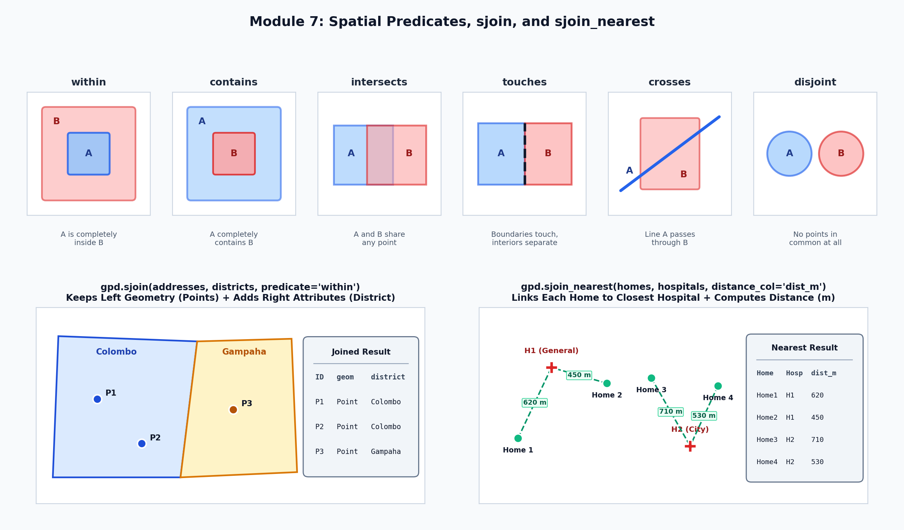
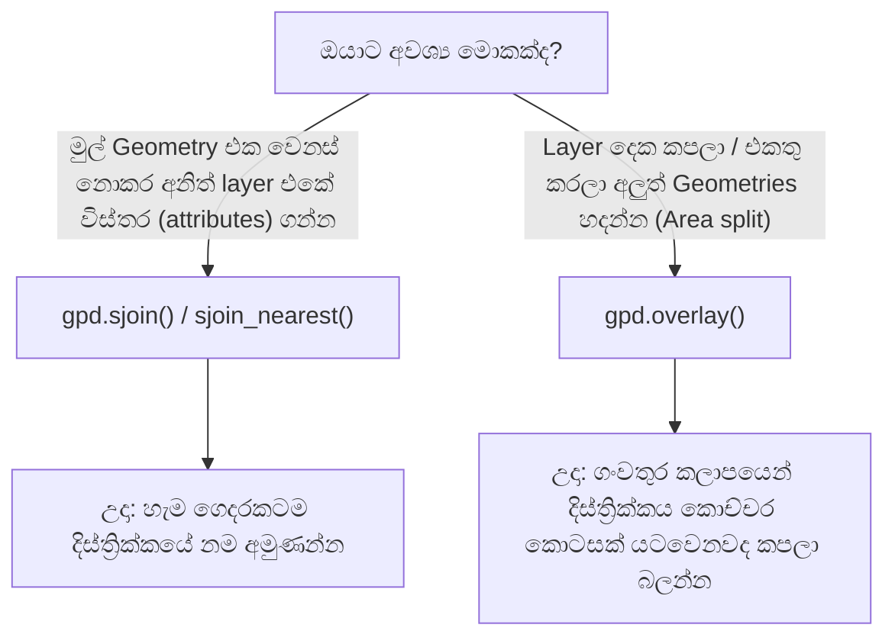

[⬅️ පෙර පාඩම: Geometry Operations](06_Geometry_Operations.md) | [🏠 මුල් පිටුව (README)](README.md) | [ඊළඟ පාඩම: Attribute Work — Dissolve, GroupBy & Merge ➡️](08_Attribute_Work_Dissolve_GroupBy_Merge.md)

---

# පාඩම 07: Spatial Relationships සහ Spatial Joins (පිහිටීම අනුව දත්ත එකතු කිරීම)

## 1. මේ පාඩමෙන් අපි මොනවද ඉගෙන ගන්නේ?

හිතන්න ඔයා ළඟ දත්ත ගොනු (layers) දෙකක් තියෙනවා:
1. **ලිපින ලැයිස්තුවක් (`addresses`)** — හැම ගෙදරකම GPS ලක්ෂ්‍යය (`Point`) තියෙනවා, හැබැයි ඒ ගෙදර තියෙන්නේ කොයි දිස්ත්‍රික්කයේද කියලා නෑ.
2. **දිස්ත්‍රික්ක සිතියමක් (`districts`)** — හැම දිස්ත්‍රික්කයකම සීමාව (`Polygon`) සහ දිස්ත්‍රික්කයේ නම තියෙනවා.

සාමාන්‍ය `pandas` වලදී අපි table දෙකක් එකතු කරන්නේ (`merge`) පොදු ID අංකයක් හෝ නමක් පාවිච්චි කරලා. හැබැයි මෙතන පොදු ID එකක් නෑ! තියෙන්නේ **සිතියමේ පිහිටීම (location)** විතරයි.

මෙන්න මෙතනදී තමයි **Spatial Join (`sjoin`)** කරළියට එන්නේ! Spatial Join එකක් කියන්නේ *"කවුද කාගේ ඇතුළේ ඉන්නේ?", "කවුද කාට ළඟම ඉන්නේ?", "කවුද කාගේ මායිමට ගෑවිලා ඉන්නේ?"* කියලා **පිහිටීම (geography)** බලලා එක layer එකක තියෙන විස්තර (attributes) අනිත් layer එකට අමුණන එක.



---

## 2. Spatial Predicates (ජ්‍යාමිතික සම්බන්ධතා පරීක්ෂා කිරීම)

**Spatial Predicate** එකක් කියන්නේ geometry දෙකක් අතර තියෙන සම්බන්ධය `True` ද `False` ද කියලා අහන සරල ප්‍රශ්නයක්. හරියට *"මේ බෝලේ පෙට්ටිය ඇතුළේ තියෙනවද?"* කියලා අහනවා වගේ.

GeoPandas වල පාවිච්චි වෙන ප්‍රධාන Spatial Predicates ටික බලමු:

| Predicate | සරල තේරුම (සිංහලෙන්) | උදාහරණය |
| --- | --- | --- |
| `intersects` | කොයිම හරි එක ලක්ෂ්‍යයක්වත් ස්පර්ශ වෙනවා හෝ අතිච්ඡාදනය (overlap) වෙනවා | පාරක් දිස්ත්‍රික්කයක් හරහා යනවාද / ගෑවෙනවාද? |
| `within` | A සම්පූර්ණයෙන්ම B ඇතුළේ ඉන්නවා | ගෙදරක් (`Point`) දිස්ත්‍රික්කයක් (`Polygon`) ඇතුළේද? |
| `contains` | A විසින් B ව සම්පූර්ණයෙන්ම ඇතුළේ තියාගෙන ඉන්නවා (`within` එකේ අනිත් පැත්ත) | දිස්ත්‍රික්කයක් ඇතුළේ මේ ගෙදර තියෙනවද? |
| `covers` | `contains` වගේමයි, හැබැයි B, A ගේ **මායිම (boundary) උඩම** හිටියත් `True` වෙනවා | මායිම උඩ ඉන්න ලක්ෂ්‍යත් අල්ලගන්න |
| `covered_by` | `within` වගේමයි, හැබැයි මායිම උඩ හිටියත් `True` වෙනවා (`covers` එකේ අනිත් පැත්ත) | මායිම උඩ ඉන්න ලක්ෂ්‍යත් ඇතුළත් කරගන්න |
| `contains_properly` | B සම්පූර්ණයෙන්ම A ඇතුළේ ඉන්නවා, **මායිමේවත් ගෑවෙන්නේ නෑ** | හරියටම ඇතුළේම ඉන්න ඒවා විතරක් ගන්න |
| `touches` | මායිම් (boundaries) විතරක් ගෑවෙනවා, ඇතුළත කොටස් එකිනෙකට කැපෙන්නේ නෑ | යාබද (neighboring) දිස්ත්‍රික්ක දෙකක් හොයන්න |
| `crosses` | රේඛාවක් (Line) තවත් රේඛාවක් හෝ Polygon එකක් හරහා කපාගෙන යනවා | ගඟක් පාලමක් හෝ දිස්ත්‍රික්කයක් හරහා යනවා |
| `overlaps` | එකම වර්ගයේ හැඩ දෙකක් (උදා: Polygon දෙකක්) කොටසක් පොදුවේ බෙදාගන්නවා (එකක් අනික ඇතුළේ නෙවෙයි) | ගංවතුර කලාපයයි, වගා බිමයි කොටසක් සමපාත වීම |
| `disjoint` | කිසිම සම්බන්ධයක් නෑ — සම්පූර්ණයෙන්ම වෙන්වෙලා තියෙන්නේ (`intersects` එකේ ප්‍රතිවිරුද්ධය) | ගංවතුර කලාපයෙන් සම්පූර්ණයෙන් පිට ඉන්න ගෙවල් |
| `dwithin` | නිශ්චිත දුරක් (`distance`) ඇතුළේ තියෙනවද? (GeoPandas 1.x වල අලුත් පහසුකමක්!) | පාසලක සිට 5 km ඇතුළේ තියෙන බස් හෝල්ට් |

### Boolean Filtering (Location අනුව පෙරා ගැනීම)

එක polygon එකක් ඇතුළේ තියෙන ලක්ෂ්‍ය ටික විතරක් පෙරා ගන්න (filter කරන්න) අපිට මේ predicates කෙලින්ම Boolean mask එකක් විදියට පාවිච්චි කරන්න පුළුවන්:

```python
# colombo_poly කියන එක polygon එකක් ඇතුළේ ඉන්න points ටික විතරක් ගන්නවා
points_in_colombo = points[points.within(colombo_poly)]
```

---

## 3. `gpd.sjoin()` — Spatial Join වැඩ කරන හැටි

`gpd.sjoin(left_df, right_df, how='inner', predicate='intersects')` තමයි GeoPandas වල වැඩිපුරම පාවිච්චි වෙන Spatial Join function එක.

මෙහි වැදගත් parameters 3ක් තියෙනවා:
1. **`left_df` සහ `right_df`**: එකතු කරන GeoDataFrame දෙක. **මතක තියාගන්න:** ප්‍රතිඵලයේ `geometry` column එක හැමවෙලේම එන්නේ `left_df` එකෙන් (`how='right'` දැම්මොත් විතරක් `right_df` එකෙන්).
2. **`how`**:
   - `'inner'` (default): දෙපැත්තෙම ගැළපුණු (matched) rows විතරක් තියාගන්නවා.
   - `'left'`: වම් පැත්තේ (`left_df`) හැම row එකක්ම තියාගන්නවා; ගැළපීමක් නැත්නම් දකුණු පැත්තේ columns වලට `NaN` වැටෙනවා.
   - `'right'`: දකුණු පැත්තේ (`right_df`) හැම row එකක්ම තියාගන්නවා.
3. **`predicate`**: `'intersects'` (default), `'within'`, `'contains'`, `'touches'`, `'crosses'`, `'dwithin'` වගේ ඕනෑම predicate එකක්.

### ⚠️ Many-to-Many Results (පේළි දෙගුණ වීම!)
හිතන්න එක පාරක් (`LineString`) දිස්ත්‍රික්ක 3ක් හරහා යනවා කියලා. `sjoin(roads, districts, predicate='intersects')` කළොත්, ඒ එක පාරට **පේළි (rows) 3ක්** හැදෙනවා (එක එක දිස්ත්‍රික්කයට එක ගානේ). ඒ නිසා `sjoin` එකකින් පස්සේ `len(joined)` බලලා duplicate rows තියෙනවද කියලා check කරන්න, අවශ්‍ය නම් `groupby()` කරලා aggregate කරන්න.

### Distance-Based Joins (`dwithin` vs Buffer + `sjoin`)
කිසියම් දුරක් ඇතුළේ තියෙන සියලුම දේවල් join කරන්න (උදා: හැම ගෙදරකටම 5 km ඇතුළේ තියෙන සියලුම රෝහල්):
- **GeoPandas 1.x ක්‍රමය (වේගවත් සහ පිරිසිදු):**
  ```python
  nearby = gpd.sjoin(homes_m, hospitals_m, how='left', predicate='dwithin', distance=5000)
  ```
- **පරණ ක්‍රමය (Buffer + `sjoin`):** මුලින්ම `homes_m.buffer(5000)` හදලා ඊට පස්සේ `sjoin` කරනවා. (මේකට වඩා `dwithin` ගොඩක් වේගවත්, අමතර polygon හදන්න ඕන නැති නිසා!)

---

## 4. `gpd.sjoin_nearest()` — ළඟම තැන හොයාගැනීම

සමහර වෙලාවට අපිට අවශ්‍ය *"කවුද ඇතුළේ ඉන්නේ?"* කියලා නෙවෙයි, **"මට ළඟම රෝහල / බස් නැවතුම / ගිනි නිවන හමුදා ස්ථානය මොකක්ද?"** කියලා හොයාගන්න.

ඒකට තමයි `gpd.sjoin_nearest()` තියෙන්නේ!
```python
nearest = gpd.sjoin_nearest(
    homes.to_crs(32644),       # මීටර් (meters) තියෙන Projected CRS එකකට මාරු කරන්න!
    hospitals.to_crs(32644),
    how='left',
    max_distance=10000,        # අවශ්‍ය නම්: 10 km ට වඩා දුර ඒවා ගන්න එපා
    distance_col='dist_m'      # දුර සඳහන් වෙන අලුත් column එකේ නම
)
```

> [!WARNING]
> **⚠️ සාමාන්‍යයෙන් වෙන වැරදි (Common Pitfalls):**
> 1. **CRS නොගැළපීම:** `left` සහ `right` layers දෙකේ CRS සමාන නැත්නම් GeoPandas එකෙන් warning/error එකක් එනවා හෝ හිස් (empty) ප්‍රතිඵලයක් එනවා. Join කරන්න කලින් **අනිවාර්යයෙන්ම** `left = left.to_crs(right.crs)` කරන්න!
> 2. **Degrees (EPSG:4326) වලින් `sjoin_nearest` හෝ `dwithin` කිරීම:** `EPSG:4326` වල දුර මනින්නේ **අංශක (degrees)** වලින් මිස මීටර් වලින් නෙවෙයි! ඒ නිසා දුර මනින හැමවෙලේම ශ්‍රී ලංකාවට ගැළපෙන **UTM Zone 44N (`EPSG:32644`)** වගේ Projected CRS එකකට `.to_crs(32644)` කරන්න.

---

## 5. Counting Points in Polygons & Anti-Join

### (A) දිස්ත්‍රික්කයක් ඇතුළේ තියෙන ලක්ෂ්‍ය ගණන ගණන් කිරීම (Points in Polygons)
උදාහරණයක් විදියට හැම දිස්ත්‍රික්කයකම සිදුවුණු රිය අනතුරු (`incidents`) ගණන ගණන් කරන්නේ මෙහෙමයි:
1. `incidents` සහ `districts` `sjoin(..., predicate='within')` කරනවා.
2. `groupby('district').size()` (හෝ `groupby('index_right').size()`) වලින් ගණන ගන්නවා.
3. ඒ ගණන ආපහු `districts` table එකට `merge()` කරලා, අනතුරු එකක්වත් නැති දිස්ත්‍රික්ක වලට `fillna(0)` දානවා.

### (B) Anti-Join (ගැළපීමක් නැති ඒවා හොයාගැනීම)
*"කිසිම සායනයක් (clinic) නැති දිස්ත්‍රික්ක මොනවද?"* වගේ ප්‍රශ්නයකට උත්තරේ හොයන්නේ **Anti-Join** එකකින්!
1. `how='left'` දාලා `sjoin(districts, clinics, how='left', predicate='contains')` කරනවා.
2. සායනයක් නැති දිස්ත්‍රික්ක වල `index_right` column එක **`NaN`** වෙනවා.
3. `joined[joined['index_right'].isna()]` කියලා පෙරා ගත්තම, සායන නැති දිස්ත්‍රික්ක ටික ලස්සනට එනවා!

---

## 6. Spatial Index (`sindex` / R-tree) — ලොකු දත්ත වේගවත් කිරීම

හිතන්න ඔයා ළඟ ගස් (`trees`) මිලියන 1කුත්, උද්‍යාන (`parks`) 10,000කුත් තියෙනවා. හැම ගහක්ම හැම උද්‍යානයක් එක්කම පරීක්ෂා කළොත් 1,000,000 × 10,000 = බිලියන 10ක් පරීක්ෂා කරන්න වෙනවා! පරිගණකය හිර වෙයි!

මේක විසඳන්න GeoPandas ඇතුළේ **R-tree Spatial Index (`gdf.sindex`)** කියලා සුපිරි ක්‍රමයක් තියෙනවා. පොතක Index පිටුව බලලා ඕන පිටුවට කෙලින්ම යනවා වගේ, R-tree එකෙන් හැම හැඩයකම **Bounding Box** (වටේ කොටුව) පාවිච්චි කරලා ළඟ තියෙන අපේක්ෂකයෝ (candidates) ටික විතරක් මිලිතත්පර ගාණකින් තෝරලා දෙනවා.

`sjoin` ඇතුළේ මේක ඉබේම වැඩ කරනවා. හැබැයි ඔයාට custom workflow එකක් ලියන්න ඕන නම් කෙලින්ම `sindex` පාවිච්චි කරන්නත් පුළුවන්:
- **`a.sindex.query(b.geometry, predicate='intersects')`**: ගැළපෙන index යුගල `(b_idx, a_idx)` ලබා දෙනවා.
- **`a.sindex.nearest(b.geometry)`**: ළඟම තියෙන feature එකේ index එක කෙලින්ම ලබා දෙනවා.

---

## 7. `sjoin` vs `overlay` සහ Topology Checks

මේ දෙක පටලවා ගන්න එපා! පහළ තියෙන Flowchart එකෙන් ඒ වෙනස හොඳටම පැහැදිලියි:



### Topology Checks (දත්තවල ගුණාත්මකභාවය පරීක්ෂා කිරීම)
සිතියම් දත්තවල **overlaps** (දිස්ත්‍රික්ක දෙකක් එක උඩ එක වැටිලාද?), **duplicates** (එකම geometry එක දෙපාරක් තියෙනවද?), හෝ **gaps** (මායිම් අතර හිඩැස් තියෙනවද?) හොයන්න අපිට layer එක **තමන් එක්කම (self-join)** කරන්න පුළුවන්:
```python
# තමන් එක්කම sjoin කරලා overlap වෙන වෙනස් polygon යුගල හොයනවා
self_join = gpd.sjoin(districts, districts, predicate='overlaps')
overlaps = self_join[self_join.index < self_join['index_right']]
```
ඒ වගේම `gpd.overlay(a, b, how='intersection')` පාවිච්චි කරලා overlap වෙන හරියේ වර්ගඵලය හරියටම මනින්නත් පුළුවන්.

---

## 8. සම්පූර්ණ කේත උදාහරණය (Complete Code + Line-by-Line Explanation)

පාඨමාලාවේ දීලා තියෙන සම්පූර්ණ උදාහරණය අපි පේළියෙන් පේළිය තේරුම් ගනිමු:

```python
import geopandas as gpd

# 1. CRS දෙක සමාන කරගැනීම (අනිවාර්යයි!)
addresses = addresses.to_crs(districts.crs)

# 2. හැම ලිපිනයක්ම අයිති දිස්ත්‍රික්කය මොකක්ද? (sjoin)
joined = gpd.sjoin(
    addresses,
    districts[['district', 'geometry']],
    how='left',
    predicate='within'
)

# 3. හැම දිස්ත්‍රික්කයකම සිදුවුණු incidents ගණන කීයද? (Points in Polygons)
counts = (
    gpd.sjoin(incidents, districts, predicate='within')
       .groupby('district')
       .size()
       .rename('n_incidents')
)
districts = districts.merge(counts, on='district', how='left').fillna({'n_incidents': 0})

# 4. හැම ගෙදරකටම ළඟම රෝහල සහ එතනට තියෙන දුර මීටර් වලින් (sjoin_nearest)
nearest = gpd.sjoin_nearest(
    homes.to_crs(32644),
    hospitals.to_crs(32644),
    how='left',
    distance_col='dist_m'
)

# 5. Spatial index (R-tree) එකෙන් කෙලින්ම index යුගල ගැනීම
tree_idx, park_idx = parks.sindex.query(trees.geometry, predicate='within')
```

### පේළියෙන් පේළිය විස්තරය:
- **පේළිය 4:** `addresses` layer එක `districts` layer එකේ CRS එකටම හරවනවා.
- **පේළි 7–12:** `districts` එකෙන් අවශ්‍ය `'district'` සහ `'geometry'` විතරක් අරගෙන `predicate='within'` දාලා `sjoin` කරනවා. `how='left'` නිසා කිසිම දිස්ත්‍රික්කයකට අහු නොවුණු ලිපිනයක් තිබුණත් ඒක මැකෙන්නේ නෑ (`NaN` වැටෙනවා).
- **පේළි 15–21:** `incidents` ටික `districts` එක්ක join කරලා, `'district'` අනුව `groupby().size()` වලින් ගණන් කරනවා. ඊට පස්සේ `districts` එකට `merge` කරලා, incident එකක්වත් නැති දිස්ත්‍රික්ක වලට `0` දානවා.
- **පේළි 24–29:** `homes` සහ `hospitals` දෙකම මීටර් ඒකක තියෙන `EPSG:32644` (UTM 44N) වලට හරවලා `sjoin_nearest` කරනවා. `distance_col='dist_m'` නිසා මීටර් ගාණ අලුත් column එකකට එනවා.
- **පේළිය 32:** `parks.sindex.query(trees.geometry, predicate='within')` මඟින් `trees` වලින් කොයි ගහ කොයි `park` එක ඇතුළේද කියලා NumPy index arrays දෙකක් විදියට වේගයෙන් ලබා දෙනවා.

### බලාපොරොත්තු වන ප්‍රතිදානය (Expected Output):
```text
# joined.head(3)
   address_id               geometry  index_right district
0         A01  POINT (79.861 6.927)            0  Colombo
1         A02  POINT (79.912 6.845)            0  Colombo
2         A03  POINT (80.015 7.084)            1  Gampaha

# nearest[['home_id', 'hospital_name', 'dist_m']].head(3)
  home_id    hospital_name      dist_m
0      H1  National Hosp.   620.45
1      H2  National Hosp.   450.12
2      H3  Gampaha General  710.88
```

---

## 9. 🧠 මතක තබා ගැනීමට පහසු ක්‍රම (Memory Hacks)

1. **`within` vs `contains` පටලැවෙන්නේ නැතිව මතක තියාගන්න:**
   - වම් පැත්තේ (Left) පොඩි දෙය (`Point`) සහ දකුණේ (Right) ලොකු දෙය (`Polygon`) ඉන්නවා නම් ➡️ **`within`** (පොඩි එක ලොකු එක **ඇතුළේ**).
   - වම් පැත්තේ ලොකු දෙය (`Polygon`) සහ දකුණේ පොඩි දෙය (`Point`) ඉන්නවා නම් ➡️ **`contains`** (ලොකු එක පොඩි එක **අඩංගු කරගෙන**).
2. **`sjoin` vs `overlay`:**
   - **S**join = **S**ame geometry (මුල් හැඩය එහෙමමයි, අලුත් columns විතරක් එනවා).
   - **O**verlay = **O**utput is new shapes (අලුත් හැඩ කැපිලා හැදෙනවා).
3. **දුර මනිද්දී "32644" මන්තරය:** `sjoin_nearest` හෝ `dwithin` දාන්න කලින් CRS එක meters වලට (`.to_crs(32644)`) මාරු කළාද කියලා දෙපාරක් බලන්න!

---

## 10. ප්‍රායෝගික අභ්‍යාස (Practical Exercises)

### Warm-up Exercise: Boolean Filter එකක් පාවිච්චි කිරීම
ඔයා ළඟ `schools` (Points) සහ `flood_zone` (එක Polygon එකක්) තියෙනවා. ගංවතුර කලාපයෙන් **සම්පූර්ණයෙන් පිටත** තියෙන ආරක්ෂිත පාසල් ටික `disjoint` පාවිච්චි කරලා තෝරගන්න.

<details>
<summary>✅ පිළිතුර බලන්න (Click to see Solution)</summary>

```python
schools = schools.to_crs(flood_zone.crs)
# flood_zone එක GeoDataFrame එකක් නම් union_all() වලින් එක geometry එකක් ගන්නවා
zone_geom = flood_zone.geometry.union_all()
safe_schools = schools[schools.disjoint(zone_geom)]
print(f"ආරක්ෂිත පාසල් ගණන: {len(safe_schools)}")
```
</details>

### Exercise 1: Assign each store to its sales region and compute revenue per region
`stores` (Points, `'revenue'` column එක තියෙනවා) සහ `regions` (Polygons, `'region_name'` column එක තියෙනවා) දීලා තියෙනවා. හැම කඩයක්ම අයිති sales region එකට join කරලා, region එකකට මුළු ආදායම (total revenue) ගණනය කරන්න.

<details>
<summary>✅ පිළිතුර බලන්න (Click to see Solution)</summary>

```python
stores = stores.to_crs(regions.crs)

stores_with_region = gpd.sjoin(
    stores,
    regions[['region_name', 'geometry']],
    how='left',
    predicate='within'
)

revenue_by_region = (
    stores_with_region.groupby('region_name', as_index=False)['revenue']
                      .sum()
                      .rename(columns={'revenue': 'total_revenue'})
)
print(revenue_by_region)
```
</details>

### Exercise 2: Count the points of interest in every grid cell and map the counts
`pois` (Points) සහ `grid` (Polygons, `'cell_id'` තියෙනවා) දීලා තියෙනවා. හැම grid කොටුවකම තියෙන POI ගණන ගණන් කරලා ඒක map එකක් විදියට plot කරන්න.

<details>
<summary>✅ පිළිතුර බලන්න (Click to see Solution)</summary>

```python
pois = pois.to_crs(grid.crs)

poi_counts = (
    gpd.sjoin(pois, grid[['cell_id', 'geometry']], predicate='within')
       .groupby('cell_id')
       .size()
       .rename('poi_count')
)

grid_counts = grid.merge(poi_counts, on='cell_id', how='left').fillna({'poi_count': 0})
grid_counts.plot(column='poi_count', cmap='YlOrRd', legend=True, figsize=(8, 6))
```
</details>

### Exercise 3: Find the nearest fire station to each building and list those further than 3 km
`buildings` සහ `fire_stations` දීලා තියෙනවා. හැම ගොඩනැගිල්ලකටම ළඟම ගිනි නිවන ස්ථානය හොයලා, 3 km (මීටර් 3000) ට වඩා දුරින් තියෙන ගොඩනැගිලි ටික ලැයිස්තුගත කරන්න.

<details>
<summary>✅ පිළිතුර බලන්න (Click to see Solution)</summary>

```python
# මීටර් ඒකක ඇති Projected CRS එකකට මාරු කරන්න (උදා: EPSG:32644)
b_m = buildings.to_crs(32644)
f_m = fire_stations.to_crs(32644)

nearest_fs = gpd.sjoin_nearest(b_m, f_m, how='left', distance_col='dist_m')

far_buildings = nearest_fs[nearest_fs['dist_m'] > 3000]
print(far_buildings[['building_id', 'station_name', 'dist_m']])
```
</details>

### Exercise 4: Identify districts that contain no clinics using an anti-join
`districts` (Polygons) සහ `clinics` (Points) දීලා තියෙනවා. Anti-join ක්‍රමය පාවිච්චි කරලා කිසිම clinic එකක් නැති දිස්ත්‍රික්ක ටික හොයන්න.

<details>
<summary>✅ පිළිතුර බලන්න (Click to see Solution)</summary>

```python
clinics = clinics.to_crs(districts.crs)

joined = gpd.sjoin(districts, clinics, how='left', predicate='contains')

# index_right හිස් (NaN) නම් ඒ දිස්ත්‍රික්කයේ කිසිම clinic එකක් නෑ
no_clinic_districts = joined[joined['index_right'].isna()][['district', 'geometry']]
print(no_clinic_districts)
```
</details>

---

## 11. කෙටි සාරාංශය (Cheat Sheet Summary Table)

| අවශ්‍යතාවය | පාවිච්චි කරන API / කේතය |
| --- | --- |
| CRS සමාන කිරීම | `left = left.to_crs(right.crs)` |
| එක polygon එකක් ඇතුළේ points පෙරීම | `points[points.within(poly)]` |
| Spatial Join (attributes එකතු කිරීම) | `gpd.sjoin(left, right, how='left', predicate='within')` |
| ළඟම feature එක හොයාගැනීම | `gpd.sjoin_nearest(a_m, b_m, how='left', max_distance=5000, distance_col='dist_m')` |
| නිශ්චිත දුරක් ඇතුළේ join (GeoPandas 1.x) | `gpd.sjoin(a_m, b_m, predicate='dwithin', distance=5000)` |
| Polygon ඇතුළේ Points ගණන් කිරීම | `gpd.sjoin(pts, polys, predicate='within').groupby('index_right').size()` |
| Anti-join (නොගැළපෙන ඒවා) | `j = gpd.sjoin(a, b, how='left'); j[j['index_right'].isna()]` |
| Spatial Index (R-tree) වේගවත් query | `a.sindex.query(b.geometry, predicate='intersects')` |
| Overlap topology check (Self-join) | `s = gpd.sjoin(gdf, gdf, predicate='overlaps'); s[s.index < s['index_right']]` |

---

[⬅️ පෙර පාඩම: Geometry Operations](06_Geometry_Operations.md) | [🏠 මුල් පිටුව (README)](README.md) | [ඊළඟ පාඩම: Attribute Work — Dissolve, GroupBy & Merge ➡️](08_Attribute_Work_Dissolve_GroupBy_Merge.md)
