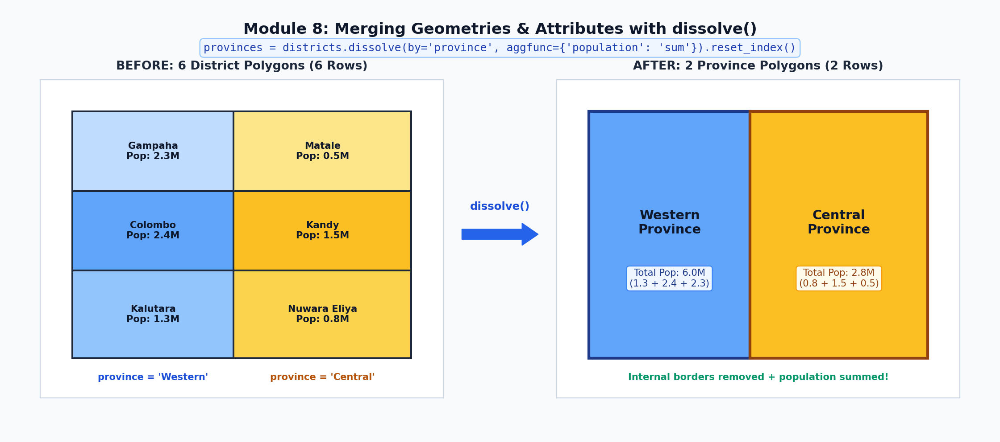
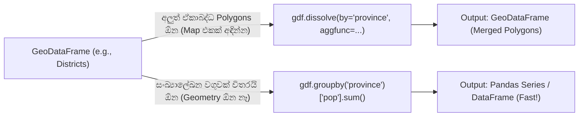

[⬅️ පෙර පාඩම: Spatial Relationships & Joins](07_Spatial_Relationships_and_Joins.md) | [🏠 මුල් පිටුව (README)](README.md) | [ඊළඟ පාඩම: Visualisation & Interactive Maps ➡️](09_Visualisation_and_Interactive_Maps.md)

---

# පාඩම 08: Attribute Work — Dissolve, GroupBy, Merge සහ Indexing

## 1. මේ පාඩමෙන් අපි මොනවද ඉගෙන ගන්නේ?

GeoPandas කියන්නේ **Geometry තීරුවක් (column) එකතු කරපු Pandas** කියන එක ඔයා දැනටමත් දන්නවා. ඒ නිසා ඔයා Pandas වලින් දන්න හැම දක්ෂතාවයක්ම (`filter`, `merge`, `groupby`, `sort_values`, `pd.concat`) මෙතනදී කෙලින්ම වැඩ කරනවා!

හැබැයි සිතියම් දත්ත එක්ක වැඩ කරද්දී අපිට **Geometry එකත් එක්කම** සිතන විශේෂ ක්‍රම කිහිපයක් ඕන වෙනවා. උදාහරණයක් විදියට:
- සාමාන්‍ය CSV ගොනුවක තියෙන ජනගහන දත්ත (census) සිතියමට අමුණන්නේ කොහොමද? (`merge`)
- දිස්ත්‍රික්ක 25 එකතු කරලා පළාත් 9ක සිතියමක් හදන්නේ කොහොමද? (**`dissolve`**)
- දූපත් ගොඩක් එක row එකක තියෙන (`MultiPolygon`) එකක් වෙන වෙනම rows වලට කඩන්නේ කොහොමද? (**`explode`**)
- සිතියම් අඳින්න කලින් දත්ත සාධාරණව සංසන්දනය කරන්න අනුපාත (rates / density) හදන්නේ කොහොමද?

මේ හැම දෙයක්ම අපි සරලව මේ පාඩමෙන් ඉගෙන ගනිමු!

---

## 2. Attribute Filtering සහ Attribute Joins (`merge`)

### Attribute Filtering (වගුවේ අගයන් අනුව පෙරීම)
සාමාන්‍ය Pandas වල වගේම Boolean masks, `.query()`, සහ `.isin()` පාවිච්චි කරලා අවශ්‍ය rows ටික තෝරගන්න පුළුවන්:

```python
# ජනගහනය ලක්ෂයට (100,000) වැඩි දිස්ත්‍රික්ක
big_districts = gdf[gdf['pop'] > 1e5]

# query() ක්‍රමය (කියවන්න හරිම පහසුයි)
parks = gdf.query('type == "park"')

# isin() — ලැයිස්තුවක තියෙන ඒවා විතරක් ගන්න
western = gdf[gdf['district'].isin(['Colombo', 'Gampaha', 'Kalutara'])]
```

### Attribute Joins (`merge`) — CSV දත්ත සිතියමට ඇමිණීම
හිතන්න ඔයා ළඟ දිස්ත්‍රික්ක මායිම් (`districts` GeoDataFrame) සහ ජන සංගණන වගුවක් (`census` CSV / DataFrame) තියෙනවා. `census` වගුවේ geometry නෑ, හැබැයි දෙකේම `district_code` කියන පොදු අංකය තියෙනවා.

```python
map_df = districts.merge(census, on='district_code', how='left', validate='one_to_one')
```
- **`how='left'`**: දිස්ත්‍රික්ක සිතියමේ හැම polygon එකක්ම රැකෙනවා (`census` වල නැති දිස්ත්‍රික්කයක් තිබුණත් සිතියමේ හිල් හැදෙන්නේ නෑ!).
- **`validate='one_to_one'`**: මේක හරිම වැදගත් ආරක්ෂක ක්‍රමයක්! දෙපැත්තේම key එක unique ද කියලා check කරනවා. වැරදිලා duplicate key එකක් තිබුණොත් rows දෙගුණ වෙන්න නොදී error එකක් පෙන්වනවා.

### 🧹 Key Hygiene (Merge කරන්න කලින් Keys පිරිසිදු කිරීම)
Attribute merge වලදී වැඩිපුරම වෙන ප්‍රශ්නය තමයි **"සමහර rows match වෙන්නේ නැති එක"**. ඒකට හේතුව:
- එක table එකක code එක `"01"` (string), අනිත් එකේ `1` (integer) වීම!
- නම් වල මුලට හෝ අගට හිස්තැන් (whitespace) තිබීම (උදා: `"Colombo "` vs `"Colombo"`).

ඒ නිසා merge කරන්න කලින් **අනිවාර්යයෙන්ම** keys පිරිසිදු කරන්න:
```python
census = pd.read_csv('census.csv', dtype={'district_code': str})
districts['district_code'] = districts['district_code'].astype(str).str.strip().str.zfill(2)
census['district_code'] = census['district_code'].str.strip().str.zfill(2)
```
මෙතන `.str.zfill(2)` මඟින් `"1"` වගේ තනි ඉලක්කමක් `"01"` විදියට බිංදුවක් දාලා සමාන කරනවා (උදා: ඉලක්කම් 5ක postal code නම් `.str.zfill(5)`).

---

## 3. `dissolve()` — Geometry සහ Attributes එකට එකතු කිරීම

**`dissolve()`** කියන්නේ GeoPandas වල තියෙන සුපිරිම tool එකක්! ඒක හරියට Pandas වල `groupby()` එකේ **Spatial අනුවාදය** වගේ.

හිතන්න ඔයා ළඟ දිස්ත්‍රික්ක 6ක සිතියමක් තියෙනවා (බස්නාහිර පළාතේ 3යි, මධ්‍යම පළාතේ 3යි). `dissolve(by='province')` කළාම:
1. එකම `province` එකට අයිති දිස්ත්‍රික්ක polygons වල **ඇතුළත මායිම් මැකිලා** එක ලොකු පළාත් polygon එකක් හැදෙනවා (`union`).
2. ඒ එක්කම `aggfunc` එකෙන් කියන විදියට ජනගහනය වගේ අගයන් එකතු (`sum`), සාමාන්‍ය (`mean`), හෝ පළමු අගය (`first`) විදියට ගණනය වෙනවා!



### Aggregation Functions (`aggfunc`) තෝරාගැනීම
හැම තීරුවටම එකම function එක දාන්න ඕන නෑ. Dictionary එකක් දීලා තීරුවෙන් තීරුවට වෙනස් summaries ගන්න පුළුවන්:
```python
provinces = districts.dissolve(
    by='province',
    aggfunc={'population': 'sum', 'area_km2': 'sum', 'capital': 'first'},
    as_index=False   # province එක index එකක් නොවී සාමාන්‍ය column එකක් විදියටම තියාගන්න
)
```

### `dissolve()` vs `groupby()` — කොයි වෙලේද මොකක් පාවිච්චි කරන්නේ?



සංඛ්‍යාලේඛන (summary table) විතරක් ඕන නම් `dissolve()` වෙනුවට සාමාන්‍ය `groupby()` පාවිච්චි කරන්න — මොකද geometry merge කරන්නේ නැති නිසා `groupby()` ගොඩක් වේගවත්! අවශ්‍ය නම් පස්සේ ඒ ප්‍රතිඵලය geometry තියෙන වෙනත් වගුවකට `merge` කරන්නත් පුළුවන්.

---

## 4. `explode()` — Multi-Part Geometries වෙන් කිරීම

සමහර වෙලාවට එක row එකක `MultiPolygon` එකක් තියෙනවා (උදා: යාපනය දිස්ත්‍රික්කයේ ප්‍රධාන ගොඩබිමයි + වටේ තියෙන දූපත් ඔක්කොම එකම row එකක). හෝ කොටස් කිහිපයකට කැඩුණු පාරක් (`MultiLineString`).

ඔයාට ඒ හැම දූපතක්ම **වෙන වෙනම row එකක්** විදියට ඕන නම් `explode()` පාවිච්චි කරන්න:
```python
single_parts = gdf.explode(ignore_index=True, index_parts=False)
```
- `ignore_index=True` / `index_parts=False` දැම්මම අලුත් පිරිසිදු 0, 1, 2, ... index එකක් ලැබෙනවා (MultiIndex එකක් හැදෙන එක වළක්වනවා).

---

## 5. Derived Columns සහ Normalising for Mapping (අනුපාත ගණනය කිරීම)

සිතියමක් අඳිද්දී **කවදාවත් නිකම්ම මුළු ගණන (raw counts) විතරක් map කරලා සංසන්දනය කරන්න එපා!**
හිතන්න කොළඹ දිස්ත්‍රික්කයේ රෝගීන් 500යි, මන්නාරමේ රෝගීන් 100යි. ඒකෙන් කියවෙන්නේ නෑ කොළඹ අවදානම 5 ගුණයක් වැඩියි කියලා — මොකද කොළඹ ජනගහනය ගොඩක් වැඩියි!

ඒ නිසා සාධාරණ සංසන්දනයක් සඳහා අපි **Normalised Rates (අනුපාත)** හදනවා:
```python
# 1. ජන ඝනත්වය (වර්ග කිලෝමීටරයට මිනිසුන් ගණන)
# මතක තියාගන්න: area ගන්න කලින් Projected CRS (EPSG:32644) වලට හරවන්න!
map_df['area_km2'] = map_df.to_crs(32644).area / 1e6
map_df['density_km2'] = map_df['population'] / map_df['area_km2']

# 2. මිනිසුන් 1,000 කට රෝගීන් ගණන (Per 1,000 residents)
map_df['cases_per_1000'] = (map_df['cases'] / map_df['population']) * 1000
```

---

## 6. Sorting, Indexing, Cleaning, Combining & Saving

දත්ත පිරිසිදු කරලා සකස් කරන අනිත් අත්‍යවශ්‍ය මෙවලම් ටික:

- **Sorting & Ranking (පිළිවෙළට සැකසීම):**
  ```python
  top10 = map_df.nlargest(10, 'cases_per_1000')                  # වැඩිම 10 දෙනා
  sorted_df = map_df.sort_values('density_km2', ascending=False) # අවරෝහණ පිළිවෙළට
  map_df['density_rank'] = map_df['density_km2'].rank(ascending=False)
  ```
- **Index Reset කිරීම:** Filter හෝ `dissolve` කළාම index එක `0, 4, 7, 12` වගේ කැඩිලා යනවා. ඒක ආපහු `0, 1, 2, 3` කරගන්න `gdf = gdf.reset_index(drop=True)` කරන්න.
- **Missing & Duplicate Rows පිරිසිදු කිරීම:**
  ```python
  gdf = gdf.drop_duplicates(subset=['district_code'])  # Duplicate අයින් කරන්න
  gdf = gdf.dropna(subset=['population', 'geometry'])  # හිස් අගයන් අයින් කරන්න
  dups = gdf[gdf.duplicated(subset=['district_code'], keep=False)]  # Duplicate බලන්න
  ```
- **Type Conversions (දත්ත වර්ග නිවැරදි කිරීම):**
  ```python
  gdf['pop'] = pd.to_numeric(gdf['pop'], errors='coerce')  # බැරි ඒවා NaN කරලා අංක බවට හරවන්න
  gdf['survey_date'] = pd.to_datetime(gdf['survey_date'])  # දිනයක් බවට හරවන්න
  gdf['code'] = gdf['code'].astype(str)                    # Text බවට හරවන්න
  ```
- **Combining Layers (`pd.concat`):** එකම columns සහ **එකම CRS** තියෙන කලාප දෙකක් (උදා: උතුර + දකුණ) එක උඩ එක අමුණන්න:
  ```python
  assert north.crs == south.crs  # CRS සමානද කියලා තහවුරු කරගන්න!
  combined = pd.concat([north, south], ignore_index=True)
  ```
- **Saving Derived Results (ප්‍රතිඵල Save කිරීම):**
  ```python
  map_df.to_file('districts_enriched.gpkg', layer='districts', driver='GPKG')
  map_df.to_parquet('districts_enriched.parquet')  # ඉතා වේගවත් සහ අඩු ඉඩක්!
  ```

> [!WARNING]
> **⚠️ සාමාන්‍යයෙන් වෙන වැරදි (Common Pitfalls):**
> 1. **`pd.merge(df, gdf)` වලදී GeoDataFrame එක දකුණට දැමීම:** `census.merge(districts, ...)` කළොත් ප්‍රතිඵලය සාමාන්‍ය `DataFrame` එකක් වෙලා GeoPandas powers නැති වෙනවා! හැමවෙලේම **GeoDataFrame එක වම් පැත්තේ** තියලා `districts.merge(census, ...)` කරන්න.
> 2. **`pd.concat([a, b])` කරද්දී CRS වෙනස් වීම:** `a` සහ `b` වල CRS වෙනස් නම් `concat` වුණාට සිතියම අවුල් වෙනවා හෝ error එනවා. මුලින්ම `b = b.to_crs(a.crs)` කරන්න!
> 3. **Key type නොගැළපීම (`int` vs `str`):** CSV කියවද්දී `"01"` කියන එක Pandas වලින් `1` (int) කරනවා. හැමවෙලේම `pd.read_csv(..., dtype={'code': str})` දාලා කියවන්න.

---

## 7. සම්පූර්ණ කේත උදාහරණය (Complete Code + Line-by-Line Explanation)

```python
import pandas as pd
import geopandas as gpd

# 1. CSV එක කියවද්දීම district_code එක string විදියට තියාගැනීම
census = pd.read_csv('census.csv', dtype={'district_code': str})

# 2. Key hygiene: districts වලත් code එක ඉලක්කම් 2ක string එකක් කරනවා ('1' -> '01')
districts['district_code'] = districts['district_code'].astype(str).str.zfill(2)

# 3. Attribute join (one-to-one validate කරලා)
map_df = districts.merge(census, on='district_code', how='left', validate='one_to_one')

# 4. Derived column: ජන ඝනත්වය (people per km²)
map_df['density_km2'] = map_df['population'] / (map_df.to_crs(32644).area / 1e6)

# 5. Dissolve: දිස්ත්‍රික්ක ටික පළාත් බවට එකතු කර ජනගහනය සම්පූර්ණ එකතුව ගැනීම
provinces = (
    map_df.dissolve(by='province', aggfunc={'population': 'sum'})
          .reset_index()
)

# 6. GroupBy: Geometry නැතිව පළාත් අනුව ජනගහන සාරාංශය (වැඩිම එක උඩින්)
totals = map_df.groupby('province')['population'].sum().sort_values(ascending=False)

# 7. Combining layers: උතුරු සහ දකුණු layers එකට එකතු කිරීම
combined = pd.concat([north, south], ignore_index=True)
```

### පේළියෙන් පේළිය විස්තරය:
- **පේළිය 5:** `dtype={'district_code': str}` නිසා `"01"` වගේ මුල බිංදු (leading zeros) මැකෙන්නේ නෑ.
- **පේළිය 8:** `districts` වල `district_code` එකත් සමාන format එකට (`.str.zfill(2)`) ගන්නවා.
- **පේළිය 11:** `districts` වම් පැත්තේ තියලා `merge` කරන නිසා ප්‍රතිඵලය `map_df` තවමත් `GeoDataFrame` එකක්.
- **පේළිය 14:** `to_crs(32644).area` වලින් වර්ග මීටර් ලැබෙනවා; `1e6` (මිලියනයෙන්) බෙදුවම වර්ග කිලෝමීටර් (km²) වෙනවා.
- **පේළි 17–20:** `dissolve` කරලා `province` අනුව මායිම් එකතු කර ජනගහනය සුමටව එකතු (`sum`) කරනවා. `.reset_index()` නිසා `province` නැවත සාමාන්‍ය column එකක් වෙනවා.
- **පේළිය 23:** සිතියම් නැතිව ඉක්මන් වගුවක් ගන්න `groupby()` පාවිච්චි කරනවා.
- **පේළිය 26:** එකම schema සහ CRS ඇති layers දෙකක් `pd.concat` වලින් එකතු කරනවා.

### බලාපොරොත්තු වන ප්‍රතිදානය (Expected Output):
```text
# provinces[['province', 'population']]
  province  population
0  Central     2800000
1  Western     6000000

# totals
province
Western    6000000
Central    2800000
Name: population, dtype: int64
```

---

## 8. 🧠 මතක තබා ගැනීමට පහසු ක්‍රම (Memory Hacks)

1. **"Geo on the Left!"** — `merge` කරද්දී හැමවෙලේම `GeoDataFrame` එක **වම් පැත්තේ** තියන්න (`gdf.merge(df)`), එතකොට තමයි ප්‍රතිඵලයත් `GeoDataFrame` එකක් වෙන්නේ.
2. **`dissolve` = `groupby` + සිතියම් මැලියම් (Glue):** `groupby` වලින් ඉලක්කම් එකතු කරනවා; `dissolve` වලින් ඉලක්කම් + සිතියම් කෑලි දෙකම අලවලා එකතු කරනවා!
3. **Rates, Not Raw Counts:** සිතියම් අඳිද්දී *"මුළු ගණන"* නෙවෙයි *"වර්ග කිලෝමීටරයට ගණන (density)"* හෝ *"මිනිසුන් 1,000කට ගණන (per 1,000)"* ගන්න.

---

## 9. ප්‍රායෝගික අභ්‍යාස (Practical Exercises)

### Warm-up Exercise: `explode()` සහ `reset_index()`
ඔයා ළඟ දූපත් කිහිපයක්ම එක row එකක තියෙන `islands` (`MultiPolygon`) GeoDataFrame එකක් තියෙනවා. ඒ හැම දූපතක්ම වෙන වෙනම row එකකට කඩලා, ඊට පස්සේ වර්ගඵලය වැඩිම දූපත් 5 තෝරගන්න.

<details>
<summary>✅ පිළිතුර බලන්න (Click to see Solution)</summary>

```python
single_islands = islands.explode(ignore_index=True, index_parts=False)
single_islands['area_km2'] = single_islands.to_crs(32644).area / 1e6
top5_islands = single_islands.nlargest(5, 'area_km2')
print(top5_islands[['name', 'area_km2']])
```
</details>

### Exercise 1: Join a CSV of census figures onto boundary polygons and diagnose any rows that failed to match
`census.csv` ගොනුව `districts` boundary GeoDataFrame එකට `district_code` අනුව join කරලා, match වෙන්නේ නැති rows තියෙනවද කියලා හඳුනාගන්න (diagnose කරන්න).

<details>
<summary>✅ පිළිතුර බලන්න (Click to see Solution)</summary>

```python
import pandas as pd

census = pd.read_csv('census.csv', dtype={'district_code': str})
census['district_code'] = census['district_code'].str.strip().str.zfill(2)
districts['district_code'] = districts['district_code'].astype(str).str.strip().str.zfill(2)

# indicator=True දැම්මම '_merge' column එකෙන් match වුණාද නැද්ද කියලා පෙන්වනවා!
merged = districts.merge(
    census, on='district_code', how='left', validate='one_to_one', indicator=True
)

unmatched = merged[merged['_merge'] == 'left_only']
print(f"Match නොවුණු දිස්ත්‍රික්ක ගණන: {len(unmatched)}")
print(unmatched[['district_code', 'district']])
```
</details>

### Exercise 2: Dissolve districts into provinces, summing population and keeping the province name
`districts` GeoDataFrame එක `province` column එක අනුව dissolve කරලා, `population` එකතුව (`sum`) අරගෙන `province` නම සාමාන්‍ය column එකක් විදියට තියාගන්න.

<details>
<summary>✅ පිළිතුර බලන්න (Click to see Solution)</summary>

```python
provinces = districts.dissolve(
    by='province',
    aggfunc={'population': 'sum'},
    as_index=False
)
print(provinces[['province', 'population']])
```
</details>

### Exercise 3: Compute cases per 1,000 residents and rank the top ten areas
`health_gdf` එකේ `'cases'` සහ `'population'` තියෙනවා. මිනිසුන් 1,000කට රෝගීන් ගණන (`cases_per_1000`) ගණනය කරලා, වැඩිම ප්‍රදේශ 10 rank කරලා පෙන්වන්න.

<details>
<summary>✅ පිළිතුර බලන්න (Click to see Solution)</summary>

```python
health_gdf['cases_per_1000'] = (health_gdf['cases'] / health_gdf['population']) * 1000
health_gdf['rank'] = health_gdf['cases_per_1000'].rank(ascending=False, method='min').astype(int)

top10 = health_gdf.nlargest(10, 'cases_per_1000')[['rank', 'area_name', 'cases_per_1000']]
print(top10)
```
</details>

### Exercise 4: Combine two regional layers into one and confirm their CRS match first
`north_layer` සහ `south_layer` එකතු කරන්න කලින් ඒ දෙකේ CRS සමානද කියලා පරීක්ෂා කරලා (නැත්නම් සමාන කරලා) එක GeoDataFrame එකක් හදන්න.

<details>
<summary>✅ පිළිතුර බලන්න (Click to see Solution)</summary>

```python
import pandas as pd

if north_layer.crs != south_layer.crs:
    print(f"CRS වෙනස්! {south_layer.crs} -> {north_layer.crs} බවට හරවනවා.")
    south_layer = south_layer.to_crs(north_layer.crs)

combined = pd.concat([north_layer, south_layer], ignore_index=True)
print("Combined CRS:", combined.crs, "| Total rows:", len(combined))
```
</details>

---

## 10. කෙටි සාරාංශය (Cheat Sheet Summary Table)

| අවශ්‍යතාවය | පාවිච්චි කරන API / කේතය |
| --- | --- |
| Attribute filtering | `gdf[gdf['pop'] > 1e5]` / `gdf.query('type == "park"')` |
| Attribute join (CSV + Map) | `gdf.merge(df, on='code', how='left', validate='one_to_one')` |
| Key පිරිසිදු කිරීම | `gdf['code'].astype(str).str.strip().str.zfill(2)` |
| Dissolve (Geometry + Data එකතු කිරීම) | `gdf.dissolve(by='province', aggfunc={'pop': 'sum'}, as_index=False)` |
| සංඛ්‍යාලේඛන විතරක් (Geometry නැතිව) | `gdf.groupby('province')['pop'].sum()` |
| Multi-part geometry වෙන් කිරීම | `gdf.explode(ignore_index=True, index_parts=False)` |
| Rate / Density ගණනය කිරීම | `gdf['per_1000'] = gdf['cases'] / gdf['pop'] * 1000` |
| Top N සහ Ranking | `gdf.nlargest(10, 'col')`, `gdf['col'].rank(ascending=False)` |
| Index පිළිවෙළට හැදීම | `gdf.reset_index(drop=True)` |
| Layers එක උඩ එක ඇමිණීම | `pd.concat([a, b], ignore_index=True)` (CRS සමාන කර!) |
| ප්‍රතිඵල Save කිරීම | `gdf.to_file('out.gpkg')`, `gdf.to_parquet('out.parquet')` |

---

[⬅️ පෙර පාඩම: Spatial Relationships & Joins](07_Spatial_Relationships_and_Joins.md) | [🏠 මුල් පිටුව (README)](README.md) | [ඊළඟ පාඩම: Visualisation & Interactive Maps ➡️](09_Visualisation_and_Interactive_Maps.md)
