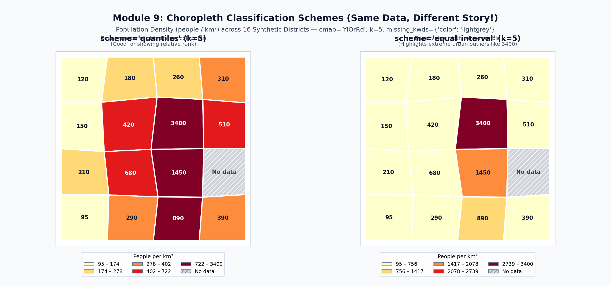
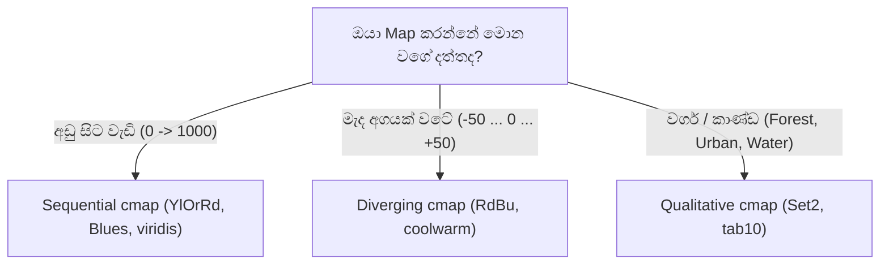

[⬅️ පෙර පාඩම: Attribute Work — Dissolve, GroupBy & Merge](08_Attribute_Work_Dissolve_GroupBy_Merge.md) | [🏠 මුල් පිටුව (README)](README.md) | [ඊළඟ පාඩම: Ecosystem Integration ➡️](10_Ecosystem_Integration.md)

---

# පාඩම 09: Visualisation සහ Interactive Maps (සිතියම් නිර්මාණය)

## 1. මේ පාඩමෙන් අපි මොනවද ඉගෙන ගන්නේ?

දත්ත කොච්චර හොඳට විශ්ලේෂණය කළත්, ඒක අනිත් අයට තේරෙන විදියට **ලස්සන, නිවැරදි සිතියමක්** විදියට පෙන්වන්න බැරි නම් වැඩේ සම්පූර්ණ නෑ!

GeoPandas වලින් අපිට ප්‍රධාන වර්ග දෙකක සිතියම් හදන්න පුළුවන්:
1. **Static Maps (Matplotlib පාවිච්චි කරලා):** වාර්තා (reports), පර්යේෂණ පත්‍රිකා (papers), සහ presentations වලට දාන්න පුළුවන් high-resolution PNG/PDF සිතියම් (`.plot()`).
2. **Interactive Web Maps (Folium පාවිච්චි කරලා):** Mouse එකෙන් zoom කරන්න, එහා මෙහා ගෙනියන්න (pan), click කළාම විස්තර පෙන්වන (tooltips/popups) HTML වෙබ් සිතියම් (`.explore()`).

---

## 2. Quick Map සහ Choropleth Maps (වර්ණ ගැන්වූ සිතියම්)

### ඉක්මන් සිතියමක් ඇඳීම (`gdf.plot()`)
දත්ත ටික කොහොමද පේන්නේ කියලා ඉක්මනට බලාගන්න:
```python
gdf.plot(figsize=(8, 8), color='lightblue', edgecolor='navy', linewidth=0.8, alpha=0.8)
```

### Choropleth Map (අගය අනුව Polygons පාට කිරීම)
ජන ඝනත්වය, ආදායම, හෝ උෂ්ණත්වය වගේ සංඛ්‍යාත්මක අගයක් අනුව දිස්ත්‍රික්ක වලට පාට දාන සිතියම් වලට **Choropleth Map** කියනවා:
```python
gdf.plot(
    column='density_km2',
    cmap='YlOrRd',
    legend=True,
    legend_kwds={'label': 'People per km²'},
    missing_kwds={'color': 'lightgrey', 'label': 'No data'}
)
```
- **`missing_kwds`**: දත්ත නැති (`NaN`) දිස්ත්‍රික්කයක් සිතියමෙන් අතුරුදහන් වෙන්නේ නැතිව අළු පාටින් (`lightgrey`) පෙන්වන්න මේක හරිම වැදගත්!

---

## 3. Classification Schemes (`mapclassify`) — එකම දත්ත, වෙනස් කතා!

Choropleth සිතියමක පාට 5ක් (`k=5`) දාද්දී, **කොයි අගයෙන් කොයි පාටට මාරු වෙනවද** කියලා තීරණය කරන්නේ **Classification Scheme** එකෙන් (මේකට `mapclassify` library එක install වෙලා තියෙන්න ඕන).

පහළ තියෙන රූපය හොඳට බලන්න — **එකම දත්ත** `quantiles` සහ `equal_interval` වලින් ඇන්දාම සිතියම පේන විදිය කොච්චර වෙනස්ද!



ප්‍රධාන Schemes ටික මෙන්න:
- **`scheme='quantiles'`**: හැම පාට කාණ්ඩයකටම **සමාන දිස්ත්‍රික්ක ගණනක්** වැටෙන විදියට බෙදනවා (උදා: දිස්ත්‍රික්ක 15 නම්, පාට එකකට 3 ගානේ). සාපේක්ෂ පෙළගැස්ම (relative rank) පෙන්වන්න හොඳයි.
- **`scheme='equal_interval'`**: අවම අගයේ සිට උපරිම අගය දක්වා **සමාන පරතරයන්** වලට බෙදනවා. ඉතාම ඉහළ අගයන් තියෙන නගර (outliers — උදා: කොළඹ 3400) කැපිලා පේනවා!
- **`scheme='natural_breaks'` / `'fisher_jenks'`**: දත්තවල ස්වාභාවිකව තියෙන හිඩැස් (natural clusters) හොයලා කාණ්ඩ වෙන් කරනවා. බොහෝ වෙලාවට හොඳම සමබර ප්‍රතිඵලය දෙනවා.
- **`scheme='user_defined'`**: ඔයාටම අවශ්‍ය සීමාවන් දෙන්න පුළුවන්: `classification_kwds={'bins': [100, 500, 1000, 2000]}`.

### Colour Choices (නිවැරදි වර්ණ මාලාව `cmap` තෝරාගැනීම)
- **Sequential (`'Blues'`, `'YlOrRd'`, `'viridis'`)**: අඩු සිට වැඩි දක්වා යන අගයන්ට (උදා: ජන ඝනත්වය, වර්ෂාපතනය).
- **Diverging (`'RdBu'`, `'coolwarm'`, `'PiYG'`)**: මැද අගයක් (උදා: `0` හෝ සාමාන්‍යය) වටේ දෙපැත්තට යන අගයන්ට (උදා: ඡන්ද ප්‍රතිඵල වෙනස, උෂ්ණත්වය අඩුවීම/වැඩිවීම).



---

## 4. Layering, Markers, Lines සහ Basemaps (`contextily`)

### Layering (එක සිතියමක් උඩ Layers කිහිපයක් ඇඳීම)
පළමු layer එක අඳිද්දී ලැබෙන `ax` එක දෙවැනි layer එකට දෙනවා:
```python
ax = districts.plot(color='#E2E8F0', edgecolor='white', figsize=(9, 9))
# Points (Bubble map — ජනගහනය අනුව තිතේ ප්‍රමාණය වෙනස් වෙනවා)
cities.plot(ax=ax, column='pop', markersize=cities['pop'] / 1e4, color='crimson', alpha=0.7)
# Lines (පාරේ මංතීරු ගණන අනුව රේඛාවේ මහත වෙනස් වෙනවා)
roads.plot(ax=ax, column='type', linewidth=roads['lanes'])
```

### Basemaps එකතු කිරීම (`contextily`)
සිතියමක් වටේ පසුබිම් සිතියමක් (වීදි, මුහුද, නගර නම්) දාන්න **`contextily`** පාවිච්චි කරනවා.
Web map tiles (OpenStreetMap, CartoDB) හැමවෙලේම තියෙන්නේ **Web Mercator (`EPSG:3857`)** වල. ඒ නිසා ඔයාගේ දත්ත `.to_crs(3857)` කරලා අඳින්න, නැත්නම් `cx.add_basemap(ax, crs=gdf.crs)` කියලා දෙන්න:
```python
import contextily as cx

ax = map_df.to_crs(3857).plot(alpha=0.75, edgecolor='white')
cx.add_basemap(ax, source=cx.providers.CartoDB.Positron)
```

---

## 5. Interactive Maps (`gdf.explore()`) — Zoom, Pan & Tooltips!

එක කේත පේළියකින් Google Maps වගේ interactive වෙබ් සිතියමක් හදන්න `gdf.explore()` පාවිච්චි කරන්න පුළුවන් (මේකට `folium` සහ `mapclassify` අවශ්‍යයි):

```python
m = map_df.explore(
    column='density_km2',
    cmap='YlOrRd',
    scheme='quantiles',
    tooltip=['district', 'density_km2'],  # Mouse එක උඩින් ගියාම පේන විස්තර
    popup=True,                           # Click කළාම පේන සම්පූර්ණ විස්තර
    tiles='CartoDB positron',             # පසුබිම් සිතියම
    legend=True
)
# තවත් layer එකක් ඒ interactive map එක උඩටම දානවා!
hospitals.explore(m=m, color='blue', marker_kwds={'radius': 6}, tooltip='name')

# ඕනෑම browser එකකින් අරින්න පුළුවන් standalone HTML ගොනුවක් විදියට Save කරනවා
m.save('density.html')
```

---

## 6. Map Polish, Multi-Panel Maps, Zooming & Exporting

වාර්තාවකට දාන සිතියමක් වෘත්තීය (publication-ready) විදියට ඔප දාන්න:
- **Axes ඉවත් කිරීම & මාතෘකාව:** `ax.set_axis_off()`, `ax.set_title('Population Density', fontsize=14)`
- **Scalebar:** `matplotlib_scalebar` library එකෙන් scale bar එකක් එකතු කරන්න පුළුවන්.
- **Multi-panel Maps (Small Multiples):** එකම ප්‍රදේශයේ විචල්‍ය 3ක් හෝ වසර 3ක් පැත්තෙන් පැත්ත සංසන්දනය කරන්න:
  ```python
  fig, axs = plt.subplots(1, 3, figsize=(15, 5))
  for ax, year in zip(axs, ['y2010', 'y2015', 'y2020']):
      gdf.plot(column=year, cmap='YlOrRd', vmin=0, vmax=5000, ax=ax)
      ax.set_title(year)
      ax.set_axis_off()
  ```
- **Zoom to Extent:** සිතියමේ නිශ්චිත ප්‍රදේශයකට විතරක් zoom කරන්න `total_bounds` පාවිච්චි කරන්න:
  ```python
  minx, miny, maxx, maxy = colombo.total_bounds
  ax.set_xlim(minx - 1000, maxx + 1000)
  ax.set_ylim(miny - 1000, maxy + 1000)
  ```
- **Exporting (Save කිරීම):**
  - Static: `fig.savefig('map.png', dpi=300, bbox_inches='tight')`
  - Interactive: `m.save('map.html')`
- **වෙනත් විශාල සිතියම් සහ 3D මෙවලම් (Other Tools):** මිලියන ගණන් දත්ත හෝ 3D dashboards හදන්න `folium`, `kepler.gl`, `pydeck`, `lonboard`, සහ `Plotly` පාවිච්චි කරනවා.

---

## 7. සම්පූර්ණ කේත උදාහරණය (Complete Code + Line-by-Line Explanation)

```python
import matplotlib.pyplot as plt
import contextily as cx

# 1. Static Choropleth Map + Basemap
fig, ax = plt.subplots(figsize=(8, 8))
map_df.to_crs(3857).plot(
    column='density_km2',
    scheme='quantiles',
    k=5,
    cmap='YlOrRd',
    legend=True,
    legend_kwds={'title': 'People per km2'},
    edgecolor='white',
    linewidth=0.4,
    alpha=0.8,
    ax=ax,
    missing_kwds={'color': 'lightgrey', 'label': 'No data'},
)

cx.add_basemap(ax, source=cx.providers.CartoDB.Positron)
ax.set_axis_off()
ax.set_title('Population density', fontsize=14)
fig.savefig('density.png', dpi=300, bbox_inches='tight')

# 2. Interactive Web Map version
m = map_df.explore(
    column='density_km2',
    cmap='YlOrRd',
    scheme='quantiles',
    tooltip=['district', 'density_km2'],
    legend=True
)
m.save('density.html')
```

### පේළියෙන් පේළිය විස්තරය:
- **පේළිය 5:** 8x8 අඟල් ප්‍රමාණයේ Matplotlib figure එකක් සහ axes එකක් හදනවා.
- **පේළිය 6:** Basemap එකට ගැළපෙන්න `map_df` එක Web Mercator (`EPSG:3857`) වලට හරවලා `.plot()` කරනවා.
- **පේළි 7–16:** `density_km2` අගය `quantiles` කාණ්ඩ 5කට බෙදලා `YlOrRd` වර්ණ මාලාවෙන් පාට කරනවා. `alpha=0.8` නිසා යට තියෙන basemap එකත් යන්තම් පේනවා. දත්ත නැති තැන් අළු පාට (`lightgrey`) වෙනවා.
- **පේළිය 20:** `CartoDB.Positron` කියන පිරිසිදු අළු-සුදු basemap එක යටින් අමුණනවා.
- **පේළි 21–23:** X/Y අක්ෂ ඉවත් කරලා මාතෘකාව දාලා, 300 DPI ගුණාත්මකභාවයෙන් `density.png` save කරනවා.
- **පේළි 26–33:** ඒ දත්තම mouse-over tooltip තියෙන interactive HTML සිතියමක් විදියට `density.html` වලට save කරනවා.

### බලාපොරොත්තු වන ප්‍රතිදානය (Expected Output):
- `density.png`: පසුබිම් සිතියමක් උඩ කහ-තැඹිලි-රතු පාටින් ජන ඝනත්වය පෙන්වන, පිරිසිදු legend එකක් සහිත high-resolution රූපයක්.
- `density.html`: Chrome/Edge වගේ browser එකකින් open කළාම zoom කරන්න සහ දිස්ත්‍රික්ක උඩ mouse එක තිබ්බම `district` සහ `density_km2` පෙන්වන interactive සිතියමක්.

---

## 8. 🧠 මතක තබා ගැනීමට පහසු ක්‍රම (Memory Hacks) & ⚠️ Pitfalls

### 🧠 Memory Hacks
1. **හොඳ සිතියම් නීති 3 (Golden Rules of Cartography):**
   - **Rates, not raw counts** (වර්ගඵලයට හෝ ජනගහනයට අනුපාත map කරන්න).
   - **Choose class breaks deliberately** (`quantiles` vs `equal_interval` හිතලා තෝරන්න).
   - **Always label units & sources** (ඒකක — උදා: `People per km²` — සහ දත්ත මූලාශ්‍රය අනිවාර්යයෙන් දාන්න).
2. **`3857` = Basemap අංකය:** `contextily` දාන හැමවෙලේම `.to_crs(3857)` මතක් වෙන්න ඕන!
3. **Multi-panel සංසන්දනයේදී `vmin` & `vmax` සමාන කරන්න:** වසර 3ක සිතියම් 3ක් අඳිද්දී හැම එකටම එකම `vmin`, `vmax` දෙන්න — නැත්නම් තද රතු පාට එක සිතියමක 100ටත්, අනිත් එකේ 5000ටත් වැටිලා බලන කෙනා නොමඟ යනවා!

> [!WARNING]
> **⚠️ සාමාන්‍යයෙන් වෙන වැරදි (Common Pitfalls):**
> 1. **CRS නොගැළපී Layering කිරීම:** `base.plot()` එක `EPSG:4326` වලිනුත්, `points.plot(ax=ax)` එක `EPSG:32644` වලිනුත් ඇන්දොත් points ටික සිතියමෙන් පිටත කොහේ හරි ගිහින් පේන්නේ නැතිව යනවා!
> 2. **Basemap පේන්නේ නැති වීම:** `contextily` වලට internet connection එකක් අවශ්‍යයි, ඒ වගේම CRS එක `EPSG:3857` (හෝ `crs=gdf.crs` ලබා දීම) අනිවාර්යයි.
> 3. **Missing values (`NaN`) අමතක කිරීම:** `missing_kwds` නොදැම්මොත් දත්ත නැති දිස්ත්‍රික්ක සිතියමෙන් මැකිලා හිස් සුදු කුහර වගේ පේනවා.

---

## 9. ප්‍රායෝගික අභ්‍යාස (Practical Exercises)

### Warm-up Exercise: Zoom to a Specific District
`districts` සිතියම ඇඳලා, `'Colombo'` දිස්ත්‍රික්කය වටේට විතරක් zoom වෙන විදියට `total_bounds`, `set_xlim`, සහ `set_ylim` පාවිච්චි කරන්න.

<details>
<summary>✅ පිළිතුර බලන්න (Click to see Solution)</summary>

```python
import matplotlib.pyplot as plt

districts_m = districts.to_crs(32644)
colombo = districts_m[districts_m['district'] == 'Colombo']
minx, miny, maxx, maxy = colombo.total_bounds

fig, ax = plt.subplots(figsize=(7, 7))
districts_m.plot(ax=ax, color='#E2E8F0', edgecolor='white')
colombo.plot(ax=ax, color='#3B82F6', edgecolor='navy')

pad = 5000  # වටේට 5 km ඉඩක් තියන්න
ax.set_xlim(minx - pad, maxx + pad)
ax.set_ylim(miny - pad, maxy + pad)
ax.set_axis_off()
ax.set_title('Colombo District (Zoomed)')
```
</details>

### Exercise 1: Draw a choropleth of a rate with quantile and equal-interval classes and compare the stories they tell
`map_df` එකේ `'density_km2'` අගය පැත්තෙන් පැත්ත සිතියම් දෙකක් විදියට — එකක් `scheme='quantiles'` සහ අනික `scheme='equal_interval'` — ඇඳලා වෙනස සංසන්දනය කරන්න.

<details>
<summary>✅ පිළිතුර බලන්න (Click to see Solution)</summary>

```python
import matplotlib.pyplot as plt

fig, axs = plt.subplots(1, 2, figsize=(14, 6))

for ax, scheme, title in zip(
    axs,
    ['quantiles', 'equal_interval'],
    ['Quantiles (Equal Count per Class)', 'Equal Interval (Highlights Outliers)']
):
    map_df.plot(
        column='density_km2',
        scheme=scheme,
        k=5,
        cmap='YlOrRd',
        legend=True,
        edgecolor='white',
        linewidth=0.5,
        missing_kwds={'color': 'lightgrey', 'label': 'No data'},
        ax=ax
    )
    ax.set_title(title, fontsize=12)
    ax.set_axis_off()

plt.tight_layout()
fig.savefig('scheme_comparison.png', dpi=300, bbox_inches='tight')
```
</details>

### Exercise 2: Plot points over polygon boundaries and add a basemap
`districts` (Polygons) උඩින් `hospitals` (Points) ඇඳලා, `contextily` වලින් basemap එකක් එකතු කරන්න.

<details>
<summary>✅ පිළිතුර බලන්න (Click to see Solution)</summary>

```python
import matplotlib.pyplot as plt
import contextily as cx

fig, ax = plt.subplots(figsize=(9, 9))

districts.to_crs(3857).plot(
    ax=ax, facecolor='none', edgecolor='#1E293B', linewidth=1.2
)
hospitals.to_crs(3857).plot(
    ax=ax, color='crimson', markersize=40, edgecolor='white', linewidth=0.8, label='Hospitals'
)

cx.add_basemap(ax, source=cx.providers.CartoDB.Positron)
ax.set_axis_off()
ax.set_title('Hospitals across Districts', fontsize=14)
ax.legend()
```
</details>

### Exercise 3: Build an interactive map with tooltips and export it as a standalone HTML file
`map_df` පාවිච්චි කරලා tooltip එකේ `'district'`, `'population'`, සහ `'density_km2'` පෙන්වන interactive map එකක් හදලා `interactive_density.html` ලෙස save කරන්න.

<details>
<summary>✅ පිළිතුර බලන්න (Click to see Solution)</summary>

```python
m = map_df.explore(
    column='density_km2',
    cmap='YlOrRd',
    scheme='natural_breaks',
    k=5,
    tooltip=['district', 'population', 'density_km2'],
    popup=True,
    tiles='CartoDB positron',
    legend=True
)
m.save('interactive_density.html')
print("Saved interactive_density.html successfully!")
```
</details>

### Exercise 4: Create a three-panel figure showing the same area for three years
`pop_df` එකේ `'density_2000'`, `'density_2010'`, සහ `'density_2020'` කියලා columns 3ක් තියෙනවා. එකම colour scale එක (`vmin`, `vmax`) පාවිච්චි කරලා පැත්තෙන් පැත්ත 3-panel සිතියමක් අඳින්න.

<details>
<summary>✅ පිළිතුර බලන්න (Click to see Solution)</summary>

```python
import matplotlib.pyplot as plt

years = ['density_2000', 'density_2010', 'density_2020']
vmax = pop_df[years].max().max()
vmin = pop_df[years].min().min()

fig, axs = plt.subplots(1, 3, figsize=(16, 5))

for ax, col in zip(axs, years):
    pop_df.plot(
        column=col,
        cmap='viridis',
        vmin=vmin,
        vmax=vmax,
        edgecolor='white',
        linewidth=0.3,
        legend=(col == years[-1]),  # අන්තිම panel එකට විතරක් colorbar එක
        ax=ax
    )
    ax.set_title(col.replace('density_', 'Year '), fontsize=13)
    ax.set_axis_off()

fig.suptitle('Population Density Change (2000 – 2020)', fontsize=15)
plt.tight_layout()
```
</details>

---

## 10. කෙටි සාරාංශය (Cheat Sheet Summary Table)

| අවශ්‍යතාවය | පාවිච්චි කරන API / කේතය |
| --- | --- |
| සරල සිතියමක් | `gdf.plot(figsize=(8, 8), color='lightblue', edgecolor='black')` |
| Choropleth සිතියමක් | `gdf.plot(column='rate', cmap='YlOrRd', legend=True, missing_kwds={'color': 'lightgrey'})` |
| Classification Schemes | `scheme='quantiles' / 'equal_interval' / 'natural_breaks' / 'fisher_jenks' / 'user_defined', k=5` |
| Layers කිහිපයක් ඇඳීම | `ax = base.plot(); points.plot(ax=ax, markersize=...)` |
| Basemap එකතු කිරීම | `cx.add_basemap(ax, source=cx.providers.CartoDB.Positron)` (CRS `EPSG:3857` කර!) |
| Interactive Web Map | `m = gdf.explore(column='rate', cmap='YlOrRd', tooltip=['name', 'rate'], legend=True)` |
| Interactive Layers එකතු කිරීම | `m = a.explore(); b.explore(m=m)` |
| Map Polish | `ax.set_axis_off()`, `ax.set_title('...')` |
| Multi-panel (Small multiples) | `fig, axs = plt.subplots(1, 3)` සමඟ `ax=axs[i]` |
| Zoom කිරීම | `minx, miny, maxx, maxy = gdf.total_bounds; ax.set_xlim(minx, maxx)` |
| Export කිරීම | `fig.savefig('map.png', dpi=300, bbox_inches='tight')` / `m.save('map.html')` |

---

[⬅️ පෙර පාඩම: Attribute Work — Dissolve, GroupBy & Merge](08_Attribute_Work_Dissolve_GroupBy_Merge.md) | [🏠 මුල් පිටුව (README)](README.md) | [ඊළඟ පාඩම: Ecosystem Integration ➡️](10_Ecosystem_Integration.md)
