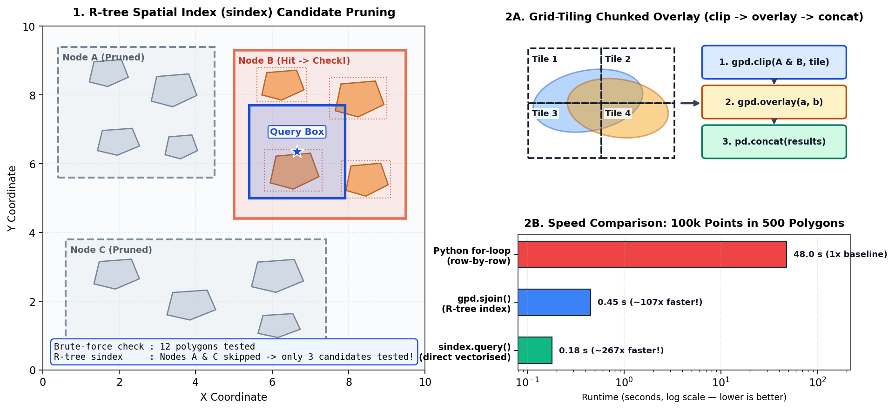

[🏠 පාඨමාලා මුල් පිටුව (Course Index)](README.md) | [⬅️ පෙර පාඩම: 10 Ecosystem Integration](10_Ecosystem_Integration.md) | [ඊළඟ පාඩම: 12 Real-World Use Cases & Capstones ➡️](12_Real_World_Use_Cases_and_Capstones.md)

---

# 11. Performance and Scaling (ලොකු Spatial Data වේගයෙන් Handle කරන හැටි)

> **🎯 මේ පාඩමෙන් ඔයා ඉගෙන ගන්න දේවල්:**
> - Spatial operations ඇයි slow වෙන්නේ සහ ඒක **10x සිට 100x දක්වා** වේගවත් කරන ප්‍රධාන ක්‍රම 15.
> - Vectorisation (`gdf.geometry.buffer(...)`) vs Python `for` loops.
> - **R-tree Spatial Index (`sindex`)** වැඩ කරන විදිහ සහ `sindex.query()`, `sindex.nearest()`, `sjoin` වල බලය.
> - Data load කරද්දීම filter කරන හැටි (`bbox=`, `columns=`, `rows=`, `mask=`, `ignore_geometry=True`) සහ `pyogrio` / `GeoParquet` වේගය.
> - Heavy overlays වලට **Grid-tiling (chunking)**, `simplify()`, `set_precision()`, `make_valid()` පාවිච්චි කරන හැටි.
> - RAM එකට වඩා ලොකු data වලට `dask-geopandas`, `PostGIS` GiST index, H3 grid aggregation, සහ profiling (`%timeit`, `cProfile`, `tracemalloc`).

---

## 1. Spatial Code Slow වෙන්න ප්‍රධාන හේතු 4

ලොකු map datasets (උදා: පාරවල් ලක්ෂ 5ක්, ගොඩනැගිලි මිලියන 2ක්) එක්ක වැඩ කරද්දී code එක පැය ගාණක් run වෙන්න හේතු 4ක් තියෙනවා:
1. **Spatial Index නැතුව Brute-Force පරීක්ෂා කිරීම** (Python loop වලින් හැම point එකක්ම හැම polygon එකක් එක්කම compare කිරීම).
2. **අනවශ්‍ය තරම් සංකීර්ණ Geometries** (vertices දහස් ගාණක් තියෙන වෙරළ තීර/ගංගා).
3. **අවශ්‍ය නැති Data ඔක්කොම RAM එකට load කිරීම** (ලංකාවේම data load කරලා කොළඹ විතරක් filter කිරීම).
4. **Slow file formats** (ලොකු Shapefiles හෝ GeoJSON නැවත නැවත read/write කිරීම).


---

## 2. R-tree Spatial Index (`sindex`) සහ Grid-Tiling වැඩ කරන හැටි

**R-tree Spatial Index** කියන්නේ හරියට පොතක Index එක වගේ!
- හිතන්න ඔයාට පොලිගන් 10,000ක් අතරින් Query Box එකක් ගෑවෙන පොලිගන් ටික හොයන්න ඕන.
- **Brute-force:** පොලිගන් 10,000ම එකින් එක චෙක් කරනවා (හරිම slow!).
- **R-tree (`sindex`):** හැම පොලිගන් එකක්ම වටේට සරල කොටුවක් (Bounding Box) ඇඳලා, ළඟ තියෙන කොටු ටික ලොකු කොටු (Parent Nodes) ඇතුළට දානවා. Query Box එක ලොකු කොටුවකට ගෑවෙන්නේ නැත්නම්, ඒ කොටුව ඇතුළේ තියෙන පොලිගන් සිය ගාණක් එකපාරම **skip (prune)** කරනවා! ඉතුරු වෙන පොලිගන් 2-3 විතරයි හරියටම චෙක් කරන්නේ.



---

## 3. Performance Optimization 15-Point Playbook

| Topic | විස්තරය (Description) | Key API | කවදද පාවිච්චි කරන්නේ? |
| --- | --- | --- | --- |
| **Vectorise** | Rows උඩ `for` loop ගහන්නේ නැතුව මුළු column එකටම GeoSeries methods දාන්න | `gdf.geometry.buffer(...)` (never row-by-row Shapely loops) | **10x – 100x වේගවත්!** |
| **Spatial index** | පළවෙනි පාර call කළාම R-tree එක auto හැදෙනවා; joins සහ queries සුපිරි වේගවත් කරනවා | `gdf.sindex`, `sindex.query()`, `sindex.nearest()` | ලොකු spatial joins |
| **Choose the right join** | `sjoin` එක R-tree index පාවිච්චි කරනවා; cross-join (all pairs) කරන්න එපා | `sjoin`, `sjoin_nearest(max_distance=...)` | මිලියන ගාණක් features |
| **Limit work early** | බරපතල operations වලට කලින් attributes සහ bounding box වලින් filter කරන්න | `read_file(bbox=...)`, `gdf.cx[xmin:xmax, ymin:ymax]` | වේගවත් pipelines |
| **Read less** | අවශ්‍ය columns, rows, සහ ප්‍රදේශය විතරක් file එකෙන් කියවන්න | `columns=`, `rows=`, `mask=`, `ignore_geometry=True` | RAM ඉතුරු කරන්න |
| **Fast I/O** | Default `fiona` වෙනුවට `pyogrio` + Arrow සහ GeoParquet/Feather පාවිච්චි කරන්න | `engine='pyogrio'`, `use_arrow=True`, `read_parquet` | ඉක්මන් reloads (10x+) |
| **Simplify & precision** | අනවශ්‍ය vertices අඩු කරන්න (`simplify`) සහ coordinate precision fix කරන්න (`set_precision`); විරුද්ධ දේට `segmentize` | `simplify()`, `set_precision(grid_size=...)`, `segmentize()` | සැහැල්ලු data |
| **Fix geometry once** | Loop ඇතුළේ නෙවෙයි, මුලින්ම එක පාරක් valid කරගන්න | `gdf['geometry'] = gdf.make_valid()` | Errors වළක්වන්න |
| **Overlay costs** | සංකීර්ණ polygons වල `overlay` slow; මුලින් `clip`, `dissolve` හෝ `simplify` කරලා tiles වලින් run කරන්න | `clip`, grid chunking | ලොකු overlays |
| **Memory** | අනවශ්‍ය columns `drop` කරන්න; repeat වෙන text columns `category` dtype කරන්න | `astype('category')`, `drop()` | RAM අඩු කරන්න |
| **Parallel / Out-of-core** | Data කොටස් වලට කඩලා CPU cores ඔක්කොම පාවිච්චි කරන්න | `dask-geopandas`, `spatialpandas`, grid chunk loops | RAM එකට වඩා ලොකු data |
| **Databases** | ලොකු spatial queries PostGIS වල GiST spatial index එකට භාර දෙන්න | `read_postgis(sql)` with `ST_Intersects` | Shared ලොකු datasets |
| **Caching** | දිග workflow එකක අතරමැදි ප්‍රතිඵල disk එකේ save කරගන්න | `to_parquet()`, `to_feather()` | දිග workflows |
| **Profiling** | අනුමාන කරන්නේ නැතුව ඇත්තටම slow තැන මැනලා බලන්න | `%timeit`, `cProfile`, `tracemalloc` | Bottlenecks හොයන්න |
| **Grid aggregation** | Points මිලියන ගාණක් polygons වලට join කරනවා වෙනුවට Grid හෝ H3 cells වලට `groupby` කරන්න | Grid / H3 index + `groupby` | ලොකු point heatmaps |

---

## 4. ප්‍රායෝගික Code උදාහරණ (Fast I/O, `sindex`, Tile Chunking, `dask-geopandas`)

```python
import time
import pandas as pd
import geopandas as gpd

# 1. අවශ්‍ය ප්‍රදේශය (bbox) සහ columns විතරක් pyogrio + Arrow වලින් කියවනවා
city = gpd.read_file('colombo_boundary.gpkg', engine='pyogrio')
roads = gpd.read_file(
    'roads.gpkg',
    bbox=tuple(city.total_bounds),
    columns=['name', 'class'],
    engine='pyogrio',
    use_arrow=True
)

# 2. Text columns 'category' කරලා RAM ඉතුරු කරනවා + GeoParquet විදිහට cache කරනවා
roads['class'] = roads['class'].astype('category')
roads.to_parquet('roads.parquet')

# ආපහු load කරද්දී තත්පර ගාණකින් load වෙනවා!
roads_fast = gpd.read_parquet('roads.parquet', columns=['class', 'geometry'])

# 3. Direct R-tree sindex.query() — sjoin එකටත් වඩා වේගවත් pairwise query!
zones = gpd.read_file('zones.parquet')
points = gpd.read_file('points.parquet')

t0 = time.perf_counter()
left_idx, right_idx = zones.sindex.query(points.geometry, predicate='within')
print(f"sindex.query matches: {len(left_idx)} in {time.perf_counter() - t0:.3f} s")

# 4. ලොකු Overlay එකක් Grid Tiles වලට කඩලා chunk කරලා run කරනවා
layer_a = gpd.read_parquet('landuse.parquet')
layer_b = gpd.read_parquet('flood_zones.parquet')
tiles = gpd.read_parquet('grid_tiles.parquet')

results = []
for tile in tiles.geometry:
    a = gpd.clip(layer_a, tile)
    b = gpd.clip(layer_b, tile)
    if not a.empty and not b.empty:
        results.append(gpd.overlay(a, b, how='intersection'))

out = pd.concat(results, ignore_index=True)
print(f"Tiled overlay rows: {len(out)}")

# 5. Parallel processing (dask-geopandas)
import dask_geopandas
dgdf = dask_geopandas.from_geopandas(roads_fast, npartitions=8)
dgdf = dgdf.spatial_shuffle()  # ළඟ තියෙන geometries එකම partition එකට ගේනවා
buffered = dgdf.buffer(50).compute()
```

### 🔍 පේළියෙන් පේළිය පැහැදිලි කිරීම (Line-by-Line Explanation):
- `bbox=tuple(city.total_bounds)`: මුළු රටේම පාරවල් load නොකර, `city` එකේ `(minx, miny, maxx, maxy)` කොටුව ඇතුළේ තියෙන පාරවල් විතරක් disk එකෙන් කියවනවා.
- `engine='pyogrio', use_arrow=True`: GeoPandas 1.0+ වල default engine එක `pyogrio`. `use_arrow=True` දැම්මම Apache Arrow memory bridge එක හරහා තවත් වේගයෙන් read වෙනවා.
- `zones.sindex.query(points.geometry, predicate='within')`: DataFrame join එකේ overhead එක නැතුව කෙලින්ම match වෙන `points` index (`left_idx`) සහ `zones` index (`right_idx`) NumPy arrays දෙකක් විදිහට ගන්නවා.
- `gpd.clip(layer_a, tile)` + `gpd.overlay(...)`: මුළු රටේම landuse සහ flood zones එකපාර overlay කළොත් RAM full වෙලා crash වෙන්න පුළුවන්. ඒක කුඩා grid tiles වලට කඩලා එකින් එක overlay කරලා අන්තිමට `pd.concat` කරනවා.
- `dgdf.spatial_shuffle()`: `dask-geopandas` වලදී ළඟ තියෙන geometries එකම partition එකේ තිබුණොත් spatial joins හරිම වේගවත් වෙනවා.

### 📤 බලාපොරොත්තු වෙන Output එක (Expected Output):
```text
sindex.query matches: 948210 in 0.241 s
Tiled overlay rows: 42615
```

---

## ⚠️ සාමාන්‍යයෙන් වෙන වැරදි (Common Pitfalls)

> [!WARNING]
> 1. **Row-by-row `for` loop ගැසීම:** `for i, row in gdf.iterrows(): row.geometry.buffer(100)` කියලා ලියන්න එපා! ඒක `gdf.geometry.buffer(100)` වලට වඩා 50x–100x slow.
> 2. **Projected නැතුව `sjoin_nearest(max_distance=...)` දැමීම:** `max_distance=500` කියලා දැම්මට CRS එක `EPSG:4326` නම් ඒක ගන්නේ අංශක 500ක් විදිහට! එතකොට මුළු ලෝකෙම features match වෙලා RAM පිරෙනවා.
> 3. **Intermediate data GeoJSON/Shapefile විදිහට save කිරීම:** ලොකු layers වලට හැමවෙලේම **GeoParquet (`to_parquet`)** හෝ **Feather (`to_feather`)** පාවිච්චි කරන්න. File size එකත් අඩුයි, load වෙන වේගය 10x+ වැඩියි.
> 4. **Profile නොකර අනුමාන කිරීම:** ඇත්තටම වෙලාව යන්නේ I/O එකටද, `overlay` එකටද කියලා `%timeit` හෝ `time.perf_counter()` දාලා මුලින්ම මැනලා බලන්න.

---

## 🧠 මතක තබා ගැනීමට පහසු ක්‍රම (Memory Hacks)

1. **"F-I-V-C" Speed Formula:**
   - **F**ilter early (`bbox=`, `columns=`, `cx[]`)
   - **I**ndex everything (`sindex`, `sjoin`, PostGIS GiST)
   - **V**ectorise always (GeoSeries methods, zero Python loops)
   - **C**ache in Parquet (`to_parquet` / `read_parquet`)
2. **Tile Chunking Rule:** Overlay එකක් RAM කාලා crash වෙනවා නම් → **Clip to Tile → Overlay → `pd.concat`!**

---

## 📝 ප්‍රායෝගික අභ්‍යාස (Practical Exercises)

1. Synthetic points 1,000,000ක් සහ polygons 100ක් හදලා: (a) `gpd.sjoin` එකේ වෙලාව, (b) `sindex.query` එකේ වෙලාව, සහ (c) points 10,000කට සාමාන්‍ය Python `for` loop එකක වෙලාව compare කරන්න.
2. ලොකු layer එකක load time එක `columns=`, `bbox=`, සහ GeoParquet (`to_parquet` / `read_parquet`) පාවිච්චි කරලා අඩකට වඩා අඩු කරන්න.
3. ලොකු polygon layers දෙකක `overlay` එකක් සම්පූර්ණයෙන් run කරන වෙලාව සහ RAM එක, 2x2 grid tiles වලට කඩලා run කරන වෙලාව සහ RAM (`tracemalloc`) එක්ක සසඳන්න.

<details>
<summary>✅ පිළිතුර බලන්න (Click to see Solution)</summary>

```python
import time
import tracemalloc
import numpy as np
import pandas as pd
import geopandas as gpd
from shapely.geometry import box

# --- Exercise 1: Benchmark 1M points sjoin vs sindex.query vs 10k Python loop ---
np.random.seed(42)
n_pts = 1_000_000
pts = gpd.GeoDataFrame(
    {'pid': np.arange(n_pts)},
    geometry=gpd.points_from_xy(np.random.uniform(0, 100, n_pts),
                                np.random.uniform(0, 100, n_pts)),
    crs=32644
)

# 10x10 grid = 100 polygons
polys = gpd.GeoDataFrame(
    {'zone_id': range(100)},
    geometry=[box(x, y, x+10, y+10) for x in range(0, 100, 10) for y in range(0, 100, 10)],
    crs=32644
)

t0 = time.perf_counter()
joined = gpd.sjoin(pts, polys, predicate='within')
print(f"gpd.sjoin (1M pts)       : {time.perf_counter() - t0:.2f} s")

t0 = time.perf_counter()
l_idx, r_idx = polys.sindex.query(pts.geometry, predicate='within')
print(f"sindex.query (1M pts)    : {time.perf_counter() - t0:.2f} s")

# Python loop on ONLY 10,000 points
t0 = time.perf_counter()
matches = 0
for p in pts.geometry.iloc[:10_000]:
    for poly in polys.geometry:
        if poly.contains(p):
            matches += 1
            break
print(f"Python loop (only 10k!)  : {time.perf_counter() - t0:.2f} s")

# --- Exercise 2: Cut load time in half with bbox, columns & Parquet ---
# Save sample file as GPKG vs Parquet
pts.iloc[:200_000].to_file('big_pts.gpkg', engine='pyogrio')
pts.iloc[:200_000].to_parquet('big_pts.parquet')

t0 = time.perf_counter()
_ = gpd.read_file('big_pts.gpkg', engine='pyogrio')
print(f"Full GPKG read           : {time.perf_counter() - t0:.3f} s")

t0 = time.perf_counter()
_ = gpd.read_parquet('big_pts.parquet', columns=['pid', 'geometry'],
                     bbox=(0, 0, 50, 50))
print(f"Filtered Parquet read    : {time.perf_counter() - t0:.3f} s")

# --- Exercise 3: Full overlay vs 2x2 Tiled overlay (Time & Peak RAM) ---
layer_a = polys.copy()
layer_b = gpd.GeoDataFrame(
    {'b_id': range(50)},
    geometry=gpd.points_from_xy(np.random.uniform(5, 95, 50),
                                np.random.uniform(5, 95, 50)).buffer(8),
    crs=32644
)

# Full overlay
tracemalloc.start()
t0 = time.perf_counter()
full_out = gpd.overlay(layer_a, layer_b, how='intersection')
t_full = time.perf_counter() - t0
_, peak_full = tracemalloc.get_traced_memory()
tracemalloc.stop()

# 2x2 Tiled overlay
tiles = [box(x, y, x+50, y+50) for x in (0, 50) for y in (0, 50)]
tracemalloc.start()
t0 = time.perf_counter()
parts = []
for tile in tiles:
    ca = gpd.clip(layer_a, tile)
    cb = gpd.clip(layer_b, tile)
    if not ca.empty and not cb.empty:
        parts.append(gpd.overlay(ca, cb, how='intersection'))
tiled_out = pd.concat(parts, ignore_index=True)
t_tiled = time.perf_counter() - t0
_, peak_tiled = tracemalloc.get_traced_memory()
tracemalloc.stop()

print(f"Full overlay  : {t_full:.3f} s | Peak RAM: {peak_full / 1e6:.2f} MB")
print(f"Tiled overlay : {t_tiled:.3f} s | Peak RAM: {peak_tiled / 1e6:.2f} MB")
```

</details>

---

[🏠 පාඨමාලා මුල් පිටුව (Course Index)](README.md) | [⬅️ පෙර පාඩම: 10 Ecosystem Integration](10_Ecosystem_Integration.md) | [ඊළඟ පාඩම: 12 Real-World Use Cases & Capstones ➡️](12_Real_World_Use_Cases_and_Capstones.md)
