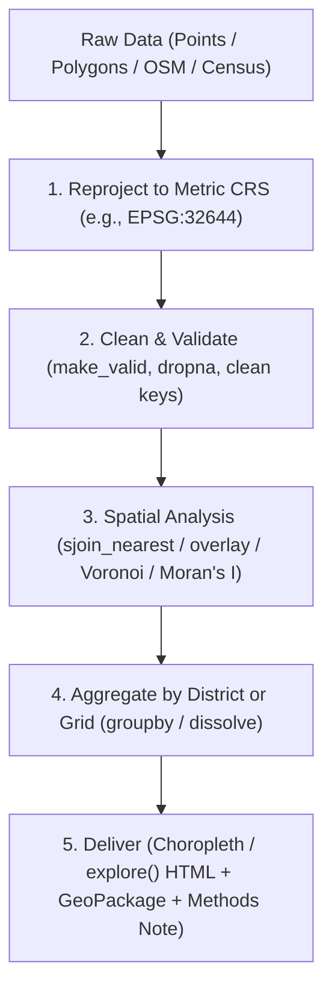
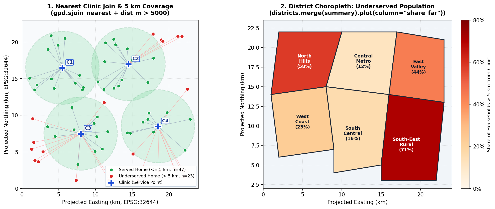

[🏠 පාඨමාලා මුල් පිටුව (Course Index)](README.md) | [⬅️ පෙර පාඩම: 11 Performance & Scaling](11_Performance_and_Scaling.md) | [ඊළඟ පාඩම: 13 Cheat Sheet, Pitfalls & Study Plan ➡️](13_Cheat_Sheet_Pitfalls_and_Study_Plan.md)

---

# 12. Real-World Use Cases and Capstone Projects (සැබෑ ලෝකයේ Projects 6ක්)

> **🎯 මේ පාඩමෙන් ඔයා ඉගෙන ගන්න දේවල්:**
> - ලෝකයේ ප්‍රධාන ක්ෂේත්‍ර (Domains) 10ක GeoPandas පාවිච්චි වෙන සැබෑ ප්‍රශ්න සහ tools.
> - **Capstone Projects 6ක** සම්පූර්ණ ප්‍රායෝගික walkthrough code (Service Access, Flood Exposure, Retail Catchments, Regional Dashboard, Hotspot Detection, Street Network Analysis).
> - වෘත්තීය GIS project එකක් පිරිසිදුව කරන හැටි (**Project Hygiene Checklist**).
> - නොමිලේ සැබෑ geospatial data ගන්න පුළුවන් හොඳම **Practice Data Sources**.

---

## 1. ක්ෂේත්‍ර 10ක සැබෑ ලෝකයේ GeoPandas භාවිතයන් (Use Cases by Domain)

| ක්ෂේත්‍රය (Domain) | සාමාන්‍යයෙන් අහන ප්‍රශ්න (Typical Questions) | ප්‍රධාන Tools (Core Tools) |
| --- | --- | --- |
| **Urban planning** | විනාඩි 10ක පයින් යන දුරින් උද්‍යානයක් (park) නැති ප්‍රදේශ මොනවද? හැම ward එකේම ජන ඝනත්වය කීයද? | `buffer`, `sjoin`, `overlay`, `dissolve` |
| **Retail & logistics** | කුමන වෙළඳසැල්ද කුමන පාරිභෝගිකයන්ට සේවය දෙන්නේ? අලුත් warehouse එකක් දාන්න ඕන කොහෙද? | `sjoin_nearest`, `voronoi_polygons`, catchment buffers |
| **Public health** | රෝග ව්‍යාප්තිය වැඩිම කොහෙද? සායනයකට (clinic) වඩා දුරින් ජීවත් වෙන්නේ කවුද? | choropleths, `sjoin_nearest`, spatial statistics |
| **Environment & climate** | වනාන්තර කොච්චරක් රක්ෂිත ප්‍රදේශ ඇතුළේ තියෙනවද? ගංවතුර කලාපවලට අහුවෙන ගම් මොනවද? | `overlay`, `zonal_stats`, raster hand-off |
| **Real estate & insurance** | දේපළවලට ස්වභාවික විපත් අවදානම කොච්චරද? ප්‍රදේශය අනුව ඉඩම් මිල කොහොමද? | `sjoin`, `buffer`, `overlay` |
| **Transport** | දිස්ත්‍රික්කයකට තියෙන මාර්ග දිග කීයද? බස් නැවතුම් ආවරණය සහ ප්‍රවේශ්‍යතාව (accessibility) කොහොමද? | line `length`, `osmnx`, graphs |
| **Agriculture** | කුඹුරු/වගා බිම් මායිම්, හැම ඉඩමකටම ලැබෙන වර්ෂාපතනය සහ පසේ ගුණාත්මකභාවය | `zonal_stats`, `overlay` |
| **Emergency response** | ළඟම ගිනි නිවන/පොලිස් ස්ථානය මොකක්ද? ප්‍රතිචාර දැක්වීමේ ආවරණ කලාප (response coverage) | `sjoin_nearest`, service areas |
| **Elections & demographics** | ඡන්ද කොට්ඨාස මායිම් වෙනස්වීම්, දිස්ත්‍රික්ක අනුව ජනගහනය, boundary compactness | `dissolve`, `area` measures |
| **Telecoms** | 4G/5G කුළුණු වල signal coverage එක සහ signal නැති හිස් තැන් (gaps) හොයනවා | `buffer`, `difference`, `union_all` |

---

## 2. Capstone Projects 6 (Portfolio-Ready Walkthroughs)

ඔයාගේ MSc project එකට හෝ GitHub portfolio එකට දාන්න පුළුවන් සුපිරි Capstone Projects 6ක් මෙතන තියෙනවා:



---

### 🏥 Capstone 1: Access to Services (සායන වලින් 5 km ට වඩා දුරින් ඉන්න ජනතාව)

- **Data ideas:** ජනගහන grid/ගෙවල් points, clinics/schools points, දිස්ත්‍රික්ක boundaries.
- **Skills tested:** CRS, buffers, `sjoin`, `sjoin_nearest`, choropleth.
- **Deliverable:** 5 km ට වඩා දුරින් ජීවත් වෙන අයගේ ප්‍රතිශතය පෙන්වන map එක සහ වගුව.



```python
import geopandas as gpd
import matplotlib.pyplot as plt

# 1. දත්ත load කරලා meter වලින් මනින්න පුළුවන් UTM CRS (Sri Lanka: EPSG:32644) වලට හරවනවා
homes = gpd.read_file('homes.gpkg').to_crs(32644)
clinics = gpd.read_file('clinics.gpkg').to_crs(32644)
districts = gpd.read_file('districts.gpkg').to_crs(32644)

# 2. හැම ගෙදරකටම ළඟම clinic එක සහ ඒකට තියෙන දුර (dist_m) හොයනවා
near = gpd.sjoin_nearest(
    homes,
    clinics[['clinic_id', 'geometry']],
    how='left',
    distance_col='dist_m'
)

# 3. 5 km (5000 m) ට වඩා දුරින් ඉන්න ගෙවල් තෝරනවා
far = near[near['dist_m'] > 5000]

# 4. හැම දිස්ත්‍රික්කයකම 5 km ට වඩා දුරින් ඉන්න ජනගහන ප්‍රතිශතය (share_far) හදනවා
summary = (
    far.groupby('district')['household_size'].sum()
       .div(homes.groupby('district')['household_size'].sum())
       .fillna(0)
       .rename('share_far')
       .reset_index()
)

# 5. දිස්ත්‍රික්ක boundaries එක්ක merge කරලා Choropleth Map එක අඳිනවා
result = districts.merge(summary, on='district', how='left')
ax = result.plot(
    column='share_far',
    cmap='OrRd',
    legend=True,
    scheme='quantiles',
    edgecolor='black',
    linewidth=0.6,
    figsize=(8, 6)
)
ax.set_title('Share of Population Living > 5 km from a Clinic')
ax.set_axis_off()
plt.tight_layout()
plt.savefig('capstone1_service_access.png', dpi=200)
```

**Expected Output (`summary.head()`):**
```text
        district  share_far
0  Central Metro       0.12
1    East Valley       0.44
2    North Hills       0.58
3  South-East          0.71
```

---

### 🌊 Capstone 2: Flood Exposure Analysis (ගංවතුර අවදානම් ප්‍රදේශ විශ්ලේෂණය)

- **Data ideas:** Flood zone polygons, buildings හෝ land-use polygons, districts.
- **Skills tested:** `clip`, `overlay`, `area` calculations, `dissolve`.
- **Deliverable:** හැම දිස්ත්‍රික්කයකම ගංවතුරට යටවෙන වර්ගඵලය සහ ප්‍රතිශතය + map එක.

```python
import geopandas as gpd

districts = gpd.read_file('districts.gpkg').to_crs(32644)
flood = gpd.read_file('flood_zones.gpkg').to_crs(32644)

# 1. Invalid geometries මුලින්ම fix කරගන්නවා
districts['geometry'] = districts.make_valid()
flood['geometry'] = flood.make_valid()

# 2. හැම දිස්ත්‍රික්කයකම මුළු වර්ගඵලය (km²)
districts['total_km2'] = districts.geometry.area / 1e6

# 3. Flood polygons ටික එකට dissolve කරලා districts එක්ක intersect කරනවා
flood_merged = flood.dissolve()
exposed = gpd.overlay(districts[['district', 'total_km2', 'geometry']],
                      flood_merged[['geometry']], how='intersection')
exposed['flood_km2'] = exposed.geometry.area / 1e6

# 4. දිස්ත්‍රික්කය අනුව ගංවතුර ප්‍රතිශතය හදනවා
report = exposed.groupby('district')['flood_km2'].sum().reset_index()
districts = districts.merge(report, on='district', how='left').fillna({'flood_km2': 0})
districts['flood_pct'] = (districts['flood_km2'] / districts['total_km2']) * 100

print(districts[['district', 'total_km2', 'flood_km2', 'flood_pct']].sort_values('flood_pct', ascending=False))
```

---

### 🛒 Capstone 3: Retail Catchments (වෙළඳසැල් ආවරණ කලාප සහ ආදායම)

- **Data ideas:** Store points, customer points (with spend/revenue).
- **Skills tested:** `voronoi_polygons`, `buffer`, `sjoin`, aggregation.
- **Deliverable:** හැම store එකකම catchment area එක සහ revenue එක පෙන්වන interactive map එක.

```python
import geopandas as gpd

stores = gpd.read_file('stores.gpkg').to_crs(32644)
customers = gpd.read_file('customers.gpkg').to_crs(32644)
city = gpd.read_file('city_boundary.gpkg').to_crs(32644)

# 1. Stores වටේ Voronoi catchments හදලා නගර සීමාවට clip කරනවා
vor_geoms = stores.geometry.voronoi_polygons(extend_to=city.union_all())
vor_gdf = gpd.GeoDataFrame(geometry=vor_geoms, crs=32644)
catchments = gpd.sjoin(vor_gdf, stores[['store_id', 'store_name', 'geometry']], predicate='contains')
catchments = gpd.clip(catchments.drop(columns='index_right'), city)

# 2. පාරිභෝගිකයන් කුමන catchment එකටද වැටෙන්නේ කියලා sjoin කරලා revenue එකතු කරනවා
cust_joined = gpd.sjoin(customers, catchments[['store_id', 'geometry']], predicate='within')
rev = cust_joined.groupby('store_id')['spend_lkr'].agg(['count', 'sum']).reset_index()
rev.columns = ['store_id', 'n_customers', 'total_revenue']

catchments = catchments.merge(rev, on='store_id', how='left').fillna(0)
# Interactive map එක HTML එකක් විදිහට save කරනවා
m = catchments.explore(column='total_revenue', cmap='YlGn',
                       tooltip=['store_name', 'n_customers', 'total_revenue'])
m.save('capstone3_retail_catchments.html')
```

---

### 📊 Capstone 4: Regional Dashboard Map (ජනගහන දත්ත Interactive Map එක)

- **Data ideas:** Census CSV table + administrative boundaries.
- **Skills tested:** Attribute `merge`, density rates, classification (`scheme`), `explore()`.
- **Deliverable:** Tooltips එක්ක share කරන්න පුළුවන් interactive HTML choropleth map එක.

```python
import pandas as pd
import geopandas as gpd

boundaries = gpd.read_file('ds_divisions.gpkg')
census = pd.read_csv('census_2024.csv', dtype={'ds_code': str})
boundaries['ds_code'] = boundaries['ds_code'].astype(str).str.zfill(4)
census['ds_code'] = census['ds_code'].str.zfill(4)

# Attribute join (left merge so no boundary polygons are lost!)
dash = boundaries.merge(census, on='ds_code', how='left')

# වර්ග කිලෝමීටරයට ජන ඝනත්වය (Rates, NOT raw counts!)
dash['area_km2'] = dash.to_crs(32644).geometry.area / 1e6
dash['pop_density'] = (dash['population'] / dash['area_km2']).round(1)

m = dash.explore(
    column='pop_density',
    scheme='NaturalBreaks',
    k=5,
    cmap='YlOrRd',
    tooltip=['ds_name', 'population', 'pop_density'],
    legend_kwds={'caption': 'Population per km²'}
)
m.save('capstone4_regional_dashboard.html')
```

---

### 🔥 Capstone 5: Hotspot Detection (අනතුරු / අපරාධ කේන්ද්‍රස්ථාන හඳුනාගැනීම)

- **Data ideas:** Incident points (road accidents, crime, dengue cases).
- **Skills tested:** Grid/H3 aggregation, `esda` Moran's I සහ Getis-Ord `G_Local`.
- **Deliverable:** Statistically significant hotspot clusters පෙන්වන map එක.

```python
import numpy as np
import geopandas as gpd
from shapely.geometry import box
from libpysal.weights import Queen
from esda.getisord import G_Local

incidents = gpd.read_file('accidents.gpkg').to_crs(32644)

# 1. 1 km x 1 km grid එකක් හදනවා
minx, miny, maxx, maxy = incidents.total_bounds
step = 1000
grid = gpd.GeoDataFrame(
    geometry=[box(x, y, x+step, y+step)
              for x in np.arange(minx, maxx, step)
              for y in np.arange(miny, maxy, step)],
    crs=32644
)
grid['cell_id'] = range(len(grid))

# 2. හැම කොටුවක් ඇතුළෙම තියෙන incidents ගණන් කරනවා
counts = gpd.sjoin(incidents, grid, predicate='within').groupby('cell_id').size()
grid['count'] = grid['cell_id'].map(counts).fillna(0)

# 3. Getis-Ord Gi* Local Hotspot statistic හදනවා
w = Queen.from_dataframe(grid, use_index=False)
w.transform = 'r'
gi = G_Local(grid['count'], w, star=True)
grid['z_score'] = gi.Zs
grid['p_val'] = gi.p_sim
grid['hotspot'] = (grid['z_score'] > 1.96) & (grid['p_val'] < 0.05)

grid.plot(column='hotspot', categorical=True, cmap='coolwarm', legend=True)
```

---

### 🛣️ Capstone 6: Street Network Analysis (OSM මාර්ග ජාල සහ Accessibility)

- **Data ideas:** OpenStreetMap roads + amenities (bus stops, hospitals).
- **Skills tested:** `osmnx`, line `length`, `sjoin_nearest`.
- **Deliverable:** මාර්ග ඝනත්වය / accessibility map එක සහ කෙටි වාර්තාවක්.

```python
import geopandas as gpd
import osmnx as ox

# 1. OSMnx වලින් නගරයේ මාර්ග ජාලය download කරලා GeoDataFrame ගන්නවා
G = ox.graph_from_place('Galle, Sri Lanka', network_type='drive')
nodes, edges = ox.graph_to_gdfs(G)

# 2. Projected CRS වලට හරවලා මාර්ග වර්ගය අනුව මුළු දිග (km) මනිනවා
edges_m = edges.to_crs(32644)
edges_m['len_km'] = edges_m.geometry.length / 1000
edges_m['road_type'] = edges_m['highway'].apply(lambda x: x[0] if isinstance(x, list) else x)

road_summary = edges_m.groupby('road_type')['len_km'].sum().sort_values(ascending=False)
print("Total road length (km) by type:\n", road_summary.head(6))

# 3. Bus stops download කරලා ළඟම මාර්ගයට දුර හොයනවා
stops = ox.features_from_place('Galle, Sri Lanka', tags={'highway': 'bus_stop'}).to_crs(32644)
nearest_road = gpd.sjoin_nearest(stops[['geometry']], edges_m[['road_type', 'geometry']], distance_col='dist_m')
print(f"Median distance from bus stop to road centerline: {nearest_road['dist_m'].median():.1f} m")
```

---

## 3. Project Hygiene Checklist (වෘත්තීය Project එකක නීති 5)

ඔයාගේ Capstone හෝ රැකියාවේ GIS project එකක් හදද්දී මේ කරුණු 5 අනිවාර්යයෙන් අනුගමනය කරන්න:
1. **Record the CRS:** හැම area/distance මිනුමකටම පාවිච්චි කරපු CRS EPSG code එක (උදා: `EPSG:32644`) code එකේ සහ report එකේ සඳහන් කරන්න.
2. **Keep Raw Data Separate:** `data/raw/` folder එකේ තියෙන මුල් data කවදාවත් overwrite කරන්න එපා! අලුත් outputs `data/processed/` වල save කරන්න.
3. **Use Modern Formats:** Final outputs **GeoPackage (`.gpkg`)** හෝ **GeoParquet (`.parquet`)** වලින් save කරන්න (Shapefile එපා).
4. **Write a Short Methods Note:** Data sources, ලබාගත් දින (dates), projections, සහ limitations කෙටි `README.md` හෝ methods note එකක ලියන්න.
5. **Sanity-Check Against Known Figures:** ඔයා හදපු රටේ/දිස්ත්‍රික්කයේ මුළු වර්ගඵලය හෝ ජනගහනය ඇත්ත අගයන්ට ළඟද කියලා අනිවාර්යයෙන් check කරන්න! (උදා: ලංකාවේ වර්ගඵලය ~65,610 km²).

---

## 4. නොමිලේ Data ගන්න පුළුවන් හොඳම Practice Sources

| Source | මොන වගේ Data ද තියෙන්නේ? |
| --- | --- |
| **Natural Earth** (`naturalearthdata.com`) | ලෝකයේ රටවල්, ප්‍රාන්ත, ගංගා, නගර boundaries (Maps අඳින්න හොඳම) |
| **OpenStreetMap via `osmnx`** | ලෝකේ ඕනෑම නගරයක පාරවල්, ගොඩනැගිලි, පාසල්, රෝහල්, කැෆේ |
| **National Census & Boundary Portals** | ශ්‍රී ලංකා ජනලේඛන හා සංඛ්‍යාලේඛන දෙපාර්තමේන්තුව / Survey Dept boundaries & census tables |
| **HDX (Humanitarian Data Exchange)** (`data.humdata.org`) | ශ්‍රී ලංකාව ඇතුළු රටවල Admin boundaries (ADM0–ADM4), health sites, flood zones |
| **GeoPandas & PySAL Galleries** | ඉගෙන ගන්න සහ practice කරන්න සූදානම් කරපු sample datasets & notebooks |

---

## ⚠️ සාමාන්‍යයෙන් වෙන වැරදි (Common Pitfalls)

> [!WARNING]
> 1. **Raw Counts Map කිරීම:** ජනගහනය වැනි raw counts map කළොත් විශාල දිස්ත්‍රික්ක හැමවෙලේම තද පාටින් පේනවා. හැමවෙලේම **Rates හෝ Densities** (`pop_density`, `share_far`, `flood_pct`) map කරන්න!
> 2. **CRS මතක නැති වීම:** Capstone 1 වල `sjoin_nearest` කරද්දී `to_crs(32644)` නොකළොත් `dist_m > 5000` filter එක සම්පූර්ණයෙන් අසාර්ථක වෙනවා (degrees 5000ක් වෙන්න බැරි නිසා).
> 3. **Merge Keys වල Leading Zeros නැතිවීම:** Excel/CSV වලින් `'0102'` වගේ codes කියවද්දී `102` (integer) වෙලා merge fail වෙනවා. හැමවෙලේම `dtype={'code': str}` සහ `.str.zfill(...)` පාවිච්චි කරන්න.

---

## 🧠 මතක තබා ගැනීමට පහසු ක්‍රම (Memory Hacks)

1. **5-Step Capstone Blueprint ("R-C-S-A-M"):**
   - **R**ead & Clean → **C**RS Project → **S**patial Op (`sjoin`/`overlay`) → **A**ggregate (Rates!) → **M**ap & Methods Note.
2. **Project Hygiene Golden Rule:** Raw data = **Read-Only**, Processed data = **GeoPackage / GeoParquet**, Numbers = **Sanity-Checked**.

---

## 📝 ප්‍රායෝගික අභ්‍යාසය (Mini-Capstone Exercise)

HDX හෝ Natural Earth වලින් ඔයාගේ රටේ/පළාතේ boundaries සහ `osmnx` වලින් රෝහල් (`amenity=hospital`) අරගෙන, හැම දිස්ත්‍රික්කයකම වර්ග කිලෝමීටර 100කට තියෙන රෝහල් ගණන (`hospitals_per_100km2`) හොයලා choropleth map එකක් හදන්න.

<details>
<summary>✅ පිළිතුර බලන්න (Click to see Solution)</summary>

```python
import geopandas as gpd
import osmnx as ox
import matplotlib.pyplot as plt

# 1. දිස්ත්‍රික්ක load කරලා projected CRS (EPSG:32644) කරනවා
districts = gpd.read_file('districts.gpkg').to_crs(32644)
districts['area_km2'] = districts.geometry.area / 1e6

# 2. OSM වලින් රෝහල් download කරලා points බවට හරවනවා
hosp = ox.features_from_place('Western Province, Sri Lanka', tags={'amenity': 'hospital'})
hosp_pts = hosp.to_crs(32644).copy()
hosp_pts['geometry'] = hosp_pts.geometry.centroid

# 3. Spatial join කරලා දිස්ත්‍රික්කයට අදාළ රෝහල් ගණන් කරනවා
joined = gpd.sjoin(hosp_pts[['geometry']], districts[['district', 'geometry']], predicate='within')
counts = joined.groupby('district').size().rename('n_hospitals').reset_index()

# 4. Merge කරලා 100 km² ට රෝහල් ගණන (rate) හදනවා
result = districts.merge(counts, on='district', how='left').fillna({'n_hospitals': 0})
result['hospitals_per_100km2'] = (result['n_hospitals'] / result['area_km2']) * 100

# 5. Plot & Save
ax = result.plot(column='hospitals_per_100km2', cmap='Blues', legend=True,
                 edgecolor='black', figsize=(8, 6))
ax.set_title('Hospitals per 100 km² by District')
ax.set_axis_off()
plt.tight_layout()
plt.savefig('hospital_density.png', dpi=200)
```

</details>

---

[🏠 පාඨමාලා මුල් පිටුව (Course Index)](README.md) | [⬅️ පෙර පාඩම: 11 Performance & Scaling](11_Performance_and_Scaling.md) | [ඊළඟ පාඩම: 13 Cheat Sheet, Pitfalls & Study Plan ➡️](13_Cheat_Sheet_Pitfalls_and_Study_Plan.md)
