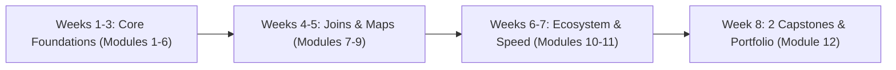

[🏠 පාඨමාලා මුල් පිටුව (Course Index)](README.md) | [⬅️ පෙර පාඩම: 12 Real-World Use Cases & Capstones](12_Real_World_Use_Cases_and_Capstones.md) | [🏠 මුල් පිටුවට ➡️](README.md)

---

# 13. Cheat Sheet, 12 Common Pitfalls & 8-Week Study Plan (සම්පූර්ණ අත්පොත)

> **🎯 මේ අවසාන පාඩමේ තියෙන දේවල්:**
> - එදිනෙදා coding කරද්දී බලන්න පුළුවන් **Quick Reference Cheat Sheet** එක.
> - GeoPandas පාවිච්චි කරන අය නිතරම කරන **බරපතල වැරදි 12 (12 Common Pitfalls)** සහ ඒවා හදාගන්න කෙටි විසඳුම්.
> - දිනකට විනාඩි 45–60 ගාණේ **සති 8ක පුහුණු සැලැස්ම (8-Week Practice Plan)**.
> - ඔයාගේ දැනුම චෙක් කරගන්න **10-Point Mastery Checklist** එක.
> - තවදුරටත් ඉගෙන ගන්න හොඳම **නොමිලේ පොත් සහ Resources**.

---

## 1. Quick Reference Cheat Sheet (මට කරන්න ඕන... → පාවිච්චි කරන්න)

| මට කරන්න ඕන... (I want to...) | පාවිච්චි කරන්න (Use) |
| --- | --- |
| **File එකක් load කරන්න** | `gpd.read_file(path, bbox=, columns=)`, `gpd.read_parquet(path)` |
| **Lon/Lat columns වලින් Points හදන්න** | `gpd.points_from_xy(lon, lat, crs=4326)` |
| **CRS එක බලන්න හෝ වෙනස් කරන්න** | `gdf.crs`, `set_crs()`, `to_crs()`, `estimate_utm_crs()` |
| **දිග, වර්ගඵලය, දුර මනින්න** | `area`, `length`, `distance()`, `bounds`, `total_bounds`, `centroid` |
| **Geometry fix / clean කරන්න** | `is_valid`, `make_valid()`, `explode()`, `simplify()` |
| **Zones / Areas හදන්න** | `buffer()`, `convex_hull`, `voronoi_polygons()`, `union_all()` |
| **කපන්න සහ එකතු කරන්න** | `clip()`, `overlay()`, `dissolve()`, `pd.concat()` |
| **පිහිටීම (Location) අනුව Join කරන්න** | `sjoin()`, `sjoin_nearest()`, `sindex.query()` |
| **Table column (Attribute) අනුව Join කරන්න** | `gdf.merge(df, on='clean_key', how='left')` |
| **Map එකක් අඳින්න** | `plot(column=, scheme=, legend=True)`, `explore()`, `contextily.add_basemap()` |
| **File එකක් Save කරන්න** | `to_file('out.gpkg', driver='GPKG')`, `to_parquet('out.parquet')`, `to_file('out.geojson', driver='GeoJSON')` |

### ක්ෂණික Code Snippet එක (Copy-Paste Starter):
```python
import geopandas as gpd
import pandas as pd

# Load -> Project -> Validate -> Spatial Join -> Save
pts = gpd.read_file('points.gpkg', engine='pyogrio').to_crs(32644)
zones = gpd.read_file('zones.gpkg', engine='pyogrio').to_crs(32644)
zones['geometry'] = zones.make_valid()

assert pts.crs == zones.crs, "CRS mismatch!"
joined = gpd.sjoin(pts, zones[['zone_id', 'geometry']], how='left', predicate='within')
joined.to_parquet('joined_output.parquet')
```

---

## 2. සාමාන්‍යයෙන් වෙන වැරදි 12 (The 12 Common Pitfalls)

> [!WARNING]
> **මේ වැරදි 12 මතක තියාගත්තොත් ඔයාගේ GIS debugging කාලය 80%කින් අඩු වෙනවා!**

| # | වෙන වැරැද්ද (Pitfall) | ඇයි වැරදි? / මොකද කරන්න ඕන? (Fix) |
| --- | --- | --- |
| **1** | **අංශක (EPSG:4326) වලින් දුර හෝ වර්ගඵලය මැනීම** | අංශක වලින් ලැබෙන `area` / `length` තේරුමක් නැහැ! මුලින්ම `to_crs(gdf.estimate_utm_crs())` වගේ projected CRS එකකට හරවන්න. |
| **2** | **`set_crs` සහ `to_crs` පටලවා ගැනීම** | `set_crs` කියන්නේ ලේබලයක් අලවනවා විතරයි (coordinates වෙනස් වෙන්නේ නැහැ). `to_crs` තමයි ඇත්තටම coordinates පරිවර්තනය කරන්නේ! |
| **3** | **වෙනස් CRS තියෙන layers 2ක් Join/Overlay කිරීම** | හිස් table එකක් හෝ වැරදි ප්‍රතිඵල එනවා. හැමවෙලේම `assert a.crs == b.crs` චෙක් කරන්න. |
| **4** | **Longitude සහ Latitude මාරු කරලා දැමීම** | **X = Longitude (නැගෙනහිර/බටහිර), Y = Latitude (උතුර/දකුණ)**. ශ්‍රී ලංකාවට `(lon=80.7, lat=7.8)`! |
| **5** | **Invalid geometries එක්ක `overlay` / `union` කිරීම** | Self-intersecting polygons නිසා `TopologyException` error එනවා. මුලින්ම `gdf['geometry'] = gdf.make_valid()` දාන්න. |
| **6** | **`sjoin` එකේදී left rows duplicate වෙන බව අමතක කිරීම** | එක left feature එකක් right polygons 2කට ගෑවුණොත් ඒ row එක දෙපාරක් එනවා! Join එකට පස්සේ `len(joined)` චෙක් කරන්න. |
| **7** | **වෙනස් data types හෝ leading zeros නැති keys වලින් `merge` කිරීම** | `'01'` vs `1` match වෙන්නේ නැහැ → `NaN` columns එනවා. `astype(str).str.strip().str.zfill(...)` දාලා keys clean කරන්න. |
| **8** | **Rates වෙනුවට Raw Counts map කිරීම** | ලොකු දිස්ත්‍රික්ක වල ජනගහනය කොහොමත් වැඩියි. ඒ නිසා density (`per km²`) හෝ percentage (`%`) map කරන්න. |
| **9** | **දිග column names තියෙන DataFrame එකක් Shapefile විදිහට save කිරීම** | Shapefile වල column names අකුරු 10න් කැපෙනවා! ඒ වෙනුවට **GeoPackage (`.gpkg`)** හෝ **GeoParquet** පාවිච්චි කරන්න. |
| **10** | **අලුත් GeoPandas වල ඉවත් කරපු (deprecated) APIs පාවිච්චි කිරීම** | උදා: `unary_union` වෙනුවට දැන් `union_all()` තියෙන්නේ; `gpd.datasets` ඉවත් කරලා. අලුත් release notes බලන්න. |
| **11** | **`buffer` එක geodesic (පෘථිවි මීටර්) කියලා හිතීම** | `buffer` වැඩ කරන්නේ CRS එකේ units වලින්! `EPSG:4326` වල buffer දැම්මොත් ඇද වෙච්ච රවුම් (distorted ovals) හැදෙනවා. |
| **12** | **Web Mercator (`EPSG:3857`) වලින් Area හෝ Length මැනීම** | `EPSG:3857` හදලා තියෙන්නේ web maps **පෙන්නන්න (display) විතරයි**! ඒකේ area/length මිනුම් වැරදියි (ධ්‍රැව වලට යද්දී ලොකු වෙනවා). |

---

## 3. සති 8ක ප්‍රායෝගික පුහුණු සැලැස්ම (8-Week Practice Plan)



| සති (Weeks) | දිනපතා පුරුද්ද (Daily Habit: විනාඩි 45 – 60) | ඉලක්කය (Focus) |
| --- | --- | --- |
| **Weeks 1 to 3** | එක පාඩමක් කියවන්න, හැම code උදාහරණයක්ම අතින් type කරලා run කරන්න, අභ්‍යාස ඉවර කරන්න | Modules 1–6 (Vector basics, I/O, CRS, Measurements, Buffer/Clip/Overlay) |
| **Weeks 4 to 5** | හැමදාම පුවත්පතක/වෙබ් අඩවියක හෝ open data portal එකක තියෙන map එකක් හෝ analysis එකක් තනියම ආපහු හදන්න | Modules 7–9 (Spatial joins, Dissolve/Merge, Choropleths & `explore()`) |
| **Weeks 6 to 7** | ඔයාගේ නගරයේ හෝ රැකියාවේ සැබෑ dataset එකකට OSM/Raster එකතු කරලා speed optimize කරන්න | Modules 10–11 (Rasterio, OSMnx, `sindex`, GeoParquet, Tiling) |
| **Week 8** | Module 12 එකෙන් **Capstone Projects 2ක්** සම්පූර්ණ කරලා maps සහ methods note එක GitHub/portfolio එකේ publish කරන්න | Module 12 (End-to-end portfolio delivery!) |

---

## 4. Mastery Checklist (ඔයා GeoPandas Pro කෙනෙක්ද? චෙක් කරගන්න!)

මේ කරුණු 10ම ඔයාට තනියම කරන්න පුළුවන් නම්, ඔයා GeoPandas සම්පූර්ණයෙන්ම master කරලා ඉවරයි:

- [ ] Geographic CRS (`EPSG:4326`) vs Projected CRS (`EPSG:32644`) වෙනස පැහැදිලි කරලා මිනුමකට හරි CRS එක තෝරගන්න මට පුළුවන්.
- [ ] Coordinates, WKT, GeoJSON හෝ files වලින් GeoDataFrame එකක් හදන්න මට පුළුවන්.
- [ ] Shapefile, GeoJSON, GeoPackage සහ GeoParquet සුදුසු තැන්වලදී read සහ write කරන්න මට පුළුවන්.
- [ ] Area, length සහ distances නිවැරදිව මැනලා geometry validity (`is_valid`, `make_valid`) චෙක් කරන්න මට පුළුවන්.
- [ ] Layers වලට `buffer`, `clip`, `overlay`, `dissolve` සහ `union_all` දාන්න මට පුළුවන්.
- [ ] ප්‍රශ්නය අනුව `sjoin`, `sjoin_nearest` සහ `overlay` අතරින් හරි tool එක තෝරගන්න මට පුළුවන්.
- [ ] Rows නැති නොකර census හෝ tabular data ටික boundaries එක්ක `merge` කරන්න මට පුළුවන්.
- [ ] පැහැදිලි classification scheme එකක් එක්ක choropleth map එකක් සහ interactive `explore()` map එකක් හදන්න මට පුළුවන්.
- [ ] Rasters, OSM data සහ geocoded points ගෙනල්ලා ඔක්කොම එකම CRS එකක තියාගෙන වැඩ කරන්න මට පුළුවන්.
- [ ] Spatial indexes (`sindex`), early filtering සහ GeoParquet පාවිච්චි කරලා slow workflow එකක් වේගවත් කරන්න මට පුළුවන්.

---

## 5. තවදුරටත් ඉගෙන ගන්න Resources

1. **Official GeoPandas Documentation:** [geopandas.org](https://geopandas.org) — User guide, gallery සහ API reference.
2. **Shapely & pyproj Documentation:** Geometry operations සහ coordinate transformations ගැන ගැඹුරින් දැනගන්න.
3. ***Geographic Data Science with Python*** — Serge Rey, Dani Arribas-Bel, Levi John Wolf ලියපු නොමිලේ කියවන්න පුළුවන් සුපිරි online පොත (`geographicdata.science/book`).
4. ***Geocomputation with Python*** — නොමිලේ කියවන්න පුළුවන් practical geospatial programming පොත (`py.geocompx.org`).
5. **Companion Library Docs:** `PySAL`, `OSMnx`, සහ `rasterio` official documentation.
6. **ඊළඟ පියවර (Next Steps):** මේ series එකේම **pandas**, **Matplotlib**, සහ **Seaborn** courses සම්පූර්ණ කරලා, ඉන්පස්සේ **PySAL** එක්ක spatial statistics සහ **xarray** එක්ක cloud-native raster analysis වලට යන්න!

---

## 🧠 මතක තබා ගැනීමට අවසාන රන් නීති 3 (3 Golden Memory Hacks)

1. **මනින්න කලින් Project කරන්න!** (`to_crs` before `area`, `length`, `distance`, `buffer`).
2. **Join කරන්න කලින් CRS සමානද බලන්න!** (`a.crs == b.crs`).
3. **Counts නෙවෙයි, Rates Map කරන්න!** (Density / Percentage > Raw Totals).

---

## 📝 අවසාන ස්වයං-පරීක්ෂණ අභ්‍යාසය (Final Pitfall Spotter Quiz)

පහළ තියෙන buggy code එකේ **වැරදි 4ක්** තියෙනවා. ඒ 4 හොයලා හරිගස්සන්න!

```python
import geopandas as gpd

# Buggy code — spot and fix all 4 pitfalls!
pts = gpd.GeoDataFrame(
    {'id': [1, 2]},
    geometry=gpd.points_from_xy([6.927, 7.290], [79.861, 80.633]),  # Bug 1?
    crs=4326
)
pts_m = pts.set_crs(32644, allow_override=True)                     # Bug 2?
buf = pts.buffer(1000)                                              # Bug 3?
pts_m.to_file('my_very_important_output.shp')                       # Bug 4?
```

<details>
<summary>✅ පිළිතුර බලන්න (Click to see Solution)</summary>

1. **Bug 1 (Swapped Lon/Lat):** `points_from_xy(lon, lat)` වෙන්න ඕන! ශ්‍රී ලංකාවේ Longitude ~80, Latitude ~7. ඒ නිසා `[79.861, 80.633]` මුලින් එන්න ඕන.
2. **Bug 2 (`set_crs` vs `to_crs`):** `set_crs(..., allow_override=True)` දැම්මම coordinates transform වෙන්නේ නැහැ! `pts.to_crs(32644)` පාවිච්චි කරන්න ඕන.
3. **Bug 3 (Buffer in degrees):** `pts` තියෙන්නේ `EPSG:4326` වල. Projected `pts_m.buffer(1000)` පාවිච්චි කරන්න ඕන.
4. **Bug 4 (Shapefile format):** Shapefile වෙනුවට GeoPackage (`.gpkg`) හෝ GeoParquet (`.parquet`) පාවිච්චි කරන්න.

**නිවැරදි Code එක:**
```python
import geopandas as gpd

pts = gpd.GeoDataFrame(
    {'id': [1, 2]},
    geometry=gpd.points_from_xy([79.861, 80.633], [6.927, 7.290]),
    crs=4326
)
pts_m = pts.to_crs(32644)
buf = pts_m.buffer(1000)
pts_m.to_file('my_very_important_output.gpkg', driver='GPKG')
```

</details>

---

[🏠 පාඨමාලා මුල් පිටුව (Course Index)](README.md) | [⬅️ පෙර පාඩම: 12 Real-World Use Cases & Capstones](12_Real_World_Use_Cases_and_Capstones.md) | [🏠 මුල් පිටුවට ➡️](README.md)
