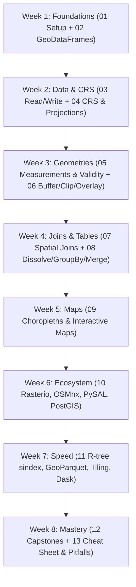

# 🌍 Master GeoPandas: සම්පූර්ණ සිංහල ස්වයං-අධ්‍යයන පාඨමාලාව (Complete Self-Study Course)

> **සරල සිංහලෙන්, මුල ඉඳන් අගටම GeoPandas ඉගෙන ගමු!**
> මේ සති 8ක පාඨමාලාවෙන් ඔයා පළවෙනි shapefile එක load කරන තැන ඉඳන්, CRS, spatial joins, overlays, interactive maps, raster/OSM integration, performance optimization සහ සැබෑ ලෝකයේ Capstone Projects 6ක් දක්වාම සම්පූර්ණයෙන් ඉගෙන ගන්නවා.

---

## 🎯 කාටද මේ පාඨමාලාව? (Who Is It For?)
- **Analysts, Data Scientists, Urban Planners, Environmental Scientists, සහ GIS Users** — මූලික Python, pandas, සහ Matplotlib දන්න ඕනෑම කෙනෙක්ට!
- **කලින් GIS දැනුමක් අවශ්‍ය නැහැ!** (No GIS background assumed — හැම දෙයක්ම මුල ඉඳන්ම සරල උදාහරණ සහ රූපසටහන් එක්ක පැහැදිලි කරලා තියෙනවා).

---

## 🗺️ පාඨමාලා ගමන් මග (Course Learning Path)



---

## 📚 සම්පූර්ණ පාඩම් මාලාව (All 13 Lessons)

| අංකය | පාඩම (Lesson) | සතිය | මූලිකව ඉගෙන ගන්න දේවල් (Key Topics) |
| :---: | --- | :---: | --- |
| **01** | [01. Setup and Geospatial Foundations](01_Setup_and_Geospatial_Foundations.md) | Week 1 | GeoPandas install, Vector vs Raster, Points/Lines/Polygons, CRS හැඳින්වීම |
| **02** | [02. GeoSeries, GeoDataFrame and Geometries](02_GeoSeries_GeoDataFrame_and_Geometries.md) | Week 1 | `GeoSeries`, `GeoDataFrame`, `points_from_xy`, WKT, GeoJSON, Shapely |
| **03** | [03. Reading and Writing Spatial Data](03_Reading_and_Writing_Spatial_Data.md) | Week 2 | Shapefile, GeoJSON, GeoPackage, GeoParquet, `pyogrio`, `bbox`/`mask` filters |
| **04** | [04. CRS and Projections](04_CRS_and_Projections.md) | Week 2 | `EPSG:4326` vs `EPSG:3857` vs UTM, `set_crs` vs `to_crs`, `estimate_utm_crs()` |
| **05** | [05. Geometry Attributes, Measurements & Validity](05_Geometry_Attributes_Measurements_and_Validity.md) | Week 3 | `area`, `length`, `distance`, `centroid`, `bounds`, `is_valid`, `make_valid()` |
| **06** | [06. Geometry Operations](06_Geometry_Operations.md) | Week 3 | `buffer`, `clip`, `overlay`, `union_all`, `simplify`, `convex_hull`, `voronoi_polygons` |
| **07** | [07. Spatial Relationships and Joins](07_Spatial_Relationships_and_Joins.md) | Week 4 | Predicates (`within`, `intersects`, `contains`), `sjoin`, `sjoin_nearest` |
| **08** | [08. Attribute Work: Dissolve, GroupBy & Merge](08_Attribute_Work_Dissolve_GroupBy_Merge.md) | Week 4 | `dissolve`, `groupby`, `merge` (tabular joins), `pd.concat`, rates vs counts |
| **09** | [09. Visualisation and Interactive Maps](09_Visualisation_and_Interactive_Maps.md) | Week 5 | Choropleths, `mapclassify` schemes, `contextily` basemaps, `explore()` web maps |
| **10** | [10. Ecosystem Integration](10_Ecosystem_Integration.md) | Week 6 | `rasterio`, `zonal_stats`, `osmnx`, `geocode`, `PySAL` (Moran's I), `PostGIS`, `H3` |
| **11** | [11. Performance and Scaling](11_Performance_and_Scaling.md) | Week 7 | Vectorisation, R-tree `sindex`, `pyogrio`, GeoParquet, Grid Tiling, `dask-geopandas` |
| **12** | [12. Real-World Use Cases and Capstones](12_Real_World_Use_Cases_and_Capstones.md) | Week 8 | 10 Domains, 6 Full Capstone Walkthroughs, Project Hygiene, Free Data Sources |
| **13** | [13. Cheat Sheet, Pitfalls and Study Plan](13_Cheat_Sheet_Pitfalls_and_Study_Plan.md) | Reference | Quick Reference Table, 12 Common Pitfalls, 8-Week Habit Plan, Mastery Checklist |

---

## 🗓️ සති 8ක පාඨමාලා සැලැස්ම (8-Week Roadmap)

| සතිය (Week) | පාඩම් (Modules) | සතිය අවසානයේ ඉලක්කය (Milestone) |
| :---: | :---: | --- |
| **Week 1** | 1 to 2 | Vector data සහ CRS තේරුම් ගැනීම; GeoDataFrames ගොඩනැගීම |
| **Week 2** | 3 to 4 | ඕනෑම spatial file format එකක් read/write කිරීම; නිවැරදිව reproject කිරීම |
| **Week 3** | 5 to 6 | Geometries මැනීම; `buffer`, `clip`, `overlay`, `union_all` පාවිච්චි කිරීම |
| **Week 4** | 7 to 8 | Spatial joins (`sjoin`, `sjoin_nearest`) සහ ප්‍රාදේශීය aggregation (`dissolve`, `merge`) |
| **Week 5** | 9 | ප්‍රකාශයට පත් කළ හැකි Choropleth maps සහ interactive HTML maps සෑදීම |
| **Week 6** | 10 | Rasters, OpenStreetMap (`osmnx`), geocoders, PySAL, සහ PostGIS සම්බන්ධ කිරීම |
| **Week 7** | 11 | R-tree indexes, GeoParquet, සහ tile chunking වලින් ලොකු layers වේගවත් කිරීම |
| **Week 8** | 12 (+ 13) | සැබෑ ලෝකයේ Capstone Projects 2ක් සම්පූර්ණ කර publish කිරීම! |

---

## 🚀 පටන් ගන්න කලින් Quick Check (Starter Code)

```python
import geopandas as gpd
import pandas as pd
import matplotlib.pyplot as plt
from shapely.geometry import Point, LineString, Polygon

print("GeoPandas version:", gpd.__version__)
```

👉 **පළවෙනි පාඩමෙන් පටන් ගමු:** [01. Setup and Geospatial Foundations ➡️](01_Setup_and_Geospatial_Foundations.md)
