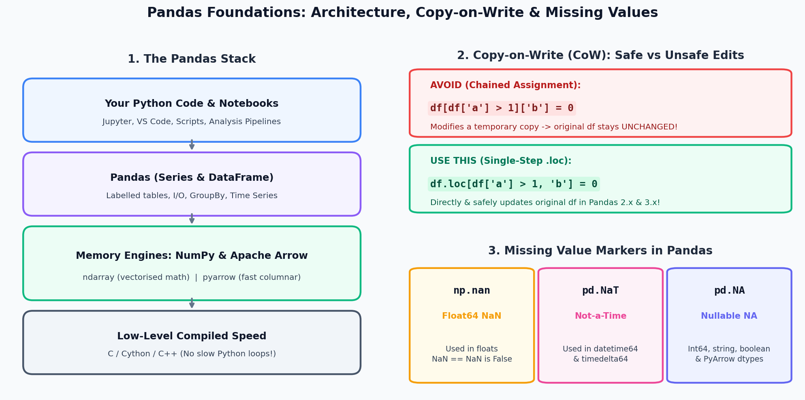
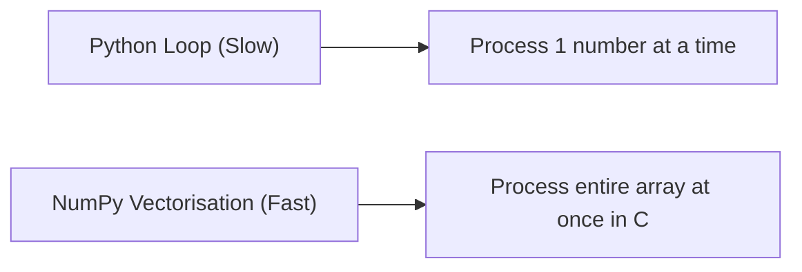
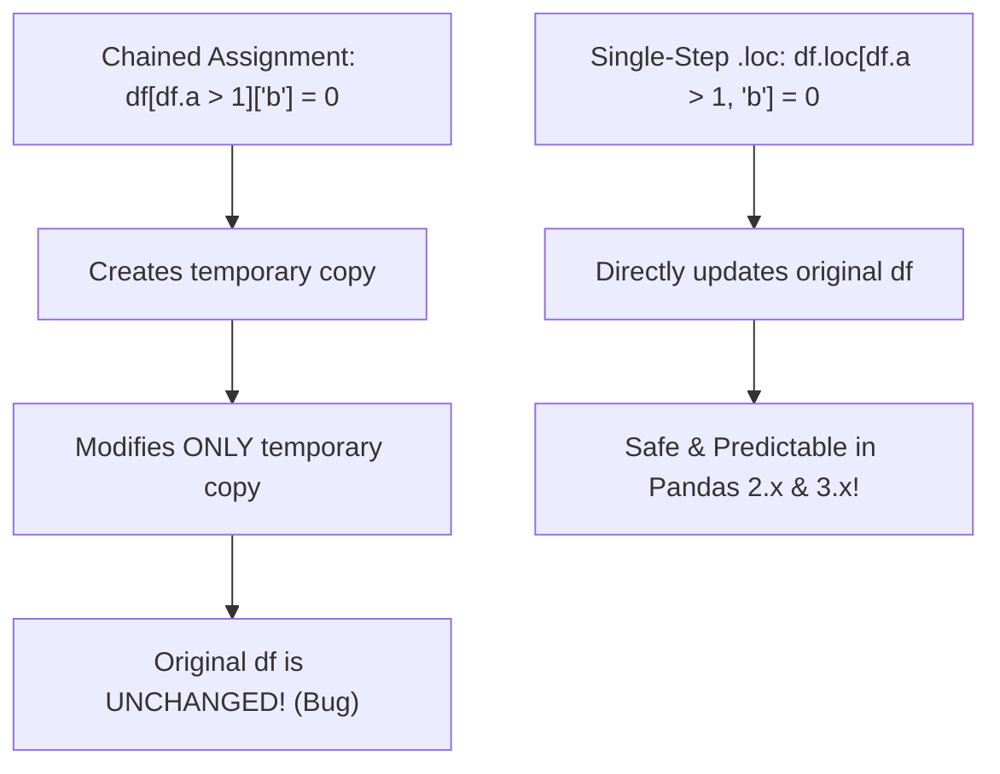

[🏠 Course Home](README.md) | [Next Lesson: 02. Series in Depth ➡️](02_Series_in_Depth.md)

---

# 📘 පාඩම 01: Setup and Foundations (මූලික සැකසුම සහ පදනම)

> **Module 1** | Week 1 | මට්ටම: Beginner (ආරම්භක)

Python වලින් Data Analysis (දත්ත විශ්ලේෂණය) කරන්න පටන් ගන්නකොට අපිට මුලින්ම හමුවෙන, ලෝකේ වැඩිපුරම පාවිච්චි කරන tool එක තමයි **Pandas**. මේ පාඩමෙන් අපි බලමු Pandas කියන්නේ මොකක්ද, ඒක computer එකේ හරියට install කරගන්නේ කොහොමද, සහ Pandas ඇතුළේ වැඩ සිද්ධ වෙන විදිය (NumPy, Arrow, Copy-on-Write, dtypes, missing values) ගැන.

---

## 🎯 මේ පාඩමෙන් ඔබ ඉගෙන ගන්නේ මොනවාද?
- **Pandas** කියන්නේ මොකක්ද සහ ඒක **NumPy** / **Apache Arrow** මත වැඩ කරන්නේ කොහොමද?
- **Virtual Environment** එකක් හදලා Pandas සහ optional libraries install කරන විදිය
- **Jupyter / VS Code / Colab** වල display options සහ magic commands පාවිච්චි කරන හැටි
- **NumPy** මූලික කරුණු (`ndarray`, `vectorisation`, `broadcasting`, `boolean masks`)
- **Pandas 2.x vs 3.x** වෙනස්කම් සහ **Copy-on-Write (CoW)** කියන්නේ මොකක්ද?
- **Dtypes** (දත්ත වර්ග) සහ **Missing Value Markers** (`NaN`, `NaT`, `pd.NA`) හරියට හඳුනාගන්නා විදිය

---

## 1. What Pandas Is — Pandas කියන්නේ මොකක්ද?

සරලවම කිව්වොත්, **Pandas කියන්නේ Python වලට තියෙන "Supercharged Excel" එකක් වගේ**.
Excel sheet එකක rows (පේළි) සහ columns (තීරු) තියෙනවා වගේම, Pandas වලත් අපිට labels (නම්) දීපු tables හදාගන්න පුළුවන්. හැබැයි Excel එකක rows ලක්ෂ 10ක් දැම්මොත් computer එක slow වෙලා hang වෙන්න පුළුවන්. Pandas වලින් ඒ වගේ දත්ත තත්පර කිහිපයකින් code ලියලා clean කරන්න, filter කරන්න, ගණන් හදන්න පුළුවන්!

Pandas තනියම වැඩ කරන එකක් නෙවෙයි. ඒක හැදිලා තියෙන්නේ වේගවත් engines දෙකක් උඩ:
1. **NumPy (`ndarray`):** ගණිතමය වැඩ (fast math) C language වේගයෙන් කරන්න.
2. **Apache Arrow (`pyarrow`):** විශාල datasets ඉතා අඩු memory එකකින් සහ අධික වේගයෙන් තියාගන්න (columnar storage).



---

## 2. Installation — Pandas Install කරගන්නා විදිය

අලුත් project එකක් පටන් ගන්න හැම වෙලාවෙම **Virtual Environment (`venv`)** එකක් හදාගන්න එක හොඳ පුරුද්දක්. එතකොට එක project එකක library versions අනිත් project එකට බාධාවක් වෙන්නේ නැහැ.

```bash
# 1. Virtual environment එකක් හදන්න
python3 -m venv pandas_env

# 2. ඒක activate කරන්න
# Linux / Mac:
source pandas_env/bin/activate
# Windows (PowerShell):
# pandas_env\Scripts\Activate.ps1

# 3. Pandas සහ අපිට නිතර ඕන වෙන optional dependencies install කරන්න
pip install pandas numpy openpyxl pyarrow sqlalchemy matplotlib jupyter
```

> **Conda** පාවිච්චි කරනවා නම්: `conda create -n pandas_env python=3.11 pandas pyarrow openpyxl matplotlib`

### Optional Dependencies මොකටද?
| Library | වැඩේ මොකක්ද? (Use Case) |
| --- | --- |
| `openpyxl` | Excel (`.xlsx`) files කියවන්න සහ ලියන්න |
| `pyarrow` | **Parquet** files කියවන්න/ලියන්න සහ Arrow-backed fast dtypes වලට |
| `sqlalchemy` | SQL Databases (PostgreSQL, MySQL, SQLite) වලට සම්බන්ධ වෙන්න |
| `matplotlib` | Pandas ඇතුළේ ඉඳන්ම charts/graphs අඳින්න |

### සම්මත Imports (Standard Imports)
මුළු course එක පුරාම අපි මේ imports දෙක පාවිච්චි කරනවා:

```python
import pandas as pd
import numpy as np

print("Pandas version:", pd.__version__)
print("NumPy version:", np.__version__)
```

**Expected Output:**
```text
Pandas version: 2.2.3
NumPy version: 2.1.1
```
*(ඔබේ machine එකේ install වෙලා තියෙන version අංකය පොඩ්ඩක් වෙනස් වෙන්න පුළුවන්.)*

---

## 3. Notebooks & IDEs — වැඩ කරන්න හොඳම තැන

Data analysis කරද්දී code එකේ ප්‍රතිඵල එවෙලෙම බලන්න **Notebooks** ගොඩක් පහසුයි:
- **Jupyter Notebook / JupyterLab:** Browser එකේ වැඩ කරන interactive notebook එකක්.
- **VS Code (Jupyter Extension):** Code editor එක ඇතුළෙම `.ipynb` notebooks රන් කරන්න පුළුවන්.
- **Google Colab:** Computer එකේ මුකුත් install නොකර browser එකෙන්ම නොමිලේ Python & Pandas රන් කරන්න පුළුවන්.

### Display Options සහ Magic Commands
Table එකේ columns ගොඩක් තියෙනකොට Pandas සාමාන්‍යයෙන් මැද columns `...` විදියට හංගනවා. ඒක හදාගන්න `pd.set_option()` පාවිච්චි කරන්න:

```python
# Columns 50ක් දක්වා සම්පූර්ණයෙන් පෙන්වන්න
pd.set_option('display.max_columns', 50)

# දශම සංඛ්‍යා ලස්සනට කොමා සහ දශම ස්ථාන 2කට පෙන්වන්න (උදා: 1,250.50)
pd.set_option('display.float_format', '{:,.2f}'.format)
```

Jupyter Notebook වලදී **Magic Commands** පාවිච්චි කරන්නත් පුළුවන්:
- `%timeit arr * 2` — code පේළියක් රන් වෙන්න යන වෙලාව මනින්න.
- `%matplotlib inline` — graphs notebook එක ඇතුළෙම පෙන්වන්න.

---

## 4. NumPy Refresher — Pandas වල හදවත

Pandas කෙලින්ම වැඩ කරන්නේ NumPy arrays (`ndarray`) එක්ක. Python `for` loop එකකින් numbers ලක්ෂ 10ක් ගුණ කරනවට වඩා, NumPy වල **Vectorisation** පාවිච්චි කළාම 50x–100x වේගවත්!



### සම්පූර්ණ Code උදාහරණය (NumPy Basics + Display Options)

```python
import numpy as np
import pandas as pd

# 1. NumPy ndarray එකක් හදමු
arr = np.array([1, 2, 3, 4])

# 2. Vectorisation & Broadcasting: loop නැතුව හැම element එකම 2න් ගුණ කරනවා
print("Vectorised * 2:", arr * 2)

# 3. Boolean Mask: 2ට වඩා වැඩි සංඛ්‍යා විතරක් තෝරනවා
mask = arr > 2
print("Boolean mask:", mask)
print("Filtered values:", arr[mask])

# 4. Pandas Display Options සකසමු
pd.set_option('display.max_columns', 50)
pd.set_option('display.float_format', '{:,.2f}'.format)
```

**Line-by-Line පැහැදිලි කිරීම:**
- `arr = np.array([1, 2, 3, 4])`: සාමාන්‍ය Python list එකක් වේගවත් NumPy `ndarray` එකක් බවට හරවනවා.
- `arr * 2`: **Broadcasting** — තනි අංකය (`2`) array එකේ හැම element එකකටම එකපාර ගුණ වෙනවා (`for` loop එකක් ඕන නැහැ!).
- `arr > 2`: හැම අංකයම 2ට වඩා වැඩිද බලලා `[False, False, True, True]` කියන **Boolean Mask** එක දෙනවා.
- `arr[mask]`: `True` තියෙන තැන් වල values විතරක් (`[3, 4]`) එළියට ගන්නවා.

**Expected Output:**
```text
Vectorised * 2: [2 4 6 8]
Boolean mask: [False False  True  True]
Filtered values: [3 4]
```

---

## 5. Pandas Versions & Copy-on-Write (CoW)

Pandas ලෝකයේ මෑතකදී ලොකු වෙනස්කම් දෙකක් වුණා:
- **Pandas 2.x:** Apache Arrow (`pyarrow`) dtypes හඳුන්වා දුන්නා + **Copy-on-Write (CoW)** optional feature එකක් විදියට ආවා.
- **Pandas 3.x:** **Copy-on-Write (CoW)** සහ වෙනම **dedicated `string` dtype** එක default (ස්වයංක්‍රීයව) ක්‍රියාත්මක වෙනවා!

### Copy-on-Write (CoW) කියන්නේ මොකක්ද?
හිතන්න ඔයා යාලුවෙක්ට ඔයාගේ සටහන් පොතේ photocopy එකක් දෙනවා. යාලුවා ඒ photocopy එකේ මොනවා හරි ලිව්වට ඔයාගේ මුල් පොත වෙනස් වෙන්නේ නැහැ නේද? **Copy-on-Write** කියන්නෙත් ඒ වගේම දෙයක්:
- ඔයා DataFrame එකකින් කෑල්ලක් වෙන් කරගත්තම, ඒක හැසිරෙන්නේ **වෙනම independent copy එකක්** විදියට.
- ඒ නිසා පරණ කාලේ වගේ **Chained Assignment** (`df[df.a > 1]['b'] = 0`) ලිව්වොත්, මුල් `df` එක වෙනස් වෙන්නේ නැහැ!



```python
df = pd.DataFrame({'a': [1, 2, 3], 'b': [10, 20, 30]})

# ❌ වැරදි ක්‍රමය (Chained Assignment - කවදාවත් පාවිච්චි කරන්න එපා!)
# df[df['a'] > 1]['b'] = 0

# ✅ හරි ක්‍රමය (Single-step .loc)
mask = df['a'] > 1
df.loc[mask, 'b'] = 0
print(df)
```

**Expected Output:**
```text
   a   b
0  1  10
1  2   0
2  3   0
```

---

## 6. Dtypes Overview — දත්ත වර්ග හඳුනාගනිමු

හැම column එකකටම හරි **dtype** (data type) එක තෝරාගත්තොත් code එක වේගවත් වෙනවා වගේම RAM memory එකත් ගොඩක් ඉතුරු වෙනවා.

| Dtype | විස්තරය (Description) | උදාහරණය |
| --- | --- | --- |
| `int64` | පූර්ණ සංඛ්‍යා (missing values බැහැ) | `10, 250, -5` |
| `float64` | දශම සංඛ්‍යා (`np.nan` තියාගන්න පුළුවන්) | `12.5, 99.99, NaN` |
| `bool` | සත්‍ය / අසත්‍ය (missing values බැහැ) | `True, False` |
| `object` / `str` | අකුරු / text (Pandas 3.x වල dedicated `str` dtype) | `'Colombo', 'Kandy'` |
| `category` | නැවත නැවත එන text labels (ලොකු memory ඉතුරුවක්!) | `'Male', 'Female'` |
| `datetime64[ns]` | දින සහ වේලාවන් | `2026-11-22 10:30:00` |
| `timedelta64[ns]` | කාල පරතරයන් (දවස් 5ක්, පැය 2ක්) | `5 days 02:00:00` |
| `Int64`, `boolean`, `string` | **Nullable dtypes** (`pd.NA` තියාගන්න පුළුවන්!) | `10, <NA>, 30` |
| `int64[pyarrow]`, `string[pyarrow]` | **PyArrow-backed dtypes** (ඉතා වේගවත්, අඩු memory) | Apache Arrow engine |

---

## 7. Missing Value Markers — හිස් දත්ත සලකුණු

සැබෑ ලෝකයේ data ගොඩක් වෙලාවට හිස් තැන් (missing values) එක්ක එන්නේ. Pandas වල හිස් දත්ත පෙන්නන්න සලකුණු 3ක් තියෙනවා:

1. **`np.nan` (Not a Number):**
   - Float (`float64`) columns වල තියෙන්නේ මේක.
   - විශේෂත්වය: `np.nan == np.nan` කියන්නේ `False`! ඒ නිසා කවදාවත් `== np.nan` චෙක් කරන්න එපා; **`pd.isna()`** පාවිච්චි කරන්න.
2. **`pd.NaT` (Not a Time):**
   - දින සහ වේලාවන් (`datetime64`, `timedelta64`) වල හිස් තැන් පෙන්නන්නේ මේකෙන්.
3. **`pd.NA` (Nullable Missing Value):**
   - නවීන Nullable types (`Int64`, `boolean`, `string`) සහ PyArrow types වල පොදු missing marker එක.
   - මෙය තිබුණා කියලා integer column එකක් බලෙන් `float64` වෙන්නේ නැහැ!

```python
s_float = pd.Series([1.5, np.nan, 3.0])
s_date  = pd.Series(pd.to_datetime(['2026-01-01', None]))
s_int   = pd.Series([10, pd.NA, 30], dtype='Int64')

print("Float NaN:", s_float.tolist(), "| dtype:", s_float.dtype)
print("Date NaT:", s_date.tolist(), "| dtype:", s_date.dtype)
print("Nullable Int:", s_int.tolist(), "| dtype:", s_int.dtype)
print("Check missing safely:", pd.isna(s_int).tolist())
```

**Expected Output:**
```text
Float NaN: [1.5, nan, 3.0] | dtype: float64
Date NaT: [Timestamp('2026-01-01 00:00:00'), NaT] | dtype: datetime64[ns]
Nullable Int: [10, <NA>, 30] | dtype: Int64
Check missing safely: [False, True, False]
```

---

## 🧠 මතක තබා ගැනීමට පහසු ක්‍රම (Memory Hacks)
- **Pandas = NumPy + Labels:** NumPy array එකකට ලස්සන row/column නම් (labels) දැම්මම තමයි Pandas හැදෙන්නේ.
- **Capital `I` vs Simple `i`:** `int64` (සිම්පල් i) වලට missing values බැහැ. **`Int64`** (කැපිටල් I) කියන්නේ "I can hold `pd.NA`!" කියලා මතක තියාගන්න.
- **One Bracket Rule for Edits:** DataFrame එකක අගයක් වෙනස් කරද්දී කවදාවත් `[][]` දෙකක් ළඟ ළඟ දාන්න එපා; හැමවෙලේම **`df.loc[rows, cols] = value`** එක පාරින් ලියන්න.

## ⚠️ සාමාන්‍යයෙන් වෙන වැරදි (Common Pitfalls)

> [!WARNING]
> **1. `np.nan == np.nan` චෙක් කිරීම:**
> `df[df['age'] == np.nan]` ලිව්වොත් හැමවෙලේම හිස් table එකක් එන්නේ! හිස් අගයන් හොයන්න හැමවෙලේම `df['age'].isna()` පාවිච්චි කරන්න.
>
> **2. Chained Assignment (`df[mask]['col'] = val`):**
> Pandas 2.x/3.x (Copy-on-Write) යටතේ මේකෙන් මුල් `df` එක update වෙන්නේ නැහැ. හැමවෙලේම `df.loc[mask, 'col'] = val` භාවිතා කරන්න.
>
> **3. Virtual Environment නැතුව global Python එකට install කිරීම:**
> පරණ projects කැඩෙන්න පුළුවන්. හැමවෙලේම `venv` හෝ `conda` env එකක් පාවිච්චි කරන්න.

---

## 💻 ප්‍රායෝගික අභ්‍යාස (Practical Exercises)

### Warm-up Exercise: Missing Value Check
`[10, None, 30, 40]` කියන list එකෙන් Nullable `Int64` Series එකක් හදලා, ඒකේ missing value කීයක් තියෙනවද කියලා `.isna().sum()` පාවිච්චි කරලා හොයන්න.

<details>
<summary>✅ පිළිතුර බලන්න (Click to see Solution)</summary>

```python
import pandas as pd

s = pd.Series([10, None, 30, 40], dtype='Int64')
print(s)
print("Missing count:", s.isna().sum())
```
**Output:**
```text
0      10
1    <NA>
2      30
3      40
dtype: Int64
Missing count: 1
```
</details>

---

### Exercise 1 (Course Exercise 1)
Virtual environment එකක් හදලා, Pandas install කරලා, ඒකේ version එක print කරන්න.

<details>
<summary>✅ පිළිතුර බලන්න (Click to see Solution)</summary>

```bash
# Terminal එකේ රන් කරන්න:
python3 -m venv my_pandas_env
source my_pandas_env/bin/activate   # Windows: my_pandas_env\Scripts\activate
pip install pandas
python -c "import pandas as pd; print(pd.__version__)"
```
</details>

---

### Exercise 2 (Course Exercise 2)
Random සංඛ්‍යා මිලියන 1ක (1,000,000) NumPy array එකක් හදලා, ඒකේ `mean` (මධ්‍යන්‍යය), `std` (සම්මත අපගමනය) සහ `0.5` ට වඩා වැඩි අගයන් විතරක් තියෙන boolean-masked subset එක හොයන්න.

<details>
<summary>✅ පිළිතුර බලන්න (Click to see Solution)</summary>

```python
import numpy as np

rng = np.random.default_rng(seed=42)
arr = rng.random(1_000_000)  # 0 සහ 1 අතර random සංඛ්‍යා මිලියන 1ක්

print(f"Mean: {arr.mean():.4f}")
print(f"Std:  {arr.std():.4f}")

above_half = arr[arr > 0.5]
print(f"Count > 0.5: {len(above_half):,}")
```
**Expected Output:**
```text
Mean: 0.4998
Std:  0.2887
Count > 0.5: 499,671
```
</details>

---

### Exercise 3 (Course Exercise 3)
`df[df.a > 1]['b'] = 0` කියන code එක විශ්වාස කරන්න බැරි (unreliable) ඇයි කියලා ඔබේම වචනවලින් පැහැදිලි කරලා, ඒකේ නිවැරදි ආකාරය ලියන්න.

<details>
<summary>✅ පිළිතුර බලන්න (Click to see Solution)</summary>

**පැහැදිලි කිරීම:**
`df[df.a > 1]['b'] = 0` කියන්නේ **Chained Assignment** එකක්. මෙතනදී පියවර දෙකක් වෙනවා: මුලින්ම `df[df.a > 1]` මඟින් තාවකාලික copy එකක් හැදෙනවා. ඊළඟට `['b'] = 0` මඟින් වෙනස් වෙන්නේ ඒ තාවකාලික copy එක මිසක් මුල් `df` එක නෙවෙයි. විශේෂයෙන්ම Copy-on-Write (CoW) තියෙන Pandas 2.x / 3.x වලදී මුල් `df` එක කිසිසේත්ම වෙනස් වෙන්නේ නැහැ.

**නිවැරදි ක්‍රමය:**
```python
df.loc[df['a'] > 1, 'b'] = 0
```
</details>

---

## 📋 Cheat Sheet Summary Table

| Concept / Command | කෙටි විස්තරය |
| --- | --- |
| `import pandas as pd` | Pandas import කිරීමේ සම්මත ක්‍රමය |
| `pd.__version__` | Install වී ඇති Pandas version එක බැලීම |
| `pd.set_option('display.max_columns', 50)` | Table display settings වෙනස් කිරීම |
| `arr * 2` / `arr[arr > 2]` | NumPy vectorisation සහ boolean masking |
| `df.loc[mask, 'col'] = val` | Copy-on-Write වලට ආරක්ෂිතව අගයන් වෙනස් කිරීම |
| `Int64` / `string` / `boolean` | `pd.NA` තබාගත හැකි Nullable dtypes |
| `np.nan` / `pd.NaT` / `pd.NA` | Float, Datetime, සහ Nullable missing markers |
| `pd.isna(x)` | ඕනෑම missing marker එකක් ආරක්ෂිතව චෙක් කිරීම |

---

[🏠 Course Home](README.md) | [Next Lesson: 02. Series in Depth ➡️](02_Series_in_Depth.md)
