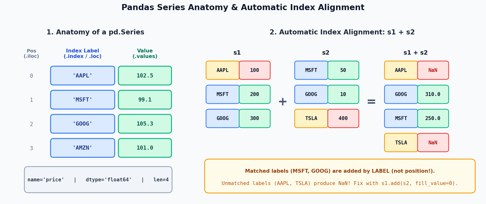
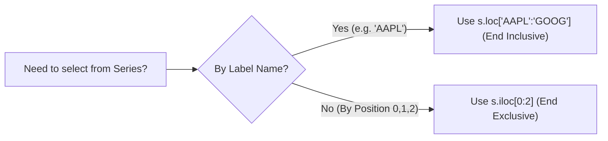

[⬅️ Previous: 01. Setup and Foundations](01_Setup_and_Foundations.md) | [🏠 Course Home](README.md) | [Next: 03. DataFrame in Depth ➡️](03_DataFrame_in_Depth.md)

---

# 📘 පාඩම 02: Series in Depth (Series ගැඹුරින් ඉගෙන ගනිමු)

> **Module 2** | Week 1 | මට්ටම: Beginner to Intermediate

Pandas වල තියෙන මූලිකම ගොඩනැගිලි ඒකකය (building block) තමයි **`pd.Series`**. සරලවම කිව්වොත්, Series එකක් කියන්නේ **එකම එක column එකක්** — හැබැයි හැම අගයකටම (value) ලස්සන **label (index)** එකක් තියෙන 1D array එකක්!
හිතන්න කඩේක බඩු වල මිල ගණන් ලියපු price tag list එකක් වගේ: `'AAPL' -> 102.5`, `'MSFT' -> 99.1`.
Series හොඳටම තේරුම් ගත්තොත්, ඊළඟට එන DataFrame වල ඕනෑම column එකක් එක්ක වැඩ කරන එක හරිම ලේසියි.

---

## 🎯 මේ පාඩමෙන් ඔබ ඉගෙන ගන්නේ මොනවාද?
- Lists, Dicts, Scalars, NumPy arrays වලින් **Series** හදන විදිය
- **Index vs Position** සහ **Automatic Index Alignment** වැඩ කරන හැටි
- Vectorised arithmetic, accessing elements (`.loc` / `.iloc`), descriptive statistics
- Counting (`value_counts`, `nunique`), ranking (`nlargest`, `idxmax`), සහ function applying (`map`, `apply`, `transform`, `agg`)
- Cumulative ops (`cumsum`, `pct_change`, `shift`), membership tests (`isin`, `between`, `where`, `mask`, `clip`)
- Missing data, type conversion (`astype`, `pd.to_numeric`), සහ **Series Accessors** (`.str`, `.dt`, `.cat`, `.sparse`)

---

## 1. Creating a Series — Series එකක් හදන විදිය

`pd.Series(data, index=, dtype=, name=)` මඟින් ඕනෑම Python data එකකින් Series එකක් හදන්න පුළුවන්:

```python
import pandas as pd
import numpy as np

# 1. List එකකින් (custom index සහ name එක්ක)
prices = pd.Series(
    [102.5, 99.1, 105.3, 101.0],
    index=['AAPL', 'MSFT', 'GOOG', 'AMZN'],
    name='price'
)

# 2. Dictionary එකකින් (keys ටික ඉබේම index වෙනවා!)
s_dict = pd.Series({'Jan': 1200, 'Feb': 1500, 'Mar': 1100})

# 3. Scalar (තනි අගයකින් — හැම index එකටම ඒ අගය පිරෙනවා)
s_scalar = pd.Series(0, index=['a', 'b', 'c'])

# 4. NumPy array හෝ range එකකින්
s_np = pd.Series(np.arange(10, 40, 10), dtype='float64')

print(prices)
```

**Expected Output:**
```text
AAPL    102.5
MSFT     99.1
GOOG    105.3
AMZN    101.0
Name: price, dtype: float64
```

---

## 2. Index, Values & Automatic Index Alignment

Series එකක ප්‍රධාන කොටස් 3ක් තියෙනවා:
- `prices.index`: Labels ටික (`Index(['AAPL', 'MSFT', 'GOOG', 'AMZN'])`)
- `prices.to_numpy()` (හෝ `.values`): ඇතුළේ තියෙන NumPy array එක (`array([102.5, 99.1, 105.3, 101.0])`)
- `prices.name`: Series එකේ නම (`'price'`)

### Automatic Index Alignment (ඉබේම Labels ගැලපීම)
Pandas වල තියෙන සුපිරිම feature එකක් තමයි, ඔයා Series දෙකක් එකතු කරද්දී (`s1 + s2`), Pandas ඒවා එකතු කරන්නේ **පේළි පිළිවෙලට (position) නෙවෙයි, Index Label එකට**!
එක Series එකක තියෙන label එකක් අනිත් එකේ නැත්නම්, එතනට **`NaN`** එනවා.



```python
s1 = pd.Series({'AAPL': 100, 'MSFT': 200, 'GOOG': 300})
s2 = pd.Series({'MSFT': 50,  'GOOG': 10,  'TSLA': 400})

print("s1 + s2 (default):\n", s1 + s2)
print("\nWith fill_value=0:\n", s1.add(s2, fill_value=0))
```

**Expected Output:**
```text
s1 + s2 (default):
AAPL      NaN
GOOG    310.0
MSFT    250.0
TSLA      NaN
dtype: float64

With fill_value=0:
AAPL    100.0
GOOG    310.0
MSFT    250.0
TSLA    400.0
dtype: float64
```

---

## 3. Vectorised Arithmetic & Accessing Elements

### Vectorised Math & Boolean Logic
Loop නොලියා කෙලින්ම `+`, `-`, `*`, `/`, `**` සහ boolean operators (`&` = AND, `|` = OR, `~` = NOT) පාවිච්චි කරන්න පුළුවන්:

```python
# Unit conversion / Portfolio weights (course sample!)
prices = pd.Series([102.5, 99.1, 105.3, 101.0],
                   index=['AAPL', 'MSFT', 'GOOG', 'AMZN'], name='price')

print("AAPL price:", prices['AAPL'])                  # 102.5
print("Above 100:\n", prices[prices > 100])           # boolean filter
print("Pct change:\n", prices.pct_change())           # NaN for first element
print("Top 2:\n", prices.nlargest(2))                 # top two
print("Weights:\n", (prices / prices.sum()).round(3)) # portfolio weights
```

**Line-by-Line පැහැදිලි කිරීම:**
- `prices['AAPL']`: `'AAPL'` label එකට අදාළ මිල (`102.5`) ගන්නවා.
- `prices[prices > 100]`: 100ට වඩා වැඩි මිල ගණන් විතරක් filter කරනවා.
- `prices.pct_change()`: පෙර අගයට සාපේක්ෂව ප්‍රතිශත වෙනස (percentage change) හොයනවා. පළමු අගයට පෙර අගයක් නැති නිසා `NaN` වෙනවා.
- `prices.nlargest(2)`: වැඩිම අගයන් 2 ගන්නවා.
- `(prices / prices.sum()).round(3)`: හැම මිලක්ම මුළු එකතුවෙන් බෙදලා දශම ස්ථාන 3කට වටයනවා.

**Expected Output:**
```text
AAPL price: 102.5
Above 100:
 AAPL    102.5
GOOG    105.3
AMZN    101.0
Name: price, dtype: float64
Pct change:
 AAPL         NaN
MSFT   -0.033171
GOOG    0.062563
AMZN   -0.040836
Name: price, dtype: float64
Top 2:
 GOOG    105.3
AAPL    102.5
Name: price, dtype: float64
Weights:
 AAPL    0.251
MSFT    0.243
GOOG    0.258
AMZN    0.248
Name: price, dtype: float64
```

### Accessing Elements: `.loc` vs `.iloc`
- **`s.loc['AAPL':'GOOG']`**: Label අනුව ගන්නවා (**`'GOOG'` ත් ඇතුළත් වෙනවා — inclusive!**)
- **`s.iloc[0:2]`**: අංක (integer position) අනුව ගන්නවා (`2` ඇතුළත් වෙන්නේ නැහැ — exclusive!)
- **Fancy List**: `prices[['AAPL', 'AMZN']]` — ඕන කරන labels ලැයිස්තුවක් විදියට දෙන්න පුළුවන්.



---

## 4. Descriptive Statistics, Counting & Ranking

### Descriptive Statistics (සාරාංශ ගණනය කිරීම්)
| Method | තේරුම |
| --- | --- |
| `sum()`, `mean()`, `median()` | එකතුව, මධ්‍යන්‍යය, මධ්‍යස්ථය |
| `std()`, `var()` | සම්මත අපගමනය, විචලතාව |
| `min()`, `max()`, `quantile(0.9)` | අවමය, උපරිමය, 90th percentile |
| `mode()`, `skew()`, `kurt()` | මාතය, skewness, kurtosis |
| `describe()` | මේ ඔක්කොම එකපාර summary table එකකින්! |

### Counting & Uniqueness (ගණන් කිරීම සහ අනන්‍යතාව)
```python
grades = pd.Series(['A', 'B', 'A', 'C', 'B', 'A'])
print(grades.value_counts())        # එක් එක් අගය කී වරක් එනවද
print("Unique:", grades.unique())   # array(['A', 'B', 'C'])
print("Count unique:", grades.nunique())   # 3
print("All unique?:", grades.is_unique)    # False
print("Duplicates:", grades.duplicated().tolist())
```

### Ranking & Ordering (පෙළගැස්වීම සහ ශ්‍රේණිගත කිරීම)
- `sort_values(ascending=False)` — අගයන් අනුව පෙළගස්වන්න.
- `sort_index()` — Index labels අනුව පෙළගස්වන්න.
- `rank()` — එක් එක් අගයට rank එකක් (1, 2, 3...) දෙන්න.
- `nlargest(3)` / `nsmallest(3)` — වැඩිම 3 / අඩුම 3.
- `idxmax()` / `idxmin()` — වැඩිම / අඩුම අගය තියෙන **Index Label** එක! (උදා: `prices.idxmax()` -> `'GOOG'`).

---

## 5. Applying Functions, Cumulative Ops & Range Tests

### Applying Functions (`map`, `apply`, `transform`, `agg`)
- **`map()`:** Dictionary එකකින් හෝ function එකකින් codes වෙනස් කරන්න හරිම ලේසියි (උදා: `s.map({'M': 'Male', 'F': 'Female'})`).
- **`apply()`:** ඕනෑම custom Python function එකක් element-by-element apply කරන්න.
- **`transform()`:** මුල් Series එකේ ප්‍රමාණයටම (same length) අලුත් Series එකක් හදන්න.
- **`agg(['min', 'mean', 'max'])`:** එකපාර aggregations කිහිපයක් ගන්න.

### Cumulative & Time-Step Operations
```python
sales = pd.Series([100, 120, 90, 150], index=['Q1', 'Q2', 'Q3', 'Q4'])
print("Running total (cumsum):", sales.cumsum().tolist())   # [100, 220, 310, 460]
print("Running max (cummax):  ", sales.cummax().tolist())   # [100, 120, 120, 150]
print("Difference (diff):     ", sales.diff().tolist())     # [nan, 20.0, -30.0, 60.0]
print("Previous Q (shift(1)): ", sales.shift(1).tolist())   # [nan, 100.0, 120.0, 90.0]
```
*(තවද `cumprod()`, `cummin()`, `pct_change()` ද මේ ආකාරයටම වැඩ කරයි.)*

### Membership & Range Tests
- `s.isin(['AAPL', 'GOOG'])` — ලැයිස්තුවේ තියෙන අගයන්ද බලන්න.
- `s.between(95, 103)` — පරාසයක් ඇතුළේද බලන්න.
- `s.clip(lower=100, upper=104)` — අගයන් 100 ත් 104 ත් අතරට සීමා කරන්න (outliers cap කරන්න).
- `s.where(s > 100, other=0)` — කොන්දේසිය **සත්‍ය** අගයන් තියාගෙන, අසත්‍ය ඒවා `0` කරන්න.
- `s.mask(s > 100, other=0)` — `where` එකේ අනිත් පැත්ත (කොන්දේසිය **සත්‍ය** ඒවා `0` කරන්න).

---

## 6. Missing Data, Type Conversion & Series Accessors

### Missing Data in Series
- `s.isna()` / `s.notna()` — හිස් තැන් හඳුනාගන්න.
- `s.dropna()` — හිස් තැන් අයින් කරන්න.
- `s.fillna(0)` — හිස් තැන් වලට අගයක් (උදා: 0 හෝ `s.mean()`) පුරවන්න.
- `s.interpolate()` — Sensor data වගේ ඒවල මැද අඩු අගයන් දෙපැත්ත බලලා අනුමාන කරලා පුරවන්න.

### Type Conversion (දත්ත වර්ග මාරු කිරීම)
```python
raw = pd.Series(['100', '250', 'bad_val', '400'])

# pd.to_numeric(..., errors='coerce') -> වැරදි text ටික NaN කරලා ඉතුරු ටික numbers කරනවා!
clean_num = pd.to_numeric(raw, errors='coerce')
print(clean_num)

# astype() -> පිරිසිදු data වල dtype මාරු කරන්න
s_int = clean_num.fillna(0).astype('int64')

# convert_dtypes() -> Pandas ලවා හොඳම nullable dtype එක ඉබේම තෝරාගන්න
s_best = clean_num.convert_dtypes()
```

### Series Accessors (`.str`, `.dt`, `.cat`, `.sparse`)
Series එකේ තියෙන data වර්ගය අනුව විශේෂ methods කට්ටල (namespaces) 4ක් තියෙනවා:
1. **`.str`:** Text වැඩ වලට — `s.str.lower()`, `s.str.replace(',', '')`, `s.str.contains('Lanka')`.
2. **`.dt`:** Date/Time වැඩ වලට — `dates.dt.year`, `dates.dt.month_name()`, `dates.dt.day_name()`.
3. **`.cat`:** Category වැඩ වලට — `cats.cat.categories`, `cats.cat.codes`.
4. **`.sparse`:** බිංදු (zeros) ගොඩක් තියෙන sparse arrays වලට — `s.sparse.density`.

---

## 🧠 මතක තබා ගැනීමට පහසු ක්‍රම (Memory Hacks)
- **`.loc` = Label, `.iloc` = Integer position:** `i` අකුරෙන් **Integer** කියලා මතක තියාගන්න!
- **`where` vs `mask`:** `where(cond)` = "**Where** condition is True, keep it!". `mask(cond)` = "**Mask** (hide/replace) where condition is True!".
- **`&`, `|`, `~` with parentheses:** Pandas වල `and`, `or`, `not` වැඩ කරන්නේ නැහැ! හැමවෙලේම වරහන් ඇතුළේ `(s > 10) & (s < 50)` ලියන්න.

## ⚠️ සාමාන්‍යයෙන් වෙන වැරදි (Common Pitfalls)

> [!WARNING]
> **1. Boolean filtering වලදී වරහන් අමතක වීම:**
> `prices[prices > 99 & prices < 105]` ලිව්වොත් `TypeError` එනවා! හැමවෙලේම **`prices[(prices > 99) & (prices < 105)]`** කියලා වරහන් දාන්න.
>
> **2. Index alignment ගැන නොදැන Series දෙකක් එකතු කිරීම:**
> Labels ගැලපෙන්නේ නැති Series දෙකක් `+` කළොත් ඔක්කොම `NaN` වෙන්න පුළුවන්. Positions අනුවම එකතු කරන්න ඕන නම් `s1.to_numpy() + s2.to_numpy()` හෝ `reset_index(drop=True)` පාවිච්චි කරන්න.

---

## 💻 ප්‍රායෝගික අභ්‍යාස (Practical Exercises)

### Warm-up Exercise
`[15, 22, 18, 30, 25]` කියන සතියේ දවස් 5ක (`Mon`–`Fri`) උෂ්ණත්වයන් Series එකක් විදියට හදලා, උපරිම උෂ්ණත්වය තිබුණු දවස (`idxmax`) සහ සාමාන්‍ය උෂ්ණත්වය (`mean`) හොයන්න.

<details>
<summary>✅ පිළිතුර බලන්න (Click to see Solution)</summary>

```python
import pandas as pd

temps = pd.Series([15, 22, 18, 30, 25],
                  index=['Mon', 'Tue', 'Wed', 'Thu', 'Fri'], name='temp_c')
print("Hottest day:", temps.idxmax(), f"({temps.max()}°C)")
print("Average temp:", temps.mean())
```
</details>

---

### Exercise 1 (Course Exercise 1)
මාස 10ක විකුණුම් අගයන් (monthly sales) මාසයේ නම index එක විදියට දාලා Series එකක් හදන්න. ඊටපස්සේ හොඳම මාසය (`idxmax`) සහ මාසයෙන් මාසයට වුණු වෙනස (`diff` සහ `pct_change`) හොයන්න.

<details>
<summary>✅ පිළිතුර බලන්න (Click to see Solution)</summary>

```python
import pandas as pd

months = ['Jan', 'Feb', 'Mar', 'Apr', 'May', 'Jun', 'Jul', 'Aug', 'Sep', 'Oct']
sales = pd.Series([1200, 1350, 1280, 1500, 1620, 1580, 1750, 1900, 1820, 2100],
                  index=months, name='monthly_sales')

print("Best month:", sales.idxmax(), "with sales:", sales.max())
print("\nMonth-over-month change (diff):\n", sales.diff())
print("\nMonth-over-month % change:\n", (sales.pct_change() * 100).round(2))
```
</details>

---

### Exercise 2 (Course Exercise 2)
භාගිකව ගැලපෙන (partially overlapping) indexes තියෙන Series දෙකක් එකතු කරලා, ප්‍රතිඵලයේ `NaN` එන්නේ ඇයි කියලා පැහැදිලි කරන්න.

<details>
<summary>✅ පිළිතුර බලන්න (Click to see Solution)</summary>

```python
import pandas as pd

s1 = pd.Series([10, 20, 30], index=['A', 'B', 'C'])
s2 = pd.Series([5, 15, 25],  index=['B', 'C', 'D'])

print("s1 + s2:\n", s1 + s2)
print("\nUsing fill_value=0:\n", s1.add(s2, fill_value=0))
```
**පැහැදිලි කිරීම:**
Pandas වල ගණිත කර්ම කරද්දී **Automatic Index Alignment** වෙනවා. `'B'` සහ `'C'` Series දෙකේම තියෙන නිසා ඒවා එකතු වෙනවා (`25.0`, `45.0`). නමුත් `'A'` තියෙන්නේ `s1` එකේ විතරයි, `'D'` තියෙන්නේ `s2` එකේ විතරයි. ගැලපෙන අගයක් නැති නිසා Pandas ඒවාට `NaN` දෙනවා. `s1.add(s2, fill_value=0)` මඟින් මේක වළක්වාගන්න පුළුවන්.
</details>

---

### Exercise 3 (Course Exercise 3)
`'1,200'`, `'3,450'`, `'980'` වගේ කොමා තියෙන strings Series එකක් integers (`int64`) බවට හරවන්න.

<details>
<summary>✅ පිළිතුර බලන්න (Click to see Solution)</summary>

```python
import pandas as pd

s_str = pd.Series(['1,200', '3,450', '980', '12,500'])
s_int = s_str.str.replace(',', '', regex=False).astype('int64')

print(s_int)
print("dtype:", s_int.dtype)
```
**Expected Output:**
```text
0     1200
1     3450
2      980
3    12500
dtype: int64
```
</details>

---

## 📋 Cheat Sheet Summary Table

| Category | Key APIs |
| --- | --- |
| Creation & Info | `pd.Series()`, `.index`, `.to_numpy()`, `.name`, `.dtype` |
| Selection | `s['a']`, `s.loc['a':'c']`, `s.iloc[0:2]`, `s[s > 10]` |
| Stats & Counts | `sum`, `mean`, `median`, `std`, `describe`, `value_counts`, `nunique`, `duplicated` |
| Ranking | `sort_values`, `sort_index`, `rank`, `nlargest`, `nsmallest`, `idxmax`, `idxmin` |
| Transform & Cumul | `map`, `apply`, `transform`, `agg`, `cumsum`, `diff`, `pct_change`, `shift` |
| Filtering & Missing | `isin`, `between`, `where`, `mask`, `clip`, `isna`, `fillna`, `dropna`, `interpolate` |
| Types & Accessors | `astype`, `pd.to_numeric`, `convert_dtypes`, `.str`, `.dt`, `.cat`, `.sparse` |

---

[⬅️ Previous: 01. Setup and Foundations](01_Setup_and_Foundations.md) | [🏠 Course Home](README.md) | [Next: 03. DataFrame in Depth ➡️](03_DataFrame_in_Depth.md)
