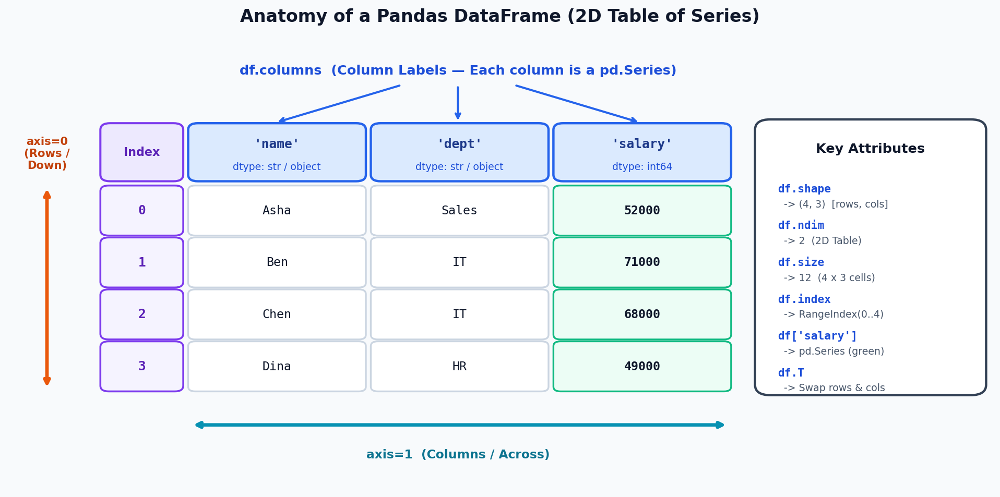
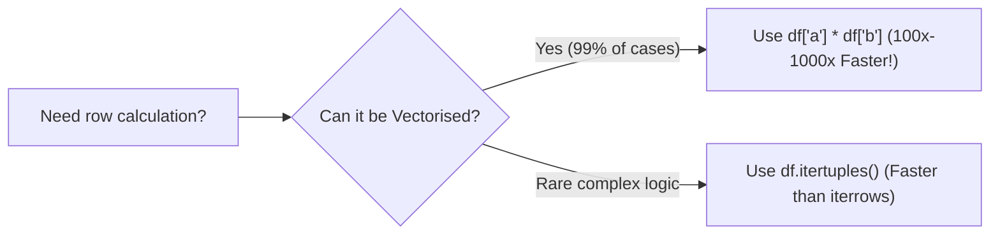

[⬅️ Previous: 02. Series in Depth](02_Series_in_Depth.md) | [🏠 Course Home](README.md) | [Next: 04. Reading and Writing Data ➡️](04_Reading_and_Writing_Data.md)

---

# 📘 පාඩම 03: DataFrame in Depth (DataFrame ගැඹුරින් ඉගෙන ගනිමු)

> **Module 3** | Week 1 | මට්ටම: Beginner to Intermediate

**`pd.DataFrame`** කියන්නේ Pandas වල ප්‍රධානම තරුව! ඒක හරියට Excel sheet එකක් හෝ SQL table එකක් වගේ 2D (ද්විමාන) වගුවක්. තවත් සරලව කිව්වොත්, **එකම Index එක බෙදාගන්න `Series` කිහිපයක් ළඟින් ළඟින් තිබ්බම හැදෙන්නේ `DataFrame` එකක්!**

---

## 🎯 මේ පාඩමෙන් ඔබ ඉගෙන ගන්නේ මොනවාද?
- Dicts, Lists of dicts, NumPy arrays, Series වලින් **DataFrames** හදන විදිය
- DataFrame **Anatomy** (`.shape`, `.columns`, `.index`, `.dtypes`, `.size`, `.ndim`, `.T`, `.values`)
- **Column operations** (`assign`, `insert`, `rename`, `drop`, `pop`, `reindex`) සහ **Index operations** (`set_index`, `reset_index`, `sort_index`, `rename_axis`)
- **Row operations** (`pd.concat`, `drop`, `loc[new] =`) සහ Iteration (`iterrows`, `itertuples`, `items`) වලින් වැළකිය යුතු ඇයි?
- Arithmetic (`add`, `sub`, `mul`, `div`, `axis=`, `fill_value=`), Aggregation (`agg`), Sorting (`sort_values`), Copying (`copy()`), සහ Conversion (`to_dict`, `to_numpy`, `to_records`, `to_list`)

---

## 1. Anatomy of a DataFrame — DataFrame එකක ව්‍යුහය

පහත රූපය දිහා බැලුවම DataFrame එකේ හැම කොටසක්ම එකපාර පැහැදිලි වෙනවා:
- **Columns (`df.columns`):** තීරු වල නම්. හැම column එකක්ම තනි `pd.Series` එකක්!
- **Index (`df.index`):** පේළි වල labels (default 0, 1, 2, 3...).
- **`axis=0`:** පහළට (rows දිගේ) වැඩ කරන දිශාව.
- **`axis=1`:** හරහට (columns දිගේ) වැඩ කරන දිශාව.



---

## 2. Creating DataFrames — DataFrame එකක් හදන ක්‍රම

```python
import pandas as pd
import numpy as np

# 1. Dict of lists (වැඩිපුරම පාවිච්චි කරන ක්‍රමය)
df = pd.DataFrame({
    'name':   ['Asha', 'Ben', 'Chen', 'Dina'],
    'dept':   ['Sales', 'IT', 'IT', 'HR'],
    'salary': [52000, 71000, 68000, 49000],
})

# 2. List of dicts (JSON / Web API responses වලට සුපිරි!)
records = [
    {'name': 'Asha', 'salary': 52000},
    {'name': 'Ben',  'salary': 71000},
]
df_rec = pd.DataFrame.from_records(records)

# 3. from_dict (rows විදියට dict එකක් දෙන්න orient='index')
df_orient = pd.DataFrame.from_dict(
    {'emp1': ['Asha', 52000], 'emp2': ['Ben', 71000]},
    orient='index', columns=['name', 'salary']
)

# 4. NumPy array එකකින්
df_np = pd.DataFrame(np.arange(6).reshape(2, 3), columns=['A', 'B', 'C'])

print("Shape:", df.shape, "| ndim:", df.ndim, "| size:", df.size)
print("Dtypes:\n", df.dtypes)
```

**Expected Output:**
```text
Shape: (4, 3) | ndim: 2 | size: 12
Dtypes:
 name      object
dept      object
salary     int64
dtype: object
```

---

## 3. Column & Index Operations (Course Core Example)

අපි දැන් course එකේ තියෙන සම්පූර්ණ code උදාහරණය රන් කරලා, පේළියෙන් පේළිය බලමු:

```python
df = pd.DataFrame({
    'name':   ['Asha', 'Ben', 'Chen', 'Dina'],
    'dept':   ['Sales', 'IT', 'IT', 'HR'],
    'salary': [52000, 71000, 68000, 49000],
})

# assign(): මුල් df වෙනස් නොකර අලුත් columns එකතු කරලා අලුත් df එකක් දෙනවා
df = df.assign(
    bonus=df['salary'] * 0.10,
    total=lambda d: d['salary'] + d['salary'] * 0.10
)

# rename() සහ set_index()
df = df.rename(columns={'name': 'employee'}).set_index('employee')

# total අනුව වැඩිම සිට අඩුම දක්වා sort කරමු
result = df.sort_values('total', ascending=False)
print(result)
```

**Line-by-Line පැහැදිලි කිරීම:**
- `df.assign(...)`: අලුත් `bonus` සහ `total` columns හදනවා. `lambda d:` පාවිච්චි කළාම මේ chain එකේම තියෙන DataFrame එක (`d`) භාවිතා කරන්න පුළුවන්!
- `.rename(columns={'name': 'employee'})`: `'name'` column එකේ නම `'employee'` කරනවා.
- `.set_index('employee')`: `'employee'` column එක row index එක බවට පත් කරනවා.
- `.sort_values('total', ascending=False)`: `'total'` අනුව ලොකු අගයේ සිට පොඩි අගයට පෙළගස්වනවා.

**Expected Output:**
```text
           dept  salary   bonus    total
employee                                
Ben          IT   71000  7100.0  78100.0
Chen         IT   68000  6800.0  74800.0
Asha      Sales   52000  5200.0  57200.0
Dina         HR   49000  4900.0  53900.0
```

### තවත් වැදගත් Column & Index Operations
| Operation | උදාහරණ Code | වැඩේ මොකක්ද? |
| --- | --- | --- |
| Direct add | `df['tax'] = df['salary'] * 0.05` | අලුත් column එකක් කෙලින්ම එකතු කිරීම |
| Insert at pos | `df.insert(1, 'country', 'LK')` | නිශ්චිත තැනකට (position 1) column එකක් දැමීම |
| Drop column | `df.drop(columns=['bonus'])` | Column එකක් ඉවත් කිරීම |
| Pop column | `b = df.pop('bonus')` | Column එක ඉවත් කර ඒක Series එකක් විදියට ලබාගැනීම |
| Reorder cols | `df[['dept', 'total', 'salary']]` | Columns වල පිළිවෙල වෙනස් කිරීම |
| Reset index | `df.reset_index()` | Index එක ආපහු සාමාන්‍ය column එකක් කිරීම |
| Sort / Rename index | `df.sort_index()`, `df.rename_axis('staff')` | Index එක පෙළගැස්වීම / නම වෙනස් කිරීම |
| Reindex | `df.reindex(['Ben', 'Asha', 'Zara'])` | අලුත් index පිළිවෙලකට සකස් කිරීම (`Zara` -> `NaN`) |

---

## 4. Row Operations & Why to Avoid Loops

### Rows එකතු කිරීම සහ ඉවත් කිරීම
- **Append rows:** පරණ `df.append()` දැන් අයින් කරලා! ඒ වෙනුවට **`pd.concat([df1, df2], ignore_index=True)`** පාවිච්චි කරන්න.
- **Add single row:** `df.loc['Eshan'] = ['IT', 65000, 6500.0, 71500.0]`
- **Drop rows:** `df.drop(index=['Dina'])`

### Iteration (`iterrows`, `itertuples`, `items`) — ඇයි Loops වලින් වළකින්න ඕන?
Pandas වල `for idx, row in df.iterrows():` ලිව්වොත් rows ලක්ෂ 5ක් යන්න තත්පර 20–30ක් යනවා. හැබැයි **Vectorised expression** එකකින් ඒක මිලි-තත්පර 2න් ඉවරයි!



- `df.iterrows()`: හරිම slow (හැම row එකටම අලුත් Series එකක් හදනවා).
- `df.itertuples()`: Loop එකක් නැතුවම බැරි නම්, `iterrows` වලට වඩා 10x වේගවත්!
- `df.items()`: Column එකෙන් column එකට loop වෙන්න.

---

## 5. Arithmetic, Aggregation, Sorting, Copying & Conversion

### Arithmetic with Alignment (`axis` & `fill_value`)
```python
scores = pd.DataFrame({'math': [80, 90], 'sci': [70, 85]}, index=['S1', 'S2'])
bonus  = pd.Series({'math': 5, 'sci': 10})

# හැම row එකකටම column labels අනුව bonus එකතු කරනවා (axis=1)
print(scores.add(bonus, axis=1))
```

### Aggregation Basics (`axis=0` vs `axis=1`)
```python
print("Column totals (axis=0):\n", scores.sum(axis=0))
print("Student totals (axis=1):\n", scores.sum(axis=1))
print("Multiple aggs:\n", scores.agg(['min', 'mean', 'max']))
```

### Sorting by Multiple Columns
```python
# dept අනුව A-Z, එකම dept එකේ අය salary වැඩිම සිට අඩුමට, NaN අගට
df_sorted = df.sort_values(by=['dept', 'salary'], ascending=[True, False], na_position='last')
```

### Copying, Transposing & Converting
- **Copying:** `df_copy = df.copy()` — Deep copy එකක් හදනවා (Pandas 2.x/3.x Copy-on-Write නිසා සාමාන්‍යයෙන් side effects නොවුණත්, පැහැදිලි බවට `.copy()` හොඳයි).
- **Transposing:** `df.T` — Rows ටික Columns බවටත්, Columns ටික Rows බවටත් මාරු කරනවා! (`swapaxes` දැන් deprecated, `.T` පාවිච්චි කරන්න.)
- **Converting to other Python/NumPy formats:**
  - `df.to_dict(orient='records')` — JSON APIs වලට යවන්න list of dicts විදියට.
  - `df.to_numpy()` — Machine Learning (Scikit-learn / PyTorch) වලට NumPy array විදියට.
  - `df.to_records()` — NumPy structured array එකක් විදියට.
  - `df['salary'].to_list()` — සාමාන්‍ය Python list එකක් විදියට.

---

## 🧠 මතක තබා ගැනීමට පහසු ක්‍රම (Memory Hacks)
- **`axis=0` vs `axis=1`:** `0` කියන්නේ කෙළින් ඉරක් වගේ **පහළට** (down the rows -> column එකේ එකතුව). `1` කියන්නේ **හරහට** (across the columns -> row එකේ එකතුව).
- **`df['col']` vs `df[['col']]`:** තනි වරහන (`[]`) දුන්නම **Series (1D)** එකක්. ද්විත්ව වරහන (`[[]]`) දුන්නම **DataFrame (2D)** එකක්!
- **`df.assign()`:** Pipeline style එකට පිරිසිදු code ලියන්න නම් `assign()` තමයි සුපිරිම.

## ⚠️ සාමාන්‍යයෙන් වෙන වැරදි (Common Pitfalls)

> [!WARNING]
> **1. `df.drop('col')` ලිවීමේදී `axis` අමතක වීම:**
> `df.drop('bonus')` ලිව්වොත් Pandas හොයන්නේ `'bonus'` කියන **row index** එකක් (`KeyError`!). හැමවෙලේම පැහැදිලිව **`df.drop(columns=['bonus'])`** ලියන්න.
>
> **2. `inplace=True` භාවිතය:**
> Pandas 3.x (Copy-on-Write) යටතේ `inplace=True` පාවිච්චි කරන එක නිර්දේශ කරන්නේ නැහැ. ඒ වෙනුවට `df = df.sort_values('total')` විදියට නැවත assign කරන්න.

---

## 💻 ප්‍රායෝගික අභ්‍යාස (Practical Exercises)

### Warm-up Exercise
ශිෂ්‍යයින් 3 දෙනෙකුගේ `name`, `maths`, `science` ලකුණු තියෙන DataFrame එකක් හදලා, `total` (එකතුව) සහ `avg` (සාමාන්‍යය) කියන columns දෙක `.assign()` මඟින් එකතු කරන්න.

<details>
<summary>✅ පිළිතුර බලන්න (Click to see Solution)</summary>

```python
import pandas as pd

students = pd.DataFrame({
    'name': ['Nimal', 'Kamal', 'Saman'],
    'maths': [85, 72, 91],
    'science': [78, 88, 95],
})

students = students.assign(
    total=lambda d: d['maths'] + d['science'],
    avg=lambda d: (d['maths'] + d['science']) / 2
)
print(students)
```
</details>

---

### Exercise 1 (Course Exercise 1)
Rows 6ක් තියෙන product DataFrame එකක් හදලා (`product`, `units`, `unit_price`), `revenue` column එකක් එකතු කරන්න. ඊටපස්සේ columns වල නම් වෙනස් කරලා (`rename`), ඒවායේ පිළිවෙල මාරු කරන්න (`reorder`).

<details>
<summary>✅ පිළිතුර බලන්න (Click to see Solution)</summary>

```python
import pandas as pd

products = pd.DataFrame({
    'product':    ['Pen', 'Book', 'Bag', 'Ruler', 'Bottle', 'Pencil'],
    'units':      [120, 45, 15, 80, 30, 200],
    'unit_price': [30, 250, 1800, 50, 650, 20],
})

# 1. revenue එකතු කරන්න
products['revenue'] = products['units'] * products['unit_price']

# 2. Rename & Reorder
products = products.rename(columns={'product': 'item_name', 'unit_price': 'price'})
products = products[['item_name', 'revenue', 'units', 'price']]

print(products)
```
</details>

---

### Exercise 2 (Course Exercise 2)
අර්ථවත් index එකක් set කරලා (`set_index`), පස්සේ ඒක reset කරන්න (`reset_index`). එක් එක් අවස්ථාව වඩාත් සුදුසු කවදාද කියලා පැහැදිලි කරන්න.

<details>
<summary>✅ පිළිතුර බලන්න (Click to see Solution)</summary>

```python
import pandas as pd

df = pd.DataFrame({
    'sku': ['P01', 'P02', 'P03'],
    'name': ['Pen', 'Book', 'Bag'],
    'price': [30, 250, 1800],
})

# Meaningful index එකක් set කිරීම
df_indexed = df.set_index('sku')
print("Indexed:\n", df_indexed)
print("Fast lookup P02:", df_indexed.loc['P02', 'name'])

# ආපහු reset කිරීම
df_reset = df_indexed.reset_index()
print("\nReset:\n", df_reset)
```
**පැහැදිලි කිරීම:**
- **`set_index('sku')` සුදුසු වෙන්නේ:** නිතර නිතර key එකකින් fast lookup (`.loc['P02']`), time-series analysis (date index), හෝ table දෙකක් index අනුව align කරන්න ඕන වෙලාවට.
- **`reset_index()` සුදුසු වෙන්නේ:** CSV/SQL වලට save කරන්න කලින්, `groupby` පස්සේ පැතලි (flat) table එකක් ඕන වුණාම, හෝ index column එක සාමාන්‍ය column එකක් විදියට filter/plot කරන්න ඕන වුණාම.
</details>

---

### Exercise 3 (Course Exercise 3)
පහත `iterrows()` loop එක වේගවත් vectorised expression එකක් විදියට නැවත ලියන්න:
```python
discounted = []
for _, row in df.iterrows():
    if row['price'] > 500:
        discounted.append(row['price'] * 0.90)
    else:
        discounted.append(row['price'])
df['final_price'] = discounted
```

<details>
<summary>✅ පිළිතුර බලන්න (Click to see Solution)</summary>

```python
import numpy as np
import pandas as pd

df = pd.DataFrame({'item': ['Pen', 'Book', 'Bag'], 'price': [30, 250, 1800]})

# Vectorised විසඳුම 1 (np.where — ඉතා වේගවත්!)
df['final_price'] = np.where(df['price'] > 500, df['price'] * 0.90, df['price'])

# හෝ Vectorised විසඳුම 2 (Pandas .where)
# df['final_price'] = df['price'].where(df['price'] <= 500, df['price'] * 0.90)

print(df)
```
**Expected Output:**
```text
   item  price  final_price
0   Pen     30         30.0
1  Book    250        250.0
2   Bag   1800       1620.0
```
</details>

---

## 📋 Cheat Sheet Summary Table

| Category | Key APIs |
| --- | --- |
| Creation | `pd.DataFrame(...)`, `from_dict`, `from_records` |
| Anatomy | `.shape`, `.columns`, `.index`, `.dtypes`, `.size`, `.ndim`, `.T`, `.values` |
| Columns | `df['c']=`, `assign`, `insert`, `rename`, `drop(columns=)`, `pop`, `reindex` |
| Index & Rows | `set_index`, `reset_index`, `sort_index`, `rename_axis`, `pd.concat`, `df.loc[new]=` |
| Math & Agg | `add`, `sub`, `mul`, `div` (`axis=`, `fill_value=`), `sum`, `mean`, `agg` |
| Sort / Copy / Convert | `sort_values`, `copy()`, `to_dict`, `to_numpy`, `to_records`, `to_list` |

---

[⬅️ Previous: 02. Series in Depth](02_Series_in_Depth.md) | [🏠 Course Home](README.md) | [Next: 04. Reading and Writing Data ➡️](04_Reading_and_Writing_Data.md)
