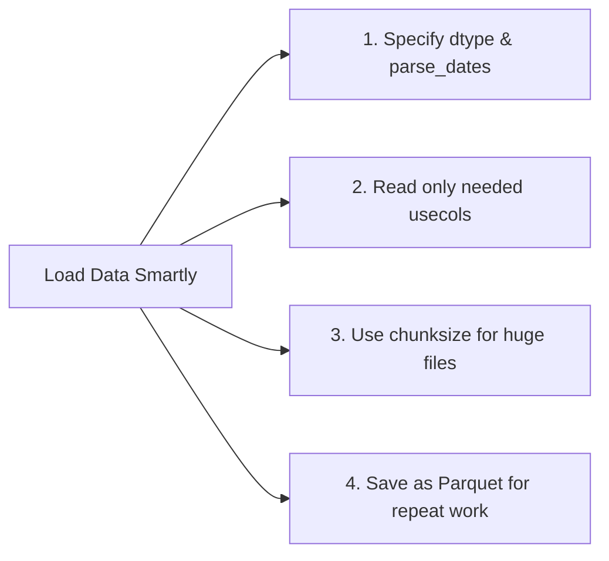
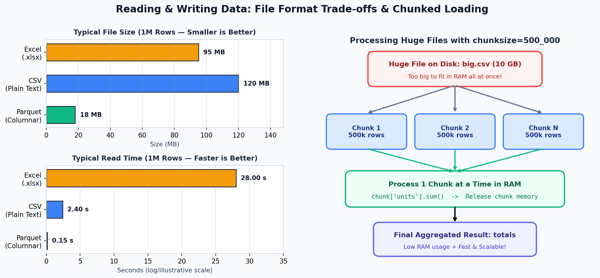

[⬅️ Previous: 03. DataFrame in Depth](03_DataFrame_in_Depth.md) | [🏠 Course Home](README.md) | [Next: 05. Inspecting and Exploring Data ➡️](05_Inspecting_and_Exploring_Data.md)

---

# 📘 පාඩම 04: Reading and Writing Data (දත්ත කියවීම සහ ලිවීම - I/O)

> **Module 4** | Week 2 | මට්ටම: Beginner to Intermediate

හැම Data Analysis project එකක්ම පටන් ගන්නේ file එකකින් හෝ database එකකින් data load කරගන්න තැනින්. හරි **reader** එකයි, හරි **options** ටිකයි මුලදීම පාවිච්චි කළොත්, පස්සේ data clean කරන්න යන පැය ගාණක් ඉතුරු කරගන්න පුළුවන්!

---

## 🎯 මේ පාඩමෙන් ඔබ ඉගෙන ගන්නේ මොනවාද?
- **CSV / TSV / Text** files වල වැදගත්ම options (`usecols`, `dtype`, `parse_dates`, `na_values`, `chunksize`, `thousands`, `decimal`, `encoding`)
- **Excel** multi-sheet reports (`read_excel`, `to_excel`, `ExcelWriter`)
- **JSON** & Nested API responses (`read_json`, `json_normalize`)
- **SQL Databases** (`read_sql`, `to_sql`, SQLAlchemy)
- **Parquet / Feather / ORC** — ඇයි CSV වෙනුවට Parquet තෝරගන්න ඕන?
- **HTML, XML, Pickle, HDF5, Clipboard, Markdown/LaTeX, Stata/SAS/SPSS, සහ Cloud (`s3://`, `gs://`)**

---

## 1. The Big Four Rules of Fast I/O — මතක තියාගන්නම ඕන රීති 4



1. **`dtype` සහ `parse_dates` මුලදීම දෙන්න:** Pandas ට අනුමාන කරන්න ඉඩ නොදී හරි types දුන්නම RAM ඉතුරු වෙනවා.
2. **`usecols` පාවිච්චි කරන්න:** Columns 100ක් තියෙන file එකකින් ඔයාට ඕන 4ක් නම්, ඒ 4 විතරක් කියවන්න!
3. **`chunksize` පාවිච්චි කරන්න:** RAM එකට වඩා ලොකු files (10 GB වගේ) කෑලි කෑලි වලට කඩලා කියවන්න.
4. **Parquet භාවිතා කරන්න:** එකම data නැවත නැවත කියවනවා නම්, CSV වෙනුවට **Parquet** විදියට save කරගන්න — file size 5x–10x අඩුයි, කියවන වේගය 10x–20x වැඩියි!



---

## 2. CSV, Excel, Parquet & Chunking (Course Core Example)

```python
import pandas as pd

# 1. හොඳම options දාලා CSV එකක් කියවමු
df = pd.read_csv(
    'sales.csv',
    usecols=['date', 'region', 'units', 'price'],
    dtype={'region': 'category'},
    parse_dates=['date'],
    na_values=['N/A', '-'],
)

# 2. වේගවත් Parquet format එකට save කරමු (index=False දාන්න අමතක කරන්න එපා!)
df.to_parquet('sales.parquet', index=False)

# 3. RAM එකට වඩා ලොකු file එකක් කෑලි (chunks) වලට කඩලා එකතුව ගනිමු
totals = sum(
    chunk['units'].sum()
    for chunk in pd.read_csv('big.csv', chunksize=500_000)
)

# 4. එකම Excel workbook එකේ Sheets කිහිපයක් ලියමු
with pd.ExcelWriter('report.xlsx', engine='openpyxl') as xw:
    df.to_excel(xw, sheet_name='Data', index=False)
    df.describe().to_excel(xw, sheet_name='Summary')
```

**Line-by-Line පැහැදිලි කිරීම:**
- `usecols=[...]`: ඕන කරන columns 4 විතරක් disk එකෙන් කියවනවා.
- `dtype={'region': 'category'}`: නැවත නැවත එන region නම් `category` විදියට load කරලා memory ඉතුරු කරනවා.
- `parse_dates=['date']`: `'date'` column එක string විදියට නැතුව කෙලින්ම `datetime64` විදියට කියවනවා.
- `na_values=['N/A', '-']`: File එකේ `'N/A'` හෝ `'-'` තියෙන තැන් ඉබේම `NaN` කරනවා.
- `chunksize=500_000`: පේළි ලක්ෂ 5 බැගින් load කරලා, ඒ කෑල්ලේ `units` එකතුව අරගෙන RAM එක නිදහස් කරනවා.
- `pd.ExcelWriter(...)`: `with` block එක ඇතුළේ `'Data'` සහ `'Summary'` කියලා sheets දෙකක් එකම `.xlsx` file එකේ හදනවා.

### CSV / Text අමතර වැදගත් Options
- `sep='\t'` (TSV වලට හෝ `pd.read_table()`), `pd.read_fwf()` (fixed-width files වලට).
- `header=None, names=['a', 'b']` — Header row එකක් නැති files වලට.
- `skiprows=2`, `nrows=100` — මුල් පේළි 2 මඟහැර පේළි 100ක් විතරක් preview කරන්න.
- `encoding='utf-8'` (හෝ `'latin-1'`) — අකුරු විකෘති වෙන files වලට.
- `thousands='.'`, `decimal=','` — යුරෝපීය අංක (`1.234,56`) හරියට කියවන්න!
- `index_col='id'`, `compression='gzip'` (`.csv.gz` කෙලින්ම unzip නොකර කියවන්න පුළුවන්!).

---

## 3. JSON & Nested API Data

සරල JSON වලට `pd.read_json('data.json')` හෝ newline-delimited JSON වලට `pd.read_json('logs.jsonl', lines=True)` පාවිච්චි කරනවා (`orient='records'` වගේ options එක්ක `to_json()`).
හැබැයි Web APIs වලින් එන **Nested JSON** (ඇතුළේ තව dicts/lists තියෙන) පැතලි table එකක් කරන්න **`pd.json_normalize()`** පාවිච්චි කරනවා:

```python
import pandas as pd

api_response = [
    {
        'order_id': 101,
        'customer': {'name': 'Asha', 'city': 'Colombo'},
        'items': [{'sku': 'A1', 'qty': 2}, {'sku': 'B2', 'qty': 1}],
    },
    {
        'order_id': 102,
        'customer': {'name': 'Ben', 'city': 'Kandy'},
        'items': [{'sku': 'A1', 'qty': 5}],
    },
]

# items list එක rows බවට දිගහැරලා, order_id සහ customer.name meta විදියට තියාගමු
flat_df = pd.json_normalize(
    api_response,
    record_path='items',
    meta=['order_id', ['customer', 'name'], ['customer', 'city']]
)
print(flat_df)
```

**Expected Output:**
```text
  sku  qty order_id customer.name customer.city
0  A1    2      101          Asha       Colombo
1  B2    1      101          Asha       Colombo
2  A1    5      102           Ben         Kandy
```

---

## 4. SQL Databases (`read_sql` & `to_sql`)

SQLite, PostgreSQL, MySQL වගේ databases එක්ක වැඩ කරන්න `sqlite3` හෝ **SQLAlchemy engine** පාවිච්චි කරනවා:

```python
import sqlite3
import pandas as pd

conn = sqlite3.connect(':memory:')  # RAM එකේ තාවකාලික SQLite DB එකක්

df_sales = pd.DataFrame({'region': ['West', 'East'], 'sales': [500, 750]})

# DataFrame -> SQL Table (if_exists: 'fail', 'replace', or 'append')
df_sales.to_sql('sales_tbl', conn, if_exists='replace', index=False)

# SQL Query -> DataFrame (SQL Injection වළක්වන්න params පාවිච්චි කරන්න!)
query = "SELECT * FROM sales_tbl WHERE sales > ?"
df_out = pd.read_sql_query(query, conn, params=(600,))
print(df_out)
conn.close()
```
*(SQLAlchemy engine එක්ක `read_sql()`, `read_sql_table()`, `chunksize=`, `method='multi'` ද පාවිච්චි කළ හැකියි.)*

---

## 5. Complete Format Guide — අනෙකුත් සියලුම Formats

| Format | Read / Write API | විශේෂ Options / Use Case |
| --- | --- | --- |
| **Parquet / Feather / ORC** | `read_parquet`, `to_parquet`, `read_feather`, `read_orc` | `engine='pyarrow'`, `columns=`, `filters=`, compression (Snappy/Zstd). වේගවත්ම columnar storage! |
| **HTML** | `read_html(url, match=, attrs=)` | Web page එකක තියෙන `<table>` ටික DataFrame list එකක් විදියට ගන්න |
| **XML** | `read_xml`, `to_xml` | `xpath=`, `parser=` — Government feeds, XML configs |
| **Pickle** | `read_pickle`, `to_pickle` | `compression=` — Python objects cache කරන්න (**විශ්වාසවන්ත files වලට විතරයි!**) |
| **HDF5** | `read_hdf`, `to_hdf`, `HDFStore` | `key=`, `format='table'` — විශාල local scientific data stores |
| **Clipboard** | `read_clipboard`, `to_clipboard` | Excel/Browser එකෙන් Copy (`Ctrl+C`) කරපු table එක කෙලින්ම Pandas වලට ගන්න! |
| **Reports / Text** | `to_markdown`, `to_latex`, `to_html`, `to_string` | GitHub README, Research papers, Email reports වලට |
| **Stats Packages** | `read_stata`, `read_sas`, `read_spss` | සමීක්ෂණ සහ විශ්වවිද්‍යාල පර්යේෂණ data (`.dta`, `.sav`) |
| **Cloud & Remote** | `pd.read_parquet('s3://bucket/data.parquet')` | URLs, `s3://`, `gs://` via `fsspec` + `storage_options={...}` |

---

## 🧠 මතක තබා ගැනීමට පහසු ක්‍රම (Memory Hacks)
- **CSV = Sharing, Parquet = Working:** වෙන කෙනෙක්ට Excel වලින් බලන්න යවන්න CSV/Excel දෙන්න. ඔයාගේ Python code වලට නැවත නැවත load කරන්න නම් හැමවෙලේම **Parquet**!
- **`index=False` Habit:** `to_csv('out.csv', index=False)` නොදැම්මොත් ඊළඟ පාර කියවද්දී `Unnamed: 0` කියලා කරදරකාරී column එකක් එනවා.
- **`pd.read_clipboard()`:** ඉක්මනට test කරන්න Excel එකෙන් table එකක් copy කරලා `df = pd.read_clipboard()` ගහන්න — මැජික් වගේ වැඩ!

## ⚠️ සාමාන්‍යයෙන් වෙන වැරදි (Common Pitfalls)

> [!WARNING]
> **1. නොදන්නා Pickle files load කිරීම (Security Risk!):**
> `pd.read_pickle()` මඟින් file එක ඇතුළේ තියෙන ඕනෑම Python code එකක් රන් වෙන්න පුළුවන්. අන්තර්ජාලයෙන් හෝ නොදන්නා කෙනෙක්ගෙන් ආපු `.pkl` files කවදාවත් load කරන්න එපා!
>
> **2. `to_csv()` වලදී `index=False` අමතක වීම:**
> Default index (`0, 1, 2...`) file එකට save වෙලා, ආපහු කියවද්දී `Unnamed: 0` column එකක් හැදෙනවා.
>
> **3. 10 GB CSV එකක් කෙලින්ම `pd.read_csv()` කිරීම:**
> RAM පිරිලා kernel එක crash වෙන්න පුළුවන්. `usecols`, `dtype`, හෝ `chunksize` පාවිච්චි කරන්න.

---

## 💻 ප්‍රායෝගික අභ්‍යාස (Practical Exercises)

### Warm-up Exercise
`io.StringIO` පාවිච්චි කරලා `"id,name,score\n1,Asha,88\n2,Ben,N/A\n3,Chen,95"` කියන CSV text එක `na_values=['N/A']` එක්ක DataFrame එකක් විදියට කියවලා, ඒක Markdown table එකක් (`to_markdown()`) විදියට print කරන්න.

<details>
<summary>✅ පිළිතුර බලන්න (Click to see Solution)</summary>

```python
import io
import pandas as pd

csv_text = "id,name,score\n1,Asha,88\n2,Ben,N/A\n3,Chen,95"
df = pd.read_csv(io.StringIO(csv_text), na_values=['N/A'])
print(df.to_markdown(index=False))
```
</details>

---

### Exercise 1 (Course Exercise 1)
යුරෝපීය අංක ක්‍රමයට (`1.234,56` — දහස් ගණන් තිතෙන්, දශම ස්ථාන කොමාවෙන්) තියෙන CSV එකක් නිවැරදිව float අගයන් විදියට කියවන්න.

<details>
<summary>✅ පිළිතුර බලන්න (Click to see Solution)</summary>

```python
import io
import pandas as pd

euro_csv = "item;price\nLaptop;1.234,56\nMouse;25,50\nMonitor;450.000,00"

df = pd.read_csv(
    io.StringIO(euro_csv),
    sep=';',
    thousands='.',
    decimal=','
)
print(df)
print("\nDtypes:\n", df.dtypes)
```
**Expected Output:**
```text
      item      price
0   Laptop    1234.56
1    Mouse      25.50
2  Monitor  450000.00

Dtypes:
 item      object
price    float64
dtype: object
```
</details>

---

### Exercise 2 (Course Exercise 2)
Nested JSON API response එකක් `pd.json_normalize()` පාවිච්චි කරලා පැතලි DataFrame එකක් බවට හරවන්න.

<details>
<summary>✅ පිළිතුර බලන්න (Click to see Solution)</summary>

```python
import pandas as pd

api_data = {
    'company': 'TechLK',
    'departments': [
        {
            'dept_name': 'Engineering',
            'staff': [{'name': 'Asha', 'role': 'ML'}, {'name': 'Ben', 'role': 'DE'}]
        },
        {
            'dept_name': 'Data',
            'staff': [{'name': 'Chen', 'role': 'Analyst'}]
        }
    ]
}

df = pd.json_normalize(
    api_data['departments'],
    record_path='staff',
    meta=['dept_name']
)
print(df)
```
**Expected Output:**
```text
   name     role    dept_name
0  Asha       ML  Engineering
1   Ben       DE  Engineering
2  Chen  Analyst         Data
```
</details>

---

### Exercise 3 (Course Exercise 3)
DataFrame එකක් SQLite database එකකට `to_sql` මඟින් save කරලා, පස්සේ `read_sql` මඟින් filter කරලා ආපහු query කරන්න.

<details>
<summary>✅ පිළිතුර බලන්න (Click to see Solution)</summary>

```python
import sqlite3
import pandas as pd

df = pd.DataFrame({
    'emp': ['Asha', 'Ben', 'Chen', 'Dina'],
    'dept': ['Sales', 'IT', 'IT', 'HR'],
    'salary': [52000, 71000, 68000, 49000],
})

with sqlite3.connect('company.db') as conn:
    df.to_sql('employees', conn, if_exists='replace', index=False)
    it_staff = pd.read_sql(
        "SELECT emp, salary FROM employees WHERE dept = ? ORDER BY salary DESC",
        conn,
        params=('IT',)
    )

print(it_staff)
```
**Expected Output:**
```text
    emp  salary
0   Ben   71000
1  Chen   68000
```
</details>

---

### Exercise 4 (Course Exercise 4)
එකම dataset එක CSV සහ Parquet විදියට save කරලා, ඒ දෙකේ file size එකයි load වෙන වේලාවයි සංසන්දනය කරන්න.

<details>
<summary>✅ පිළිතුර බලන්න (Click to see Solution)</summary>

```python
import os
import time
import numpy as np
import pandas as pd

# Rows 200,000ක sample DataFrame එකක් හදමු
n = 200_000
df = pd.DataFrame({
    'id': np.arange(n),
    'region': np.random.choice(['North', 'South', 'East', 'West'], size=n),
    'sales': np.random.uniform(10, 5000, size=n),
})

df.to_csv('bench.csv', index=False)
df.to_parquet('bench.parquet', index=False)

csv_mb = os.path.getsize('bench.csv') / (1024 ** 2)
pq_mb  = os.path.getsize('bench.parquet') / (1024 ** 2)

t0 = time.perf_counter(); _ = pd.read_csv('bench.csv');     t_csv = time.perf_counter() - t0
t0 = time.perf_counter(); _ = pd.read_parquet('bench.parquet'); t_pq = time.perf_counter() - t0

print(f"CSV:     {csv_mb:.2f} MB | Load time: {t_csv:.4f} s")
print(f"Parquet: {pq_mb:.2f} MB | Load time: {t_pq:.4f} s")
```
*(සාමාන්‍යයෙන් Parquet file එක CSV එකට වඩා 3x–6x කුඩා වෙන අතර 5x–15x වේගවත්ව load වෙනවා!)*
</details>

---

## 📋 Cheat Sheet Summary Table

| Task | Key API |
| --- | --- |
| Read / Write CSV | `pd.read_csv(..., usecols=, dtype=, parse_dates=, na_values=, chunksize=)` / `df.to_csv(..., index=False)` |
| European Numbers | `pd.read_csv(..., sep=';', thousands='.', decimal=',')` |
| Multi-sheet Excel | `with pd.ExcelWriter('f.xlsx') as xw: df.to_excel(xw, sheet_name='S1', index=False)` |
| Nested JSON | `pd.json_normalize(data, record_path=, meta=)` |
| SQL Databases | `df.to_sql('tbl', conn, if_exists='replace')`, `pd.read_sql_query(sql, conn, params=)` |
| Fast Storage | `df.to_parquet('f.parquet', index=False)`, `pd.read_parquet('f.parquet', columns=)` |
| Quick Helpers | `pd.read_html(url)`, `pd.read_clipboard()`, `df.to_markdown(index=False)` |

---

[⬅️ Previous: 03. DataFrame in Depth](03_DataFrame_in_Depth.md) | [🏠 Course Home](README.md) | [Next: 05. Inspecting and Exploring Data ➡️](05_Inspecting_and_Exploring_Data.md)
