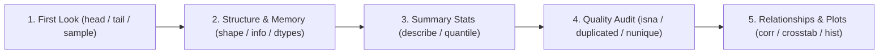
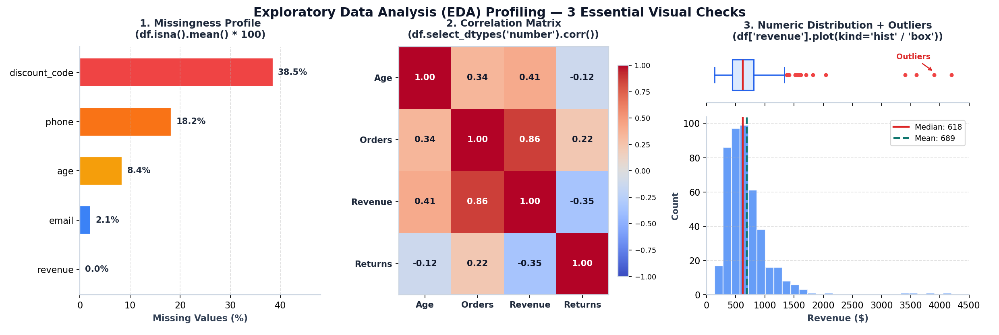

[⬅️ කලින් පාඩම: 04 Reading and Writing Data](04_Reading_and_Writing_Data.md) | [🏠 ප්‍රධාන පිටුව (README)](README.md) | [ඊළඟ පාඩම: 06 Selection, Indexing and Filtering ➡️](06_Selection_Indexing_and_Filtering.md)

# Module 5: Inspecting and Exploring Data (දත්ත පරීක්ෂා කිරීම සහ ගවේෂණය — EDA)

> **සරලවම කිව්වොත්:** ඔයා පාවිච්චි කරපු කාර් එකක් ගන්න ගියාම, එකපාරටම සල්ලි දීලා ගෙදර ගේන්නේ නෑනේ? මුලින්ම වටේ ඇවිදලා බලනවා, bonnet එක ඇරලා engine එක check කරනවා, meter එකේ කීයද තියෙන්නේ බලනවා, ටයර් ගෙවිලාද බලනවා. Data Science වලදීත් අලුත් dataset එකක් load කරපු ගමන් කිසිම වෙනසක් කරන්න කලින් ඒකේ size එක, data types, හිස් තැන් (missing values), සහ සම්බන්ධතා (relationships) පරීක්ෂා කරලා බලන එකට තමයි **Inspecting & Exploring Data (EDA - Exploratory Data Analysis)** කියන්නේ!

---

## 🗺️ EDA Workflow එක වැඩ කරන හැටි (Visual Overview)





---

## 1. First Look — දත්ත දිහා මුලින්ම එබිලා බලමු (`head`, `tail`, `sample`)

Dataset එක load කරපු ගමන් පේළි ලක්ෂ ගාණක් එකපාර print කරන්න බැහැනේ. ඒ නිසා sanity check එකක් විදියට මුල, අග, හෝ අහඹු (random) පේළි ටිකක් බලනවා:

- `df.head(n=5)` — මුල් පේළි 5 (හෝ ඔයා දෙන `n` ගාණ) පෙන්වනවා.
- `df.tail(n=5)` — අන්තිම පේළි 5 පෙන්වනවා (file එක අග හරියේ අමුතු total rows හෝ broken rows තියෙනවද බලන්න මරු!).
- `df.sample(n, random_state=42)` — මැදින් අහඹු පේළි `n` ක් අරන් පෙන්වනවා. `random_state` දුන්නම හැම වතාවෙම එකම random rows ටික ලැබෙනවා (reproducible!).

```python
import pandas as pd

df = pd.read_csv('customers.csv')

print(df.head(3))                      # මුල් පේළි 3 බලන්න
print(df.tail(3))                      # අන්තිම පේළි 3 බලන්න
print(df.sample(3, random_state=42))   # අහඹු පේළි 3ක් බලන්න
```

**Expected Output (`df.head(3)`):**
```text
   customer_id   name  age segment  revenue  discount_code
0          101  Nimal  28.0    Gold   1500.0            NaN
1          102  Kamal  35.0  Silver    800.0         SAVE10
2          103   Sita   NaN    Gold   2400.0            NaN
```

---

## 2. Structure & Memory — ව්‍යුහය, Data Types සහ Memory පරීක්ෂාව

CSV එකක් load කරද්දී සමහර වෙලාවට ඉලක්කම් තියෙන column එකක් text (`object`/`string`) විදියට load වෙලා තියෙන්න පුළුවන්, නැත්නම් date එකක් string එකක් විදියට තියෙන්න පුළුවන්. ඒවා අල්ලගන්න මේ methods ටික භාවිතා කරනවා:

- `df.shape` — `(rows, columns)` tuple එකක් දෙනවා (උදා: `(10000, 12)`).
- `df.columns` — හැම column එකේම නම් ටික පෙන්වනවා (නම් වල අනවශ්‍ය spaces තියෙනවද බලන්න හොඳයි).
- `df.dtypes` — එක් එක් column එකේ data type එක පෙන්වනවා.
- `df.info(memory_usage='deep')` — rows ගාණ, columns ගාණ, non-null counts, dtypes සහ **ඇත්තම memory ප්‍රමාණය** පෙන්වනවා.
- `df.memory_usage(deep=True)` — එක් එක් column එක RAM එකෙන් bytes කීයක් ගන්නවද කියලා වෙන වෙනම පෙන්වනවා.

> [!TIP]
> `memory_usage='deep'` නැතුව නිකන් `df.info()` ගැහුවොත්, string/object columns වල ඇත්ත memory එක ගණන් ගන්නේ නැහැ (pointer size එක විතරයි පෙන්වන්නේ). ඒ නිසා හැමවෙලේම `deep=True` / `memory_usage='deep'` දාලා බලන්න!

```python
print("Shape:", df.shape)
print("Columns:", df.columns.tolist())
df.info(memory_usage='deep')

# එක් එක් column එකේ memory usage එක KB වලින්
print((df.memory_usage(deep=True) / 1024).round(2))
```

**Expected Output (`df.info(memory_usage='deep')`):**
```text
<class 'pandas.core.frame.DataFrame'>
RangeIndex: 1000 entries, 0 to 999
Data columns (total 6 columns):
 #   Column         Non-Null Count  Dtype  
---  ------         --------------  -----  
 0   customer_id    1000 non-null   int64  
 1   name           1000 non-null   object 
 2   age            916 non-null    float64
 3   segment        1000 non-null   object 
 4   revenue        1000 non-null   float64
 5   discount_code  615 non-null    object 
dtypes: float64(2), int64(1), object(3)
memory usage: 214.8 KB
```

---

## 3. Summary Statistics — දත්තවල සාරාංශය (`describe`, `quantile`, `nlargest`)

දත්තවල බෙදී යාම (distribution) එක බැල්මෙන් තේරුම් ගන්න `describe()` තරම් වටින tool එකක් තවත් නැහැ.

- `df.describe()` — Default එන්නේ numeric columns වලට විතරයි (`count`, `mean`, `std`, `min`, `25%`, `50%`, `75%`, `max`).
- `df.describe(include='all').T` — Numeric + Text/Categorical ඔක්කොම පෙන්වනවා. `.T` (Transpose) දැම්මම columns ටික rows විදියට ලස්සනට කියවන්න පහසු වෙනවා!
- `df.describe(percentiles=[0.01, 0.05, 0.5, 0.95, 0.99])` — ඔයාට ඕන custom percentiles (උදා: 99th percentile — extreme outliers අල්ලන්න) බලන්න පුළුවන්.
- **Ranges & Extremes:**
  - `df['revenue'].quantile([0.25, 0.5, 0.75, 0.99])` — නිශ්චිත quantiles ගන්න.
  - `df.nlargest(5, 'revenue')` / `df.nsmallest(5, 'revenue')` — ලොකුම / පොඩිම අගයන් තියෙන පේළි 5 කෙලින්ම ගන්න (මුළු table එකම sort කරනවට වඩා ගොඩක් වේගවත්!).
  - `df['revenue'].idxmax()` / `df['revenue'].idxmin()` — ලොකුම / පොඩිම අගය තියෙන පේළියේ **index label එක** දෙනවා.

```python
# Numeric + Categorical summary transpose කරලා බලමු
print(df.describe(include='all').T)

# ලොකුම revenue තියෙන customers 3 දෙනා
top3 = df.nlargest(3, 'revenue')
max_idx = df['revenue'].idxmax()
print("Highest revenue row index:", max_idx)
```

**Expected Output (`df.describe(include='all').T`):**
```text
                count unique     top freq    mean     std    min    25%    50%     75%     max
customer_id    1000.0    NaN     NaN  NaN   600.5   288.8  101.0  350.8  600.5   850.2  1100.0
name             1000    980   Nimal    3     NaN     NaN    NaN    NaN    NaN     NaN     NaN
age             916.0    NaN     NaN  NaN    34.2     9.8   18.0   27.0   33.0    41.0    68.0
segment          1000      3  Silver  520     NaN     NaN    NaN    NaN    NaN     NaN     NaN
revenue        1000.0    NaN     NaN  NaN  1245.5   680.2   50.0  720.0 1120.0  1650.0  4200.0
discount_code     615      4  SAVE10  310     NaN     NaN    NaN    NaN    NaN     NaN     NaN
```

---

## 4. Missingness Profile & Uniqueness — හිස් තැන් සහ Duplicate පරීක්ෂාව

Data cleaning පටන් ගන්න කලින්, මොන columns වලද හිස් තැන් (nulls / `NaN`) තියෙන්නේ සහ කීයක් තියෙනවද කියලා ගණන් හදන්න ඕනේ.

### Missing Data Checks (`isna`, `notna`)
- `df.isna().sum()` — එක් එක් column එකේ null ගාණ.
- `(df.isna().mean() * 100).round(1).sort_values(ascending=False)` — එක් එක් column එකේ **null ප්‍රතිශතය (%)** වැඩිම එකේ ඉඳන් අඩුම එකට! (`True` = `1`, `False` = `0` නිසා `.mean()` ගත්තම කෙලින්ම අනුපාතය එනවා!).
- `df['age'].notna()` — හිස් නැති cells වලට `True` දෙනවා.

### Uniqueness & Duplicates (`nunique`, `unique`, `value_counts`, `duplicated`)
- `df.nunique()` — එක් එක් column එකේ වෙනස් අගයන් (distinct values) කීයක් තියෙනවද? (ID column එකක `nunique()` එක total rows ගාණට සමාන නම් duplicates නෑ!).
- `df['segment'].unique()` — ඒ column එකේ තියෙන වෙනස් අගයන් මොනවද කියලා array එකක් දෙනවා.
- `df['segment'].value_counts(normalize=True)` — එක් එක් category එකේ ප්‍රතිශතය (share) පෙන්වනවා (`dropna=False` දැම්මොත් `NaN` ගාණත් පෙන්වනවා!).
- `df.duplicated().sum()` — සම්පූර්ණයෙන්ම එකම වගේ repeat වෙච්ච rows කීයක් තියෙනවද?

```python
# 1. Missing values ප්‍රතිශතය (%) වැඩිම එකේ ඉඳන්
missing_pct = (df.isna().mean() * 100).round(1).sort_values(ascending=False)
print("Missing %:\n", missing_pct)

# 2. Segment වල ප්‍රතිශතය
print("\nSegment Share:\n", df['segment'].value_counts(normalize=True).round(3))

# 3. Distinct values සහ Duplicates
print("\nUnique counts:\n", df.nunique())
print("Exact duplicate rows:", df.duplicated().sum())
```

**Expected Output:**
```text
Missing %:
 discount_code    38.5
age               8.4
customer_id       0.0
name              0.0
segment           0.0
revenue           0.0
dtype: float64

Segment Share:
 segment
Silver    0.520
Gold      0.310
Bronze    0.170
Name: proportion, dtype: float64
```

---

## 5. Selecting by Dtype, Correlation & Cross-tabulation

### `select_dtypes` — Type එක අනුව Columns තෝරාගැනීම
Correlation බලන්න හෝ numeric summary ගන්න කලින් ඉලක්කම් තියෙන columns විතරක් වෙන් කරගන්න ඕනේ:
- `df.select_dtypes(include='number')` — `int`, `float` ඔක්කොම ගන්නවා.
- `df.select_dtypes(exclude='number')` — text, category, datetime වගේ ඒවා ගන්නවා.

### Correlation & Covariance (`corr`, `cov`, `corrwith`)
Columns දෙකක් අතර සම්බන්ධතාවය (`-1` සිට `+1` දක්වා) බලන්න:
- `df.select_dtypes('number').corr(method='pearson').round(2)` — Linear සම්බන්ධතාවය (`method='spearman'` non-linear monotonic සම්බන්ධතා වලට හොඳයි).
- `df.select_dtypes('number').cov()` — Covariance matrix එක.
- `df.select_dtypes('number').corrwith(df['revenue'])` — එක් target column එකක් (`revenue`) අනිත් හැම numeric column එකක් එක්කම තියෙන correlation එක එකපාර බලන්න!

### Cross-tabulation (`pd.crosstab` & `groupby().size()`)
Categorical columns දෙකක් (උදා: `segment` vs `country`) අතර counts සංසන්දනය කරන්න:
- `pd.crosstab(df['country'], df['segment'], margins=True)` — Excel Pivot Table එකක් වගේ ලස්සන 2D count table එකක් හදලා දෙනවා (`normalize='index'` දැම්මොත් row-wise percentages පෙන්වනවා!).
- `df.groupby(['country', 'segment']).size().unstack(fill_value=0)` — ඒකම `groupby` වලින් කරන විදිය.

```python
# Numeric columns වල correlation matrix එක
corr_matrix = df.select_dtypes('number').corr().round(2)
print(corr_matrix)

# Cross-tabulation: Country vs Segment
ct = pd.crosstab(df['country'], df['segment'], margins=True)
print(ct)
```

---

## 6. Comparing Frames & Quick Plots (`equals`, `compare`, `isin`, `hist`, `plot`)

### DataFrames දෙකක් සංසන්දනය කිරීම
ඔයා cleaning code එකක් ලිව්වට පස්සේ කලින් තිබ්බ table එකයි අලුත් table එකයි අතර වෙනස් වුණේ මොන cells ද කියලා බලන්න:
- `df1.equals(df2)` — හැම cell එකක්ම සහ index/dtype එකම නම් `True` දෙනවා (`NaN == NaN` පවා `True` විදියට ගණන් ගන්නවා!).
- `df1.compare(df2)` — වෙනස් වෙච්ච rows සහ columns විතරක් `self` vs `other` විදියට පැත්තෙන් පැත්තේ පෙන්වනවා! (Validation වලට සුපිරි!).
- `df1['customer_id'].isin(df2['customer_id'])` — පළවෙනි table එකේ IDs දෙවෙනි එකේ තියෙනවද කියලා check කරනවා.

### Quick Plots (`df.hist()`, `df.plot()`)
Matplotlib code ලිය ලියා ඉන්නේ නැතුව Pandas වලින්ම තත්පරෙන් graphs බලන්න:
- `df['revenue'].hist(bins=30)` — Histogram එකක් අඳිනවා.
- `df.plot(kind='box', y='revenue')` — Boxplot (outliers බලන්න).
- `df.plot(kind='scatter', x='age', y='revenue')` — Scatter plot (සම්බන්ධතාවය බලන්න).

---

## 💻 සම්පූර්ණ EDA Profiling Script එක (Course Code Sample)

```python
import pandas as pd

# 1. Data load කරමු
df = pd.read_csv('customers.csv')

# 2. Structure & real memory usage බලමු
df.info(memory_usage='deep')

# 3. Numeric + Categorical summary (Transposed)
summary = df.describe(include='all').T

# 4. එක් එක් column එකේ missing % වැඩිම එකේ ඉඳන්
missing_report = (df.isna().mean() * 100).round(1).sort_values(ascending=False)

# 5. Category share බලමු
segment_share = df['segment'].value_counts(normalize=True)

# 6. Numeric columns අතර correlation බලමු
corr_table = df.select_dtypes('number').corr().round(2)
```

**Line-by-Line පැහැදිලි කිරීම:**
1. `df.info(memory_usage='deep')`: Rows, columns, non-null counts, dtypes සහ සැබෑ RAM memory එක පෙන්වනවා.
2. `df.describe(include='all').T`: සියලුම columns වල stats අරන් `.T` මගින් පේළි විදියට හරවනවා.
3. `(df.isna().mean() * 100).round(1).sort_values(ascending=False)`: හිස් cells ප්‍රතිශතය හදලා වැඩිම හිස් තැන් තියෙන columns උඩටම ගේනවා.
4. `df['segment'].value_counts(normalize=True)`: එක් එක් segment එක මුළු customers ලගෙන් කීයෙන් පංගුවක්ද (0–1 අතර) පෙන්වනවා.
5. `df.select_dtypes('number').corr().round(2)`: Text columns මඟහැර ඉලක්කම් තියෙන columns වල විතරක් correlation හදලා දශම ස්ථාන 2කට වටයනවා.

---

## 🧠 මතක තබා ගැනීමට පහසු ක්‍රම (Memory Hacks)

1. **"H-I-D-M-C" Checklist එක:** අලුත් dataset එකක් ආපු ගමන් පිළිවෙලින් මේ 5 ගහන්න:
   - **H**ead (`df.head()`)
   - **I**nfo (`df.info(memory_usage='deep')`)
   - **D**escribe (`df.describe(include='all').T`)
   - **M**issing (`df.isna().mean() * 100`)
   - **C**orr (`df.select_dtypes('number').corr()`)
2. **`isna().mean()` Trick:** Python වල `True == 1` සහ `False == 0`. ඒ නිසා boolean Series එකක `.mean()` කියන්නේ හැමවෙලේම `True` වෙන ප්‍රතිශතය (0.0 – 1.0)!

## ⚠️ සාමාන්‍යයෙන් වෙන වැරදි (Common Pitfalls)

> [!WARNING]
> **1. `df.corr()` කෙලින්ම call කිරීම (Pandas 2.0+ Error!):**
> Text columns තියෙන DataFrame එකකට කෙලින්ම `df.corr()` ගැහුවොත් Pandas 2.0+ වල `ValueError: could not convert string to float` එනවා! හැමවෙලේම `df.select_dtypes('number').corr()` (හෝ `numeric_only=True`) භාවිතා කරන්න.

> [!WARNING]
> **2. `value_counts()` වලින් `NaN` හැංගෙනවා!**
> Default `df['col'].value_counts()` වලින් missing values (`NaN`) ගණන් ගන්නේ නෑ! හිස් තැන් ටිකත් බලන්න ඕනේ නම් `dropna=False` දාන්න: `df['col'].value_counts(dropna=False)`.

> [!WARNING]
> **3. `df.info()` වල fake memory size එකට රැවටෙන්න එපා:**
> `memory_usage='deep'` නැතුව බැලුවොත් 500MB තියෙන text column එකක් 5MB විදියට පේන්න පුළුවන්.

---

## 🏋️ ප්‍රායෝගික අභ්‍යාස (Practical Exercises)

### Warm-up Exercise:
`sales_df` එකේ වැඩිම `profit` එකක් ගත්ත පළවෙනි rows 5 හොයලා, `region` අනුව තියෙන order ප්‍රතිශතය (missing values ඇතුළුව) පෙන්වන්න.

<details>
<summary>✅ පිළිතුර බලන්න (Click to see Solution)</summary>

```python
# වැඩිම profit තියෙන rows 5
top5_profit = sales_df.nlargest(5, 'profit')

# Region අනුව ප්‍රතිශතය (NaN ඇතුළුව)
region_share = sales_df['region'].value_counts(normalize=True, dropna=False) * 100
print(top5_profit)
print(region_share.round(2))
```
</details>

### Exercise 1 (Course Exercise):
ඕනෑම DataFrame එකක් දුන්නම, එක් එක් column එකේ `dtype`, `null_pct` (%), `nunique` (unique count), සහ `sample_value` (හිස් නැති උදාහරණ අගයක්) තියෙන summary DataFrame එකක් return කරන `profile(df)` function එකක් ලියන්න.

<details>
<summary>✅ පිළිතුර බලන්න (Click to see Solution)</summary>

```python
import pandas as pd

def profile(df: pd.DataFrame) -> pd.DataFrame:
    return pd.DataFrame({
        'dtype': df.dtypes,
        'null_pct': (df.isna().mean() * 100).round(2),
        'nunique': df.nunique(),
        'sample_value': [
            df[col].dropna().iloc[0] if df[col].notna().any() else None
            for col in df.columns
        ],
    })

# භාවිතය:
# print(profile(df))
```
</details>

### Exercise 2 (Course Exercise):
Target column එකක් (`revenue`) එක්ක වැඩිම correlation එකක් (ධන හෝ ඍණ — absolute value අනුව) තියෙන අනිත් columns 5 හොයන්න.

<details>
<summary>✅ පිළිතුර බලන්න (Click to see Solution)</summary>

```python
target = 'revenue'
num_df = df.select_dtypes('number')

# target එකම අයින් කරලා, absolute correlation අනුව top 5 ගමු
corrs = num_df.corrwith(num_df[target]).drop(labels=[target])
top5_cols = corrs.abs().nlargest(5).index
print(corrs.loc[top5_cols].round(3))
```
</details>

### Exercise 3 (Course Exercise):
DataFrame එකේ `object` හෝ `string` columns අතරින්, unique values ප්‍රමාණය මුළු rows ගාණෙන් 50% ට වඩා අඩු (`category` dtype එකට හැරෙව්වොත් memory ඉතුරු වෙන) columns ටික හොයාගන්න.

<details>
<summary>✅ පිළිතුර බලන්න (Click to see Solution)</summary>

```python
text_cols = df.select_dtypes(include=['object', 'string'])
candidates = [
    col for col in text_cols.columns
    if df[col].nunique() / len(df) < 0.5
]
print("Convert to 'category' to save memory:", candidates)
```
</details>

---

## 📋 Cheat Sheet — Module 5 සාරාංශය

| අවශ්‍යතාවය (Task) | Key API / Code | කෙටි විස්තරය |
| --- | --- | --- |
| මුල / අග / අහඹු පේළි | `df.head(5)`, `df.tail(5)`, `df.sample(5, random_state=42)` | Quick sanity check |
| Structure & Real Memory | `df.shape`, `df.info(memory_usage='deep')`, `df.memory_usage(deep=True)` | Rows, dtypes, සැබෑ RAM |
| සම්පූර්ණ Summary | `df.describe(include='all').T` | Numeric + Categorical stats |
| Missing % Profile | `(df.isna().mean() * 100).sort_values(ascending=False)` | වැඩිම nulls තියෙන columns |
| Unique & Duplicates | `df.nunique()`, `df['c'].value_counts(normalize=True)`, `df.duplicated().sum()` | Cardinality & duplicate check |
| Correlation | `df.select_dtypes('number').corr()`, `corrwith(target)` | Numeric relationships |
| Top / Bottom Rows | `df.nlargest(5, 'col')`, `df.nsmallest(5, 'col')`, `df['col'].idxmax()` | Extremes & anomalies |
| 2D Category Counts | `pd.crosstab(df['a'], df['b'], margins=True)` | Cross-tabulation |
| Frame Comparison | `df1.equals(df2)`, `df1.compare(df2)` | Cleaning validation |
| Quick Visuals | `df.hist()`, `df.plot(kind='box')` | Instant visual profiling |

---

[⬅️ කලින් පාඩම: 04 Reading and Writing Data](04_Reading_and_Writing_Data.md) | [🏠 ප්‍රධාන පිටුව (README)](README.md) | [ඊළඟ පාඩම: 06 Selection, Indexing and Filtering ➡️](06_Selection_Indexing_and_Filtering.md)
