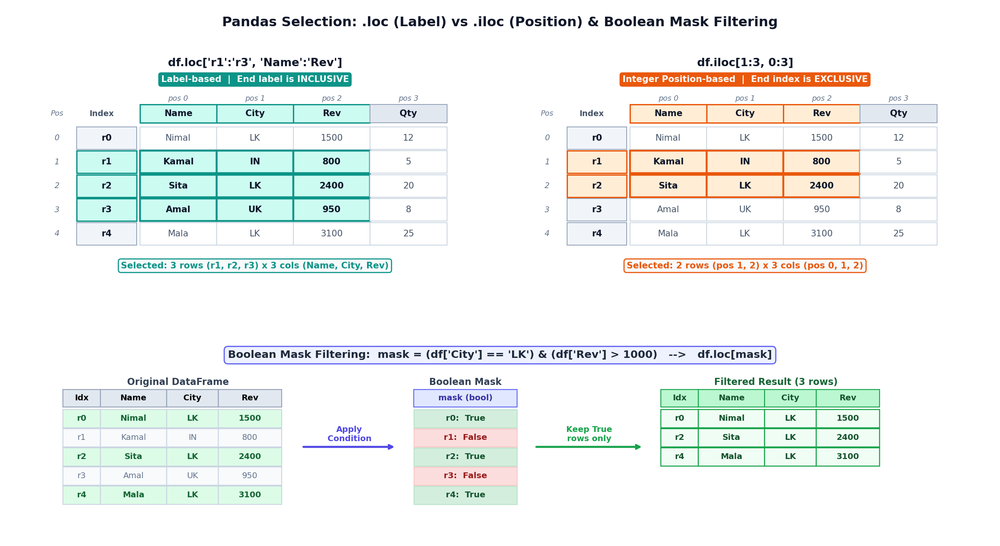

[⬅️ කලින් පාඩම: 05 Inspecting and Exploring Data](05_Inspecting_and_Exploring_Data.md) | [🏠 ප්‍රධාන පිටුව (README)](README.md) | [ඊළඟ පාඩම: 07 Data Cleaning ➡️](07_Data_Cleaning.md)

# Module 6: Selection, Indexing and Filtering (දත්ත තේරීම සහ පෙරීම)

> **සරලවම කිව්වොත්:** Pandas වල වැඩිපුරම bugs එන, හැමෝම වැඩිපුරම පටලවා ගන්න තැන තමයි මේක! හිතන්නකෝ ඔයාගේ කාමරේ පොත් රාක්කයක් තියෙනවා කියලා. පොතක් ගන්න ක්‍රම දෙකක් තියෙනවා:
> 1. **නම කියලා ගන්නවා** ("'Madol Doowa' පොත ගන්න") -> මේක තමයි **`.loc`** (Label-based)!
> 2. **ස්ථානය/අංකය කියලා ගන්නවා** ("වමේ ඉඳන් 2 වෙනි පොත ගන්න") -> මේක තමයි **`.iloc`** (Integer position-based)!
>
> මේ වෙනස හරියටම ඔළුවට දාගත්තොත් Pandas වලින් භාගයක්ම ජයගත්තා වගේ තමයි!

---

## 🗺️ මොන Selector එකද කවදද පාවිච්චි කරන්නේ?

```mermaid
flowchart TD
    Q1{"ඔයාට තෝරන්න ඕනේ මොනවද?"}
    Q1 -->|"Single cell (Speed critical)"| FAST[".at (Label) / .iat (Position)"]
    Q1 -->|"Rows & Columns by Name/Label"| LOC["df.loc[row_labels, col_names] (Inclusive!)"]
    Q1 -->|"Rows & Columns by Integer Position"| ILOC["df.iloc[row_pos, col_pos] (Exclusive!)"]
    Q1 -->|"Rows by Condition (Filter)"| FILT{"Condition එක සංකීර්ණද?"}
    FILT -->|"Standard Mask"| MASK["df.loc[(df['a'] > 5) & (df['b'] == 'x')]"]
    FILT -->|"Readable String"| QUERY["df.query('a > @t and b in [\"x\", \"y\"]')"]
```



---

## 1. Column Selection — Columns තෝරාගැනීම (`df['a']`, `df[['a', 'b']]`, `df.a`)

- `df['revenue']` — **තනි වරහනක් `[]`**: මෙය return කරන්නේ **Series** එකක් (1D).
- `df[['customer', 'revenue']]` — **වරහන් දෙකක් `[[]]`** (list එකක් දුන්නම): මෙය return කරන්නේ **DataFrame** එකක් (2D).
- `df.revenue` — Dot notation එක. ලියන්න ලේසියි, හැබැයි column නමේ space තිබ්බොත් (`df.first name` ❌), හෝ `df.count` / `df.min` වගේ Pandas method නමක් තිබ්බොත් වැඩ කරන්නේ නෑ! ඒ නිසා production code වල හැමවෙලේම `df['col']` පාවිච්චි කරන්න.

---

## 2. `.loc` vs `.iloc` — ලොකුම වෙනස!

| ලක්ෂණය | `.loc[rows, cols]` | `.iloc[rows, cols]` |
| --- | --- | --- |
| **පදනම** | **Label (නම)** අනුව | **Integer Position (0, 1, 2...)** අනුව |
| **Slice End එක** | **INCLUSIVE** (අන්තිම label එකත් **ඇතුළත්**!) | **EXCLUSIVE** (අන්තිම position එක **අයිති නෑ**!) |
| **උදාහරණය** | `df.loc['r1':'r3', 'Name':'Rev']` -> `r1, r2, r3` | `df.iloc[1:3, 0:3]` -> `pos 1, 2` විතරයි! |
| **Boolean Mask** | ✅ සෘජුවම දෙන්න පුළුවන් (`df.loc[mask, 'col']`) | ❌ Series mask බෑ (NumPy array නම් පුළුවන්) |

### Label Slicing on Sorted Index
Index එක date හෝ alphabetical order එකට sort කරලා තියෙනවා නම් `.loc` වලින් range එකක් ගන්න හරිම ලේසියි:
```python
df = df.sort_index()
q1_data = df.loc['2026-01':'2026-03']   # 2026 ජනවාරි සිට මාර්තු අවසානය දක්වා (Inclusive!)
```

### Fast Scalars (`.at` සහ `.iat`)
ඔයාට **එකම එක cell එකක්** විතරක් අරගන්න හෝ වෙනස් කරන්න ඕනේ නම් (විශේෂයෙන් loop එකක් ඇතුළේ), `.loc`/`.iloc` වලට වඩා `.at` (label) සහ `.iat` (position) ගොඩක් වේගවත්!
```python
val1 = df.at['r2', 'Rev']    # Label වලින් එක cell එකක්
val2 = df.iat[2, 2]          # Position වලින් එක cell එකක්
```

---

## 3. Boolean Filtering — කොන්දේසි දාලා Rows පෙරීම

Pandas වල Python වල `and`, `or`, `not` වැඩ කරන්නේ **නැහැ**! ඒ වෙනුවට Bitwise operators භාවිතා කරන්න ඕනේ, **සෑම කොන්දේසියක්ම වරහන් `()` ඇතුළේ දාන්නත් ඕනේ**:

- `&` -> AND (දෙකම සත්‍ය වෙන්න ඕනේ)
- `|` -> OR (එකක් හරි සත්‍ය වෙන්න ඕනේ)
- `~` -> NOT (විරුද්ධ එක — `True` එක `False` කරනවා)

### `isin()`, `between()`, සහ Text Filters
දිග `|` ගොඩක් ලියනවට වඩා මේ helper methods ගොඩක් පිරිසිදුයි:
- `df['country'].isin(['LK', 'IN', 'UK'])` — List එකේ තියෙන ඕනෑම අගයක්ද බලනවා.
- `df['revenue'].between(1000, 5000, inclusive='both')` — පරාසයක් (`1000 <= x <= 5000`) ඇතුළේ තියෙනවද බලනවා (`inclusive='neither'` / `'left'` / `'right'` දෙන්නත් පුළුවන්).
- `df[df['name'].str.contains('^A', na=False)]` — `'A'` අකුරෙන් පටන් ගන්න නම් පෙරනවා. **`na=False` දාන්නම ඕනේ** නැත්නම් `NaN` තියෙන rows නිසා error එකක් එනවා!

### `df.query()` — කියවන්න ලේසිම Filter ක්‍රමය
SQL `WHERE` clause එකක් වගේ string එකකින් filter ලියන්න පුළුවන්! Python variable එකක් ඇතුළට ගන්න `@variable` දාන්න:
```python
threshold = 1000
res = df.query('country in ["LK", "IN"] and revenue > @threshold')
```

---

## 4. Conditional Assignment — කොන්දේසි අනුව අගයන් දැමීම

1. **Single Condition (`df.loc[mask, 'col'] = value`):**
   ```python
   df.loc[df['revenue'] > 5000, 'tier'] = 'gold'
   ```
2. **Binary If / Else (`np.where`):**
   ```python
   import numpy as np
   df['status'] = np.where(df['revenue'] >= 1000, 'High', 'Low')
   ```
3. **Multiple Conditions (`np.select`):** `if / elif / else` වගේ කොන්දේසි ගොඩකට සුපිරි!
   ```python
   df['size'] = np.select(
       [df['units'] < 10, df['units'] < 100],
       ['small', 'medium'],
       default='large',
   )
   ```
4. **`Series.where` & `Series.mask`:**
   - `s.where(cond, other)` — `cond` එක **True** තැන් තියාගෙන, False තැන් `other` වලින් replace කරනවා.
   - `s.mask(cond, other)` — `cond` එක **True** තැන් හංගලා `other` දානවා (විරුද්ධ එක!).

---

## 5. Specialised Accessors (`filter`, `xs`, `get`, `take`, `drop`, `nlargest`)

- **`df.filter()`** — Column (හෝ row) නම් pattern එකකින් තෝරන්න:
  - `df.filter(like='rev')` — නමේ `'rev'` තියෙන හැම column එකක්ම.
  - `df.filter(regex='^sales_202')` — Regex එකට ගැලපෙන columns.
  - `df.filter(items=['name', 'revenue'])` — නිශ්චිත list එකක්.
- **`df.get('col', default)`** — Column එක තියෙනවා නම් ගන්නවා; නැත්නම් crash වෙන්නේ නැතුව `default` අගය දෙනවා (dictionary `.get()` වගේ!).
- **`df.xs('key', level=...)`** — MultiIndex DataFrame එකකින් නිශ්චිත level එකක cross-section එකක් ගන්න.
- **`df.take([0, 3, 1])`** — Integer positions list එකකින් වේගයෙන් rows ගන්න.
- **Top rows & Deduplication:** `df.nlargest(5, 'revenue')`, `df.nsmallest(5, 'revenue')`, `df.drop_duplicates(subset=['customer'])`.
- **Safe Dropping (`drop`):** `df = df.drop(columns=['temp_col'])` හෝ `df = df.drop(index=['r0', 'r1'])`. (`axis=0/1` කියලා පටලවා ගන්නේ නැතුව `columns=` / `index=` පාවිච්චි කරන්න!).

---

## 6. Copy-on-Write (CoW) සහ Chained Indexing Rule!

Pandas 2.x/3.0 වල **Copy-on-Write (CoW)** ක්‍රියාත්මක වෙනවා. කවදාවත් **Chained Indexing** (`df[mask]['col'] = val`) කරලා අගයක් assign කරන්න එපා! ඒකෙන් වෙන්නේ temporary copy එකක් වෙනස් වෙලා මුල් `df` එක වෙනස් නොවී යන එක (silent no-op හෝ `ChainedAssignmentError`).

```python
# ❌ වැරදියි (Chained Indexing — Original df එක වෙනස් වෙන්නේ නෑ!)
df[df['revenue'] > 5000]['tier'] = 'gold'

# ✅ හරියි (තනි .loc call එකකින් කරන්න!)
df.loc[df['revenue'] > 5000, 'tier'] = 'gold'
```

---

## 💻 සම්පූර්ණ Code උදාහරණය (Course Code Sample)

```python
import numpy as np
import pandas as pd

df = pd.DataFrame({
    'customer': ['Nimal', 'Kamal', 'Sita', 'Amal', 'Mala'],
    'country':  ['LK', 'IN', 'LK', 'UK', 'LK'],
    'revenue':  [1500, 800, 6200, 950, 3100],
    'units':    [12, 5, 140, 8, 45],
})

# 1. Boolean mask + .loc subsetting
mask = (df['country'] == 'LK') & (df['revenue'] > 1000)
high_lk = df.loc[mask, ['customer', 'revenue']]

# 2. Safe conditional assignment using single .loc
df['tier'] = 'standard'
df.loc[df['revenue'] > 5000, 'tier'] = 'gold'

# 3. Multi-branch vectorised bucketing with np.select
df['size'] = np.select(
    [df['units'] < 10, df['units'] < 100],
    ['small', 'medium'],
    default='large',
)

# 4. Readable query with external variable
threshold = 1000
q_res = df.query('country in ["LK", "IN"] and revenue > @threshold')

print("--- high_lk ---\n", high_lk)
print("\n--- Updated df ---\n", df[['customer', 'revenue', 'tier', 'size']])
```

**Expected Output:**
```text
--- high_lk ---
   customer  revenue
0    Nimal     1500
2     Sita     6200
4     Mala     3100

--- Updated df ---
   customer  revenue      tier    size
0    Nimal     1500  standard  medium
1    Kamal      800  standard   small
2     Sita     6200      gold   large
3     Amal      950  standard   small
4     Mala     3100  standard  medium
```

---

## 🧠 මතක තබා ගැනීමට පහසු ක්‍රම (Memory Hacks)

1. **`.loc` vs `.iloc`:**
   - **L**oc = **L**abel (නම) — **Inclusive** (අන්තිම එකත් ගන්නවා).
   - **I**loc = **I**nteger position (අංකය) — **Exclusive** (Python normal list slicing වගේමයි, අන්තිම එක අයින්).
2. **`where` vs `mask`:**
   - **Mask** එකක් දැම්මම මූණ වැහෙනවා -> `mask(cond, val)` කියන්නේ `cond` **True** වෙන තැන් වහලා `val` දානවා!
   - `where` ඒකේ අනිත් පැත්ත (`cond` True තැන් රකිනවා).

## ⚠️ සාමාන්‍යයෙන් වෙන වැරදි (Common Pitfalls)

> [!WARNING]
> **1. වරහන් `()` අමතක කිරීම:**
> `df[df['a'] > 5 & df['b'] == 'x']` ❌ මෙහෙම ගැහුවොත් `TypeError` එනවා! මොකද Python වල `&` ට `>` ට වඩා priority වැඩියි. හැමවෙලේම `df[(df['a'] > 5) & (df['b'] == 'x')]` ✅ කියලා වරහන් දාන්න.

> [!WARNING]
> **2. `str.contains()` වල `na=False` අමතක කිරීම:**
> Column එකේ එක `NaN` එකක් හරි තිබ්බොත් `df[df['name'].str.contains('A')]` කියන එක `ValueError: Cannot mask with non-boolean array containing NA / NaN values` දීලා crash වෙනවා. හැමවෙලේම `na=False` දාන්න!

> [!WARNING]
> **3. Chained Indexing (`df[...]['col'] = ...`):**
> කවදාවත් දෙපාරක් `[][]` දාලා value assign කරන්න එපා. හැමවෙලේම `df.loc[row_cond, 'col'] = value` පාවිච්චි කරන්න.

---

## 🏋️ ප්‍රායෝගික අභ්‍යාස (Practical Exercises)

### Warm-up Exercise:
`df` එකේ නම `'S'` අකුරෙන් පටන් ගන්න, සහ `revenue` එක `1000` ත් `5000` ත් අතර තියෙන customers ලාගේ `customer` සහ `revenue` columns විතරක් `.loc` වලින් තෝරන්න.

<details>
<summary>✅ පිළිතුර බලන්න (Click to see Solution)</summary>

```python
mask = (
    df['customer'].str.contains('^S', na=False)
    & df['revenue'].between(1000, 5000, inclusive='both')
)
result = df.loc[mask, ['customer', 'revenue']]
print(result)
```
</details>

### Exercise 1 (Course Exercise):
`.iloc` භාවිතා කරලා **10 වෙනි row එකේ ඉඳන් 20 වෙනි row එක** (1-indexed විදියට 10th to 20th, ඒ කියන්නේ positions 9 සිට 19 දක්වා) සහ **හැම දෙවෙනි column එකක්ම** (`0, 2, 4, ...`) තෝරන්න.

<details>
<summary>✅ පිළිතුර බලන්න (Click to see Solution)</summary>

```python
# 10th row = index position 9, 20th row = index position 19 (iloc end is exclusive -> 20)
# ::2 මගින් හැම දෙවෙනි column එකක්ම තෝරනවා
subset = df.iloc[9:20, ::2]
print(subset)
```
</details>

### Exercise 2 (Course Exercise):
`orders` DataFrame එකෙන් **2026 වසරේ** දාපු, `['LK', 'IN', 'SG']` යන රටවල් තුනේ customers ලාගේ, `revenue` එක මුළු table එකේ **median revenue එකට වඩා වැඩි** orders ටික filter කරන්න.

<details>
<summary>✅ පිළිතුර බලන්න (Click to see Solution)</summary>

```python
target_countries = ['LK', 'IN', 'SG']
med_rev = orders['revenue'].median()

# ක්‍රමය 1: Boolean mask
mask = (
    (orders['order_date'].dt.year == 2026)
    & (orders['country'].isin(target_countries))
    & (orders['revenue'] > med_rev)
)
filtered_1 = orders.loc[mask]

# ක්‍රමය 2: query() (order_date datetime නම්)
filtered_2 = orders.query(
    'order_date.dt.year == 2026 and country in @target_countries and revenue > @med_rev'
)
```
</details>

### Exercise 3 (Course Exercise):
`np.select` භාවිතා කරලා `revenue` අනුව පරාස 4කට `tier` column එකක් හදන්න: `< 500` -> `'Bronze'`, `< 2000` -> `'Silver'`, `< 5000` -> `'Gold'`, `>= 5000` -> `'Platinum'`.

<details>
<summary>✅ පිළිතුර බලන්න (Click to see Solution)</summary>

```python
import numpy as np

conditions = [
    df['revenue'] < 500,
    df['revenue'] < 2000,
    df['revenue'] < 5000,
]
choices = ['Bronze', 'Silver', 'Gold']

df['tier'] = np.select(conditions, choices, default='Platinum')
print(df[['customer', 'revenue', 'tier']])
```
</details>

---

## 📋 Cheat Sheet — Module 6 සාරාංශය

| අවශ්‍යතාවය (Task) | Key API / Code | මතක තියාගන්න දේ |
| --- | --- | --- |
| Single / Multi Columns | `df['a']` (Series), `df[['a', 'b']]` (DataFrame) | Dot notation (`df.a`) වලින් වළකින්න |
| Label-based Selection | `df.loc[row_lbl, col_lbl]` | End label **Inclusive** |
| Position-based Selection | `df.iloc[0:5, [0, 2]]` | End index **Exclusive** |
| Fast Single Cell | `df.at[lbl, col]`, `df.iat[r, c]` | Tight loops වලට වේගවත් |
| Boolean Filtering | `df.loc[(c1) & (c2) \| ~(c3)]` | හැම condition එකටම `()` දාන්න |
| Membership & Range | `isin([...])`, `between(lo, hi)` | Cleaner than multiple `\|` / `&` |
| Readable Query | `df.query('a > @x and b in ["LK"]')` | External vars වලට `@` |
| Text Filter | `df[df['name'].str.contains('^A', na=False)]` | `na=False` අනිවාර්යයි |
| Conditional Assign | `df.loc[mask, 'c'] = v`, `np.where`, `np.select` | Chained indexing එපා! |
| Column Name Pattern | `df.filter(like=..., regex=...)` | Pattern-based column pick |
| Safe Drop / Get | `df.drop(columns=['x'])`, `df.get('x', default)` | KeyError වළක්වනවා |

---

[⬅️ කලින් පාඩම: 05 Inspecting and Exploring Data](05_Inspecting_and_Exploring_Data.md) | [🏠 ප්‍රධාන පිටුව (README)](README.md) | [ඊළඟ පාඩම: 07 Data Cleaning ➡️](07_Data_Cleaning.md)
