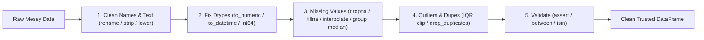
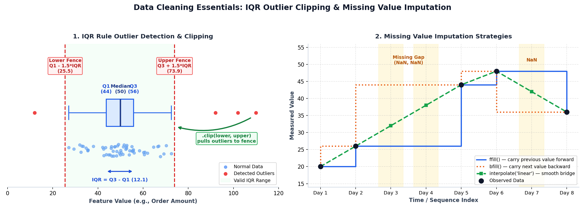

[⬅️ කලින් පාඩම: 06 Selection, Indexing and Filtering](06_Selection_Indexing_and_Filtering.md) | [🏠 ප්‍රධාන පිටුව (README)](README.md) | [ඊළඟ පාඩම: 08 Data Transformation ➡️](08_Data_Transformation.md)

# Module 7: Data Cleaning (දත්ත පිරිසිදු කිරීම)

> **සරලවම කිව්වොත්:** ඔයා පොළෙන් එළවළු ගෙනල්ලා කෙලින්ම මුට්ටියට දාලා උයන්නේ නෑනේ? මඩ හෝදනවා, කුණු වෙච්ච කෑලි අයින් කරනවා, ලෙලි අරිනවා, එකම ප්‍රමාණයට කපනවා. Data Analysts ලා තමන්ගේ කාලයෙන් **70%–80% ක්ම** වැය කරන්නේ මෙන්න මේ **Data Cleaning** වැඩේට! මොකද "Garbage In, Garbage Out" — කුණු දත්ත දුන්නොත්, හොඳම AI model එකකින්වත් වැඩක් නෑ!

---

## 🗺️ Repeatable Cleaning Pipeline එකක් හදන පිළිවෙල





---

## 1. Missing Data — හිස් තැන් හඳුනාගැනීම, ඉවත් කිරීම සහ පිරවීම

### A. Detecting (`isna`, `notna`)
- `df.isna().sum()` — column එකකට තියෙන හිස් තැන් ගාණ.
- `df[df['amount'].isna()]` — `amount` එක හිස් rows ටික බලන්න.

### B. Dropping (`dropna`)
හිස් තැන් තියෙන rows හෝ columns සම්පූර්ණයෙන් අයින් කරන්න:
- `df.dropna()` — එක `NaN` එකක් හරි තියෙන ඕනෑම row එකක් අයින් කරනවා.
- `df.dropna(how='all')` — මුළු row එකම හිස් නම් විතරක් අයින් කරනවා.
- `df.dropna(subset=['order_id', 'date'])` — වැදගත් columns ටිකක `NaN` තිබ්බොත් විතරක් row එක අයින් කරනවා.
- `df.dropna(thresh=3)` — අඩුම ගාණේ non-null අගයන් 3ක්වත් තියෙන rows විතරක් තියාගන්නවා (`axis=1` දැම්මොත් columns වලට).

### C. Filling (`fillna`, `ffill`, `bfill`, `interpolate`)
Rows අයින් කරන එකෙන් data නාස්ති වෙනවා නම්, බුද්ධිමත්ව හිස් තැන් පුරවනවා (**Imputation**):
- `df['age'].fillna(df['age'].median())` — Constant හෝ statistic (mean/median/mode) එකකින් පිරවීම.
- `df['price'].ffill()` — **Forward fill**: කලින් තිබ්බ අගය ඉස්සරහට අරන් යනවා (stock prices වගේ ඒවට හොඳයි).
- `df['price'].bfill()` — **Backward fill**: ඊළඟට තියෙන අගය පස්සට ගන්නවා.
- `df['temp'].interpolate(method='linear')` — දෙපැත්තේ තියෙන අගයන් අතර සුමට රේඛාවක් ගහලා අනුමාන කරනවා (`method='time'` හෝ `'spline'` දෙන්නත් පුළුවන්!).

### D. Group-wise Imputation (සුපිරිම ක්‍රමය!)
හැම කෙනාගෙම හිස් `amount` එක මුළු table එකේම median එකෙන් පුරවනවට වඩා, **ඒ ඒ රටේ (country) median එකෙන්** පුරවන එක ගොඩක් නිවැරදියි:
```python
df['amount'] = df['amount'].fillna(
    df.groupby('country')['amount'].transform('median')
)
```
(`transform('median')` මගින් මුල් DataFrame එකේ size එකටම ගැලපෙන Series එකක් හදලා දෙනවා!)

---

## 2. Duplicates — නැවත නැවත ආපු Rows ඉවත් කිරීම

- `df.duplicated(subset=['order_id'], keep='first')` — පළවෙනි එක තියාගෙන අනිත් duplicates වලට `True` දෙනවා (`keep='last'` හෝ `keep=False` දෙන්න පුළුවන්).
- `df.drop_duplicates(subset=['order_id'], keep='last')` — එකම `order_id` එක දෙපාරක් තිබ්බොත් අලුත්ම (අන්තිම) එක තියාගෙන අනිත් එක අයින් කරනවා.

---

## 3. Data Type Fixing & Nullable Types

CSV වල `"1,250"` හෝ `"N/A"` වගේ දේවල් තිබ්බම මුළු column එකම text (`object`) වෙනවා.
- `pd.to_numeric(s, errors='coerce')` — ඉලක්කම් බවට හරවනවා; හරවන්න බැරි `"N/A"` වගේ text කැඩෙන්නේ නැතුව `NaN` කරනවා!
- `pd.to_datetime(s, errors='coerce')` — Dates බවට හරවනවා; වැරදි dates `NaT` කරනවා.
- `pd.to_timedelta(s)` — කාල පරාස (durations, උදා: `"2 days 03:00:00"`) වලට හරවනවා.
- `df.convert_dtypes()` — Pandas විසින්ම හොඳම modern nullable types (`Int64`, `string`, `boolean`) තෝරලා දෙනවා.

### Nullable Types (`Int64`, `boolean`, `string`, `pd.NA`)
සාමාන්‍ය NumPy `int64` column එකකට `NaN` එකක් ආවොත් Pandas ඒක `float64` කරනවා (`10` -> `10.0`). ඒක වළක්වන්න **Capital-I `Int64`** පාවිච්චි කරන්න:
```python
s = pd.Series([10, None, 30], dtype='Int64')   # Output: 10, <NA>, 30 (int විදියටම ඉන්නවා!)
```

---

## 4. Tidying Names, Text, Categories & Bad Structure

### Column Names පිරිසිදු කිරීම
```python
df = df.rename(columns={'Order ID': 'order_id'})
# නැත්නම් හැම column එකක්ම එකපාර snake_case කරමු:
df.columns = (
    df.columns.str.strip()
              .str.lower()
              .str.replace(r'\W+', '_', regex=True)
)
```

### Text & Inconsistent Categories (`strip`, `lower`, `replace`, `map`)
`' USA '`, `'usa'`, `'U.S.'`, `'United States'` — මේ ඔක්කොම එකම රට වුණාට computer එකට පේන්නේ රටවල් 4ක් වගේ!
```python
country_map = {'USA': 'US', 'U.S.': 'US', 'UNITED STATES': 'US'}
df['country'] = (
    df['country'].str.strip()
                 .str.upper()
                 .replace(country_map)
)
```
- `replace()` — ඔයා දුන්න keys විතරක් මාරු කරලා, අනිත් values ඒ විදියටම තියාගන්නවා.
- `map()` — Dictionary එකේ නැති values ඔක්කොම `NaN` කරනවා! (ඒ නිසා පරිස්සමෙන්!)

### Reshaping Bad Structure (`str.split`, `explode`, `melt`)
එකම cell එකක values ගොඩක් තිබ්බොත් (උදා: `"python,sql,pandas"`):
- `df['tags'].str.split(',').explode()` — එක tag එකකට එක row එක ගාණේ කඩලා දෙනවා!
- `df['full_name'].str.split(' ', expand=True)` — Columns දෙකකට (`first_name`, `last_name`) වෙන් කරනවා.
- `df.melt(...)` — Wide table එකක් Tidy Long table එකක් කරනවා.

---

## 5. Outliers (අසාමාන්‍ය අගයන්) & Validation

### IQR Rule & Clipping (Winsorising)
උඩ රූපයේ පේන විදියට, සාමාන්‍ය දත්තවලින් ගොඩක් ඈතට ගිය outliers අයින් නොකර, සීමාව (fence) ඇතුළට නවලා ගන්න `.clip()` පාවිච්චි කරනවා:
- $\text{IQR} = Q_3 - Q_1$
- $\text{Lower Fence} = Q_1 - 1.5 \times \text{IQR}$
- $\text{Upper Fence} = Q_3 + 1.5 \times \text{IQR}$

```python
q1, q3 = df['amount'].quantile([0.25, 0.75])
iqr = q3 - q1
df['amount'] = df['amount'].clip(lower=q1 - 1.5 * iqr, upper=q3 + 1.5 * iqr)
```
*(විකල්පයක් විදියට Z-score: `abs((x - x.mean()) / x.std()) > 3` හෝ quantile clipping `.clip(df['x'].quantile(0.01), df['x'].quantile(0.99))` පාවිච්චි කරන්නත් පුළුවන්.)*

### Data Validation (`assert`, `between`, `isin`, `pd.testing`)
Cleaning ඉවර වුණාම data ඇත්තටම පිරිසිදුද කියලා automatic checks දාන්න:
```python
assert df['order_id'].is_unique, "Duplicate order IDs found!"
assert (df['amount'] >= 0).all(), "Negative amounts found!"
assert df['country'].isin(['LK', 'US', 'UK', 'IN']).all(), "Invalid country code!"
```

---

## 6. Cleaning Pipeline with `.pipe()` (Course Code Sample)

Cleaning steps ඔක්කොම function එකකට දාලා `.pipe()` වලින් call කරාම, අලුත් data එන හැමවෙලේම එකම පිරිසිදු process එක run කරන්න පුළුවන්:

```python
import pandas as pd

def clean(df: pd.DataFrame) -> pd.DataFrame:
    df = df.copy()
    # 1. Column names snake_case කරමු
    df.columns = (
        df.columns.str.strip()
                  .str.lower()
                  .str.replace(r'\W+', '_', regex=True)
    )
    # 2. Comma අයින් කරලා numeric බවට හරවමු
    df['amount'] = pd.to_numeric(
        df['amount'].astype('string').str.replace(',', ''),
        errors='coerce'
    )
    # 3. Dates parse කරමු
    df['date'] = pd.to_datetime(df['date'], errors='coerce')
    # 4. Country text normalize කරමු
    df['country'] = df['country'].str.strip().str.upper().replace({'USA': 'US'})
    # 5. Country-wise median වලින් missing amount පුරවමු
    df['amount'] = df['amount'].fillna(
        df.groupby('country')['amount'].transform('median')
    )
    # 6. IQR rule එකෙන් outliers clip කරමු
    q1, q3 = df['amount'].quantile([0.25, 0.75])
    iqr = q3 - q1
    df['amount'] = df['amount'].clip(q1 - 1.5 * iqr, q3 + 1.5 * iqr)
    # 7. Duplicate orders අයින් කරමු
    return df.drop_duplicates(subset=['order_id'])

raw = pd.DataFrame({
    ' Order ID ': [1, 2, 2, 3, 4],
    'Amount':     ['1,200', 'bad', '1,500', '1,100', '95,000'],
    'Date':       ['2026-01-05', '2026-01-06', '2026-01-06', 'not_a_date', '2026-01-08'],
    'Country':    [' usa ', 'US', 'US', 'lk', ' LK '],
})

clean_df = raw.pipe(clean)
print(clean_df)
```

**Expected Output:**
```text
   order_id  amount       date country
0         1  1200.0 2026-01-05      US
1         2  1350.0 2026-01-06      US
3         3  1100.0        NaT      LK
4         4  1612.5 2026-01-08      LK
```
*(බලන්න: `'bad'` එක `NaN` වෙලා US median එක වුණ `1350.0` වලින් පිරුණා; `95,000` outlier එක upper fence එකට clip වුණා; duplicate `order_id=2` අයින් වුණා!)*

---

## 🧠 මතක තබා ගැනීමට පහසු ක්‍රම (Memory Hacks)

1. **`errors='coerce'`:** "Coerce" කියන්නේ "බලෙන් හරවන්න, බැරි නම් `NaN` කරන්න" — Crash නොවී dirty data clean කරන්න තියෙන හොඳම keyword එක!
2. **`replace()` vs `map()`:**
   - සමහර අගයන් විතරක් මාරු කරන්න -> **`replace()`**
   - හැම අගයක්ම අලුතෙන් map කරන්න (නැති ඒවා `NaN` වෙන්න) -> **`map()`**
3. **Capital `Int64`:** `NaN` එක්ක integers තියාගන්න ඕනේ නම් Capital `I` (`Int64`, `boolean`, `string`) මතක තියාගන්න.

## ⚠️ සාමාන්‍යයෙන් වෙන වැරදි (Common Pitfalls)

> [!WARNING]
> **1. `df.copy()` නොදා function එකක් ඇතුළේ `df` mutate කිරීම:**
> Cleaning function එක පටන් ගද්දිම `df = df.copy()` දාන්න. නැත්නම් මුල් `raw` DataFrame එක නොදැනුවත්වම වෙනස් වෙන්න පුළුවන්!

> [!WARNING]
> **2. Outliers clip කරන්න කලින් Mean එකෙන් Missing values පිරවීම:**
> `95,000` වගේ ලොකු outlier එකක් තියෙද්දී `mean()` ගත්තොත් ඒක වැරදි ලොකු අගයක් වෙනවා. ඒ නිසා හැමවෙලේම **`median()`** පාවිච්චි කරන්න!

> [!WARNING]
> **3. `inplace=True` භාවිතය:**
> Pandas 2.x/3.0 වල `inplace=True` recommend කරන්නේ නෑ (memory ඉතුරු වෙන්නෙත් නෑ, method chaining බිඳෙනවා). හැමවෙලේම `df = df.dropna(...)` විදියට assign කරන්න.

---

## 🏋️ ප්‍රායෝගික අභ්‍යාස (Practical Exercises)

### Warm-up Exercise:
`df['tags']` column එකේ `"a, b, c"` වගේ comma-separated strings තියෙනවා. ඒවා වෙන වෙනම rows වලට කඩලා (`explode`), අනවශ්‍ය spaces අයින් කරලා lowercase කරන්න.

<details>
<summary>✅ පිළිතුර බලන්න (Click to see Solution)</summary>

```python
df_exploded = (
    df.assign(tags=df['tags'].str.split(','))
      .explode('tags')
)
df_exploded['tags'] = df_exploded['tags'].str.strip().str.lower()
```
</details>

### Exercise 1 (Course Exercise):
Mixed date formats (`'2026-01-10'`, `'10/02/2026'`), currency symbols (`'$1,250.50'`, `'Rs. 500'`), සහ duplicate `id` තියෙන messy DataFrame එකක් clean කරන pipeline එකක් ලියන්න.

<details>
<summary>✅ පිළිතුර බලන්න (Click to see Solution)</summary>

```python
import pandas as pd

raw = pd.DataFrame({
    'id':     [101, 102, 102, 103],
    'date':   ['2026-01-10', '10/02/2026', '10/02/2026', '2026.03.15'],
    'amount': ['$1,250.50', 'Rs. 500', 'Rs. 500', '$890.00'],
})

def clean_messy(df: pd.DataFrame) -> pd.DataFrame:
    df = df.copy()
    df['date'] = pd.to_datetime(df['date'], format='mixed', errors='coerce')
    # ඉලක්කම් සහ දශම තිත හැර අනිත් සියල්ල ($, Rs., commas, spaces) අයින් කරමු
    df['amount'] = pd.to_numeric(
        df['amount'].astype('string').str.replace(r'[^0-9.-]', '', regex=True),
        errors='coerce'
    )
    return df.drop_duplicates(subset=['id'], keep='first')

print(raw.pipe(clean_messy))
```
</details>

### Exercise 2 (Course Exercise):
`employees` DataFrame එකේ missing `age` අගයන්, එක් එක් `job_title` එකේ **median age** එකෙන් impute කරන්න.

<details>
<summary>✅ පිළිතුර බලන්න (Click to see Solution)</summary>

```python
employees['age'] = employees['age'].fillna(
    employees.groupby('job_title')['age'].transform('median')
)
# යම් job_title එකක ඔක්කොම ages NaN නම්, fallback එකක් විදියට overall median දාමු:
employees['age'] = employees['age'].fillna(employees['age'].median())
```
</details>

### Exercise 3 (Course Exercise):
Clean කරපු `clean_df` එකේ (1) `order_id` unique විය යුතුයි, (2) `amount` ඍණ අගයන් නොවිය යුතුයි, (3) `country` codes `['LK', 'US', 'UK', 'IN']` අතර විය යුතුයි කියලා assertions 3ක් ලියන්න.

<details>
<summary>✅ පිළිතුර බලන්න (Click to see Solution)</summary>

```python
valid_countries = {'LK', 'US', 'UK', 'IN'}

assert clean_df['order_id'].is_unique, "Duplicate order_id detected!"
assert (clean_df['amount'] >= 0).all(), "Negative amount detected!"
assert clean_df['country'].isin(valid_countries).all(), "Unexpected country code!"
print("All 3 validation assertions passed!")
```
</details>

---

## 📋 Cheat Sheet — Module 7 සාරාංශය

| අවශ්‍යතාවය (Task) | Key API / Code | භාවිතය |
| --- | --- | --- |
| Missing Drop | `df.dropna(subset=['a'], thresh=3)` | වැදගත් nulls අයින් කිරීම |
| Simple / Time Fill | `fillna(val)`, `ffill()`, `bfill()`, `interpolate('linear')` | Imputation |
| Group Imputation | `df['x'].fillna(df.groupby('g')['x'].transform('median'))` | Group-wise median fill |
| Duplicates | `df.duplicated(subset=)`, `df.drop_duplicates(subset=, keep=)` | Deduplication |
| Safe Type Fixing | `pd.to_numeric(..., errors='coerce')`, `pd.to_datetime(...)` | Text -> Number/Date |
| Nullable Types | `dtype='Int64'`, `'boolean'`, `'string'` | `pd.NA` එක්ක integers |
| Text & Names | `str.strip().str.lower().str.replace(...)`, `rename()` | Schema & text cleanup |
| Category Fix | `df['c'].replace({'USA': 'US'})` | Unmatched values ආරක්ෂිතයි |
| Outlier Clipping | `df['x'].clip(q1 - 1.5*iqr, q3 + 1.5*iqr)` | IQR Winsorising |
| Multi-value Cells | `str.split(',', expand=True)`, `explode()` | Structure reshaping |
| Pipeline & Checks | `df.pipe(clean)`, `assert ...` | Repeatable & safe cleaning |

---

[⬅️ කලින් පාඩම: 06 Selection, Indexing and Filtering](06_Selection_Indexing_and_Filtering.md) | [🏠 ප්‍රධාන පිටුව (README)](README.md) | [ඊළඟ පාඩම: 08 Data Transformation ➡️](08_Data_Transformation.md)
