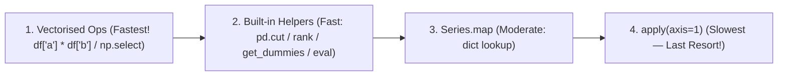
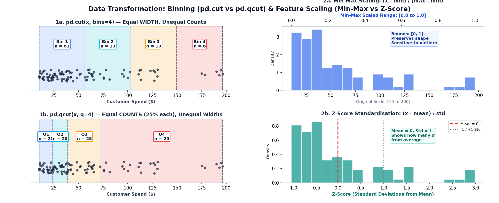

[⬅️ කලින් පාඩම: 07 Data Cleaning](07_Data_Cleaning.md) | [🏠 ප්‍රධාන පිටුව (README)](README.md) | [ඊළඟ පාඩම: 09 Text Data and Categoricals ➡️](09_Text_Data_and_Categoricals.md)

# Module 8: Data Transformation (දත්ත පරිවර්තනය සහ Feature Engineering)

> **සරලවම කිව්වොත්:** දැන් එළවළු හෝදලා පිරිසිදු කරලා ඉවරයි (Module 7). දැන් තමයි ඒවායින් රස කෑමක් හදන (cooking / feature engineering) වෙලාව! තියෙන columns පාවිච්චි කරලා අලුත් තොරතුරු (`revenue`, `age_band`, `rank`, `z-score`, `one-hot encoding`) හදන හැටි අපි මේ පාඩමෙන් ඉගෙන ගන්නවා.
>
> **රන් රීතිය (Golden Rule):** හැමවෙලේම **Vectorised methods** (NumPy / built-in Pandas) මුලින් පාවිච්චි කරන්න. `apply(axis=1)` පාවිච්චි කරන්නේ වෙන කිසිම විකල්පයක් නැත්නම් විතරයි (මොකද `apply(axis=1)` කියන්නේ හිමින් යන Python loop එකක්!).

---

## 🗺️ Transformation වල වේගය (Speed Hierarchy)





---

## 1. Method Chaining with `.assign()` & `.pipe()`

අතරමැදි variables ගොඩක් (`df1`, `df2`, `df3`) හදන්නේ නැතුව, මුල් `df` එක වෙනස් (mutate) නොකර, කියවන්න ලස්සන pipeline එකක් ලියන්න `.assign()` පාවිච්චි කරනවා!
`lambda d:` දැම්මම ඒ මොහොතේ කලින් step එකෙන් හැදුණු අලුත් columns පවා ඊළඟ පේළියේදී කෙලින්ම පාවිච්චි කරන්න පුළුවන්:

```python
out = (
    df
    .assign(
        revenue=lambda d: d['units'] * d['price'],
        tax=lambda d: d['revenue'] * 0.15,   # උඩ හදපු revenue එක මෙතනම ගත්තා!
    )
    .pipe(lambda d: d[d['revenue'] > 0])
)
```

---

## 2. `map`, `apply`, `DataFrame.map`, `agg` & `transform`

- **`Series.map()`:** Dictionary, Series, හෝ function එකක් දීලා element-by-element අගයන් මාරු කරන්න:
  `df['tier_code'] = df['tier'].map({'Bronze': 1, 'Silver': 2, 'Gold': 3})`
- **`apply(axis=0 / 1)`:** Column එකක් දිගේ (`axis=0`) හෝ Row එකක් දිගේ (`axis=1`) custom function එකක් run කරන්න (`result_type='expand'` දුන්නොත් list එකක් columns කිහිපයකට කඩනවා). **මතක තියාගන්න: හැකි සෑම විටම vectorise කරන්න!**
- **`df.map(func)`** *(කලින් `applymap` කියලා තිබුණේ, Pandas 2.1+ වල `df.map`)*: මුළු DataFrame එකේම හැම cell එකකටම function එකක් apply කරන්න (උදා: `df.map(lambda x: f"{x:.2f}")`).
- **`agg` vs `transform`:**
  - `df[['units', 'price']].agg(['mean', 'std'])` — **Reduction**: බොහෝ rows එකතු කරලා summary එකක් හදනවා.
  - `df.groupby('region')['revenue'].transform('mean')` — **Same-shape**: මුල් DataFrame එකේ rows ගාණටම ප්‍රතිඵලය දෙනවා (column එකක් විදියට එකතු කරන්න පහසුයි!).

---

## 3. Conditional Logic (Vectorised If/Else)

- `np.where(cond, val_if_true, val_if_false)` — Binary if/else.
- `np.select([cond1, cond2], [val1, val2], default=...)` — Multi-branch if/elif/else.
- `Series.case_when([(cond1, val1), (cond2, val2)])` — Pandas 2.2+ වල ආපු අලුත්, කියවන්න ලේසි method එක!
- `where()` & `mask()` — Condition එකට අනුව values රඳවාගන්න හෝ මාරු කරන්න.

---

## 4. Binning — ඉලක්කම් කාණ්ඩ (Intervals) වලට කැඩීම (`pd.cut` vs `pd.qcut`)

උඩ රූපයේ පේන විදියට මේ දෙකේ වෙනස හරිම වැදගත්:
- **`pd.cut(x, bins=..., labels=...)` (Equal-WIDTH හෝ Custom Edges):**
  ඔයා කියන නිශ්චිත සීමා (උදා: වයස `0–18`, `18–35`, `35–60`, `60–120`) අනුව කඩනවා. හැම කාණ්ඩයකම සමාන data ගාණක් නොවෙන්න පුළුවන්.
- **`pd.qcut(x, q=4, labels=['Q1','Q2','Q3','Q4'])` (Equal-COUNT Quantiles):**
  හැම කාණ්ඩයකටම **සමාන දත්ත ප්‍රමාණයක් (25% බැගින්)** වැටෙන විදියට සීමාවන් Pandas විසින්ම හොයලා කඩනවා!

---

## 5. Sorting, Ranking & Arithmetic Helpers

### Sorting & Ranking
- `df.sort_values(['region', 'revenue'], ascending=[True, False])` — Columns කිහිපයකින් sort කිරීම.
- `df.sort_index()` — Index එක අනුව sort කිරීම.
- `df['revenue'].rank(method='dense', ascending=False)` — Leaderboard rank එකක් දීම (`pct=True` දැම්මොත් `0.0–1.0` percentile rank එක දෙනවා!).

### Arithmetic & Window Helpers
- `round(2)`, `clip(0, 100)`, `abs()` — වටයන්න, සීමා කරන්න, ඍණ ලකුණ අයින් කරන්න.
- `cumsum()` — Cumulative sum (මේ දක්වා එකතුව).
- `shift(1)` — කලින් row එකේ අගය ගන්න (වෙනස බලන්න).
- `diff()` — කලින් row එකට වඩා කීයකින් වෙනස් වුණාද (`x[t] - x[t-1]`).
- `pct_change()` — ප්‍රතිශත වෙනස / Growth rate (`(x[t] - x[t-1]) / x[t-1]`).

---

## 6. Scaling, Encoding & Fast Expressions

### Feature Scaling (Machine Learning වලට අත්‍යවශ්‍යයි!)
- **Min-Max Scaling (`[0, 1]`):** `(x - x.min()) / (x.max() - x.min())`
- **Z-Score Standardisation (`mean=0, std=1`):** `(x - x.mean()) / x.std()`

### Encoding Categories (Text -> Numbers for ML)
- **One-Hot Encoding (`pd.get_dummies` & `pd.from_dummies`):**
  - `dummies = pd.get_dummies(df, columns=['age_band'], drop_first=True)` — එක් එක් category එකට 0/1 column එක ගාණේ හදනවා (`drop_first=True` multicollinearity අඩු කරන්න).
  - `pd.from_dummies(dummy_cols)` — One-hot columns ආපහු මුල් category column එකට හරවන්න!
- **Label Encoding (`pd.factorize` & `cat.codes`):**
  - `codes, uniques = pd.factorize(df['region'])` — Categories වලට `0, 1, 2...` integer codes දෙනවා.

### String Ops, `eval`, Sampling & Row-wise Ops
- **Strings:** `df['full'].str.split(' ', expand=True)`, `df['first'].str.cat(df['last'], sep=' ')`.
- **Fast `eval()`:** ලොකු DataFrames (rows ලක්ෂ ගාණක්) වල `df.eval('c = a + b * 2')` memory අඩුවෙන් වේගයෙන් ගණනය කරනවා.
- **Replace & Rename:** `replace()`, `rename()`, `rename_axis('row_id')`.
- **Sampling & Duplicating:** `df.sample(frac=0.8, random_state=42)` (80% train split!), `df.sample(n=100, weights='prob')`, `df.loc[df.index.repeat(2)]`.
- **Row-wise Ops (`axis=1`):**
  - `df[['q1', 'q2', 'q3']].sum(axis=1)` — හැම row එකකම එකතුව.
  - `df[['q1', 'q2', 'q3']].max(axis=1)` — හැම row එකකම ලොකුම අගය.
  - `df[['q1', 'q2', 'q3']].idxmax(axis=1)` — ලොකුම අගය තිබුණු **column නම**!

---

## 💻 සම්පූර්ණ Transformation Pipeline එක (Course Code Sample)

```python
import pandas as pd

df = pd.DataFrame({
    'customer': ['Nimal', 'Kamal', 'Sita', 'Amal'],
    'age':      [16, 27, 45, 68],
    'units':    [10, 25, 5, 40],
    'price':    [100, 80, 300, 60],
})

out = (
    df
    .assign(
        revenue=lambda d: d['units'] * d['price'],
        age_band=lambda d: pd.cut(
            d['age'],
            bins=[0, 18, 35, 60, 120],
            labels=['teen', 'young', 'adult', 'senior']
        ),
        spend_rank=lambda d: d['revenue'].rank(pct=True),
    )
    .pipe(pd.get_dummies, columns=['age_band'], drop_first=True)
    .sort_values('revenue', ascending=False)
)

# Z-score standardisation for all numeric columns
num = df.select_dtypes('number')
z_scores = ((num - num.mean()) / num.std()).round(2)

print("--- Transformed Output ---\n", out)
print("\n--- Z-Scores ---\n", z_scores)
```

**Expected Output:**
```text
--- Transformed Output ---
   customer  age  units  price  revenue  spend_rank  age_band_young  age_band_adult  age_band_senior
3     Amal   68     40     60     2400        1.00           False           False             True
1    Kamal   27     25     80     2000        0.75            True           False            False
2     Sita   45      5    300     1500        0.50           False            True            False
0    Nimal   16     10    100     1000        0.25           False           False            False

--- Z-Scores ---
     age  units  price
0 -1.03  -0.63  -0.33
1 -0.54   0.32  -0.52
2  0.27  -0.95   1.48
3  1.30   1.26  -0.63
```

---

## 🧠 මතක තබා ගැනීමට පහසු ක්‍රම (Memory Hacks)

1. **`cut` vs `qcut`:** **`q`**cut = **Q**uantiles (Equal **Q**uantity / Count in each bin!). `cut` = Equal Width.
2. **`axis=0` vs `axis=1`:**
   - `axis=0` -> **පහළට** (rows දිගේ ගණන් කරලා එක column එකකට එක උත්තරයක්).
   - `axis=1` -> **හරහට** (columns දිගේ ගණන් කරලා එක row එකකට එක උත්තරයක්).
3. **`assign` + `lambda d:`:** `lambda d:` පාවිච්චි කරාම chain එකේ කලින් හදපු අලුත් columns ඒ වෙලේම භාවිතා කරන්න පුළුවන්!

## ⚠️ සාමාන්‍යයෙන් වෙන වැරදි (Common Pitfalls)

> [!WARNING]
> **1. `apply(axis=1)` අනවශ්‍ය ලෙස භාවිතා කිරීම:**
> Rows 500,000 ක DataFrame එකක `df.apply(lambda r: r['a'] * r['b'], axis=1)` ගැහුවොත් තත්පර 10+ යනවා. ඒකම `df['a'] * df['b']` ගැහුවොත් **milliseconds 2** යි! (5,000x වේගවත්!).

> [!WARNING]
> **2. `pd.qcut` Duplicate Bin Edges Error:**
> දත්තවල එකම අගය (උදා: `0`) ගොඩක් තිබ්බොත් `pd.qcut` crash වෙන්න පුළුවන් (`Bin edges must be unique`). ඒ වෙලාවට `duplicates='drop'` දාන්න: `pd.qcut(x, q=4, duplicates='drop')`.

> [!WARNING]
> **3. `pd.get_dummies` වල `dtype=int`:**
> Pandas 2.0+ වල `get_dummies()` default දෙන්නේ `True/False` (bool). ඔයාට `0/1` integers ම ඕනේ නම් `dtype=int` දෙන්න.

---

## 🏋️ ප්‍රායෝගික අභ්‍යාස (Practical Exercises)

### Warm-up Exercise:
`sales` DataFrame එකේ `jan`, `feb`, `mar` columns තුනෙන් එක් එක් customer ගේ මුළු විකුණුම් (`q1_total`) සහ වැඩිම විකුණුම් තිබ්බ මාසය (`best_month`) row-wise vectorised operations වලින් හදන්න.

<details>
<summary>✅ පිළිතුර බලන්න (Click to see Solution)</summary>

```python
months = ['jan', 'feb', 'mar']
sales = sales.assign(
    q1_total=lambda d: d[months].sum(axis=1),
    best_month=lambda d: d[months].idxmax(axis=1),
)
```
</details>

### Exercise 1 (Course Exercise):
`apply(axis=1)` පාවිච්චි කරලා හදපු row-wise tier function එකක් `np.select` වලට මාරු කරලා, `time.perf_counter()` වලින් speed-up එක මැනලා බලන්න.

<details>
<summary>✅ පිළිතුර බලන්න (Click to see Solution)</summary>

```python
import time
import numpy as np
import pandas as pd

n = 100_000
df = pd.DataFrame({
    'units': np.random.randint(1, 200, size=n),
    'price': np.random.uniform(10, 100, size=n),
})

# 1. Slow apply(axis=1)
def get_tier(row):
    rev = row['units'] * row['price']
    if rev < 1000:
        return 'low'
    elif rev < 5000:
        return 'mid'
    return 'high'

t0 = time.perf_counter()
df['tier_apply'] = df.apply(get_tier, axis=1)
t_apply = time.perf_counter() - t0

# 2. Fast vectorised np.select
t1 = time.perf_counter()
rev = df['units'] * df['price']
df['tier_vec'] = np.select([rev < 1000, rev < 5000], ['low', 'mid'], default='high')
t_vec = time.perf_counter() - t1

print(f"apply(axis=1): {t_apply:.3f}s | np.select: {t_vec:.4f}s | Speed-up: {t_apply/t_vec:.1f}x")
assert (df['tier_apply'] == df['tier_vec']).all()
```
</details>

### Exercise 2 (Course Exercise):
Customers ලාව එයාලගේ `revenue` අනුව **spending quartiles 4කට** (`Q1_Low`, `Q2_MidLow`, `Q3_MidHigh`, `Q4_High`) `pd.qcut` වලින් බෙදලා, එක් එක් quartile එකේ customers ලා කී දෙනෙක් ඉන්නවද count කරන්න.

<details>
<summary>✅ පිළිතුර බලන්න (Click to see Solution)</summary>

```python
df['spend_quartile'] = pd.qcut(
    df['revenue'],
    q=4,
    labels=['Q1_Low', 'Q2_MidLow', 'Q3_MidHigh', 'Q4_High']
)
print(df['spend_quartile'].value_counts().sort_index())
```
</details>

### Exercise 3 (Course Exercise):
`region` column එක `pd.get_dummies` වලින් one-hot encode කරලා (prefix නැතුව හෝ `prefix='reg'` දාලා), ඊට පස්සේ `pd.from_dummies` වලින් ආපහු මුල් `region` column එක rebuild කරන්න.

<details>
<summary>✅ පිළිතුර බලන්න (Click to see Solution)</summary>

```python
import pandas as pd

df = pd.DataFrame({'region': ['West', 'Central', 'South', 'West', 'North']})

# One-hot encode (Note: from_dummies සඳහා drop_first=False තියන්න)
dummies = pd.get_dummies(df['region'], prefix='reg', dtype=int)
print(dummies)

# Rebuild original column
rebuilt = pd.from_dummies(dummies, sep='_')
print("\nRebuilt:\n", rebuilt)
```
</details>

---

## 📋 Cheat Sheet — Module 8 සාරාංශය

| අවශ්‍යතාවය (Task) | Key API / Code | භාවිතය |
| --- | --- | --- |
| Chained Column Add | `df.assign(x=lambda d: ...)`, `df.pipe(fn)` | Clean, immutable pipelines |
| Element Lookup | `df['c'].map(dict)` | Category recoding |
| Vectorised If/Else | `np.where`, `np.select`, `case_when` | Fast flags & tiers |
| Binning (Width / Count) | `pd.cut(x, bins=)`, `pd.qcut(x, q=4)` | Age bands / Quartiles |
| Sort & Rank | `sort_values`, `rank(method=, pct=True)` | Leaderboards & percentiles |
| Growth & Running Sum | `cumsum()`, `diff()`, `pct_change()`, `shift(1)` | Time/sequence math |
| Scaling | `(x - min)/(max - min)`, `(x - mean)/std` | ML feature scaling |
| Encoding | `pd.get_dummies`, `pd.from_dummies`, `pd.factorize` | One-hot & label encoding |
| Fast Expressions | `df.eval('c = a + b')` | Large DataFrames |
| Row-wise Ops | `df[cols].sum(axis=1)`, `idxmax(axis=1)` | Across-column totals/max |
| Random / Weighted Split | `df.sample(frac=0.8, random_state=42)` | Train/test sampling |

---

[⬅️ කලින් පාඩම: 07 Data Cleaning](07_Data_Cleaning.md) | [🏠 ප්‍රධාන පිටුව (README)](README.md) | [ඊළඟ පාඩම: 09 Text Data and Categoricals ➡️](09_Text_Data_and_Categoricals.md)
