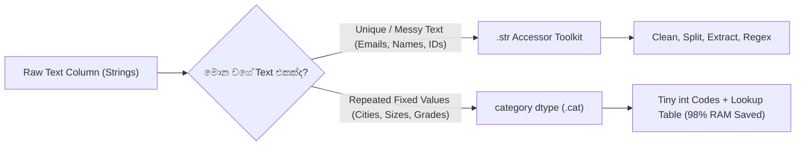
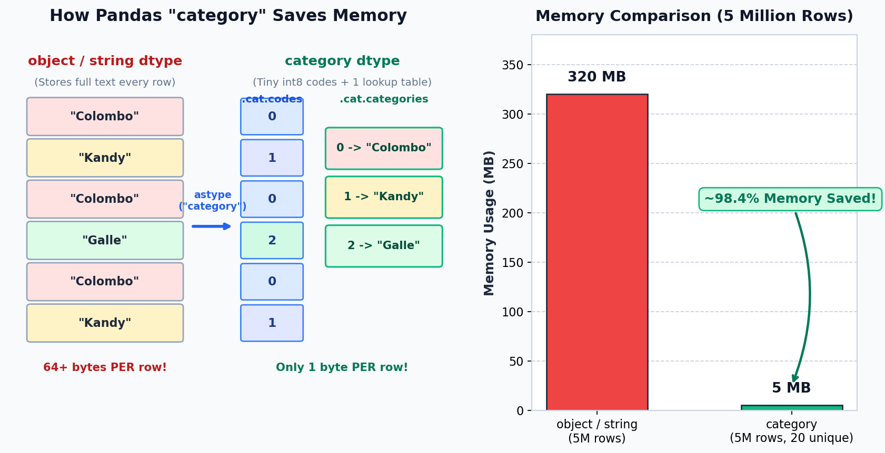

[⬅️ පෙර පාඩම: 08 Data Transformation](08_Data_Transformation.md) | [🏠 මුල් පිටුව (README)](README.md) | [ඊළඟ පාඩම: 10 Dates, Times & Time Series ➡️](10_Dates_Times_and_Time_Series.md)

---

# 📝 පාඩම 09: Text Data & Categoricals (වචන දත්ත සහ ප්‍රවර්ග දත්ත)

Real-world datasets වල තියෙන්නේ ඉලක්කම් (numbers) විතරක් නෙවෙයි. නම්, email addresses, ලිපින, product codes, city names, T-shirt sizes (`S`, `M`, `L`) වගේ **Text data** විශාල ප්‍රමාණයක් තියෙනවා. 

Pandas වල මේ text data වේගයෙන් සහ පහසුවෙන් handle කරන්න special toolkits දෙකක් තියෙනවා:
1. **`.str` accessor** — Text/String data clean කරන්න, search කරන්න, කපන්න, වෙන් කරන්න.
2. **`category` dtype** — එකම වචන ටික නැවත නැවත repeat වෙන columns (උදා: District names, Gender, Status) වල memory ඉතිරි කරන්න සහ speed වැඩි කරන්න.

> [!TIP]
> **සරල උදාහරණය (Real-life Analogy):**
> හිතන්න ඔයා ළඟ පාසල් ළමයි 50,000කගේ ලැයිස්තුවක් තියෙනවා.
> - ළමයින්ගේ **නම්** clean කරන්න (අමතර spaces අයින් කරන්න, capital/simple හදන්න) අපිට **`.str`** toolkit එක ඕනේ.
> - හැබැයි හැම ළමයාගේම **පළාත (Province)** ලියද්දි "Western Province" කියලා 20,000 පාරක් ලියනවට වඩා, `0 = Western Province`, `1 = Central Province` කියලා පොඩි code එකක් ලියලා තියාගන්න එක කොච්චර ලේසිද? අන්න ඒ වැඩේ තමයි **`category`** කරන්නේ!



---

## 🅰️ Part A: String Methods (`.str` Accessor)

Python වල සාමාන්‍ය string එකකට `.lower()`, `.strip()`, `.replace()` දානවා වගේ, Pandas `Series` එකක තියෙන **හැම row එකකටම එකපාර** string methods apply කරන්න අපි `.str` පාවිච්චි කරනවා. 

විශේෂත්වය තමයි: row එකක `NaN` හෝ `None` (missing value) තිබුණත් `.str` එක crash වෙන්නේ නැතුව ලස්සනට skip කරලා යනවා!

### 1. Case & Whitespace Cleaning (අකුරු සහ අමතර Spaces පිරිසිදු කිරීම)
Data entry කරද්දී අකුරු ලොකු පොඩි වෙලා (`"aNN.lee"`), මුලට අගට spaces වැටිලා (`"  Colombo  "`) තියෙන එක හරිම සාමාන්‍යයි.

| Method | කරන වැඩේ | උදාහරණය (`"  hello world  "`) |
| :--- | :--- | :--- |
| `.str.lower()` | ඔක්කොම simple කරනවා | `"  hello world  "` |
| `.str.upper()` | ඔක්කොම CAPITAL කරනවා | `"  HELLO WORLD  "` |
| `.str.title()` | හැම වචනෙකම මුල් අකුර Capital | `"  Hello World  "` |
| `.str.capitalize()` | මුළු වාක්‍යයේම මුල් අකුර විතරක් Capital | `"  Hello world  "` |
| `.str.strip()` | දෙපැත්තෙම spaces අයින් කරනවා | `"hello world"` |
| `.str.lstrip()` / `.str.rstrip()` | වම් පැත්තේ / දකුණු පැත්තේ spaces විතරක් අයින් කරනවා | `"hello world  "` / `"  hello world"` |

### 2. Searching & Filtering Text (වචන සෙවීම)
Row එකක යම් වචනයක් හෝ pattern එකක් තියෙනවද බලලා `True`/`False` (boolean mask) හදාගන්න:
- `.str.contains('gmail', case=False, na=False)` — ඇතුළේ තියෙනවද බලනවා (`na=False` දැම්මම `NaN` තියෙන තැන් `False` වෙනවා — filter කරද්දි හරිම වැදගත්!).
- `.str.startswith('ORD')` / `.str.endswith('.com')` — මුලින් හෝ අගින් පටන් ගන්නවද/ඉවර වෙනවද බලනවා.
- `.str.match(r'^ORD')` — string එකේ මුල ඉඳන් regex එක match වෙනවද බලනවා.
- `.str.fullmatch(r'\d{4}')` — මුළු string එකම pattern එකට සම්පූර්ණයෙන්ම ගැලපෙනවද බලනවා.
- `.str.find('sub')` — වචනය තියෙන index position එක දෙනවා (නැත්නම් `-1`).
- `.str.count('a')` — අකුරක් හෝ pattern එකක් කී පාරක් තියෙනවද ගණන් කරනවා.

### 3. Extracting & Slicing (කොටස් උපුටා ගැනීම)
Text එකක් ඇතුළෙන් අපිට ඕන ID එක, අවුරුද්ද, හෝ domain name එක විතරක් ගලවලා ගන්න:
- `.str.extract(r'(\d+)')` — Regex capture group `(...)` ඇතුළේ තියෙන **පළවෙනි match එක** column එකක් විදියට එළියට ගන්නවා (groups 2ක් දැම්මොත් DataFrame එකක columns 2ක් එනවා!).
- `.str.extractall(r'(\d+)')` — එක row එකක matches ගොඩක් තියෙනවා නම් ඔක්කොම MultiIndex DataFrame එකකට ගන්නවා.
- `.str.findall(r'\d+')` — හැම match එකම Python list එකක් විදියට දෙනවා.
- `.str.get(0)` හෝ `.str[:3]` — index එකෙන් අකුරක් හෝ slice එකක් ගන්නවා (උදා: පළවෙනි අකුරු 3).

### 4. Replacing & Cleaning Symbols (අකුරු මාරු කිරීම)
- `.str.replace(r'[^0-9]', '', regex=True)` — Regex පාවිච්චි කරලා symbols/අකුරු අයින් කරනවා (උදා: `"Rs. 1,500"` -> `"1500"`).
- `.str.removeprefix('Mr. ')` / `.str.removesuffix('.pdf')` — මුල හෝ අග තියෙන නිශ්චිත කොටසක් හරියටම අයින් කරනවා.
- `.str.translate(table)` — අකුරු ගොඩක් එකපාර map කරලා වෙනස් කරනවා (`str.maketrans` එක්ක).

### 5. Splitting, Joining, Padding & Testing
- **Splitting & Joining:**
  - `.str.split(',', expand=True)` — වචන කඩලා කෙලින්ම වෙනම **columns** හදනවා! (`expand=False` නම් list එකක් එන්නේ).
  - `.str.rsplit('-', n=1)` — දකුණු පැත්තේ ඉඳන් කඩනවා.
  - `.str.partition('@')` — separator එකට වම් පැත්ත, separator එක, දකුණු පැත්ත කියලා කොටස් 3කට කඩනවා.
  - `.str.cat(other_series, sep='-')` — Series දෙකක text එකතු කරලා keys හදනවා.
  - `.str.join('-')` — list එකක් ඇතුළේ තියෙන strings එකතු කරනවා.
- **Padding & Formatting:**
  - `.str.zfill(5)` — ඉස්සරහට `0` දාලා fixed-width codes හදනවා (`"42"` -> `"00042"`).
  - `.str.pad(width=8, side='left', fillchar='0')`, `.str.center(10)`, `.str.wrap(20)`.
- **Validation (Testing):**
  - `.str.isnumeric()`, `.str.isdigit()`, `.str.isalpha()`, `.str.isspace()`, `.str.isupper()`, `.str.len()` — Data validation වලට සුපිරි!
- **Multi-label Dummies & Unicode Encoding:**
  - `.str.get_dummies(sep='|')` — එක cell එකක `"Action|Comedy"` වගේ tags ගොඩක් තියෙනකොට ඒවා `0`/`1` columns වලට කඩනවා!
  - `.str.encode('utf-8')`, `.str.decode('utf-8')`, `.str.normalize('NFKD')` — Unicode characters (accented letters වගේ දේවල්) clean කරන්න.

---

### 💻 සම්පූර්ණ කේත උදාහරණය (Part A: `.str` Accessor)

```python
import pandas as pd

# 1. String dtype එකෙන් Series එකක් හදමු (None තියෙනවා)
emails = pd.Series(['Ann.Lee@Corp.com ', 'bob@mail.org', None], dtype='string')

# 2. Spaces අයින් කරලා simple කරමු (Method Chaining)
clean = emails.str.strip().str.lower()

# 3. Regex පාවිච්චි කරලා '@' ට පස්සේ තියෙන domain එක ගමු
domain = clean.str.extract(r'@([\w.]+)$')[0]

# 4. '@' එකෙන් කඩලා username එක ගමු
user = clean.str.split('@').str[0]

# 5. Multi-label tags වලට get_dummies පාවිච්චි කරමු
tags = pd.Series(['python|pandas', 'sql|python', 'excel'])
tag_matrix = tags.str.get_dummies(sep='|')

print("--- Clean Emails ---")
print(clean)
print("\n--- Extracted Domains ---")
print(domain)
print("\n--- Extracted Users ---")
print(user)
print("\n--- Tag Dummies ---")
print(tag_matrix)
```

**🔍 පේළියෙන් පේළිය පැහැදිලි කිරීම (Line-by-Line Explanation):**
- **Line 4:** `dtype='string'` දාන එක පරණ `object` dtype එකට වඩා ගොඩක් හොඳයි. Missing values `<NA>` විදියට පිරිසිදුව handle වෙනවා.
- **Line 7:** `.str.strip().str.lower()` — මුලින්ම දෙපැත්තේ spaces අයින් කරලා, ඊළඟට ආයෙත් `.str` දාලා ඔක්කොම simple කළා.
- **Line 10:** `r'@([\w.]+)$'` කියන්නේ `@` අකුරෙන් පස්සේ string එකේ අවසානය (`$`) වෙනකම් තියෙන අකුරු සහ තිත් (`[\w.]+`) අල්ලගන්න කියන එකයි. `.extract()` එකෙන් DataFrame එකක් එන නිසා `[0]` දාලා පළවෙනි column එක `Series` එකක් විදියට ගත්තා.
- **Line 13:** `.str.split('@')` කළාම `['ann.lee', 'corp.com']` වගේ list එකක් එනවා. ඒකේ `.str[0]` ගත්තම පළවෙනි කොටස (`'ann.lee'`) ලැබෙනවා.
- **Line 17:** `tags.str.get_dummies(sep='|')` මගින් `|` වලින් වෙන් වුණ tags ටික වෙනම `excel`, `pandas`, `python`, `sql` කියලා 0/1 columns බවට හරවනවා.

**📤 බලාපොරොත්තු වන ප්‍රතිදානය (Expected Output):**
```text
--- Clean Emails ---
0    ann.lee@corp.com
1        bob@mail.org
2                <NA>
dtype: string

--- Extracted Domains ---
0    corp.com
1    mail.org
2        <NA>
Name: 0, dtype: string

--- Extracted Users ---
0    ann.lee
1        bob
2       <NA>
dtype: object

--- Tag Dummies ---
   excel  pandas  python  sql
0      0       1       1    0
1      0       0       1    1
2      1       0       0    0
```

---

## 🅱️ Part B: Categorical Data (`category` dtype)

ඔයාගේ DataFrame එකේ rows මිලියන 5ක් තියෙනවා, ඒකේ `city` කියන column එකේ තියෙන්නේ ලංකාවේ නගර 20ක් විතරයි කියලා හිතන්න. ඒක සාමාන්‍ය `object`/`string` විදියට තිබ්බොත් `"Colombo"` කියන වචනේ මිලියන ගාණක් පාර RAM එකේ store වෙනවා!

ඒක `category` වලට මාරු කළාම Pandas කරන්නේ:
1. Unique වචන 20 විතරක් පොඩි **lookup table** එකක (`.cat.categories`) තියාගන්නවා.
2. මිලියන 5ක් rows වලට දාන්නේ `0, 1, 2...` වගේ පුංචි **integer codes** (`.cat.codes`) විතරයි!



### 1. Creating Categoricals (Unordered & Ordered)
- **සාමාන්‍ය (Unordered):** `df['city'] = df['city'].astype('category')` හෝ `pd.Categorical(['Colombo', 'Kandy', 'Colombo'])`.
- **පිළිවෙලක් ඇති (Ordered):** T-shirt sizes (`S < M < L`), ratings (`Low < Medium < High`), severity levels වගේ දේවල් alphabetical order එකට නෙවෙයි, **අපිට ඕන logical order එකට** sort කරන්න සහ compare (`>=`, `<`, `min()`, `max()`) කරන්න `pd.CategoricalDtype(..., ordered=True)` පාවිච්චි කරනවා!

### 2. `.cat` Accessor — Vocabulary එක පාලනය කිරීම
String වලට `.str` වගේ, categorical columns වලට තියෙන්නේ **`.cat`** accessor එක:
- `.cat.categories` — දැනට තියෙන unique categories ටික බලන්න.
- `.cat.codes` — ඇතුළේ store වෙලා තියෙන integer codes (`0, 1, 2...`, missing නම් `-1`) බලන්න.
- `.cat.add_categories(['XL'])` — අලුත් category එකක් එකතු කරන්න.
- `.cat.remove_categories(['XS'])` — category එකක් අයින් කරන්න (ඒ rows `NaN` වෙනවා).
- `.cat.rename_categories({'S': 'Small', 'M': 'Medium'})` — නම් වෙනස් කරන්න.
- `.cat.reorder_categories(['S', 'M', 'L'], ordered=True)` — order එක මාරු කරන්න.
- `.cat.set_categories(['S', 'M', 'L', 'XL'])` — එකපාර add/remove/reorder ඔක්කොම කරන්න.
- `.cat.remove_unused_categories()` — DataFrame එක filter කළාට පස්සේ data නැති හිස් categories අයින් කරන්න.

### 3. Memory & GroupBy Speed
- Memory බලන්න: `df['city'].memory_usage(deep=True)` (`deep=True` නැතුව string memory එක හරියට පෙන්නන්නේ නෑ!).
- **GroupBy behaviour:** Categorical column එකකින් `groupby` කරද්දී, data නැති categories වලටත් හිස් rows එන්න පුළුවන්. ඒක නවත්තලා වේගය වැඩි කරන්න හැමවෙලේම **`df.groupby('city', observed=True)`** පාවිච්චි කරන්න!

---

### 💻 සම්පූර්ණ කේත උදාහරණය (Part B: Ordered Categoricals)

```python
import pandas as pd

# 1. Custom logical order එකක් එක්ක CategoricalDtype එක හදමු
size_type = pd.CategoricalDtype(categories=['S', 'M', 'L'], ordered=True)
size = pd.Series(['S', 'L', 'M', 'S'], dtype=size_type)

# 2. Alphabetical නෙවෙයි, S < M < L පිළිවෙලට sort වෙනවා!
print("Sorted:\n", size.sort_values().tolist())

# 3. Logical comparisons වැඩ කරනවා!
print("M හෝ ඊට වැඩි ගණන:", (size >= 'M').sum())
print("Min:", size.min(), "| Max:", size.max())

# 4. ඇතුළේ තියෙන codes සහ categories බලමු
print("Categories:", size.cat.categories.tolist())
print("Codes:", size.cat.codes.tolist())

# 5. අලුත් category එකක් එකතු කරමු
size = size.cat.add_categories(['XL'])
print("Updated Categories:", size.cat.categories.tolist())
```

**📤 බලාපොරොත්තු වන ප්‍රතිදානය (Expected Output):**
```text
Sorted:
 ['S', 'S', 'M', 'L']
M හෝ ඊට වැඩි ගණන: 2
Min: S | Max: L
Categories: ['S', 'M', 'L']
Codes: [0, 2, 1, 0]
Updated Categories: ['S', 'M', 'L', 'XL']
```

---

## 🧠 මතක තබා ගැනීමට පහසු ක්‍රම (Memory Hacks)
1. **Accessors 3 මතක තියාගන්න:** Strings වලට **`.str`**, Categoricals වලට **`.cat`**, Dates වලට **`.dt`**!
2. **`.str` දාන්න ඕන හැම පියවරේම:** `s.str.strip().lower()` වැරදියි! `.strip()` එකෙන් එන්නේ Series එකක් නිසා ආයෙත් `.str` දාලා **`s.str.strip().str.lower()`** කියලා ලියන්න ඕනේ.
3. **Category rule of thumb:** Column එකක unique values ගණන මුළු rows ගණනින් **50% ට වඩා අඩුයි** නම් (විශේෂයෙන් 1% - 10% වගේ නම්) `category` වලට හරවන්න. හැම row එකක්ම unique (උදා: NIC numbers, emails) නම් `category` දාන්න එපා — එතකොට memory වැඩි වෙනවා!

## ⚠️ සාමාන්‍යයෙන් වෙන වැරදි (Common Pitfalls)

> [!WARNING]
> 1. **`str.contains()` එක්ක `NaN` error එක:** `df[df['email'].str.contains('gmail')]` දුවද්දී column එකේ `NaN` තිබුණොත් `ValueError: Cannot mask with non-boolean array containing NA / NaN values` එනවා! හැමවෙලේම **`na=False`** දාන්න: `df['email'].str.contains('gmail', na=False)`.
> 2. **Category එකට නැති value එකක් assign කිරීම:** `size[0] = 'XXL'` කළොත් `TypeError` එනවා, මොකද `'XXL'` කියන එක `.cat.categories` වල නෑ! මුලින්ම `.cat.add_categories(['XXL'])` කරලා ඉන්න ඕනේ.
> 3. **`memory_usage()` වල `deep=True` අමතක වීම:** `s.memory_usage()` විතරක් ගැහුවොත් Python string pointers වල size එක විතරයි පෙන්නන්නේ, ඇත්ත string memory එක පෙන්නන්නේ නෑ. හැමවෙලේම **`memory_usage(deep=True)`** දාන්න!

---

## 🏋️ ප්‍රායෝගික අභ්‍යාස (Practical Exercises)

### Warm-up Exercise
`'  colombo  '`, `'KANDY'`, `'galle '` කියන messy city names ටික clean කරලා `'Colombo'`, `'Kandy'`, `'Galle'` විදියට Title Case කරන්න.

<details>
<summary>✅ පිළිතුර බලන්න (Click to see Solution)</summary>

```python
import pandas as pd

cities = pd.Series(['  colombo  ', 'KANDY', 'galle '], dtype='string')
clean_cities = cities.str.strip().str.title()
print(clean_cities)
```
</details>

### Exercise 1 (Course Exercise)
`ORD-2026-00871` වගේ strings තියෙන Series එකකින් **4-digit year** එකයි **order number** එකයි වෙනම columns දෙකකට extract කරන්න.

<details>
<summary>✅ පිළිතුර බලන්න (Click to see Solution)</summary>

```python
import pandas as pd

orders = pd.Series(['ORD-2026-00871', 'ORD-2025-10422', 'ORD-2026-00009'], dtype='string')

# Named capture groups පාවිච්චි කළාම column names ඉබේම හැදෙනවා!
extracted = orders.str.extract(r'ORD-(?P<year>\d{4})-(?P<order_num>\d+)')
print(extracted)
```
**Output:**
```text
   year order_num
0  2026     00871
1  2025     10422
2  2026     00009
```
</details>

### Exercise 2 (Course Exercise)
`'Colombo, Sri Lanka'` වගේ strings තියෙන column එකක් කොමා (`,`) එකෙන් වෙනම columns දෙකකට (`city`, `country`) split කරලා, දෙපැත්තේ තියෙන අමතර spaces අයින් (trim) කරන්න.

<details>
<summary>✅ පිළිතුර බලන්න (Click to see Solution)</summary>

```python
import pandas as pd

df = pd.DataFrame({'location': ['Colombo, Sri Lanka', ' Kandy , Sri Lanka ', 'Tokyo, Japan']})

df[['city', 'country']] = df['location'].str.split(',', expand=True)
df['city'] = df['city'].str.strip()
df['country'] = df['country'].str.strip()

print(df)
```
</details>

### Exercise 3 (Course Exercise)
Unique values 20ක් තියෙන, rows මිලියන 5ක string column එකක් හදලා ඒක `category` dtype එකට convert කරන්න. කොච්චර memory (MB සහ %) ඉතිරි වුණාද කියලා report කරන්න.

<details>
<summary>✅ පිළිතුර බලන්න (Click to see Solution)</summary>

```python
import numpy as np
import pandas as pd

rng = np.random.default_rng(42)
vocab = [f'City_{i:02d}' for i in range(20)]
s_obj = pd.Series(rng.choice(vocab, size=5_000_000))

mem_before = s_obj.memory_usage(deep=True) / (1024 ** 2)  # MB
s_cat = s_obj.astype('category')
mem_after = s_cat.memory_usage(deep=True) / (1024 ** 2)   # MB

saved_mb = mem_before - mem_after
saved_pct = (saved_mb / mem_before) * 100

print(f"Before (object):   {mem_before:.2f} MB")
print(f"After (category):  {mem_after:.2f} MB")
print(f"Saved:             {saved_mb:.2f} MB ({saved_pct:.1f}%)")
```
</details>

---

## 📋 Cheat Sheet Summary

| කාර්යය (Task) | Pandas API | උදාහරණය |
| :--- | :--- | :--- |
| Clean case & spaces | `.str.strip()`, `.str.lower()`, `.str.title()` | `s.str.strip().str.lower()` |
| Filter text safely | `.str.contains(..., na=False)` | `df[df['col'].str.contains('abc', na=False)]` |
| Extract with Regex | `.str.extract(r'(...)')` | `s.str.extract(r'(\d{4})')` |
| Replace with Regex | `.str.replace(pat, repl, regex=True)` | `s.str.replace(r'\D', '', regex=True)` |
| Split to columns | `.str.split(',', expand=True)` | `df[['a', 'b']] = df['c'].str.split(',', expand=True)` |
| Multi-label tags | `.str.get_dummies(sep='\|')` | `df['tags'].str.get_dummies(sep='\|')` |
| Convert to category | `.astype('category')` | `df['city'] = df['city'].astype('category')` |
| Ordered category | `pd.CategoricalDtype(cats, ordered=True)` | `s.astype(pd.CategoricalDtype(['S','M','L'], ordered=True))` |
| Edit categories | `.cat.add_categories()`, `.cat.remove_unused_categories()` | `s.cat.add_categories(['XL'])` |
| Check real memory | `.memory_usage(deep=True)` | `df['city'].memory_usage(deep=True)` |

---

[⬅️ පෙර පාඩම: 08 Data Transformation](08_Data_Transformation.md) | [🏠 මුල් පිටුව (README)](README.md) | [ඊළඟ පාඩම: 10 Dates, Times & Time Series ➡️](10_Dates_Times_and_Time_Series.md)
