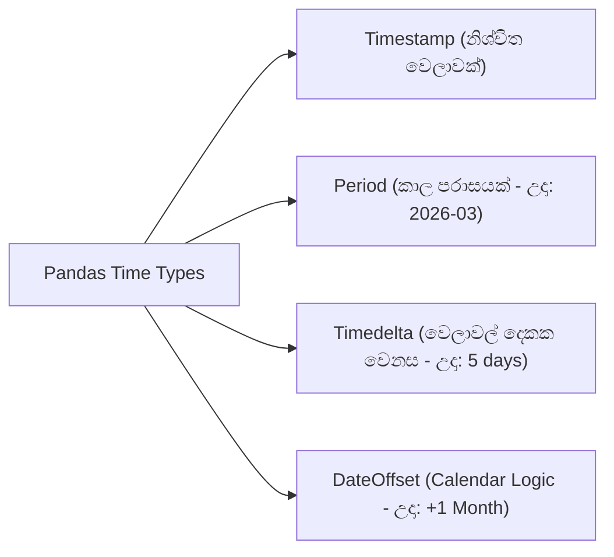
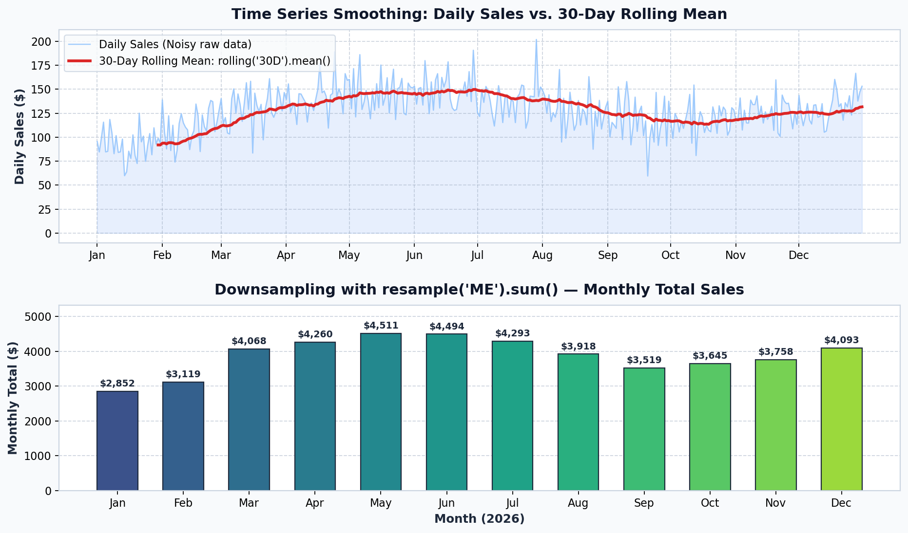

[⬅️ පෙර පාඩම: 09 Text Data & Categoricals](09_Text_Data_and_Categoricals.md) | [🏠 මුල් පිටුව (README)](README.md) | [ඊළඟ පාඩම: 11 GroupBy & Aggregation ➡️](11_GroupBy_and_Aggregation.md)

---

# ⏰ පාඩම 10: Dates, Times & Time Series (දින, වේලාවන් සහ කාල ශ්‍රේණි)

Pandas මුලින්ම හැදුවේ මූල්‍ය (Finance) ක්ෂේත්‍රයේ stock market data විශ්ලේෂණය කරන්නයි. ඒ නිසා අදටත් Python ලෝකේ **Time Series (දින සහ වේලාවන් ආශ්‍රිත දත්ත)** handle කරන්න තියෙන ප්‍රබලම tool එක Pandas!

> [!TIP]
> **සරල උදාහරණය (Real-life Analogy):**
> ඔයාගේ කඩේ හැමදාම වෙන විකුණුම් (daily sales) පොතක ලියලා තියෙනවා කියලා හිතන්න.
> - දින ටික නිකන් වචන (`"2026-03-15"`) විදියට තිබ්බොත් computer එකට තේරෙන්නේ නෑ ඒක ඉරිදා දවසක්ද, මාර්තු මාසෙද, නැත්නම් ඊළඟ දවස මොකක්ද කියලා.
> - ඒවා **`Timestamp` (Datetime)** වලට හැරෙව්වම, "මාර්තු මාසේ ඔක්කොම sales ගන්න", "හැම මාසෙම එකතුව හදන්න (`resample`)", "පහුගිය දවස් 30 සාමාන්‍යය බලන්න (`rolling`)" වගේ සුපිරි වැඩ තනි පේළියකින් කරන්න පුළුවන්!

---

## 1. Parsing Dates & Core Time Types (දින නිවැරදිව කියවීම)

CSV එකකින් data load කරද්දී දින ගොඩක් වෙලාවට එන්නේ සාමාන්‍ය strings විදියට. ඒවා datetime වලට හරවන්න ක්‍රම 2ක් තියෙනවා:
1. Load කරද්දීම: `pd.read_csv('orders.csv', parse_dates=['order_date'])`
2. Load කළාට පස්සේ: `pd.to_datetime(df['date'], format='%Y-%m-%d', errors='coerce', dayfirst=False, utc=False)`
   - **`errors='coerce'`:** වැරදි දින (උදා: `"N/A"`, `"2026-99-99"`) තිබුණොත් crash නොවී **`NaT`** (Not a Time) බවට හරවනවා.
   - **`dayfirst=True`:** ලංකාවේ වගේ `DD/MM/YYYY` (`25/12/2026`) format එක තියෙනවා නම් මේක දාන්න!

### Core Time Types 4 හඳුනාගමු:



| Core Type | තේරුම | උදාහරණය |
| :--- | :--- | :--- |
| **`Timestamp`** | නිශ්චිත දිනයක් හා වේලාවක් (Point in time) | `pd.Timestamp('2026-11-21 14:30:00')` |
| **`Period`** | සම්පූර්ණ කාල කලාපයක් (Span) | `pd.Period('2026-03', freq='M')` (මුළු මාර්තු මාසයම) |
| **`Timedelta`** | නිශ්චිත කාල ප්‍රමාණයක් / වෙනසක් (Duration) | `pd.Timedelta(days=7, hours=2)` |
| **`DateOffset`** | Calendar නීති වලට අනුව දින එකතු කිරීම | `pd.DateOffset(months=1)` (Jan 31 + 1 month = Feb 28!) |

---

## 2. Generating Date Ranges & `.dt` Accessor

### Date Ranges (දින පෙළක් හදාගැනීම)
- `pd.date_range(start='2026-01-01', end='2026-12-31', freq='D')` — හැම දවසම.
- `pd.date_range('2026-01-01', periods=12, freq='ME')` — මාස 12ක අවසාන දින.
- `pd.bdate_range('2026-01-01', '2026-01-31')` — Business days (සඳුදා–සිකුරාදා) විතරක්.
- `pd.period_range('2026Q1', periods=4, freq='Q')` / `pd.timedelta_range(0, periods=5, freq='6h')`.

> [!NOTE]
> **Frequency Aliases Update:** අලුත් Pandas versions වල පරණ `'M'` (month-end) සහ `'Q'` (quarter-end) වෙනුවට **`'ME'`** සහ **`'QE'`** පාවිච්චි කරනවා! (`'D'` = Daily, `'W'` = Weekly, `'h'` = Hourly).

### `.dt` Accessor (දිනයෙන් කොටස් ගලවා ගැනීම)
String වලට `.str` වගේ, datetime Series එකකින් අවුරුද්ද, මාසය, දවස, පැය වගේ features ගන්න **`.dt`** පාවිච්චි කරනවා:
- `s.dt.year`, `s.dt.month`, `s.dt.day`, `s.dt.hour`, `s.dt.quarter`
- `s.dt.dayofweek` (Monday=0 ... Sunday=6), `s.dt.day_name()` (`'Monday'`, `'Tuesday'`)
- `s.dt.is_month_end` (මාසයේ අන්තිම දවසද? `True`/`False`)
- `s.dt.date` (වේලාව අයින් කරලා date object එක ගන්න)
- `s.dt.normalize()` (වේලාව `00:00:00` කරනවා, හැබැයි `datetime64` dtype එකම තියාගන්නවා!)

### Date Arithmetic (දින එකතු/අඩු කිරීම)
- `df['due_date'] = df['order_date'] + pd.Timedelta(days=14)`
- `df['next_month'] = df['order_date'] + pd.DateOffset(months=1)`
- `df['month_end'] = df['order_date'] + pd.offsets.MonthEnd(0)`
- `df['next_workday'] = df['order_date'] + pd.offsets.BDay(1)` (සති අන්ත skip කරලා ඊළඟ වැඩ කරන දවස)

---

## 3. DatetimeIndex, Resampling, Rolling & Shifting

දින තියෙන column එක **Index** එක බවට පත් කළාම (`df.set_index('order_date').sort_index()`), Pandas වලට සුපිරි බලයක් ලැබෙනවා:

1. **Partial String Slicing (ඉතා පහසු Slicing):**
   - `df.loc['2026-03']` — 2026 මාර්තු මාසයේ ඔක්කොම rows!
   - `df.loc['2026-01':'2026-03']` — ජනවාරි සිට මාර්තු දක්වා.
   - `df.between_time('09:00', '17:00')` / `df.at_time('12:00')` — දවසේ නිශ්චිත වේලාවන් ඇතුළත data විතරක්.

2. **Resampling (Frequency එක වෙනස් කිරීම — Time-based GroupBy):**
   - **Downsampling (දින -> මාස/සති):** `sales['amount'].resample('ME').sum()`, `.mean()`, `.ohlc()` (Open-High-Low-Close — stock charts වලට).
   - **Upsampling (මාස -> දින):** `.asfreq('D')` (අලුත් දින වලට `NaN` එනවා, ඊට පස්සේ `.ffill()` හෝ `.interpolate(method='time')` දාන්න පුළුවන්).

3. **Rolling Statistics (Moving Averages / Smoothing):**
   - Daily sales වල noise (උච්චාවචනය) ගොඩක් තියෙන නිසා සැබෑ trend එක බලන්න **`rolling('30D').mean()`** හෝ `rolling('7D').mean()` පාවිච්චි කරනවා!

4. **Shifting & Lagging (කාලය ඉදිරියට/පසුපසට තල්ලු කිරීම):**
   - `.shift(1)` — ඊයේ අගය අද row එකට ගේනවා (Lag feature).
   - `.diff()` — අද අගයෙන් ඊයේ අගය අඩු කරනවා (`today - yesterday`).
   - `.pct_change()` — ප්‍රතිශත වර්ධනය (Growth rate: `(today - yesterday) / yesterday`).



---

## 4. Time Zones, Missing Dates, `merge_asof`, Periods & Holidays

- **Time Zones (වේලා කලාප):**
  - `ts.tz_localize('UTC')` — Timezone එකක් නැති (naive) timestamp එකකට "මේක UTC වෙලාව" කියලා label කරනවා.
  - `ts.tz_convert('Asia/Colombo')` — UTC වෙලාව ලංකාවේ වේලාවට (+05:30) හරවනවා!
- **Missing Time Points (හිස් දින පිරවීම):**
  - සමහර දවස්වල sales නැත්නම් ඒ දින table එකේ නෑ. සම්පූර්ණ calendar එකක් හදන්න:
    `full_idx = pd.date_range('2026-01-01', '2026-12-31', freq='D')`
    `daily = daily.reindex(full_idx, fill_value=0)` (නැත්නම් `.interpolate(method='time')`).
- **Merge by Nearest Time (`pd.merge_asof`):**
  - Stock trade එකක් වුණේ `10:01:03` ට, හැබැයි price quote එක ආවේ `10:01:01` ට. හරියටම timestamp සමාන නැති නිසා සාමාන්‍ය `merge()` වැඩ නෑ!
  - `pd.merge_asof(trades, quotes, on='time', by='ticker', direction='backward', tolerance=pd.Timedelta('1s'))` — ළඟම පෙර (`backward`), පසු (`forward`), හෝ ළඟම (`nearest`) timestamp එකට join කරනවා!
- **Periods & Fiscal Calendars:**
  - `df.index.to_period('M')` (Timestamp -> Period), `PeriodIndex`, `.asfreq()`, සහ අප්‍රේල් මාසෙන් පටන් ගන්න ලංකාවේ/ඉන්දියාවේ වගේ fiscal year වලට `freq='QS-APR'`.
- **Holidays & Business Days:**
  - `from pandas.tseries.holiday import AbstractHolidayCalendar, Holiday` සහ `pd.offsets.CustomBusinessDay(calendar=...)` පාවිච්චි කරලා නිවාඩු දින අතහැරලා වැඩ කරන දින ගණන් කරන්න පුළුවන්.
- **Date-based GroupBy (`pd.Grouper`):**
  - Index එක datetime නොවුණත් කෙලින්ම column එකකින් මාසිකව group කරන්න: `df.groupby(pd.Grouper(key='order_date', freq='ME'))['amount'].sum()`.

---

### 💻 සම්පූර්ණ කේත උදාහරණය (Time Series Pipeline)

```python
import pandas as pd

# 1. Sample sales data හදමු (CSV එකකින් ගන්නවා නම් parse_dates=['order_date'] දාන්න)
sales = pd.DataFrame({
    'order_date': pd.to_datetime([
        '2026-01-05', '2026-01-20', '2026-02-10', '2026-02-25', '2026-03-12'
    ]),
    'signup': pd.to_datetime([
        '2025-11-01', '2025-12-15', '2026-01-01', '2025-10-10', '2026-02-01'
    ]),
    'amount': [120, 180, 250, 200, 360]
}).set_index('order_date').sort_index()

# 2. මාසික එකතුව සහ මාසික වර්ධනය (Month-over-Month Growth)
monthly = sales['amount'].resample('ME').sum()
monthly_growth = monthly.pct_change()

# 3. 30-day Rolling Mean trend එක
trend = sales['amount'].resample('D').sum().rolling('30D').mean()

# 4. Calendar features සහ tenure (පාරිභෝගිකයා හිටපු දින ගණන)
sales['weekday'] = sales.index.day_name()
sales['tenure_days'] = (pd.Timestamp('2026-11-21') - sales['signup']).dt.days

print("--- Monthly Totals ---")
print(monthly)
print("\n--- Monthly Growth (%) ---")
print((monthly_growth * 100).round(1))
print("\n--- Sales with Features ---")
print(sales[['amount', 'weekday', 'tenure_days']])
```

**🔍 පේළියෙන් පේළිය පැහැදිලි කිරීම (Line-by-Line Explanation):**
- **Line 12:** `.set_index('order_date').sort_index()` — `resample` සහ slicing හරියට වැඩ කරන්න DatetimeIndex එක sort කරලා තියෙන එක අනිවාර්යයි.
- **Line 15:** `.resample('ME').sum()` — ජනවාරි, පෙබරවාරි, මාර්තු මාස වල අග දින වලට sales ටික එකතු කරනවා.
- **Line 16:** `.pct_change()` — පෙබරවාරි sales ජනවාරියට වඩා කීයකින් වැඩි වුණාද (`(450-300)/300 = +50%`) කියලා හදනවා.
- **Line 19:** මුලින්ම `.resample('D').sum()` කරලා හැම දවසක්ම හදාගෙන, ඊළඟට `.rolling('30D').mean()` ගත්තම දින 30ක time-window average එක ලැබෙනවා.
- **Line 22–23:** Index එකෙන් කෙලින්ම `.day_name()` ගන්න පුළුවන් (index එකට `.dt` ඕන නෑ!), හැබැයි `sales['signup']` Series එකක් නිසා `.dt.days` දැම්මා.

**📤 බලාපොරොත්තු වන ප්‍රතිදානය (Expected Output):**
```text
--- Monthly Totals ---
order_date
2026-01-31    300
2026-02-28    450
2026-03-31    360
Freq: ME, Name: amount, dtype: int64

--- Monthly Growth (%) ---
order_date
2026-01-31     NaN
2026-02-28    50.0
2026-03-31   -20.0
Freq: ME, Name: amount, dtype: float64

--- Sales with Features ---
            amount    weekday  tenure_days
order_date                                
2026-01-05     120     Monday          385
2026-01-20     180    Tuesday          341
2026-02-10     250    Tuesday          324
2026-02-25     200  Wednesday          407
2026-03-12     360   Thursday          293
```

---

## 🧠 මතක තබා ගැනීමට පහසු ක්‍රම (Memory Hacks)
1. **Localize vs Convert:** Timezone එකක් නැති දිනයකට මුලින්ම passport එක දෙන්නේ **`tz_localize()`** (උදා: UTC). ඊට පස්සේ වෙන රටකට ගෙනියන්නේ **`tz_convert()`** (උදා: Asia/Colombo).
2. **`resample` = Time-based `groupby`:** `df.resample('ME').sum()` හිතන්න `df.groupby(month).sum()` වගේමයි!
3. **Series vs DatetimeIndex:** Series එකකට **`s.dt.year`**, හැබැයි DatetimeIndex එකකට `.dt` නැතුව කෙලින්ම **`df.index.year`**!

## ⚠️ සාමාන්‍යයෙන් වෙන වැරදි (Common Pitfalls)

> [!WARNING]
> 1. **`merge_asof` sort නොකර දුවන්න බෑ!** `trades` සහ `quotes` tables දෙකම join කරන time column එකෙන් අනිවාර්යයෙන්ම **`sort_values('time')`** කරලා තියෙන්න ඕනේ. නැත්නම් `ValueError: left keys must be sorted` එනවා!
> 2. **US vs Sri Lanka Date Format:** `'05/03/2026'` කියන එක default විදියට Pandas හිතන්නේ මැයි 3 කියලා (MM/DD/YYYY). ඒක මාර්තු 5 නම් අනිවාර්යයෙන්ම **`dayfirst=True`** හෝ **`format='%d/%m/%Y'`** දෙන්න!
> 3. **Naive timestamp එකකට `tz_convert` දාන්න බෑ:** Timezone නැති column එකකට කෙලින්ම `tz_convert('Asia/Colombo')` ගැහුවොත් `TypeError` එනවා. මුලින් `tz_localize('UTC')` කරලා ඊට පස්සේ `tz_convert()` කරන්න.

---

## 🏋️ ප්‍රායෝගික අභ්‍යාස (Practical Exercises)

### Warm-up Exercise
`['2026-03-01', 'invalid_date', '2026-03-15']` කියන list එක `pd.to_datetime()` පාවිච්චි කරලා error නොවී parse කරන්න, ඊට පස්සේ හැම දිනයකම දවසේ නම (Monday, Sunday...) ලබාගන්න.

<details>
<summary>✅ පිළිතුර බලන්න (Click to see Solution)</summary>

```python
import pandas as pd

dates = pd.to_datetime(['2026-03-01', 'invalid_date', '2026-03-15'], errors='coerce')
print(dates)
print(dates.day_name())
```
</details>

### Exercise 1 (Course Exercise)
Daily sales data තියෙන Series එකක් **weekly totals** (`resample('W')`) වලට resample කරලා, **week-over-week growth** (`pct_change()`) ගණනය කරලා plot කරන්න.

<details>
<summary>✅ පිළිතුර බලන්න (Click to see Solution)</summary>

```python
import numpy as np
import pandas as pd

rng = np.random.default_rng(7)
idx = pd.date_range('2026-01-01', '2026-03-31', freq='D')
daily_sales = pd.Series(rng.integers(50, 200, size=len(idx)), index=idx, name='sales')

weekly = daily_sales.resample('W').sum()
wow_growth = weekly.pct_change() * 100

print(pd.DataFrame({'weekly_sales': weekly, 'wow_growth_pct': wow_growth.round(1)}).head(6))
# Plot කරන්න:
# wow_growth.plot(kind='bar', title='Week-over-Week Sales Growth (%)')
```
</details>

### Exercise 2 (Course Exercise)
සමහර දවස් අඩු (missing days තියෙන) daily Series එකක්, ජනවාරි 1 සිට දෙසැම්බර් 31 දක්වා හැම දවසම තියෙන විදියට fill කරන්න (missing දින වලට `0` දාන්න).

<details>
<summary>✅ පිළිතුර බලන්න (Click to see Solution)</summary>

```python
import pandas as pd

sparse = pd.Series([100, 250, 180],
                   index=pd.to_datetime(['2026-01-03', '2026-06-15', '2026-12-28']))

full_year_idx = pd.date_range('2026-01-01', '2026-12-31', freq='D')
complete = sparse.reindex(full_year_idx, fill_value=0)

print("Total days:", len(complete))
print(complete.loc['2026-01-01':'2026-01-05'])
```
</details>

### Exercise 3 (Course Exercise)
UTC timestamps තියෙන Series එකක් **`Asia/Colombo`** timezone එකට convert කරලා, ලංකාවේ වේලාවෙන් එක එක පැයේ (local hour) ආපු orders ගණන count කරන්න.

<details>
<summary>✅ පිළිතුර බලන්න (Click to see Solution)</summary>

```python
import pandas as pd

utc_times = pd.Series(pd.to_datetime([
    '2026-05-01 03:15:00', '2026-05-01 03:45:00',
    '2026-05-01 09:10:00', '2026-05-01 18:30:00'
]))

# 1. UTC විදියට localize කරලා Asia/Colombo වලට convert කරමු (+05:30)
local_times = utc_times.dt.tz_localize('UTC').dt.tz_convert('Asia/Colombo')

# 2. Local hour අනුව orders ගණන් කරමු
orders_per_hour = local_times.dt.hour.value_counts().sort_index()
print(orders_per_hour)
```
</details>

### Exercise 4 (Course Exercise)
DataFrame එකක තියෙන `start_date` සහ `end_date` කියන date columns දෙක අතර තියෙන **business days (වැඩ කරන දින)** ගණන හොයන්න.

<details>
<summary>✅ පිළිතුර බලන්න (Click to see Solution)</summary>

```python
import numpy as np
import pandas as pd

df = pd.DataFrame({
    'start_date': pd.to_datetime(['2026-03-02', '2026-03-06', '2026-03-10']),
    'end_date':   pd.to_datetime(['2026-03-06', '2026-03-09', '2026-03-20']),
})

# NumPy busday_count ඉතා වේගවත් (vectorized)!
df['business_days'] = np.busday_count(
    df['start_date'].values.astype('datetime64[D]'),
    df['end_date'].values.astype('datetime64[D]')
)
print(df)
```
</details>

---

## 📋 Cheat Sheet Summary

| කාර්යය (Task) | Pandas API | උදාහරණය |
| :--- | :--- | :--- |
| Parse dates safely | `pd.to_datetime(..., errors='coerce')` | `pd.to_datetime(df['d'], dayfirst=True, errors='coerce')` |
| Generate calendar | `pd.date_range()`, `pd.bdate_range()` | `pd.date_range('2026-01-01', periods=12, freq='ME')` |
| Extract components | `.dt.year`, `.dt.day_name()`, `.dt.quarter` | `df['date'].dt.day_name()` |
| Add calendar offset | `pd.Timedelta`, `pd.DateOffset`, `BDay` | `df['d'] + pd.DateOffset(months=1)` |
| Slice by month/time | `df.loc['YYYY-MM']`, `between_time()` | `df.loc['2026-03']` |
| Resample frequency | `.resample('ME').sum()`, `.asfreq()` | `s.resample('W').mean()` |
| Rolling trend | `.rolling('30D').mean()` | `s.rolling('7D').mean()` |
| Lags & Growth | `.shift()`, `.diff()`, `.pct_change()` | `monthly.pct_change()` |
| Time zones | `.tz_localize()`, `.tz_convert()` | `s.dt.tz_localize('UTC').dt.tz_convert('Asia/Colombo')` |
| Nearest-time join | `pd.merge_asof(..., direction='backward')` | `pd.merge_asof(trades, quotes, on='time', by='ticker')` |
| Date groupby | `pd.Grouper(key='date', freq='ME')` | `df.groupby(pd.Grouper(key='date', freq='ME')).sum()` |

---

[⬅️ පෙර පාඩම: 09 Text Data & Categoricals](09_Text_Data_and_Categoricals.md) | [🏠 මුල් පිටුව (README)](README.md) | [ඊළඟ පාඩම: 11 GroupBy & Aggregation ➡️](11_GroupBy_and_Aggregation.md)
