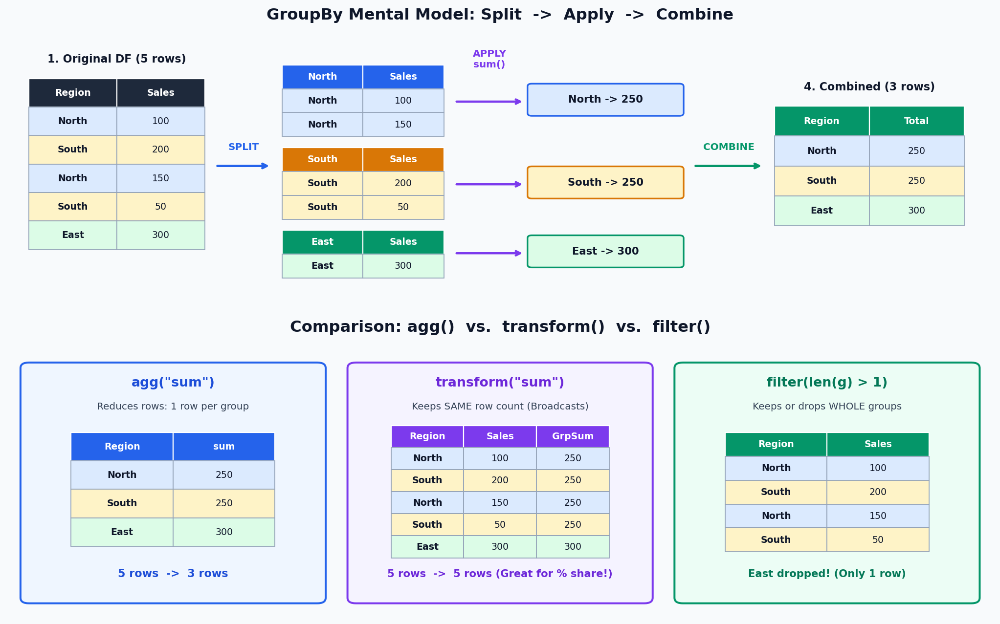
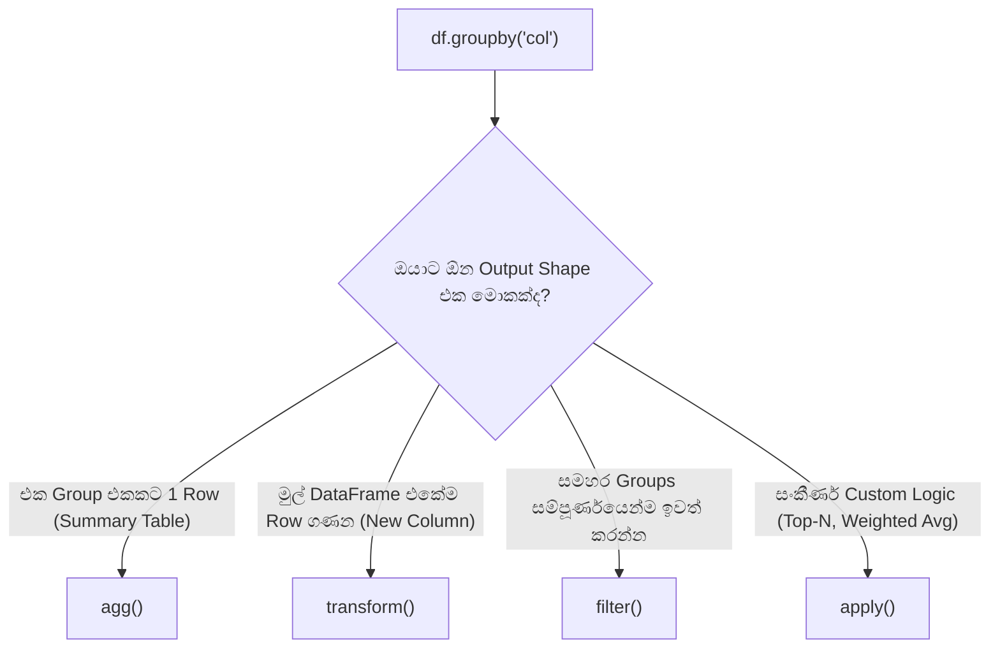

[⬅️ පෙර පාඩම: 10 Dates, Times & Time Series](10_Dates_Times_and_Time_Series.md) | [🏠 මුල් පිටුව (README)](README.md) | [ඊළඟ පාඩම: 12 Combining Data ➡️](12_Combining_Data.md)

---

# 📊 පාඩම 11: GroupBy & Aggregation (කාණ්ඩ කිරීම සහ සාරාංශ ගණනය)

Data analysis වල අපි වැඩිපුරම අහන ප්‍රශ්න මොනවද?
- "එක එක **පළාතේ** මුළු ආදායම කීයද?"
- "හැම **පාරිභෝගිකයෙක්ම** සාමාන්‍යයෙන් කීයක් වියදම් කරනවද?"
- "එක එක **Category** එකේ වැඩියෙන්ම විකිණුන Top 3 products මොනවද?"

මේ හැම ප්‍රශ්නෙටම උත්තර දෙන්නේ **`groupby()`**!

GroupBy වැඩ කරන්නේ හරිම සරල පියවර 3ක රටාවකට — ඒකට කියන්නේ **Split → Apply → Combine** කියලා:
1. **Split (වෙන් කරන්න):** එකම key එක තියෙන rows (උදා: North, South, East) වෙනම කූඩ වලට දානවා.
2. **Apply (ගණනය කරන්න):** හැම කූඩයකටම වෙන වෙනම function එකක් (`sum`, `mean`, `count`...) apply කරනවා.
3. **Combine (එකතු කරන්න):** හැම කූඩයෙන්ම ආපු උත්තර ටික ආයේ එක ලස්සන DataFrame එකකට එකතු කරනවා!



---

## 1. Basic GroupBy & Built-in Aggregations

- **එක key එකකින් හෝ කිහිපයකින්:** `df.groupby('region')` හෝ `df.groupby(['region', 'product'])`.
- **Groups ඇතුළ බලන්න:** `.groups` (dict එකක් විදියට indices පෙන්නනවා), `.get_group('North')` (එක group එකක DataFrame එක ගන්න).
- **Iterating groups:** Group එකෙන් group එකට loop ගහලා වෙන වෙනම CSV export කරන්න වගේ වැඩ වලට:
  ```python
  for key, grp in df.groupby('region'):
      grp.to_csv(f'sales_{key}.csv', index=False)
  ```

### Built-in Aggregations (KPIs හදන්න)
`sum()`, `mean()`, `median()`, `count()` (NaN නැති ගණන), `size()` (NaN එක්කම මුළු rows ගණන), `nunique()` (unique ගණන), `min()`, `max()`, `std()`, `var()`, `first()`, `last()`, `prod()`, `sem()`.

### Group Options (Output එක පිරිසිදුව ගන්න)
- **`as_index=False`** — Group keys ටික index එකට නොදා සාමාන්‍ය columns විදියටම තියාගන්න (SQL `GROUP BY` වගේ!).
- **`sort=False`** — Group keys sort නොකර තිබ්බ පිළිවෙලටම තියාගන්න (වේගයත් වැඩි වෙනවා).
- **`dropna=False`** — Group key එකේ `NaN` තියෙන rows අතහරින්නේ නැතුව ඒවටත් group එකක් හදන්න.
- **`observed=True`** — Categorical columns group කරද්දී හිස් groups අයින් කරන්න.
- **`group_keys=False`** — `.apply()` කරද්දී අමතර extra index level එකක් එකතු වෙන එක නවත්තන්න.

---

## 2. The Big Four: `agg` vs `transform` vs `filter` vs `apply`

GroupBy වල තියෙන වැදගත්ම concept එක මේකයි. ඔයාට අවසානයේ ඕන **output shape** එක අනුව හරි method එක තෝරගන්න:



### ① `agg()` — Named Aggregations & Custom Functions
එක එක column එකට වෙනස් functions දාලා, ලස්සන අලුත් column names එක්ක summary table එකක් හදන්න (**Named Aggregation** — Best Practice!):
```python
summary = (
    df.groupby(['region', 'product'], as_index=False)
      .agg(
          orders=('order_id', 'nunique'),
          revenue=('amount', 'sum'),
          avg_order=('amount', 'mean'),
          range_amt=('amount', lambda s: s.max() - s.min())
      )
)
```
තනි column එකකට functions ගොඩක් දාන්න: `df.groupby('region')['amount'].agg(['min', 'mean', 'max'])`.

### ② `transform()` — Group Result එක හැම Row එකටම Broadcast කිරීම
**හරිම වැදගත්!** හිතන්න ඔයාට ඕන හැම order එකක්ම එයාගේ **region එකේ මුළු sales වලින් කීයෙන් පංගුවක්ද (`region_share`)** කියලා මුල් DataFrame එකටම අලුත් column එකක් හදන්න.
- `agg('sum')` කළොත් rows 1000ක් rows 3කට අඩු වෙනවා — මුල් DataFrame එකට assign කරන්න බෑ!
- **`transform('sum')`** කළොත් හැම row එකකටම එයාගේ group එකේ sum එක copy වෙලා **rows 1000ම** ආපහු එනවා!
```python
df['region_share'] = df['amount'] / df.groupby('region')['amount'].transform('sum')
# Group එක ඇතුළේ Z-score හදන්නත් සුපිරි:
df['z_score'] = df.groupby('region')['amount'].transform(lambda s: (s - s.mean()) / s.std())
```

### ③ `filter()` — මුළු Groups පිටින්ම තියාගැනීම හෝ ඉවත් කිරීම
Row එකෙන් row එක නෙවෙයි, **මුළු group එකම** condition එකකින් check කරලා `True` නම් තියාගන්නවා, `False` නම් drop කරනවා!
```python
# Orders 5කට වඩා දාලා තියෙන loyal customers ලගේ rows විතරක් තියාගමු
loyal = df.groupby('customer').filter(lambda g: len(g) > 5)
```

### ④ `apply()` — ඕනෑම සංකීර්ණ Per-Group Logic එකකට
`agg`, `transform`, `filter` වලින් කරන්න බැරි (උදා: එක එක group එකෙන් Top 3 rows ගන්න, columns 2ක් පාවිච්චි කරලා weighted average හදන්න) වැඩ වලට `apply()` පාවිච්චි කරනවා:
```python
# හැම region එකකම වැඩිම amount තියෙන Top 3 orders
top3 = df.groupby('region', group_keys=False).apply(lambda g: g.nlargest(3, 'amount'))
```

---

## 3. Advanced GroupBy Techniques

| Topic | Key API | ප්‍රයෝජනය (Use Case) |
| :--- | :--- | :--- |
| **Ranking inside groups** | `.rank(ascending=False)`, `.cumcount()`, `.nth(0)`, `.head(3)`, `.tail(2)` | Category එක ඇතුළේ 1st, 2nd, 3rd හොයන්න |
| **Cumulative & Lags by group** | `.cumsum()`, `.cummax()`, `.shift(1)`, `.diff()`, `.pct_change()` | පාරිභෝගිකයාගේ running total, පෙර order එකත් එක්ක වෙනස |
| **Time grouping** | `pd.Grouper(key='date', freq='ME')`, `groupby('seg').resample('ME')` | Segment එක අනුව මාසික ආදායම |
| **Binning then grouping** | `df.groupby(pd.cut(df['age'], [0, 18, 35, 60, 100]), observed=True)` | වයස් කාණ්ඩ (Age bands) අනුව සාරාංශ |
| **Window functions in groups** | `df.groupby('store')['sales'].rolling(3).mean()`, `.expanding().mean()` | එක එක කඩේට වෙන වෙනම 3-day moving average |
| **Pivot-style aggregation** | `df.pivot_table(index='region', columns='product', values='amount', aggfunc='sum')`, `.unstack()` | Cross-tab report layouts |
| **Weighted average** | `np.average(g['price'], weights=g['qty'])` inside `apply()` | Quantity එක අනුව බර තැබූ සාමාන්‍ය මිල |

---

### 💻 සම්පූර්ණ කේත උදාහරණය (All-in-One GroupBy)

```python
import pandas as pd

df = pd.DataFrame({
    'order_id': [101, 102, 103, 104, 105, 106],
    'region':   ['West', 'West', 'West', 'Central', 'Central', 'South'],
    'product':  ['Tea', 'Coffee', 'Tea', 'Tea', 'Coffee', 'Tea'],
    'amount':   [200, 300, 500, 400, 100, 150]
})

# 1. Named Aggregation + Sort
summary = (
    df.groupby(['region', 'product'], as_index=False)
      .agg(orders=('order_id', 'nunique'),
           revenue=('amount', 'sum'),
           avg_order=('amount', 'mean'))
      .sort_values('revenue', ascending=False)
)

# 2. transform(): හැම row එකේම region share එක
df['region_share'] = (df['amount'] / df.groupby('region')['amount'].transform('sum')).round(2)

# 3. Ranking & Running Total inside each region
df['rank_in_region'] = df.groupby('region')['amount'].rank(ascending=False).astype(int)
df['running_total'] = df.groupby('region')['amount'].cumsum()

# 4. filter(): Orders 2ක් හෝ ඊට වැඩි regions විතරක්
active_regions = df.groupby('region').filter(lambda g: len(g) >= 2)

print("--- Summary Table ---")
print(summary)
print("\n--- Enriched DataFrame ---")
print(df[['order_id', 'region', 'amount', 'region_share', 'rank_in_region', 'running_total']])
print("\n--- Active Regions Only (South dropped!) ---")
print(active_regions['region'].unique())
```

**📤 බලාපොරොත්තු වන ප්‍රතිදානය (Expected Output):**
```text
--- Summary Table ---
    region product  orders  revenue  avg_order
3     West     Tea       2      700      350.0
1  Central     Tea       1      400      400.0
2     West  Coffee       1      300      300.0
4    South     Tea       1      150      150.0
0  Central  Coffee       1      100      100.0

--- Enriched DataFrame ---
   order_id   region  amount  region_share  rank_in_region  running_total
0       101     West     200          0.20               3            200
1       102     West     300          0.30               2            500
2       103     West     500          0.50               1           1000
3       104  Central     400          0.80               1            400
4       105  Central     100          0.20               2            500
5       106    South     150          1.00               1            150

--- Active Regions Only (South dropped!) ---
['West' 'Central']
```

---

## 🧠 මතක තබා ගැනීමට පහසු ක්‍රම (Memory Hacks)
1. **Shape Hack:**
   - **`agg`** = **Shrinks** (පොඩි කරනවා — 1 row per group).
   - **`transform`** = **Same size** (මුල් row ගණනම තියෙනවා).
   - **`filter`** = **Keep/Drop groups** (කූඩ පිටින් තියාගන්නවා/අයින් කරනවා).
2. **`count()` vs `size()`:** `count()` එක `NaN` ගණන් ගන්නේ නෑ; `size()` එක `NaN` එක්කම හැම row එකක්ම ගණන් කරනවා!
3. **Speed Tip:** `apply(lambda ...)` slow වෙන්න පුළුවන්. පුළුවන් හැමවෙලේම built-in string names (`'sum'`, `'mean'`, `'nunique'`) `agg()` සහ `transform()` ඇතුළේ පාවිච්චි කරන්න — ඒවා Cython වලින් 10x–100x වේගවත්!

## ⚠️ සාමාන්‍යයෙන් වෙන වැරදි (Common Pitfalls)

> [!WARNING]
> 1. **`NaN` keys නොදැනුවත්වම අතුරුදහන් වීම!** Default විදියට `groupby()` එක `NaN` තියෙන group keys සම්පූර්ණයෙන්ම drop කරනවා. Missing values තියෙන rows නැති වෙන එක වළක්වන්න **`dropna=False`** දාන්න!
> 2. **MultiIndex columns හැදීම:** `df.groupby('region').agg({'amount': ['sum', 'mean']})` කළාම column names 2-level MultiIndex වෙනවා — access කරන්න අමාරුයි. ඒ වෙනුවට හැමවෙලේම **Named Aggregation** (`agg(total=('amount', 'sum'), avg=('amount', 'mean'))`) පාවිච්චි කරන්න!
> 3. **`transform()` ඇතුළේ column 2ක් පාවිච්චි කිරීම:** `transform()` වැඩ කරන්නේ එක Series (column) එකකට විතරයි. Weighted average වගේ columns 2ක් ඕන වැඩ වලට `apply()` හෝ helper column එකක් (`price * qty`) හදලා `agg()` පාවිච්චි කරන්න.

---

## 🏋️ ප්‍රායෝගික අභ්‍යාස (Practical Exercises)

### Warm-up Exercise
පහත DataFrame එකෙන් එක එක `dept` එකේ සාමාන්‍ය පඩිය (`mean_salary`) සහ සේවකයන් ගණන (`emp_count`) තනි `agg()` call එකකින් හොයන්න (`as_index=False` දාලා).

<details>
<summary>✅ පිළිතුර බලන්න (Click to see Solution)</summary>

```python
import pandas as pd

emp = pd.DataFrame({
    'dept': ['IT', 'IT', 'HR', 'HR', 'Sales'],
    'salary': [150000, 180000, 120000, 130000, 110000]
})

res = emp.groupby('dept', as_index=False).agg(
    emp_count=('salary', 'size'),
    mean_salary=('salary', 'mean')
)
print(res)
```
</details>

### Exercise 1 (Course Exercise)
එක එක `customer` ගේ **order count**, **first order date**, **last order date**, සහ **total spend** එක තනි `agg()` call එකකින් ගණනය කරන්න.

<details>
<summary>✅ පිළිතුර බලන්න (Click to see Solution)</summary>

```python
import pandas as pd

orders = pd.DataFrame({
    'order_id': [1, 2, 3, 4, 5],
    'customer': ['Kasun', 'Nimali', 'Kasun', 'Kasun', 'Nimali'],
    'order_date': pd.to_datetime(['2026-01-05', '2026-01-10', '2026-02-14', '2026-03-01', '2026-03-20']),
    'amount': [1500, 2200, 3000, 1200, 1800]
})

cust_summary = orders.groupby('customer', as_index=False).agg(
    order_count=('order_id', 'nunique'),
    first_order=('order_date', 'min'),
    last_order=('order_date', 'max'),
    total_spend=('amount', 'sum')
)
print(cust_summary)
```
</details>

### Exercise 2 (Course Exercise)
හැම order එකක්ම එම පාරිභෝගිකයාගේ (customer) මුළු වියදමෙන් **ප්‍රතිශතයක් (percentage)** විදියට අලුත් column එකකට එකතු කරන්න.

<details>
<summary>✅ පිළිතුර බලන්න (Click to see Solution)</summary>

```python
orders['pct_of_customer_total'] = (
    orders['amount'] / orders.groupby('customer')['amount'].transform('sum') * 100
).round(2)

print(orders[['order_id', 'customer', 'amount', 'pct_of_customer_total']])
```
</details>

### Exercise 3 (Course Exercise)
එක එක `category` එක ඇතුළේ වැඩිම `revenue` තියෙන **Top 2 products** හොයන්න.

<details>
<summary>✅ පිළිතුර බලන්න (Click to see Solution)</summary>

```python
import pandas as pd

prod = pd.DataFrame({
    'category': ['Tech', 'Tech', 'Tech', 'Food', 'Food', 'Food'],
    'product':  ['Laptop', 'Mouse', 'Phone', 'Rice', 'Tea', 'Sugar'],
    'revenue':  [5000, 800, 4200, 1500, 2300, 900]
})

# ක්‍රමය 1: sort_values + groupby().head(2) (ඉතා වේගවත්!)
top2 = prod.sort_values('revenue', ascending=False).groupby('category', as_index=False).head(2)
print(top2.sort_values(['category', 'revenue'], ascending=[True, False]))
```
</details>

### Exercise 4 (Course Exercise)
එක එක `product` එකේ **weighted average price** එක ගණනය කරන්න (weights = `quantity`).

<details>
<summary>✅ පිළිතුර බලන්න (Click to see Solution)</summary>

```python
import numpy as np
import pandas as pd

sales = pd.DataFrame({
    'product': ['Tea', 'Tea', 'Coffee', 'Coffee'],
    'price':   [100, 120, 200, 250],
    'qty':     [10, 30, 5, 15]
})

# ක්‍රමය 1: apply + np.average
wavg_apply = (
    sales.groupby('product')
         .apply(lambda g: np.average(g['price'], weights=g['qty']), include_groups=False)
         .rename('weighted_avg_price')
)
print(wavg_apply)

# ක්‍රමය 2: Vectorized (ගොඩක් data තියෙනකොට super fast!)
sales['total'] = sales['price'] * sales['qty']
g = sales.groupby('product')[['total', 'qty']].sum()
wavg_fast = g['total'] / g['qty']
print("\nFast vectorized:\n", wavg_fast)
```
</details>

---

## 📋 Cheat Sheet Summary

| කාර්යය (Task) | Pandas API | උදාහරණය |
| :--- | :--- | :--- |
| Basic GroupBy | `df.groupby(['a', 'b'], as_index=False)` | `df.groupby('region', as_index=False)['amt'].sum()` |
| Named Aggregation | `.agg(new_col=('col', 'func'))` | `df.groupby('c').agg(total=('amt', 'sum'))` |
| Group % / Broadcast | `.transform('sum')` | `df['amt'] / df.groupby('c')['amt'].transform('sum')` |
| Filter whole groups | `.filter(lambda g: ...)` | `df.groupby('c').filter(lambda g: len(g) > 5)` |
| Top-N per group | `sort_values` + `.groupby().head(N)` | `df.sort_values('x', ascending=False).groupby('c').head(3)` |
| Rank inside group | `.groupby('c')['x'].rank()` | `df.groupby('c')['x'].rank(ascending=False)` |
| Running total | `.groupby('c')['x'].cumsum()` | `df.groupby('cust')['amt'].cumsum()` |
| Time-based GroupBy | `pd.Grouper(key='date', freq='ME')` | `df.groupby([pd.Grouper(key='d', freq='ME'), 'c']).sum()` |
| Rolling per group | `.groupby('c')['x'].rolling(3).mean()` | Per-store 3-day moving average |
| Include NaN keys | `dropna=False` | `df.groupby('c', dropna=False).size()` |

---

[⬅️ පෙර පාඩම: 10 Dates, Times & Time Series](10_Dates_Times_and_Time_Series.md) | [🏠 මුල් පිටුව (README)](README.md) | [ඊළඟ පාඩම: 12 Combining Data ➡️](12_Combining_Data.md)
