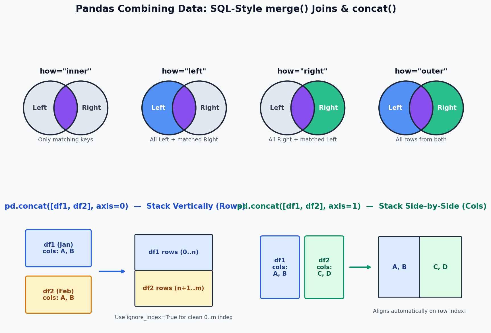
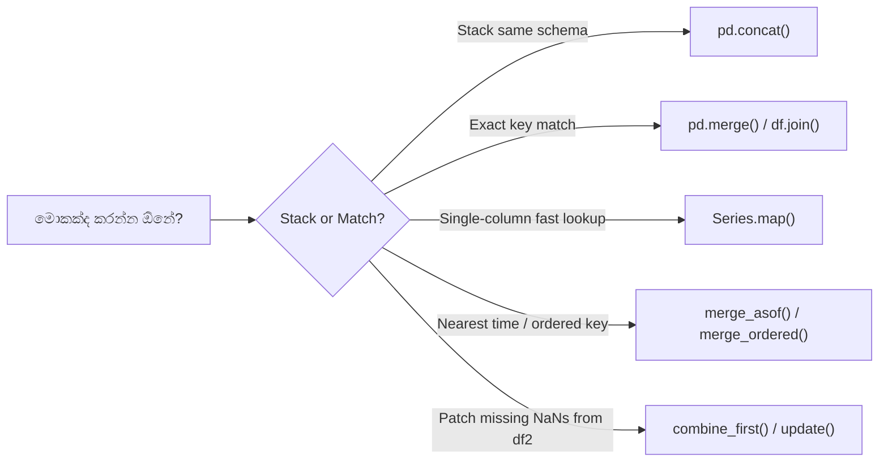

[⬅️ පෙර පාඩම: 11 GroupBy & Aggregation](11_GroupBy_and_Aggregation.md) | [🏠 මුල් පිටුව (README)](README.md) | [ඊළඟ පාඩම: 13 Reshaping ➡️](13_Reshaping.md)

---

# 🔗 පාඩම 12: Combining Data (දත්ත වගු එකතු කිරීම — Concat, Merge & Join)

සැබෑ ලෝකයේ data analysis කරද්දී ඔක්කොම දත්ත එකම table එකක තියෙන්නේ කලාතුරකින්.
- `orders_jan.csv`, `orders_feb.csv`... කියලා මාස 12ක files තියෙන්න පුළුවන් (ඒවා **උඩින් යටට අමුණන්න** ඕනේ -> `pd.concat`).
- `orders` table එකේ තියෙන්නේ `customer_id` විතරයි, customer ගේ නමයි රටයි තියෙන්නේ `customers` table එකේ (ඒවා **common key එකකින් සම්බන්ධ කරන්න** ඕනේ -> `pd.merge`).

> [!TIP]
> **සරල උදාහරණය (Real-life Analogy):**
> - **`pd.concat()`** කියන්නේ **පොත් ගොඩක් එක උඩ එක තියනවා** වගේ (ජනවාරි පොත + පෙබරවාරි පොත = එක ලොකු පොතක්).
> - **`pd.merge()`** කියන්නේ **හැඳුනුම්පත් අංකය (NIC)** බලලා පාසල් ලැයිස්තුවයි, විභාග ප්‍රතිඵල ලැයිස්තුවයි හරියටම ගළපලා එකට අමුණනවා වගේ!



---

## 1. Concatenation (`pd.concat`) — Stack Vertically or Side-by-Side

- **Vertical stack (`axis=0`, default):** එකම columns තියෙන tables උඩින් යටට එකතු කරනවා (උදා: මාසික CSV files).
  - **`ignore_index=True`:** පරණ index (`0,1,2, 0,1,2`) අයින් කරලා අලුත් `0,1,2,3,4,5` index එකක් හදනවා.
  - **`keys=['Jan', 'Feb']`:** මොන row එක ආවේ මොන table එකෙන්ද කියලා MultiIndex එකක් විදියට ලකුණු කරනවා.
  - **`join='outer'` (default) vs `join='inner'`:** Tables දෙකේ columns වෙනස් නම් `outer` ඔක්කොම columns තියාගෙන අඩු තැන් වලට `NaN` දානවා; `inner` පොදු columns විතරක් තියාගන්නවා.
- **Horizontal stack (`axis=1`):** Tables දෙකක් **පැත්තෙන් පැත්තට** (side-by-side) එකතු කරනවා — row index එකට අනුව ඉබේම align වෙනවා!
- **Appending rows:** පරණ Pandas වල තිබුණ `df.append()` දැන් ඉවත් කරලා (removed). අලුත් rows එකතු කරන්න හැමවෙලේම **`pd.concat([df, new_rows], ignore_index=True)`** පාවිච්චි කරන්න!

---

## 2. SQL-Style Joins (`pd.merge`)

SQL වල `JOIN` වගේම, common key column එකකින් tables දෙකක් සම්බන්ධ කරන්න **`pd.merge()`** හෝ **`left.merge(right, ...)`** පාවිච්චි කරනවා.

| Join Type (`how=`) | කරන වැඩේ | ප්‍රතිඵලය |
| :--- | :--- | :--- |
| **`'inner'`** (default) | දෙපැත්තෙම match වෙන keys විතරයි | පොදු rows විතරයි |
| **`'left'`** | Left table එකේ ඔක්කොම rows + match වෙන Right rows | Match නැති Right columns `NaN` |
| **`'right'`** | Right table එකේ ඔක්කොම rows + match වෙන Left rows | Match නැති Left columns `NaN` |
| **`'outer'`** | දෙපැත්තෙම ඔක්කොම rows | Match නැති තැන් `NaN` |
| **`'cross'`** | හැම Left row එකම හැම Right row එකත් එක්කම (Cartesian product) | `len(L) * len(R)` rows |

### Merge Parameters හොඳින් දැනගමු:
- **Different key names:** Tables දෙකේ key column එකේ නම වෙනස් නම්: `left_on='cust_id', right_on='id'` (Index එකෙන් join කරන්න `left_index=True`, `right_index=True`).
- **Overlapping columns:** Key නොවන එකම නම ඇති columns දෙපැත්තෙම තියෙනවා නම් (උදා: `name`), default `_x`, `_y` වෙනුවට පැහැදිලි නම් දෙන්න: `suffixes=('_order', '_customer')`.
- **Join Validation (ඉතා වැදගත්!):** නොදැනුවත්ව duplicate keys තිබිලා rows ගුණ වෙන එක (row explosion) අල්ලගන්න **`validate=`** පාවිච්චි කරන්න:
  - `'one_to_one'` (`1:1`), `'one_to_many'` (`1:m`), `'many_to_one'` (`m:1` — orders to customers වලට හොඳම!).
  - උල්ලංඝනය වුණොත් `MergeError` එකක් දීලා ඔයාව බේරගන්නවා!
- **Join Indicator (`indicator=True`):** `_merge` කියලා අලුත් column එකක් හැදෙනවා (`'left_only'`, `'right_only'`, `'both'`).

### Anti Join & Semi Join (Match නැති / ඇති Rows හොයන්න)
- **Anti Join** (උදා: කවදාවත් order එකක් දාපු නැති customers ලා):
  `how='left', indicator=True` කරලා **`_merge == 'left_only'`** filter කරනවා! (නැත්නම් `customers[~customers['customer_id'].isin(orders['customer_id'])]`).
- **Semi Join** (උදා: අඩුම ගානේ එක order එකක් හරි දාපු customers ලා):
  `customers[customers['customer_id'].isin(orders['customer_id'])]`.

---

## 3. Specialized Combining Tools



- **`DataFrame.join()`:** Index එක මත පදනම්ව join කරන්න shortcut එකක් (`df.join(other, how='left', lsuffix='_l', rsuffix='_r')`).
- **Fast Single-Column Lookup (`map`):** මුළු DataFrame එකම merge කරන්නේ නැතුව, එක column එකක් (උදා: `product_name`) විතරක් lookup කරන්න `orders['product_name'] = orders['sku'].map(products.set_index('sku')['name'])` — ගොඩක් වේගවත්!
- **`pd.merge_asof()`:** Nearest-key join for sorted data (උදා: trade එකකට ළඟම පෙර price quote එක — `on='time', by='ticker', direction='backward', tolerance=pd.Timedelta('1s')`).
- **`pd.merge_ordered()`:** Time series දෙකක් ordered විදියට outer join කරලා හිස් තැන් `fill_method='ffill'` වලින් පුරවනවා.
- **`combine_first()` & `update()`:**
  - `df1.combine_first(df2)` — `df1` එකේ `NaN` තියෙන තැන් විතරක් `df2` එකෙන් පුරවනවා (non-NaN වෙනස් කරන්නේ නෑ).
  - `df1.update(df2)` — `df2` එකේ non-NaN අගයන් වලින් `df1` එක **in-place** overwrite කරනවා.
- **Alignment & Comparing:**
  - `df1.align(df2)` / `df1.reindex_like(df2)` — Index සහ columns එකම විදියට align කරනවා.
  - `df1.compare(df2)` — එකම shape තියෙන tables දෙකක වෙනස් වුණ cells විතරක් side-by-side (`self` vs `other`) පෙන්නනවා!
  - `df1.equals(df2)` — Tables දෙක 100% සමානද (`True`/`False`) බලනවා (`NaN == NaN` පවා `True` කියලා සලකනවා).

---

### 💻 සම්පූර්ණ කේත උදාහරණය (Real-world Combining Workflow)

```python
import pandas as pd

# 1. මාසික orders tables දෙකක් concat කරමු
jan = pd.DataFrame({'order_id': [1, 2], 'customer_id': ['C1', 'C2'], 'sku': ['A1', 'B2'], 'amount': [500, 300]})
feb = pd.DataFrame({'order_id': [3, 4], 'customer_id': ['C1', 'C9'], 'sku': ['B2', 'A1'], 'amount': [700, 200]})

all_orders = pd.concat(
    [jan.assign(source='jan.csv'), feb.assign(source='feb.csv')],
    ignore_index=True
)

# 2. Customers & Products lookup tables
customers = pd.DataFrame({
    'customer_id': ['C1', 'C2', 'C3'],
    'segment':     ['VIP', 'Regular', 'Regular'],
    'country':     ['LK', 'LK', 'IN']
})
products = pd.DataFrame({'sku': ['A1', 'B2'], 'name': ['Ceylon Tea', 'Arabica Coffee']})

# 3. Left Join + Validation + Indicator
enriched = all_orders.merge(
    customers[['customer_id', 'segment', 'country']],
    on='customer_id', how='left', validate='many_to_one', indicator=True
)

# 4. Anti-Join: කවදාවත් order එකක් නොදාපු customers ලා (C3)
no_orders = (
    customers.merge(all_orders[['customer_id']].drop_duplicates(),
                    on='customer_id', how='left', indicator=True)
             .query('_merge == "left_only"')
)

# 5. Fast single-column lookup with map()
enriched['product_name'] = enriched['sku'].map(products.set_index('sku')['name'])

print("--- Enriched Orders ---")
print(enriched[['order_id', 'customer_id', 'product_name', 'segment', '_merge']])
print("\n--- Customers With No Orders (Anti-Join) ---")
print(no_orders[['customer_id', 'segment', 'country']])
```

**🔍 පේළියෙන් පේළිය පැහැදිලි කිරීම (Line-by-Line Explanation):**
- **Line 7–10:** `.assign(source=...)` දාලා මොන file එකෙන්ද ආවේ කියලා සටහන් කරලා `pd.concat(..., ignore_index=True)` කළා. Real files load කරද්දී `(pd.read_csv(f).assign(source=f.name) for f in Path('data').glob('orders_*.csv'))` විදියට generator එකක් දෙන්න පුළුවන්!
- **Line 21–24:** `validate='many_to_one'` මගින් `customers` table එකේ `customer_id` duplicate නැති බව සහතික කරනවා. `C9` customer කෙනෙක් නැති නිසා `_merge` column එකේ `'left_only'` කියලා පෙන්නනවා.
- **Line 27–31:** `customers` left එකට තියලා `all_orders` right එකට තියලා `_merge == "left_only"` ගත්තම orders නැති `C3` අහුවෙනවා.
- **Line 34:** `.map()` මගින් `sku` -> `product_name` කෙලින්ම attach කළා.

**📤 බලාපොරොත්තු වන ප්‍රතිදානය (Expected Output):**
```text
--- Enriched Orders ---
   order_id customer_id    product_name  segment     _merge
0         1          C1      Ceylon Tea      VIP       both
1         2          C2  Arabica Coffee  Regular       both
2         3          C1  Arabica Coffee      VIP       both
3         4          C9      Ceylon Tea      NaN  left_only

--- Customers With No Orders (Anti-Join) ---
  customer_id  segment country
2          C3  Regular      IN
```

---

## 🧠 මතක තබා ගැනීමට පහසු ක්‍රම (Memory Hacks)
1. **Before every `merge()`, check row count!** Merge කරන්න කලින් `len(left)` බලන්න, merge කළාට පස්සේ `len(result)` බලන්න. `how='left'` කරද්දී rows ගණන **වැඩි වුණා නම්**, Right table එකේ duplicate keys තියෙනවා!
2. **Always use `validate=`:** `orders.merge(customers, ...)` වලට හැමවෙලේම **`validate='many_to_one'`** දාන්න පුරුදු වෙන්න — bugs 90%ක් එතනින්ම අහුවෙනවා.
3. **Need 1 column? Use `map()`!** Columns 1ක් විතරක් ගන්න මුළු table එකම `merge()` කරන්න එපා — `.map()` වේගවත් සහ පිරිසිදුයි.

## ⚠️ සාමාන්‍යයෙන් වෙන වැරදි (Common Pitfalls)

> [!WARNING]
> 1. **Many-to-Many Row Explosion (පේළි පුපුරා යාම):** Left table එකේ `id='C1'` පේළි 3ක් තියෙනවා, Right table එකෙත් `id='C1'` පේළි 4ක් තියෙනවා නම්, merge කළාම `3 x 4 = 12` rows හැදෙනවා! ඊට පස්සේ `.sum()` ගත්තොත් මුළු revenue එක 4 ගුණයකින් වැරදි වෙනවා! Merge කරන්න කලින් `right['id'].is_unique` check කරන්න හෝ `drop_duplicates('id')` කරන්න.
> 2. **Key dtypes නොගැලපීම:** Left එකේ `customer_id` integer (`101`) වෙලා Right එකේ string (`'101'`) වුණොත් `ValueError` එනවා! Merge කරන්න කලින් දෙකම එකම dtype එකට convert කරන්න.
> 3. **Loop එකක් ඇතුළේ `pd.concat()` දැමීම:** `for f in files: df = pd.concat([df, pd.read_csv(f)])` කියලා ලිව්වොත් හැම පාරම මුළු table එකම memory එකේ copy වෙලා හරිම slow වෙනවා! හැමවෙලේම list එකකට එකතු කරලා **අන්තිමට එකපාර `pd.concat(dfs, ignore_index=True)`** කරන්න!

---

## 🏋️ ප්‍රායෝගික අභ්‍යාස (Practical Exercises)

### Warm-up Exercise
`df1` (`A: [1, 2]`) සහ `df2` (`A: [3, 4]`) උඩින් යටට (`axis=0`) `ignore_index=True` දාලා එකතු කරන්න.

<details>
<summary>✅ පිළිතුර බලන්න (Click to see Solution)</summary>

```python
import pandas as pd

df1 = pd.DataFrame({'A': [1, 2]})
df2 = pd.DataFrame({'A': [3, 4]})

combined = pd.concat([df1, df2], ignore_index=True)
print(combined)
```
</details>

### Exercise 1 (Course Exercise)
මාස 12ක CSV files (හෝ DataFrames 12ක්) එකම DataFrame එකකට `pd.concat` කරලා, මුළු row count එක මාස 12ක row counts වල එකතුවට සමානද කියලා `assert` එකකින් verify කරන්න.

<details>
<summary>✅ පිළිතුර බලන්න (Click to see Solution)</summary>

```python
import pandas as pd

# මාස 12ක sample DataFrames හදමු (සැබෑ files වලට Path('data').glob('orders_*.csv') පාවිච්චි කරන්න)
monthly_dfs = [
    pd.DataFrame({'month': m, 'order_id': range(1, 11)}).assign(source=f'orders_2026_{m:02d}.csv')
    for m in range(1, 13)
]

expected_rows = sum(len(d) for d in monthly_dfs)
all_year = pd.concat(monthly_dfs, ignore_index=True)

assert len(all_year) == expected_rows, "Row count mismatch!"
print(f"Verified! Combined {len(monthly_dfs)} files -> {len(all_year)} rows.")
```
</details>

### Exercise 2 (Course Exercise)
`orders` table එක `customers` table එකට left-join කරලා, matching customer කෙනෙක් **නැති** orders කීයක් තියෙනවද කියලා report කරන්න.

<details>
<summary>✅ පිළිතුර බලන්න (Click to see Solution)</summary>

```python
import pandas as pd

orders = pd.DataFrame({'order_id': [1, 2, 3, 4], 'cust_id': ['C1', 'C2', 'C99', 'C88'], 'amt': [100, 200, 150, 300]})
customers = pd.DataFrame({'cust_id': ['C1', 'C2', 'C3'], 'name': ['Amal', 'Bimal', 'Kamal']})

merged = orders.merge(customers, on='cust_id', how='left', indicator=True)
unmatched_count = (merged['_merge'] == 'left_only').sum()

print(f"Matching customer නැති orders ගණන: {unmatched_count}")
print(merged[merged['_merge'] == 'left_only'])
```
</details>

### Exercise 3 (Course Exercise)
Many-to-many merge එකකදී rows පුපුරා යන (row explosion) හැටි පෙන්නලා, ඒක `validate='many_to_one'` සහ `drop_duplicates()` පාවිච්චි කරලා fix කරන්න.

<details>
<summary>✅ පිළිතුර බලන්න (Click to see Solution)</summary>

```python
import pandas as pd

orders = pd.DataFrame({'order_id': [1, 2], 'cust_id': ['C1', 'C1'], 'amt': [100, 200]})
# Right table එකේ C1 දෙපාරක් තියෙනවා (duplicate bug!)
customers_dirty = pd.DataFrame({'cust_id': ['C1', 'C1'], 'city': ['Colombo', 'Colombo']})

# 1. Row Explosion! (2 rows -> 4 rows වෙනවා, මුළු amt එක 300 වෙනුවට 600 වෙනවා!)
exploded = orders.merge(customers_dirty, on='cust_id', how='left')
print(f"Before fix: {len(orders)} orders became {len(exploded)} rows! Sum = {exploded['amt'].sum()}")

# 2. validate='many_to_one' දැම්මොත් MergeError එකෙන් අල්ලගන්නවා
try:
    orders.merge(customers_dirty, on='cust_id', how='left', validate='many_to_one')
except pd.errors.MergeError as e:
    print("Caught by validate:", e)

# 3. Fix: De-duplicate කරලා ආයේ merge කරමු
customers_clean = customers_dirty.drop_duplicates(subset=['cust_id'])
fixed = orders.merge(customers_clean, on='cust_id', how='left', validate='many_to_one')
print(f"After fix: {len(fixed)} rows! Sum = {fixed['amt'].sum()}")
```
</details>

### Exercise 4 (Course Exercise)
`trades` table එකට `quotes` table එකෙන් **1-second tolerance** එකක් ඇතුළත ළඟම පෙර price quote එක `pd.merge_asof()` පාවිච්චි කරලා join කරන්න.

<details>
<summary>✅ පිළිතුර බලන්න (Click to see Solution)</summary>

```python
import pandas as pd

trades = pd.DataFrame({
    'time': pd.to_datetime(['2026-05-01 10:00:01.500', '2026-05-01 10:00:05.000']),
    'ticker': ['AAPL', 'AAPL'],
    'qty': [10, 20]
})

quotes = pd.DataFrame({
    'time': pd.to_datetime(['2026-05-01 10:00:01.000', '2026-05-01 10:00:02.000']),
    'ticker': ['AAPL', 'AAPL'],
    'bid': [185.50, 185.75]
})

matched = pd.merge_asof(
    trades.sort_values('time'),
    quotes.sort_values('time'),
    on='time',
    by='ticker',
    direction='backward',
    tolerance=pd.Timedelta('1s')
)
print(matched)
# දෙවෙනි trade එක (10:00:05) ළඟම quote එකට (10:00:02) වඩා තත්පර 3ක් පරක්කු නිසා bid = NaN වෙනවා!
```
</details>

---

## 📋 Cheat Sheet Summary

| කාර්යය (Task) | Pandas API | උදාහරණය |
| :--- | :--- | :--- |
| Stack rows vertically | `pd.concat([...], axis=0, ignore_index=True)` | `pd.concat([jan, feb], ignore_index=True)` |
| Stack columns side-by-side | `pd.concat([...], axis=1)` | `pd.concat([df1, df2], axis=1)` |
| SQL-style join | `pd.merge(L, R, on='k', how='left')` | `orders.merge(cust, on='cid', how='left')` |
| Different key names | `left_on=`, `right_on=` | `L.merge(R, left_on='cid', right_on='id')` |
| Prevent row explosion | `validate='many_to_one'` | `orders.merge(cust, on='cid', validate='m:1')` |
| Anti-join (unmatched) | `indicator=True` + `_merge == 'left_only'` | `L.merge(R, how='left', indicator=True)` |
| Fast 1-col lookup | `Series.map()` | `df['name'] = df['id'].map(lookup_series)` |
| Nearest-time join | `pd.merge_asof(..., tolerance=)` | `pd.merge_asof(trades, quotes, on='time', by='ticker')` |
| Fill NaNs from df2 | `df1.combine_first(df2)` | Patch missing values without overwriting valid ones |
| Diff two frames | `df1.compare(df2)`, `df1.equals(df2)` | Change detection |

---

[⬅️ පෙර පාඩම: 11 GroupBy & Aggregation](11_GroupBy_and_Aggregation.md) | [🏠 මුල් පිටුව (README)](README.md) | [ඊළඟ පාඩම: 13 Reshaping ➡️](13_Reshaping.md)
