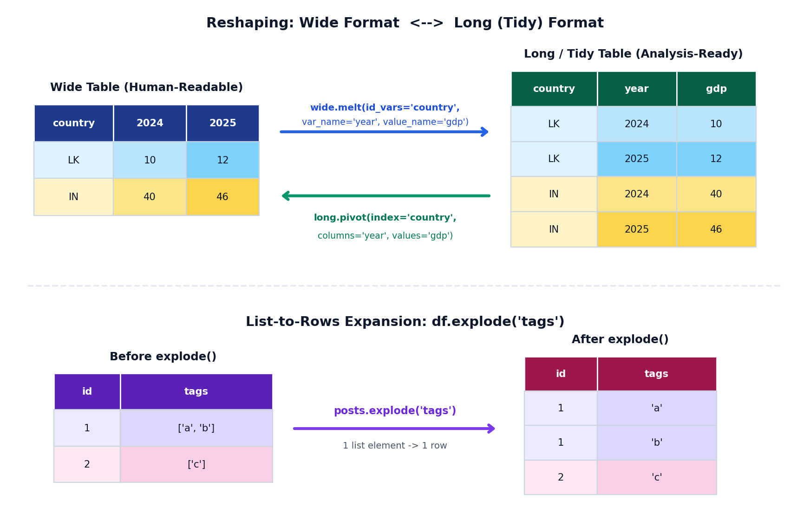
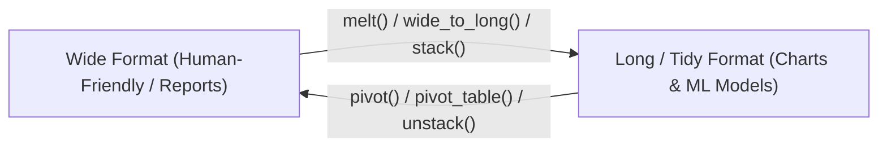
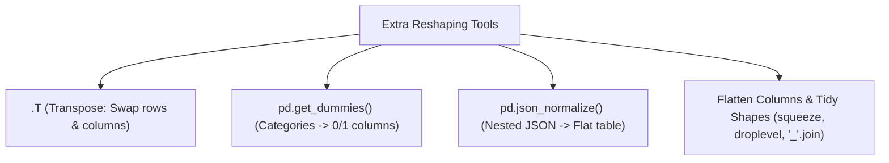

[⬅️ Module 12: Combining Data](12_Combining_Data.md) | [🏠 Course Index](README.md) | [Module 14: MultiIndex & Hierarchical Data ➡️](14_MultiIndex_and_Hierarchical_Data.md)

---

# 🔄 Module 13: Reshaping Data (දත්තවල හැඩය වෙනස් කිරීම)

## 🎯 මේ පාඩමෙන් අපි මොනවද ඉගෙන ගන්නේ?
Data analysis කරද්දී අපිට ලැබෙන data table එක හැමවෙලේම අපිට ඕන විදියටම හැදිලා නෑ. සමහර වෙලාවට මාස 12 ම වෙන වෙනම columns 12 ක් විදියට තියෙනවා (Wide format). ඒත් chart එකක් අඳින්න හෝ Machine Learning model එකකට දාන්න ඒක තනි `month` column එකකට ගන්න වෙනවා (Long format). තවත් වෙලාවක Excel වල Pivot Table එකක් වගේ summary matrix එකක් හදන්න ඕන වෙනවා.

මේ වගේ table එකක **හැඩය (shape)** එහා මෙහා හරවන එකට තමයි **Reshaping** කියන්නේ!

> [!TIP]
> **එදිනෙදා උදාහරණය (Real-life Analogy):**
> ඔයාගේ ඉස්කෝලේ ලකුණු පොත (Report Card) හිතන්න. ඒකේ තියෙන්නේ පේළි වලට ළමයින්ගේ නම්, තීරු (columns) වලට Term 1, Term 2, Term 3 ලකුණු. මේක මිනිස්සුන්ට කියවන්න ලේසි **Wide format** එකක්. ඒත් ඔයාට computer එකෙන් graph එකක් අඳින්න ඕන නම්, හැම වාරයම වෙනම row එකක් විදියට (`Name | Term | Marks`) තියෙන **Long format** එකට හරවන්න වෙනවා. `melt` සහ `pivot` කරන්නේ හරියටම ඒ දෙක අතර මාරු වෙන එක!



---

## 1. Tidy Data Principles (පිරිසිදු දත්ත නීති)

Data Science වල "Tidy Data" (පිළිවෙලට තියෙන දත්ත) කියන්නේ හරිම වැදගත් concept එකක්. Table එකක් Tidy වෙන්න නම් නීති 3 ක් තියෙනවා:
1. **One variable per column:** එක column එකක තියෙන්න ඕනේ එක variable එකක් විතරයි (උදා: `year` කියලා තනි column එකක් මිසක් `2024`, `2025` කියලා වෙනම columns නෙවෙයි).
2. **One observation per row:** එක row එකක තියෙන්න ඕනේ එක සිද්ධියක් / නිරීක්ෂණයක් විතරයි.
3. **One table per observational unit:** එක table එකක එක වර්ගයක දත්ත විතරයි.

Charts අඳින්න (Matplotlib/Seaborn) සහ Machine Learning models හදන්න හොඳම format එක තමයි **Long (Tidy) Format** එක.



---

## 2. `melt()` — Wide ඉඳන් Long වලට හැරවීම

`2024`, `2025` වගේ columns ගොඩක් තියෙන Wide table එකක්, `year` සහ `gdp` කියන columns දෙකක් තියෙන Long table එකකට හරවන්න `melt()` පාවිච්චි කරනවා.

```python
import pandas as pd

wide = pd.DataFrame({
    'country': ['LK', 'IN'],
    '2024': [10, 40],
    '2025': [12, 46],
})

long = wide.melt(
    id_vars='country',
    value_vars=['2024', '2025'],  # මේක නොදුන්නත් id_vars හැර අනිත් ඔක්කොම ගන්නවා
    var_name='year',
    value_name='gdp'
)
print(long)
```

**පේළියෙන් පේළිය විස්තරය (Line-by-Line):**
- `id_vars='country'`: වෙනස් නොවී එහෙමම තියාගන්න ඕනේ identifier column එක (`country`).
- `value_vars=['2024', '2025']`: දිය කරලා (melt කරලා) rows වලට දාන්න ඕනේ columns ටික.
- `var_name='year'`: කලින් column names (`2024`, `2025`) ටික වැටෙන අලුත් column එකේ නම.
- `value_name='gdp'`: කලින් තිබුණු numbers ටික වැටෙන අලුත් column එකේ නම.

**Expected Output:**
```text
  country  year  gdp
0      LK  2024   10
1      IN  2024   40
2      LK  2025   12
3      IN  2025   46
```

### `wide_to_long()` — එකම Prefix (Stub) එක තියෙන Columns වලට
සමහර tables වල `sales_2024`, `sales_2025`, `cost_2024`, `cost_2025` වගේ columns තියෙනවා. ඒ වගේ වෙලාවට `pd.wide_to_long()` හරිම ලේසියි:

```python
df_stub = pd.DataFrame({
    'id': [1, 2],
    'sales_2024': [100, 200],
    'sales_2025': [120, 230],
    'cost_2024': [70, 140],
    'cost_2025': [80, 150],
})

res = pd.wide_to_long(df_stub, stubnames=['sales', 'cost'], i='id', j='year', sep='_')
print(res)
```
- `stubnames`: පොදු මුල් කොටස් (`sales`, `cost`).
- `i='id'`: Unique row identifier එක.
- `j='year'`: අගට තියෙන කොටස (`2024`, `2025`) වැටෙන අලුත් index/column එකේ නම.
- `sep='_'`: Prefix එකයි අවුරුද්දයි වෙන් කරන symbol එක.

**Expected Output:**
```text
         sales  cost
id year             
1  2024    100    70
2  2024    200   140
1  2025    120    80
2  2025    230   150
```

---

## 3. `pivot()` සහ `pivot_table()` — Long ඉඳන් Wide වලට හැරවීම

### A) `df.pivot()` — Duplicate නැති වෙලාවට
Long format එකේ තියෙන table එකක් ආපහු matrix එකක් (Wide format) කරන්න `pivot()` පාවිච්චි කරනවා. **වැදගත්:** හැම `(index, columns)` pair එකකටම තියෙන්න පුළුවන් **එක value එකක්** විතරයි!

```python
wide_back = long.pivot(index='country', columns='year', values='gdp')
print(wide_back)
```
**Expected Output:**
```text
year     2024  2025
country            
IN         40    46
LK         10    12
```

### B) `df.pivot_table()` — Duplicates තියෙන වෙලාවට (Excel Pivot Table වගේ!)
සැබෑ ලෝකයේ data වල එකම `region` එකේ එකම `quarter` එකේ sales rows 100 ක් තියෙන්න පුළුවන්. එතකොට `pivot()` error එකක් දෙනවා. ඒ වෙනුවට `pivot_table()` දාලා ඒවා එකතු (`sum`), සාමාන්‍ය (`mean`) කරන්න පුළුවන්!

```python
df = pd.DataFrame({
    'region': ['West', 'West', 'East', 'East', 'West'],
    'quarter': ['Q1', 'Q1', 'Q1', 'Q2', 'Q2'],
    'amount': [100, 150, 200, 300, 120]
})

pt = df.pivot_table(
    index='region',
    columns='quarter',
    values='amount',
    aggfunc='sum',      # Duplicates එකතු කරන්න
    fill_value=0,       # හිස් තැන් (NaN) වලට 0 දාන්න
    margins=True,       # Row & Column Totals ('All') එකතු කරන්න
    observed=False      # Categorical columns තියෙනවා නම් observed=True දාන්න
)
print(pt)
```

**Expected Output:**
```text
quarter   Q1   Q2  All
region                
East     200  300  500
West     250  120  370
All      450  420  870
```

---

## 4. `stack()` සහ `unstack()` — Index සහ Columns අතර මාරු කිරීම

`stack()` සහ `unstack()` කියන්නේ `melt` / `pivot` වලම MultiIndex version එක වගේ.
- **`stack()`**: Column labels ටික අරගෙන Row index එකේ ඇතුළට (innermost level එකට) දානවා (Table එක උස/Long වෙනවා).
- **`unstack(level=..., fill_value=...)`**: Row index එකේ level එකක් අරගෙන Column labels වලට යවනවා (Table එක පළල්/Wide වෙනවා).

```python
stacked = wide_back.stack()        # columns ('2024', '2025') -> row index level
print(stacked)

unstacked = stacked.unstack(level='year', fill_value=0)  # ආපහු Wide වෙනවා
print(unstacked)
```

---

## 5. `pd.crosstab()` — Frequency & Cross-Tabulation Table

Survey data හෝ categorical columns දෙකක් අතර සම්බන්ධය බලන්න (උදා: Gender එක අනුව Plan එක තෝරගත්ත අය කී දෙනාද?) `pd.crosstab()` සුපිරි!

```python
survey = pd.DataFrame({
    'gender': ['F', 'F', 'M', 'M', 'M', 'F'],
    'plan':   ['Pro', 'Free', 'Free', 'Pro', 'Free', 'Pro'],
    'spend':  [50, 0, 0, 50, 0, 50]
})

# Row percentages (normalize='index' -> හැම row එකකම එකතුව 1.0 / 100%)
ct = pd.crosstab(survey['gender'], survey['plan'], normalize='index')
print(ct.round(2))

# Counts + Totals (margins=True)
ct_counts = pd.crosstab(survey['gender'], survey['plan'], margins=True)
print(ct_counts)

# Custom values + aggfunc
ct_spend = pd.crosstab(survey['gender'], survey['plan'], values=survey['spend'], aggfunc='sum').fillna(0)
```

**Expected Output (`ct.round(2)`):**
```text
plan    Free   Pro
gender            
F       0.33  0.67
M       0.67  0.33
```

---

## 6. `explode()` සහ `str.split(expand=True)` — Cell එකක් ඇතුළේ ගොඩක් Values තියෙනකොට

### A) `explode()` — List එකක් Rows වලට පුපුරවන්න!
සමහර වෙලාවට එක cell එකක tags list එකක් (`['a', 'b']`) තියෙනවා. `df.explode('tags')` දුන්නම list එකේ හැම element එකකටම වෙනම row එකක් හැදෙනවා!

```python
posts = pd.DataFrame({
    'id': [1, 2],
    'tags': [['a', 'b'], ['c']]
})
exploded = posts.explode('tags')
print(exploded)
```
**Expected Output:**
```text
   id tags
0   1    a
0   1    b
1   2    c
```
*(අලුත් index එක 0, 1, 2 විදියට හදාගන්න `.reset_index(drop=True)` දාන්න පුළුවන්.)*

### B) `str.split(expand=True)` — Text එකක් Columns වලට කඩන්න
Cell එකක `"Colombo,Western"` වගේ comma-separated text එකක් තියෙනවා නම්, ඒක අලුත් columns දෙකකට කඩන්න:

```python
loc_df = pd.DataFrame({'place': ['Colombo,Western', 'Kandy,Central']})
loc_df[['city', 'province']] = loc_df['place'].str.split(',', expand=True)
print(loc_df)
```

---

## 7. තවත් අත්‍යවශ්‍ය Reshaping Tools



1. **Transpose (`.T`)**: Rows ටික columns කරලා, columns ටික rows කරන්න. පොඩි summary tables print කරන්න හොඳයි.
   ```python
   summary_T = pt.T
   ```
2. **`pd.get_dummies()` (One-Hot Encoding)**: Machine Learning වලට text categories (`'Red'`, `'Blue'`) 0/1 indicator columns බවට හරවන්න:
   ```python
   pd.get_dummies(survey['plan'], prefix='plan', dtype=int)
   ```
3. **`pd.json_normalize()`**: Web APIs වලින් එන nested JSON (dictionary ඇතුළේ dictionary) flat DataFrame එකක් කරන්න:
   ```python
   payload = [{'id': 1, 'user': {'name': 'Nimal', 'city': 'Galle'}}]
   pd.json_normalize(payload)
   # Columns: 'id', 'user.name', 'user.city'
   ```
4. **Tidy Shapes (`squeeze`, `droplevel`, `reset_index`) සහ Column Flattening**:
   - `df.squeeze()`: තනි column එකක් විතරක් තියෙන DataFrame එකක් Series එකක් බවට හරවනවා.
   - `df.droplevel(0, axis=1)`: MultiIndex header එකක අනවශ්‍ය level එකක් අයින් කරනවා.
   - **Flatten Columns after `pivot_table` / `agg`**:
     ```python
     # උදා: columns = [('amount', 'Q1'), ('amount', 'Q2')] නම්:
     df.columns = ['_'.join(map(str, c)) for c in df.columns]
     # Result: ['amount_Q1', 'amount_Q2']
     ```

---

## 🧠 මතක තබා ගැනීමට පහසු ක්‍රම (Memory Hacks)
- **`melt` = අයිස් කැටයක් දිය වෙනවා වගේ!** පළල් (Wide) table එක දිය වෙලා පහළට දිග (Long) වෙනවා.
- **`pivot` vs `pivot_table`**: `pivot` කියන්නේ කෙටි නමක් -> සරලයි, **duplicates බෑ**. `pivot_table` කියන්නේ දිග නමක් -> බලවත්, **duplicates aggfunc එකෙන් එකතු කරනවා + `margins=True` තියෙනවා**.
- **`explode` = බෝම්බයක් පිපිරෙනවා වගේ!** Cell එක ඇතුළේ තියෙන list එක පුපුරලා rows ගොඩක් හැදෙනවා.

---

## ⚠️ සාමාන්‍යයෙන් වෙන වැරදි (Common Pitfalls)

> [!WARNING]
> **1. `ValueError: Index contains duplicate entries, cannot reshape` (`pivot()` වලදී)**
> එකම `(index, column)` pair එකට rows දෙකක් හෝ වැඩිය තිබුණොත් `df.pivot()` crash වෙනවා! එහෙම වෙලාවට අනිවාර්යයෙන්ම `df.pivot_table(..., aggfunc='sum')` හෝ `aggfunc='mean'` පාවිච්චි කරන්න.

> [!WARNING]
> **2. `explode()` කළාම string list එකක් explode නොවීම!**
> ඔයාගේ column එකේ තියෙන්නේ Python list එකක් (`['a', 'b']`) නැතුව `"a,b"` වගේ string එකක් නම්, කෙලින්ම `explode()` කළාට වැඩ කරන්නේ නෑ! ඉස්සෙල්ලාම `df['tags'].str.split(',').explode()` විදියට list එකක් කරලා ඊට පස්සේ explode කරන්න.

> [!WARNING]
> **3. `pivot_table` එකෙන් පස්සේ Column MultiIndex නිසා `df['col']` වැඩ නොකිරීම**
> `pivot_table` වල `values` වලට list එකක් දුන්නොත් columns MultiIndex වෙනවා. ඒක `df.columns = ['_'.join(map(str, c)) for c in df.columns]` වලින් flatten කරගත්තම ඉස්සරහට code ලියන්න හරිම ලේසියි.

---

## 🏋️ ප්‍රායෝගික අභ්‍යාස (Practical Exercises)

### Warm-up Exercise:
`wide = pd.DataFrame({'student': ['Kamal', 'Nimal'], 'Math': [80, 90], 'Science': [75, 85]})` කියන table එක `melt()` පාවිච්චි කරලා `student | subject | marks` කියන Long format එකට හරවන්න.

<details>
<summary>✅ පිළිතුර බලන්න (Click to see Solution)</summary>

```python
import pandas as pd

wide = pd.DataFrame({'student': ['Kamal', 'Nimal'], 'Math': [80, 90], 'Science': [75, 85]})
long = wide.melt(id_vars='student', var_name='subject', value_name='marks')
print(long)
```
</details>

---

### Exercise 1:
මාස 12 ක columns (`Jan` සිට `Dec`) තියෙන table එකක් Long format එකට හරවලා, අවුරුද්ද (year) අනුව මාසික සාමාන්‍යය (monthly average) හොයන්න.

<details>
<summary>✅ පිළිතුර බලන්න (Click to see Solution)</summary>

```python
import pandas as pd

df_months = pd.DataFrame({
    'year': [2024, 2025],
    'Jan': [100, 120], 'Feb': [110, 130], 'Mar': [105, 125],
    'Apr': [115, 140], 'May': [120, 145], 'Jun': [130, 150],
    'Jul': [125, 155], 'Aug': [135, 160], 'Sep': [140, 165],
    'Oct': [145, 170], 'Nov': [150, 180], 'Dec': [160, 190],
})

long_df = df_months.melt(id_vars='year', var_name='month', value_name='sales')
avg_by_year = long_df.groupby('year')['sales'].mean()
print(avg_by_year)
```
</details>

---

### Exercise 2:
`region` සහ `quarter` අනුව revenue matrix එකක් හදලා, ඒකට row totals සහ column totals (`margins=True`) එකතු කරන්න.

<details>
<summary>✅ පිළිතුර බලන්න (Click to see Solution)</summary>

```python
import pandas as pd

sales = pd.DataFrame({
    'region': ['West', 'West', 'East', 'East', 'North'],
    'quarter': ['Q1', 'Q2', 'Q1', 'Q2', 'Q1'],
    'revenue': [500, 650, 400, 520, 300]
})

matrix = sales.pivot_table(
    index='region',
    columns='quarter',
    values='revenue',
    aggfunc='sum',
    fill_value=0,
    margins=True
)
print(matrix)
```
</details>

---

### Exercise 3:
Customer `segment` සහ `churn` (Yes/No) අතර row-normalized `crosstab` එකක් හදන්න.

<details>
<summary>✅ පිළිතුර බලන්න (Click to see Solution)</summary>

```python
import pandas as pd

cust = pd.DataFrame({
    'segment': ['SMB', 'SMB', 'SMB', 'Enterprise', 'Enterprise', 'Consumer', 'Consumer'],
    'churn':   ['Yes', 'No', 'No', 'No', 'No', 'Yes', 'Yes']
})

ct = pd.crosstab(cust['segment'], cust['churn'], normalize='index')
print((ct * 100).round(1))  # ප්‍රතිශතයක් (%) විදියට පෙන්වන්න
```
</details>

---

### Exercise 4:
Comma-separated tags column එකක් (`"python,pandas,data"`) explode කරලා වැඩියෙන්ම තියෙන tags ටික count කරන්න.

<details>
<summary>✅ පිළිතුර බලන්න (Click to see Solution)</summary>

```python
import pandas as pd

articles = pd.DataFrame({
    'id': [1, 2, 3],
    'tags': ['python,pandas,data', 'python,ml', 'pandas,data,sql']
})

# 1. Comma වලින් split කරලා list එකක් හදන්න
# 2. explode() කරන්න
# 3. value_counts() වලින් count කරන්න
tag_counts = (articles['tags']
              .str.split(',')
              .explode()
              .str.strip()
              .value_counts())
print(tag_counts)
```
</details>

---

## 📋 Cheat Sheet Summary

| Task | Key API | කෙටි විස්තරය |
| --- | --- | --- |
| Wide → Long | `df.melt(id_vars=, var_name=, value_name=)` | Columns ටික rows වලට හරවයි |
| Wide (with prefix) → Long | `pd.wide_to_long(df, stubnames=, i=, j=)` | `sales_2024`, `sales_2025` වගේ ඒවාට |
| Long → Wide (Unique) | `df.pivot(index=, columns=, values=)` | Duplicates නැති matrix එකක් හදයි |
| Long → Wide (Aggregate) | `df.pivot_table(..., aggfunc=, fill_value=, margins=True)` | Excel-style Pivot Table එකක් හදයි |
| Index ↔ Columns | `df.stack()` / `df.unstack(level=)` | MultiIndex levels එහා මෙහා කරයි |
| Cross-Tabulation | `pd.crosstab(a, b, normalize='index', margins=True)` | Frequency / percentage table එකක් හදයි |
| List → Rows | `df.explode('col')` | Cell එකක තියෙන list එක rows වලට කඩයි |
| Text → Columns | `df['col'].str.split(',', expand=True)` | Delimited text එක columns වලට කඩයි |
| Swap Axes | `df.T` | Rows සහ Columns මාරු කරයි |
| One-Hot Encode | `pd.get_dummies(df['col'])` | Categories 0/1 columns බවට හරවයි |
| Nested JSON → Table | `pd.json_normalize(data)` | Nested JSON flat DataFrame එකක් කරයි |
| Flatten MultiIndex Cols | `df.columns = ['_'.join(map(str, c)) for c in df.columns]` | Multi-level column names එකතු කරයි |

---

[⬅️ Module 12: Combining Data](12_Combining_Data.md) | [🏠 Course Index](README.md) | [Module 14: MultiIndex & Hierarchical Data ➡️](14_MultiIndex_and_Hierarchical_Data.md)
