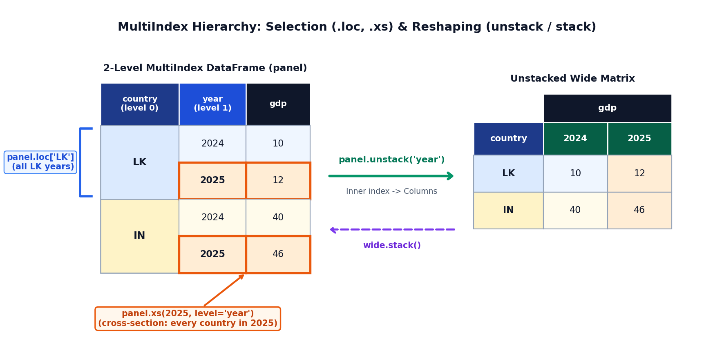
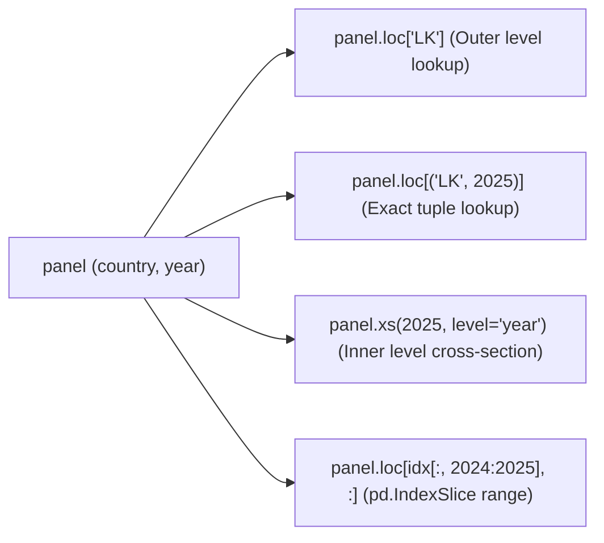

[⬅️ Module 13: Reshaping](13_Reshaping.md) | [🏠 Course Index](README.md) | [Module 15: Window Functions ➡️](15_Window_Functions.md)

---

# 🗂️ Module 14: MultiIndex & Hierarchical Data (බහු-මට්ටමේ දත්ත)

## 🎯 මේ පාඩමෙන් අපි මොනවද ඉගෙන ගන්නේ?
සාමාන්‍ය DataFrame එකක හැම row එකකටම තියෙන්නේ එක index එකක් (`0, 1, 2...` හෝ තනි නමක්). ඒත් සමහර වෙලාවට දත්ත තියෙන්නේ **මට්ටම් කිහිපයකින් (hierarchy)** — උදාහරණයක් විදියට `Country -> Year` හෝ `Province -> District -> City`.

මේ වගේ row index එකට හෝ column headers වලට මට්ටම් (levels) කිහිපයක් දෙන එකට තමයි **MultiIndex** (Hierarchical Index) කියන්නේ!

> [!TIP]
> **එදිනෙදා උදාහරණය (Real-life Analogy):**
> ඔයාගේ computer එකේ folders හිතන්න: `Sri_Lanka/2024`, `Sri_Lanka/2025`, `India/2024`, `India/2025`. එකම අවුරුද්ද (`2024`) රටවල් දෙක ඇතුළෙම තියෙනවා. ඒත් රටයි අවුරුද්දයි දෙකම එකතු කළාම (`('LK', 2024)`) ඒක හරියටම unique ලිපිනයක් වෙනවා! MultiIndex කියන්නෙත් අන්න ඒ වගේ folder structure එකක්.



---

## 1. MultiIndex එකක් හදන ක්‍රම (Creating a MultiIndex)

MultiIndex එකක් හදන්න ප්‍රධාන ක්‍රම 4 ක් තියෙනවා:

```python
import pandas as pd

# 1. MultiIndex.from_product() — හැම combination එකම ඉබේම හදනවා (Panel data වලට සුපිරි!)
idx = pd.MultiIndex.from_product(
    [['LK', 'IN'], [2024, 2025]],
    names=['country', 'year']
)
panel = pd.DataFrame({'gdp': [10, 12, 40, 46]}, index=idx)
print(panel)

# 2. DataFrame columns වලින්: set_index(['country', 'year'])
flat = pd.DataFrame({
    'country': ['LK', 'LK', 'IN', 'IN'],
    'year': [2024, 2025, 2024, 2025],
    'gdp': [10, 12, 40, 46]
})
panel2 = flat.set_index(['country', 'year'])

# 3. Tuples වලින්: MultiIndex.from_tuples()
idx_t = pd.MultiIndex.from_tuples([('LK', 'Colombo'), ('LK', 'Kandy'), ('IN', 'Delhi')],
                                  names=['country', 'city'])

# 4. Arrays වලින්: MultiIndex.from_arrays()
idx_a = pd.MultiIndex.from_arrays([['LK', 'LK', 'IN'], ['Colombo', 'Kandy', 'Delhi']],
                                  names=['country', 'city'])
```

**Expected Output (`panel`):**
```text
              gdp
country year     
LK      2024   10
        2025   12
IN      2024   40
        2025   46
```

---

## 2. Levels පරීක්ෂා කිරීම (Inspecting Levels)

MultiIndex එකක ඇතුළත තියෙන්නේ මොනවද කියලා බලන්න මේ properties පාවිච්චි කරනවා:

```python
print(panel.index.names)                     # ['country', 'year']
print(panel.index.nlevels)                   # 2 (levels ගණන)
print(panel.index.levels)                    # FrozenList([['IN', 'LK'], [2024, 2025]])
print(panel.index.get_level_values('year'))  # Index([2024, 2025, 2024, 2025], name='year')
```

---

## 3. Data තේරීම (Selecting & Slicing a Hierarchy)

MultiIndex එකකින් data ගන්න ක්‍රම 4 ක් තියෙනවා:



```python
# 1. Outer level එකෙන් ගන්න (සම්පූර්ණ LK දත්ත)
print(panel.loc['LK'])

# 2. Full-key tuple එකකින් හරියටම එක row එකක් ගන්න
print(panel.loc[('LK', 2025)])

# 3. Inner level එකකින් cross-section එකක් ගන්න: xs()
# හැම රටේම 2025 අවුරුද්දේ data විතරක්!
print(panel.xs(2025, level='year'))

# 4. pd.IndexSlice — Levels කිහිපයකින් එකපාර slice කරන්න!
panel = panel.sort_index()   # Slice කරන්න කලින් sort කරන්නම ඕනේ!
idx = pd.IndexSlice
print(panel.loc[idx[['IN', 'LK'], 2025], :])
```

**Expected Output (`panel.xs(2025, level='year')`):**
```text
         gdp
country     
LK        12
IN        46
```

### Boolean Filters & Updating Values
- **Boolean Filter on a Level:**
  ```python
  panel[panel.index.get_level_values('country') == 'LK']
  ```
- **Targeted Update with Tuples:**
  ```python
  panel.loc[('LK', 2025), 'gdp'] = 13
  ```

---

## 4. Sorting (වර්ගීකරණය) — අත්‍යවශ්‍ය පියවරක්!

MultiIndex එකක් slice කරන්න (`loc[idx[...]]`) කලින් ඒක sort වෙලා තියෙන්න ඕනේ. නැත්නම් `UnsortedIndexError` හෝ `PerformanceWarning` එනවා.

```python
print(panel.index.is_monotonic_increasing)  # True ද False ද බලන්න
panel = panel.sort_index()                  # සම්පූර්ණයෙන්ම sort කරන්න
panel = panel.sort_index(level='year')      # විශේෂිත level එකකින් sort කරන්න
```

---

## 5. Reordering, Renaming & Aggregating by Level

### Levels මාරු කිරීම සහ නම් වෙනස් කිරීම:
```python
panel.swaplevel('country', 'year')                  # level 0 සහ level 1 මාරු කරයි
panel.reorder_levels(['year', 'country'])           # කැමති පිළිවෙලට සකසයි
panel.rename_axis(['nation', 'yr'])                 # Index level නම් වෙනස් කරයි
panel.index = panel.index.set_names(['nation', 'yr'])
```

### Level එකක් අනුව GroupBy & Aggregate කිරීම:
කලින් Pandas versions වල `sum(level='country')` තිබුණත්, දැන් නිවැරදි නවීන ක්‍රමය තමයි **`groupby(level=...)`**:

```python
# රට අනුව මුළු GDP එක
print(panel.groupby(level='country').sum())

# රට ඇතුළත අවුරුද්දෙන් අවුරුද්ද වර්ධනය (Year-over-Year growth)
print(panel.groupby(level='country').pct_change())
```

**Expected Output (`pct_change()`):**
```text
                   gdp
country year          
LK      2024       NaN
        2025  0.200000
IN      2024       NaN
        2025  0.150000
```

---

## 6. Levels එහා මෙහා කිරීම, Dropping & Flattening

```python
# 1. Index level එකක් columns වලට යවන්න (Wide matrix)
wide = panel.unstack('year')
print(wide)

# 2. ආපහු rows වලට ගන්න
back = wide.stack(future_stack=True)

# 3. එක level එකක් විතරක් සාමාන්‍ය column එකක් කරන්න
panel.reset_index(level='year')

# 4. අනවශ්‍ය level එකක් සම්පූර්ණයෙන්ම අයින් කරන්න
panel.droplevel('year')

# 5. සම්පූර්ණයෙන්ම Flat DataFrame එකක් කරන්න
flat_again = panel.reset_index()
```

### Column MultiIndex (බහු-මට්ටමේ Column Headers)
ඔයා `groupby().agg(['sum', 'mean'])` හෝ `pd.concat([df1, df2], keys=['2024', '2025'], axis=1)` කළාම **Column MultiIndex** එකක් හැදෙනවා:

```python
sales = pd.DataFrame({
    'region': ['West', 'West', 'East', 'East'],
    'revenue': [100, 200, 150, 250],
    'profit': [20, 45, 30, 60]
})

agg_df = sales.groupby('region').agg({'revenue': ['sum', 'mean'], 'profit': ['sum']})
print("Before flattening:", agg_df.columns.tolist())
# [('revenue', 'sum'), ('revenue', 'mean'), ('profit', 'sum')]

# Flatten column MultiIndex -> සරල තනි names!
agg_df.columns = ['_'.join(col) for col in agg_df.columns]
agg_df = agg_df.reset_index()
print(agg_df)
```

**Expected Output:**
```text
  region  revenue_sum  revenue_mean  profit_sum
0   East          400         200.0          90
1   West          300         150.0          65
```

---

## 💡 Practical Advice: MultiIndex පාවිච්චි කරන්න ඕන කවදාද?
MultiIndex හරිම බලවත් වුණත්, හැමදේටම MultiIndex දාන්න යන්න එපා!
- **Keep MultiIndex:** Panel data (`entity, time`), `unstack`/`stack` කරන්න ඕන වෙලාවට, හෝ hierarchical reports හදද්දී.
- **Flatten it (`reset_index()`):** සාමාන්‍ය filtering, merging, charting සහ Machine Learning වලදී flat columns + `groupby()` පාවිච්චි කරන එක ගොඩක් පිරිසිදුයි, bugs අඩුයි!

---

## 🧠 මතක තබා ගැනීමට පහසු ක්‍රම (Memory Hacks)
- **`xs` = Cross-Section (හරස්කඩ)!** Outer level එක skip කරලා කෙලින්ම inner level එකෙන් slice එකක් කපලා ගන්න `xs()` පාවිච්චි කරන්න.
- **`unstack()` = අඩුක් කරපු පිඟන් ටික පැත්තට අතුරනවා වගේ!** (Rows → Columns). `stack()` කියන්නේ ආපහු උඩින් උඩින් අඩුක් කරනවා (Columns → Rows).
- **Tuples for exact cells:** MultiIndex එකේ exact row එකක් ගන්න හැමවෙලේම `('LK', 2025)` වගේ tuple එකක් දෙන්න.

---

## ⚠️ සාමාන්‍යයෙන් වෙන වැරදි (Common Pitfalls)

> [!WARNING]
> **1. Sort නොකර `pd.IndexSlice` වලින් Slice කිරීම!**
> MultiIndex එක sort වෙලා නැත්නම් `panel.loc[idx['IN':'LK', 2024:2025], :]` දුන්නම `UnsortedIndexError` එකක් එනවා. Slice කරන්න කලින් හැමවෙලේම `panel = panel.sort_index()` දාන්න.

> [!WARNING]
> **2. `df.loc['LK', 'gdp']` vs `df.loc[('LK', 2025), 'gdp']` පටලැවීම**
> Comma එකකින් වෙන් කරලා දෙන පළවෙනි argument එක තමයි **row index** එක; දෙවෙනි argument එක තමයි **column name** එක. MultiIndex row එකක් select කරද්දී ඒක අනිවාර්යයෙන්ම tuple එකක් ඇතුළේ `('LK', 2025)` විදියට දාන්න.

> [!WARNING]
> **3. `df.sum(level='country')` පාවිච්චි කිරීම**
> පරණ tutorials වල තියෙන `level=` parameter එක Pandas 2.x වල අයින් කරලා තියෙන්නේ. ඒ වෙනුවට හැමවෙලේම `df.groupby(level='country').sum()` ලියන්න.

---

## 🏋️ ප්‍රායෝගික අභ්‍යාස (Practical Exercises)

### Warm-up Exercise:
`MultiIndex.from_product([['Colombo', 'Kandy'], ['Q1', 'Q2']], names=['city', 'quarter'])` පාවිච්චි කරලා sales DataFrame එකක් හදලා `xs('Q2', level='quarter')` වලින් Q2 දත්ත විතරක් ගන්න.

<details>
<summary>✅ පිළිතුර බලන්න (Click to see Solution)</summary>

```python
import pandas as pd

idx = pd.MultiIndex.from_product([['Colombo', 'Kandy'], ['Q1', 'Q2']], names=['city', 'quarter'])
df = pd.DataFrame({'sales': [500, 620, 300, 380]}, index=idx)
print(df.xs('Q2', level='quarter'))
```
</details>

---

### Exercise 1:
Country (`LK`, `IN`, `SG`) සහ Year (`2023`, `2024`, `2025`) panel DataFrame එකක් හදලා, හැම රටක් ඇතුළෙම අවුරුද්දෙන් අවුරුද්ද GDP වර්ධන ප්‍රතිශතය (year-over-year growth) හොයන්න.

<details>
<summary>✅ පිළිතුර බලන්න (Click to see Solution)</summary>

```python
import pandas as pd

idx = pd.MultiIndex.from_product(
    [['LK', 'IN', 'SG'], [2023, 2024, 2025]],
    names=['country', 'year']
)
panel = pd.DataFrame({'gdp': [80, 84, 90, 3500, 3750, 4050, 480, 500, 525]}, index=idx)
panel['yoy_growth_%'] = (panel.groupby(level='country')['gdp'].pct_change() * 100).round(2)
print(panel)
```
</details>

---

### Exercise 2:
`pd.IndexSlice` පාවිච්චි කරලා එක call එකකින් රටවල් කිහිපයක (`['IN', 'LK']`) සහ අවුරුදු පරාසයක (`2024` සිට `2025`) data select කරන්න.

<details>
<summary>✅ පිළිතුර බලන්න (Click to see Solution)</summary>

```python
import pandas as pd

idx_mi = pd.MultiIndex.from_product(
    [['LK', 'IN', 'SG'], [2023, 2024, 2025]],
    names=['country', 'year']
)
panel = pd.DataFrame({'gdp': [80, 84, 90, 3500, 3750, 4050, 480, 500, 525]}, index=idx_mi)

# Sort first!
panel = panel.sort_index()
slc = pd.IndexSlice
subset = panel.loc[slc[['IN', 'LK'], 2024:2025], :]
print(subset)
```
</details>

---

### Exercise 3:
`groupby().agg(['sum', 'mean'])` වලින් හැදෙන Column MultiIndex එක flatten කරලා සාමාන්‍ය තනි-level columns බවට පත් කරන්න.

<details>
<summary>✅ පිළිතුර බලන්න (Click to see Solution)</summary>

```python
import pandas as pd

df = pd.DataFrame({
    'dept': ['IT', 'IT', 'HR', 'HR'],
    'salary': [120, 150, 90, 110],
    'bonus': [15, 20, 10, 12]
})

summary = df.groupby('dept').agg(['sum', 'mean'])
summary.columns = ['_'.join(col) for col in summary.columns]
summary = summary.reset_index()
print(summary)
```
</details>

---

## 📋 Cheat Sheet Summary

| Task | Key API | කෙටි විස්තරය |
| --- | --- | --- |
| Create MultiIndex | `set_index([a, b])`, `MultiIndex.from_product(...)` | Columns හෝ combinations වලින් හදයි |
| Inspect | `index.names`, `index.levels`, `get_level_values('a')`, `nlevels` | Levels විස්තර බලයි |
| Outer Lookup | `df.loc['LK']` | පළවෙනි level එකෙන් තෝරයි |
| Exact Lookup / Edit | `df.loc[('LK', 2025), 'gdp']` | Tuple එකකින් හරියටම cell එකක් ගනී |
| Inner Cross-Section | `df.xs(2025, level='year')` | ඕනෑම inner level එකකින් තෝරයි |
| Multi-Level Slicing | `idx = pd.IndexSlice; df.loc[idx[:, 2024:2025], :]` | Levels කිහිපයක් එකපාර slice කරයි |
| Sort Index | `df.sort_index()`, `is_monotonic_increasing` | Slice කිරීමට පෙර sort කරයි |
| Reorder / Rename | `swaplevel`, `reorder_levels`, `rename_axis`, `set_names` | Levels පිළිවෙල හා නම් වෙනස් කරයි |
| Aggregate by Level | `df.groupby(level='country').sum()` | Level එකක් අනුව එකතු කරයි |
| Reshape / Flatten | `unstack()`, `stack()`, `droplevel()`, `reset_index()` | Index ↔ Columns / Flat DataFrame |

---

[⬅️ Module 13: Reshaping](13_Reshaping.md) | [🏠 Course Index](README.md) | [Module 15: Window Functions ➡️](15_Window_Functions.md)
