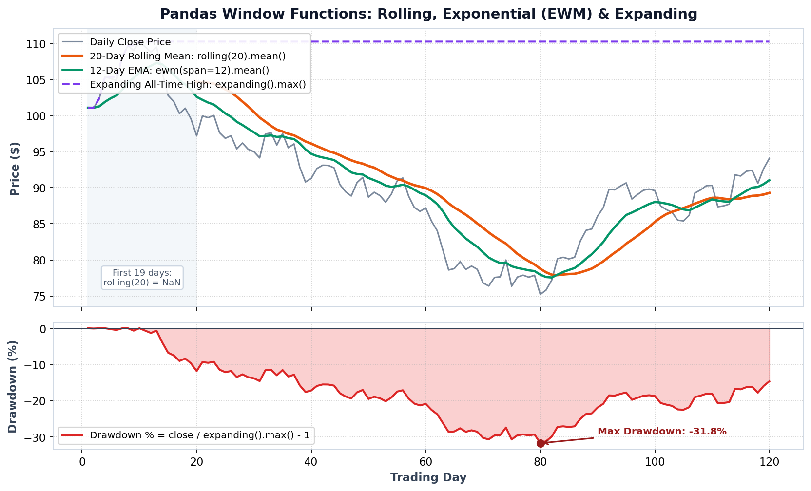
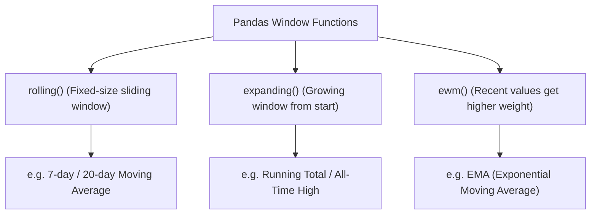

[⬅️ Module 14: MultiIndex & Hierarchical Data](14_MultiIndex_and_Hierarchical_Data.md) | [🏠 Course Index](README.md) | [Module 16: Visualization & Styler ➡️](16_Visualization_and_Styler.md)

---

# 🪟 Module 15: Window Functions (චලනය වන කවුළු ගණනය කිරීම්)

## 🎯 මේ පාඩමෙන් අපි මොනවද ඉගෙන ගන්නේ?
කොටස් වෙළඳපොළේ (Stock Market) මිල ගණන් හෝ දෛනික විකුණුම් (Daily Sales) දවසින් දවස උඩ පහළ යනවා. ඒ නිසා එක දවසක අගය විතරක් බලලා trend එක කියන්න අමාරුයි. ඒ වෙනුවට අපි බලන්නේ **"පහුගිය දවස් 7 සාමාන්‍යය" (7-day moving average)** හෝ **"මෙතෙක් වාර්තා වූ ඉහළම අගය" (All-time high)**.

මේ විදියට data rows කිහිපයක් උඩින් ජනේලයක් (window) වගේ ලිස්සලා ගිහින් ගණනය කිරීම් කරන functions වලට තමයි **Window Functions** කියන්නේ!

> [!TIP]
> **එදිනෙදා උදාහරණය (Real-life Analogy):**
> ක්‍රිකට් match එකක ක්‍රීඩකයෙක්ගේ form එක බලන හැටි හිතන්න:
> - **Rolling Window:** "අන්තිම ඉනිම් 5 තුළ සාමාන්‍ය ලකුණු" (හැම match එකකදීම අලුත් match එක එකතු වෙලා පරණම එක අයින් වෙනවා).
> - **Expanding Window:** "මුළු career එකේම මෙතෙක් ලබාගත් ඉහළම ලකුණු" (මුල ඉඳන් අද වෙනකම් window එක ලොකු වෙනවා).
> - **EWM (Exponentially Weighted):** අන්තිම match එකට වැඩි බරක් (weight) දීලා, පරණ matches වලට අඩු බරක් දීලා form එක මනිනවා.



---

## 1. Window වර්ග 3 (The Three Window Types)



---

## 2. Rolling Windows (`rolling()`) — ස්ථාවර ප්‍රමාණයේ ලිස්සන කවුළුව

`rolling(window)` වලින් කලින් rows $N$ ගාණක් අරගෙන `mean`, `sum`, `std`, `var`, `min`, `max`, `median`, `quantile`, `count`, `corr`, `cov`, `skew`, `kurt`, `apply` වගේ ඕනෑම calculation එකක් කරන්න පුළුවන්.

```python
import pandas as pd

df = pd.DataFrame({
    'date': pd.date_range('2025-01-01', periods=25, freq='D'),
    'close': [100, 102, 101, 104, 106, 105, 108, 110, 109, 112,
              115, 114, 113, 116, 118, 117, 120, 122, 121, 125,
              124, 126, 128, 127, 130]
})
price = df.set_index('date')['close']

features = pd.DataFrame({
    'close': price,
    'ma20': price.rolling(20).mean(),                        # 20-day Moving Average
    'vol20': price.pct_change().rolling(20).std(),           # 20-day Volatility
    'ema12': price.ewm(span=12, adjust=False).mean(),        # 12-day EMA
    'high_to_date': price.expanding().max(),                 # All-Time High so far
    'ret_1d': price.pct_change(),                            # 1-day return (%)
    'lag_5': price.shift(5),                                 # Price 5 days ago
})

features['drawdown'] = features['close'] / features['high_to_date'] - 1
print(features.tail(4).round(4))
```

**පේළියෙන් පේළිය විස්තරය:**
- `rolling(20).mean()`: පහුගිය දවස් 20 සාමාන්‍යය. මුල් දවස් 19 වල `NaN` එනවා (මොකද දවස් 20 ක් සම්පූර්ණ නැති නිසා). ඒකට `min_periods=1` දුන්නොත් මුල් දවසේ ඉඳන්ම ගණනය වෙනවා!
- `center=True`: Window එක මැදට තියලා (ඉස්සරහයි පස්සයි දෙපැත්තෙන්ම අරගෙන) smooth කරන්න.
- `closed='left'` / `'right'` / `'both'`: Window එකේ කෙළවරවල් ඇතුළත් කරන විදිය තීරණය කරයි.
- `features['drawdown']`: අද මිල, මෙතෙක් තිබුණු ඉහළම මිලට (`high_to_date`) වඩා කොච්චර ප්‍රතිශතයක් පහළින්ද තියෙන්නේ කියලා බලනවා (0.0 නම් අද තමයි අලුත් All-Time High එක!).

**Expected Output (last 4 rows):**
```text
            close    ma20   vol20     ema12  high_to_date  ret_1d  lag_5  drawdown
date                                                                              
2025-01-22    126  115.25  0.0149  121.0289         126.0  0.0161  120.0    0.0000
2025-01-23    128  116.60  0.0147  122.1014         128.0  0.0159  122.0    0.0000
2025-01-24    127  117.75  0.0145  122.8550         128.0 -0.0078  121.0   -0.0078
2025-01-25    130  118.95  0.0145  123.9542         130.0  0.0236  125.0    0.0000
```

### Time-Based Windows (කාලය මත පදනම් වූ Windows)
Timestamps අක්‍රමවත්ව (irregular) තියෙනකොට — උදාහරණයක් විදියට සමහර දවස් වල transactions 5 ක්, සමහර දවස් වල 0 ක් — rows ගාණක් වෙනුවට **කාල සීමාවක්** දෙන්න පුළුවන්!
```python
# DatetimeIndex එකක් මත දින 30 ක window එකක්
price.rolling('30D').mean()

# Index එක datetime නොවේ නම් on='ts' column එක දෙන්න
df.rolling('1h', on='ts')['amount'].sum()
```

### Custom Windows & Speeding Up with Numba
- **Weighted Gaussian Window:** `price.rolling(7, win_type='gaussian').mean(std=2)`
- **Custom Function (`apply`):** `price.rolling(5).apply(lambda arr: arr.max() - arr.min(), raw=True)` (`raw=True` දැම්මම NumPy array එකක් යන නිසා ගොඩක් වේගවත්!).
- **Forward-looking / Custom Indexer:** `pd.api.indexers.FixedForwardWindowIndexer(window_size=5)` (හෝ `BaseIndexer` subclass කරලා) ඉදිරි දවස් 5 බලන්න පුළුවන්.
- **Numba Engine:** ලොකු datasets වලදී `price.rolling(20).mean(engine='numba')` පාවිච්චි කළොත් speed එක සෑහෙන්න වැඩි වෙනවා.

---

## 3. Expanding Windows (`expanding()`) — මුල ඉඳන් වර්ධනය වන කවුළුව

Window එක පළවෙනි row එකේ ඉඳන් පටන් අරගෙන හැම row එකක් ගානෙම ලොකු වෙනවා.
```python
price.expanding(min_periods=1).mean()  # මෙතෙක් සාමාන්‍යය (Running Average)
price.expanding().max()                # මෙතෙක් ඉහළම අගය (All-Time High)
price.expanding().sum()                # මෙතෙක් මුළු එකතුව (Running Sum)
```

---

## 4. Exponentially Weighted Windows (`ewm()`) — අලුත් දත්ත වලට වැඩි බරක්!

සාමාන්‍ය moving average එකක දවස් 20 කට කලින් මිලයි ඊයේ මිලයි දෙකටම දෙන්නේ එකම බර (equal weight). ඒත් `ewm()` වලදී **මෑත අගයන් වලට වැඩි බරක්** දෙනවා. ඒ නිසා trend වෙනස්වීම් ඉක්මනින්ම අල්ලගන්නවා!

```python
# Finance වල සුප්‍රසිද්ධ 12-day EMA
ema12 = price.ewm(span=12, adjust=False).mean()

# වෙනත් parameters: halflife (බර භාගයක් වෙන්න යන කාලය), alpha (0 < alpha <= 1)
ewm_std = price.ewm(halflife=5).std()
```

---

## 5. Pairwise, Grouped, Shift & Cumulative Helpers

### A) Pairwise Rolling Correlation (`corr`)
Stocks දෙකක් (උදා: Apple සහ Microsoft) පහුගිය දවස් 60 තුළ එකටද ගමන් කළේ කියලා බලන්න:
```python
rolling_corr = stock_a.rolling(60).corr(stock_b)
ewm_corr = stock_a.ewm(span=30).corr(stock_b)
```

### B) Grouped Windows (`groupby().rolling()`)
එකම table එකේ customers ලා ගොඩක් ඉන්නකොට, එක් එක් customer ඇතුළත වෙන වෙනම rolling average හොයන්න:
```python
orders = pd.DataFrame({
    'customer': ['A', 'A', 'A', 'B', 'B', 'B'],
    'amount': [100, 150, 200, 50, 80, 70]
})
orders['ma2'] = (orders.groupby('customer')['amount']
                       .rolling(2)
                       .mean()
                       .reset_index(level=0, drop=True))
```

### C) Shift-Based Features (Lags, Leads, Diff, Pct Change)
Time-series forecasting / ML features හදන්න නැතුවම බැරි functions:
```python
price.shift(1)               # Lag: ඊයේ අගය (1 row පහළට තල්ලු කරයි)
price.shift(-1)              # Lead: හෙට අගය (1 row උඩට අදියි)
price.diff(1)                # අද - ඊයේ වෙනස
price.pct_change(periods=1)  # ප්‍රතිශත වෙනස: (අද - ඊයේ) / ඊයේ
```

### D) Rank & Cumulative Helpers (Position-Based)
```python
orders['running_total'] = orders.groupby('customer')['amount'].cumsum()
orders['running_max']   = orders.groupby('customer')['amount'].cummax()
orders['order_num']     = orders.groupby('customer').cumcount() + 1  # 1, 2, 3...
orders['rank_in_cust']  = orders.groupby('customer')['amount'].rank(ascending=False)
```

---

## 🧠 මතක තබා ගැනීමට පහසු ක්‍රම (Memory Hacks)
- **`rolling` = කෝච්චියක ජනේලය!** ජනේලයේ පළල හැමවෙලේම එකයි (උදා: දවස් 7), හැබැයි ඉස්සරහට යද්දී පේන දර්ශනය වෙනස් වෙනවා.
- **`expanding` = බැලූනයක් පිම්බෙනවා වගේ!** මුල ඉඳන් දිගටම ලොකු වෙනවා, පරණ දත්ත කවදාවත් අයින් වෙන්නේ නෑ.
- **`shift(+1)` vs `shift(-1)`**: `+1` කියන්නේ අතීතය (Lag — ඊයේ අගය අද row එකට ගේනවා). `-1` කියන්නේ අනාගතය (Lead — ML models වල feature එකක් විදියට දැම්මොත් **Data Leakage** වෙනවා!).

---

## ⚠️ සාමාන්‍යයෙන් වෙන වැරදි (Common Pitfalls)

> [!WARNING]
> **1. Data Sort නොකර `rolling()` හෝ `shift()` කිරීම!**
> Window functions වැඩ කරන්නේ table එකේ rows තියෙන පිළිවෙලට. Date/Time අනුව sort වෙලා නැත්නම් සම්පූර්ණ ගණනය කිරීමම වැරදියි! හැමවෙලේම `df = df.sort_values('date')` කරලා පටන් ගන්න.

> [!WARNING]
> **2. ML Models වලදී `center=True` හෝ `shift(-1)` පාවිච්චි කිරීම (Data Leakage!)**
> ඔයා අනාගත මිලක් predict කරන model එකක් හදනවා නම්, `center=True` දැම්මොත් අනාගත දවස් වල data අද row එකට leak වෙනවා! Forecasting වලදී හැමවෙලේම default `center=False` තියාගන්න.

> [!WARNING]
> **3. `groupby().rolling()` වල Index Mismatch එක**
> `df.groupby('k')['v'].rolling(3).mean()` වලින් MultiIndex Series එකක් එන නිසා කෙලින්ම `df['ma'] = ...` කියලා දැම්මොත් error එන්න පුළුවන්. `.reset_index(level=0, drop=True)` හෝ `groupby('k')['v'].transform(lambda s: s.rolling(3).mean())` පාවිච්චි කරන්න.

---

## 🏋️ ප්‍රායෝගික අභ්‍යාස (Practical Exercises)

### Warm-up Exercise:
දවස් 10 ක උෂ්ණත්වය (`[28, 30, 29, 31, 33, 32, 30, 29, 31, 34]`) සඳහා 3-day rolling average සහ expanding max එක හොයන්න.

<details>
<summary>✅ පිළිතුර බලන්න (Click to see Solution)</summary>

```python
import pandas as pd

temp = pd.Series([28, 30, 29, 31, 33, 32, 30, 29, 31, 34], name='temp')
res = pd.DataFrame({
    'temp': temp,
    'ma3': temp.rolling(3).mean().round(2),
    'max_so_far': temp.expanding().max()
})
print(res)
```
</details>

---

### Exercise 1:
දෛනික විකුණුම් (daily sales) වල 7-day සහ 30-day moving averages හොයලා, short average (`ma7`) එක long average (`ma30`) එකට වඩා ඉහළින් කැපිලා යන (crosses above — Golden Cross!) දවස් flag කරන්න.

<details>
<summary>✅ පිළිතුර බලන්න (Click to see Solution)</summary>

```python
import pandas as pd
import numpy as np

np.random.seed(1)
dates = pd.date_range('2025-01-01', periods=60, freq='D')
sales = pd.Series(100 + np.cumsum(np.random.randn(60) * 3), index=dates, name='sales')

df = pd.DataFrame({'sales': sales})
df['ma7'] = df['sales'].rolling(7).mean()
df['ma30'] = df['sales'].rolling(30).mean()

# Cross above: අද ma7 > ma30 වෙලා, ඊයේ ma7 <= ma30 තිබුණු දවස්!
df['cross_above'] = (df['ma7'] > df['ma30']) & (df['ma7'].shift(1) <= df['ma30'].shift(1))
print(df[df['cross_above']])
```
</details>

---

### Exercise 2:
Stocks දෙකක් අතර 60-day rolling correlation එක ගණනය කරන්න.

<details>
<summary>✅ පිළිතුර බලන්න (Click to see Solution)</summary>

```python
import pandas as pd
import numpy as np

np.random.seed(42)
dates = pd.date_range('2025-01-01', periods=100, freq='D')
market = np.random.randn(100)
stock_a = pd.Series(100 + np.cumsum(market + np.random.randn(100) * 0.5), index=dates)
stock_b = pd.Series(50 + np.cumsum(market * 0.8 + np.random.randn(100) * 0.7), index=dates)

# Daily returns වල rolling correlation හොයන එක finance වල best practice!
ret_a = stock_a.pct_change()
ret_b = stock_b.pct_change()
corr_60 = ret_a.rolling(60).corr(ret_b)
print(corr_60.dropna().tail(5).round(3))
```
</details>

---

### Exercise 3:
එක් එක් customer ගේ running total of spend (මෙතෙක් වියදම් කළ මුළු මුදල) සහ customer ඇතුළත order අංකය (`1, 2, 3...`) ගණනය කරන්න.

<details>
<summary>✅ පිළිතුර බලන්න (Click to see Solution)</summary>

```python
import pandas as pd

orders = pd.DataFrame({
    'customer_id': ['C1', 'C2', 'C1', 'C1', 'C2'],
    'order_date': pd.to_datetime(['2025-01-01', '2025-01-02', '2025-01-05', '2025-01-10', '2025-01-12']),
    'spend': [120, 300, 80, 200, 150]
})

orders = orders.sort_values(['customer_id', 'order_date'])
orders['running_spend'] = orders.groupby('customer_id')['spend'].cumsum()
orders['order_number'] = orders.groupby('customer_id').cumcount() + 1
print(orders)
```
</details>

---

## 📋 Cheat Sheet Summary

| Task | Key API | කෙටි විස්තරය |
| --- | --- | --- |
| Sliding Window | `s.rolling(20, min_periods=1).mean()` | ස්ථාවර rows ගාණක moving stats |
| Time-Based Window | `s.rolling('30D').mean()`, `df.rolling('1h', on='ts')` | කාල සීමාවක් මත rolling stats |
| Custom / Fast Window | `rolling(5).apply(fn, raw=True)`, `engine='numba'` | Custom functions & high speed |
| Growing Window | `s.expanding().max()` / `.mean()` / `.sum()` | මුල සිට මෙතෙක් ගණනය කිරීම් |
| Exponentially Weighted | `s.ewm(span=12, adjust=False).mean()` | අලුත් අගයන්ට වැඩි බරක් (EMA) |
| Rolling Correlation | `s1.rolling(60).corr(s2)` | Series දෙකක් අතර සම්බන්ධය |
| Per-Group Window | `df.groupby('k')['v'].rolling(3).mean()` | Group එකක් ඇතුළත rolling |
| Lag / Lead / Diff | `shift(n)`, `diff()`, `pct_change(periods=)` | කලින් අගයන් සහ වෙනස්කම් |
| Cumulative & Rank | `cumsum()`, `cummax()`, `cumcount()`, `rank()` | Running totals & order numbers |

---

[⬅️ Module 14: MultiIndex & Hierarchical Data](14_MultiIndex_and_Hierarchical_Data.md) | [🏠 Course Index](README.md) | [Module 16: Visualization & Styler ➡️](16_Visualization_and_Styler.md)
