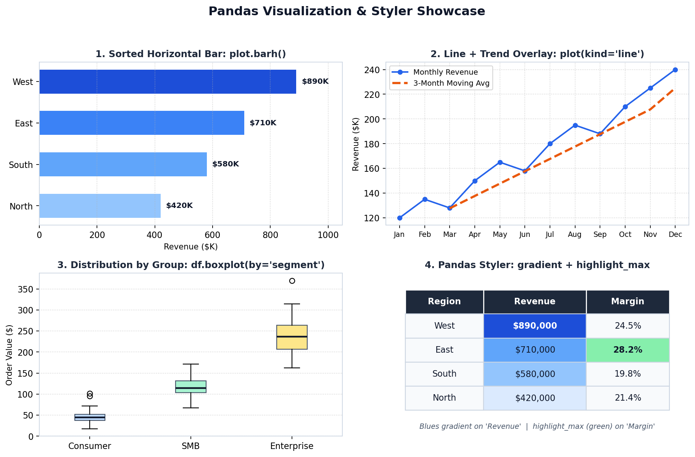
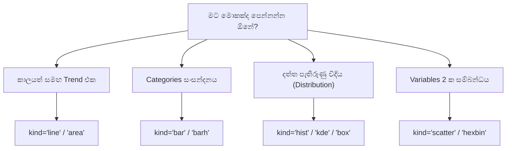

[⬅️ Module 15: Window Functions](15_Window_Functions.md) | [🏠 Course Index](README.md) | [Module 17: Performance, Memory & Scaling ➡️](17_Performance_Memory_and_Scaling.md)

---

# 📊 Module 16: Visualization & Styler (ප්‍රස්ථාර සහ අලංකාර වගු)

## 🎯 මේ පාඩමෙන් අපි මොනවද ඉගෙන ගන්නේ?
අංක පේළි 1000 ක් දිහා බලලා තේරුම් ගන්න බැරි දෙයක් එක chart එකකින් තත්පර 2 කින් තේරුම් ගන්න පුළුවන්! Pandas ඇතුළෙම Matplotlib wrap කරලා තියෙන නිසා තනි පේළියකින් quick charts අඳින්න පුළුවන්. ඒ විතරක් නෙවෙයි, **Pandas Styler** පාවිච්චි කරලා Excel වල වගේ පාට පාට, heatmaps සහ progress bars තියෙන ලස්සන tables හදලා HTML/Excel වලට export කරන්නත් පුළුවන්!

> [!TIP]
> **එදිනෙදා උදාහරණය (Real-life Analogy):**
> ඔයා boss ට හෝ teacher ට presentation එකක් කරද්දී කළු සුදු අංක ගොඩක් පෙන්නනවට වඩා, වැඩිම විකුණුම් තියෙන පළාත කොළ පාටින් highlight කරලා, මාසික වර්ධනය line chart එකකින් පෙන්නුවම කොච්චර පැහැදිලිද? **`.plot()`** සහ **`.style`** කරන්නේ අන්න ඒ වැඩේ!



---

## 1. කුමන Chart එකද තෝරගන්නේ? (Choosing the Right Plot)



---

## 2. Pandas Plot Basics & Customizing with Matplotlib

Series එකකින් හෝ DataFrame එකකින් කෙලින්ම `.plot()` call කරන්න පුළුවන්. ඒකෙන් return වෙන්නේ Matplotlib `Axes` (`ax`) object එකක්. ඒ නිසා ඊට පස්සේ `ax.set_xlabel()`, `plt.tight_layout()`, `plt.savefig()` වගේ Matplotlib commands දාලා ලස්සනට customize කරන්න පුළුවන්!

```python
import pandas as pd
import matplotlib.pyplot as plt

df = pd.DataFrame({
    'region': ['West', 'East', 'North', 'South', 'West', 'East'],
    'revenue': [450, 380, 420, 580, 440, 330]
})

# Sorted Horizontal Bar Chart + Save as PNG
ax = (df.groupby('region')['revenue'].sum()
        .sort_values()
        .plot.barh(title='Revenue by Region', figsize=(7, 4), color='#2563EB'))

ax.set_xlabel('Revenue')
ax.set_ylabel('Region')
plt.tight_layout()
plt.savefig('revenue.png', dpi=150)
plt.show()
```

**පේළියෙන් පේළිය විස්තරය:**
- `.sort_values()`: Horizontal bar chart එකේ ලොකුම bar එක උඩින්ම එන්න sort කරනවා (කියවන්න හරිම ලේසියි).
- `.plot.barh(...)`: `plot(kind='barh')` ලියන කෙටි ක්‍රමය.
- `plt.tight_layout()`: Labels කැපිලා යන්නේ නැති වෙන්න ඉඩ හදනවා.
- `plt.savefig('revenue.png', dpi=150)`: හොඳ quality එකකින් image එක save කරනවා.

---

## 3. හැම Chart වර්ගයක්ම එක පෙළට (All Built-in Plot Types)

1. **Line & Area Charts (Trends over time):**
   ```python
   ts_df.plot(kind='line', figsize=(8, 4), title='Monthly Sales')
   ts_df.plot(kind='area', alpha=0.4)               # යට කොටස පාට කරයි
   ts_df.plot(subplots=True, figsize=(8, 6))        # හැම column එකටම වෙනම chart
   ts_df.plot(y=['revenue', 'orders'], secondary_y='orders')  # දකුණු පැත්තේ 2වෙනි Y-axis එකක්!
   ```

2. **Bar Charts (Compare categories):**
   ```python
   df.plot(kind='bar')                   # සිරස් බාර්
   df.plot(kind='barh', stacked=True)    # තිරස් stacked බාර්
   ```

3. **Distributions (Spread, Outliers & Skew):**
   ```python
   df['price'].plot(kind='hist', bins=20)   # Histogram
   df['price'].plot(kind='kde')             # Smooth density curve
   df['price'].plot(kind='box')             # Boxplot (outliers බලන්න සුපිරි!)
   df.hist(figsize=(9, 6), bins=15)         # හැම numeric column එකටම histogram grid එකක්
   ```

4. **Relationships (Variable Pairs):**
   ```python
   df.plot(kind='scatter', x='ad_spend', y='revenue')
   df.plot(kind='hexbin', x='ad_spend', y='revenue', gridsize=20)  # Points ලක්ෂ ගාණක් තියෙනකොට!
   pd.plotting.scatter_matrix(df[['ad_spend', 'revenue', 'orders']], figsize=(7, 7))
   ```

5. **Part of Whole (Shares):**
   ```python
   # Pie charts භාවිතා කරන්නේ categories 3-4 ක් වගේ පොඩි ගාණක් තියෙනකොට විතරයි!
   df.groupby('region')['revenue'].sum().plot(kind='pie', autopct='%1.1f%%')
   ```

6. **Grouped Plots (Compare segments):**
   ```python
   # Group එකෙන් group එකට lines
   sales.groupby('segment')['revenue'].plot(legend=True)

   # Segment අනුව Boxplots
   orders.boxplot(column='order_value', by='segment', figsize=(7, 4))
   ```

7. **Specialised Pandas Plots (`pd.plotting`):**
   - `pd.plotting.lag_plot(series)` — Time series එකේ අද අගයයි ඊයේ අගයයි අතර රටාවක් තියෙනවද බලන්න.
   - `pd.plotting.autocorrelation_plot(series)` — Time series seasonality / autocorrelation check කරන්න.
   - `pd.plotting.parallel_coordinates(df, 'class')`, `andrews_curves`, `radviz` — High-dimensional multivariate data බලන්න.

8. **Interactive Plotting Backends & Companion Libraries:**
   ```python
   # Matplotlib වෙනුවට Plotly interactive charts පාවිච්චි කරන්න (plotly install කරලා තියෙන්න ඕනේ):
   pd.options.plotting.backend = 'plotly'
   df.plot.line()  # දැන් zoom / hover කරන්න පුළුවන් interactive chart එකක් එනවා!
   ```
   - **Companion Libraries:**
     - **Matplotlib**: සම්පූර්ණ low-level පාලනය.
     - **Seaborn**: ලස්සන statistical charts ලේසියෙන්ම.
     - **Plotly / Altair**: Interactive web dashboards & tooltips.

---

## 4. Pandas Styler (`df.style`) — වගු අලංකාර කිරීම!

Jupyter Notebook වල, HTML reports වල, සහ Excel sheets වල DataFrames ලස්සනට format කරලා highlight කරන්න **`df.style`** පාවිච්චි කරනවා.

```python
summary = pd.DataFrame({
    'region': ['West', 'East', 'South', 'North'],
    'revenue': [890000, 710000, 580000, 420000],
    'margin': [0.245, 0.282, 0.198, 0.214]
}).set_index('region')

styled = (
    summary.style
    .format({'revenue': '${:,.0f}', 'margin': '{:.1%}'})        # Numbers format කරන්න
    .background_gradient(subset=['revenue'], cmap='Blues')      # Color heatmap gradient
    .highlight_max(subset=['margin'], color='lightgreen')       # වැඩිම margin එක කොළ පාටින්!
    .highlight_null(color='mistyrose')                          # Missing values (NaN) රතු පාටින්
)
```

### Advanced Styler Methods & Exporting:
- **In-cell Progress Bars:** `summary.style.bar(subset=['revenue'], color='#60A5FA')`
- **Custom Cell Coloring (`map` & `apply`):**
  ```python
  def color_low_margin(val):
      return 'color: red; font-weight: bold' if val < 0.20 else ''

  styled = styled.map(color_low_margin, subset=['margin'])
  ```
- **CSS Styling (`set_properties`, `set_table_styles`):**
  ```python
  styled = styled.set_properties(**{'text-align': 'right', 'border': '1px solid #ddd'})
  ```
- **Export කිරීම (`to_html`, `to_latex`, `to_excel`):**
  ```python
  styled.to_html('report.html')          # Web browser එකේ open කරන්න පුළුවන්!
  styled.to_excel('report.xlsx')         # පාට ටිකත් එක්කම Excel එකට යනවා!
  latex_code = styled.to_latex()         # Research papers වලට
  ```

---

## 5. Display Options (Notebook වල පේන විදිය පාලනය)

DataFrame එකේ columns 50 ක් තියෙනකොට මැද `...` වැටිලා හැංගෙනවද? ඒක හදාගන්න display options තියෙනවා:

```python
# Global setting
pd.set_option('display.max_rows', 100)
pd.set_option('display.max_columns', 50)
pd.set_option('display.float_format', '{:,.2f}'.format)

# තාවකාලිකව විතරක් (මේ block එක ඇතුළේ විතරයි වෙනස් වෙන්නේ!)
with pd.option_context('display.max_rows', 200, 'display.max_columns', None):
    print(large_df)
```

---

## 🧠 මතක තබා ගැනීමට පහසු ක්‍රම (Memory Hacks)
- **`barh` > `bar`:** Category නම් දිගයි නම් හැමවෙලේම `barh` (horizontal) අඳින්න — නම් ඇලවෙන්නේ නැතුව කෙලින්ම කියවන්න පුළුවන්!
- **`df.style` = DataFrame එකේ Makeup එක!** DataFrame එකේ ඇත්ත අංක වෙනස් වෙන්නේ නෑ; පේන විදිය විතරයි ලස්සන වෙන්නේ.
- **`option_context`** පාවිච්චි කළාම මුළු notebook එකේම settings අවුල් වෙන්නේ නැතුව තාවකාලිකව ලොකු table එකක් print කරලා බලන්න පුළුවන්.

---

## ⚠️ සාමාන්‍යයෙන් වෙන වැරදි (Common Pitfalls)

> [!WARNING]
> **1. `df.style` object එක DataFrame එකක් කියලා හිතලා `.head()` හෝ `.sum()` කිරීම!**
> `df.style` return කරන්නේ `Styler` object එකක් මිසක් DataFrame එකක් නෙවෙයි. ඒ නිසා හැම calculation එකක්ම සහ filtering එකක්ම ඉවර කරලා **අන්තිම පියවරේදී** විතරක් `.style` දාන්න.

> [!WARNING]
> **2. `plt.show()` වලට පස්සේ `plt.savefig()` call කිරීම!**
> `plt.show()` කළාට පස්සේ Matplotlib figure එක clear කරනවා. එතකොට `plt.savefig()` වලින් save වෙන්නේ **සුදු පාට හිස් පින්තූරයක්**! හැමවෙලේම `plt.savefig()` ඉස්සෙල්ලා දාලා ඊට පස්සේ `plt.show()` දාන්න.

> [!WARNING]
> **3. `background_gradient()` වලට `matplotlib` නැතුව run කිරීම**
> `background_gradient(cmap='Blues')` වැඩ කරන්න Matplotlib install වෙලා තියෙන්න ඕනේ. ඒ වගේම string/text columns වලට gradient දාන්න බැරි නිසා හැමවෙලේම `subset=['numeric_col']` දෙන්න.

---

## 🏋️ ප්‍රායෝගික අභ්‍යාස (Practical Exercises)

### Warm-up Exercise:
Product 4 ක (`Laptop`, `Phone`, `Tablet`, `Watch`) විකුණුම් අගයන් sort කරලා Horizontal Bar Chart (`plot.barh`) එකක් ඇඳලා title එකක් දාන්න.

<details>
<summary>✅ පිළිතුර බලන්න (Click to see Solution)</summary>

```python
import pandas as pd
import matplotlib.pyplot as plt

sales = pd.Series({'Laptop': 450, 'Phone': 720, 'Tablet': 280, 'Watch': 340})
ax = sales.sort_values().plot.barh(title='Units Sold by Product', color='#059669')
ax.set_xlabel('Units Sold')
plt.tight_layout()
plt.show()
```
</details>

---

### Exercise 1:
මාසික ආදායම (monthly revenue) line chart එකක් විදියට ඇඳලා, ඒක උඩින්ම 3-month moving average එක overlay කරන්න.

<details>
<summary>✅ පිළිතුර බලන්න (Click to see Solution)</summary>

```python
import pandas as pd
import matplotlib.pyplot as plt

months = pd.date_range('2025-01-01', periods=12, freq='ME')
df = pd.DataFrame({
    'revenue': [120, 135, 128, 150, 165, 158, 180, 195, 188, 210, 225, 240]
}, index=months)

df['ma_3m'] = df['revenue'].rolling(3).mean()

ax = df['revenue'].plot(kind='line', marker='o', figsize=(9, 4), label='Monthly Revenue')
df['ma_3m'].plot(ax=ax, linestyle='--', linewidth=2.5, color='orange', label='3-Month MA')

ax.set_title('Monthly Revenue with 3-Month Moving Average')
ax.set_ylabel('Revenue ($K)')
ax.legend()
plt.tight_layout()
plt.show()
```
</details>

---

### Exercise 2:
Customer `segment` එක අනුව `order_value` වල boxplots අඳින්න.

<details>
<summary>✅ පිළිතුර බලන්න (Click to see Solution)</summary>

```python
import pandas as pd
import numpy as np
import matplotlib.pyplot as plt

np.random.seed(7)
orders = pd.DataFrame({
    'segment': ['Consumer']*50 + ['SMB']*50 + ['Enterprise']*50,
    'order_value': np.concatenate([
        np.random.normal(50, 12, 50),
        np.random.normal(120, 25, 50),
        np.random.normal(250, 45, 50),
    ])
})

ax = orders.boxplot(column='order_value', by='segment', figsize=(7, 4), grid=True)
ax.set_title('Order Value by Customer Segment')
plt.suptitle('')  # Default pandas suptitle එක අයින් කරන්න
ax.set_ylabel('Order Value ($)')
plt.tight_layout()
plt.show()
```
</details>

---

### Exercise 3:
Summary table එකක් thousands separators (`,`), color gradient එකක්, සහ maximum value එක highlight කරලා style කරන්න; ඊට පස්සේ HTML file එකකට export කරන්න.

<details>
<summary>✅ පිළිතුර බලන්න (Click to see Solution)</summary>

```python
import pandas as pd

summary = pd.DataFrame({
    'region': ['West', 'East', 'South', 'North'],
    'revenue': [890000, 710000, 580000, 420000],
    'margin': [0.245, 0.282, 0.198, 0.214]
}).set_index('region')

styled = (
    summary.style
    .format({'revenue': '{:,.0f}', 'margin': '{:.1%}'})
    .background_gradient(subset=['revenue'], cmap='Blues')
    .highlight_max(subset=['margin'], color='lightgreen')
)

styled.to_html('styled_summary.html')
print("Exported to styled_summary.html successfully!")
```
</details>

---

## 📋 Cheat Sheet Summary

| Task | Key API | කෙටි විස්තරය |
| --- | --- | --- |
| Quick Plot | `df.plot(kind='line'/'bar'/'barh'/'hist'/'box'/'scatter')` | තනි පේළියකින් chart අඳියි |
| Multi-Plot / Dual Axis | `subplots=True`, `secondary_y='col'` | වෙනම charts හෝ Y-axis 2 ක් |
| Grouped Boxplot | `df.boxplot(column='v', by='group')` | Group අනුව distribution බලයි |
| Save High-Res Chart | `plt.tight_layout(); plt.savefig('out.png', dpi=150)` | පිරිසිදුව PNG/PDF save කරයි |
| Interactive Backend | `pd.options.plotting.backend = 'plotly'` | Plotly interactive charts |
| Format Numbers | `df.style.format({'rev': '{:,.0f}', 'pct': '{:.1%}'})` | Commas, %, currency format |
| Highlight & Gradient | `background_gradient()`, `highlight_max()`, `highlight_null()`, `bar()` | Conditional color formatting |
| Custom CSS & Export | `style.map()`, `set_properties()`, `to_html()`, `to_excel()` | Branded reports export කරයි |
| Display Options | `pd.set_option(...)`, `pd.option_context(...)` | Rows/cols පේන සීමාව වෙනස් කරයි |

---

[⬅️ Module 15: Window Functions](15_Window_Functions.md) | [🏠 Course Index](README.md) | [Module 17: Performance, Memory & Scaling ➡️](17_Performance_Memory_and_Scaling.md)
