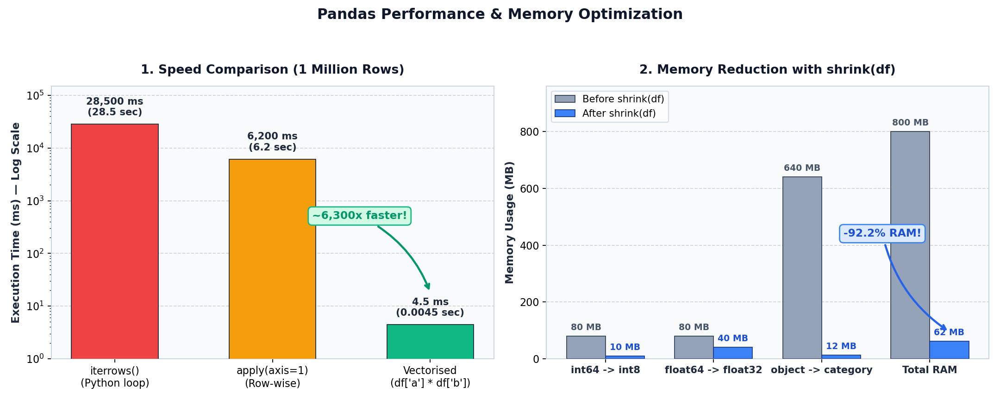
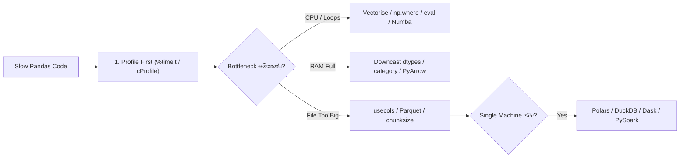

[🏠 Course Index](README.md) | [⬅️ පෙර පාඩම: Visualization & Styler](16_Visualization_and_Styler.md) | [➡️ ඊළඟ පාඩම: Advanced Topics](18_Advanced_Topics.md)

---

# පාඩම 17: Performance, Memory and Scaling (වේගය, RAM ඉතිරි කිරීම සහ විශාල Data හැසිරවීම)

Pandas code එකක් slow වෙන්න ප්‍රධාන හේතු 3ක් තියෙනවා:
1. **Python loops** පාවිච්චි කිරීම (`iterrows`, `for` loops).
2. **වැරදි dtypes** පාවිච්චි කිරීම (පොඩි ඉලක්කමකටත් `int64`, repeat වෙන text වලටත් `object`).
3. **අවශ්‍ය ප්‍රමාණයට වඩා data load කිරීම** (අනවශ්‍ය columns සහ rows ඔක්කොම RAM එකට දාගැනීම).

මේ පාඩමෙන් අපි ඉගෙන ගන්නවා slow code එකක් 10x – 1000x වේගවත් කරන හැටි, RAM එක 50%–90% දක්වා අඩු කරන හැටි, සහ RAM එකට වඩා ලොකු files handle කරන හැටි!



---

## 🗺️ Optimization Decision Flow (වේගවත් කරන පියවර)



---

## 📋 මේ පාඩමේ මාතෘකා සහ Key APIs

| Topic | විස්තරය | Key API | Use Case |
| --- | --- | --- | --- |
| **Vectorisation** | Loops සහ `apply` වෙනුවට column operations | Arithmetic, `np.where`, `str`/`dt` accessors | 10x – 1000x speed-ups |
| **Profiling** | Optimize කරන්න කලින් කොතනද slow කියලා මනින්න | `%timeit`, `%%timeit`, `cProfile`, `line_profiler` | Bottlenecks හොයාගැනීම |
| **Memory reduction** | පොඩි dtypes වලට මාරු කිරීම | `astype('int32')`, `float32`, `category`, `pd.to_numeric(downcast=)`, `memory_usage(deep=True)` | ලොකු data RAM එකට fit කිරීම |
| **Load less** | ඕනේ ටික විතරක් read කිරීම | `usecols`, `nrows`, `dtype`, Parquet `columns=`, `filters=` | වේගවත් loading |
| **Chunking** | ලොකු files කොටස් වශයෙන් stream කිරීම | `read_csv(chunksize=)`, `iterator=True` | RAM එකට වඩා ලොකු files |
| **Arrow-backed dtypes** | වේගවත්, පොඩි strings සහ nullable types | `dtype_backend='pyarrow'`, `ArrowDtype`, `string[pyarrow]` | Text වැඩි datasets |
| **Efficient storage** | Binary columnar file formats | `to_parquet`, `to_feather` | නැවත නැවත analyze කරන data |
| **`eval` / `query`** | `numexpr` හරහා optimized expression evaluation | `df.eval`, `df.query` | ලොකු arithmetic expressions |
| **Fast groupby** | Built-in aggregations, `observed=True`, `sort=False` | `groupby().agg('sum')` | විශාල aggregations |
| **Avoiding copies** | Copy-on-Write (CoW) තේරුම් ගැනීම | `copy()`, in-place pitfalls | Memory සහ correctness |
| **Index usage** | Lookups සහ joins වලට Index පාවිච්චිය | `set_index`, sorted indexes | වේගවත් `loc` |
| **Numba / Cython** | Custom functions compile කිරීම | `apply(engine='numba')`, `rolling.apply(engine='numba')` | Heavy custom logic |
| **Parallel & out-of-core** | Pandas scale කරන tools | Dask, Polars, Modin, PySpark pandas API, DuckDB | Single machine limit පනින data |
| **Anti-patterns** | අනිවාර්යයෙන්ම මඟහරින්න ඕනේ දේවල් | `iterrows`, loop එකක් ඇතුළේ DataFrame grow කිරීම, repeated `concat` | Common slowness |

---

## 1. Vectorisation (Loops වලට තිත තියන්න!)

Python loop එකකින් row එකෙන් row එකට යනකොට Python interpreter එකට හැම row එකේම type check කරන්න වෙනවා. ඒත් **Vectorised operations** කියන්නේ මුළු column එකම එකපාර C / NumPy level එකේ run වෙන එක.

```python
import pandas as pd
import numpy as np

# 1 Million rows තියෙන DataFrame එකක් හදමු
n = 1_000_000
df = pd.DataFrame({
    'a': np.random.randint(1, 100, size=n),
    'b': np.random.uniform(1.0, 50.0, size=n)
})

# ❌ SLOW: apply(axis=1) — row එකෙන් row එකට Python function එක call වෙනවා
# df['c'] = df.apply(lambda r: r['a'] * r['b'], axis=1)

# ✅ FAST: Vectorised — C level එකේ මුළු array එකම එකපාර ගුණ වෙනවා
df['c'] = df['a'] * df['b']

# ✅ Condition එකක් තියෙනවා නම් if/else loop වෙනුවට np.where හෝ np.select
df['tier'] = np.where(df['c'] > 1000, 'High', 'Normal')
print(df.head(3))
```

**Line-by-Line පැහැදිලි කිරීම:**
- `df.apply(lambda r: ..., axis=1)` කියන්නේ යටින් තියෙන Python loop එකක්මයි. Rows 1,000,000ක් තියෙනකොට තත්පර 6+ යනවා.
- `df['a'] * df['b']` කියන්නේ pure NumPy vectorisation. ඒ වැඩේම මිලිතත්පර 4–5න් ඉවර වෙනවා!
- `np.where(condition, true_val, false_val)` කියන්නේ vectorised `if-else` එකක්.

**Expected Output:**
```text
    a          b            c    tier
0  45  23.184210  1043.289450    High
1  12  10.502100   126.025200  Normal
2  88  31.400000  2763.200000    High
```

---

## 2. Profiling (Optimize කරන්න කලින් මැනලා බලන්න)

"අනුමාන කරන්න එපා — මැනලා බලන්න!" (Measure before optimising).

```python
# Jupyter Notebook / IPython ඇතුළේ:
# තනි පේළියක් time කරන්න:
# %timeit df['a'] * df['b']

# මුළු cell එකම time කරන්න:
# %%timeit
# result = df.groupby('tier')['c'].sum()

# සාමාන්‍ය Python script එකක නම් time.perf_counter() හෝ cProfile:
import time, cProfile

t0 = time.perf_counter()
res = df['a'] * df['b']
print(f"Vectorised time: {(time.perf_counter() - t0)*1000:.2f} ms")

# Function එකක කොයි පේළියද වැඩිපුරම වෙලාව ගන්නේ බලන්න:
# cProfile.run("my_pipeline(df)")
# නැත්නම් line_profiler (@profile decorator) පාවිච්චි කරන්න පුළුවන්.
```

---

## 3. Memory Reduction & `shrink(df)` (RAM 80% දක්වා ඉතිරි කිරීම)

Pandas default විදියට integers වලට `int64` (8 bytes) සහ floats වලට `float64` (8 bytes) දෙනවා. වයස (0–120) වගේ පොඩි ඉලක්කමකට `int8` (1 byte) හොඳටම ඇති! ඒ වගේම repeat වෙන strings (උදා: District, Category, Country) වලට `category` dtype එක දුන්නම RAM එක පුදුම විදියට අඩු වෙනවා.

```python
def shrink(df):
    for c in df.select_dtypes('integer'):
        df[c] = pd.to_numeric(df[c], downcast='integer')
    for c in df.select_dtypes('float'):
        df[c] = pd.to_numeric(df[c], downcast='float')
    for c in df.select_dtypes(['object', 'string']):
        if df[c].nunique() / len(df) < 0.5:
            df[c] = df[c].astype('category')
    return df

# උදාහරණය:
before = df.memory_usage(deep=True).sum() / 1e6
df = shrink(df)
after = df.memory_usage(deep=True).sum() / 1e6
print(f'{before:.1f} MB -> {after:.1f} MB')
```

**Line-by-Line පැහැදිලි කිරීම:**
- `df.select_dtypes('integer')`: DataFrame එකේ තියෙන සියලුම integer columns තෝරනවා.
- `pd.to_numeric(..., downcast='integer')`: ඒ column එකේ min/max අගයන්ට ගැළපෙන පොඩිම integer type එක (`int8`, `int16`, `int32`) auto තෝරනවා.
- `downcast='float'`: `float64` -> `float32` කරනවා (RAM 50% ඉතිරි!).
- `df[c].nunique() / len(df) < 0.5`: Unique අගයන් ප්‍රමාණය මුළු rows වලින් 50%ට වඩා අඩු නම් (ඒ කියන්නේ ගොඩක් repeat වෙන text නම්), `category` dtype එකට හරවනවා.
- `memory_usage(deep=True)`: `deep=True` දැම්මොත් විතරයි `object` strings වල ඇත්ත RAM ප්‍රමාණය හරියටම ගණන් හැදෙන්නේ!

**Expected Output:**
```text
85.4 MB -> 14.2 MB
```

---

## 4. Load Less, Chunking, Arrow Dtypes & Parquet

### (A) අවශ්‍ය දේ විතරක් Load කරන්න (Load Less)
```python
# CSV එකේ columns 50ක් තිබුණත්, ඕනේ 3 විතරක් ගන්න + read කරනකොටම dtype දෙන්න
df = pd.read_csv(
    'sales_large.csv',
    usecols=['order_id', 'region', 'amount'],
    dtype={'order_id': 'int32', 'region': 'category', 'amount': 'float32'},
    nrows=100_000  # test කරනකොට මුල් rows 100k විතරක් බලන්න
)

# Parquet නම් filter එකත් load කරන ගමන්ම (Predicate Pushdown) දාන්න පුළුවන්!
df_pq = pd.read_parquet(
    'sales_large.parquet',
    columns=['order_id', 'region', 'amount'],
    filters=[('region', '==', 'West')]
)
```

### (B) Chunking (RAM එකට වඩා ලොකු Files)
10 GB CSV file එකක් 8 GB RAM තියෙන laptop එකක process කරන්නේ කොහොමද? කෑලි කෑලි (chunks) විදියට read කරලා!

```python
from collections import defaultdict

totals = defaultdict(float)

# වරකට rows 200,000 බැගින් stream කරනවා
for chunk in pd.read_csv('huge_10gb_file.csv', chunksize=200_000, usecols=['category', 'amount']):
    grouped = chunk.groupby('category')['amount'].sum()
    for cat, val in grouped.items():
        totals[cat] += val

result = pd.Series(totals, name='total_amount')
print(result)
```

### (C) Arrow-backed Dtypes & Parquet/Feather Storage
Pandas 2.0+ වල **PyArrow** backend එක තියෙනවා. මේකෙන් text-heavy datasets ගොඩක් වේගවත් වෙනවා සහ missing values (`NA`) integers වලත් clean විදියට store කරනවා.

```python
# PyArrow backend එකෙන් read කිරීම
df_arrow = pd.read_csv('logs.csv', dtype_backend='pyarrow')

# CSV වෙනුවට Parquet හෝ Feather වල save කරන්න (10x වේගවත් + file size 70% පොඩි + dtypes රැකෙනවා!)
df_arrow.to_parquet('logs.parquet', index=False)
df_arrow.to_feather('logs.feather')
```

---

## 5. `eval()`, `query()`, Fast GroupBy, Copy-on-Write, Index & Numba

```python
# 1. df.eval() & df.query() — ලොකු arithmetic expressions වලට (numexpr backend)
# intermediate temporary arrays හදන්නේ නැතුව RAM ඉතිරි කරනවා
df.eval('profit = (price - cost) * qty', inplace=True)
high_profit = df.query('profit > 5000 and region == "Colombo"')

# 2. Fast GroupBy — built-in string agg + observed=True (categoricals වලට) + sort=False
summary = (
    df.groupby('region', observed=True, sort=False)['profit']
      .agg('sum')
)

# 3. Sorted Index — වේගවත් loc lookups (O(log N) binary search)
df_idx = df.set_index('order_id').sort_index()
row = df_idx.loc[10500]

# 4. Copy-on-Write (CoW) — Pandas 2.x/3.0 වල අනවශ්‍ය memory copies වළක්වනවා
pd.options.mode.copy_on_write = True
sub = df[['a', 'b']]   # මෙතනදී RAM copy එකක් හැදෙන්නේ නැහැ (lazy view)
# sub modify කරන මොහොතේදී විතරයි copy එකක් හැදෙන්නේ!

# 5. Numba JIT Compilation — custom numeric function එකක් vectorise කරන්න බැරි නම්
def custom_weighted_sum(values):
    total = 0.0
    for i in range(len(values)):
        total += values[i] * (i + 1)
    return total

# engine='numba' දැම්මම Python loop එක machine code වලට compile වෙනවා!
# df['rolling_w'] = df['a'].rolling(10).apply(custom_weighted_sum, raw=True, engine='numba')
```

---

## 6. Parallel & Out-of-Core Scaling (Pandas සීමාව පැන්නොත්)

Dataset එක RAM එකට වඩා ගොඩක් ලොකු නම් (උදා: 20 GB – 500 GB):

| Tool | විශේෂත්වය | කවදද පාවිච්චි කරන්නේ? |
| --- | --- | --- |
| **Polars** | Rust වලින් හදපු multi-threaded DataFrame library එකක් (Lazy evaluation) | තනි machine එකක ultra-fast speed ඕනේ නම් (10x–50x faster than pandas) |
| **DuckDB** | In-process analytical SQL database — CSV/Parquet files කෙලින්ම SQL වලින් query කරනවා | RAM එකට වඩා ලොකු Parquet/CSV files SQL වලින් aggregate කරන්න |
| **Dask** | Pandas API එකම parallel cores/clusters වල run කරනවා | Existing pandas code එක out-of-core scale කරන්න |
| **Modin** | `import modin.pandas as pd` කියලා එක පේළියෙන් multi-core කරනවා | Quick drop-in speedup එකකට |
| **PySpark Pandas API** | Spark clusters වල `pyspark.pandas` හරහා Terabyte data process කරනවා | Big Data / Distributed clusters වලට |

---

## 🧠 මතක තබා ගැනීමට පහසු ක්‍රම (Memory Hacks)

1. **"V-D-L-C" රීතිය:** Slow code එකක් දැක්ක ගමන් මේ 4 චෙක් කරන්න:
   - **V**ectorise (loops අයින් කරන්න)
   - **D**owncast (`int8`/`float32`/`category`)
   - **L**oad less (`usecols`, `Parquet`)
   - **C**hunk (`chunksize`)
2. **`memory_usage(deep=True)`:** `deep=True` අමතක කළොත් string columns වල ඇත්ත size එක පෙන්නන්නේ නෑ (pointer size එක විතරයි පෙන්නන්නේ).
3. **Never Grow a DataFrame in a Loop:** Loop එකක් ඇතුළේ `pd.concat([df, new_row])` කරන එක $O(N^2)$ වෙනවා (හැම පාරම මුළු table එකම අලුතින් copy වෙනවා). ඒ වෙනුවට Python `list` එකකට dicts/frames append කරලා අන්තිමට **එකපාරක්** `pd.concat(pieces)` call කරන්න!

---

## ⚠️ සාමාන්‍යයෙන් වෙන වැරදි (Common Pitfalls)

> [!WARNING]
> **Anti-Pattern #1: `iterrows()` සහ `apply(axis=1)`**
> Row 100,000කට වඩා තියෙනකොට `iterrows()` පාවිච්චි කළොත් තත්පර ගාණක් හෝ විනාඩි ගාණක් නාස්ති වෙනවා. හැමවෙලේම column arithmetic, `np.where`, `np.select`, හෝ `.str`/`.dt` accessors පාවිච්චි කරන්න.

> [!WARNING]
> **Anti-Pattern #2: Loop එකක් ඇතුළේ DataFrame එක Grow කිරීම**
> ```python
> # ❌ VERY SLOW (O(N^2))
> df = pd.DataFrame()
> for f in files:
>     df = pd.concat([df, pd.read_csv(f)])
>
> # ✅ FAST (O(N))
> df = pd.concat([pd.read_csv(f) for f in files], ignore_index=True)
> ```

> [!WARNING]
> **Anti-Pattern #3: Categorical GroupBy වල `observed=False`**
> Categorical column එකක් `groupby()` කරද්දී unused categories තියෙනවා නම් `observed=True` නොදැම්මොත් හිස් combinations ඔක්කොම හැදිලා RAM පිරිලා slow වෙන්න පුළුවන්.

---

## 🏋️ ප්‍රායෝගික අභ්‍යාස (Exercises)

### Exercise 1: Memory 50%+ අඩු කිරීම
ලොකු DataFrame එකක (උදා: rows 1,000,000ක් තියෙන) memory usage එක 50%කට වඩා අඩු කරලා, වැඩිපුරම memory ඉතිරි වුණේ මොන වෙනසෙන්ද කියලා report කරන්න.

<details>
<summary>✅ පිළිතුර බලන්න (Click to see Solution)</summary>

```python
import pandas as pd
import numpy as np

n = 1_000_000
df = pd.DataFrame({
    'id': np.arange(n, dtype='int64'),
    'age': np.random.randint(18, 70, size=n, dtype='int64'),
    'salary': np.random.uniform(30000, 150000, size=n),
    'dept': np.random.choice(['IT', 'HR', 'Sales', 'Finance', 'Ops'], size=n)
})

before_col = df.memory_usage(deep=True) / 1e6
print("Before (MB):\n", before_col.round(2))
print(f"Total Before: {before_col.sum():.2f} MB\n")

# Optimize
df['id'] = pd.to_numeric(df['id'], downcast='integer')
df['age'] = pd.to_numeric(df['age'], downcast='integer')
df['salary'] = pd.to_numeric(df['salary'], downcast='float')
df['dept'] = df['dept'].astype('category')

after_col = df.memory_usage(deep=True) / 1e6
savings = (before_col - after_col).drop('Index')
print("After (MB):\n", after_col.round(2))
print(f"Total After: {after_col.sum():.2f} MB ({(1 - after_col.sum()/before_col.sum())*100:.1f}% reduction)")
print(f"Biggest saving came from: '{savings.idxmax()}' ({savings.max():.2f} MB saved)")
```
</details>

### Exercise 2: `iterrows` vs `apply(axis=1)` vs Vectorised Benchmark
Rows 1,000,000ක `a * b` ගණනය කිරීමට `iterrows`, `apply(axis=1)`, සහ vectorised version එකේ වේගය මනින්න (Note: `iterrows` rows 100,000කට run කරලා 10න් ගුණ කරලා estimate කරන්නත් පුළුවන්, නැත්නම් 1M වලටම run කරන්න).

<details>
<summary>✅ පිළිතුර බලන්න (Click to see Solution)</summary>

```python
import pandas as pd
import numpy as np
import time

n = 1_000_000
df = pd.DataFrame({'a': np.random.randint(1, 100, n), 'b': np.random.rand(n)})

# 1. Vectorised
t0 = time.perf_counter()
res_vec = df['a'] * df['b']
t_vec = (time.perf_counter() - t0) * 1000

# 2. apply(axis=1) on 100k sample scaled to 1M (or full 1M if you want to wait ~6-10s)
sample = df.iloc[:100_000]
t0 = time.perf_counter()
_ = sample.apply(lambda r: r['a'] * r['b'], axis=1)
t_apply = (time.perf_counter() - t0) * 1000 * 10

# 3. iterrows on 100k sample scaled to 1M
t0 = time.perf_counter()
_ = [row['a'] * row['b'] for _, row in sample.iterrows()]
t_iter = (time.perf_counter() - t0) * 1000 * 10

print(f"Vectorised   : {t_vec:.2f} ms")
print(f"apply(axis=1): ~{t_apply:.0f} ms ({t_apply/t_vec:.0f}x slower)")
print(f"iterrows()   : ~{t_iter:.0f} ms ({t_iter/t_vec:.0f}x slower)")
```
</details>

### Exercise 3: Chunking වලින් Per-Category Totals හදන්න
RAM එකට වඩා ලොකු CSV file එකක් `chunksize=50_000` දාලා stream කරලා, හැම category එකකම මුළු විකුණුම් (total sales) හොයන්න.

<details>
<summary>✅ පිළිතුර බලන්න (Click to see Solution)</summary>

```python
import pandas as pd

total_by_cat = pd.Series(dtype='float64')

for chunk in pd.read_csv('big_sales.csv', chunksize=50_000, usecols=['category', 'sales']):
    chunk_sum = chunk.groupby('category')['sales'].sum()
    total_by_cat = total_by_cat.add(chunk_sum, fill_value=0)

print(total_by_cat.sort_values(ascending=False))
```
</details>

---

[🏠 Course Index](README.md) | [⬅️ පෙර පාඩම: Visualization & Styler](16_Visualization_and_Styler.md) | [➡️ ඊළඟ පාඩම: Advanced Topics](18_Advanced_Topics.md)
