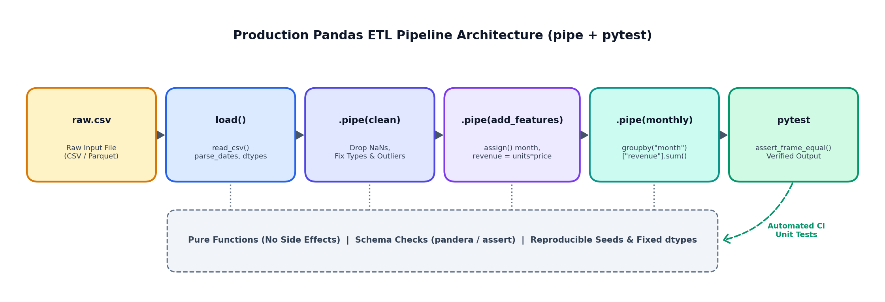
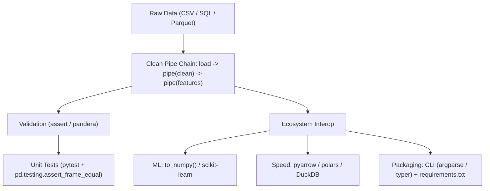

[🏠 Course Index](README.md) | [⬅️ පෙර පාඩම: Performance & Scaling](17_Performance_Memory_and_Scaling.md) | [➡️ ඊළඟ පාඩම: Real-World Capstones](19_Real_World_Use_Cases_and_Capstones.md)

---

# පාඩම 18: Advanced Topics (Production Pipelines, Testing සහ Interoperability)

සාමාන්‍ය Pandas user කෙනෙක් සහ **Master** කෙනෙක් අතර වෙනස තියෙන්නේ මෙන්න මේ පාඩමේ! Notebook එකක කෑලි කෑලි code ලියනවට වඩා, කියවන්න පහසු **pipelines (`pipe`)**, automated **unit tests (`pytest`)**, **data validation (`pandera`)**, **custom accessors**, සහ අනිත් tools (NumPy, PyArrow, Polars, DuckDB, Scikit-learn) එක්ක වැඩ කරන හැටි අපි මේ පාඩමෙන් ඉගෙන ගන්නවා.



---

## 🗺️ Production Pipeline & Ecosystem Map



---

## 📋 මේ පාඩමේ මාතෘකා සහ Key APIs

| Topic | විස්තරය | Key API | Use Case |
| --- | --- | --- | --- |
| **Method chaining & `pipe`** | පොඩි, නම් කරපු functions එකට අමුණලා pipeline හැදීම | `df.pipe(f, arg)`, `assign`, `query` | Readable ETL |
| **Options system** | Global සහ temporary settings පාලනය | `pd.set_option`, `get_option`, `reset_option`, `option_context`, `describe_option` | Display & behaviour control |
| **Index types** | විශේෂිත indexes | `RangeIndex`, `DatetimeIndex`, `PeriodIndex`, `TimedeltaIndex`, `IntervalIndex`, `CategoricalIndex`, `Index.union/intersection/difference` | Efficient lookups |
| **Intervals** | පරාස (ranges) values විදියට | `pd.Interval`, `interval_range`, `IntervalIndex.from_breaks` | Bin lookups, overlapping ranges |
| **Extension dtypes** | Nullable සහ Arrow types | `Int64`, `Float64`, `boolean`, `string`, `ArrowDtype` | Missing-safe integers |
| **Sparse data** | වැඩිපුරම 0 හෝ NaN තියෙන data අඩු RAM වලින් | `pd.arrays.SparseArray`, `astype(pd.SparseDtype)`, `.sparse` accessor | One-hot matrices |
| **Custom accessors** | තමන්ගේම `.my_tool` namespace එකක් හදන්න | `@pd.api.extensions.register_dataframe_accessor` | Team utility libraries |
| **Testing** | Tests වලදී DataFrames/Series compare කිරීම | `pd.testing.assert_frame_equal`, `assert_series_equal`, `assert_index_equal` | Unit tests with pytest |
| **Data validation** | Schema සහ rules check කිරීම | `assert`, `pandera`, `pydantic` with `pandas` | Pipeline safety |
| **Warnings & errors** | ප්‍රධාන warnings තේරුම් ගැනීම | `SettingWithCopyWarning`, `FutureWarning`, `PerformanceWarning` | Debugging |
| **Interoperability** | අනිත් libraries එක්ක data හුවමාරුව | `to_numpy`, `to_dict`, `pyarrow.Table.from_pandas`, `polars.from_pandas`, `scikit-learn`, `statsmodels` | ML & statistics |
| **Dataframe interchange** | Standard cross-library protocol | `df.__dataframe__()`, `pd.api.interchange.from_dataframe` | Cross-library exchange |
| **SQL-like operations** | SQL logic Pandas/DuckDB වලින් | `merge`, `groupby`, `query`, `pandasql` / DuckDB over frames | SQL users migrating |
| **Random & sampling** | Reproducible experiments | `sample(random_state=)`, `np.random.default_rng` | Simulations, test splits |
| **Functional helpers** | Generic code ලියන්න utilities | `pd.api.types.is_numeric_dtype`, `infer_objects`, `pd.unique`, `pd.cut`, `pd.isna` | Reusable helper functions |
| **Logging & reproducibility** | ප්‍රතිඵල නැවත ඒ විදියටම ගන්න | Seeds, fixed dtypes, versions in `requirements.txt` | Auditable analysis |
| **Packaging pipelines** | Notebook එක production script එකක් කරන්න | Functions, modules, CLI (`argparse` / `typer`), scheduled jobs | Production ETL |

---

## 1. Method Chaining, `pipe()`, සහ `pytest` Unit Testing

Spaghetti notebook code එකක් වෙනුවට, හැම පියවරක්ම පොඩි **pure function** එකක් විදියට ලියලා `.pipe()` වලින් අමුණන්න. එතකොට හැම function එකක්ම වෙන වෙනම `pytest` වලින් test කරන්න පුළුවන්!

```python
import pandas as pd
import pandas.testing as pdt

def load(path):
    return pd.read_csv(path, parse_dates=['date'])

def add_features(df):
    return df.assign(
        month=df['date'].dt.to_period('M'),
        revenue=df['units'] * df['price']
    )

def monthly(df):
    return df.groupby('month', as_index=False)['revenue'].sum()

# Pipeline එක run කරන හැටි:
# report = load('sales.csv').pipe(add_features).pipe(monthly)

# pytest-style unit test:
def test_monthly():
    df = pd.DataFrame({
        'date': pd.to_datetime(['2026-01-01', '2026-01-15']),
        'units': [1, 2],
        'price': [10, 10]
    })
    out = df.pipe(add_features).pipe(monthly)
    expected = pd.DataFrame({
        'month': [pd.Period('2026-01', freq='M')],
        'revenue': [30]
    })
    pdt.assert_frame_equal(out, expected, check_dtype=False)

test_monthly()
print("test_monthly PASSED!")
```

**Line-by-Line පැහැදිලි කිරීම:**
- `df.assign(...)`: මුල් `df` එක modify නොකර අලුත් columns එක්ක copy එකක් return කරනවා (pure function).
- `.pipe(add_features).pipe(monthly)`: DataFrame එක ඉහළ සිට පහළට කියවන්න පහසු pipeline එකක් විදියට යවනවා. Extra arguments ඕනේ නම් `.pipe(func, tax=0.15)` විදියට දෙන්න පුළුවන්.
- `pdt.assert_frame_equal(out, expected, check_dtype=False)`: `pytest` ඇතුළේ DataFrame දෙකක් හරියටම සමානද බලනවා (`assert_series_equal`, `assert_index_equal` ද තියෙනවා).

**Expected Output:**
```text
test_monthly PASSED!
```

---

## 2. Custom Accessors (තමන්ගේම `.ana` Namespace එකක් හදන්න!)

Pandas වල `.str` සහ `.dt` වගේ ඔයාටත් ඔයාගේ team එකේ නිතර පාවිච්චි වෙන helper methods DataFrame එකටම add කරන්න පුළුවන්.

```python
@pd.api.extensions.register_dataframe_accessor('ana')
class AnaAccessor:
    def __init__(self, df):
        self._df = df

    def null_report(self):
        """හැම column එකේම missing percentage එක sort කරලා දෙනවා"""
        return (self._df.isna().mean() * 100).round(2).sort_values(ascending=False)

    def mem_mb(self):
        """DataFrame එකේ මුළු RAM ප්‍රමාණය MB වලින්"""
        return round(self._df.memory_usage(deep=True).sum() / 1e6, 3)

# දැන් ඕනෑම DataFrame එකක .ana පාවිච්චි කරන්න පුළුවන්!
sample = pd.DataFrame({'a': [1, None, 3], 'b': ['x', None, None]})
print(sample.ana.null_report())
print("Memory (MB):", sample.ana.mem_mb())
```

**Expected Output:**
```text
b    66.67
a    33.33
dtype: float64
Memory (MB): 0.001
```

---

## 3. Options System (Display සහ Global Settings)

```python
# Global settings
pd.set_option('display.max_columns', 50)
pd.set_option('display.float_format', '{:,.2f}'.format)

# Option එකක් ගැන විස්තර බලන්න:
# pd.describe_option('display.max_rows')

# තාවකාලිකව (scoped) විතරක් option එකක් වෙනස් කරන්න — with block එකෙන් පස්සේ auto reset වෙනවා!
with pd.option_context('display.max_rows', 100, 'display.precision', 4):
    print(sample)

# Default වලට reset කරන්න:
pd.reset_option('display.float_format')
```

---

## 4. Specialised Indexes, Intervals, Extension Dtypes & Sparse Data

```python
# 1. Index Set Operations (union, intersection, difference)
idx1 = pd.Index(['A', 'B', 'C'])
idx2 = pd.Index(['B', 'C', 'D'])
print("Common:", idx1.intersection(idx2).tolist())   # ['B', 'C']
print("Only in 1:", idx1.difference(idx2).tolist())  # ['A']

# 2. IntervalIndex — පරාස (tax brackets / age bins) lookup කරන්න
brackets = pd.IntervalIndex.from_breaks([0, 100_000, 300_000, 1_000_000], closed='right')
tax_rates = pd.Series([0.0, 0.12, 0.24], index=brackets)
print("Tax rate for 250,000:", tax_rates.loc[250_000])  # 0.12

# 3. Nullable Extension Dtypes (Int64 — capital 'I'!)
# සාමාන්‍ය int64 වල NaN දාන්න බෑ (float64 වෙනවා), ඒත් Int64 වල pd.NA පුළුවන්!
s_int = pd.Series([10, pd.NA, 30], dtype='Int64')
s_bool = pd.Series([True, pd.NA, False], dtype='boolean')

# 4. Sparse Data (One-hot encoding වගේ 95%ක්ම 0 තියෙන tables වල RAM ඉතිරි කරන්න)
sparse_col = pd.Series([0, 0, 0, 1, 0, 0, 0]).astype(pd.SparseDtype('int8', fill_value=0))
print("Sparse density:", sparse_col.sparse.density)  # 0.1428...
```

---

## 5. Data Validation (`assert` & `pandera`), Interop, SQL & Packaging

### (A) Data Validation
Pipeline එකේ මැදදී වැරදි data (උදා: negative prices, duplicate IDs) ආවොත් නිහඬව වැරදි report හැදෙනවට වඩා fail-fast වෙන්න ඕනේ.

```python
# Simple assert validation
def validate_orders(df):
    assert not df.empty, "Orders DataFrame cannot be empty!"
    assert (df['price'] >= 0).all(), "Negative price detected!"
    assert df['order_id'].is_unique, "Duplicate order_id found!"
    return df

# Production schema validation with Pandera:
# import pandera as pa
# schema = pa.DataFrameSchema({
#     "order_id": pa.Column(int, unique=True),
#     "price": pa.Column(float, checks=pa.Check.ge(0)),
# })
# validated_df = schema.validate(df)
```

### (B) Ecosystem Interoperability & DuckDB SQL
```python
# NumPy / Scikit-learn වලට:
X = df[['units', 'price']].to_numpy()

# PyArrow & Polars වලට (zero-copy / ultra-fast):
# import pyarrow as pa, polars as pl
# arrow_tbl = pa.Table.from_pandas(df)
# pl_df = pl.from_pandas(df)

# Standard Dataframe Interchange Protocol:
# interchange_obj = df.__dataframe__()
# df_back = pd.api.interchange.from_dataframe(interchange_obj)

# DuckDB — කෙලින්ම Pandas DataFrame එක උඩ SQL ගහන්න!
# import duckdb
# result_df = duckdb.sql("SELECT region, SUM(revenue) AS rev FROM df GROUP BY region").df()
```

### (C) Reproducibility, Functional Helpers & CLI Packaging
```python
import numpy as np

# 1. Reproducible random sampling
rng = np.random.default_rng(seed=42)
train = df.sample(frac=0.8, random_state=42)

# 2. Functional type helpers (generic functions ලියද්දී)
for col in df.columns:
    if pd.api.types.is_numeric_dtype(df[col]):
        print(f"{col} is numeric")

# 3. CLI Script Packaging (argparse / typer)
# pipeline.py විදියට save කරලා terminal එකෙන්: python pipeline.py --input sales.csv --output report.parquet
# dependencies pin කරන්න: pip freeze > requirements.txt (උදා: pandas==2.2.3)
```

---

## 🧠 මතක තබා ගැනීමට පහසු ක්‍රම (Memory Hacks)

1. **Capital = Nullable:** `int64` / `float64` / `bool` (lowercase) = NumPy dtypes (integer වල `NaN` බෑ). `Int64` / `Float64` / `boolean` / `string` (Capital / Pandas) = Nullable Extension dtypes (`pd.NA` පුළුවන්!).
2. **`pipe()` කියන්නේ "දිය ඇල්ලක්" වගේ:** උඩ ඉඳන් පහළට data ගලාගෙන යනවා — intermediate variables (`df1`, `df2`, `df3_final_v2`) හදන්න ඕනේ නෑ!
3. **`option_context`:** Display settings වෙනස් කරලා ආයේ reset කරන්න අමතක වෙනවා නම් හැමවෙලේම `with pd.option_context(...):` පාවිච්චි කරන්න.

---

## ⚠️ සාමාන්‍යයෙන් වෙන වැරදි (Common Pitfalls)

> [!WARNING]
> **1. `SettingWithCopyWarning` / Mutating input inside `pipe()`**
> `pipe()` function එකක් ඇතුළේ `df['x'] = ...` කෙලින්ම ලිව්වොත් caller ගේ original DataFrame එකත් වෙනස් වෙන්න පුළුවන්. හැමවෙලේම `df.assign(...)` හෝ function එක පටන් ගන්න තැන `df = df.copy()` පාවිච්චි කරන්න.

> [!WARNING]
> **2. `FutureWarning` සහ `PerformanceWarning` නොසලකා හැරීම**
> - `FutureWarning`: ඊළඟ Pandas version එකේදී ඔයාගේ code එක කැඩෙන්න පුළුවන් කියන අනතුරු ඇඟවීමයි. `requirements.txt` වල version pin කරන්න.
> - `PerformanceWarning`: DataFrame fragmented වෙලා (loop එකකින් columns ගොඩක් add කරලා) හෝ unsorted MultiIndex lookup කරනකොට එනවා.

> [!WARNING]
> **3. Tests වලදී `df1 == df2` පාවිච්චි කිරීම**
> `df1 == df2` කළාම boolean DataFrame එකක් return වෙනවා මිසක් තනි `True`/`False` එකක් නෙවෙයි (තවද `NaN == NaN` -> `False`). Tests වලදී හැමවෙලේම `pd.testing.assert_frame_equal(df1, df2)` පාවිච්චි කරන්න!

---

## 🏋️ ප්‍රායෝගික අභ්‍යාස (Exercises)

### Exercise 1: Notebook එකක් `pipe()` Functions 3කට Refactor කරන්න
Messy sales DataFrame එකක් (1) clean කරන, (2) tax & net_revenue add කරන, සහ (3) region-wise summary හදන pure functions 3ක් ලියලා `.pipe()` වලින් අමුණන්න.

<details>
<summary>✅ පිළිතුර බලන්න (Click to see Solution)</summary>

```python
import pandas as pd

def clean_sales(df):
    return (
        df.copy()
          .dropna(subset=['amount'])
          .assign(region=lambda d: d['region'].str.strip().str.title())
    )

def add_net_revenue(df, tax_rate=0.10):
    return df.assign(
        tax=lambda d: d['amount'] * tax_rate,
        net_revenue=lambda d: d['amount'] * (1 - tax_rate)
    )

def summarize_region(df):
    return df.groupby('region', as_index=False)['net_revenue'].sum()

raw = pd.DataFrame({
    'region': [' colombo ', 'Kandy', 'COLOMBO', 'Kandy'],
    'amount': [1000.0, 2000.0, 500.0, None]
})

report = (
    raw.pipe(clean_sales)
       .pipe(add_net_revenue, tax_rate=0.15)
       .pipe(summarize_region)
)
print(report)
```
</details>

### Exercise 2: `pytest` Test Suite (Edge Cases 5ක් එක්ක)
ඉහත `clean_sales()` function එකට empty DataFrame, all-NaN amounts, whitespace strings වගේ edge cases 5ක් test කරන `pytest` suite එකක් ලියන්න.

<details>
<summary>✅ පිළිතුර බලන්න (Click to see Solution)</summary>

```python
import pandas as pd
import pandas.testing as pdt

def test_clean_drops_null_amount():
    df = pd.DataFrame({'region': ['Colombo', 'Galle'], 'amount': [100.0, None]})
    out = clean_sales(df)
    assert len(out) == 1

def test_clean_normalizes_region_text():
    df = pd.DataFrame({'region': ['  kandy  '], 'amount': [50.0]})
    out = clean_sales(df)
    assert out['region'].iloc[0] == 'Kandy'

def test_clean_empty_dataframe():
    df = pd.DataFrame({'region': pd.Series(dtype='str'), 'amount': pd.Series(dtype='float64')})
    out = clean_sales(df)
    assert out.empty

def test_clean_does_not_mutate_input():
    df = pd.DataFrame({'region': [' galle '], 'amount': [10.0]})
    _ = clean_sales(df)
    assert df['region'].iloc[0] == ' galle '

def test_clean_exact_output():
    df = pd.DataFrame({'region': [' colombo '], 'amount': [200.0]})
    expected = pd.DataFrame({'region': ['Colombo'], 'amount': [200.0]})
    pdt.assert_frame_equal(clean_sales(df), expected)
```
</details>

### Exercise 3: Custom Accessor එකක් Register කරන්න
`team` කියලා custom DataFrame accessor එකක් හදන්න — ඒකේ methods 2ක් තියෙන්න ඕනේ: `clean_col_names()` (columns ඔක්කොම lowercase + underscore කරන) සහ `summary_shape()` (rows, cols, missing count dict එකක් return කරන).

<details>
<summary>✅ පිළිතුර බලන්න (Click to see Solution)</summary>

```python
import pandas as pd

@pd.api.extensions.register_dataframe_accessor('team')
class TeamAccessor:
    def __init__(self, df):
        self._df = df

    def clean_col_names(self):
        df_copy = self._df.copy()
        df_copy.columns = (
            df_copy.columns.str.strip()
                           .str.lower()
                           .str.replace(r'\s+', '_', regex=True)
        )
        return df_copy

    def summary_shape(self):
        return {
            'rows': self._df.shape[0],
            'cols': self._df.shape[1],
            'total_missing': int(self._df.isna().sum().sum())
        }

df = pd.DataFrame({'First Name ': ['Nimal', None], 'Total Sales': [500, 700]})
clean_df = df.team.clean_col_names()
print(clean_df.columns.tolist())     # ['first_name', 'total_sales']
print(clean_df.team.summary_shape()) # {'rows': 2, 'cols': 2, 'total_missing': 1}
```
</details>

---

[🏠 Course Index](README.md) | [⬅️ පෙර පාඩම: Performance & Scaling](17_Performance_Memory_and_Scaling.md) | [➡️ ඊළඟ පාඩම: Real-World Capstones](19_Real_World_Use_Cases_and_Capstones.md)
