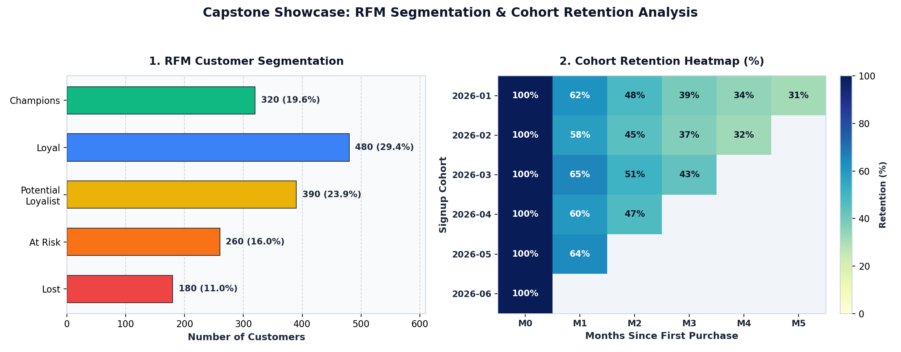
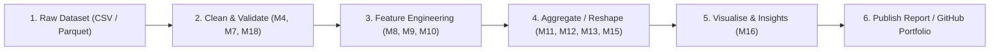

[🏠 Course Index](README.md) | [⬅️ පෙර පාඩම: Advanced Topics](18_Advanced_Topics.md) | [➡️ ඊළඟ පාඩම: Cheat Sheet & Study Plan](20_Cheat_Sheet_Pitfalls_and_Study_Plan.md)

---

# පාඩම 19: Real-World Use Cases and Capstone Projects (සැබෑ ලෝකයේ ව්‍යාපෘති 6ක්)

මෙච්චර කල් ඉගෙන ගත්ත හැම Pandas skill එකක්ම එකට එකතු කරලා, සැබෑ ලෝකයේ ප්‍රශ්න විසඳන වෙලාවයි මේ! අවම වශයෙන් **Capstone Projects 2ක්වත්** raw file එකේ ඉඳන් written conclusion එකක් දක්වාම තනියම කරලා GitHub හෝ blog එකක publish කරන්න.



---

## 🗺️ End-to-End Capstone Workflow



---

## 🌍 ක්ෂේත්‍ර අනුව Pandas භාවිතය (Use Cases by Domain)

| Domain (ක්ෂේත්‍රය) | සාමාන්‍ය Pandas වැඩ | භාවිතා වන Modules |
| --- | --- | --- |
| **Business and sales** | Revenue reports, cohort & retention tables, RFM customer segmentation, basket analysis | 7, 11, 12, 13 |
| **Finance** | Returns, rolling volatility, drawdown, portfolio weights, OHLC resampling, trade & quote alignment | 10, 11, 15 |
| **Marketing** | Funnel conversion, A/B test summaries, campaign attribution, UTM parsing | 9, 11, 13 |
| **Operations & supply chain** | Inventory turnover, delivery delays, demand forecasting features | 10, 11, 15 |
| **Healthcare & science** | Patient cohorts, lab result cleaning, survey crosstabs, missing-data handling | 7, 11, 13 |
| **HR & people analytics** | Attrition rates, tenure bands, pay equity by group | 8, 11 |
| **IoT & sensors** | Gap filling, resampling, anomaly flags with rolling z-scores | 7, 10, 15 |
| **Web & product analytics** | Sessionisation, log parsing, user retention curves | 9, 10, 11 |
| **Machine learning prep** | Feature engineering, encoding, scaling, train/test splits | 8, 11, 15 |
| **Data engineering** | ETL scripts, validation, Parquet data lakes, SQL loads | 4, 17, 18 |

---

## 🚀 Capstone Projects 6 — Complete Practical Walkthroughs

පහත දැක්වෙන්නේ course එකේ Capstone Projects 6ම ක්‍රියාත්මක කරන සම්පූර්ණ, ප්‍රායෝගික Pandas code patterns!

### Capstone 1: Sales Performance Dashboard
**Skills:** I/O, cleaning, `merge`, `groupby`, `resample`, plots.  
**Deliverable:** Monthly KPIs, top products, regional trends.

```python
import pandas as pd

# 1. Load & Merge tables
orders = pd.read_csv('orders.csv', parse_dates=['order_date'])
products = pd.read_csv('products.csv')
df = orders.merge(products, on='product_id', how='left', validate='many_to_one')

# 2. Clean & Calculate revenue
df = (
    df.dropna(subset=['qty', 'unit_price'])
      .assign(revenue=lambda d: d['qty'] * d['unit_price'])
)

# 3. Monthly KPIs (Resample)
monthly_kpi = (
    df.set_index('order_date')
      .resample('ME')
      .agg(total_revenue=('revenue', 'sum'),
           orders_count=('order_id', 'nunique'),
           avg_order_value=('revenue', 'mean'))
)

# 4. Top 5 Products & Regional Trends
top_products = df.groupby('product_name')['revenue'].sum().nlargest(5)
region_monthly = df.pivot_table(
    index=df['order_date'].dt.to_period('M'),
    columns='region', values='revenue', aggfunc='sum', fill_value=0
)
print(monthly_kpi.tail())
```

---

### Capstone 2: Customer Segmentation (RFM)
**Skills:** Date maths, `groupby`, `qcut`, `transform`.  
**Deliverable:** Customer table with Recency (R), Frequency (F), Monetary (M) scores and segments.

```python
import pandas as pd

# RFM segmentation (Course official pattern + segment labels)
snapshot = pd.Timestamp('2026-11-21')

rfm = (
    orders.groupby('customer_id')
          .agg(last=('order_date', 'max'),
               frequency=('order_id', 'nunique'),
               monetary=('amount', 'sum'))
          .assign(recency=lambda d: (snapshot - d['last']).dt.days)
)

# Recency අඩු වෙන තරමට හොඳයි -> labels=[4, 3, 2, 1]
rfm['R'] = pd.qcut(rfm['recency'], 4, labels=[4, 3, 2, 1]).astype(int)
# Frequency ties වළක්වන්න .rank(method='first') පාවිච්චි කරනවා
rfm['F'] = pd.qcut(rfm['frequency'].rank(method='first'), 4, labels=[1, 2, 3, 4]).astype(int)
rfm['M'] = pd.qcut(rfm['monetary'], 4, labels=[1, 2, 3, 4]).astype(int)
rfm['score'] = rfm[['R', 'F', 'M']].sum(axis=1)

# Segment නම් ලබා දීම
rfm['segment'] = pd.cut(
    rfm['score'],
    bins=[2, 5, 8, 10, 12],
    labels=['Lost', 'At Risk', 'Loyal', 'Champions']
)
print(rfm['segment'].value_counts())
```

**Line-by-Line පැහැදිලි කිරීම:**
- `snapshot - d['last']`: අන්තිමට order කරපු දවසේ ඉඳන් දවස් කීයක් ගෙවිලද (**Recency**).
- `frequency=('order_id', 'nunique')`: Customer කී පාරක් බඩු අරන්ද (**Frequency**).
- `monetary=('amount', 'sum')`: මුළු වියදම කීයද (**Monetary**).
- `pd.qcut(..., 4)`: Customers ලා සමාන කොටස් 4කට (quartiles) බෙදලා 1–4 ලකුණු දෙනවා.

---

### Capstone 3: Stock Analysis (5 Tickers)
**Skills:** Time series, `rolling`, correlation, drawdown.  
**Deliverable:** Risk and return report with charts.

```python
import pandas as pd
import numpy as np

# prices: DatetimeIndex, columns = ['AAPL', 'MSFT', 'GOOG', 'AMZN', 'NVDA']
daily_ret = prices.pct_change().dropna()

# Annualized Return & Volatility (trading days = 252)
ann_return = daily_ret.mean() * 252
ann_vol = daily_ret.std() * np.sqrt(252)
sharpe = ann_return / ann_vol

# Rolling 30-day Volatility & Maximum Drawdown
rolling_vol = daily_ret.rolling(30).std() * np.sqrt(252)
cum_growth = (1 + daily_ret).cumprod()
running_max = cum_growth.cummax()
drawdown = (cum_growth - running_max) / running_max
max_drawdown = drawdown.min()

# Correlation matrix
corr_matrix = daily_ret.corr()

risk_report = pd.DataFrame({
    'Ann_Return': ann_return,
    'Ann_Volatility': ann_vol,
    'Sharpe': sharpe,
    'Max_Drawdown': max_drawdown
}).round(3)
print(risk_report)
```

---

### Capstone 4: Data Cleaning Challenge (Messy Survey / HR Export)
**Skills:** Text cleaning, dtypes, missing data, validation, unit tests.  
**Deliverable:** Clean dataset, reusable cleaning function, `pytest` tests.

```python
import pandas as pd

def clean_hr_export(df: pd.DataFrame) -> pd.DataFrame:
    out = df.copy()
    # 1. Column names standardize
    out.columns = out.columns.str.strip().str.lower().str.replace(r'\s+', '_', regex=True)
    # 2. Text cleaning (names, emails, dept)
    out['dept'] = out['dept'].str.strip().str.title().replace({'Hr': 'HR', 'It': 'IT'})
    # 3. Currency string -> float ("$65,000" -> 65000.0)
    out['salary'] = (
        out['salary'].astype(str)
                     .str.replace(r'[$,]', '', regex=True)
                     .pipe(pd.to_numeric, errors='coerce')
    )
    # 4. Missing salary fill by department median
    out['salary'] = out['salary'].fillna(out.groupby('dept')['salary'].transform('median'))
    # 5. Deduplicate & Validate
    out = out.drop_duplicates(subset=['emp_id'])
    assert out['emp_id'].is_unique, "Duplicate emp_id!"
    assert (out['salary'] > 0).all(), "Invalid salary!"
    return out
```

---

### Capstone 5: Big-File Pipeline (Multi-GB Log / Trip Data)
**Skills:** Chunking, dtypes, Parquet, aggregation under a memory budget.  
**Deliverable:** Production script producing summary tables.

```python
import pandas as pd

def process_big_trips(csv_path: str, out_parquet: str, chunksize: int = 250_000):
    usecols = ['pickup_zone', 'fare_amount', 'trip_distance']
    dtypes = {'pickup_zone': 'category', 'fare_amount': 'float32', 'trip_distance': 'float32'}

    agg_chunks = []
    for chunk in pd.read_csv(csv_path, usecols=usecols, dtype=dtypes, chunksize=chunksize):
        chunk = chunk[chunk['fare_amount'] > 0]
        part = chunk.groupby('pickup_zone', observed=True).agg(
            trips=('fare_amount', 'count'),
            total_fare=('fare_amount', 'sum'),
            total_dist=('trip_distance', 'sum')
        )
        agg_chunks.append(part)

    # Combine small chunk summaries & re-aggregate
    final = pd.concat(agg_chunks).groupby(level=0, observed=True).sum()
    final['avg_fare'] = (final['total_fare'] / final['trips']).round(2)
    final.to_parquet(out_parquet)
    return final
```

---

### Capstone 6: Cohort Retention Analysis
**Skills:** `pivot`, `transform('min')`, period arithmetic.  
**Deliverable:** Retention heatmap table (% retained Month 0..Month N).

```python
import pandas as pd

# events columns: ['user_id', 'event_date']
events['order_month'] = events['event_date'].dt.to_period('M')
events['cohort'] = events.groupby('user_id')['order_month'].transform('min')

# Cohort පටන් ගත් මාසයේ ඉඳන් කීවෙනි මාසයද? (Month 0, 1, 2, ...)
events['cohort_index'] = (events['order_month'] - events['cohort']).apply(lambda p: p.n)

# Unique active users per (cohort, cohort_index)
cohort_counts = (
    events.groupby(['cohort', 'cohort_index'])['user_id']
          .nunique()
          .unstack(fill_value=0)
)

# Month 0 size එකෙන් බෙදලා retention % හදන්න
cohort_sizes = cohort_counts.iloc[:, 0]
retention_pct = (cohort_counts.divide(cohort_sizes, axis=0) * 100).round(1)
print(retention_pct)
```

---

## 📂 Practice කරන්න Open Datasets

- **NYC Taxi Trips** (Big-file pipeline / time series)
- **Kaggle Retail & Titanic datasets** (Sales dashboard / RFM / Cleaning)
- **World Bank Indicators** (Reshaping / MultiIndex / Visualisation)
- **UCI Machine Learning Repository** (ML feature prep)
- **Our World in Data** (Time series / Cohort / Global trends)
- **ඔයාගේම Bank Statements හෝ Fitness App Exports** (Personal finance / health dashboard!)

---

## 🧠 මතක තබා ගැනීමට පහසු ක්‍රම (Memory Hacks)

1. **RFM වල `R` Reverse!** Recency කියන්නේ අන්තිම purchase එකේ ඉඳන් ගෙවුණු දවස් ගාණ — ඒක **අඩු** වෙන තරමට customer හොඳයි! ඒ නිසා `qcut` වල `labels=[4, 3, 2, 1]` විදියට අනිත් පැත්තට දෙන්න.
2. **Cohort Formula:** `cohort = groupby('user_id')['month'].transform('min')` — මේ තනි පේළියෙන් හැම user කෙනෙක්ගෙම පළවෙනි මාසය ලැබෙනවා!
3. **Chunked Aggregation Pattern:** හැම chunk එකකම `count` සහ `sum` ගන්න (කෙලින්ම `mean` අරන් ආයේ `mean` කරන්න එපා — weighted average වැරදෙයි!). අන්තිමට `total_sum / total_count` ගන්න.

---

## ⚠️ සාමාන්‍යයෙන් වෙන වැරදි (Common Pitfalls)

> [!WARNING]
> **1. Chunked `mean()` වැරදීම**
> Chunks 2ක averages වල average එක ඇත්ත average එකට සමාන වෙන්නේ නෑ chunk sizes වෙනස් නම්! හැමවෙලේම `sum` සහ `count` වෙන වෙනම accumulate කරලා අන්තිමට බෙදන්න.

> [!WARNING]
> **2. `pd.qcut()` වල Duplicate Bin Edges Error**
> `frequency` වගේ ගොඩක් customers ලට එකම අගය (උදා: `1`) තියෙන column එකකට `qcut` දැම්මොත් `ValueError: Bin edges must be unique` එනවා. ඒක විසඳන්න `s.rank(method='first')` පාවිච්චි කරන්න!

---

## 🏋️ ප්‍රායෝගික අභ්‍යාස (Capstone Mini-Challenge)

### Mini-Challenge: End-to-End RFM + Cohort Script
පහත sample data එක පාවිච්චි කරලා, (1) හැම customer කෙනෙක්ගෙම RFM score එක සහ (2) monthly cohort retention table එක එකම script එකකින් හදන්න.

<details>
<summary>✅ පිළිතුර බලන්න (Click to see Solution)</summary>

```python
import pandas as pd

orders = pd.DataFrame({
    'order_id': range(1, 9),
    'customer_id': ['C1', 'C1', 'C2', 'C2', 'C3', 'C4', 'C1', 'C3'],
    'order_date': pd.to_datetime([
        '2026-01-10', '2026-02-12', '2026-01-15', '2026-03-20',
        '2026-02-05', '2026-02-18', '2026-03-05', '2026-03-25'
    ]),
    'amount': [100, 150, 200, 250, 80, 50, 300, 120]
})

# 1. RFM
snapshot = pd.Timestamp('2026-04-01')
rfm = (
    orders.groupby('customer_id')
          .agg(last=('order_date', 'max'),
               freq=('order_id', 'nunique'),
               monetary=('amount', 'sum'))
          .assign(recency=lambda d: (snapshot - d['last']).dt.days)
)
print("RFM Table:\n", rfm, "\n")

# 2. Cohort Retention
orders['order_month'] = orders['order_date'].dt.to_period('M')
orders['cohort'] = orders.groupby('customer_id')['order_month'].transform('min')
orders['idx'] = (orders['order_month'] - orders['cohort']).apply(lambda p: p.n)
counts = orders.groupby(['cohort', 'idx'])['customer_id'].nunique().unstack(fill_value=0)
retention = (counts.divide(counts.iloc[:, 0], axis=0) * 100).round(1)
print("Cohort Retention (%):\n", retention)
```
</details>

---

[🏠 Course Index](README.md) | [⬅️ පෙර පාඩම: Advanced Topics](18_Advanced_Topics.md) | [➡️ ඊළඟ පාඩම: Cheat Sheet & Study Plan](20_Cheat_Sheet_Pitfalls_and_Study_Plan.md)
