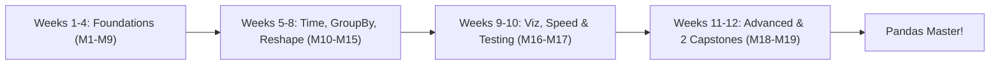

[🏠 Course Index](README.md) | [⬅️ පෙර පාඩම: Real-World Capstones](19_Real_World_Use_Cases_and_Capstones.md)

---

# පාඩම 20: Cheat Sheet, Top 10 Pitfalls & 12-Week Study Plan (ඉක්මන් මාර්ගෝපදේශය)

මේ පාඩම ඔයාගේ **Quick-Reference Handbook** එක! ඕනෑම project එකක් කරද්දී අමතක වෙන Pandas syntax ඉක්මනින් බලාගන්න, හැමෝම කරන **Top 10 වැරදි** මඟහරින්න, සහ සති 12න් Pandas Master කෙනෙක් වෙන **Practice Plan** එකයි **Mastery Checklist** එකයි මෙතන තියෙනවා.

---

## 🗺️ 12-Week Mastery Roadmap



---

## ⚡ Quick-Reference Cheat Sheet (කාර්යය අනුව)

| මට කරන්න ඕනේ... (I want to...) | පාවිච්චි කරන්න (Use) |
| --- | --- |
| **Load a file** (File එකක් read කරන්න) | `read_csv`, `read_excel`, `read_parquet`, `read_json`, `read_sql` |
| **See the data** (Data ටික බලන්න) | `head`, `info`, `describe`, `value_counts`, `isna().sum()` |
| **Pick rows or columns** (තෝරගන්න) | `loc`, `iloc`, boolean mask, `query`, `filter` |
| **Fix types and gaps** (Types & NaNs හදන්න) | `astype`, `to_numeric`, `to_datetime`, `fillna`, `dropna`, `interpolate` |
| **Create columns** (අලුත් columns හදන්න) | `assign`, `np.where`, `np.select`, `map`, `cut`, `qcut` |
| **Summarise by group** (Group කරලා summary ගන්න) | `groupby().agg()`, `transform`, `pivot_table`, `crosstab` |
| **Combine tables** (Tables එකතු කරන්න) | `concat`, `merge`, `join`, `merge_asof` |
| **Reshape** (හැඩය වෙනස් කරන්න) | `melt`, `pivot`, `stack`, `unstack`, `explode` |
| **Work with time** (දින/වේලා එක්ක වැඩ) | `to_datetime`, `.dt`, `resample`, `rolling`, `shift`, `pct_change` |
| **Work with text** (Text clean කරන්න) | `.str.contains`, `.extract`, `.split`, `.replace` |
| **Speed up** (වේගවත් කරන්න) | vectorise, `category`, Parquet, `usecols`, `chunksize` |
| **Save results** (ප්‍රතිඵල save කරන්න) | `to_csv`, `to_parquet`, `to_excel`, `to_sql` |

---

## ⚠️ Top 10 Common Pitfalls (හැමෝම කරන වැරදි 10 සහ නිවැරදි ක්‍රමය)

> [!WARNING]
> මේ වැරදි 10 හොඳට මතක තියාගත්තොත් ඔයාගේ Pandas debugging time එක 80%කින් අඩු වෙනවා!

| # | ❌ වැරදි ක්‍රමය (Pitfall) | ✅ නිවැරදි ක්‍රමය (Fix) |
| --- | --- | --- |
| **1** | **Chained assignment:** `df[mask]['c'] = 1` | `df.loc[mask, 'c'] = 1` පාවිච්චි කරන්න. |
| **2** | **`and` / `or` භාවිතය** හෝ parentheses අමතක කිරීම: `df[df.a > 1 and df.b < 5]` | `&` / `\|` සහ වරහන් දාන්න: `df[(df['a'] > 1) & (df['b'] < 5)]` |
| **3** | **Non-unique keys වලින් `merge()`** කරලා rows නිහඬව ගුණ වීම | `validate='many_to_one'` දාන්න + merge එකට පෙර/පසු `len(df)` compare කරන්න. |
| **4** | **`NaN` සාමාන්‍ය අගයක් වගේ check කිරීම:** `df[df['x'] == np.nan]` (`NaN == NaN` -> `False`!) | `df[df['x'].isna()]` පාවිච්චි කරන්න. |
| **5** | **Vectorised ක්‍රමයක් තියෙද්දී `iterrows` / `apply(axis=1)`** පාවිච්චි කිරීම | `df['a'] * df['b']`, `np.where()`, `.str`/`.dt` පාවිච්චි කරන්න. |
| **6** | **`loc` vs `iloc` slice end එක පටලවා ගැනීම** | `loc[0:5]` -> **5 ඇතුළත් (inclusive)**; `iloc[0:5]` -> **5 නෑ (exclusive)**! |
| **7** | **Numbers/Dates text විදියට read වීම** (`dtype`, `parse_dates` නොදැමීම) | `pd.read_csv(..., parse_dates=['date'], dtype={'zip': 'string'})` දාන්න. |
| **8** | **Version defaults වෙනස් වීම නිසා code කැඩීම** | `requirements.txt` වල pandas version pin කරන්න; upgrade කරන්න කලින් release notes බලන්න. |
| **9** | **Loop එකක් ඇතුළේ DataFrame එක grow කිරීම** (`df = pd.concat([df, row])`) | List එකකට collect කරලා අන්තිමට **එකපාරක්** `pd.concat(pieces)` කරන්න. |
| **10** | **Built-in agg තියෙද්දී `groupby().apply()`** පාවිච්චි කිරීම | `groupby().agg('sum')` හෝ `groupby().transform('mean')` පාවිච්චි කරන්න (ගොඩක් වේගවත්!). |

---

## 🗓️ 12-Week Practice Plan (දිනපතා මිනිත්තු 45–60)

| සති (Weeks) | දිනපතා පුරුද්ද (Daily Habit: 45 to 60 minutes) |
| --- | --- |
| **Weeks 1 to 4** | Module එකක් කියවන්න, හැම code example එකක්ම **තමන් අතින් type කරන්න** (copy-paste එපා!), අභ්‍යාස ඉවර කරන්න. |
| **Weeks 5 to 8** | කලින් කරපු අභ්‍යාස ඔයා කැමති **අලුත් dataset** එකක ආයේ කරන්න; හැම solution එකක්ම හයියෙන් තමන්ටම explain කරන්න. |
| **Weeks 9 to 10** | කලින් හදපු notebook එකක් speed සහ memory වලට optimize කරන්න; `pytest` tests ලියන්න. |
| **Weeks 11 to 12** | **Capstone Projects 2ක්** සම්පූර්ණ කරලා GitHub එකේ හෝ blog post එකක publish කරන්න. |

---

## ✅ Mastery Checklist (ඔයා Master කෙනෙක්ද? Check කරගන්න!)

- [ ] මට ඕනෑම common file format එකක් load කරලා read time එකේදීම `dtype`, `parse_dates`, සහ missing values පාලනය කරන්න පුළුවන්.
- [ ] මට warnings නැතුව `loc`, `iloc`, boolean masks, සහ `query` වලින් ඕනෑම data subset එකක් තෝරගන්න පුළුවන්.
- [ ] මට messy dataset එකක් clean කරලා, ඒක හරි කියලා `assert` / tests වලින් ඔප්පු කරන්න පුළුවන්.
- [ ] මට `groupby`, `agg`, `transform`, සහ `pivot_table` පාවිච්චි කරලා business ප්‍රශ්නයකට උත්තර දෙන්න පුළුවන්.
- [ ] මට tables කිහිපයක් join කරලා rows නැති වුණේ හෝ duplicate වුණේ නෑ කියලා verify කරන්න පුළුවන්.
- [ ] මට time series data `resample`, `shift`, `rolling` කරන්න සහ time zones handle කරන්න පුළුවන්.
- [ ] මට wide සහ long formats අතර දෙපැත්තටම (`pivot` / `melt`) reshape කරන්න පුළුවන්.
- [ ] මට slow pandas code එකක් profile කරලා speed up කරන්න සහ RAM usage අඩු කරන්න පුළුවන්.
- [ ] මට `pipe` වලින් tested, reusable pipeline එකක් ලියලා script එකක් විදියට ship කරන්න පුළුවන්.

---

## 📚 තවදුරටත් ඉගෙන ගන්න සම්පත් (Resources)

- **Official pandas documentation:** User Guide, API Reference, සහ Cookbook ([pandas.pydata.org](https://pandas.pydata.org))
- ***Python for Data Analysis*** — Wes McKinney (Pandas නිර්මාතෘගේ පොත!)
- ***Effective Pandas*** — Matt Harrison (Method chaining සහ idiomatic Pandas වලට සුපිරි)
- **Kaggle Learn:** Pandas micro-course සහ public notebooks
- **Practice Platforms:** Kaggle datasets, StrataScratch, DataLemur, සහ LeetCode Pandas problems

---

## 🧠 මතක තබා ගැනීමට පහසු ක්‍රම (Final Memory Hacks)

1. **`loc` = Label (End Included) | `iloc` = Integer (End Excluded).**
2. **Merge කරන හැමවෙලේම `validate=` + `len()` check!**
3. **Typing > Reading:** Code දිහා බලාගෙන ඉඳලා Pandas පුළුවන් වෙන්නේ නෑ — දවසට විනාඩි 45ක් අතින් type කරලා error messages එක්ක හැප්පුනොත් සති 12න් අනිවාර්යයෙන්ම Master වෙනවා!

---

## 🏋️ Final Self-Check Exercise (Bug Hunt!)

පහත code එකේ **Common Pitfalls 4ක්** තියෙනවා. ඒ 4 හොයලා නිවැරදි කරන්න!

```python
# ❌ Buggy Code:
df = pd.read_csv('sales.csv')
df[df['price'] > 100 and df['region'] == 'West']['discount'] = 0.1
missing_rows = df[df['customer_id'] == np.nan]
df['total'] = df.apply(lambda r: r['price'] * r['qty'], axis=1)
```

<details>
<summary>✅ පිළිතුර බලන්න (Click to see Solution)</summary>

1. **`and` වෙනුවට `&` + parentheses** දාන්න ඕනේ.
2. **Chained assignment** (`df[mask]['discount'] = ...`) වෙනුවට `df.loc[mask, 'discount'] = ...` පාවිච්චි කරන්න ඕනේ.
3. **`== np.nan`** වෙනුවට `.isna()` පාවිච්චි කරන්න ඕනේ.
4. **`apply(axis=1)`** වෙනුවට vectorised `df['price'] * df['qty']` පාවිච්චි කරන්න ඕනේ.

```python
# ✅ Fixed & Fast Code:
df = pd.read_csv('sales.csv')
mask = (df['price'] > 100) & (df['region'] == 'West')
df.loc[mask, 'discount'] = 0.1
missing_rows = df[df['customer_id'].isna()]
df['total'] = df['price'] * df['qty']
```
</details>

---

[🏠 Course Index](README.md) | [⬅️ පෙර පාඩම: Real-World Capstones](19_Real_World_Use_Cases_and_Capstones.md)
