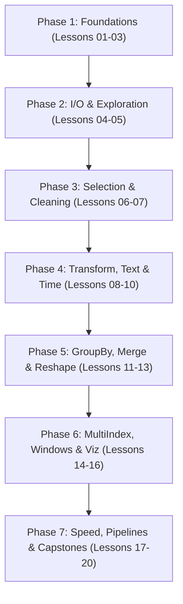

# 🐼 Master Python Pandas: සම්පූර්ණ සිංහල Self-Study පාඨමාලාව

> **සති 12න් Zero සිට Production-Grade Data Pipelines දක්වා!**  
> ඔයාගේ පළවෙනි `pd.read_csv()` එකේ ඉඳන්, messy data clean කරලා, time series analyze කරලා, RAM & speed optimize කරලා, `pytest` එක්ක production ETL pipelines හදන තැනටම සරල සිංහලෙන්!

---

## 🎯 මේ පාඨමාලාව කාටද?

- **කාටද:** Basic Python (variables, lists, dicts, functions, loops) දන්න analysts, data scientists, engineers, සහ students ලට.
- **අවශ්‍යතා (Prerequisites):** Python 3.10+, terminal එකේ basic වැඩ කරන්න පුළුවන්කම, සහ හැම code example එකක්ම තමන් අතින් type කරලා practice කරන්න තියෙන උනන්දුව!
- **Standard Imports (හැම පාඩමකම):**
```python
import pandas as pd
import numpy as np

print(pd.__version__)
```

---

## 🗺️ සම්පූර්ණ Learning Path (ඉගෙන ගන්නා පිළිවෙළ)



---

## 📚 සම්පූර්ණ පාඩම් මාලාව (All 20 Lessons)

| # | පාඩම (Lesson) | ආවරණය වන ප්‍රධාන මාතෘකා |
| --- | --- | --- |
| **01** | [Setup and Foundations](01_Setup_and_Foundations.md) | Environment setup, NumPy/Arrow backend, Series vs DataFrame, Index, dtypes |
| **02** | [Series in Depth](02_Series_in_Depth.md) | 1D labeled arrays, vectorised ops, value counts, indexing, alignment |
| **03** | [DataFrame in Depth](03_DataFrame_in_Depth.md) | Creating DataFrames, columns/rows manipulation, axes, copying |
| **04** | [Reading and Writing Data](04_Reading_and_Writing_Data.md) | CSV, Excel, Parquet, JSON, SQL, APIs, dtypes & `parse_dates` |
| **05** | [Inspecting and Exploring Data](05_Inspecting_and_Exploring_Data.md) | `head`, `info`, `describe`, profiling, missing & duplicate checks |
| **06** | [Selection, Indexing and Filtering](06_Selection_Indexing_and_Filtering.md) | `loc`, `iloc`, boolean masks, `isin`, `between`, `query`, `filter` |
| **07** | [Data Cleaning](07_Data_Cleaning.md) | Missing values (`isna`/`fillna`/`dropna`), duplicates, outliers, type fixing |
| **08** | [Data Transformation](08_Data_Transformation.md) | `assign`, `np.where`, `np.select`, `map`, `apply`, `cut`, `qcut`, ranking |
| **09** | [Text Data and Categoricals](09_Text_Data_and_Categoricals.md) | `.str` accessor, regex `extract`/`replace`, `category` dtype & ordering |
| **10** | [Dates, Times and Time Series](10_Dates_Times_and_Time_Series.md) | `to_datetime`, `.dt`, `DatetimeIndex`, `resample`, `shift`, time zones |
| **11** | [GroupBy and Aggregation](11_GroupBy_and_Aggregation.md) | Split-Apply-Combine, `agg`, named aggregations, `transform`, `filter` |
| **12** | [Combining Data](12_Combining_Data.md) | `concat`, `merge` (joins & `validate=`), `join`, `merge_asof` |
| **13** | [Reshaping](13_Reshaping.md) | `pivot`, `pivot_table`, `melt`, `stack`, `unstack`, `crosstab`, `explode` |
| **14** | [MultiIndex and Hierarchical Data](14_MultiIndex_and_Hierarchical_Data.md) | Hierarchical indexing, `xs`, `IndexSlice`, `swaplevel`, sorting |
| **15** | [Window Functions](15_Window_Functions.md) | `rolling`, `expanding`, `ewm`, moving averages, cumulative stats |
| **16** | [Visualization and Styler](16_Visualization_and_Styler.md) | `.plot()` charts, Matplotlib/Seaborn integration, `df.style` formatting |
| **17** | [Performance, Memory and Scaling](17_Performance_Memory_and_Scaling.md) | Vectorisation, `shrink(df)`, `chunksize`, Parquet, PyArrow, Numba, Polars/DuckDB |
| **18** | [Advanced Topics](18_Advanced_Topics.md) | `pipe()` pipelines, `pytest` testing, `pandera`, custom accessors, interop |
| **19** | [Real-World Use Cases and Capstones](19_Real_World_Use_Cases_and_Capstones.md) | 10 domains + 6 full capstones (Sales, RFM, Stock, Cleaning, Big-File, Cohort) |
| **20** | [Cheat Sheet, Pitfalls and Study Plan](20_Cheat_Sheet_Pitfalls_and_Study_Plan.md) | Quick-reference table, Top 10 pitfalls, 12-week plan, mastery checklist |

---

## 🗓️ සති 12 පාඨමාලා සැලැස්ම (12-Week Roadmap)

| සතිය (Week) | Modules | ඉලක්කය (Milestone) |
| --- | --- | --- |
| **1** | 1 to 3 | Series සහ DataFrames හදලා manipulate කරන්න |
| **2** | 4 to 5 | ඕනෑම dataset එකක් load කරලා profile කරන්න |
| **3** | 6 to 7 | හරියටම select කරන්න; messy data clean කරන්න |
| **4** | 8 to 9 | Columns transform කරන්න; text සහ categories handle කරන්න |
| **5** | 10 | Time series analyze කරන්න |
| **6** | 11 | `groupby`, `transform`, සහ `agg` වලින් aggregate කරන්න |
| **7** | 12 to 13 | Tables join කරන්න; `pivot` සහ `melt` කරන්න |
| **8** | 14 to 15 | MultiIndex සහ rolling windows පාවිච්චි කරන්න |
| **9** | 16 | ප්‍රතිඵල visualise සහ style කරන්න |
| **10** | 17 | Speed සහ RAM optimize කරන්න |
| **11** | 18 | Advanced patterns, `pytest` testing, සහ interop |
| **12** | 19 (+20) | Capstone Projects 2ක් සම්පූර්ණ කරලා publish කරන්න! |

---

## 💡 ඉගෙන ගන්න හොඳම විදිය

1. **Jupyter Notebook** හෝ **VS Code** notebook එකක් open කරගන්න.
2. හැම පාඩමකම තියෙන code එක **අතින් type කරලා** run කරලා output එක බලන්න.
3. හැම පාඩමකම අග තියෙන **Exercises** ටික තනියම try කරලා, ඊට පස්සේ `✅ පිළිතුර බලන්න` click කරලා compare කරන්න.
4. පටන් ගන්න: 👉 **[පාඩම 01: Setup and Foundations](01_Setup_and_Foundations.md)**
