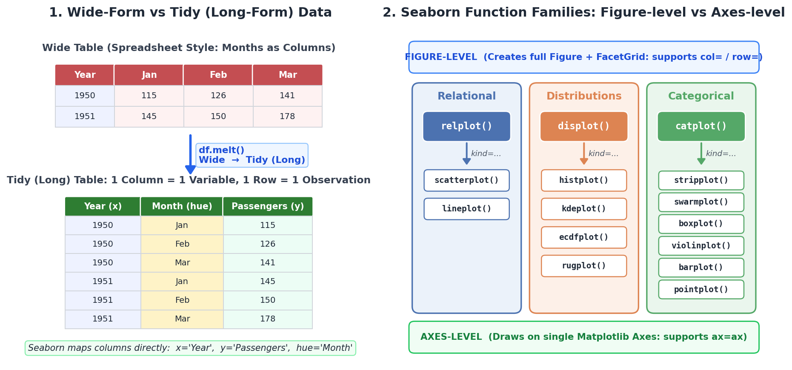
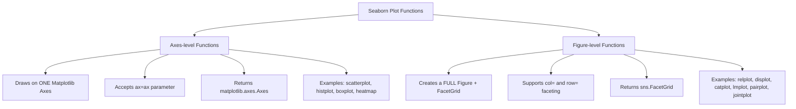
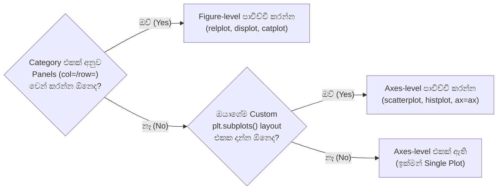

# පාඩම 01: Setup, Philosophy, Tidy Data සහ Function Families

> 🧭 **Navigation:** [🏠 Course Home (README)](README.md) | [ඊළඟ පාඩම: Relational Plots ➡️](02_Relational_Plots.md)

---

## 🎯 මේ පාඩමෙන් අපි මොනවද ඉගෙන ගන්නේ?

ඔයා කලින් Matplotlib පාවිච්චි කරලා තියෙනවා නම් දන්නවා ඇති, ලස්සන statistical chart එකක් අඳින්න code පේළි 15–20ක් විතර ලියන්න වෙනවා. **Seaborn** කියන්නේ ඒ වැඩේ හරිම ලේසි කරන, Matplotlib උඩින්ම හදපු **high-level data visualization library** එකක්! Pandas `DataFrame` එකක් දුන්නම **එක code පේළියකින්** professional statistical chart එකක් අඳින්න Seaborn වලින් පුළුවන්.

මේ පාඩමෙන් අපි සම්පූර්ණයෙන්ම ඉගෙන ගන්නේ:
1. **Setup සහ Bundled Datasets** — Seaborn install කරලා, practice datasets load කරගන්න විදිය.
2. **Tidy (Long) Data vs Wide-Form Data** — Seaborn කැමතිම data format එක සහ `df.melt()` / `df.pivot()` පාවිච්චි කරන විදිය.
3. **The Universal Pattern (`data, x, y, hue, size, style`)** — එක call එකකින් variables ගණනාවක් පෙන්වන විදිය.
4. **Axes-level vs Figure-level Function Families** — `scatterplot` වගේ functions සහ `relplot` වගේ functions අතර වෙනස හා හරි එක තෝරාගන්න විදිය.
5. **Statistical Aggregation සහ Missing Data (`NaN`)** — Seaborn auto-calculate කරන විදිය හා `NaN` handle වෙන විදිය.

---

## 1. Setup සහ Example Datasets

### 1.1 Installation සහ Standard Imports
Seaborn වැඩ කරන්නේ **NumPy**, **pandas**, සහ **Matplotlib** උඩ. ඒ නිසා Seaborn install කරද්දී ඒවත් auto install වෙනවා:

```bash
# pip පාවිච්චි කරනවා නම්:
pip install seaborn

# conda පාවිච්චි කරනවා නම්:
conda install seaborn
```

හැම Python notebook එකකම හෝ script එකකම මුලින්ම මේ standard imports ටික දාගන්න:

```python
import seaborn as sns
import matplotlib.pyplot as plt
import pandas as pd
import numpy as np

print(sns.__version__)   # Install වෙලා තියෙන Seaborn version එක බලන්න
sns.set_theme()          # Seaborn වල ලස්සන default theme එක apply කරන්න
```

> [!TIP]
> `sns.set_theme()` කියන line එක දැම්මම Matplotlib වල සාමාන්‍ය කැත default look එක අයින් වෙලා, clean grid එකක්, ලස්සන soft colors සහ පැහැදිලි font sizes auto apply වෙනවා!

### 1.2 Bundled Example Datasets (Practice Datasets)
අලුතින් CSV files හොය හොයා ඉන්න ඕනේ නෑ! Seaborn එක්කම ලෝක ප්‍රසිද්ධ practice datasets ගොඩක් එනවා (මුල් පාර call කරද්දී internet එකෙන් පොඩි CSV එක download වෙනවා):

| Dataset නම | අඩංගු දේ (What's inside) | හොඳම පාවිච්චිය |
| :--- | :--- | :--- |
| `'tips'` | Restaurant bills, tips, day, time, smoker, party size | Scatter, Box, Violin plots |
| `'penguins'` | Palmer Penguins species, bill length, flipper length, body mass | Histograms, KDE, Pair plots |
| `'iris'` | මල් වර්ග 3ක petal/sepal මිනුම් | Classification & Pair plots |
| `'flights'` | 1949–1960 මාසික ගුවන් මගීන් ගණන (Year, Month, Passengers) | Line plots, Heatmaps |
| `'titanic'` | Titanic මගීන්ගේ වයස, class, survival විස්තර | Categorical & Count plots |
| `'diamonds'` | දියමන්ති 53,000+ ක carat, cut, color, price | Large-data plots, Hexbin |
| `'planets'` | Exoplanets සොයාගත් වසර, mass, orbital period | Log scales, Time trends |
| `'mpg'` | කාර් වල mileage, horsepower, weight, origin | Regression & Multi-variable |

```python
# තියෙන ඔක්කොම datasets ලැයිස්තුව බලන්න
print(sns.get_dataset_names())

# Dataset එකක් Pandas DataFrame එකක් විදියට load කරගන්න
tips = sns.load_dataset('tips')
print(tips.head())
```

---

## 2. Tidy (Long) Data vs Wide-Form Data

Seaborn වල සම්පූර්ණ දර්ශනය (philosophy) රඳා පවතින්නේ ප්‍රධාන අදහස් **දෙකක්** උඩ:
1. **Tidy (Long-form) Data**
2. **Consistent Function Families**

### 🍽️ සරල උදාහරණයකින් තේරුම් ගමු!
හිතන්න ඔයා ගාව කඩේක මාසික විකුණුම් (Sales) Excel sheet එකක් තියෙනවා කියලා.
- **Wide-form (Excel / Spreadsheet style):** Columns වල තියෙන්නේ `Year`, `Jan`, `Feb`, `Mar`. මේක මිනිස්සුන්ට කියවන්න ලේසියි.
- **Tidy / Long-form:**
  1. **හැම Column එකක්ම එක Variable එකක්** (`Year`, `Month`, `Passengers`).
  2. **හැම Row එකක්ම එක Observation (දත්ත සටහනක්)** (`1950, Jan, 115`).

Seaborn කැමතිම මේ **Tidy (Long)** format එකට! ඇයි? එතකොට අපිට කෙලින්ම කියන්න පුළුවන්: *"x-axis එකට `Year` ගන්න, y-axis එකට `Passengers` ගන්න, පාට (`hue`) එකට `Month` ගන්න!"* කියලා.



### Wide Data ➔ Tidy Data හරවන විදිය (`df.melt` සහ `df.pivot`)
- **Wide ➔ Long (Tidy):** `df.melt()` පාවිච්චි කරනවා (දිය කරලා දිගු කරනවා වගේ!).
- **Long ➔ Wide:** `df.pivot()` පාවිච්චි කරනවා (ආපහු table/matrix එකක් හදන්න — විශේෂයෙන් Heatmaps වලට).

```python
flights = sns.load_dataset('flights')

# 1. Long සිට Wide table එකක් හදමු (df.pivot)
flights_wide = flights.pivot(index='year', columns='month', values='passengers')

# 2. Wide table එකක් ආපහු Tidy (Long) format එකට හරවමු (df.melt)
long_df = flights_wide.melt(ignore_index=False, var_name='month', value_name='n').reset_index()
print(long_df.head())

# 3. Wide-form data කෙලින්ම දීලත් සරල plot එකක් අඳින්න පුළුවන්!
sns.lineplot(data=flights_wide)
plt.show()
```

> [!NOTE]
> `sns.lineplot(data=wide_df)` වගේ සරල plots වලට Seaborn **wide-form data** පිළිගන්නවා (එක එක column එකට එක එක line එකක් අඳිනවා). හැබැයි `hue`, `col`, `row`, `style` වගේ power features පාවිච්චි කරන්න නම් **Tidy (Long) Data** අනිවාර්යයි!

---

## 3. The Universal Pattern: `data, x, y, hue, size, style`

Seaborn වල හැම function එකකම වගේ තියෙන්නේ එකම ලස්සන pattern එකක්:
```python
sns.<plot_function>(data=df, x='col1', y='col2', hue='col3', size='col4', style='col5')
```

මේක හරියට **2D කොළයක Dimensions 5ක්** පෙන්වනවා වගේ වැඩක්!
- `data=` : ඔයාගේ Pandas DataFrame එක.
- `x=`, `y=` : තිරස් සහ සිරස් අක්ෂ වලට දාන column නම්.
- `hue=` : **පාට (Color)** මගින් 3වෙනි variable එකක් පෙන්වනවා (උදා: `time='Lunch'/'Dinner'`).
- `size=` : **ප්‍රමාණය (Size)** මගින් 4වෙනි variable එකක් පෙන්වනවා (උදා: කණ්ඩායමේ ඉන්න ගණන).
- `style=` : **හැඩය / ඉරි රටාව (Marker / Dash style)** මගින් 5වෙනි variable එකක් පෙන්වනවා (උදා: `smoker='Yes'/'No'`).

---

## 4. Axes-Level vs Figure-Level Function Families

මේක තමයි Seaborn වල **වැදගත්ම concept එක**! Seaborn functions ප්‍රධාන කොටස් 2කට බෙදෙනවා:



### 🏠 ගෙදරක කාමර උදාහරණය (Analogy)
- **Axes-level function (`scatterplot`, `histplot`, `boxplot`, `heatmap`):** මේක හරියට ඔයා දැනටමත් හදාගත්ත ගෙදරක (Figure) තියෙන **එක කාමරයකට (`ax`)** ගිහින් චිත්‍රයක් අඳින චිත්‍ර ශිල්පියෙක් වගේ. ඔයාට `fig, axes = plt.subplots(1, 2)` හදලා, වම් කාමරේට (`axes[0]`) histogram එකකුත්, දකුණු කාමරේට (`axes[1]`) scatter plot එකකුත් දාන්න පුළුවන්!
- **Figure-level function (`relplot`, `displot`, `catplot`, `lmplot`, `pairplot`, `jointplot`):** මේක හරියට **අලුතින්ම මුළු ගෙදරම (Figure)** හදලා, categories අනුව කාමර (`col=`, `row=`) auto බෙදලා, legend එකත් එළියෙන් ලස්සනට තියන Architect කෙනෙක් වගේ!

### කොයි එකද තෝරාගන්නේ? (Decision Flowchart)



---

## 5. Statistical Aggregation සහ Missing Data (`NaN`)

### 5.1 Automatic Statistical Aggregation
Matplotlib වලදී mean එක හෝ 95% confidence interval එක ඔයා අතින් ගණන් හදන්න ඕනේ. හැබැයි Seaborn වල `lineplot`, `barplot`, `pointplot` වගේ functions ඒක **auto හදනවා**!
- `estimator=` : මොන summary එකද ගන්නේ? (Default: `'mean'`, ඔයාට `'median'`, `np.sum` වගේ දෙන්න පුළුවන්).
- `errorbar=` : Uncertainty / error bar එක මොකක්ද? (උදා: `('ci', 95)`, `'sd'`, `'se'`, `None`).
- `stat=` : Distribution plots වල `'count'`, `'density'`, `'probability'` වගේ තෝරන්න.

### 5.2 Missing Data (`NaN`)
ඔයාගේ DataFrame එකේ හිස් අගයන් (`NaN`) තිබුණොත් Seaborn crash වෙන්නේ නෑ — ඒ plot එකට අදාළ `NaN` rows **auto drop කරලා** ඉතුරු data වලින් plot එක අඳිනවා. හැබැයි data වලින් ලොකු කොටසක් `NaN` වෙලා නම් ඔයා නොදැනුවත්වම වැරදි තීරණ ගන්න පුළුවන්! ඒ නිසා plot කරන්න කලින් pandas වලින් `df.isna().sum()` බලලා clean කරගන්න එක හොඳම පුරුද්දක්.

---

## 💻 සම්පූර්ණ Code උදාහරණය (Complete Walkthrough)

```python
import seaborn as sns
import matplotlib.pyplot as plt

sns.set_theme(style='whitegrid')
tips = sns.load_dataset('tips')
print(tips.head())

# 1. Axes-level: ඔයාම හදාගත්ත Axes එකක් උඩ අඳිනවා
fig, ax = plt.subplots(figsize=(6, 4))
sns.scatterplot(data=tips, x='total_bill', y='tip', hue='time', ax=ax)
ax.set_title('Axes-level: Bill vs Tip by Meal Time')
plt.show()

# 2. Figure-level: අලුත් Figure එකක් හදලා, 'time' අනුව columns දෙකකට බෙදනවා
g = sns.relplot(
    data=tips,
    x='total_bill',
    y='tip',
    hue='smoker',
    col='time',
    height=3.5
)
g.set_axis_labels('Bill ($)', 'Tip ($)')
g.figure.suptitle('Figure-level: Faceted by Meal Time', y=1.03)
plt.show()
```

### 🔍 Line-by-Line පැහැදිලි කිරීම
- **`sns.set_theme(style='whitegrid')`**: සුදු පසුබිමක ලා grid lines එක්ක clean look එකක් දෙනවා.
- **`fig, ax = plt.subplots(figsize=(6, 4))`**: අඟල් 6×4 ප්‍රමාණයේ Matplotlib figure එකයි එක Axes එකයි හදනවා.
- **`sns.scatterplot(..., ax=ax)`**: Axes-level function එකට `ax=ax` දුන්නම ඒක කෙලින්ම අපේ කාමරේ ඇතුළෙම අඳිනවා.
- **`g = sns.relplot(..., col='time', height=3.5)`**: Figure-level function එකක්! `col='time'` නිසා Lunch වලට වම් පැත්තේ chart එකකුත්, Dinner වලට දකුණු පැත්තේ chart එකකුත් auto හැදෙනවා. Return වෙන්නේ `FacetGrid` object එකක් (`g`).
- **`g.set_axis_labels('Bill ($)', 'Tip ($)')`**: `FacetGrid` එකේ හැම subplot එකකම x සහ y labels එකපාරින්ම වෙනස් කරනවා.

### 👀 Expected Visual Output (බලාපොරොත්තු වෙන ප්‍රතිඵලය)
1. **පළමු chart එක:** එකම තනි scatter plot එකක්. X-axis එකේ `total_bill`, Y-axis එකේ `tip`. Lunch points එක පාටකිනුත්, Dinner points තව පාටකිනුත් ඇතුළේ legend එකක් එක්ක පේනවා.
2. **දෙවෙනි chart එක:** පැත්තෙන් පැත්ත තියෙන scatter plots **දෙකක්** (`time = Lunch` | `time = Dinner`), දෙකටම එකම Y-axis scale එකක් තියෙනවා, `smoker` legend එක දකුණු පැත්තේ chart එකෙන් එළියේ පිළිවෙළට තියෙනවා.

---

## 🧠 මතක තබා ගැනීමට පහසු ක්‍රම (Memory Hacks)

1. **"3-Letter Prefix = Figure-level"**: `rel`plot, `dis`plot, `cat`plot, `lm`plot — කෙටි නම් තියෙන ඔක්කොම **Figure-level** (ලොකු පවුල් වල ප්‍රධානියෝ)! දිග විශේෂිත නම් (`scatterplot`, `histplot`, `boxplot`) **Axes-level**.
2. **Tidy Data Rule = "1-1 Rule"**: **1** Column = **1** Variable, **1** Row = **1** Observation.
3. **`melt()` vs `pivot()`**: Ice cream එකක් **melt** වුණාම දිගට ගලාගෙන යනවා (**Wide ➔ Long**).

---

## ⚠️ සාමාන්‍යයෙන් වෙන වැරදි (Common Pitfalls)

> [!WARNING]
> **වැරැද්ද 1: Figure-level function එකකට `ax=ax` දෙන්න හැදීම!**
> `sns.relplot(..., ax=ax)` හෝ `sns.displot(..., ax=ax)` ලිව්වොත් warning/error එනවා හෝ ඔයාගේ `fig, ax` එක හිස්වෙලා අලුත් figure එකක් හැදෙනවා! Figure-level functions වලට `ax=` බෑ. `plt.subplots()` ඇතුළේ දාන්න නම් අනිවාර්යයෙන්ම **Axes-level** (`scatterplot`, `histplot`) පාවිච්චි කරන්න.

> [!WARNING]
> **වැරැද්ද 2: `FacetGrid` එකක `figsize=(10, 4)` දෙන්න හැදීම!**
> Figure-level functions වල size එක control කරන්නේ `figsize` වලින් නෙවෙයි, **`height=`** (එක panel එකක උස) සහ **`aspect=`** (පළල/උස අනුපාතය) වලින්! (Width = `height * aspect`).

> [!WARNING]
> **වැරැද්ද 3: `NaN` values check නොකර plot කිරීම!**
> Seaborn නිශ්ශබ්දවම `NaN` අයින් කරන නිසා, dataset එකේ 40%ක් missing වුණත් chart එක ලස්සනට පේනවා. හැමවෙලේම කලින් `df.isna().sum()` check කරන්න.

---

## 🏋️ ප්‍රායෝගික අභ්‍යාස (Exercises)

### Warm-up Exercise: ඔයාගේ පළමු Seaborn Chart එක
`iris` dataset එක load කරලා, `sepal_length` vs `sepal_width` scatter plot එකක් `species` අනුව පාට කරලා අඳින්න.

<details>
<summary>✅ පිළිතුර බලන්න (Click to see Solution)</summary>

```python
import seaborn as sns
import matplotlib.pyplot as plt

sns.set_theme()
iris = sns.load_dataset('iris')

fig, ax = plt.subplots(figsize=(6, 4))
sns.scatterplot(data=iris, x='sepal_length', y='sepal_width', hue='species', ax=ax)
ax.set_title('Iris: Sepal Length vs Width')
plt.show()
```
</details>

### Exercise 1: Bundled Datasets පරීක්ෂා කිරීම
Seaborn වල bundled datasets තුනක් (`tips`, `penguins`, `flights`) load කරලා ඒවයේ `shape`, `dtypes`, සහ මුල් පේළි (`head()`) print කරන්න.

<details>
<summary>✅ පිළිතුර බලන්න (Click to see Solution)</summary>

```python
import seaborn as sns

for name in ['tips', 'penguins', 'flights']:
    df = sns.load_dataset(name)
    print(f"\n=== {name.upper()} ===")
    print("Shape:", df.shape)
    print("Dtypes:\n", df.dtypes)
    print("First 3 rows:\n", df.head(3))
```
</details>

### Exercise 2: Axes-level vs Figure-level සංසන්දනය
`tips` dataset එකේ `total_bill` vs `tip` scatter plot එක:
(a) ඔයාගේම `plt.subplots()` එකක් උඩ Axes-level function එකකින් අඳින්න.
(b) `col='day'` දාලා Figure-level function එකකින් panels වලට බෙදලා අඳින්න.

<details>
<summary>✅ පිළිතුර බලන්න (Click to see Solution)</summary>

```python
import seaborn as sns
import matplotlib.pyplot as plt

sns.set_theme(style='whitegrid')
tips = sns.load_dataset('tips')

# (a) Axes-level
fig, ax = plt.subplots(figsize=(6, 4))
sns.scatterplot(data=tips, x='total_bill', y='tip', hue='day', ax=ax)
ax.set_title('Axes-level Scatterplot')
plt.show()

# (b) Figure-level split by col='day'
g = sns.relplot(data=tips, x='total_bill', y='tip', hue='time', col='day', height=3.2, aspect=1.0)
g.set_axis_labels('Total Bill ($)', 'Tip ($)')
plt.show()
```
</details>

### Exercise 3: Wide Sales Table ➔ Tidy (Long) Table + Line Plot
පහත දීලා තියෙන wide spreadsheet-style මාසික sales table එක `df.melt()` පාවිච්චි කරලා Tidy (Long) format එකට හරවලා, `hue='Branch'` එක්ක line plot එකක් අඳින්න.

<details>
<summary>✅ පිළිතුර බලන්න (Click to see Solution)</summary>

```python
import pandas as pd
import seaborn as sns
import matplotlib.pyplot as plt

sns.set_theme(style='whitegrid')

# Wide spreadsheet-style table
sales_wide = pd.DataFrame({
    'Month': ['Jan', 'Feb', 'Mar', 'Apr'],
    'Colombo': [120, 145, 160, 175],
    'Kandy':   [85,  95,  110, 130],
    'Galle':   [60,  72,  80,  95]
})

# Wide -> Tidy (Long)
sales_long = sales_wide.melt(id_vars='Month', var_name='Branch', value_name='Sales')
print(sales_long.head())

# Plot with hue
fig, ax = plt.subplots(figsize=(7, 4))
sns.lineplot(data=sales_long, x='Month', y='Sales', hue='Branch', marker='o', ax=ax)
ax.set_title('Monthly Sales by Branch (Tidy Data)')
plt.show()
```
</details>

---

## 📋 Cheat Sheet Summary

| Concept / Task | Key API / Syntax | මතක තබා ගත යුතු කරුණ |
| :--- | :--- | :--- |
| Theme apply කිරීම | `sns.set_theme()` | හැම notebook එකකම මුලින්ම දාන්න |
| Dataset load කිරීම | `sns.load_dataset('tips')` | `sns.get_dataset_names()` වලින් list එක බලන්න |
| Wide ➔ Tidy (Long) | `df.melt(id_vars=..., var_name=..., value_name=...)` | Column 1 = Variable 1, Row 1 = Observation 1 |
| Tidy ➔ Wide | `df.pivot(index=..., columns=..., values=...)` | Heatmaps වලට ගොඩක් ඕන වෙනවා |
| Semantic Mapping | `x=, y=, hue=, size=, style=` | එක call එකකින් variables 5ක් දක්වා |
| Axes-level Plot | `sns.scatterplot(..., ax=ax)` | Custom `plt.subplots()` වලට; `Axes` return කරයි |
| Figure-level Plot | `sns.relplot(..., col=, row=, height=)` | Faceting වලට; `FacetGrid` return කරයි |
| Axis labels (FacetGrid) | `g.set_axis_labels('X', 'Y')` | හැම facet එකකම labels එකපාරින් set කරයි |
| Statistical Summary | `estimator=`, `errorbar=`, `stat=` | Seaborn auto calculate කරයි |
| Missing Data | `df.isna().sum()` | Seaborn `NaN` auto drop කරයි — කලින් check කරන්න |

---

> 🧭 **Navigation:** [🏠 Course Home (README)](README.md) | [ඊළඟ පාඩම: Relational Plots ➡️](02_Relational_Plots.md)
