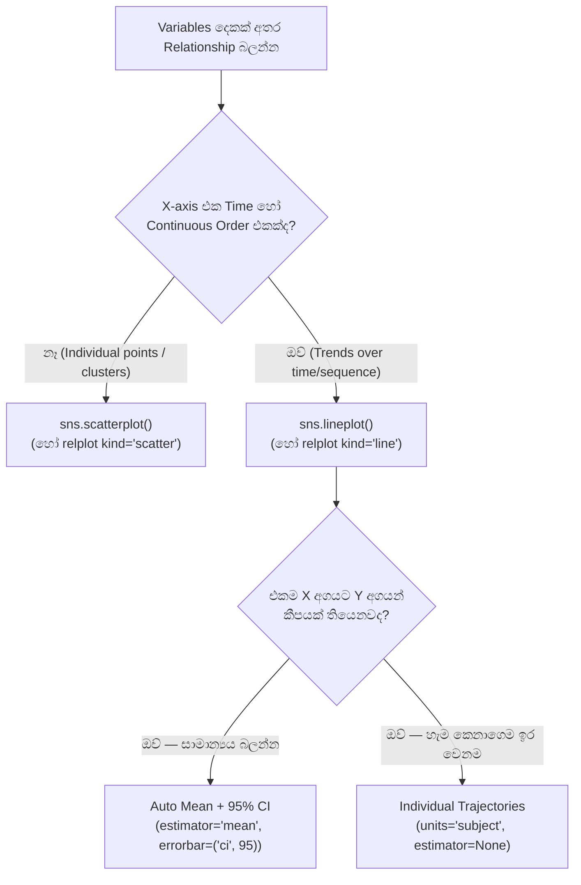
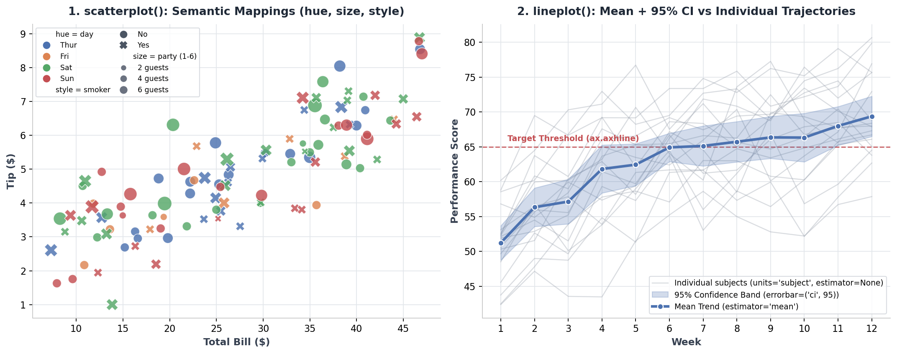
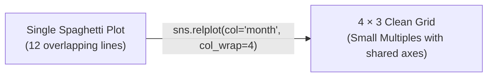

# පාඩම 02: Relational Plots (`scatterplot`, `lineplot`, `relplot`)

> 🧭 **Navigation:** [⬅️ පෙර පාඩම: Setup & Tidy Data](01_Setup_Tidy_Data_and_Function_Families.md) | [🏠 Course Home (README)](README.md) | [ඊළඟ පාඩම: Distribution Plots ➡️](03_Distribution_Plots.md)

---

## 🎯 මේ පාඩමෙන් අපි මොනවද ඉගෙන ගන්නේ?

Data analysis වලදී අපි නිතරම අහන ප්‍රශ්නයක් තමයි: **"Variable දෙකක් අතර සම්බන්ධයක් (Relationship) තියෙනවද?"**
- උදා: *Bill එක වැඩි වෙනකොට Tip එකත් වැඩි වෙනවද?* ➔ **Scatter Plot (`sns.scatterplot`)**
- උදා: *අවුරුද්දෙන් අවුරුද්ද ගුවන් මගීන් ගණන කොහොමද වෙනස් වෙන්නේ?* ➔ **Line Plot (`sns.lineplot`)**

මේ පාඩමෙන් අපි Relational family එකේ සියලුම tools ඉගෙන ගන්නවා:
1. **`sns.scatterplot()`** සහ Semantic Mappings (`hue`, `size`, `style`, `alpha`, `palette`, `sizes`, `hue_order`, `size_norm`)
2. **`sns.lineplot()`** සහ Automatic Aggregation + Uncertainty (`estimator`, `errorbar`, `n_boot`, `markers`)
3. **Individual Trajectories (`units=`, `estimator=None`)** සහ **Ordering (`sort=False`)**
4. **`sns.relplot()`** මගින් Small Multiples (`col`, `row`, `col_wrap`, `height`, `aspect`)
5. **Dates (`fig.autofmt_xdate()`), Reference Marks (`ax.axhline`/`ax.axvline`), සහ Legend Control (`sns.move_legend`)**

---

## 1. Relational Family එක තෝරාගන්නේ කොහොමද?





---

## 2. `sns.scatterplot()` සහ Semantic Mappings

Numeric variables දෙකක් (`x`, `y`) අතර සම්බන්ධය හෝ clusters බලන්න `scatterplot` පාවිච්චි කරනවා. මෙතන තියෙන ලොකුම power එක තමයි **Semantic Mappings** — ඒ කියන්නේ අමතර columns visual properties වලට map කිරීම:

| Parameter | Visual Property | හොඳම දත්ත වර්ගය | Control Parameters |
| :--- | :--- | :--- | :--- |
| `hue=` | **පාට (Color)** | Categorical හෝ Numeric | `palette='viridis'`, `hue_order=['Thur','Fri','Sat','Sun']` |
| `size=` | **තිතේ ප්‍රමාණය (Point Size)** | Numeric (උදා: party size) | `sizes=(20, 200)`, `size_norm=(1, 6)` |
| `style=` | **හැඩය (Marker shape)** | Categorical (උදා: smoker) | `markers={'Yes': 'X', 'No': 'o'}` |
| `alpha=` | **විනිවිදභාවය (Transparency)** | Points ගොඩක් overlap වෙද්දී | `0.0` (අදෘශ්‍යමාන) – `1.0` (ඝන), උදා `alpha=0.8` |

> [!TIP]
> **Clutter Rule (අවුල් වෙන එක වළක්වන්න):** එකම scatter plot එකක `hue`, `size`, `style` තුනම දාන්න පුළුවන් වුණාට, ඇහැට තේරුම් ගන්න අමාරු වෙන්න පුළුවන්! සාමාන්‍යයෙන් **`x`, `y` + තව mappings 1ක් හෝ 2ක්** (`hue` විතරක්, හෝ `hue` + `style`) තියෙන එක තමයි පැහැදිලිම.

---

## 3. `sns.lineplot()`: Trends, Aggregation සහ Uncertainty

`lineplot` එකේ තියෙන සුපිරිම feature එක තමයි: **එකම `x` අගයට data rows කීපයක් තිබුණොත්** (උදා: එකම අවුරුද්දට මාස 12ක data), Seaborn ඉබේම ඒවයේ **Mean (සාමාන්‍යය)** ඉර විදියට ඇඳලා, වටේට **95% Confidence Interval (CI)** එක ලා පාට band එකක් විදියට අඳිනවා!

### 3.1 Aggregation Control (`estimator=` සහ `errorbar=`)
සාමාන්‍යය විතරක් පෙන්වනවට වඩා, දත්ත වල විසිරීම (uncertainty) පෙන්වන එක honest data science පුරුද්දක්:

- **`estimator=`**:
  - `'mean'` (default) — සාමාන්‍ය අගය
  - `'median'` — මධ්‍යස්ථ අගය (outliers තියෙන data වලට හොඳයි!)
  - `None` — කිසිම aggregation එකක් නොකර raw data අඳින්න
- **`errorbar=`**:
  - `('ci', 95)` (default) — 95% bootstrapped confidence interval (bootstrap iterations ගණන `n_boot=1000` වලින් control කරන්න පුළුවන්)
  - `'sd'` — Standard Deviation (දත්ත වල විසිරීම පෙන්වන්න)
  - `'se'` — Standard Error
  - `('pi', 90)` — 90% Prediction / Percentile Interval (දත්ත වලින් 90%ක් වැටෙන පරාසය!)
  - `None` — Shaded band එක සම්පූර්ණයෙන්ම අයින් කරන්න

### 3.2 Individual Series / Trajectories (`units=` + `estimator=None`)
හිතන්න ඔයා ගාව රෝගීන් 20 දෙනෙක්ගේ සති 12ක ලකුණු තියෙනවා කියලා. හැම රෝගියාගෙම ගමන් මග (trajectory) වෙන වෙනම ලා ඉරි විදියට අඳින්න ඕනේ නම්:
```python
sns.lineplot(
    data=df, x='week', y='score',
    units='subject', estimator=None,
    alpha=0.4, color='gray'
)
```
> [!NOTE]
> `units='subject'` නැතුව `estimator=None` විතරක් දැම්මොත්, Seaborn හැම subject එකකම points zig-zag විදියට එකට යා කරලා කැත මකුළු දැලක් හදයි! ඒ නිසා **`units=` + `estimator=None`** හැමවෙලේම ජෝඩුවක් විදියට පාවිච්චි කරන්න.

### 3.3 Ordering (`sort=False`)
Default විදියට `lineplot` එක `x` අගයන් කුඩා සිට විශාල දක්වා **sort** කරලා තමයි ඉර අඳින්නේ. හැබැයි ඔයා GPS ගමන් මගක් (path/trajectory) හෝ loop එකක් අඳිනවා නම්, data තියෙන පිළිවෙළටම ඉර අඳින්න **`sort=False`** දාන්න!

---

## 4. `sns.relplot()`: Small Multiples (Faceting)

එක chart එකේ ඉරි 12ක් ඇන්දොත් ඒක හරියට **"Spaghetti Plot"** එකක් වගේ පැටලෙනවා! ඒ වෙලාවට තමයි Figure-level **`sns.relplot()`** පාවිච්චි කරලා, category එක අනුව පොඩි පොඩි charts grid එකක් (**Small Multiples**) හදන්නේ:



- `kind='scatter'` (default) හෝ `kind='line'`
- `col='month'` — Columns වලට බෙදන්න
- `row='region'` — Rows වලට බෙදන්න
- `col_wrap=4` — එක පේළියක panels 4ක් ආවම ඊළඟ පේළියට කඩන්න (12 panels ➔ 3×4 grid!)
- `height=2, aspect=1.3` — එක panel එකක උස හා පළල/උස අනුපාතය

---

## 5. Dates, Reference Marks සහ Legend Control

### 5.1 Datetime X-Axes (දින සහ වෙලාවන්)
X-axis එකේ දින (`datetime`) තියෙනකොට labels එකට ගෑවිලා කියවන්න බැරි වෙනවා. ඒකට Matplotlib වල **`fig.autofmt_xdate()`** දැම්මම දින ලස්සනට ඇල කරලා ඉඩ හදාගන්නවා!

### 5.2 Reference Marks (`ax.axhline` සහ `ax.axvline`)
Target එකක්, threshold එකක් හෝ වැදගත් දිනයක් ලකුණු කරන්න underlying `Axes` එකේ Matplotlib methods කෙලින්ම පාවිච්චි කරන්න:
```python
ax.axhline(y=5.0, color='red', linestyle='--', label='Target Tip')
ax.axvline(x=30.0, color='green', linestyle=':', label='High Bill Cutoff')
```

### 5.3 Legend Control (`legend=` සහ `sns.move_legend`)
- `legend='auto'` / `'brief'` / `'full'` / `False` — Legend එකේ විස්තර ගණන හෝ legend එක සම්පූර්ණයෙන්ම hide කිරීම.
- **`sns.move_legend(ax, "upper left", bbox_to_anchor=(1, 1))`** — Chart එක ඇතුළේ data වහගෙන ඉන්න legend එක පහසුවෙන්ම chart එකෙන් එළියට ගන්න පුළුවන්!

---

## 💻 සම්පූර්ණ Code උදාහරණය (Complete Walkthrough)

```python
import seaborn as sns
import matplotlib.pyplot as plt
import numpy as np
import pandas as pd

sns.set_theme(style='whitegrid')
tips = sns.load_dataset('tips')
flights = sns.load_dataset('flights')

# 1. Multi-variable Scatter Plot + Reference Line + Legend Move
fig, ax = plt.subplots(figsize=(7.5, 4.5))
sns.scatterplot(
    data=tips, x='total_bill', y='tip',
    hue='day', size='size', style='smoker',
    alpha=0.8, sizes=(30, 220), ax=ax
)
ax.axhline(tips['tip'].mean(), color='crimson', linestyle='--', linewidth=1.2)
sns.move_legend(ax, 'upper left', bbox_to_anchor=(1.02, 1))
ax.set_title('Tips vs Total Bill (hue, size, style)')
plt.tight_layout()
plt.show()

# 2. Line Plot with Automatic Aggregation (Mean + 95% CI across all months)
fig, ax = plt.subplots(figsize=(7, 4))
sns.lineplot(
    data=flights, x='year', y='passengers',
    estimator='mean', errorbar=('ci', 95), markers=True, ax=ax
)
ax.set_title('Average Monthly Passengers per Year (with 95% CI)')
plt.show()

# 3. Faceted Line Chart (Small Multiples with col_wrap)
g = sns.relplot(
    data=flights, x='year', y='passengers',
    col='month', col_wrap=4, kind='line',
    height=2.2, aspect=1.3
)
g.figure.suptitle('Monthly Passenger Trends (1949–1960)', y=1.02)
plt.show()
```

### 🔍 Line-by-Line පැහැදිලි කිරීම
- **`hue='day', size='size', style='smoker', alpha=0.8`**: දවසට පාට, party size එකට තිතේ ප්‍රමාණය, smoker status එකට marker හැඩය, සහ overlap පේන්න 80% opacity දෙනවා.
- **`sns.move_legend(ax, 'upper left', bbox_to_anchor=(1.02, 1))`**: Legend එක plot box එකෙන් දකුණු පැත්තේ එළියට ගන්නවා.
- **`estimator='mean', errorbar=('ci', 95)`**: හැම අවුරුද්දකම මාස 12ක data වල සාමාන්‍යය සහ 95% confidence band එක auto අඳිනවා.
- **`col='month', col_wrap=4, kind='line'`**: මාස 12ට වෙන වෙනම පොඩි line charts 12ක් පේළි 3කට (4×3) අහුරලා අඳිනවා.

### 👀 Expected Visual Output (බලාපොරොත්තු වෙන ප්‍රතිඵලය)
1. **Chart 1:** ඉහළට යන positive trend එකක් පෙන්වන scatter plot එකක්; දවස් 4 පාට 4කින්, party size අනුව තිත් ලොකු පොඩි වෙලා, මැදින් රතු කඩ ඉරක් average tip එක පෙන්වනවා, legend එක දකුණු පැත්තේ එළියේ.
2. **Chart 2:** 1949 සිට 1960 දක්වා ඉහළට යන තනි නිල් ඉරක් සහ ඒ වටේට ලා නිල් 95% confidence band එකක්.
3. **Chart 3:** මාස 12 (Jan–Dec) සඳහා 4×3 grid එකක පිළිවෙළට අහුරපු පොඩි line charts 12ක් (ජූලි-අගෝස්තු වල ඉහළම පිම්ම පැහැදිලිව පේනවා).

---

## 🧠 මතක තබා ගැනීමට පහසු ක්‍රම (Memory Hacks)

1. **`relplot` = RELationship Plot**: Scatter සහ Line දෙකම අයිති `relplot` පවුලට (`kind='scatter'` / `kind='line'`).
2. **CI vs PI vs SD**:
   - **`ci`** = Mean එක කොහෙද තියෙන්නේ කියන විශ්වාසය (වැඩි data තියෙද්දී පටු වෙනවා).
   - **`sd` / `pi`** = තනි තනි data points කොච්චර විසිරිලාද කියන එක (පළලයි).
3. **Individual lines = "UE" (`units=` + `estimator=None`)**: හරියට *User Experience* වගේ මතක තියාගන්න!

---

## ⚠️ සාමාන්‍යයෙන් වෙන වැරදි (Common Pitfalls)

> [!WARNING]
> **වැරැද්ද 1: `scatterplot` එකක Variables 5ක් දාලා Over-encoding කිරීම!**
> `hue`, `size`, `style` ඔක්කොම එකපාර දැම්මම chart එක කියවන්න බැරි "fruit salad" එකක් වෙනවා. 3වෙනි හෝ 4වෙනි variable එකට `col=` දාලා `relplot` පාවිච්චි කරන එක ගොඩක් පැහැදිලියි!

> [!WARNING]
> **වැරැද්ද 2: `lineplot` එකේ `sort=False` අමතක වීම!**
> X-axis එක time නෙවෙයි නම් (උදා: drone එකක `(x, y)` coordinates path එකක්), default `sort=True` නිසා Seaborn coordinates අවුල් කරලා අඳිනවා. Trajectory/path වලට අනිවාර්යයෙන් `sort=False` දාන්න.

> [!WARNING]
> **වැරැද්ද 3: `col_wrap=` එක්ක `row=` දාන්න හැදීම!**
> `col_wrap` පාවිච්චි කරන්න පුළුවන් `col=` විතරක් තියෙනකොටයි (`row=` එක්ක combine කරන්න බෑ — error එනවා).

---

## 🏋️ ප්‍රායෝගික අභ්‍යාස (Exercises)

### Warm-up Exercise: Per-Subject Trajectories + Mean Line
Simulated students 10 දෙනෙකුගේ සති 6ක exam scores හදලා, හැම student ගෙම ඉර ලා අළු පාටින් (`units='subject', estimator=None`) සහ උඩින්ම සමස්ත mean ඉර තද නිල් පාටින් අඳින්න.

<details>
<summary>✅ පිළිතුර බලන්න (Click to see Solution)</summary>

```python
import numpy as np
import pandas as pd
import seaborn as sns
import matplotlib.pyplot as plt

sns.set_theme(style='whitegrid')
rng = np.random.default_rng(0)

rows = []
for s in range(1, 11):
    base = rng.normal(55, 8)
    for w in range(1, 7):
        rows.append({'subject': f'S{s}', 'week': w, 'score': base + w * 4 + rng.normal(0, 3)})
df = pd.DataFrame(rows)

fig, ax = plt.subplots(figsize=(7, 4))
# 1. Per-subject faint lines
sns.lineplot(data=df, x='week', y='score', units='subject', estimator=None,
             color='gray', alpha=0.4, ax=ax)
# 2. Overall mean + 95% CI on top
sns.lineplot(data=df, x='week', y='score', color='tab:blue', linewidth=2.5,
             marker='o', errorbar=('ci', 95), ax=ax)
ax.set_title('Individual Student Trajectories vs Group Mean')
plt.show()
```
</details>

### Exercise 1: Semantic Encodings සහ Clutter විශ්ලේෂණය
`tips` dataset එකේ `tip` vs `total_bill` plot එකක් `hue='day'`, `size='size'`, `style='smoker'` දාලා අඳින්න. ඊළඟට ඒක දිහා බලලා මොන encoding එකද උදව් වෙන්නේ, මොන එකද clutter (අවුල්) කරන්නේ කියලා තීරණය කරලා cleaner version එකක් හදන්න.

<details>
<summary>✅ පිළිතුර බලන්න (Click to see Solution)</summary>

```python
import seaborn as sns
import matplotlib.pyplot as plt

sns.set_theme(style='whitegrid')
tips = sns.load_dataset('tips')

# Version A: All 3 encodings at once (can feel cluttered)
fig, ax = plt.subplots(figsize=(7, 4.5))
sns.scatterplot(data=tips, x='total_bill', y='tip',
                hue='day', size='size', style='smoker', alpha=0.8, ax=ax)
sns.move_legend(ax, 'upper left', bbox_to_anchor=(1.02, 1))
ax.set_title('All 3 Encodings: hue + size + style')
plt.tight_layout()
plt.show()

# Version B (Cleaner): Split smoker into col= panels, keep hue='day'
g = sns.relplot(data=tips, x='total_bill', y='tip',
                hue='day', size='size', col='smoker', alpha=0.8, height=4)
g.set_axis_labels('Total Bill ($)', 'Tip ($)')
plt.show()
# Observation: hue (color) + col (faceting) is much easier to read than mixing 4 colors x 2 markers x 6 sizes in one panel!
```
</details>

### Exercise 2: Median Line + 90% Prediction Interval
`flights` dataset එකේ වාර්ෂික `passengers` trend එක **median** ඉරක් සහ **90% prediction interval** (`errorbar=('pi', 90)`) එකක් එක්ක අඳින්න.

<details>
<summary>✅ පිළිතුර බලන්න (Click to see Solution)</summary>

```python
import seaborn as sns
import matplotlib.pyplot as plt

sns.set_theme(style='whitegrid')
flights = sns.load_dataset('flights')

fig, ax = plt.subplots(figsize=(7, 4))
sns.lineplot(
    data=flights, x='year', y='passengers',
    estimator='median', errorbar=('pi', 90),
    marker='o', ax=ax
)
ax.set_title('Yearly Passenger Trend: Median with 90% Prediction Interval')
ax.set_xlabel('Year')
ax.set_ylabel('Passengers')
plt.show()
```
</details>

### Exercise 3: Category අනුව Line Charts Grid එකක් (Shared Axes + Single Title)
`flights` dataset එකේ හැම `month` එකකටම වෙන වෙනම line chart එක ගානේ shared axes තියෙන 4-column grid එකක් හදලා, මුළු figure එකටම එක main title එකක් දාන්න.

<details>
<summary>✅ පිළිතුර බලන්න (Click to see Solution)</summary>

```python
import seaborn as sns
import matplotlib.pyplot as plt

sns.set_theme(style='whitegrid')
flights = sns.load_dataset('flights')

g = sns.relplot(
    data=flights, x='year', y='passengers',
    col='month', col_wrap=4, kind='line',
    height=2.2, aspect=1.3,
    facet_kws={'sharex': True, 'sharey': True}
)
g.set_axis_labels('Year', 'Passengers')
g.set_titles('{col_name}')
g.figure.suptitle('Airline Passengers Growth by Month (1949–1960)', y=1.03, fontsize=13, fontweight='bold')
plt.show()
```
</details>

---

## 📋 Cheat Sheet Summary

| Task | Function / Option | උදාහරණය |
| :--- | :--- | :--- |
| Scatter plot (Axes-level) | `sns.scatterplot()` | `sns.scatterplot(data=df, x='a', y='b', hue='c', size='d', style='e', alpha=0.8)` |
| Line plot (Axes-level) | `sns.lineplot()` | `sns.lineplot(data=df, x='year', y='val', hue='grp', markers=True)` |
| Faceted relational (Figure-level) | `sns.relplot()` | `sns.relplot(data=df, x='year', y='val', col='grp', col_wrap=4, kind='line')` |
| Median + 90% PI | `estimator=`, `errorbar=` | `estimator='median', errorbar=('pi', 90)` |
| Error bar අයින් කරන්න | `errorbar=None` | `sns.lineplot(..., errorbar=None)` |
| Per-subject raw lines | `units=`, `estimator=None` | `sns.lineplot(..., units='subject', estimator=None)` |
| Path order රැකගන්න | `sort=False` | `sns.lineplot(..., sort=False)` |
| Date labels ඇල කරන්න | `fig.autofmt_xdate()` | Datetime x-axis overlap වෙනකොට |
| Reference threshold line | `ax.axhline()`, `ax.axvline()` | `ax.axhline(50, color='red', linestyle='--')` |
| Legend එළියට ගන්න | `sns.move_legend()` | `sns.move_legend(ax, 'upper left', bbox_to_anchor=(1, 1))` |

---

> 🧭 **Navigation:** [⬅️ පෙර පාඩම: Setup & Tidy Data](01_Setup_Tidy_Data_and_Function_Families.md) | [🏠 Course Home (README)](README.md) | [ඊළඟ පාඩම: Distribution Plots ➡️](03_Distribution_Plots.md)
