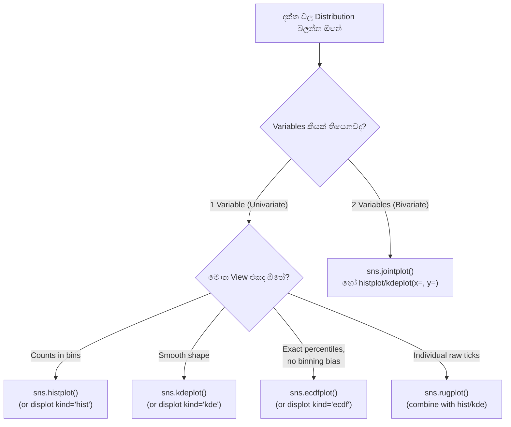
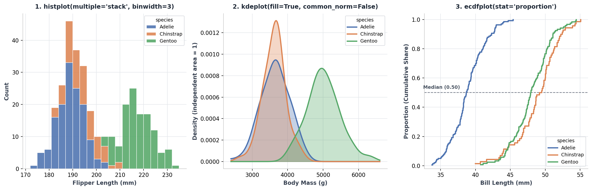
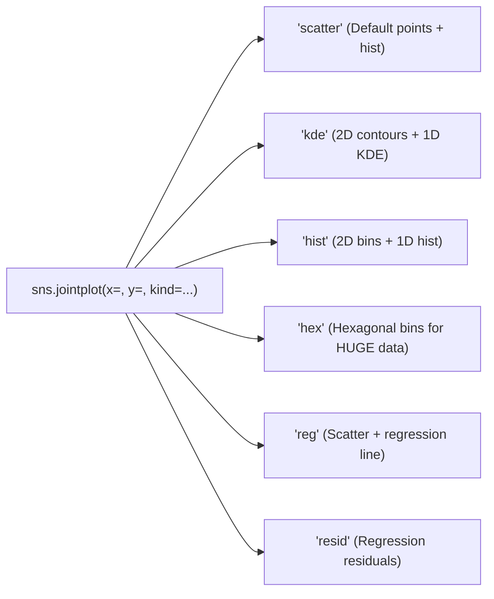

# පාඩම 03: Distribution Plots (`histplot`, `kdeplot`, `ecdfplot`, `displot`, `jointplot`)

> 🧭 **Navigation:** [⬅️ පෙර පාඩම: Relational Plots](02_Relational_Plots.md) | [🏠 Course Home (README)](README.md) | [ඊළඟ පාඩම: Categorical Plots ➡️](04_Categorical_Plots.md)

---

## 🎯 මේ පාඩමෙන් අපි මොනවද ඉගෙන ගන්නේ?

දත්ත වල **Mean** එක හෝ **Median** එක විතරක් බලලා තීරණ ගන්න එක හරිම භයානකයි! මොකද එකම සාමාන්‍යය තියෙන datasets දෙකක දත්ත පැතිරිලා තියෙන හැඩය (Distribution) සම්පූර්ණයෙන්ම වෙනස් වෙන්න පුළුවන් (උදා: peaks දෙකක් තියෙන bimodal distribution එකක්, හෝ එක් පැත්තකට ඇදිච්ච right-skewed distribution එකක්).

ඒ නිසා summary එකක් හදන්න කලින් **දත්ත පැතිරිලා තියෙන හැටි ඇහෙන් බලන්න** අපි Distribution Plots පාවිච්චි කරනවා! මේ පාඩමෙන් අපි ඉගෙන ගන්නේ:
1. **Histogram (`sns.histplot`)** — Bins, `binwidth`, `stat`, `multiple`, `kde=True`, `element='step'`, `cumulative=True`.
2. **Kernel Density Estimate (`sns.kdeplot`)** — Smooth curves, `bw_adjust`, `fill=True`, `common_norm=False`, `cut=`.
3. **ECDF (`sns.ecdfplot`)** — Binning නැතුව නිවැරදිම cumulative share එක බලන විදිය (`stat='proportion'`, `complementary=True`).
4. **Rug Plot (`sns.rugplot`)** — හැම data point එකම පොඩි ඉරි කෑල්ලක් විදියට පෙන්වීම (`height=`, `expand_margins`).
5. **Bivariate Distributions & `sns.jointplot()`** — Variables 2ක joint density + marginal plots (`scatter`, `hist`, `kde`, `hex`, `reg`, `resid`).
6. **`sns.displot()`** — Figure-level faceting (`kind='hist'/'kde'/'ecdf'`, `col=`, `row=`, `rug=True`).
7. **Log Scales (`log_scale=True`), Weighted Data (`weights=`), සහ Bin/Bandwidth තෝරාගැනීම**.

---

## 1. මොන Distribution Plot එකද තෝරාගන්නේ?





---

## 2. Univariate Plots: Histogram, KDE, ECDF සහ Rug

### 2.1 Histogram (`sns.histplot`)
දත්ත range එක සමාන කොටස් (**bins**) වලට කඩලා, එක එක bin එකට වැටෙන ගණන තීරු (bars) වලින් පෙන්වනවා.
- **`bins=20`** හෝ **`binwidth=3`**: Bin ගණන හෝ එක bin එකක පළල තීරණය කරන්න.
- **`stat=`**: Y-axis එකේ මොකක්ද පෙන්වන්නේ?
  - `'count'` (default) — ගණන
  - `'density'` — වර්ගඵලය 1 වෙන විදියට normalize කරනවා
  - `'probability'` / `'proportion'` — තීරු වල උස එකතුව 1 වෙනවා (ප්‍රතිශත බලන්න ලේසියි!)
- **`kde=True`**: Histogram එක උඩින්ම smooth KDE ඉරකුත් අඳිනවා.
- **`element='step'`** (හෝ `'bars'`, `'poly'`): Bars වෙනුවට outline step එකක් විතරක් අඳින්න (groups කීපයක් overlap වෙද්දී පැහැදිලියි).
- **`cumulative=True`**: එකතු වෙවී යන (cumulative) histogram එකක්.
- **`multiple=`** (`hue=` දැම්මම groups පෙන්වන විදිය):
  - `'layer'` (default) — එක උඩ එක විනිවිද පේන්න
  - `'stack'` — එක උඩ එක ගොඩ ගහලා (total එකත් පේනවා!)
  - `'dodge'` — පැත්තෙන් පැත්ත
  - `'fill'` — 100% දක්වා පුරවලා අනුපාත (proportions) පෙන්වන්න

### 2.2 Kernel Density Estimate (`sns.kdeplot`)
Histogram එකක තියෙන කැඩුණු bars වෙනුවට, දත්ත වල හැඩය **සුමට (smooth) වක්‍රයකින්** පෙන්වනවා.
- **`fill=True`**: වක්‍රය යටින් පාට පුරවන්න (`alpha=0.4` එක්ක ලස්සනයි!).
- **`bw_adjust=`** (Bandwidth Adjust): Smoothness එක control කරනවා!
  - Default `bw_adjust=1`.
  - **`bw_adjust=0.4`** ➔ වඩාත් detail / bumpy (under-smoothed).
  - **`bw_adjust=2.0`** ➔ ගොඩක් smooth (over-smoothed — ඇත්ත peaks නැතිවෙන්න පුළුවන්!).
- **`common_norm=False`**: **ගොඩක් වැදගත්!** `hue=` දැම්මම එක group එකක data අඩු නම් (උදා: Chinstrap penguins අඩුයි), default `common_norm=True` නිසා ඒකේ curve එක ගොඩක් පොඩි වෙලා පේනවා. `common_norm=False` දැම්මම **හැම group එකකම වර්ගඵලය වෙන වෙනම 1 වෙන නිසා** හැඩයන් සාධාරණව සංසන්දනය කරන්න පුළුවන්!
- **`cut=0`**: Curve එක ඇත්ත data range එකෙන් එළියට (උදා: සෘණ අගයන් වලට) දිග්ගැස්සෙන එක නවත්වනවා.

### 2.3 ECDF (`sns.ecdfplot`) — Statistical Superpower!
**Empirical Cumulative Distribution Function (ECDF)** කියන්නේ X අගයට වඩා අඩු හෝ සමාන දත්ත කොච්චර ප්‍රතිශතයක් තියෙනවද කියලා පෙන්වන step curve එකක්.
- **ලොකුම වාසිය:** `bins` හෝ `bw_adjust` වගේ කිසිම parameter එකක් තෝරන්න ඕනේ නෑ! හැම data point එකම නිවැරදිව පෙන්වනවා.
- **කියවන විදිය:** Y-axis එකේ `0.5` ගාවින් හරස් ඉරක් ඇඳලා curve එක කැපෙන තැන X අගය බැලුවොත් ඒක තමයි හරියටම **Median** එක!
- **`stat='proportion'`** (default) හෝ `'count'`.
- **`complementary=True`**: "මේ අගයට වඩා **වැඩි** කොච්චර ඉන්නවද?" (Survival curve style) බලන්න.

### 2.4 Rug Plot (`sns.rugplot`)
X-axis එක දිගේ හැම තනි data point එකටම පොඩි ඉරි කෑල්ලක් (tick mark) අඳිනවා — හරියට පාපිස්සක (rug) කෙඳි වගේ!
- `height=0.05` (tick වල උස), `expand_margins=True`.
- තනියම නෙවෙයි, KDE හෝ Histogram එකක් යටින් raw data කොහෙද තියෙන්නේ කියලා බලන්න පාවිච්චි කරනවා (`displot(..., rug=True)` වලින් එක පාරින්ම දාන්න පුළුවන්).

---

## 3. Bivariate Distributions, `displot` සහ `jointplot`

### 3.1 Bivariate (2D) `histplot` සහ `kdeplot`
`x=` සහ `y=` දෙකම දුන්නම 2D heatmap/contour plot එකක් හැදෙනවා:
- `sns.histplot(data=penguins, x='bill_length_mm', y='bill_depth_mm', cbar=True)` — 2D color bins + color bar.
- `sns.kdeplot(data=penguins, x='bill_length_mm', y='bill_depth_mm', levels=6, thresh=0.05, fill=True)` — 2D contour rings (`levels=` වලින් වළලු ගණන, `thresh=` වලින් අඩුම density cutoff එක).

### 3.2 `sns.displot()` (Figure-level Faceting)
Categories අනුව distributions වෙන වෙනම panels වල බලන්න:
```python
g = sns.displot(
    data=penguins, x='bill_length_mm',
    col='island', hue='species',
    kind='kde', fill=True, rug=True, height=3
)
```

### 3.3 `sns.jointplot()` (Joint + Marginal Plots)
මැදින් variables 2ක relationship එකත්, උඩින් සහ දකුණු පැත්තෙන් ඒ එක එක variable එකේ individual distribution (marginal) එකත් එකම figure එකක පෙන්වනවා!


- `marginal_kws={'bins': 25, 'fill': True}` වලින් පැත්තේ marginal plots customize කරන්න පුළුවන්.

---

## 4. Special Cases: Log Scales, Weights සහ Bin/Bandwidth Sensitivity

1. **Log Scales (`log_scale=True`)**: ආදායම් (income), ගෙවල් මිල ගණන් (prices) වගේ **right-skewed** (දකුණට දිගු වලිගයක් තියෙන) data වලදී සාමාන්‍ය histogram එකක් වම් පැත්තට තද වෙලා පේන්නේ. `log_scale=True` දැම්මම data ලස්සනට දිගහැරිලා පැහැදිලිව පේනවා! (Bivariate වලට `log_scale=(True, False)` දෙන්න පුළුවන්).
2. **Weighted Data (`weights='count'`)**: ඔයා ගාව raw rows වෙනුවට දැනටමත් ගණන් එකතු කරපු table එකක් තියෙනවා නම් (උදා: `age_group` සහ `population`), `weights='population'` දුන්නම Seaborn ඒ බර අනුව නිවැරදි histogram/KDE එක අඳිනවා.
3. **Choosing Bins & Bandwidth**: Default `bins='auto'` හෝ `bw_adjust=1` හැමවෙලේම ඇත්ත shape එක නොපෙන්වන්න පුළුවන්! Bins ගොඩක් අඩු වුණොත් peaks හැංගෙනවා; bins ගොඩක් වැඩි වුණොත් noise විතරක් පේනවා. ඒ නිසා හැමවෙලේම අගයන් 2–3ක් try කරලා බලන්න.

---

## 💻 සම්පූර්ණ Code උදාහරණය (Complete Walkthrough)

```python
import seaborn as sns
import matplotlib.pyplot as plt

sns.set_theme(style='whitegrid')
penguins = sns.load_dataset('penguins').dropna()

# 1. Stacked Histogram (Axes-level)
fig, ax = plt.subplots(figsize=(6.5, 4))
sns.histplot(
    data=penguins, x='flipper_length_mm', hue='species',
    multiple='stack', binwidth=3, ax=ax
)
ax.set_title('Flipper Length Distribution (Stacked Histogram)')
plt.show()

# 2. Filled KDE with independent normalization
fig, ax = plt.subplots(figsize=(6.5, 4))
sns.kdeplot(
    data=penguins, x='body_mass_g', hue='species',
    fill=True, common_norm=False, alpha=0.4, ax=ax
)
ax.set_title('Body Mass Distribution (KDE, common_norm=False)')
plt.show()

# 3. ECDF Plot (Zero binning bias!)
fig, ax = plt.subplots(figsize=(6.5, 4))
sns.ecdfplot(data=penguins, x='bill_length_mm', hue='species', ax=ax)
ax.axhline(0.5, color='gray', linestyle='--')
ax.set_title('Bill Length ECDF by Species')
plt.show()

# 4. Figure-level displot (Faceted KDE by island)
g = sns.displot(
    data=penguins, x='bill_length_mm', col='island',
    hue='species', kind='kde', fill=True, height=3
)
plt.show()

# 5. Bivariate jointplot (2D KDE + Marginals)
sns.jointplot(
    data=penguins, x='bill_length_mm', y='bill_depth_mm',
    hue='species', kind='kde'
)
plt.show()
```

### 🔍 Line-by-Line පැහැදිලි කිරීම
- **`penguins = sns.load_dataset('penguins').dropna()`**: Missing values (`NaN`) කලින්ම අයින් කරලා clean කරගන්නවා.
- **`multiple='stack', binwidth=3`**: හැම bin එකක්ම 3mm පළලට කඩලා species 3 එක උඩ එක stack කරනවා.
- **`common_norm=False, alpha=0.4`**: Species 3ක count එක වෙනස් වුණත් (Chinstrap අඩුයි), හැම curve එකක්ම එකම පරිමාණයෙන් (area = 1) පෙන්වලා, 40% විනිවිද පේන විදියට fill කරනවා.
- **`sns.ecdfplot(...)` + `ax.axhline(0.5)`**: Cumulative proportion එක 0 සිට 1 දක්වා step curve එකක් අඳිනවා; 0.5 ඉරෙන් species 3ක median කෙලින්ම කියවන්න පුළුවන්.
- **`sns.jointplot(..., kind='kde')`**: මැද 2D contour rings වලින් clusters 3 පෙන්වන ගමන් උඩින් `bill_length_mm` KDE එකත් දකුණෙන් `bill_depth_mm` KDE එකත් පෙන්වනවා.

### 👀 Expected Visual Output (බලාපොරොත්තු වෙන ප්‍රතිඵලය)
1. **Histogram:** Flipper length 175–230mm අතර, Gentoo (කොළ) දකුණු පැත්තේ වෙනම ඉහළ අගයන් වලත්, Adelie හා Chinstrap වම් පැත්තේත් පැහැදිලිව පේනවා.
2. **KDE:** Smooth කඳු 3ක්. Adelie සහ Chinstrap ගොඩක් overlap වෙලා 3700g ආසන්නයේ තියෙනවා, Gentoo 5000g ආසන්නයේ වෙනම ඉහළින් තියෙනවා.
3. **ECDF:** S-හැඩයේ curves 3ක් 0 සිට 1 දක්වා ඉහළට යනවා. Adelie වම් පැත්තේ (කෙටි හොට), Chinstrap හා Gentoo දකුණු පැත්තේ (දිග හොට).
4. **Jointplot:** මැද 2D contour rings වලින් species 3ම එකිනෙකින් වෙන් වුණු දූපත් 3ක් වගේ පැහැදිලිව වෙන් වෙලා පේනවා!

---

## 🧠 මතක තබා ගැනීමට පහසු ක්‍රම (Memory Hacks)

1. **"H-K-E Trio"**:
   - **H**istogram = **H**eight of bars (bins මත රඳා පවතී).
   - **K**DE = **K**urvy smooth shape (`bw_adjust` මත රඳා පවතී).
   - **E**CDF = **E**xact cumulative share (කිසිම bin/bandwidth අවුලක් නෑ!).
2. **`common_norm=False`**: *"Group sizes අසමාන නම්, `common_norm=False` දාලා සාධාරණ කරන්න!"*
3. **Large Data 2D = `kind='hex'`**: ලක්ෂ ගාණක් points තියෙනකොට `scatter` කළු පාට ගුලියක් වෙනවා — එතකොට මී වදයක් වගේ **`kind='hex'`** පාවිච්චි කරන්න!

---

## ⚠️ සාමාන්‍යයෙන් වෙන වැරදි (Common Pitfalls)

> [!WARNING]
> **වැරැද්ද 1: Default `bins` එක විතරක් විශ්වාස කිරීම!**
> එකම dataset එකේ `bins=5` දැම්මම එක කන්දක් (unimodal) වගේ පේන දේ, `bins=20` දැම්මම කඳු දෙකක් (bimodal) විදියට පේන්න පුළුවන්! හැමවෙලේම bin widths කීපයක් try කරලා, සැක නම් `ecdfplot` එකකින් verify කරන්න.

> [!WARNING]
> **වැරැද්ද 2: KDE එක impossible අගයන් වලට (උදා: සෘණ වයස හෝ මිල) යෑම!**
> Smoothness නිසා `kdeplot` එක 0 ට වඩා අඩු පැත්තටත් curve එක ඇඳගෙන යනවා. ඒක නවත්වන්න **`cut=0`** දාන්න!

> [!WARNING]
> **වැරැද්ද 3: `jointplot` එක `plt.subplots()` ඇතුළේ දාන්න හැදීම!**
> `jointplot` කියන්නේ Figure-level (`JointGrid`) function එකක්. ඒකට `ax=` දෙන්න බෑ — එයා තනියම තමන්ගේම figure එක හදාගන්නවා.

---

## 🏋️ ප්‍රායෝගික අභ්‍යාස (Exercises)

### Warm-up Exercise: Histogram + KDE + Rug එකට
`penguins` dataset එකේ `flipper_length_mm` සඳහා `displot` පාවිච්චි කරලා histogram, smooth KDE curve (`kde=True`), සහ rug marks (`rug=True`) තුනම එකම chart එකේ අඳින්න.

<details>
<summary>✅ පිළිතුර බලන්න (Click to see Solution)</summary>

```python
import seaborn as sns
import matplotlib.pyplot as plt

sns.set_theme(style='whitegrid')
penguins = sns.load_dataset('penguins').dropna()

g = sns.displot(
    data=penguins, x='flipper_length_mm',
    kde=True, rug=True, bins=20, height=4, aspect=1.4
)
g.set_axis_labels('Flipper Length (mm)', 'Count')
g.figure.suptitle('Flipper Length: Histogram + KDE + Rug', y=1.02)
plt.show()
```
</details>

### Exercise 1: Histogram vs KDE vs ECDF සංසන්දනය
`penguins` dataset එකේ species තුනේ `body_mass_g` distribution එක **1×3 subplot** එකක Histogram, KDE (`common_norm=False`), සහ ECDF වලින් ඇඳලා, කොයි view එකද පැහැදිලිම සහ ඇයි කියලා සටහන් කරන්න.

<details>
<summary>✅ පිළිතුර බලන්න (Click to see Solution)</summary>

```python
import seaborn as sns
import matplotlib.pyplot as plt

sns.set_theme(style='whitegrid')
penguins = sns.load_dataset('penguins').dropna()

fig, axes = plt.subplots(1, 3, figsize=(15, 4.5))

sns.histplot(data=penguins, x='body_mass_g', hue='species', element='step', ax=axes[0])
axes[0].set_title('1. Histogram (element="step")')

sns.kdeplot(data=penguins, x='body_mass_g', hue='species', fill=True, common_norm=False, alpha=0.35, ax=axes[1])
axes[1].set_title('2. KDE (common_norm=False)')

sns.ecdfplot(data=penguins, x='body_mass_g', hue='species', ax=axes[2])
axes[2].axhline(0.5, color='gray', linestyle='--')
axes[2].set_title('3. ECDF (Exact Percentiles)')

plt.tight_layout()
plt.show()

# Which is clearest?
# - KDE makes the overall shapes and the big Gentoo shift instantly obvious.
# - ECDF is clearest for reading exact medians/quartiles (e.g., Adelie & Chinstrap overlap heavily around 3700g, while Gentoo median is ~5000g) without any binning/bandwidth choices!
```
</details>

### Exercise 2: Bins 5, 20, සහ 80 වල බලපෑම
`penguins` dataset එකේ `flipper_length_mm` සඳහා `bins=5`, `bins=20`, සහ `bins=80` දාලා histograms 3ක් පැත්තෙන් පැත්ත ඇඳලා හැඩය වෙනස් වෙන හැටි පෙන්වන්න.

<details>
<summary>✅ පිළිතුර බලන්න (Click to see Solution)</summary>

```python
import seaborn as sns
import matplotlib.pyplot as plt

sns.set_theme(style='whitegrid')
penguins = sns.load_dataset('penguins').dropna()

fig, axes = plt.subplots(1, 3, figsize=(14, 4))
for ax, b in zip(axes, [5, 20, 80]):
    sns.histplot(data=penguins, x='flipper_length_mm', bins=b, ax=ax)
    ax.set_title(f'bins = {b}')

fig.suptitle('How Bin Count Changes Histogram Shape', y=1.03, fontsize=13)
plt.tight_layout()
plt.show()
# bins=5 hides the bimodal structure; bins=20 clearly shows 2 peaks; bins=80 is too noisy!
```
</details>

### Exercise 3: Right-Skewed Data වලට Log-Scaled Histogram
Right-skewed `income` (හෝ `diamonds` dataset එකේ `price`) සඳහා සාමාන්‍ය linear histogram එකක් සහ `log_scale=True` histogram එකක් පැත්තෙන් පැත්ත ඇඳලා සංසන්දනය කරන්න.

<details>
<summary>✅ පිළිතුර බලන්න (Click to see Solution)</summary>

```python
import numpy as np
import pandas as pd
import seaborn as sns
import matplotlib.pyplot as plt

sns.set_theme(style='whitegrid')
rng = np.random.default_rng(42)
income_df = pd.DataFrame({'income': rng.lognormal(mean=10.8, sigma=0.75, size=2000)})

fig, axes = plt.subplots(1, 2, figsize=(12, 4))

sns.histplot(data=income_df, x='income', bins=40, ax=axes[0])
axes[0].set_title('Linear Scale (Right-Skewed)')

sns.histplot(data=income_df, x='income', bins=40, log_scale=True, ax=axes[1])
axes[1].set_title('Log Scale (log_scale=True)')

plt.tight_layout()
plt.show()
```
</details>

### Exercise 4: Large Dataset සඳහා Hexagonal `jointplot`
`diamonds` (53,940 rows) dataset එකේ `carat` vs `price` සඳහා `kind='hex'` දාලා `jointplot` එකක් හදන්න (අවශ්‍ය නම් `carat < 2.5` filter කරලා පැහැදිලි කරගන්න).

<details>
<summary>✅ පිළිතුර බලන්න (Click to see Solution)</summary>

```python
import seaborn as sns
import matplotlib.pyplot as plt

sns.set_theme(style='whitegrid')
diamonds = sns.load_dataset('diamonds')
subset = diamonds[diamonds['carat'] < 2.5]

g = sns.jointplot(
    data=subset, x='carat', y='price',
    kind='hex', color='#4C72B0',
    marginal_kws={'bins': 30, 'fill': True}
)
g.set_axis_labels('Carat Weight', 'Price ($)')
g.figure.suptitle('Diamonds: Carat vs Price (Hexbin Jointplot)', y=1.02)
plt.show()
```
</details>

---

## 📋 Cheat Sheet Summary

| Plot Type | Function | Key Options | හොඳම පාවිච්චිය |
| :--- | :--- | :--- | :--- |
| Histogram | `sns.histplot()` | `bins=`, `binwidth=`, `stat=`, `kde=True`, `multiple='stack'/'dodge'/'fill'`, `element='step'`, `cumulative=True` | Counts & quick shape check |
| Kernel Density | `sns.kdeplot()` | `bw_adjust=`, `fill=True`, `common_norm=False`, `cut=0`, `levels=` | Smooth comparison across groups |
| ECDF | `sns.ecdfplot()` | `stat='proportion'`, `complementary=True` | Exact percentiles, zero binning bias |
| Rug | `sns.rugplot()` | `height=`, `expand_margins=` | Raw observation ticks along axis |
| Bivariate 2D | `histplot(x=, y=)`, `kdeplot(x=, y=)` | `cbar=True`, `levels=`, `thresh=` | 2-variable joint density |
| Faceted Dist | `sns.displot()` | `kind='hist'/'kde'/'ecdf'`, `col=`, `row=`, `rug=True` | Distributions split by category |
| Joint + Marginals | `sns.jointplot()` | `kind='scatter'/'hist'/'kde'/'hex'/'reg'/'resid'`, `marginal_kws=` | 2D exploration + 1D marginals |
| Skewed Data | `log_scale=True` | `histplot(..., log_scale=True)` | Income, prices, exponential data |
| Pre-aggregated Data | `weights=` | `histplot(..., weights='count')` | Summarized frequency tables |

---

> 🧭 **Navigation:** [⬅️ පෙර පාඩම: Relational Plots](02_Relational_Plots.md) | [🏠 Course Home (README)](README.md) | [ඊළඟ පාඩම: Categorical Plots ➡️](04_Categorical_Plots.md)
