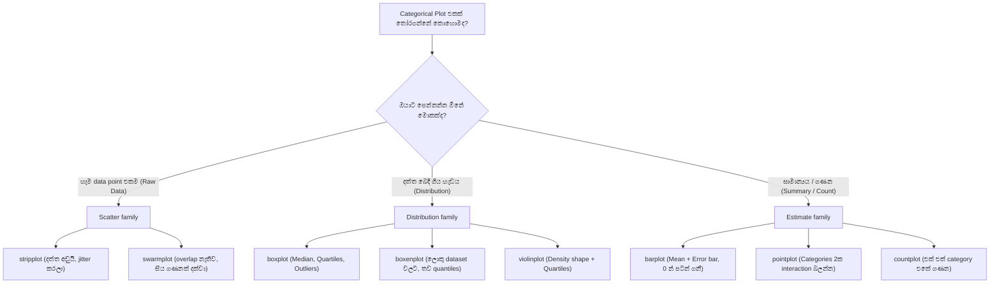
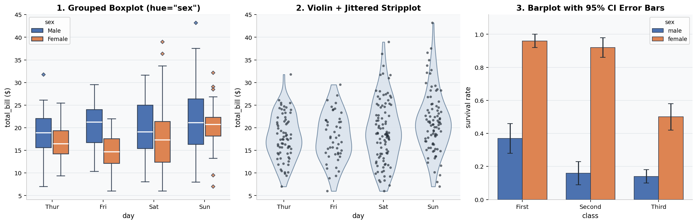

[⬅️ පෙර පාඩම: Distribution Plots](03_Distribution_Plots.md) | [🏠 පාඨමාලා සුචිය (Course Index)](README.md) | [ඊළඟ පාඩම: Regression & Model-Fit Plots ➡️](05_Regression_and_Model_Fit_Plots.md)

# පාඩම 04: Categorical Plots — කාණ්ඩ අනුව දත්ත සංසන්දනය කරමු (Module 4)

> [!TIP]
> **මේ පාඩමෙන් ඔබ ඉගෙන ගන්නේ මොනවාද?**
> Numeric variable (සංඛ්‍යාත්මක දත්ත — උදා: `total_bill`, `tip`, `age`) එකක් විවිධ Categories (කාණ්ඩ — උදා: `day`, `sex`, `class`) අතර compare කරන්න Seaborn වල තියෙන සියලුම **Categorical Plots** (`stripplot`, `swarmplot`, `boxplot`, `boxenplot`, `violinplot`, `barplot`, `pointplot`, `countplot`, සහ `catplot`) සරලව හා නිවැරදිව පාවිච්චි කරන හැටි!

---

## 1. Categorical Plots කියන්නේ මොනවාද? (සරල උදාහරණයකින්!)

හිතන්න ඔයා රෙස්ටුරන්ට් එකක අයිතිකාරයෙක්. ඔයාට දැනගන්න ඕනේ:
*"බ්‍රහස්පතින්දා, සිකුරාදා, සෙනසුරාදා, ඉරිදා — මේ දවස් 4න් කොයි දවසෙද මිනිස්සු වැඩිපුරම බිල් ගෙවන්නේ? පිරිමි අයද, ගැහැණු අයද වැඩිපුරම tip දෙන්නේ?"*

මෙතන:
- **Category (කාණ්ඩය):** `day` (Thur, Fri, Sat, Sun) හෝ `sex` (Male, Female)
- **Numeric Value (සංඛ්‍යාත්මක අගය):** `total_bill` හෝ `tip`

මේ වගේ **Category එකකට සාපේක්ෂව Numeric අගයක් compare කරන්න** පාවිච්චි කරන charts වලට තමයි **Categorical Plots** කියන්නේ. Seaborn මේ plots කොටස් 3කට බෙදනවා:
1. **Categorical Scatterplots (තනි තනි දත්ත පෙන්නන):** `stripplot`, `swarmplot`
2. **Categorical Distribution Plots (බෙදී යාමේ හැඩය පෙන්නන):** `boxplot`, `boxenplot`, `violinplot`
3. **Categorical Estimate Plots (සාරාංශ අගයන් — mean, count — පෙන්නන):** `barplot`, `pointplot`, `countplot`





---

## 2. Seaborn Categorical Plot වර්ග 9ම එකම තැනකින්

| Plot වර්ගය | Function එක | පෙන්නන්නේ මොනවාද? | හොඳම අවස්ථාව (Best for) |
| --- | --- | --- | --- |
| **Strip** | `sns.stripplot` | හැම observation එකම jitter කරපු තිතක් (point) විදිහට | පොඩි datasets (Small data) |
| **Swarm** | `sns.swarmplot` | තිත් එක උඩ එක වැටෙන්නේ නැතිව (no overlap) පෙළගස්වලා | Group එකකට points සිය කිහිපයක් දක්වා |
| **Box** | `sns.boxplot` | Median, Quartiles (Q1, Q3), Whiskers, සහ Outliers | Groups කිහිපයක් සංසන්දනය කරන්න |
| **Boxen** (letter-value) | `sns.boxenplot` | Boxplot එකකට වඩා වැඩි quantiles ගණනක් | ලොකු datasets (Large samples) |
| **Violin** | `sns.violinplot` | KDE density හැඩය + ඇතුළෙන් quartiles | Group එකක distribution හැඩය බලන්න |
| **Bar** | `sns.barplot` | Mean (හෝ වෙනත් estimator එකක්) + error bar | සාරාංශ පෙන්නන්න (හැමවිටම 0 න් පටන් ගන්න) |
| **Point** | `sns.pointplot` | Estimate points ටික ඉරි වලින් යා කරලා + error bars | Categories දෙකක interaction එක බලන්න |
| **Count** | `sns.countplot` | එක් එක් category එකේ තියෙන observations ගණන | Frequencies (ගණන් කිරීමට) |
| **`catplot`** | `sns.catplot` | උඩ තියෙන ඕනෑම plot එකක් **figure-level** එකෙන් (`col=`, `row=` එක්ක) | Group අනුව panels (subplots) හදන්න |

---

## 3. හැම Categorical Plot එකකම වගේ තියෙන Common Options

මේ parameters ටික හොඳට මතක තියාගත්තොත්, ඕනෑම categorical plot එකක් ලස්සනට customize කරන්න පුළුවන්:

- **`order=` / `hue_order=`**: Categories පෙන්නන පිළිවෙළ අපිට ඕන විදිහට වෙනස් කරන්න (උදා: `order=['Sun', 'Sat', 'Fri', 'Thur']`).
- **`hue=`**: දෙවෙනි category එකක් පාට අනුව එකතු කරන්න (උදා: `hue='sex'`).
- **`dodge=`**: `hue=` දැම්මම groups දෙක පැත්තකින් පැත්තට වෙන් කරලා තියන්න (`dodge=True`) හෝ එකම තැන උඩින් තියන්න (`dodge=False`).
- **`orient='h'`**: Plot එක තිරස් අතට (horizontal) හරවන්න. (හෝ `y=` එකට category එක දුන්නම auto horizontal වෙනවා!)
- **`estimator=` & `errorbar=`**: `barplot` සහ `pointplot` වල default පෙන්නන්නේ `mean` (සාමාන්‍යය) සහ 95% confidence interval (`errorbar=('ci', 95)`). ඔයාට ඕන නම් `estimator='median'` හෝ `errorbar='sd'` (standard deviation) හෝ `errorbar=None` දෙන්න පුළුවන්.
- **`split=True`**: `violinplot` වල `hue=` එකට categories 2ක් තියෙනකොට, violin එක දෙකට බෙදලා වම් පැත්තට එක කාණ්ඩයකුත් දකුණු පැත්තට අනිත් කාණ්ඩයකුත් දාන්න (half-violins).
- **`inner=`**: `violinplot` ඇතුළේ පෙන්නන්න ඕන දේ: `'box'` (default), `'quartile'`, `'point'`, `'stick'`, හෝ `None` (හිස්ව තියන්න).
- **`saturation=`, `width=`, `fill=`**: පාටේ තද ගතිය (`saturation=0.75`), box/bar එකේ පළල (`width=0.6`), සහ ඇතුළ පාට කරනවද නැද්ද (`fill=False` දැම්මොත් outline එක විතරයි!).
- **`native_scale=True`**: X-axis එකේ ඉලක්කම් categories (උදා: 2010, 2015, 2025) තියෙනකොට, ඒවා සමාන දුරින් තියන්නේ නැතිව ඇත්ත සංඛ්‍යාත්මක පරතරයට අනුව තියන්න.

---

## 4. Layering — Plots දෙකක් එක උඩ එක දාලා සුපිරි Chart එකක් හදමු!

`boxplot` හෝ `violinplot` එකක් විතරක් ඇන්දම summary එක පේනවා, හැබැයි ඇත්තටම data points කීයක් තියෙනවද, ඒවා කොහේද තියෙන්නේ කියලා පේන්නේ නෑ.
ඒ නිසා Data Scientists ලා කරන හොඳම trick එක තමයි **Layering** — ඒ කියන්නේ `violinplot` හෝ `boxplot` එකක් ඇඳලා, ඒක උඩින්ම `stripplot` හෝ `swarmplot` එකක් අඳින එක!

---

## 5. සම්පූර්ණ Python Code එක සහ පේළියෙන් පේළිය පැහැදිලි කිරීම

```python
import matplotlib.pyplot as plt
import seaborn as sns

# 1. Built-in datasets load කරගමු
tips = sns.load_dataset('tips')
titanic = sns.load_dataset('titanic')

# 2. එකම figure එකක subplots 3ක් (1 row, 3 columns) හදමු
fig, axs = plt.subplots(1, 3, figsize=(13, 4), constrained_layout=True)

# Panel 1: Grouped Boxplot (day අනුව total_bill, sex අනුව පාට බෙදලා)
sns.boxplot(data=tips, x='day', y='total_bill', hue='sex', ax=axs[0])
axs[0].set_title('Grouped Boxplot')

# Panel 2: Layering - Violin plot එක උඩින් Strip plot එකක්
sns.violinplot(data=tips, x='day', y='total_bill', inner=None, ax=axs[1], color='.9')
sns.stripplot(data=tips, x='day', y='total_bill', size=3, color='k', ax=axs[1])
axs[1].set_title('Violin + Stripplot')

# Panel 3: Barplot with 95% Confidence Interval Error Bars
sns.barplot(data=titanic, x='class', y='survived', hue='sex',
            errorbar=('ci', 95), ax=axs[2])
axs[2].set_ylabel('survival rate')
axs[2].set_title('Titanic Survival Rate')

plt.show()

# 3. Figure-level catplot: Meal time (Lunch vs Dinner) අනුව columns දෙකකට බෙදලා
sns.catplot(data=tips, x='day', y='tip', col='time', kind='box', height=3.5)
plt.show()

# 4. Countplot: වැඩිම ගණන ඉඳන් අඩුම ගණනට sort කරලා horizontal bar chart එකක්
sns.countplot(data=titanic, y='deck', order=titanic['deck'].value_counts().index)
plt.show()
```

### 🔍 පේළියෙන් පේළිය පැහැදිලි කිරීම (Line-by-Line Explanation)
- `fig, axs = plt.subplots(1, 3, figsize=(13, 4), constrained_layout=True)`: පේළි 1කට charts 3ක් දාන්න පුළුවන් canvas එකක් හදනවා. `constrained_layout=True` නිසා labels එක උඩ එක වැටෙන්නේ නෑ.
- `sns.boxplot(..., hue='sex', ax=axs[0])`: පළවෙනි කොටුවේ (`axs[0]`) දවස් අනුව `total_bill` පෙන්නනවා, `Male` සහ `Female` වෙන වෙනම පාට දෙකකින්.
- `sns.violinplot(..., inner=None, color='.9')`: දෙවෙනි කොටුවේ (`axs[1]`) ලා අළු පාටින් (`'.9'`) violin එක අඳිනවා. ඇතුළේ box එක අයින් කරන්න `inner=None` දුන්නා, මොකද අපි ඊළඟ පේළියෙන් ඒක උඩින් points දාන නිසා.
- `sns.stripplot(..., size=3, color='k', ax=axs[1])`: ඒ `axs[1]` එක උඩින්ම කළු පාට (`'k'`) පොඩි තිත් (`size=3`) විදිහට හැම bill එකක්ම අඳිනවා.
- `sns.barplot(data=titanic, x='class', y='survived', hue='sex', errorbar=('ci', 95), ax=axs[2])`: `survived` කියන්නේ `0` සහ `1` නිසා, ඒකේ සාමාන්‍යය (mean) කියන්නේ **Survival Rate** එක (බේරුණු ප්‍රතිශතය)! `errorbar=('ci', 95)` මගින් 95% confidence interval ඉර අඳිනවා.
- `sns.catplot(..., col='time', kind='box', height=3.5)`: `catplot` කියන්නේ **Figure-level** function එකක්. `col='time'` දුන්නම `Lunch` සහ `Dinner` වලට වෙන වෙනම subplots දෙකක් auto හැදෙනවා.
- `order=titanic['deck'].value_counts().index`: `deck` column එකේ වැඩිපුරම මගීන් හිටපු deck එකේ ඉඳන් අඩුම එක දක්වා පිළිවෙළට හදලා `countplot` එකට දෙනවා.

### 👀 බලාපොරොත්තු වන ප්‍රතිඵලය (Expected Visual Output)
1. **Panel 1 (Boxplot):** සෙනසුරාදා සහ ඉරිදා දවස්වල `total_bill` මැද අගය (median) සතියේ දවස්වලට වඩා ඉහළ බවත්, outliers කිහිපයක් $40–$50 අතර තියෙන බවත් පේනවා.
2. **Panel 2 (Violin + Strip):** ලා අළු පාට violin හැඩය ඇතුළේ කළු තිත් විසිරිලා තියෙනවා — සිකුරාදා දවසේ දත්ත (තිත්) ඉතා අඩු බව එකපාරටම පේනවා!
3. **Panel 3 (Barplot):** ටයිටැනික් නැවේ 1st, 2nd, 3rd class තුනේම පිරිමි අයට වඩා ගැහැණු අයගේ survival rate එක ගොඩක් වැඩි බවත්, 3rd class පිරිමි අයගේ survival rate එක අඩුම (~14%) බවත් පේනවා.

---

## 6. Pointplot සහ Boxenplot ගැනත් කෙටියෙන් දැනගමු

```python
# Pointplot: Categories දෙකක interaction එක බලන්න සුපිරි!
sns.pointplot(data=titanic, x='class', y='survived', hue='sex', dodge=True)
plt.title('Interaction of Class and Sex on Survival')
plt.show()

# Boxenplot: දත්ත ගොඩක් (උදා: diamonds dataset) තියෙනකොට boxplot වෙනුවට
diamonds = sns.load_dataset('diamonds')
sns.boxenplot(data=diamonds, x='cut', y='price')
plt.show()
```
- **`pointplot`** එකේ lines දෙක සමාන්තර (parallel) නැතිව කැපිලා යනවා නම් හෝ කෝණය වෙනස් වෙනවා නම්, එතන **interaction effect** එකක් තියෙනවා කියලා ඉක්මනින් අඳුරගන්න පුළුවන්!
- **`boxenplot`** එක ලොකු datasets වලදී tails (කෙළවරවල්) වල තියෙන outliers සහ distribution එක `boxplot` එකට වඩා ගොඩක් පැහැදිලිව පෙන්නනවා.

---

## 🧠 මතක තබා ගැනීමට පහසු ක්‍රම (Memory Hacks)

1. **"Raw → Shape → Summary" රීතිය:**
   - **Raw data** ඕනද? → `stripplot` / `swarmplot`
   - **Shape** ඕනද? → `boxplot` / `boxenplot` / `violinplot`
   - **Summary (Mean / Count)** ඕනද? → `barplot` / `pointplot` / `countplot`
2. **`catplot` = "Master Remote Control"**: උඩ තියෙන 8න් ඕනෑම එකක් `col=` හෝ `row=` එක්ක subplots හදන්න ඕන නම්, `sns.catplot(..., kind='...')` පාවිච්චි කරන්න.
3. **`barplot` vs `countplot`**: `countplot` එකට දෙන්නේ **එක** variable එකක් විතරයි (`x=` හෝ `y=`) — ඒක ගණන් කරන්නේ frequency එක. `barplot` එකට `x=` සහ `y=` **දෙකම** ඕනේ — ඒක ගණන් කරන්නේ `y` වල සාමාන්‍යය (mean).

---

## ⚠️ සාමාන්‍යයෙන් වෙන වැරදි (Common Pitfalls)

> [!WARNING]
> 1. **ලොකු Dataset එකකට `swarmplot` පාවිච්චි කිරීම:** Data points දහස් ගණනක් තියෙනකොට `swarmplot` දැම්මොත් ගොඩක් slow වෙනවා සහ *"points could not be placed"* කියලා warning එනවා. එහෙම වෙලාවට `stripplot(alpha=0.3)` හෝ `boxenplot` පාවිච්චි කරන්න.
> 2. **`catplot` එකට `ax=` දෙන්න උත්සාහ කිරීම:** `catplot` කියන්නේ **Figure-level** function එකක්. ඒක තමන්ගේම figure එකක් හදනවා — `ax=axs[0]` වගේ දුන්නොත් error එනවා හෝ ignore වෙනවා! Subplots ඇතුළේ අඳින්න නම් `boxplot`, `violinplot` වගේ axes-level functions පාවිච්චි කරන්න.
> 3. **`barplot` එකේ Y-axis එක 0 න් පටන් නොගැනීම:** Bar වල උස compare කරන්නේ 0 ඉඳන්. ඒ නිසා `barplot` එකක `ylim` එක වෙනස් කරලා 0 අයින් කරන්න එපා — එහෙම කළොත් කියවන කෙනාව නොමඟ යනවා! 0 න් පටන් ගන්න බැරි නම් `pointplot` පාවිච්චි කරන්න.
> 4. **පරණ `ci=95` parameter එක පාවිච්චි කිරීම:** අලුත් Seaborn (v0.12+) වල `ci=95` deprecated කරලා තියෙන්නේ. ඒ වෙනුවට හැමවිටම `errorbar=('ci', 95)` හෝ `errorbar=None` පාවිච්චි කරන්න.

---

## 🏋️ ප්‍රායෝගික අභ්‍යාස (Practical Exercises)

### Warm-up Exercise: Horizontal Sorted Countplot
`tips` dataset එකේ එක් එක් දවසට (`day`) බිල් කීයක් තියෙනවද කියලා වැඩිම දවසේ ඉඳන් අඩුම දවසට horizontal `countplot` එකක් අඳින්න.

<details>
<summary>✅ පිළිතුර බලන්න (Click to see Solution)</summary>

```python
import matplotlib.pyplot as plt
import seaborn as sns

tips = sns.load_dataset('tips')
day_order = tips['day'].value_counts().index

sns.countplot(data=tips, y='day', order=day_order, color='#4C72B0')
plt.title('Number of Bills per Day (Sorted)')
plt.xlabel('Count')
plt.show()
```
</details>

---

### Exercise 1: Tip Percentage by Day (Box + Swarm Layering)
`tips` dataset එකේ `tip_pct` (tip ප්‍රතිශතය = `tip / total_bill * 100`) අලුත් column එකක් හදලා, දවස (`day`) අනුව `boxplot` එකක් ඇඳලා, ඒක උඩින්ම raw data පෙන්නන `swarmplot` එකක් දාන්න.

<details>
<summary>✅ පිළිතුර බලන්න (Click to see Solution)</summary>

```python
import matplotlib.pyplot as plt
import seaborn as sns

tips = sns.load_dataset('tips')
tips['tip_pct'] = (tips['tip'] / tips['total_bill']) * 100

plt.figure(figsize=(7, 4.5))
sns.boxplot(data=tips, x='day', y='tip_pct', color='white', fliersize=0)
sns.swarmplot(data=tips, x='day', y='tip_pct', color='#2B5B84', size=4, alpha=0.75)
plt.ylabel('Tip Percentage (%)')
plt.title('Tip Percentage by Day (Box + Swarm)')
plt.show()
```
*(සටහන: `fliersize=0` දැම්මේ boxplot එකේ outlier තිත් දෙපාරක් — box එකෙනුයි swarm එකෙනුයි — පේන එක නවත්තන්න!)*
</details>

---

### Exercise 2: Titanic Survival Rate by Class & Sex + Error Bar Explanation
`titanic` dataset එකේ `class` සහ `sex` අනුව survival rate එක error bars එක්ක plot කරන්න. ඒ error bars වලින් කියවෙන්නේ මොකක්ද කියලා පැහැදිලි කරන්න.

<details>
<summary>✅ පිළිතුර බලන්න (Click to see Solution)</summary>

```python
import matplotlib.pyplot as plt
import seaborn as sns

titanic = sns.load_dataset('titanic')

sns.barplot(data=titanic, x='class', y='survived', hue='sex', errorbar=('ci', 95))
plt.ylabel('Survival Rate (Mean of survived)')
plt.title('Titanic Survival Rate by Class and Sex (95% CI)')
plt.show()
```
**Error Bars වලින් කියවෙන්නේ මොකක්ද?**
- Default `errorbar=('ci', 95)` කියන්නේ **95% Bootstrap Confidence Interval** එක.
- ඒකෙන් පෙන්නන්නේ අපේ sample එකේ සාමාන්‍යය (mean) වටේට තියෙන **අවිනිශ්චිතතාවය (uncertainty)**.
- Error bar එක **දිගයි නම්** → ඒ කාණ්ඩයේ data අඩුයි හෝ විසිරීම වැඩියි (විශ්වාසය අඩුයි). Error bar එක **කෙටියි නම්** → ඇස්තමේන්තුව ගොඩක් නිවැරදියි (precision වැඩියි).
</details>

---

### Exercise 3: Order Categories by Median Value
`tips` dataset එකේ `day` categories ටික alphabetical පිළිවෙළට නැතිව, එක් එක් දවසේ `total_bill` වල **median** (මැද අගය) වැඩිම දවසේ ඉඳන් අඩුම දවසට sort කරලා `boxplot` එකක් අඳින්න.

<details>
<summary>✅ පිළිතුර බලන්න (Click to see Solution)</summary>

```python
import matplotlib.pyplot as plt
import seaborn as sns

tips = sns.load_dataset('tips')

# එක් එක් day එකේ median total_bill එක ගණන් කරලා descending sort කරමු
median_order = (tips.groupby('day', observed=True)['total_bill']
                    .median()
                    .sort_values(ascending=False)
                    .index)

sns.boxplot(data=tips, x='day', y='total_bill', order=median_order)
plt.title('Total Bill by Day (Ordered by Median)')
plt.show()
```
</details>

---

### Exercise 4: `catplot` Grid of Violins per Meal Time
`sns.catplot` පාවිච්චි කරලා, `tips` dataset එකේ `time` (Lunch / Dinner) අනුව columns දෙකකට බෙදුණු `violinplot` grid එකක් හදන්න (`x='day'`, `y='total_bill'`, `hue='sex'`, `split=True`).

<details>
<summary>✅ පිළිතුර බලන්න (Click to see Solution)</summary>

```python
import matplotlib.pyplot as plt
import seaborn as sns

tips = sns.load_dataset('tips')

g = sns.catplot(
    data=tips,
    x='day',
    y='total_bill',
    hue='sex',
    col='time',
    kind='violin',
    split=True,
    inner='quartile',
    height=4,
    aspect=1.1
)
g.set_axis_labels('Day', 'Total Bill ($)')
plt.show()
```
</details>

---

## 📋 Cheat Sheet Summary Table (ඉක්මන් මතක සටහන)

| කාර්යය (Task) | පාවිච්චි කරන Code එක |
| --- | --- |
| Raw points (jittered) | `sns.stripplot(data=df, x='cat', y='num', alpha=0.5)` |
| Raw points (no overlap) | `sns.swarmplot(data=df, x='cat', y='num', size=4)` |
| Median, Quartiles & Outliers | `sns.boxplot(data=df, x='cat', y='num', hue='grp')` |
| Large dataset quantiles | `sns.boxenplot(data=df, x='cat', y='num')` |
| Density shape + half-violins | `sns.violinplot(data=df, x='cat', y='num', hue='grp', split=True, inner='quartile')` |
| Mean + 95% CI bars | `sns.barplot(data=df, x='cat', y='num', errorbar=('ci', 95))` |
| Two-category interaction | `sns.pointplot(data=df, x='cat1', y='num', hue='cat2', dodge=True)` |
| Category frequency count | `sns.countplot(data=df, y='cat', order=df['cat'].value_counts().index)` |
| Faceted grid (Figure-level) | `sns.catplot(data=df, x='cat', y='num', col='panel', kind='box')` |

---

[⬅️ පෙර පාඩම: Distribution Plots](03_Distribution_Plots.md) | [🏠 පාඨමාලා සුචිය (Course Index)](README.md) | [ඊළඟ පාඩම: Regression & Model-Fit Plots ➡️](05_Regression_and_Model_Fit_Plots.md)
