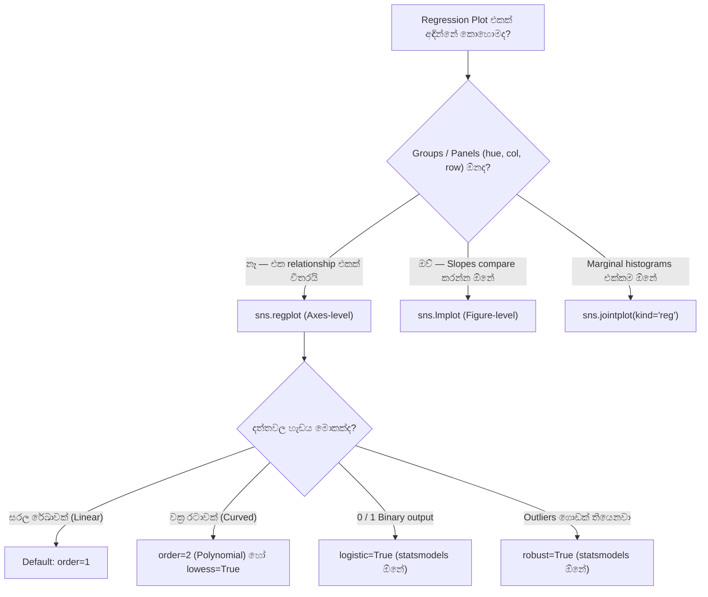
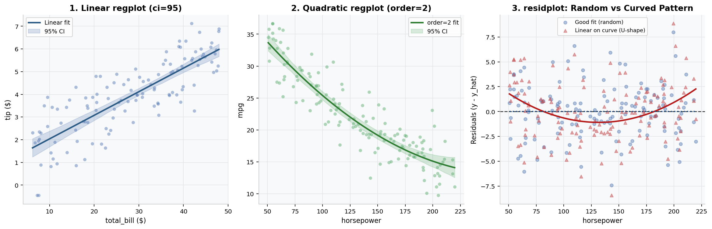

[⬅️ පෙර පාඩම: Categorical Plots](04_Categorical_Plots.md) | [🏠 පාඨමාලා සුචිය (Course Index)](README.md) | [ඊළඟ පාඩම: Matrix Plots — Heatmap & Clustermap ➡️](06_Matrix_Plots_Heatmap_and_Clustermap.md)

# පාඩම 05: Regression & Model-Fit Plots — දත්තවල රටාව සහ ප්‍රවණතාවය හොයමු (Module 5)

> [!TIP]
> **මේ පාඩමෙන් ඔබ ඉගෙන ගන්නේ මොනවාද?**
> දත්ත දෙකක් අතර තියෙන සම්බන්ධය (relationship) හඳුනාගන්න Seaborn වලින් trend line එකක් සහ confidence band එකක් අඳින හැටි (`regplot`, `lmplot`), වක්‍ර trends (`order=2`, `lowess=True`), binary data (`logistic=True`), outliers handle කරන හැටි (`robust=True`), සහ අපේ model එක ඇත්තටම හොඳද කියලා පරීක්ෂා කරන **`residplot`** ගැන සම්පූර්ණයෙන්ම ඉගෙන ගනිමු!

---

## 1. Regression Plots කියන්නේ මොනවාද? (සරල උදාහරණයකින්!)

හිතන්න ඔයා බලනවා: *"රෙස්ටුරන්ට් එකේ බිල (`total_bill`) වැඩි වෙනකොට, මිනිස්සු දෙන `tip` එකත් වැඩි වෙනවද?"*
Scatter plot එකක් ඇන්දම තිත් ගොඩක් පේනවා. ඒ තිත් මැදින් යන **හොඳම සරල රේඛාව (Best-Fit Line)** ඇඳලා, ඒ රේඛාව වටේට **Confidence Interval (විශ්වාස පරාසය)** පටියකුත් දැම්මම, ඒ දත්ත දෙක අතර තියෙන සම්බන්ධය එකපාරටම පැහැදිලි වෙනවා!

හැබැයි වැදගත්ම දෙයක් මුලින්ම මතක තියාගන්න:
> Seaborn වල regression plots හදලා තියෙන්නේ **Data Exploration (දත්ත ගවේෂණය)** සඳහා මිසක්, සම්පූර්ණ statistical modelling (p-values, $R^2$, coefficients, multiple predictors) වලට නෙවෙයි! ඒවාට අපි `statsmodels` හෝ `scikit-learn` පාවිච්චි කරනවා.





---

## 2. `regplot` vs `lmplot` — ප්‍රධාන වෙනස මොකක්ද?

මේ දෙකම කරන්නේ එකම දේ (scatter + regression line), හැබැයි වැදගත් වෙනස්කම් 3ක් තියෙනවා:

| ලක්ෂණය | `sns.regplot()` | `sns.lmplot()` |
| --- | --- | --- |
| **මට්ටම (Level)** | **Axes-level** (ඔයාගේ `ax=axs[0]` ඇතුළේ අඳින්න පුළුවන්) | **Figure-level** (තමන්ගේම `FacetGrid` එකක් හදනවා) |
| **Faceting (`hue`, `col`, `row`)** | ❌ නැත | ✅ ඇත! Groups අනුව වෙන වෙනම lines & panels අඳිනවා |
| **Size පාලනය** | `plt.figure(figsize=(w, h))` | `height=` සහ `aspect=` parameters වලින් |
| **Data format** | NumPy arrays, Pandas Series, හෝ DataFrame | අනිවාර්යයෙන්ම Pandas `DataFrame` (`data=`) + string column names |

---

## 3. හැම Regression Option එකක්ම හඳුනාගමු

| Topic | විස්තරය (Description) | Key API | පාවිච්චි කරන අවස්ථාව |
| --- | --- | --- | --- |
| **Linear fit** | සරල රේඛීය regression + 95% CI | `sns.regplot(data=, x=, y=, ci=95)` | එක් සරල සම්බන්ධයක් |
| **Grouped / Faceted** | කාණ්ඩ අනුව slopes compare කරන්න | `sns.lmplot(data=, x=, y=, hue=, col=, height=, aspect=)` | Smokers vs Non-smokers වගේ |
| **Polynomial fits** | වක්‍ර (curved) trends වලට | `order=2` (හෝ 3) | Nonlinear trends (උදා: `horsepower` vs `mpg`) |
| **Logistic regression** | Binary (0 හෝ 1) ප්‍රතිඵල වලට S-හැඩැති curve එකක් | `logistic=True` *(requires `statsmodels`)* | Probability vs variable |
| **Robust regression** | Outliers වල බලපෑම අඩු කරලා fit කරන්න | `robust=True` *(requires `statsmodels`)* | Outliers ගොඩක් තියෙන data |
| **LOWESS smoothing** | කිසිම සමීකරණයක් උපකල්පනය නොකර local trend එක | `lowess=True` *(requires `statsmodels`)* | Exploratory trend |
| **Discretised `x`** | පූර්ණ සංඛ්‍යා (integer) `x` අගයන් පැහැදිලිව පෙන්නන්න | `x_bins=`, `x_jitter=`, `x_estimator=np.mean` | `size` (1, 2, 3, 4, 5, 6) වගේ predictors |
| **Residual plots** | Model එකේ වැරදි (errors) පරීක්ෂා කරන්න | `sns.residplot(data=, x=, y=, lowess=True)` | Model diagnostics |
| **Confidence bands** | Fit එකේ අවිනිශ්චිතතාවය (shading) | `ci=95`, `n_boot=1000` (හෝ `ci=None`) | Uncertainty interpretation |
| **Marginal fits** | Regression plot එක + දෙපැත්තෙන් histograms | `sns.jointplot(data=, x=, y=, kind='reg')` | Joint distribution + trend |

### 💡 Styling Customization (`scatter_kws` සහ `line_kws`)
`regplot` / `lmplot` වල තිත් වල පාට/විනිවිදභාවය වෙනස් කරන්න `scatter_kws={'alpha': 0.4, 's': 30}` ද, රේඛාවේ පාට/ඝනකම වෙනස් කරන්න `line_kws={'color': 'red', 'lw': 2}` ද පාවිච්චි කරනවා.

---

## 4. Residual Plot (`residplot`) — අපේ Model එක හොඳද කියලා Check කරමු!

**Residual** කියන්නේ හරිම සරල දෙයක්:
$$\text{Residual} = \text{ඇත්ත අගය } (y) - \text{රේඛාවෙන් පුරෝකථනය කළ අගය } (\hat{y})$$

අපි ඇන්ද linear line එක දත්ත වලට හොඳටම ගැළපෙනවා නම්, මේ residuals ටික **0 වටේට කිසිම රටාවක් නැතිව අහඹු විදිහට (random noise)** විසිරිලා තියෙන්න ඕනේ.
- ✅ **හොඳ Fit එකක්:** `y = 0` ඉර උඩින් සහ යටින් තිත් සමානව, කිසිම රටාවක් නැතිව විසිරිලා තියෙනවා (රූපයේ නිල් තිත් වගේ).
- ❌ **වැරදි Fit එකක්:** තිත් ටික **U-හැඩයක් (curved pattern)** හෝ වෙනත් රටාවක් හදනවා නම් (රූපයේ රතු තිත් වගේ), ඒකෙන් කියවෙන්නේ සරල රේඛාවක් (`order=1`) මේ දත්ත වලට හරියන්නේ නෑ — `order=2` වගේ වක්‍ර model එකක් ඕනේ කියන එකයි!

---

## 5. සම්පූර්ණ Python Code එක සහ පේළියෙන් පේළිය පැහැදිලි කිරීම

```python
import numpy as np
import matplotlib.pyplot as plt
import seaborn as sns

# Datasets load කරගමු
tips = sns.load_dataset('tips')
mpg = sns.load_dataset('mpg')

# 1. සරල Linear regplot එකක් (තිත් තරමක් transparent කරලා)
sns.regplot(data=tips, x='total_bill', y='tip', scatter_kws={'alpha': .4})
plt.title('Total Bill vs Tip (Linear Fit)')
plt.show()

# 2. Figure-level lmplot: Smoker සහ Meal Time අනුව Slopes compare කරමු
sns.lmplot(data=tips, x='total_bill', y='tip', hue='smoker', col='time', height=3.5)
plt.show()

# 3. Quadratic (order=2) fit එකක්: horsepower වැඩි වෙනකොට mpg වක්‍රාකාරව අඩු වෙන හැටි
sns.regplot(data=mpg, x='horsepower', y='mpg', order=2, ci=90)
plt.title('Horsepower vs MPG (Quadratic Fit, 90% CI)')
plt.show()

# 4. Residual plot: Linear fit එකේ residuals 0 වටේ random ද බලමු
sns.residplot(data=mpg.dropna(), x='horsepower', y='mpg', lowess=True,
              line_kws={'color': 'red'})
plt.title('Residuals of Linear Fit (Curved Pattern = Nonlinear Data!)')
plt.show()
```

### 🔍 පේළියෙන් පේළිය පැහැදිලි කිරීම (Line-by-Line Explanation)
- `scatter_kws={'alpha': .4}`: තිත් ගොඩක් එක ළඟ තියෙනකොට `alpha=0.4` දැම්මම ඒවා විනිවිද පේනවා — එතකොට regression line එකයි දත්ත ඝනත්වයයි දෙකම පැහැදිලියි.
- `sns.lmplot(..., hue='smoker', col='time', height=3.5)`: `Lunch` සහ `Dinner` වලට panels 2ක් හදලා, ඒ හැම එකකම `Smoker` (Yes/No) වලට වෙන වෙනම regression lines 2ක් අඳිනවා.
- `order=2, ci=90`: දෙවෙනි මාත්‍රයේ polynomial (parabola) වක්‍රයක් fit කරනවා, 90% confidence band එකක් එක්ක.
- `sns.residplot(data=mpg.dropna(), ..., lowess=True, line_kws={'color': 'red'})`: `mpg` වල missing values (`NaN`) අයින් කරලා (`.dropna()`), linear fit එකේ residuals අඳිනවා. `lowess=True` දැම්මම රතු පාට සිනිඳු ඉරකින් residuals වල හැංගිලා තියෙන U-හැඩය ලස්සනට පෙන්නනවා.

### 💡 Discretised `x` (Integer values) වලට හොඳ උදාහරණයක්:
```python
# Party size (1, 2, 3, 4, 5, 6) වගේ integer x එකකට:
# x_estimator=np.mean දැම්මම හැම size එකකම සාමාන්‍යය + error bar එක පෙන්නනවා!
sns.regplot(data=tips, x='size', y='tip', x_estimator=np.mean)
plt.title('Party Size vs Tip (with x_estimator=np.mean)')
plt.show()
```

### 👀 බලාපොරොත්තු වන ප්‍රතිඵලය (Expected Visual Output)
1. **Linear `regplot`:** `total_bill` වැඩි වෙනකොට `tip` එක ඉහළට යන ධනාත්මක (positive) රේඛාවක් පේනවා. දත්ත අඩු ඉහළ අගයන් ($40–$50) ළඟදී confidence band එක පළල් වෙනවා (අවිනිශ්චිතතාවය වැඩි නිසා).
2. **`lmplot`:** Dinner වෙලාවේ Non-smokers ලගේ රේඛාව Smokers ලට වඩා ටිකක් තියුණු (steeper slope) බව පේනවා.
3. **Quadratic `regplot` (`order=2`):** `horsepower` 50 ඉඳන් 220 ට යනකොට `mpg` එක කෙළින් නැතිව වක්‍රව පහළට බහින හැටි හරියටම අල්ලගන්නවා.
4. **`residplot`:** රතු පාට LOWESS ඉර පැහැදිලි **U-හැඩයක්** පෙන්නනවා — ඒ කියන්නේ linear model එක මදි, quadratic (`order=2`) model එක ඕනේ!

---

## 6. Limits of Seaborn Regression Plots — කවදද නවත්තන්න ඕනේ?

Seaborn කියන්නේ **Visualization library** එකක්, **Statistical Modelling library** එකක් නෙවෙයි.
- ❌ Seaborn ඔයාට **regression equation** එක ($y = mx + c$), **p-value**, **$R^2$ score**, හෝ **multiple predictors** ($y = \beta_0 + \beta_1 x_1 + \beta_2 x_2$) දෙන්නේ නෑ!
- ✅ ඇත්තටම prediction model එකක් හදන්න හෝ hypothesis testing කරන්න ඕන නම් **`statsmodels`** (statistical inference වලට) හෝ **`scikit-learn`** (machine learning වලට) පාවිච්චි කරන්න.

---

## 🧠 මතක තබා ගැනීමට පහසු ක්‍රම (Memory Hacks)

1. **"`regplot` = Single Room, `lmplot` = Whole Apartment":** එක subplot එකක අඳින්න නම් `regplot`, `hue`/`col`/`row` එක්ක panels හදන්න නම් `lmplot`.
2. **Residual Plot Golden Rule:** *"Random cloud = Good model 👍 | Pattern / Smile / U-shape = Bad linear model 👎 (Try `order=2`!)"*
3. **Statsmodels Trio:** `logistic=True`, `robust=True`, `lowess=True` — මේ 3ටම `statsmodels` install කරලා තියෙන්න ඕනේ!

---

## ⚠️ සාමාන්‍යයෙන් වෙන වැරදි (Common Pitfalls)

> [!WARNING]
> 1. **`statsmodels` නැතිව `lowess=True`, `robust=True`, හෝ `logistic=True` run කිරීම:** `ModuleNotFoundError: No module named 'statsmodels'` එනවා. ඒකට `pip install statsmodels` කරන්න ඕනේ.
> 2. **Overfitting (`order=6` වගේ ලොකු අගයන් දැමීම):** `order=` එකට 5, 6 වගේ ලොකු ඉලක්කම් දැම්මම රේඛාව තිත් හැම එකක්ම අල්ලන්න ගිහින් විකාර විදිහට වැනෙනවා (overfitting). ගොඩක් වෙලාවට `order=2` හෝ `lowess=True` හොඳටම ඇති.
> 3. **Confidence Band එක Prediction Interval එකක් කියලා වරදවා වටහා ගැනීම:** `regplot` එකේ පාට කරපු පටිය (95% CI) කියන්නේ **සාමාන්‍ය රේඛාවේ** අවිනිශ්චිතතාවය මිසක්, 95% ක් දත්ත තිත් ඒ පටිය ඇතුළේ තියෙනවා කියන එක නෙවෙයි!
> 4. **Missing values (`NaN`) තියෙද්දී `residplot(..., lowess=True)` දැමීම:** සමහර versions වල `NaN` නිසා error එන්න පුළුවන් — ඒ නිසා `.dropna()` කරලා දෙන එක ආරක්ෂිතයි.

---

## 🏋️ ප්‍රායෝගික අභ්‍යාස (Practical Exercises)

### Warm-up Exercise: Customized `regplot`
`tips` dataset එකේ `total_bill` vs `tip` සඳහා `regplot` එකක් අඳින්න — තිත් කොළ පාටින් (`alpha=0.4`) සහ regression line එක රතු පාටින් (`lw=2.5`) වෙනස් කරලා, `ci=None` දාලා confidence band එක අයින් කරන්න.

<details>
<summary>✅ පිළිතුර බලන්න (Click to see Solution)</summary>

```python
import matplotlib.pyplot as plt
import seaborn as sns

tips = sns.load_dataset('tips')
sns.regplot(
    data=tips, x='total_bill', y='tip', ci=None,
    scatter_kws={'color': 'green', 'alpha': 0.4},
    line_kws={'color': 'red', 'lw': 2.5}
)
plt.title('Customized regplot (No CI Band)')
plt.show()
```
</details>

---

### Exercise 1: Linear vs Quadratic vs LOWESS + Residual Check
`mpg` dataset එකේ `horsepower` vs `mpg` වලට Linear (`order=1`), Quadratic (`order=2`), සහ LOWESS (`lowess=True`) lines 3ම පැත්තෙන් පැත්තට ඇඳලා, `residplot` එකක් මගින් වඩාත්ම හොඳින් fit වෙන්නේ මොකක්ද කියලා තීරණය කරන්න.

<details>
<summary>✅ පිළිතුර බලන්න (Click to see Solution)</summary>

```python
import matplotlib.pyplot as plt
import seaborn as sns

mpg = sns.load_dataset('mpg').dropna(subset=['horsepower', 'mpg'])

fig, axs = plt.subplots(2, 2, figsize=(11, 8), constrained_layout=True)

sns.regplot(data=mpg, x='horsepower', y='mpg', order=1, ax=axs[0, 0])
axs[0, 0].set_title('Linear Fit (order=1)')

sns.regplot(data=mpg, x='horsepower', y='mpg', order=2, ax=axs[0, 1])
axs[0, 1].set_title('Quadratic Fit (order=2)')

sns.regplot(data=mpg, x='horsepower', y='mpg', lowess=True, ax=axs[1, 0])
axs[1, 0].set_title('LOWESS Smoothing')

# Residuals for Linear vs Quadratic:
sns.residplot(data=mpg, x='horsepower', y='mpg', order=2, lowess=True,
              line_kws={'color': 'red'}, ax=axs[1, 1])
axs[1, 1].set_title('Residuals for order=2 (Much flatter around 0!)')

plt.show()
```
**තීරණය:** `order=1` වල residuals U-හැඩයක් ගන්නවා, හැබැයි `order=2` වල residuals 0 වටේට ගොඩක් සමතලා (random) වෙනවා — ඒ නිසා Quadratic (`order=2`) fit එක Linear එකට වඩා ගොඩක් හොඳයි!
</details>

---

### Exercise 2: Compare Slopes Across Categories (`lmplot`)
`penguins` dataset එකේ `flipper_length_mm` vs `body_mass_g` සඳහා එක් එක් `species` (Adelie, Chinstrap, Gentoo) එකට වෙන වෙනම regression lines ඇඳලා ඒවායේ slopes (බෑවුම) සංසන්දනය කරන්න.

<details>
<summary>✅ පිළිතුර බලන්න (Click to see Solution)</summary>

```python
import matplotlib.pyplot as plt
import seaborn as sns

penguins = sns.load_dataset('penguins').dropna()

sns.lmplot(
    data=penguins,
    x='flipper_length_mm',
    y='body_mass_g',
    hue='species',
    height=4.5,
    aspect=1.2
)
plt.title('Flipper Length vs Body Mass by Penguin Species')
plt.show()
```
*(Gentoo පෙන්ගුයින්ලගේ slope එක තරමක් වැඩි බවත්, ඔවුන් අනිත් විශේෂ දෙකටම වඩා බරින් හා flipper දිගින් වැඩි බවත් එකපාරටම පේනවා!)*
</details>

---

### Exercise 3: `jointplot(kind='reg')`
`tips` dataset එකේ `total_bill` සහ `tip` අතර සම්බන්ධයයි, ඒ දෙකේම marginal distributions (histograms + KDE) ටිකයි එකම chart එකකින් පෙන්නන්න `sns.jointplot(kind='reg')` පාවිච්චි කරන්න.

<details>
<summary>✅ පිළිතුර බලන්න (Click to see Solution)</summary>

```python
import matplotlib.pyplot as plt
import seaborn as sns

tips = sns.load_dataset('tips')

g = sns.jointplot(data=tips, x='total_bill', y='tip', kind='reg', height=6)
g.fig.suptitle('Total Bill vs Tip with Marginal Distributions', y=1.02)
plt.show()
```
</details>

---

## 📋 Cheat Sheet Summary Table (ඉක්මන් මතක සටහන)

| කාර්යය (Task) | පාවිච්චි කරන Code එක |
| --- | --- |
| Simple linear regression (axes-level) | `sns.regplot(data=df, x='x', y='y', ci=95)` |
| Multi-group / faceted regression | `sns.lmplot(data=df, x='x', y='y', hue='grp', col='panel')` |
| Curved (Quadratic) trend | `sns.regplot(data=df, x='x', y='y', order=2)` |
| Local smooth trend (no assumptions) | `sns.regplot(data=df, x='x', y='y', lowess=True)` |
| Binary (0/1) outcome | `sns.regplot(data=df, x='x', y='binary_y', logistic=True)` |
| Down-weight outliers | `sns.regplot(data=df, x='x', y='y', robust=True)` |
| Integer `x` summary points | `sns.regplot(data=df, x='int_x', y='y', x_estimator=np.mean)` |
| Check model fit (residuals) | `sns.residplot(data=df, x='x', y='y', lowess=True)` |
| Regression + marginal histograms | `sns.jointplot(data=df, x='x', y='y', kind='reg')` |

---

[⬅️ පෙර පාඩම: Categorical Plots](04_Categorical_Plots.md) | [🏠 පාඨමාලා සුචිය (Course Index)](README.md) | [ඊළඟ පාඩම: Matrix Plots — Heatmap & Clustermap ➡️](06_Matrix_Plots_Heatmap_and_Clustermap.md)
