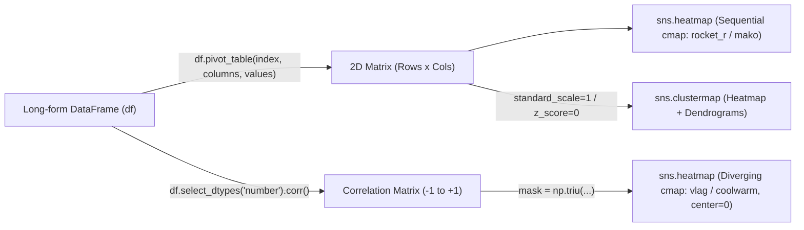
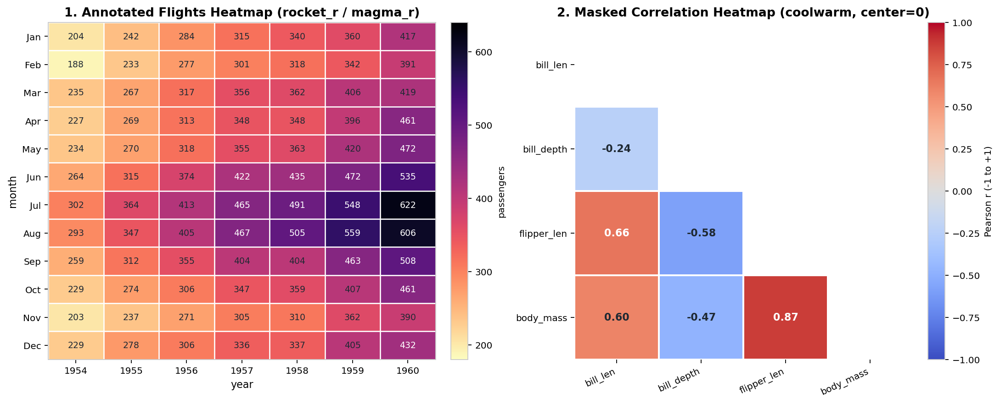

[⬅️ පෙර පාඩම: Regression & Model-Fit Plots](05_Regression_and_Model_Fit_Plots.md) | [🏠 පාඨමාලා සුචිය (Course Index)](README.md) | [ඊළඟ පාඩම: Multi-Plot Grids ➡️](07_Multi_Plot_Grids.md)

# පාඩම 06: Matrix Plots — Heatmap සහ Clustermap (Module 6)

> [!TIP]
> **මේ පාඩමෙන් ඔබ ඉගෙන ගන්නේ මොනවාද?**
> 2D table (Matrix / Grid) එකක තියෙන ඉලක්කම් පාට වලට හරවලා එක බැල්මෙන්ම රටා අඳුරගන්න **`sns.heatmap`** පාවිච්චි කරන හැටි (Pivot tables, Masked Correlation Matrices, Confusion Matrices) සහ, සමාන පේළි/තීරු ඉබේම එක ළඟට group කරලා පෙන්නන **`sns.clustermap`** ගැන සම්පූර්ණයෙන්ම ඉගෙන ගනිමු!

---

## 1. Matrix Plots කියන්නේ මොනවාද? (සරල උදාහරණයකින්!)

හිතන්න ඔයා ගාව අවුරුදු 12ක, මාස 12ක ගුවන් මගීන්ගේ ගණන තියෙන Excel table එකක් තියෙනවා (ඉලක්කම් 144ක්!). ඒ ඉලක්කම් 144 දිහා බලලා *"කොයි මාසෙද වැඩිම මගීන් හිටියේ?"* කියලා හොයන්න ඇස් රිදෙනවා නේද?
හැබැයි අපි **වැඩි ඉලක්කම් තද පාටිනුත්, අඩු ඉලක්කම් ලා පාටිනුත්** පාට කළොත් — තත්පර 1ක් ඇතුළත පේනවා හැම අවුරුද්දෙම **ජූලි සහ අගෝස්තු** මාසවල තමයි වැඩිම මගීන් ඉන්නේ කියලා!

මේ විදිහට **2D rectangular data (Matrix)** එකක් පාට වලින් පෙන්නන charts වලට තමයි **Matrix Plots** කියන්නේ. මේවා ප්‍රධාන වශයෙන් අවස්ථා 4කදී පාවිච්චි වෙනවා:
1. **Pivot Tables:** අවුරුද්ද × මාසය වගේ කාල රටා (seasonal patterns) බලන්න.
2. **Correlation Matrices:** Variables අතර සම්බන්ධතාවය (`-1` සිට `+1` දක්වා) බලන්න.
3. **Confusion Matrices:** Machine Learning classifier එකක නිවැරදි සහ වැරදි predictions බලන්න.
4. **Clustered Patterns (`clustermap`):** සමාන ලක්ෂණ තියෙන rows හෝ columns auto group කරන්න.





---

## 2. Heatmap සහ Clustermap වල වැදගත්ම Concepts 10

| Topic | විස්තරය (Description) | Key API | හොඳම අවස්ථාව |
| --- | --- | --- | --- |
| **`heatmap`** | පාට කරපු 2D matrix එකක් + cell labels | `sns.heatmap(data, annot=True, fmt='.2f', cmap=, vmin=, vmax=, center=, linewidths=, cbar_kws=, square=, mask=)` | Correlations, pivot tables |
| **Annotations** | හැම කොටුවක් ඇතුළෙම ඉලක්කම print කරන්න | `annot=True`, `fmt='d'` (integers), `fmt='.2f'` (decimals), `annot_kws={'size': 8}` | Exact values බලන්න |
| **Diverging data** | 0 මැද තියලා + සහ − වෙනම පාට දෙකකින් | `cmap='vlag'` හෝ `'coolwarm'`, `center=0`, `vmin=-1`, `vmax=1` | Correlations / Differences |
| **Masking** | සමමිතික (symmetric) matrix එකක උඩ භාගය හංගන්න | `mask=np.triu(np.ones_like(corr, dtype=bool))` | පිරිසිදු correlation plots |
| **Pivot then plot** | Long-form data මුලින්ම 2D grid එකකට හරවන්න | `df.pivot_table(index=, columns=, values=)` හෝ `df.pivot(...)` | Year × Month grids |
| **`clustermap`** | Rows & columns hierarchical clustering කරලා අඳින heatmap එක | `sns.clustermap(data, method='average', metric='euclidean', standard_scale=1, z_score=0, row_colors=, col_cluster=)` | සමාන groups හොයන්න |
| **Scaling** | වෙනස් units තියෙන columns සමාන පරිමාණයකට ගේන්න | `standard_scale=1` (0–1 අතරට) හෝ `z_score=0` (mean=0, std=1) | Mixed-unit data |
| **Annotation colours** | Clusters වල ඇත්ත group labels පැත්තෙන් පාට පටියකින් | `row_colors=`, `col_colors=` | Species / labels පෙන්නන්න |
| **Confusion matrix** | Predicted vs Actual ගණන් | `sns.heatmap(cm, annot=True, fmt='d', xticklabels=, yticklabels=)` | Classification results |
| **Large matrices** | Rows/cols සිය ගණනක් තියෙනකොට slow නොවෙන්න | `xticklabels=False`, `yticklabels=False`, `rasterized=True` | ගොඩක් ලොකු datasets |

---

## 3. `mask` සහ `clustermap` (Dendrogram) සරලව තේරුම් ගමු

### 🎭 Masking (උඩ ත්‍රිකෝණය හංගන්නේ ඇයි?)
Correlation matrix එකක A එක්ක B ගේ correlation එකයි, B එක්ක A ගේ correlation එකයි **එකම අගය**! ඒ වගේම මැද විකර්ණය (diagonal) හැමවිටම `1.00`.
ඒ නිසා එකම ඉලක්කම දෙපාරක් පෙන්නලා chart එක පටලවන්නේ නැතිව, අපි `np.triu(np.ones_like(corr, dtype=bool))` පාවිච්චි කරලා උඩ ත්‍රිකෝණය (`True` තියෙන කොටු) හංගනවා — එතකොට යට ත්‍රිකෝණය විතරක් සුපිරියට පේනවා!

### 🌳 `clustermap` සහ Dendrogram කියන්නේ මොකක්ද?
`sns.clustermap` එක කරන්නේ heatmap එකේ පේළි (rows) සහ තීරු (columns) **වඩාත්ම සමාන ඒවා එක ළඟට එන විදිහට නැවත පිළිවෙළට හදන (reorder)** එකයි.
ඒකේ වම් පැත්තෙයි උඩයි පේන ගහක අතු වගේ ඉරි ටිකට තමයි **Dendrogram** කියන්නේ:
- 🌿 **කෙටි අතු වලින් යා වෙලා තියෙන පේළි:** ඒ දෙක එකිනෙකට **ගොඩක් සමානයි**.
- 🌳 **ගොඩක් උසින්/දුරින් යා වෙලා තියෙන පේළි:** ඒවා එකිනෙකට **ගොඩක් වෙනස්**.

> **Scaling ඇයි ඕනේ?** හිතන්න එක column එකක් `age` (20–60) අනිත් එක `salary` (50,000–200,000). Scale නොකර `clustermap` දැම්මොත් `salary` එකේ ලොකු ඉලක්කම් නිසා `age` එකේ වෙනස්කම් සම්පූර්ණයෙන්ම යට යනවා! ඒකට:
> - `standard_scale=1` → හැම column එකම 0 ඉඳන් 1 අතරට හරවනවා (0 = rows, 1 = columns).
> - `z_score=1` → හැම column එකකම mean = 0, std = 1 වෙන්න standardize කරනවා.

---

## 4. සම්පූර්ණ Python Code එක සහ පේළියෙන් පේළිය පැහැදිලි කිරීම

```python
import numpy as np
import matplotlib.pyplot as plt
import seaborn as sns

# 1. Pivot Table -> Annotated Flights Heatmap
flights = sns.load_dataset('flights').pivot(index='month', columns='year',
                                            values='passengers')
plt.figure(figsize=(10, 6))
sns.heatmap(flights, cmap='rocket_r', linewidths=.3, annot=True, fmt='d')
plt.title('Monthly Airline Passengers (1949 - 1960)')
plt.show()

# 2. Lower-Triangle Masked Correlation Heatmap
corr = sns.load_dataset('penguins').select_dtypes('number').corr()
mask = np.triu(np.ones_like(corr, dtype=bool))

plt.figure(figsize=(6, 5))
sns.heatmap(corr, mask=mask, annot=True, fmt='.2f',
            cmap='vlag', center=0, vmin=-1, vmax=1, square=True)
plt.title('Penguins Numeric Correlations (Lower Triangle)')
plt.show()

# 3. Clustermap on Iris Dataset (Column-wise 0-1 scaling)
iris = sns.load_dataset('iris')
sns.clustermap(iris.drop(columns='species'), standard_scale=1,
               cmap='mako', figsize=(6, 6))
plt.show()

# 4. Confusion Matrix Heatmap (Classification Results)
cm = np.array([[42, 3],
               [5, 50]])
sns.heatmap(cm, annot=True, fmt='d', cmap='Blues', cbar=False,
            xticklabels=['Pred 0', 'Pred 1'],
            yticklabels=['Actual 0', 'Actual 1'])
plt.xlabel('Predicted')
plt.ylabel('Actual')
plt.title('Confusion Matrix')
plt.show()
```

### 🔍 පේළියෙන් පේළිය පැහැදිලි කිරීම (Line-by-Line Explanation)
- `flights.pivot(index='month', columns='year', values='passengers')`: Long-form table එක `month` (rows) × `year` (columns) 2D grid එකක් බවට හරවනවා.
- `cmap='rocket_r', linewidths=.3, annot=True, fmt='d'`: `_r` කියන්නේ **reversed** colormap (අඩු අගය ලා පාට, වැඩි අගය තද පාට). `linewidths=.3` මගින් කොටු අතර සිහින් සුදු ඉරි දානවා. `fmt='d'` කියන්නේ දශම නැති integer විදිහට print කරන්න.
- `select_dtypes('number').corr()`: DataFrame එකේ සංඛ්‍යාත්මක columns ටික විතරක් තෝරලා correlation matrix එක හදනවා.
- `mask = np.triu(np.ones_like(corr, dtype=bool))`: `np.triu` (triangle upper) මගින් උඩ ත්‍රිකෝණය `True` කරලා, ඒ කොටු heatmap එකෙන් හංගනවා.
- `cmap='vlag', center=0, vmin=-1, vmax=1, square=True`: `vlag` (නිල්–සුදු–රතු) diverging colormap එකේ මැද (`0`) හරියටම සුදු පාට වෙන්න `center=0` දෙනවා. `square=True` මගින් හැම කොටුවක්ම සමචතුරස්‍රයක් කරනවා.
- `sns.clustermap(..., standard_scale=1, cmap='mako')`: `species` (text column) එක අයින් කරලා, හැම feature column එකම 0–1 අතරට scale කරලා hierarchical clustering කරනවා.
- `cbar=False`: Confusion matrix එකක ඉලක්කම් කෙළින්ම කොටු ඇතුළේ තියෙන නිසා පැත්තේ colorbar එක අයින් කරලා පිරිසිදුව තියාගන්නවා.

### 👀 බලාපොරොත්තු වන ප්‍රතිඵලය (Expected Visual Output)
1. **Flights Heatmap:** වමේ ඉඳන් දකුණට (1949 → 1960) පාට තද වෙනවා (මගීන් ගණන අවුරුද්දෙන් අවුරුද්ද වැඩි වීම), ඒ වගේම ජූලි–අගෝස්තු පේළි දෙක හැම අවුරුද්දෙම තදම පාටින් කැපිලා පේනවා (Summer vacation peak!).
2. **Masked Correlation Heatmap:** උඩ ත්‍රිකෝණය හිස්ව තියෙද්දී, යට ත්‍රිකෝණයේ `flipper_length` සහ `body_mass` අතර ඉතා ප්‍රබල ධන සම්බන්ධයක් (`+0.87`, තද රතු) තියෙන බව පේනවා.
3. **Iris Clustermap:** මල් 150 එකම විශේෂයට අයත් ඒවා එක ළඟට group වෙලා, පැහැදිලි වර්ණ blocks 2–3ක් විදිහට dendrogram අතු එක්ක පේනවා.

---

## 🧠 මතක තබා ගැනීමට පහසු ක්‍රම (Memory Hacks)

1. **Colormap රීතිය:**
   - **0 ඉඳන් ඉහළට** (Counts, Passengers, Confusion Matrix) → **Sequential** cmap (`rocket_r`, `mako`, `Blues`, `viridis`).
   - **− සිට + දක්වා (0 මැද)** (Correlations, Profit/Loss) → **Diverging** cmap (`vlag`, `coolwarm`, `RdBu_r`) + **`center=0`**.
2. **`fmt` Code Cheat:**
   - `'d'` = Integer (උදා: `42`)
   - `'.2f'` = දශම ස්ථාන 2යි (උදා: `0.87`)
   - `'.1%'` = ප්‍රතිශතයක් විදිහට (උදා: `93.3%`)
3. **`standard_scale=1` vs `0`:** `1` = **Column-wise** (Features වෙනස් units වල තියෙනකොට වැඩිපුරම පාවිච්චි වෙන්නේ මේක!), `0` = **Row-wise**.

---

## ⚠️ සාමාන්‍යයෙන් වෙන වැරදි (Common Pitfalls)

> [!WARNING]
> 1. **Long-form DataFrame එක කෙළින්ම `sns.heatmap` එකට දැමීම:** `flights` වගේ long-form table එකක් pivot නොකර heatmap එකට දුන්නොත් error එනවා (text columns තියෙන නිසා). මුලින්ම `.pivot()` හෝ `.pivot_table()` කරලා 2D numeric grid එකක් හදාගන්න!
> 2. **Float data වලට `fmt='d'` දැමීම:** Correlation වගේ දශම අගයන් තියෙන matrix එකකට `fmt='d'` දුන්නොත් `ValueError: Unknown format code 'd' for object of type 'float'` එනවා. Float වලට `fmt='.2f'` පාවිච්චි කරන්න.
> 3. **Correlation Heatmap එකේ `vmin=-1, vmax=1, center=0` අමතක කිරීම:** මේවා නොදුන්නොත් දත්තවල තියෙන min/max අනුව පාට scale වෙලා, `0.3` වගේ අගයක් සුදු පාටින් පේන්න පුළුවන් — ඒක කියවන කෙනාව නොමඟ යවනවා!
> 4. **`clustermap` එක `ax=` එකකට දෙන්න උත්සාහ කිරීම:** `clustermap` කියන්නේ **Figure-level** function එකක් (තමන්ගේම `ClusterGrid` එකක් හදනවා). ඒ නිසා `plt.subplots` ඇතුළේ දාන්න බෑ — `figsize=(7, 7)` කෙළින්ම `clustermap` එක ඇතුළෙම දෙන්න.

---

## 🏋️ ප්‍රායෝගික අභ්‍යාස (Practical Exercises)

### Warm-up Exercise: Pivot Table + Heatmap on `tips`
`tips` dataset එකේ `day` (rows) සහ `time` (columns) අනුව සාමාන්‍ය `total_bill` එක `pivot_table` එකකින් හදලා, දශම ස්ථාන 1කට (`fmt='.1f'`) annotate කරපු heatmap එකක් අඳින්න.

<details>
<summary>✅ පිළිතුර බලන්න (Click to see Solution)</summary>

```python
import matplotlib.pyplot as plt
import seaborn as sns

tips = sns.load_dataset('tips')
pt = tips.pivot_table(index='day', columns='time', values='total_bill',
                      aggfunc='mean', observed=True)

sns.heatmap(pt, annot=True, fmt='.1f', cmap='YlGnBu', linewidths=0.5)
plt.title('Mean Total Bill by Day and Meal Time')
plt.show()
```
</details>

---

### Exercise 1: Year-by-Month Flights Heatmap & Seasonal Pattern
`flights` dataset එකෙන් year-by-month heatmap එකක් ඇඳලා, එහි පේන සෘතුමය රටාව (seasonal pattern) පැහැදිලි කරන්න.

<details>
<summary>✅ පිළිතුර බලන්න (Click to see Solution)</summary>

```python
import matplotlib.pyplot as plt
import seaborn as sns

flights = sns.load_dataset('flights').pivot(index='month', columns='year', values='passengers')

plt.figure(figsize=(10, 6))
sns.heatmap(flights, cmap='rocket_r', annot=True, fmt='d', linewidths=0.3)
plt.title('Airline Passengers by Month and Year')
plt.show()
```
**රටාව (Seasonal Pattern):**
1. **වර්ධන ප්‍රවණතාවය (Upward Trend):** 1949 සිට 1960 දක්වා වමේ සිට දකුණට සෑම මාසයකම මගීන් ගණන ක්‍රමයෙන් වැඩි වී තිබෙනවා.
2. **සෘතුමය උච්චතම අවස්ථාව (Summer Peak):** සෑම වසරකම **ජූලි සහ අගෝස්තු** මාසවල වැඩිම මගීන් ගණනක් වාර්තා වෙනවා (ගිම්හාන නිවාඩු කාලය). නොවැම්බර් සහ පෙබරවාරි අඩුම මාස වෙනවා.
</details>

---

### Exercise 2: Lower-Triangle Correlation Heatmap
`mpg` dataset එකේ numeric columns ටිකේ correlation matrix එක හදලා, `coolwarm` diverging colormap එක `center=0` කරලා, උඩ ත්‍රිකෝණය hide කරපු (`mask`) correlation heatmap එකක් අඳින්න.

<details>
<summary>✅ පිළිතුර බලන්න (Click to see Solution)</summary>

```python
import numpy as np
import matplotlib.pyplot as plt
import seaborn as sns

mpg = sns.load_dataset('mpg')
corr = mpg.select_dtypes('number').corr()
mask = np.triu(np.ones_like(corr, dtype=bool))

plt.figure(figsize=(7, 6))
sns.heatmap(corr, mask=mask, annot=True, fmt='.2f',
            cmap='coolwarm', center=0, vmin=-1, vmax=1,
            square=True, linewidths=0.5)
plt.title('MPG Dataset Correlation Matrix (Lower Triangle)')
plt.show()
```
</details>

---

### Exercise 3: Standardised `clustermap` with `row_colors`
`iris` dataset එකේ `species` column එකට පාට දීලා (`row_colors=`), අනිත් columns 4 `z_score=1` (standardised) කරලා `clustermap` එකක් අඳින්න. Dendrogram එකෙන් පේන්නේ මොකක්ද?

<details>
<summary>✅ පිළිතුර බලන්න (Click to see Solution)</summary>

```python
import matplotlib.pyplot as plt
import seaborn as sns

iris = sns.load_dataset('iris')
species = iris['species']
palette = dict(zip(species.unique(), ['#4C72B0', '#DD8452', '#55A868']))
row_colors = species.map(palette)

sns.clustermap(
    iris.drop(columns='species'),
    z_score=1,
    row_colors=row_colors,
    cmap='vlag',
    center=0,
    figsize=(7, 7)
)
plt.show()
```
**Dendrogram විග්‍රහය:**
- වම් පැත්තේ `row_colors` පටිය දිහා බැලුවම, **Setosa** (නිල්) මල් ටික සම්පූර්ණයෙන්ම වෙනම ලොකු අත්තකට (cluster එකකට) වෙන් වෙලා තියෙනවා!
- **Versicolor** සහ **Virginica** තරමක් සමාන නිසා ඒ දෙක එක ළඟ අතු වලට group වෙලා තියෙනවා.
- උඩ dendrogram එකෙන් පේනවා `petal_length` සහ `petal_width` එකිනෙකට ගොඩක් සමානව හැසිරෙන බව.
</details>

---

### Exercise 4: Confusion Matrix (Counts + Row-Normalised Percentages)
Classifier එකක confusion matrix එකක් (`cm = np.array([[45, 5, 0], [3, 38, 4], [1, 6, 48]])`) සඳහා, එක පැත්තක **Counts** සහ අනිත් පැත්තේ **Row-Normalised Percentages** පෙන්නන subplots 2ක් හදන්න.

<details>
<summary>✅ පිළිතුර බලන්න (Click to see Solution)</summary>

```python
import numpy as np
import matplotlib.pyplot as plt
import seaborn as sns

cm = np.array([[45, 5, 0],
               [3, 38, 4],
               [1, 6, 48]])
labels = ['Cat', 'Dog', 'Bird']

# Row-normalised percentages (එක් එක් actual class එකෙන් කී % ක් හරියට predict කළාද)
cm_pct = cm / cm.sum(axis=1, keepdims=True)

fig, axs = plt.subplots(1, 2, figsize=(11, 4.5), constrained_layout=True)

sns.heatmap(cm, annot=True, fmt='d', cmap='Blues', cbar=False,
            xticklabels=labels, yticklabels=labels, square=True, ax=axs[0])
axs[0].set_title('Confusion Matrix (Counts)')
axs[0].set_xlabel('Predicted')
axs[0].set_ylabel('Actual')

sns.heatmap(cm_pct, annot=True, fmt='.1%', cmap='Greens', cbar=False,
            xticklabels=labels, yticklabels=labels, square=True, ax=axs[1])
axs[1].set_title('Confusion Matrix (Row-Normalised %)')
axs[1].set_xlabel('Predicted')
axs[1].set_ylabel('Actual')

plt.show()
```
</details>

---

## 📋 Cheat Sheet Summary Table (ඉක්මන් මතක සටහන)

| කාර්යය (Task) | පාවිච්චි කරන Code එක |
| --- | --- |
| Long-form → 2D grid | `df.pivot_table(index='r', columns='c', values='v')` |
| Annotated heatmap (integers) | `sns.heatmap(grid, annot=True, fmt='d', cmap='rocket_r', linewidths=0.3)` |
| Lower-triangle correlation mask | `mask = np.triu(np.ones_like(corr, dtype=bool))` |
| Diverging correlation heatmap | `sns.heatmap(corr, mask=mask, annot=True, fmt='.2f', cmap='vlag', center=0, vmin=-1, vmax=1, square=True)` |
| Clustered heatmap (0–1 scaled) | `sns.clustermap(df_num, standard_scale=1, cmap='mako')` |
| Clustered heatmap (z-score + labels) | `sns.clustermap(df_num, z_score=1, row_colors=colors, cmap='vlag', center=0)` |
| Confusion matrix | `sns.heatmap(cm, annot=True, fmt='d', cmap='Blues', cbar=False)` |
| Large matrix performance | `sns.heatmap(big_df, xticklabels=False, yticklabels=False, rasterized=True)` |

---

[⬅️ පෙර පාඩම: Regression & Model-Fit Plots](05_Regression_and_Model_Fit_Plots.md) | [🏠 පාඨමාලා සුචිය (Course Index)](README.md) | [ඊළඟ පාඩම: Multi-Plot Grids ➡️](07_Multi_Plot_Grids.md)
