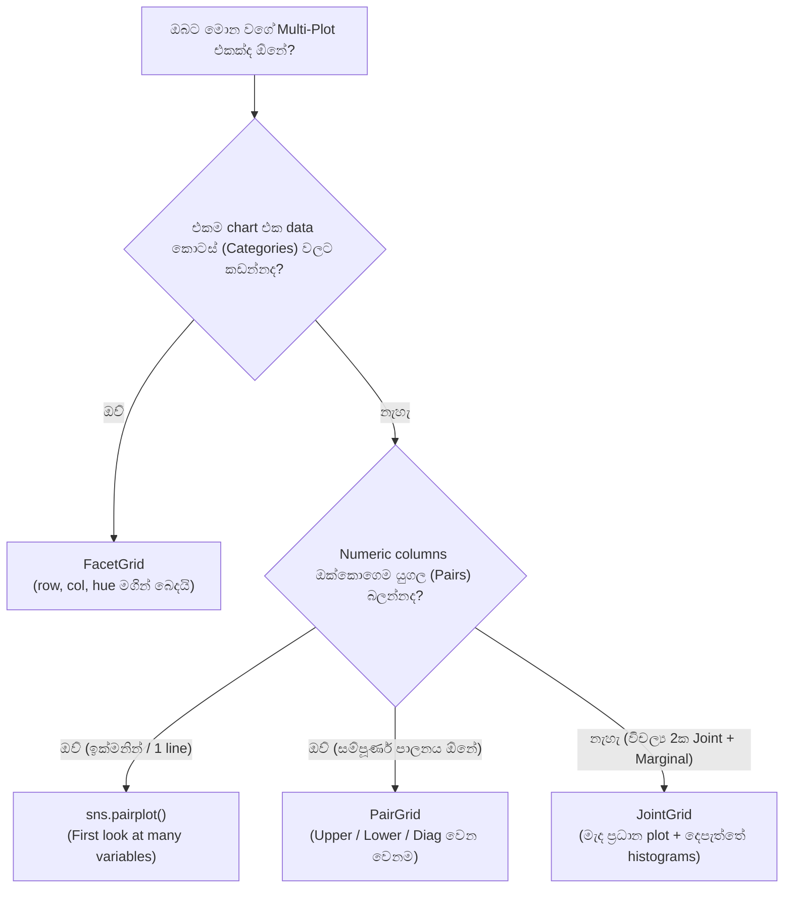
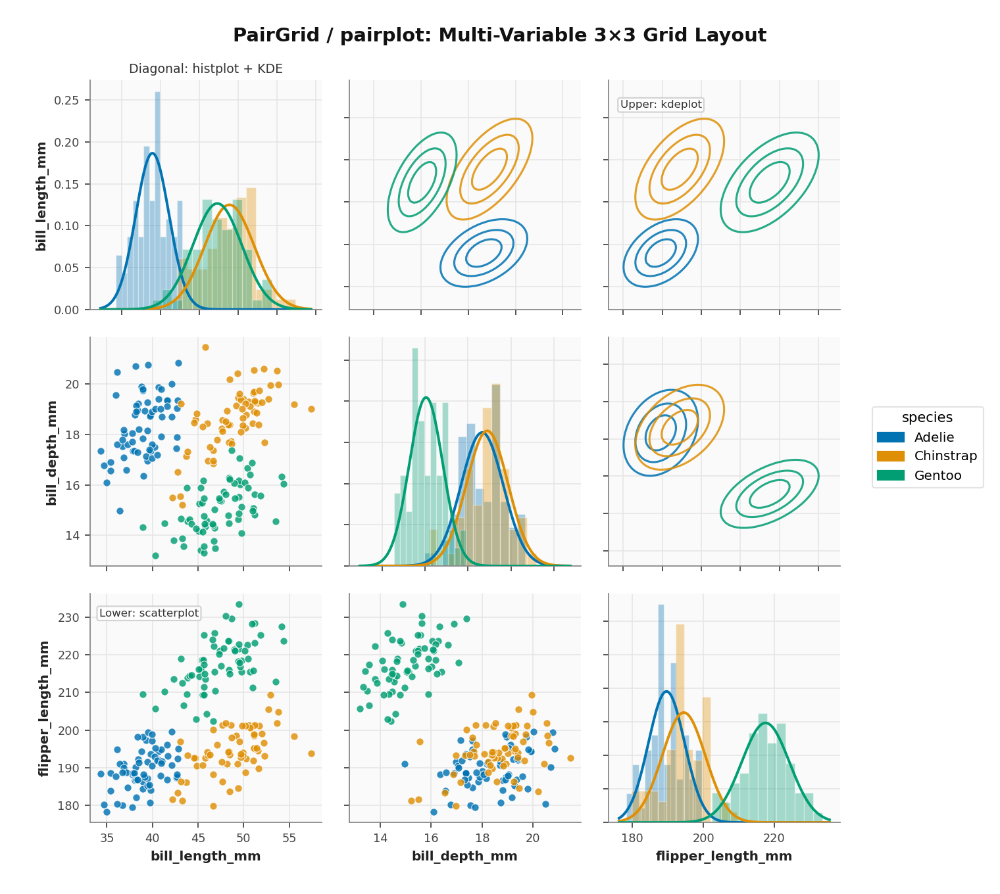
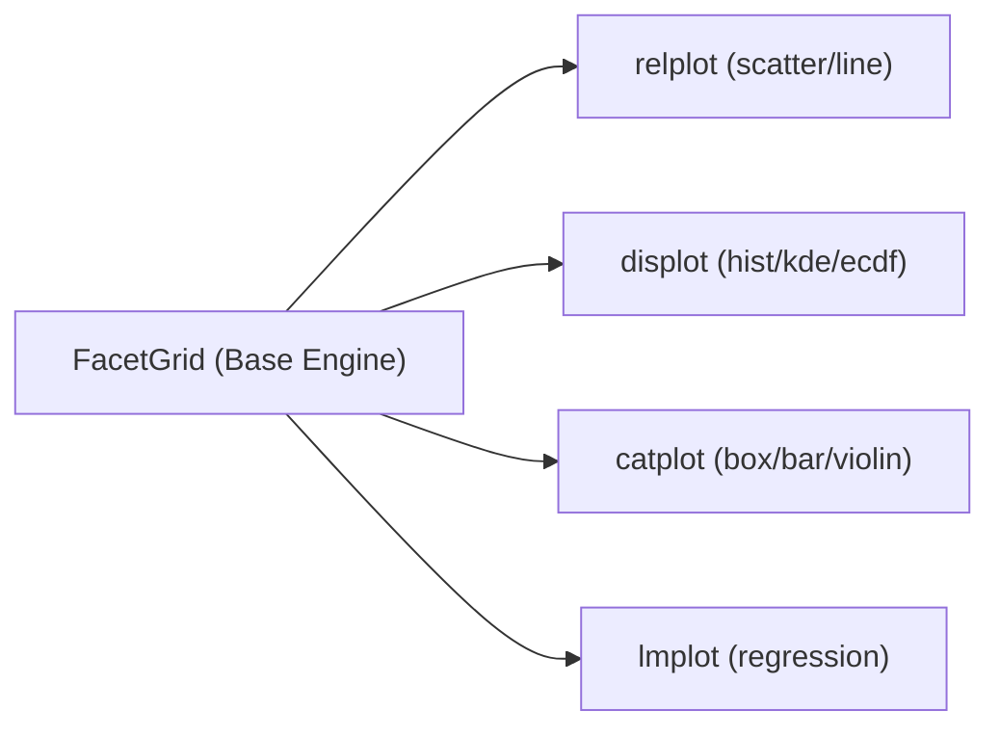

[⬅️ පෙර පාඩම (06 - Matrix Plots)](06_Matrix_Plots_Heatmap_and_Clustermap.md) | [🏠 ප්‍රධාන පිටුව (Course Index)](README.md) | [ඊළඟ පාඩම (08 - Themes & Palettes) ➡️](08_Themes_Styles_Contexts_and_Palettes.md)

---

# 07. Multi-Plot Grids (`FacetGrid`, `PairGrid`, `pairplot` & `JointGrid`)

Data Analysis කරද්දී අපිට ගොඩක් වෙලාවට එකම chart එක data වල විවිධ කොටස් (subsets) වලට වෙන වෙනම ඇඳලා සංසන්දනය (compare) කරන්න ඕන වෙනවා. උදාහරණයක් විදිහට, එකම scatter plot එකක data ඔක්කොම දැම්මොත් ඒක අවුල් ජාලයක් වෙන්න පුළුවන්. ඒ වෙනුවට, ඒ data එක "කාන්තා/පිරිමි" හෝ "දූපත් 3" විදිහට කොටස් වලට කඩලා පොඩි charts ගොඩක් එක ළඟ තියලා බලන එකට තමයි **Small Multiples** නැත්නම් **Multi-Plot Grids** කියලා කියන්නේ.

හරියට **CCTV කැමරා මොනිටරයක්** වගේ! එකම සාප්පුවේ විවිධ කාමර වෙන වෙනම කොටු වල පෙන්නනවා වගේ, Seaborn Grids මගින් අපේ dataset එකේ විවිධ පැතිකඩවල් එකම screen එකක පිළිවෙළට පෙන්නනවා.

---

## 🧭 Grid වර්ග 3 තෝරාගන්නේ කොහොමද? (Choosing the Right Grid)

Seaborn වල ප්‍රධාන Grid classes 3 ක් තියෙනවා. අපේ අවශ්‍යතාවය අනුව ගැළපෙන Grid එක තෝරාගන්න මේ සටහන බලන්න:



---

## 1️⃣ `FacetGrid`: ඕනෑම Plot එකක් කොටු වලට බෙදන්න (Small Multiples)

`FacetGrid` එක කියන්නේ හිස් කොටු පුවරුවක් (empty grid) හදලා, ඊට පස්සේ ඒ හැම කොටුවකටම අපි කැමති plotting function එකක් (`scatterplot`, `histplot`, custom function එකක් වුණත්!) map කරන ක්‍රමය.

- **Data බෙදන විදිහ:** `row=` (පේළි), `col=` (තීරු), `hue=` (පාට).
- **ප්‍රමාණය සහ පෙනුම:**
  - `col_wrap=`: තීරු ගොඩක් තිබ්බොත් (උදා: මාස 12) එක පේළියකට කොටු කීයක් දාන්නද කියලා කියනවා (`col_wrap=4`).
  - `height=` සහ `aspect=`: හැම පොඩි කොටුවකම උස (`height`, inches වලින්) සහ පළල (`width = height * aspect`).
  - `sharex=`, `sharey=`: හැම කොටුවකම X සහ Y axes වල පරිමාණය (scale) එකම වෙන්න ඕනෙද (`True`/`False`).
  - `margin_titles=True`: `row` එකේ නම් හැම කොටුව උඩම ලියන්නේ නැතුව, දකුණු පැත්තේ අයිනේ ලස්සනට පෙන්නනවා.
- **Plot එක අඳින විදිහ:** `g.map_dataframe(sns.scatterplot, x='a', y='b')` (නූතන Seaborn වල `g.map` වලට වඩා `g.map_dataframe` පාවිච්චි කරන එක ගොඩක් සුරක්ෂිතයි!).
- **Legend එක දාන විදිහ:** `g.add_legend()` මගින් grid එකෙන් පිටත ලස්සනට legend එක එකතු වෙනවා.

### 🛠️ `FacetGrid` Helpers (කොටු ටික ලස්සනට සකස් කරන්න)
Grid එක ඇන්දට පස්සේ හැම කොටුවක්ම එක පාර tidy up කරන්න මේ methods පාවිච්චි කරනවා:
- `g.set_titles('{col_name}')`: හැම කොටුවකම title template එක වෙනස් කරන්න (උදා: `island = Biscoe` වෙනුවට `Biscoe` විතරක්).
- `g.set_axis_labels('X Label', 'Y Label')`: පිටත X සහ Y labels දාන්න.
- `g.set(xlim=(0, 60), ylim=(10, 25))`: හැම කොටුවකටම එකම limits හෝ ticks දාන්න.
- `g.refline(y=20, ls='--')`: හැම කොටුවකම එකම reference line එකක් අඳින්න.
- `g.tight_layout()`: කොටු අතර ඉඩකඩ overlap නොවී හදන්න.
- **Matplotlib වලට ඇතුළු වෙන්න:** `g.axes` (2D NumPy array), `g.axes_dict` (කොටුවේ නමින් ඒ කොටුව ගන්න, උදා: `g.axes_dict['Biscoe']`), `g.figure` (මුළු Figure object එක).

---

## 2️⃣ `pairplot` සහ `PairGrid`: Variables ඔක්කොම එක පාර බලන්න

Dataset එකක numeric columns 4-5 ක් තියෙනවා නම්, ඒ හැම යුගලයක් (pair) අතරම සම්බන්ධය බලන්න `pairplot` සහ `PairGrid` පාවිච්චි කරනවා.



### ⚡ `sns.pairplot()` (One-line Quick Look)
එකම කේත පේළියකින් සම්පූර්ණ pair grid එකක් අඳින්න පුළුවන්:
- `hue='species'`: Category එක අනුව පාට කරනවා.
- `kind=`: Off-diagonal (විකර්ණයෙන් පිටත) කොටු වල අඳින plot වර්ගය — `'scatter'` (default), `'kde'`, `'reg'`, හෝ `'hist'`.
- `diag_kind=`: Diagonal (විකර්ණය - එකම variable එක) කොටු වල plot වර්ගය — `'hist'` හෝ `'kde'`.
- `corner=True`: උඩ ත්‍රිකෝණය (upper triangle) ඉවත් කරලා යට ත්‍රිකෝණය විතරක් පෙන්නනවා (මොකද උඩයි යටයි එකම දේ repeat වෙන නිසා!).
- `vars=[...]`: ඔක්කොම columns නැතුව තෝරාගත් columns කිහිපයක් විතරක් ගන්න.
- `plot_kws={'alpha': 0.6, 's': 25}`: ඇතුළේ plot එකට අමතර styling parameters යවන්න.

### 🎨 `sns.PairGrid()` (සම්පූර්ණ පාලනය - Custom Pair Plots)
උඩ ත්‍රිකෝණයට එක chart එකක්, යට ත්‍රිකෝණයට තව chart එකක්, මැද විකර්ණයට (diagonal) වෙනම chart එකක් දාන්න ඕන නම් `PairGrid` පාවිච්චි කරනවා:
- `g = sns.PairGrid(df, hue='species', vars=[...], diag_sharey=False)`
- `g.map_upper(...)` — උඩ ත්‍රිකෝණයට (උදා: `sns.scatterplot` හෝ `sns.kdeplot`)
- `g.map_lower(...)` — යට ත්‍රිකෝණයට
- `g.map_diag(...)` — මැද විකර්ණයට (උදා: `sns.histplot`)
- `g.map_offdiag(...)` — උඩ සහ යට දෙකටම එකම plot එක දාන්න

---

## 3️⃣ `JointGrid`: මැද ප්‍රධාන Plot එකයි, දෙපැත්තේ Marginals යි

`sns.jointplot()` එකෙන් ලැබෙන chart එකට වඩා වැඩි පාලනයක් ඕන නම් (උදාහරණයක් විදිහට මැදට scatter + regression දාලා, දෙපැත්තට histogram + rugplot දාන්න) `JointGrid` පාවිච්චි කරනවා.
- `g = sns.JointGrid(data=penguins, x='bill_length_mm', y='flipper_length_mm')`
- `g.plot_joint(sns.scatterplot, ...)` — මැද ප්‍රධාන කොටුවට
- `g.plot_marginals(sns.histplot, ...)` — උඩ (X) සහ දකුණු (Y) දාර වල කොටු වලට
- **Underlying Axes:** මැද axes එක `g.ax_joint`, උඩ axes එක `g.ax_marg_x`, දකුණු axes එක `g.ax_marg_y`.

---

## 4️⃣ Figure-Level Wrappers & Legends in Grids

ඔබ කලින් පාඩම් වල ඉගෙනගත් `relplot()`, `displot()`, `catplot()`, `lmplot()` ඔක්කොම ඇතුළතින් හදලා තියෙන්නේ මේ `FacetGrid` එක උඩමයි! ඒ නිසා ගොඩක් වෙලාවට `FacetGrid` වෙනම හදන්නේ නැතුව, එකම call එකකින් `col=`, `row=`, `col_wrap=` දීලා faceting කරන්න පුළුවන්.



- **Legends පාලනය:** Grid objects වල legend එක සාමාන්‍යයෙන් කොටු වලින් පිටත (outside axes) තමයි හැදෙන්නේ. `g.add_legend()` හෝ `sns.move_legend(g, 'lower center', bbox_to_anchor=(0.5, 1), ncol=3)` මගින් legend එක කැමති තැනකට ගෙනියන්න පුළුවන්.
- **කොටු ගොඩක් තිබ්බොත් (Many Panels):** `height=`, `aspect=`, `col_wrap=`, සහ `pairplot` වලදී `corner=True` පාවිච්චි කරලා කියවන්න පහසු (readable) output එකක් ගන්න.

---

## 💻 සම්පූර්ණ කේත උදාහරණය (Complete Code Example)

```python
import seaborn as sns
import matplotlib.pyplot as plt

penguins = sns.load_dataset('penguins')

# 1. One-line pairplot (යට ත්‍රිකෝණය විතරයි, diagonal එකට KDE)
sns.pairplot(penguins, hue='species', corner=True, diag_kind='kde')
plt.show()

# 2. FacetGrid (දූපත සහ ස්ත්‍රී/පුරුෂ භාවය අනුව කොටු වලට බෙදා scatterplot ඇඳීම)
g = sns.FacetGrid(penguins, col='island', row='sex', hue='species',
                  height=2.5, margin_titles=True)
g.map_dataframe(sns.scatterplot, x='bill_length_mm', y='bill_depth_mm')
g.set_titles(col_template='{col_name} Island', row_template='{row_name}')
g.set_axis_labels('Bill Length (mm)', 'Bill Depth (mm)')
g.add_legend()
plt.show()

# 3. Custom PairGrid (උඩ, යට සහ මැදට වෙනස් plots 3ක්)
g = sns.PairGrid(penguins, vars=['bill_length_mm', 'body_mass_g'], hue='species')
g.map_upper(sns.scatterplot)
g.map_lower(sns.kdeplot)
g.map_diag(sns.histplot)
g.add_legend()
plt.show()

# 4. JointGrid (මැද scatterplot + දෙපැත්තේ KDE සහිත histograms)
g = sns.JointGrid(data=penguins, x='bill_length_mm', y='flipper_length_mm')
g.plot_joint(sns.scatterplot, s=30, alpha=0.6)
g.plot_marginals(sns.histplot, kde=True)
plt.show()
```

### 🔍 පේළියෙන් පේළිය පැහැදිලි කිරීම (Line-by-Line Explanation)
1. `sns.pairplot(..., corner=True, diag_kind='kde')`: `penguins` dataset එකේ හැම numeric column pair එකක්ම අඳිනවා. `corner=True` නිසා අනවශ්‍ය duplicate කොටු (upper triangle) ඉවත් වෙනවා.
2. `FacetGrid(..., col='island', row='sex', hue='species', height=2.5, margin_titles=True)`: දූපත් 3 columns විදිහටත්, `Male`/`Female` rows 2 විදිහටත් 2×3 කොටු 6ක grid එකක් හදනවා. `margin_titles=True` නිසා `Male`/`Female` ලේබල් දකුණු අයිනේ පිළිවෙළට වැටෙනවා.
3. `g.map_dataframe(sns.scatterplot, ...)`: ඒ හැම කොටුවකටම අදාළ subset එකෙන් scatter plot එක අඳිනවා.
4. `PairGrid(...)` + `map_upper` / `map_lower` / `map_diag`: උඩට scatter points, යටට KDE contour වළලු, මැදට histograms දාලා එකම grid එකකින් තොරතුරු 3ක් පෙන්නනවා.
5. `JointGrid(...)` + `plot_joint` + `plot_marginals`: මැද කොටුවේ transparency (`alpha=0.6`) තියෙන scatter plot එකක් සහ උඩ/දකුණු පැති වල distribution පෙන්නන histograms අඳිනවා.

### 👀 බලාපොරොත්තු වන ප්‍රතිඵලය (Expected Visual Output)
- **Plot 1 (`pairplot`):** පහළ ත්‍රිකෝණාකාර (staircase) හැඩයේ 4×4 grid එකක්; `Gentoo` penguins ලා අනිත් විශේෂ දෙකෙන් පැහැදිලිවම වෙන් වෙලා පේනවා.
- **Plot 2 (`FacetGrid`):** පේළි 2ක් සහ තීරු 3ක (2×3) කොටු ජාලයක්. `Biscoe` දූපතේ `Gentoo` + `Adelie` ඉන්න බවත්, `Dream` දූපතේ `Chinstrap` + `Adelie` ඉන්න බවත්, `Torgersen` වල `Adelie` විතරක් ඉන්න බවත් එක බැල්මෙන් පේනවා.
- **Plot 3 (`PairGrid`):** 2×2 grid එකක් — උඩ දකුණේ scatter, යට වමේ contour රේඛා, විකර්ණයේ histograms.
- **Plot 4 (`JointGrid`):** මැද ලොකු scatter plot එකක් (ධනාත්මක සම්බන්ධයක් පෙන්නන) සහ ඒකේ උඩ හා දකුණු පැත්තේ smooth curve සහිත histograms දෙකක්.

---

## 🧠 මතක තබා ගැනීමට පහසු ක්‍රම (Memory Hacks)

- **F = Filter into boxes (`FacetGrid`):** Categories අනුව data කොටු වලට බෙදනවා.
- **P = Pairs of columns (`PairGrid` / `pairplot`):** Columns දෙක දෙක යුගල කරලා බලනවා.
- **J = Joined center + margins (`JointGrid`):** මැද එක plot එකකට දෙපැත්තෙන් තව plots දෙකක් "join" කරනවා.
- **Rule of Thumb:** ඉක්මන් වැඩක් නම් Wrapper එකක් (`relplot`, `catplot`, `pairplot`, `jointplot`) පාවිච්චි කරන්න. සම්පූර්ණ custom control ඕන නම් විතරක් Grid class එක (`FacetGrid`, `PairGrid`, `JointGrid`) පාවිච්චි කරන්න!

---

## ⚠️ සාමාන්‍යයෙන් වෙන වැරදි (Common Pitfalls)

> [!WARNING]
> **1. `FacetGrid` එකට `map()` වෙනුවට `map_dataframe()` පාවිච්චි කරන්න!**
> පරණ tutorials වල `g.map(sns.scatterplot, 'x', 'y')` තිබුණත්, නූතන Seaborn වල `hue` සහ DataFrame columns හරියටම වැඩ කරන්නේ `g.map_dataframe(sns.scatterplot, x='x', y='y')` පාවිච්චි කළාමයි.

> [!WARNING]
> **2. `col_wrap` සහ `row` එකට දාන්න බැහැ!**
> `FacetGrid(..., row='sex', col='island', col_wrap=2)` කියලා දුන්නොත් error එකක් එනවා. `col_wrap` පාවිච්චි කරන්න පුළුවන් `col` විතරක් තියෙන වෙලාවටයි.

> [!WARNING]
> **3. Grid Object එකට `ax=` දෙන්න බැහැ!**
> `FacetGrid`, `PairGrid`, `JointGrid`, `pairplot`, `relplot` ඔක්කොම Figure-level. ඒවා තමන්ගේම අලුත් Figure එකක් හදන නිසා `plt.subplots()` ඇතුළේ `ax=` දීලා අඳින්න බැහැ.

---

## 🏋️ ප්‍රායෝගික අභ්‍යාස (Practical Exercises)

### Warm-up Exercise: Quick Faceting with Wrapper
`tips` dataset එකේ `total_bill` සහ `tip` අතර සම්බන්ධය `relplot` පාවිච්චි කරලා `time` අනුව columns වලටත්, `smoker` අනුව colors (`hue`) වලටත් බෙදලා අඳින්න.

<details>
<summary>✅ පිළිතුර බලන්න (Click to see Solution)</summary>

```python
import seaborn as sns
import matplotlib.pyplot as plt

tips = sns.load_dataset('tips')
g = sns.relplot(data=tips, x='total_bill', y='tip', col='time', hue='smoker', height=3.5)
g.set_titles('{col_name} Time')
plt.show()
```
</details>

### Exercise 1 (Course Module 7.1)
Draw a `pairplot` of four numeric columns of `penguins` coloured by `species` (`hue='species'`) and note which pairs separate the groups best.

<details>
<summary>✅ පිළිතුර බලන්න (Click to see Solution)</summary>

```python
import seaborn as sns
import matplotlib.pyplot as plt

penguins = sns.load_dataset('penguins').dropna()
num_cols = ['bill_length_mm', 'bill_depth_mm', 'flipper_length_mm', 'body_mass_g']

sns.pairplot(penguins, vars=num_cols, hue='species', corner=True, diag_kind='kde',
             plot_kws={'alpha': 0.7, 's': 30})
plt.show()
# Observation: bill_length_mm vs bill_depth_mm සහ bill_length_mm vs flipper_length_mm
# යුගල දෙකෙන් species 3 (Adelie, Chinstrap, Gentoo) ඉතාම පැහැදිලිව වෙන් වෙනවා!
```
</details>

### Exercise 2 (Course Module 7.2)
Build a `FacetGrid` with a custom function that draws a histogram plus a vertical mean line in each panel.

<details>
<summary>✅ පිළිතුර බලන්න (Click to see Solution)</summary>

```python
import seaborn as sns
import matplotlib.pyplot as plt

penguins = sns.load_dataset('penguins').dropna()

def hist_with_mean(data, **kwargs):
    x_col = kwargs.pop('x')
    sns.histplot(data=data, x=x_col, kde=True, **kwargs)
    mean_val = data[x_col].mean()
    plt.axvline(mean_val, color='crimson', linestyle='--', linewidth=1.8)
    plt.text(mean_val, plt.ylim()[1] * 0.85, f' Mean: {mean_val:.1f}', color='crimson', fontsize=9)

g = sns.FacetGrid(penguins, col='species', height=3.5, aspect=1.1)
g.map_dataframe(hist_with_mean, x='bill_length_mm', color='#4C72B0')
g.set_titles('{col_name}')
g.set_axis_labels('Bill Length (mm)', 'Count')
plt.show()
```
</details>

### Exercise 3 (Course Module 7.3)
Create a `PairGrid` with scatter on the lower triangle, KDE on the upper triangle, and histograms on the diagonal.

<details>
<summary>✅ පිළිතුර බලන්න (Click to see Solution)</summary>

```python
import seaborn as sns
import matplotlib.pyplot as plt

penguins = sns.load_dataset('penguins').dropna()
cols = ['bill_length_mm', 'bill_depth_mm', 'flipper_length_mm']

g = sns.PairGrid(penguins, vars=cols, hue='species', diag_sharey=False)
g.map_lower(sns.scatterplot, alpha=0.75, s=25)
g.map_upper(sns.kdeplot, levels=4)
g.map_diag(sns.histplot, kde=True, alpha=0.45)
g.add_legend()
plt.show()
```
</details>

### Exercise 4 (Course Module 7.4)
Make a `JointGrid` with a hexbin centre and rugged marginals (histogram + rugplot on margins).

<details>
<summary>✅ පිළිතුර බලන්න (Click to see Solution)</summary>

```python
import seaborn as sns
import matplotlib.pyplot as plt

penguins = sns.load_dataset('penguins').dropna()

g = sns.JointGrid(data=penguins, x='bill_length_mm', y='flipper_length_mm', height=6)
# Hexbin in the centre using Matplotlib's plt.hexbin
g.plot_joint(plt.hexbin, gridsize=20, cmap='crest', mincnt=1)
# Rugged marginals: histplot + rugplot
g.plot_marginals(sns.histplot, kde=True, color='#2C728E', alpha=0.5)
g.plot_marginals(sns.rugplot, color='#243561', height=0.15)
g.set_axis_labels('Bill Length (mm)', 'Flipper Length (mm)')
plt.show()
```
</details>

---

## 📋 කෙටි සටහන (Cheat Sheet Summary)

| අවශ්‍යතාවය (Task) | Key API / Method | විශේෂ Parameters |
| :--- | :--- | :--- |
| Categories අනුව කොටු වලට බෙදන්න | `sns.FacetGrid(data, ...)` + `g.map_dataframe()` | `row=`, `col=`, `hue=`, `col_wrap=`, `margin_titles=True` |
| FacetGrid tidy up කරන්න | `g.set_titles()`, `g.set_axis_labels()`, `g.refline()` | `g.set(xlim=, ylim=)`, `g.tight_layout()`, `g.add_legend()` |
| ඉක්මන් Pair Plot එකක් | `sns.pairplot(df, ...)` | `hue=`, `kind=`, `diag_kind=`, `corner=True`, `vars=` |
| Custom Pair Grid එකක් | `sns.PairGrid(df, ...)` | `g.map_upper`, `g.map_lower`, `g.map_diag`, `g.map_offdiag` |
| Custom Joint + Marginals | `sns.JointGrid(data, x=, y=)` | `g.plot_joint(...)`, `g.plot_marginals(...)` |
| Underlying Matplotlib Axes ගන්න | `g.axes`, `g.axes_dict`, `g.figure` | `JointGrid` වලදී: `g.ax_joint`, `g.ax_marg_x`, `g.ax_marg_y` |
| Legend එක වෙන තැනකට ගෙනියන්න | `sns.move_legend(g, loc, bbox_to_anchor=)` | `g.add_legend()` |

---

[⬅️ පෙර පාඩම (06 - Matrix Plots)](06_Matrix_Plots_Heatmap_and_Clustermap.md) | [🏠 ප්‍රධාන පිටුව (Course Index)](README.md) | [ඊළඟ පාඩම (08 - Themes & Palettes) ➡️](08_Themes_Styles_Contexts_and_Palettes.md)
