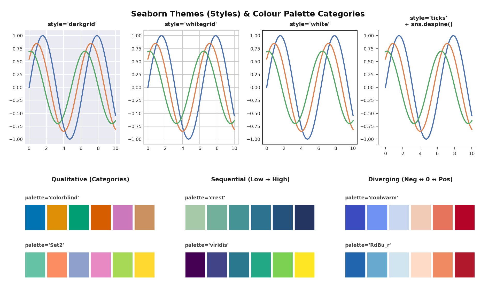
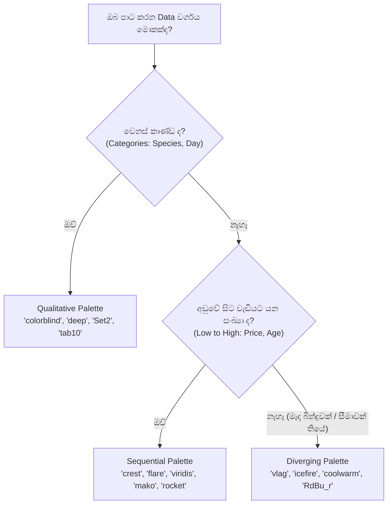

[⬅️ පෙර පාඩම (07 - Multi-Plot Grids)](07_Multi_Plot_Grids.md) | [🏠 ප්‍රධාන පිටුව (Course Index)](README.md) | [ඊළඟ පාඩම (09 - Customisation & Matplotlib) ➡️](09_Customisation_and_Matplotlib_Integration.md)

---

# 08. Themes, Styles, Contexts & Colour Palettes

ඔබ හොඳ data analysis එකක් කළත්, chart එකේ පෙනුම කැතයි නම් හෝ පාට පැටලෙනවා නම් කෙනෙක්ට ඒක තේරුම් ගන්න අමාරුයි. Seaborn වල තියෙන ලොකුම වාසියක් තමයි, එකම chart එකක පෙනුම පැහැදිලිව කොටස් 3කට වෙන් කරලා තියෙන එක:

1. **Style (පසුබිම සහ Grid ඉරි):** හරියට කාමරේ බිත්ති වල පාට සහ ටයිල් රටාව වගේ.
2. **Context (අකුරු සහ ඉරි වල ප්‍රමාණය):** හරියට පොතක අකුරු size එකද, නැත්නම් projector screen එකක පෙන්නන ලොකු අකුරුද කියලා තීරණය කරනවා වගේ.
3. **Palette (පාට තෝරාගැනීම):** හරියට chart එකට අන්දන ඇඳුමේ පාට වගේ.



---

## 1️⃣ `sns.set_theme()`: එකම Call එකකින් ඔක්කොම හදන්න

Notebook එකේ හෝ Python script එකේ උඩින්ම `sns.set_theme()` දැම්මොත්, ඊට පස්සේ අඳින හැම chart එකක්ම (Matplotlib charts පවා!) ලස්සන Seaborn පෙනුමට හැරෙනවා.

```python
sns.set_theme(
    style='whitegrid',    # පසුබිම සහ grid
    context='talk',       # අකුරු සහ lines වල scale එක
    palette='colorblind', # පාට සැලැස්ම
    font='sans-serif',    # font වර්ගය
    font_scale=1.1,       # අකුරු තව 10% ක් ලොකු කරන්න
    rc={'figure.dpi': 120} # ඕනෑම Matplotlib rcParam එකක් override කරන්න
)
```

- **Reset කරන්න ඕන නම්:** Seaborn styling ඔක්කොම අයින් කරලා ආපහු පරණ default Matplotlib පෙනුමට යන්න `sns.reset_defaults()` හෝ `sns.reset_orig()` පාවිච්චි කරනවා.

---

## 2️⃣ Styles, Contexts & Despining

### 🎨 Styles 5 (`style=`)
| Style | පෙනුම | වඩාත් සුදුසු අවස්ථාව |
| :--- | :--- | :--- |
| `'darkgrid'` | අළු පසුබිම + සුදු grid ඉරි (Seaborn default) | Exploratory analysis, අගයන් ඉක්මනින් කියවන්න |
| `'whitegrid'` | සුදු පසුබිම + අළු grid ඉරි | Reports, web dashboards, ලොකු datasets |
| `'dark'` | අළු පසුබිම, grid ඉරි නැත | Patterns / clusters බලන්න |
| `'white'` | සුදු පසුබිම, grid ඉරි නැත | Minimalist publications |
| `'ticks'` | සුදු පසුබිම + පිටතට යොමු වුණු tick ඉරි | Scientific papers, printed journals |

- **තාවකාලිකව Style එකක් දාන්න (Temporary Style):** මුළු notebook එකම වෙනස් නොකර, එක chart එකකට විතරක් style එකක් දාන්න Python `with` block එක පාවිච්චි කරන්න:
  ```python
  with sns.axes_style('white'):
      sns.scatterplot(data=tips, x='total_bill', y='tip')
  ```

### 📏 Contexts 4 (`context=`)
Chart එක පෙන්නන මාධ්‍යය (medium) අනුව labels, titles සහ line widths ස්වයංක්‍රීයව ලොකු/පොඩි කරනවා (කුඩාම එකේ ඉඳන් ලොකුම එකට):
`'paper'` → `'notebook'` (default) → `'talk'` (slides/presentations) → `'poster'` (ලොකු බැනර්/පෝස්ටර්).
තාවකාලිකව context එකක් දාන්න `with sns.plotting_context('poster'):` පාවිච්චි කරනවා.

### ✂️ Despining (`sns.despine()`)
Chart එකක උඩ (top) සහ දකුණු (right) බෝඩර් ඉරි අයින් කරලා පිරිසිදු (minimal) පෙනුමක් දෙන්න `sns.despine()` පාවිච්චි කරනවා:
- `sns.despine()` — උඩ සහ දකුණු ඉරි අයින් කරයි.
- `sns.despine(offset=10, trim=True)` — X/Y අක්ෂ ටිකක් ඈත් කරලා, අන්තිම tick එකෙන් ඉර නතර කරයි (Publication quality!).
- `sns.despine(left=True)` — වම් අක්ෂයත් අයින් කරන්න (උදා: horizontal bar chart වලට).

---

## 3️⃣ Colour Palettes: නිවැරදි පාට තෝරාගන්නේ කොහොමද?

Data වර්ගය අනුව පාට තෝරාගන්න විදිහ දැනගැනීම Data Visualization වල ඉතාම වැදගත් කුසලතාවයක්!



### 1. Qualitative Palettes (වෙනස් කාණ්ඩ / Categories වලට)
පිළිවෙළක් නැති කාණ්ඩ (උදා: `Adelie`, `Chinstrap`, `Gentoo`) වෙන් කරලා පෙන්නන්න පැහැදිලිව වෙනස් පාට ඕනේ.
- Built-in options: `'deep'`, `'muted'`, `'pastel'`, `'bright'`, `'dark'`, `'colorblind'`, `'Set2'`, `'tab10'`.
- **Colourblind Safety (Accessibility):** රතු-කොළ (red-green) පාට පාවිච්චි කළොත් වර්ණ අන්ධතාවය තියෙන අයට (ලෝකයේ පිරිමි අයගෙන් ~8% කට!) chart එක වෙන් කරගන්න බැහැ. ඒ නිසා හැමවිටම `palette='colorblind'` පාවිච්චි කරන එක ඉතාම හොඳ පුරුද්දක්!

### 2. Sequential Palettes (අඩු අගයේ සිට වැඩි අගයට)
Numeric `hue` වලට සහ heatmaps වලට. ලා පාටින් තද පාටට (හෝ තදින් ලා පාටට) සුමටව යනවා.
- Built-in options: `'rocket'`, `'mako'`, `'flare'`, `'crest'`, `'viridis'`, `'Blues'`.
- තනි පාටකින් හදන්න: `sns.light_palette('seagreen')`, `sns.dark_palette('#69d')`.

### 3. Diverging Palettes (මැද මධ්‍යස්ථ අගයක් තියෙන විට)
Correlations (`-1` සිට `0` හරහා `+1`), ලාභ/පාඩු, උෂ්ණත්ව වෙනස්කම් වගේ මැද වැදගත් අගයක් (`0`) තියෙන data වලට.
- Built-in options: `'vlag'`, `'icefire'`, `'coolwarm'`.
- Custom diverging palette: `sns.diverging_palette(h_neg=240, h_pos=10, s=75, l=50, center='light', as_cmap=True)` (මෙතන `h_neg` සහ `h_pos` කියන්නේ 0–360 අතර hue angles — 240 නිල්, 10 රතු!).

### 4. Custom & Dictionary Palettes + Tools
- **Brand Colours (List):** `sns.color_palette(['#4C78A8', '#F58518'])`, `sns.cubehelix_palette()`, `sns.blend_palette(['#1f77b4', '#ff7f0e'])`.
- **Dictionary Palettes (Consistency across charts):** එකම category එකට හැම chart එකකම එකම පාට තියාගන්න dict එකක් දෙන්න!
  `species_colors = {'Adelie': '#4C78A8', 'Chinstrap': '#F58518', 'Gentoo': '#54A24B'}`
- **Palette Preview & Tools:** Jupyter notebook එකේ `sns.color_palette('crest', n_colors=6)` කියලා run කළාම පාට ටික කෙළින්ම පෙන්නනවා (පරණ version වල `sns.palplot()` පාවිච්චි කළා). Heatmaps වල `cmap=` එකට දෙන්න ඕන නම් `as_cmap=True` දාන්න.
- **Saturation & Alpha:** Bar/Box plots වල තද පාට ටිකක් මෘදු (soft) කරන්න `saturation=0.75` හෝ `alpha=0.8` පාවිච්චි කරනවා.

---

## 💻 සම්පූර්ණ කේත උදාහරණය (Complete Code Example)

```python
import seaborn as sns
import matplotlib.pyplot as plt

# 1. Project එකටම global theme එකක් සකස් කිරීම
sns.set_theme(style='ticks', context='notebook', palette='colorblind', font_scale=1.1)

tips = sns.load_dataset('tips')
penguins = sns.load_dataset('penguins').dropna()
flights = sns.load_dataset('flights')

# 2. Sequential palette ('crest') + despine()
sns.scatterplot(data=tips, x='total_bill', y='tip', hue='size', palette='crest')
sns.despine()
plt.title('Tips vs Total Bill (Sequential Palette)')
plt.show()

# 3. Dictionary palette: හැම chart එකකම එකම species එකට එකම පාට
species_colors = {'Adelie': '#4C78A8', 'Chinstrap': '#F58518', 'Gentoo': '#54A24B'}
sns.histplot(data=penguins, x='body_mass_g', hue='species', palette=species_colors, alpha=0.7)
sns.despine()
plt.title('Body Mass with Fixed Brand Colours')
plt.show()

# 4. Custom Diverging Palette + Heatmap
corr = penguins.select_dtypes('number').corr()
div = sns.diverging_palette(240, 10, as_cmap=True, center='light')
sns.heatmap(corr, cmap=div, center=0, annot=True, fmt='.2f')
plt.title('Correlation Matrix (Custom Diverging Palette)')
plt.show()

# 5. Temporary Context ('poster' - එක chart එකකට විතරයි)
with sns.plotting_context('poster'):
    sns.lineplot(data=flights, x='year', y='passengers')
    sns.despine()
    plt.title('Flights Trend (Poster Context)')
    plt.show()
```

### 🔍 පේළියෙන් පේළිය පැහැදිලි කිරීම (Line-by-Line Explanation)
1. `sns.set_theme(...)`: මුළු script එකටම `ticks` style, `notebook` context, `colorblind` palette සහ 1.1× අකුරු ප්‍රමාණය set කරනවා.
2. `palette='crest'`: `size` කියන්නේ අඩුවේ සිට වැඩියට යන සංඛ්‍යාවක් (1 සිට 6 දක්වා) නිසා Sequential palette එකක් දීලා තියෙනවා. `sns.despine()` වලින් උඩ සහ දකුණු borders අයින් කරනවා.
3. `species_colors = {...}`: Dictionary එකක් දුන්නම data order එක මාරු වුණත් `Adelie` හැමදාම නිල්, `Chinstrap` තැඹිලි, `Gentoo` කොළ පාටමයි!
4. `sns.diverging_palette(240, 10, as_cmap=True, center='light')`: ඍණ අගයන් නිල් (240) වලිනුත්, ධන අගයන් රතු (10) වලිනුත්, 0 ලා පාටිනුත් පෙන්නන continuous colormap (`as_cmap=True`) එකක් හදනවා.
5. `with sns.plotting_context('poster'):`: මේ block එක ඇතුළේ අඳින lineplot එකේ අකුරු සහ ඉරි ගොඩක් ලොකුයි; block එකෙන් එළියට ආවම ආපහු `notebook` context එකටම හැරෙනවා.

### 👀 බලාපොරොත්තු වන ප්‍රතිඵලය (Expected Visual Output)
- **Chart 1:** සුදු පසුබිමක outward ticks සහිත scatter plot එකක්; පොඩි groups ලා කොළ පාටිනුත්, ලොකු groups තද නිල් පාටිනුත් පේනවා.
- **Chart 2:** නිශ්චිත hex පාට 3කින් අඳින ලද overlapping histograms 3ක්.
- **Chart 3:** මැද `0` සුදු/ලා පාටින්ද, ධන correlations රතු පාටින්ද, ඍණ correlations නිල් පාටින්ද පෙන්නන 4×4 heatmap එකක්.
- **Chart 4:** දුර ඉඳන් පවා කියවන්න පුළුවන් තරම් ලොකු අකුරු සහ ඝන ඉරක් තියෙන line chart එකක්.

---

## 🧠 මතක තබා ගැනීමට පහසු ක්‍රම (Memory Hacks)

- **S-C-P Formula (`set_theme`):** **S**tyle (පසුබිම) + **C**ontext (අකුරු size) + **P**alette (පාට).
- **Q-S-D Palette Rule:**
  - **Q**ualitative = **Q**ualities / Categories (වර්ග)
  - **S**equential = **S**teps / Scale (පඩිපෙළ වගේ අඩු → වැඩි)
  - **D**iverging = **D**irections (දෙපැත්තට බෙදෙන `+` / `-` අගයන්)
- **Context Size Order:** **P**aper < **N**otebook < **T**alk < **P**oster (පොඩි පොතේ ඉඳන් ලොකු පෝස්ටරය දක්වා!).

---

## ⚠️ සාමාන්‍යයෙන් වෙන වැරදි (Common Pitfalls)

> [!WARNING]
> **1. Heatmap එකට `as_cmap=True` අමතක වීම!**
> `sns.diverging_palette(240, 10)` කියලා විතරක් දුන්නොත් එන්නේ පාට 6ක list එකක්. `sns.heatmap(corr, cmap=...)` එකට continuous colormap එකක් ඕන නිසා අනිවාර්යයෙන්ම `as_cmap=True` දාන්න.

> [!WARNING]
> **2. `despine()` එක plot එකට කලින් call කිරීම!**
> `sns.despine()` වැඩ කරන්නේ දැනට ඇඳලා තියෙන axes එකට. Plot එක අඳින්න කලින් `despine()` දැම්මොත් වැඩක් වෙන්නේ නැහැ — හැමවිටම plot එක ඇන්දට **පස්සේ** call කරන්න.

> [!WARNING]
> **3. Categories වලට Sequential palette එකක් දීම (හෝ අනිත් පැත්ත)!**
> උදාහරණයක් විදිහට `species` වලට `'Blues'` දුන්නොත්, බලන කෙනාට හිතෙනවා `Gentoo` කියන්නේ `Adelie` ට වඩා "වැඩි අගයක්" කියලා. වෙනස් කාණ්ඩ වලට Qualitative palette එකක්ම පාවිච්චි කරන්න.

---

## 🏋️ ප්‍රායෝගික අභ්‍යාස (Practical Exercises)

### Warm-up Exercise: Temporary Style Switch
Global theme එක `'darkgrid'` තියාගෙන, `with sns.axes_style('ticks'):` පාවිච්චි කරලා එක `boxplot` එකක් විතරක් clean ticks + `despine(trim=True)` විදිහට අඳින්න.

<details>
<summary>✅ පිළිතුර බලන්න (Click to see Solution)</summary>

```python
import seaborn as sns
import matplotlib.pyplot as plt

sns.set_theme(style='darkgrid')
tips = sns.load_dataset('tips')

with sns.axes_style('ticks'):
    sns.boxplot(data=tips, x='day', y='total_bill', palette='pastel')
    sns.despine(offset=8, trim=True)
    plt.title('Temporary Ticks Style with Trimmed Despine')
    plt.show()
```
</details>

### Exercise 1 (Course Module 8.1)
Draw one chart in all five styles (`'darkgrid'`, `'whitegrid'`, `'dark'`, `'white'`, `'ticks'`) and choose the best for a printed paper and for a presentation.

<details>
<summary>✅ පිළිතුර බලන්න (Click to see Solution)</summary>

```python
import seaborn as sns
import matplotlib.pyplot as plt

tips = sns.load_dataset('tips')
styles = ['darkgrid', 'whitegrid', 'dark', 'white', 'ticks']

for st in styles:
    with sns.axes_style(st):
        fig, ax = plt.subplots(figsize=(5, 3))
        sns.scatterplot(data=tips, x='total_bill', y='tip', hue='time', ax=ax)
        ax.set_title(f"Style: '{st}'")
        if st == 'ticks':
            sns.despine()
        plt.show()

# Best for printed paper: 'ticks' (with despine) හෝ 'white' — මුද්‍රණය කරද්දී තීන්ත ඉතිරි වෙනවා, පැහැදිලියි.
# Best for presentation: 'whitegrid' (context='talk' සමඟ) — projector එකක දුර ඉඳන් අගයන් කියවන්න පහසුයි.
```
</details>

### Exercise 2 (Course Module 8.2)
Define a company palette dictionary and reuse it so each category keeps its colour in three different charts.

<details>
<summary>✅ පිළිතුර බලන්න (Click to see Solution)</summary>

```python
import seaborn as sns
import matplotlib.pyplot as plt

penguins = sns.load_dataset('penguins').dropna()
brand_palette = {
    'Adelie': '#1B9E77',
    'Chinstrap': '#D95F02',
    'Gentoo': '#7570B3'
}

fig, axs = plt.subplots(1, 3, figsize=(13, 4), constrained_layout=True)

sns.scatterplot(data=penguins, x='bill_length_mm', y='bill_depth_mm',
                hue='species', palette=brand_palette, ax=axs[0])
axs[0].set_title('Scatter Plot')

sns.boxplot(data=penguins, x='species', y='body_mass_g',
            hue='species', palette=brand_palette, legend=False, ax=axs[1])
axs[1].set_title('Box Plot')

sns.histplot(data=penguins, x='flipper_length_mm',
             hue='species', palette=brand_palette, alpha=0.6, ax=axs[2])
axs[2].set_title('Histogram')

sns.despine()
plt.show()
```
</details>

### Exercise 3 (Course Module 8.3)
Make a colourblind-safe version of a red/green chart and test it in grayscale.

<details>
<summary>✅ පිළිතුර බලන්න (Click to see Solution)</summary>

```python
import seaborn as sns
import matplotlib.pyplot as plt
import numpy as np
from PIL import Image

tips = sns.load_dataset('tips')

# Colourblind-safe chart (palette='colorblind' + style/markers අමතරව යොදාගැනීම)
sns.set_theme(style='whitegrid', palette='colorblind')
fig, ax = plt.subplots(figsize=(6, 4))
sns.scatterplot(data=tips, x='total_bill', y='tip',
                hue='smoker', style='smoker', s=70, ax=ax)
ax.set_title('Colourblind-Safe Chart (Hue + Marker Shape)')
sns.despine()
fig.savefig('cb_safe.png', dpi=150, bbox_inches='tight')
plt.close(fig)

# Test in grayscale using PIL
img_gray = Image.open('cb_safe.png').convert('L')
plt.figure(figsize=(6, 4))
plt.imshow(img_gray, cmap='gray')
plt.axis('off')
plt.title('Grayscale Accessibility Test')
plt.show()
# Grayscale කළත් brightness වෙනසයි, marker shapes (o vs X) වෙනසයි නිසා පැහැදිලිව වෙන් කරගන්න පුළුවන්!
```
</details>

---

## 📋 කෙටි සටහන (Cheat Sheet Summary)

| අවශ්‍යතාවය (Task) | Key API | උදාහරණ / Options |
| :--- | :--- | :--- |
| Global theme set කරන්න | `sns.set_theme(...)` | `style=`, `context=`, `palette=`, `font=`, `font_scale=`, `rc=` |
| පසුබිම/Grid Styles 5 | `style=` / `sns.axes_style()` | `'darkgrid'`, `'whitegrid'`, `'dark'`, `'white'`, `'ticks'` |
| අකුරු/Lines Scale (Contexts) | `context=` / `sns.plotting_context()` | `'paper'`, `'notebook'`, `'talk'`, `'poster'` |
| Borders අයින් කරන්න | `sns.despine(...)` | `offset=10`, `trim=True`, `left=True` |
| Qualitative (Categories) | `palette=` | `'colorblind'`, `'deep'`, `'muted'`, `'Set2'`, `'tab10'` |
| Sequential (Low → High) | `palette=` / `cmap=` | `'crest'`, `'flare'`, `'rocket'`, `'mako'`, `'viridis'`, `light_palette` |
| Diverging (Neg ↔ 0 ↔ Pos) | `sns.diverging_palette(...)` | `'vlag'`, `'icefire'`, `'coolwarm'`, `as_cmap=True`, `center='light'` |
| Fixed Brand Colours | Dict / `sns.color_palette([...])` | `palette={'A': '#4C78A8', 'B': '#F58518'}` |
| Reset to Matplotlib default | `sns.reset_defaults()` | `sns.reset_orig()` |

---

[⬅️ පෙර පාඩම (07 - Multi-Plot Grids)](07_Multi_Plot_Grids.md) | [🏠 ප්‍රධාන පිටුව (Course Index)](README.md) | [ඊළඟ පාඩම (09 - Customisation & Matplotlib) ➡️](09_Customisation_and_Matplotlib_Integration.md)
