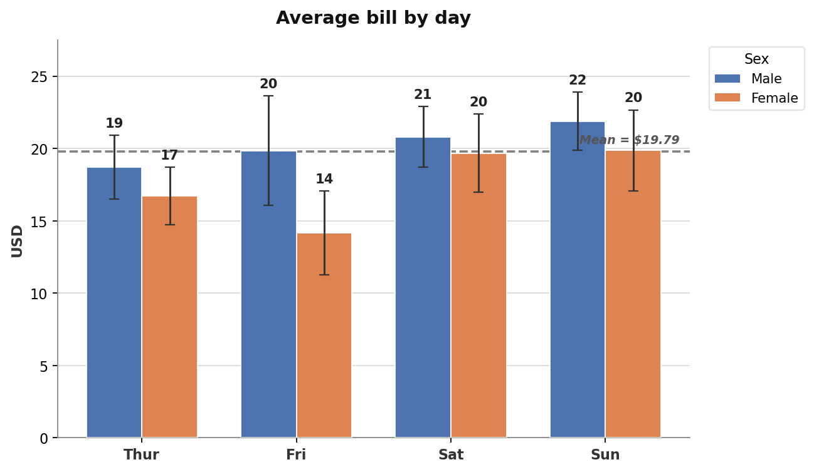
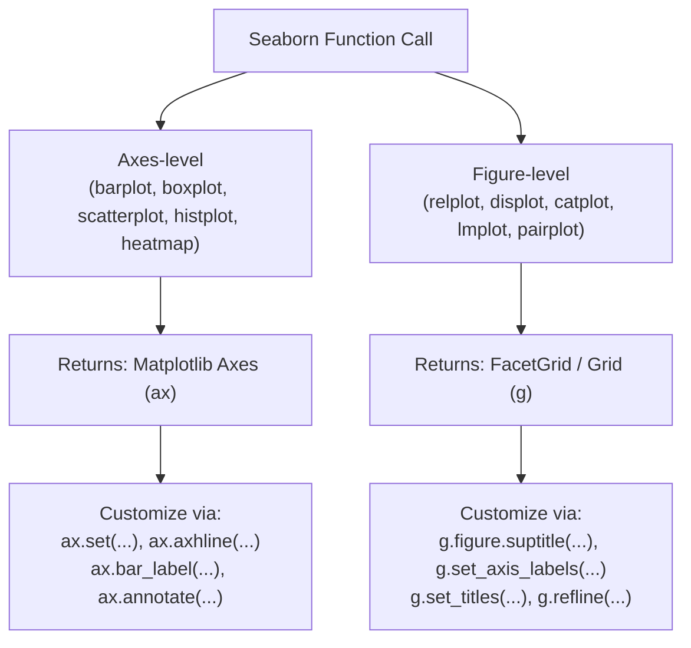

[⬅️ පෙර පාඩම (08 - Themes & Palettes)](08_Themes_Styles_Contexts_and_Palettes.md) | [🏠 ප්‍රධාන පිටුව (Course Index)](README.md) | [ඊළඟ පාඩම (10 - Statistical Estimation & Objects) ➡️](10_Statistical_Estimation_and_Objects_Interface.md)

---

# 09. Customisation & Matplotlib Integration

Seaborn වල ලස්සන charts ඇඳගත්තට පස්සේ, අපිට සමහර වෙලාවට සියුම් වෙනස්කම් (fine-tuning) කරන්න ඕන වෙනවා — උදාහරණයක් විදිහට හැම bar එකක් උඩම ඒකේ අගය ලියන්න, average ඉරක් අඳින්න, legend එක plot එකෙන් එළියට ගන්න, නැත්නම් එකම dashboard එකක charts 3ක් එකට තියන්න.

මේ හැම දේටම තියෙන රහස හරිම සරලයි: **Seaborn කියන්නේ Matplotlib උඩ හදපු පුස්තකාලයක්!** ඒ නිසා Seaborn function එකක් call කළාම ඒක අපිට ආපහු දෙන්නේ Matplotlib object එකක් (හෝ ඒක ඇතුළේ තියෙන Grid object එකක්). හරියට **Seaborn කියන්නේ ගෙදර බිත්ති හදලා පේන්ට් කරන කොන්ත්‍රාත්කරුවා වගේ; ඊට පස්සේ ඇණ ගහලා පින්තූර එල්ලන එක (fine-tuning) අපි Matplotlib පාවිච්චි කරලා කරනවා!**



---

## 1️⃣ Seaborn ආපහු දෙන Object එක මොකක්ද? (Axes-Level vs Figure-Level)

Customisation කරද්දී මුලින්ම බලන්න ඕනේ ඔබ call කළේ **Axes-level** function එකක්ද, නැත්නම් **Figure-level** function එකක්ද කියන එකයි.



- **Axes-level (`ax = sns.boxplot(...)`):** කෙළින්ම Matplotlib `Axes` object එකක් return කරනවා. ඒක නිසා `ax.set_title(...)`, `ax.axhline(...)` වගේ ඕනෑම Matplotlib method එකක් කෙළින්ම පාවිච්චි කරන්න පුළුවන්.
- **Figure-level (`g = sns.relplot(...)`):** `FacetGrid` (හෝ `PairGrid`/`JointGrid`) object එකක් return කරනවා. ඒකේ මුළු figure එකට title එකක් දාන්න `g.figure.suptitle('Title', y=1.04)` ද, axis labels වලට `g.set_axis_labels(...)` ද, panel titles වලට `g.set_titles(...)` ද පාවිච්චි කරනවා.

---

## 2️⃣ Custom Dashboards: `plt.subplots()` එක්ක Seaborn

විවිධ වර්ගයේ charts (උදා: boxplot එකක්, histogram එකක්, heatmap එකක්) එකම Figure එකක පෙළට තියන්න Matplotlib වල `plt.subplots()` හදලා, ඒ හැම කොටුවකම `ax=` parameter එකට දෙන්න:

```python
fig, axs = plt.subplots(1, 3, figsize=(14, 4), constrained_layout=True)
sns.boxplot(data=tips, x='day', y='total_bill', ax=axs[0])
sns.histplot(data=tips, x='total_bill', kde=True, ax=axs[1])
sns.heatmap(tips.select_dtypes('number').corr(), annot=True, ax=axs[2])
```

- **Overlaying Layers (එකම Axes එකේ Plots 2ක්):** එකම `ax` එක දීලා Seaborn functions දෙකක් call කළොත්, ඒ දෙක එක උඩ එක ඇඳෙනවා! (උදා: `violinplot` එක උඩ `swarmplot` හෝ `stripplot` එකක් දාන එක).
- **Raw Matplotlib Layers:** Seaborn වල නැති ඕනෑම දෙයක් (`ax.fill_between()`, `ax.errorbar()`, custom shapes / `patches`) ඒ `ax` එකටම එකතු කරන්න පුළුවන්.

---

## 3️⃣ අත්‍යවශ්‍ය Customisation මෙවලම් (Essential Toolkit)

### 🏷️ Titles, Labels & Tick Labels
- **එක පාර සකස් කරන්න:** `ax.set(title='Average bill', xlabel='', ylabel='USD')`
- **දිග Category නම් කරකවන්න (Rotate Ticks):**
  - `ax.tick_params(axis='x', labelrotation=45)`
  - නැත්නම් `ax.set_xticks(...)` / `plt.setp(ax.get_xticklabels(), rotation=45, ha='right')`

### 🔭 Axis Limits & Log Scales
- **Zoom / Limits:** `ax.set(xlim=(0, 50), ylim=(0, 30))`
- **Skewed Data වලට Log Scale:** `ax.set(yscale='log')` හෝ සමහර Seaborn functions වල කෙළින්ම `log_scale=True`.

### 📌 Legends, Reference Lines & Annotations
- **Legend එක එළියට ගන්න:** `sns.move_legend(ax, 'upper left', bbox_to_anchor=(1, 1), title='Sex')` (හෝ `ax.legend(loc=...)`).
- **Reference Lines (ඉලක්ක / සාමාන්‍ය අගයන්):**
  - Axes-level: `ax.axhline(y_val, ls='--', color='gray')` (තිරස් ඉර), `ax.axvline(x_val)` (සිරස් ඉර).
  - Figure-level: `g.refline(y=y_val, ls='--')` (හැම කොටුවකටම එක පාර!).
- **Bar Labels (Bars උඩ අගයන් ලියන්න):**
  ```python
  for c in ax.containers:
      ax.bar_label(c, fmt='%.0f', padding=2)
  ```
- **Callouts & Text:** විශේෂ ලක්ෂ්‍යයක් පෙන්නන්න `ax.annotate('Peak!', xy=(x, y), xytext=(x2, y2), arrowprops=dict(arrowstyle='->'))` හෝ සරලව `ax.text(x, y, 'Label')`.

### 📐 Size, Layout & High-Res Saving
- **ප්‍රමාණය (Size):** Axes-level නම් `plt.figure(figsize=(8, 4))` හෝ `plt.subplots(figsize=(8, 4))`. Figure-level නම් `height=3.5, aspect=1.2`.
- **Overlap නවත්වන්න (Layout):** `plt.subplots(..., constrained_layout=True)` (වඩාත් නූතන සහ හොඳම ක්‍රමය!), නැත්නම් `plt.tight_layout()` / `g.tight_layout()`.
- **Export / Save කරන්න:**
  - `fig.savefig('bill.png', dpi=300, bbox_inches='tight')` — `dpi=300` වලින් print quality එක ලැබෙනවා; `bbox_inches='tight'` නිසා පිටත තියෙන legend හෝ titles කැපෙන්නේ (clip වෙන්නේ) නැහැ!
  - Figure-level නම්: `g.savefig('grid.png', dpi=300)`.

---

## 💻 සම්පූර්ණ කේත උදාහරණය (Complete Code Example)

```python
import seaborn as sns
import matplotlib.pyplot as plt

sns.set_theme(style='whitegrid')
tips = sns.load_dataset('tips')

# 1. Axes-level: Grouped barplot + bar labels + mean line + outside legend + save
fig, ax = plt.subplots(figsize=(7, 4), constrained_layout=True)
sns.barplot(data=tips, x='day', y='total_bill', hue='sex', ax=ax)

# හැම bar group (container) එකකටම value labels එකතු කිරීම
for c in ax.containers:
    ax.bar_label(c, fmt='%.0f', padding=2)

# සමස්ත සාමාන්‍යය පෙන්නන dashed reference line එක
ax.axhline(tips['total_bill'].mean(), ls='--', color='gray')

# Title සහ axis labels
ax.set(title='Average bill by day', xlabel='', ylabel='USD')

# Legend එක chart එකෙන් පිටත දකුණු ඉහළට ගෙනයාම
sns.move_legend(ax, 'upper left', bbox_to_anchor=(1, 1), title='Sex')
sns.despine(ax=ax)

# High-resolution export (legend කැපෙන්නේ නැතුව)
fig.savefig('bill.png', dpi=300, bbox_inches='tight')
plt.show()

# 2. Figure-level: catplot customisation
g = sns.catplot(data=tips, x='day', y='tip', col='time', kind='box', height=3.2)
g.set_axis_labels('', 'Tip ($)')
g.set_titles('{col_name} Service')
g.figure.suptitle('Tips by day and meal', y=1.04)
g.savefig('tips_grid.png', dpi=300)
plt.show()
```

### 🔍 පේළියෙන් පේළිය පැහැදිලි කිරීම (Line-by-Line Explanation)
1. `fig, ax = plt.subplots(figsize=(7, 4), constrained_layout=True)`: අඟල් 7×4 ප්‍රමාණයේ Figure එකක් සහ `ax` එකක් හදනවා. `constrained_layout=True` මගින් labels/legends එකිනෙක ගැටීම වළක්වනවා.
2. `sns.barplot(..., ax=ax)`: Seaborn barplot එක අපි හදපු `ax` එක ඇතුළේ අඳිනවා.
3. `for c in ax.containers: ax.bar_label(c, fmt='%.0f', padding=2)`: `hue='sex'` නිසා Male සහ Female වලට bar containers 2ක් හැදෙනවා. `for` loop එකෙන් ඒ දෙකේම bars උඩ පූර්ණ සංඛ්‍යා (`%.0f`) ලියනවා.
4. `ax.axhline(tips['total_bill'].mean(), ls='--', color='gray')`: මුළු dataset එකේම average බිල්පත හරහා කඩ ඉරක් අඳිනවා.
5. `sns.move_legend(ax, 'upper left', bbox_to_anchor=(1, 1), title='Sex')`: Legend එකේ වම්-ඉහළ කෙළවර (`upper left`), plot එකේ දකුණු-ඉහළ කෙළවරට (`x=1, y=1`) තබනවා — එතකොට legend එක plot එකෙන් පිටත ලස්සනට ඉන්නවා.
6. `g.figure.suptitle('...', y=1.04)`: `catplot` එක Figure-level නිසා මුළු grid එකටම උඩින් ප්‍රධාන title එකක් දාන්න `y=1.04` පාවිච්චි කරලා panel titles වල ගෑවෙන එක නවත්වනවා.

### 👀 බලාපොරොත්තු වන ප්‍රතිඵලය (Expected Visual Output)
- **Figure 1 (`bill.png`):** දවස් 4 සඳහා Male/Female grouped bars, හැම bar එකක් උඩම ඒකේ rounded අගය (`19`, `17`, `20`, `14`, ...), `$19.79` මට්ටමේ අළු පාට dashed ඉරක්, උඩ/දකුණු borders නැති clean පෙනුමක්, සහ දකුණු පැත්තේ පිටත `Sex` legend එකක්.
- **Figure 2 (`tips_grid.png`):** `Lunch Service` සහ `Dinner Service` කියලා කොටු 2ක boxplots, පොදු Y-axis label එක `'Tip ($)'`, සහ උඩින්ම මුළු figure එකේ ප්‍රධාන title එක.

---

## 🧠 මතක තබා ගැනීමට පහසු ක්‍රම (Memory Hacks)

- **`ax` vs `g` Rule:**
  - `ax` (Axes-level) → `ax.set(...)`, `ax.axhline(...)`, `fig.savefig(...)`
  - `g` (Figure-level) → `g.set_titles(...)`, `g.refline(...)`, `g.figure.suptitle(...)`, `g.savefig(...)`
- **`bbox_to_anchor=(1, 1)` තේරුම:** Plot කොටුවේ පහළ-වම `(0, 0)` සහ ඉහළ-දකුණ `(1, 1)` විදිහට හිතන්න. `loc='upper left'` එක `(1, 1)` ට තිබ්බම legend එක හරියටම දකුණු පැත්තෙන් එළියේ එල්ලෙනවා!
- **Save Checklist:** හැමදාම **`dpi=300, bbox_inches='tight'`** මේ දෙක මතක තියාගන්න — එතකොට blur වෙන්නෙත් නෑ, text කැපෙන්නෙත් නෑ!

---

## ⚠️ සාමාන්‍යයෙන් වෙන වැරදි (Common Pitfalls)

> [!WARNING]
> **1. `ax.bar_label(ax.containers[0])` විතරක් දීම!**
> `hue` එකක් තියෙන grouped bar chart එකක containers ගොඩක් තියෙනවා (එක `hue` category එකකට එක container එක ගානේ). `ax.containers[0]` විතරක් දුන්නොත් පළවෙනි පාටේ bars වලට විතරයි labels වැටෙන්නේ! ඒ නිසා හැමවිටම `for c in ax.containers: ax.bar_label(c)` ලියන්න.

> [!WARNING]
> **2. `plt.show()` එකට පස්සේ `fig.savefig()` call කිරීම!**
> `plt.show()` කළාම Matplotlib figure එක clear කරනවා. ඊට පස්සේ `plt.savefig()` දැම්මොත් සුදු පාට හිස් image එකක් තමයි save වෙන්නේ! හැමවිටම `savefig()` මුලින්, `plt.show()` පස්සේ!

> [!WARNING]
> **3. Figure-level plots වල `figsize=` දීම!**
> `sns.catplot(..., figsize=(8, 4))` කියලා දුන්නොත් error එකක් එනවා. Figure-level functions වල ප්‍රමාණය හදන්නේ `height=` සහ `aspect=` වලින් විතරයි.

---

## 🏋️ ප්‍රායෝගික අභ්‍යාස (Practical Exercises)

### Warm-up Exercise: Overlaying Two Plots on One Axes
`tips` dataset එකේ `day` අනුව `total_bill` පෙන්නන්න එකම `ax` එකේ `violinplot` එකක් සහ ඒක උඩින් `stripplot` එකක් අඳින්න.

<details>
<summary>✅ පිළිතුර බලන්න (Click to see Solution)</summary>

```python
import seaborn as sns
import matplotlib.pyplot as plt

sns.set_theme(style='whitegrid')
tips = sns.load_dataset('tips')

fig, ax = plt.subplots(figsize=(7, 4), constrained_layout=True)
sns.violinplot(data=tips, x='day', y='total_bill', inner=None, color='#D0E1F9', ax=ax)
sns.stripplot(data=tips, x='day', y='total_bill', color='#1F4E79', alpha=0.6, size=4, ax=ax)
ax.set(title='Violin + Strip Overlay on Single Axes', xlabel='', ylabel='Total Bill ($)')
sns.despine(ax=ax)
plt.show()
```
</details>

### Exercise 1 (Course Module 9.1)
Build a `1×3` figure mixing a boxplot, a histogram, and a heatmap, each on its own axes with a shared style.

<details>
<summary>✅ පිළිතුර බලන්න (Click to see Solution)</summary>

```python
import seaborn as sns
import matplotlib.pyplot as plt

sns.set_theme(style='whitegrid', palette='colorblind')
tips = sns.load_dataset('tips')

fig, axs = plt.subplots(1, 3, figsize=(15, 4.2), constrained_layout=True)

# Panel 1: Boxplot
sns.boxplot(data=tips, x='day', y='total_bill', hue='sex', ax=axs[0])
axs[0].set(title='Total Bill by Day & Sex', xlabel='', ylabel='Total Bill ($)')
sns.despine(ax=axs[0])

# Panel 2: Histogram
sns.histplot(data=tips, x='tip', kde=True, color='#0173B2', ax=axs[1])
axs[1].axvline(tips['tip'].mean(), ls='--', color='crimson', label='Mean')
axs[1].set(title='Tip Distribution', xlabel='Tip ($)', ylabel='Count')
axs[1].legend()
sns.despine(ax=axs[1])

# Panel 3: Heatmap
corr = tips.select_dtypes('number').corr()
sns.heatmap(corr, annot=True, fmt='.2f', cmap='coolwarm', center=0, ax=axs[2])
axs[2].set_title('Numeric Correlations')

fig.suptitle('Tips Dataset — 1×3 Combined Dashboard', fontsize=14, fontweight='bold')
plt.show()
```
</details>

### Exercise 2 (Course Module 9.2)
Add value labels to every bar and move the legend outside the plot.

<details>
<summary>✅ පිළිතුර බලන්න (Click to see Solution)</summary>

```python
import seaborn as sns
import matplotlib.pyplot as plt

sns.set_theme(style='ticks', palette='Set2')
penguins = sns.load_dataset('penguins').dropna()

fig, ax = plt.subplots(figsize=(7.5, 4.5), constrained_layout=True)
sns.barplot(data=penguins, x='species', y='body_mass_g', hue='sex', errorbar=None, ax=ax)

for container in ax.containers:
    ax.bar_label(container, fmt='%.0f g', padding=3, fontsize=9)

ax.set(title='Mean Penguin Body Mass by Species & Sex', xlabel='', ylabel='Body Mass (g)')
ax.set_ylim(0, 6200)
sns.move_legend(ax, 'upper left', bbox_to_anchor=(1.02, 1), title='Sex')
sns.despine(ax=ax)
plt.show()
```
</details>

### Exercise 3 (Course Module 9.3)
Customise a `catplot` grid so each panel has a descriptive title and a shared y-axis label.

<details>
<summary>✅ පිළිතුර බලන්න (Click to see Solution)</summary>

```python
import seaborn as sns
import matplotlib.pyplot as plt

sns.set_theme(style='whitegrid', palette='muted')
tips = sns.load_dataset('tips')

g = sns.catplot(data=tips, x='day', y='total_bill', col='time',
                kind='box', height=3.8, aspect=1.1, sharey=True)
g.set_titles('Meal Period: {col_name}')
g.set_axis_labels('Day of Week', 'Total Bill (USD)')
g.refline(y=tips['total_bill'].median(), ls='--', color='gray')
g.figure.suptitle('Restaurant Bill Distribution by Meal Period', y=1.05, fontweight='bold')
plt.show()
```
</details>

---

## 📋 කෙටි සටහන (Cheat Sheet Summary)

| අවශ්‍යතාවය (Task) | Axes-Level (`ax`) | Figure-Level (`g`) |
| :--- | :--- | :--- |
| Title සහ Labels | `ax.set(title=, xlabel=, ylabel=)` | `g.figure.suptitle(..., y=1.04)`, `g.set_axis_labels(...)`, `g.set_titles(...)` |
| Multiple Subplots | `fig, axs = plt.subplots(1, 3)` + `ax=axs[i]` | `col=`, `row=`, `col_wrap=` |
| Tick Labels Rotate | `ax.tick_params(axis='x', labelrotation=45)` | `g.tick_params(axis='x', labelrotation=45)` |
| Limits & Log Scale | `ax.set(xlim=, yscale='log')` | `g.set(xlim=, yscale='log')` |
| Legend පිටතට ගන්න | `sns.move_legend(ax, 'upper left', bbox_to_anchor=(1, 1))` | `sns.move_legend(g, ...)` |
| Reference Lines | `ax.axhline(y)`, `ax.axvline(x)` | `g.refline(x=, y=)` |
| Bar Labels / Callouts | `ax.bar_label(c)`, `ax.annotate(...)`, `ax.text(...)` | `for ax in g.axes.flat: ...` |
| Size & Layout | `figsize=(7, 4)`, `constrained_layout=True` | `height=3.5`, `aspect=1.2`, `g.tight_layout()` |
| Save High-Res Image | `fig.savefig('f.png', dpi=300, bbox_inches='tight')` | `g.savefig('g.png', dpi=300)` |

---

[⬅️ පෙර පාඩම (08 - Themes & Palettes)](08_Themes_Styles_Contexts_and_Palettes.md) | [🏠 ප්‍රධාන පිටුව (Course Index)](README.md) | [ඊළඟ පාඩම (10 - Statistical Estimation & Objects) ➡️](10_Statistical_Estimation_and_Objects_Interface.md)
