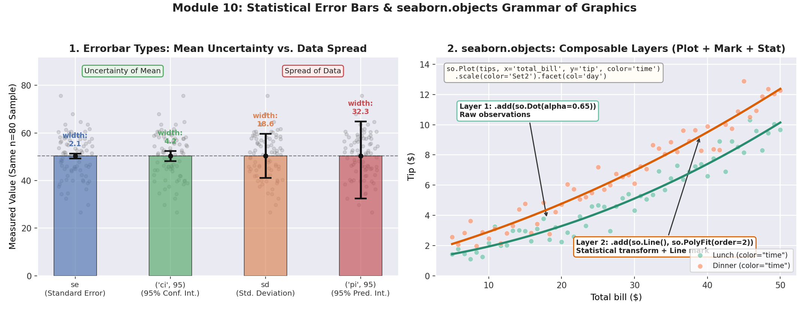
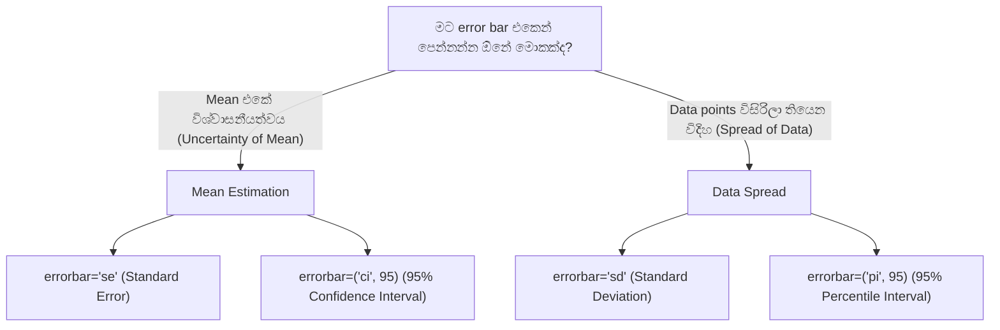
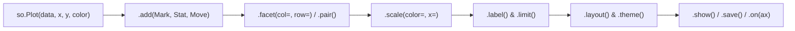

[🏠 Course Home](README.md) | [⬅️ Previous: 09 Customisation & Matplotlib](09_Customisation_and_Matplotlib_Integration.md) | [➡️ Next: 11 EDA Workflows & Performance](11_EDA_Workflows_and_Performance.md)

# පාඩම 10: Statistical Estimation සහ `seaborn.objects` Interface

Seaborn වල ලස්සන chart එකක් අඳිනවාට වඩා වැදගත් දෙයක් තමයි ඒ chart එකෙන් පෙන්නන **statistics (සංඛ්‍යාලේඛන)** හරියටම තේරුම් ගන්න එක. ඒ වගේම Seaborn version 0.12 ඉඳන් හඳුන්වා දීපු අලුත්ම, නවීන **Grammar of Graphics** ක්‍රමය වෙන `seaborn.objects` interface එක පාවිච්චි කරලා layer-by-layer (තට්ටු වශයෙන්) සුපිරි charts හදන විදිහත් අපි මේ පාඩමෙන් ඉගෙන ගමු!

---

## 🎯 මේ පාඩමෙන් ඔයා ඉගෙන ගන්න දේවල් (Learning Objectives)
- `errorbar` parameter එක හරහා `ci`, `se`, `sd`, `pi` අතර ඇති වෙනස හරියටම තේරුම් ගැනීම.
- Bootstrapping (`n_boot`, `seed`) සහ Custom `estimator` (`mean`, `median`, `sum`, `np.std`) පාවිච්චි කිරීම.
- Weighted histograms සහ Normalization (`weights`, `stat='probability'`, `common_norm`) පාලනය කිරීම.
- අලුත්ම `seaborn.objects` (`import seaborn.objects as so`) interface එකේ **Marks**, **Stats**, **Moves**, **Scales**, **Facets** පාවිච්චි කරලා plots ගොඩනැගීම.

---

## 🖼️ දෘශ්‍ය සාරාංශය (Visual Overview)



> [!TIP]
> උඩ තියෙන පළවෙනි රූපය (වම් පැත්ත) හොඳට බලන්න! එකම dataset එකේ (`n=80`) මැද අගය (mean) එකම වුණාට, `se` සහ `ci` කියන ඉරි හරිම කෙටියි. හැබැයි `sd` සහ `pi` කියන ඉරි ගොඩක් දිගයි. ඇයි එහෙම වෙන්නේ? අපි දැන් ඒක හරියටම තේරුම් ගමු!

---

## 📊 Part A: Estimation සහ Uncertainty (Classic API)

Seaborn වල `barplot`, `lineplot`, `pointplot` වගේ charts අඳිනකොට එයා නිකම්ම bar එකක් හෝ ඉරක් විතරක් නෙවෙයි, ඒක උඩ **error bar** (කළු ඉරක්) හෝ **shaded band** එකක් අඳිනවා. මේකෙන් කියන්නේ අපේ data වල තියෙන **uncertainty (අවිනිශ්චිතතාවය)** හෝ **spread (විහිදීම)** ගැනයි.

### 1. Error Bars තෝරාගැනීම (`errorbar=`)

පරණ Seaborn versions වල තිබුණු `ci=` argument එක දැන් ඉවත් කරලා (deprecated), ඒ වෙනුවට ගොඩක් පැහැදිලි `errorbar=` parameter එක හඳුන්වා දීලා තියෙනවා.

| `errorbar` අගය | තේරුම (Meaning) | මේකෙන් මනින්නේ මොකක්ද? | පාවිච්චි කරන්නේ කවදාද? |
| :--- | :--- | :--- | :--- |
| `'se'` | Standard Error of the Mean | මධ්‍යන්‍යය (Mean) කොච්චර නිවැරදිද? | Mean එකේ precision එක පෙන්නන්න |
| `'ci'` හෝ `('ci', 95)` | 95% Confidence Interval (Default) | ඇත්ත population mean එක තියෙන්න පුළුවන් පරාසය | A/B tests, group means සංසන්දනය කරන්න |
| `'sd'` | Standard Deviation | දත්ත (Data points) කොච්චර විසිරිලාද? | Data වල spread එක පෙන්නන්න |
| `('pi', 95)` | 95% Percentile / Prediction Interval | Data වලින් 95% ක් වැටෙන පරාසය (2.5th–97.5th percentile) | Skewed data වල spread එක පෙන්නන්න |
| `None` | Error bar නැත | Error bar අඳින්නේ නෑ | Chart එක clean කරගන්න හෝ speed වැඩි කරන්න |
| Custom function | ඔයාම ලියන function එකක් | `(low, high)` tuple එකක් return කරන ඕනෑම logic එකක් | විශේෂ statistical rules වලට |



### 2. Bootstrapping (`n_boot=` සහ `seed=`)
Default විදිහට `errorbar=('ci', 95)` ගණනය කරන්නේ **Bootstrapping** කියන ක්‍රමයෙන්. ඒ කියන්නේ ඔයාගේ data එකෙන් අහඹු විදිහට නැවත නැවත samples 1,000 ක් (`n_boot=1000`) අරගෙන ඒවායේ mean එක හදලා 95% පරාසය බලන එක.
- **Reproducibility (හැමදාම එකම උත්තරේ ගන්න):** අහඹු sampling නිසා chart එක run කරන හැම පාරම error bar එක චුට්ටක් වෙනස් වෙන්න පුළුවන්. ඒක නවත්තන්න `seed=42` දෙන්න!
- **Speed වැඩි කරන්න:** Data ගොඩක් ලොකු නම් `n_boot=200` වගේ අඩු කරන්න පුළුවන්.

### 3. Estimators (`estimator=`)
Default විදිහට `barplot` සහ `lineplot` ගණනය කරන්නේ `mean` (සාමාන්‍යය). හැබැයි data වල ලොකු outliers තියෙනවා නම් (skewed data — උදා: පඩි, ගෙවල් මිල), `mean` එක නොමඟ යවන සුළුයි. එතකොට `estimator='median'`, `'sum'`, `np.std`, හෝ ඔයාගේම Python function එකක් දෙන්න පුළුවන්!

### 4. Weights සහ Normalisation (`weights=`, `stat=`, `common_norm=`)
Group දෙකක සාම්පල් ගණන (sample size) සමාන නැති වෙලාවට (උදා: group A වල rows 1000යි, group B වල rows 100යි) `histplot` අඳිනකොට count එකෙන් compare කරන්න අමාරුයි.
- `stat='probability'` හෝ `stat='density'` දැම්මම ප්‍රතිශතයක් විදිහට බලන්න පුළුවන්.
- `common_norm=False` දැම්මම හැම group එකක්ම **වෙන වෙනම 100% (1.0) වෙන විදිහට** normalize වෙනවා!
- `weights='column_name'` දැම්මම එක row එකකට එක ගානේ count නොකර, ඒ row එකේ තියෙන බර (උදා: sales amount, population) එකතු කරනවා.

```python
import seaborn as sns
import matplotlib.pyplot as plt
import numpy as np

sns.set_theme(style="whitegrid")
tips = sns.load_dataset("tips")

fig, axs = plt.subplots(1, 3, figsize=(14, 4))

# 1. Median estimator + reproducible 95% CI
sns.barplot(
    data=tips, x="day", y="total_bill",
    estimator="median", errorbar=("ci", 95),
    n_boot=1000, seed=42, ax=axs[0]
)
axs[0].set_title("Median Bill with 95% CI")

# 2. Spread of data using Standard Deviation ('sd')
sns.barplot(
    data=tips, x="day", y="total_bill",
    estimator="mean", errorbar="sd", ax=axs[1]
)
axs[1].set_title("Mean Bill with Spread (SD)")

# 3. Normalised histogram comparing unequal groups
sns.histplot(
    data=tips, x="total_bill", hue="time",
    stat="probability", common_norm=False,
    element="step", ax=axs[2]
)
axs[2].set_title("Probability Share (common_norm=False)")

plt.tight_layout()
plt.show()
```

**කේතය පේළියෙන් පේළිය පැහැදිලි කිරීම (Line-by-Line Explanation):**
- `estimator="median"`: Outliers නිසා බලපෑමක් නැතිව මැද අගය (median) ගණනය කරයි.
- `n_boot=1000, seed=42`: Bootstrap iterations 1000ක් සිදු කරන අතර `seed=42` නිසා හැම වතාවෙම එකම error bar එක ලැබේ.
- `errorbar="sd"`: දෙවෙනි chart එකේදී mean එකේ අවිනිශ්චිතතාවය වෙනුවට, data points විහිදී ඇති ප්‍රමාණය (Standard Deviation) පෙන්වයි.
- `stat="probability", common_norm=False`: Lunch සහ Dinner වලට වෙන වෙනම සම්භාවිතා එකතුව 1.0 වන ලෙස histogram එක normalize කරයි.

**බලාපොරොත්තු වන ප්‍රතිඵලය (Expected Output):**
එක පේළියට charts 3ක් පෙන්වයි: පළමු එකේ දින අනුව median බිල සහ කෙටි 95% CI ඉරිද, දෙවැන්නේ mean බිල සහ දිග SD විහිදුම් ඉරිද, තෙවැන්නේ Lunch සහ Dinner සාධාරණව සංසන්දනය කළ step histograms දෙකක්ද දිස්වේ.

---

## 🧩 Part B: `seaborn.objects` Interface (Grammar of Graphics)

ඔයා R භාෂාවේ `ggplot2` හෝ Altair ගැන අහලා තියෙනවා නම්, `seaborn.objects` කියන්නේ ඒ වගේම **Declarative (Grammar of Graphics)** ක්‍රමයක්!
Classic Seaborn වලදී අපිට scatter + regression line එකක් අඳින්න `regplot` වගේ විශේෂ function එකක් මතක තියාගන්න වුණා. හැබැයි `seaborn.objects` වලදී අපි කරන්නේ **Lego කෑලි එකතු කරනවා වගේ** plot එක තට්ටු (layers) විදිහට එකතු කරන එක!



### `seaborn.objects` වල ප්‍රධාන කොටස් (Core Building Blocks)

| සංකල්පය (Concept) | කාර්යය (What it does) | ප්‍රධාන උදාහරණ (Examples) |
| :--- | :--- | :--- |
| **`so.Plot(...)`** | Data එකයි, columns ටික x/y/color වලට map කරන තැන | `so.Plot(df, x='bill', y='tip', color='time')` |
| **`.add(Mark, Stat, Move)`** | Chart එකට අලුත් layer එකක් එකතු කිරීම | `.add(so.Dot())`, `.add(so.Line(), so.PolyFit(order=2))` |
| **Marks** (දෘශ්‍ය රූප) | Screen එකේ ඇඳෙන ජ්‍යාමිතික හැඩතල | `so.Dot`, `so.Line`, `so.Lines`, `so.Path`, `so.Bar`, `so.Bars`, `so.Band`, `so.Area`, `so.Range`, `so.Text` |
| **Stats** (ගණනය කිරීම්) | අඳින්න කලින් data transform කරන හැටි | `so.Agg('mean')`, `so.Est('mean', errorbar='sd')`, `so.Hist()`, `so.KDE()`, `so.PolyFit()`, `so.Count()` |
| **Moves** (ස්ථාන සැකසීම) | Overlap වෙන marks එහා මෙහා කිරීම | `so.Dodge()`, `so.Jitter()`, `so.Stack()`, `so.Shift()`, `so.Norm()` |
| **Scales** (පරිමාණය) | Axis scales සහ color palettes පාලනය | `.scale(color='viridis', x='log')`, `so.Continuous`, `so.Nominal`, `so.Temporal` |
| **Facets & Pairs** | Subplots වලට කැඩීම | `.facet(col='time', wrap=2)`, `.pair(x=['a', 'b'])` |
| **Labels & Limits** | නම් සහ සීමාවන් දැමීම | `.label(title='...', x='...', y='...')`, `.limit(x=(0, 10))` |
| **Layout & Theme** | ප්‍රමාණය සහ theme එක | `.layout(size=(8, 4))`, `.theme({...})` |
| **Output** | පෙන්වීම, save කිරීම හෝ Matplotlib ax එකකට දැමීම | `.show()`, `.save('plot.png')`, `.on(ax)` |

### සම්පූර්ණ උදාහරණය (Complete Example: Objects vs Classic)

```python
import seaborn as sns
import seaborn.objects as so

tips = sns.load_dataset("tips")

# උදාහරණය 1: Scatter + Linear Fit + Facets (Grammar of Graphics)
p1 = (
    so.Plot(tips, x="total_bill", y="tip", color="time")
    .add(so.Dot(alpha=0.5))
    .add(so.Line(), so.PolyFit(order=1))
    .facet(col="day", wrap=2)
    .label(x="Total bill ($)", y="Tip ($)", title="Tips by Day & Meal Time")
    .scale(color="Set2")
    .layout(size=(8, 5))
)
p1.show()

# උදාහරණය 2: Mean bars + SE error bars, dodged side-by-side
p2 = (
    so.Plot(tips, x="day", y="total_bill", color="sex")
    .add(so.Bar(), so.Agg("mean"), so.Dodge())
    .add(so.Range(), so.Est(errorbar="se"), so.Dodge())
    .label(y="Mean Total Bill ($)", title="Objects API: Bar + SE Range")
)
p2.show()

# උදාහරණය 3: Classic API එකෙන් ඒ දේම එක පේළියෙන්
sns.barplot(data=tips, x="day", y="total_bill", hue="sex", errorbar="se")
```

**කේතය පේළියෙන් පේළිය පැහැදිලි කිරීම (Line-by-Line Explanation):**
- `so.Plot(tips, x="total_bill", y="tip", color="time")`: Data එක සහ mapping එක සකසයි. තවම කිසිම දෙයක් ඇඳෙන්නේ නැත.
- `.add(so.Dot(alpha=0.5))`: පළවෙනි layer එක විදිහට 50% transparent තිත් (dots) එකතු කරයි.
- `.add(so.Line(), so.PolyFit(order=1))`: දෙවෙනි layer එක විදිහට සරල රේඛීය regression line එකක් (order=1) එකතු කරයි.
- `.facet(col="day", wrap=2)`: දවස් 4 (Thur, Fri, Sat, Sun) පේළියකට 2 බැගින් 2x2 grid එකකට බෙදයි.
- `.add(so.Bar(), so.Agg("mean"), so.Dodge())`: Mean අගය bar එකක් ලෙස අඳින අතර `so.Dodge()` නිසා Male/Female bars එක උඩ එක වැටෙන්නේ නැතුව ළඟින් ළඟින් තබයි.
- `.add(so.Range(), so.Est(errorbar="se"), so.Dodge())`: ඒ bars උඩම Standard Error range ඉරි එකතු කරයි.

**බලාපොරොත්තු වන ප්‍රතිඵලය (Expected Output):**
- `p1`: දවස් 4 සඳහා 2x2 panel grid එකක්; හැම panel එකේම Lunch සහ Dinner වලට වෙන වෙනම තිත් සහ trend lines ඇඳී ඇත.
- `p2`: `sns.barplot` එකට සමාන, දවස් අනුව Male/Female bars ළඟින් ළඟින් ඇඳී, ඒවා මත SE error bars පෙන්වන chart එකක් ලැබේ.

> [!NOTE]
> Jupyter Notebook එකක නම් `p1` කියලා අන්තිමට තිබ්බම ඉබේම පේනවා. Python script එකක නම් `.show()` හෝ `.save("out.png", dpi=150)` අනිවාර්යයෙන් කතා කරන්න.

---

## 🧠 මතක තබා ගැනීමට පහසු ක්‍රම (Memory Hacks)

1. **"CI = Confidence in the Mean, SD/PI = Spread of Data":**
   - Sample size ($n$) වැඩි වෙනකොට `se` සහ `ci` **පොඩි වෙනවා** (මොකද අපිට mean එක ගැන විශ්වාසය වැඩි වෙනවා).
   - හැබැයි `sd` සහ `pi` පොඩි වෙන්නේ නෑ — මොකද ඒවා පෙන්නන්නේ data points වල ඇත්ත විසිරීම!
2. **"M-S-M" රීතිය (`so.Plot.add` සඳහා):**
   `.add(Mark, Stat, Move)` → මුලින්ම **මොකක්ද අඳින්නේ** (`Mark`), ඊළඟට **මොකක්ද ගණන් හදන්නේ** (`Stat`), අන්තිමට **කොහෙටද තල්ලු කරන්නේ** (`Move`).

---

## ⚠️ සාමාන්‍යයෙන් වෙන වැරදි (Common Pitfalls)

> [!WARNING]
> **වැරැද්ද 1:** 95% Confidence Interval (`errorbar=('ci', 95)`) එක දැකලා "data වලින් 95% ක් මේ ඉර ඇතුළේ ඉන්නවා" කියලා හිතන එක!
> **නිවැරදි දේ:** නෑ! ඒකෙන් කියන්නේ **Mean එක** ගැන 95% විශ්වාසය විතරයි. Data වලින් 95% ක් ඉන්න පරාසය බලන්න නම් `errorbar=('pi', 95)` පාවිච්චි කරන්න.

> [!WARNING]
> **වැරැද්ද 2:** `so.Plot` එකේ `.add(so.Bar(), so.Agg('mean'))` වලට `so.Dodge()` දාන්න අමතක වීම.
> **නිවැරදි දේ:** `color=` තියෙන bar chart එකක `so.Dodge()` දැම්මේ නැත්නම් bars දෙක එක උඩ එක වැහිලා යනවා! ඒ වගේම Bar layer එකටයි Range layer එකටයි **දෙකටම** `so.Dodge()` දාන්න ඕනේ.

> [!WARNING]
> **වැරැද්ද 3:** පරණ tutorials බලාගෙන `ci=95` හෝ `ci='sd'` ලියන එක.
> **නිවැරදි දේ:** අලුත් Seaborn වල ඒක warning එකක් දෙනවා හෝ වැඩ කරන්නේ නෑ. හැමවෙලේම `errorbar=('ci', 95)` හෝ `errorbar='sd'` පාවිච්චි කරන්න.

---

## 🏋️ ප්‍රායෝගික අභ්‍යාස (Practical Exercises)

### අභ්‍යාසය 1: Classic vs Objects සංසන්දනය
`penguins` dataset එක අරගෙන `bill_length_mm` (x) සහ `bill_depth_mm` (y) අතර scatter plot එකක් + linear trend line එකක් (`species` අනුව වර්ණ ගන්වලා) Classic API (`sns.lmplot`) එකෙනුයි `seaborn.objects` එකෙනුයි දෙකෙන්ම අඳින්න.

<details>
<summary>✅ පිළිතුර බලන්න (Click to see Solution)</summary>

```python
import seaborn as sns
import seaborn.objects as so

penguins = sns.load_dataset("penguins").dropna()

# 1. Classic API
sns.lmplot(data=penguins, x="bill_length_mm", y="bill_depth_mm", hue="species", ci=None)

# 2. seaborn.objects API (වඩාත් පැහැදිලි සහ වෙනස් කරන්න ලේසියි!)
(
    so.Plot(penguins, x="bill_length_mm", y="bill_depth_mm", color="species")
    .add(so.Dot(alpha=0.6))
    .add(so.Line(), so.PolyFit(order=1))
    .label(
        x="Bill Length (mm)",
        y="Bill Depth (mm)",
        title="Penguins Bill Dimensions (Objects API)"
    )
    .show()
)
```
</details>

### අභ්‍යාසය 2: Error Bar වර්ග 3ක් සංසන්දනය
`tips` dataset එකේ `day` අනුව `total_bill` පෙන්වන bar chart එක `errorbar=('ci', 95)`, `errorbar='sd'`, සහ `errorbar=('pi', 95)` කියන 3න්ම පැත්තෙන් පැත්තට ඇඳලා whiskers වෙනස් වෙන විදිහ බලන්න.

<details>
<summary>✅ පිළිතුර බලන්න (Click to see Solution)</summary>

```python
import seaborn as sns
import matplotlib.pyplot as plt

tips = sns.load_dataset("tips")
fig, axs = plt.subplots(1, 3, figsize=(13, 4), sharey=True)

for ax, eb, title in zip(
    axs,
    [("ci", 95), "sd", ("pi", 95)],
    ["95% CI (Mean Uncertainty)", "SD (Spread)", "95% PI (95% of Data)"]
):
    sns.barplot(data=tips, x="day", y="total_bill", errorbar=eb, seed=0, ax=ax)
    ax.set_title(title)

plt.tight_layout()
plt.show()
# පැහැදිලි කිරීම: CI ඉරි ඉතා කෙටියි (mean එක ගැන precision එක).
# SD ඉරි මධ්‍යම ප්‍රමාණයේ විහිදීම පෙන්නනවා.
# PI ඉරි ඉතා දිගයි — මොකද ඒක data වලින් 95% ක්ම ආවරණය කරනවා!
```
</details>

### අභ්‍යාසය 3: Objects API Histogram + KDE + Facet
`seaborn.objects` පාවිච්චි කරලා `penguins` dataset එකේ `flipper_length_mm` සඳහා `species` අනුව facet කරපු histogram එකක් (density normalized) සහ ඒක උඩින් KDE curve එකක් අඳින්න.

<details>
<summary>✅ පිළිතුර බලන්න (Click to see Solution)</summary>

```python
import seaborn as sns
import seaborn.objects as so

penguins = sns.load_dataset("penguins").dropna()

(
    so.Plot(penguins, x="flipper_length_mm", color="species")
    .add(so.Bars(alpha=0.45), so.Hist(stat="density"))
    .add(so.Line(linewidth=2), so.KDE())
    .facet(col="species")
    .label(x="Flipper Length (mm)", y="Density", title="Flipper Distribution by Species")
    .layout(size=(10, 3.5))
    .show()
)
```
</details>

---

[🏠 Course Home](README.md) | [⬅️ Previous: 09 Customisation & Matplotlib](09_Customisation_and_Matplotlib_Integration.md) | [➡️ Next: 11 EDA Workflows & Performance](11_EDA_Workflows_and_Performance.md)
