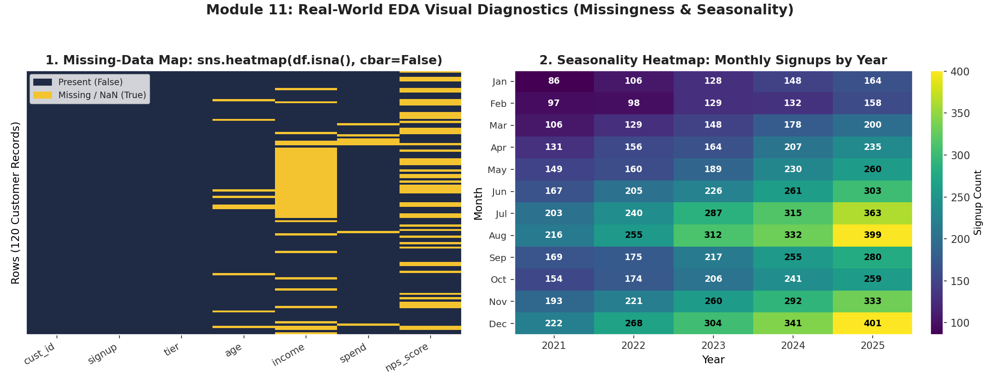
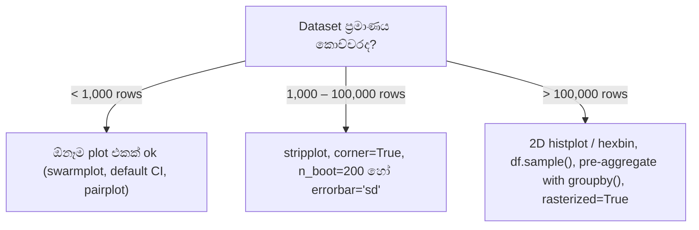

[🏠 Course Home](README.md) | [⬅️ Previous: 10 Statistical Estimation & Objects](10_Statistical_Estimation_and_Objects_Interface.md) | [➡️ Next: 12 Chart Selection & Capstones](12_Chart_Selection_and_Capstone_Projects.md)

# පාඩම 11: Real-World EDA Workflows සහ Performance

අලුත් dataset එකක් අතට ආවම "මම කොතනින්ද පටන් ගන්නේ? මොන chart එකද මුලින්ම අඳින්නේ?" කියලා හිතෙන එක සාමාන්‍යයි. Data Science වල මේකට කියන්නේ **EDA (Exploratory Data Analysis)** කියලා. Seaborn හදලා තියෙන්නේම ඉක්මනින්, පිළිවෙළට EDA කරන්නයි. ඒ වගේම rows මිලියන ගාණක් තියෙන ලොකු datasets ආවම chart එක slow වෙන්නේ නැතුව, hang වෙන්නේ නැතුව අඳින **Performance tricks** ටිකත් මේ පාඩමෙන් ඉගෙන ගමු!

---

## 🎯 මේ පාඩමෙන් ඔයා ඉගෙන ගන්න දේවල් (Learning Objectives)
- ඕනෑම අලුත් dataset එකකට යොදාගන්න පුළුවන් **8-Step Repeatable EDA Workflow** එක.
- Missing data heatmap එකක් සහ Year-by-Month Seasonality heatmap එකක් හදන විදිහ.
- Large datasets (rows මිලියන ගාණක්) වලදී speed වැඩි කරගන්න පුළුවන් Performance & Scale උපක්‍රම 7ක්.
- `pd.Categorical` පාවිච්චි කරලා categories වල පිළිවෙළ (order) හැම chart එකකම නිවැරදිව තියාගන්න විදිහ.

---

## 🖼️ දෘශ්‍ය සාරාංශය (Visual Overview)



> [!TIP]
> වම් පැත්තේ **Missing-Data Map** එකෙන් එක බැල්මෙන්ම පේනවා `income` column එකේ මැද හරියේ ලොකු කොටසක් (contiguous block) හිස් වෙලා තියෙන බවත්, `nps_score` වල ගොඩක් missing values තියෙන බවත්! දකුණු පැත්තේ **Seasonality Heatmap** එකෙන් අවුරුද්දෙන් අවුරුද්ද growth එකයි, ජූලි–අගෝස්තු සහ නොවැම්බර්–දෙසැම්බර් මාසවල peaks තියෙන බවයි ලස්සනට පේනවා.

---

## 🔍 පියවර 8ක EDA වැඩපිළිවෙළ (8-Step Repeatable EDA Workflow)


හැම අලුත් dataset එකක්ම ලැබුණම මේ පියවර 8 අනුගමනය කරන්න:

| පියවර (Step) | ඔයා අහන්න ඕනේ ප්‍රශ්නය (Question) | පාවිච්චි කරන Tools / Seaborn Functions |
| :--- | :--- | :--- |
| **1. Shape and types** | Columns කීයක්, rows කීයක්, මොන data types ද තියෙන්නේ? | `df.info()`, `df.describe()`, `df.head()` |
| **2. Missing data** | හිස් තැන් (`NaN`) තියෙන්නේ කොහෙද? Pattern එකක් තියෙනවද? | `sns.heatmap(df.isna(), cbar=False)` |
| **3. Single variables** | එක එක column එකේ distribution එක කොහොමද? | `histplot`, `kdeplot`, `boxplot`, `countplot` |
| **4. Pairs** | Variables දෙකක් අතර සම්බන්ධයක් තියෙනවද? | `pairplot`, `scatterplot`, `heatmap(df.corr())` |
| **5. Groups** | කාණ්ඩ (segments) අනුව වෙනසක් තියෙනවද? | `catplot`, `violinplot`, `barplot`, `displot(col=)` |
| **6. Time** | කාලයත් එක්ක trend එකක් හෝ seasonality එකක් තියෙනවද? | `lineplot`, `relplot(kind='line')`, year-month `heatmap` |
| **7. Outliers** | අසාමාන්‍ය (unusual) data points මොනවාද? | `boxplot`, `scatterplot` (annotated points එක්ක) |
| **8. Communicate** | මේකෙන් කියන්න තියෙන **ප්‍රධානම පණිවිඩය** මොකක්ද? | Chart එක සරල කරන්න, direct labels දාන්න, හොඳ theme එකක් යොදන්න |

---

## 💻 Real-World EDA සම්පූර්ණ කේත උදාහරණය

මේ code එකෙන් සැබෑ customer dataset එකක් EDA කරන ප්‍රධාන පියවර 4ක් පෙන්වනවා (Missing map, Numeric pairplot, Ordered category comparison, Seasonality heatmap):

```python
import pandas as pd
import numpy as np
import seaborn as sns
import matplotlib.pyplot as plt

sns.set_theme(style="whitegrid")

# Real dataset එකක් නම්: df = pd.read_csv("customers.csv", parse_dates=["signup"])
# අපි test කරන්න sample DataFrame එකක් හදමු:
rng = np.random.default_rng(42)
n = 3000
df = pd.DataFrame({
    "id": np.arange(n),
    "signup": pd.to_datetime("2022-01-01") + pd.to_timedelta(rng.integers(0, 1095, n), unit="D"),
    "tier": rng.choice(["basic", "plus", "pro"], size=n, p=[0.5, 0.35, 0.15]),
    "age": rng.normal(35, 10, n).round(0),
    "spend": rng.gamma(2.5, 40, n).round(2),
})
df.loc[rng.random(n) < 0.12, "age"] = np.nan  # missing values ටිකක් දාමු

# 1. Missing-data map (හිස් තැන් බැලීම)
plt.figure(figsize=(8, 4))
sns.heatmap(df.isna(), cbar=False, yticklabels=False)
plt.title("Missing Data Pattern")
plt.show()

# 2. Numeric overview (ලොකු data වලදී sample කරලා corner=True දාන්න!)
num = df.select_dtypes("number").drop(columns=["id"])
sns.pairplot(
    num.sample(min(len(num), 2000), random_state=0),
    corner=True, kind="hist"
)
plt.show()

# 3. Ordered category comparison (පිළිවෙළට tier ටික පෙන්වීම)
df["tier"] = pd.Categorical(df["tier"], ["basic", "plus", "pro"], ordered=True)
plt.figure(figsize=(7, 4))
sns.boxplot(data=df, x="tier", y="spend", showfliers=False)
plt.title("Customer Spend by Tier (Ordered)")
plt.show()

# 4. Seasonality Heatmap (මාසය සහ අවුරුද්ද අනුව signups)
monthly = (
    df.assign(year=df["signup"].dt.year, month=df["signup"].dt.month)
      .pivot_table(index="month", columns="year", values="id", aggfunc="count")
)
plt.figure(figsize=(7, 5))
sns.heatmap(monthly, cmap="mako", annot=True, fmt="d")
plt.title("Monthly Signups by Year")
plt.show()
```

**කේතය පේළියෙන් පේළිය පැහැදිලි කිරීම (Line-by-Line Explanation):**
- `sns.heatmap(df.isna(), cbar=False, yticklabels=False)`: `df.isna()` මගින් True/False matrix එකක් හදනවා. `cbar=False` නිසා අනවශ්‍ය colorbar එක අයින් වෙනවා, `yticklabels=False` නිසා row numbers 3000ක් ඇඳිලා slow වෙන එක නවතිනවා.
- `num.sample(min(len(num), 2000), random_state=0)`: Rows කොච්චර තිබුණත් උපරිම 2,000ක් විතරක් ගන්නවා — ඒකෙන් `pairplot` එක තත්පර ගාණකින් run වෙනවා!
- `corner=True, kind="hist"`: Pairplot එකේ උඩ ත්‍රිකෝණය (duplicate කොටස) අයින් කරලා, scatter වෙනුවට වේගවත් 2D histograms අඳිනවා.
- `pd.Categorical(df["tier"], ["basic", "plus", "pro"], ordered=True)`: Alphabetical පිළිවෙළ වෙනුවට logical පිළිවෙළ (`basic` → `plus` → `pro`) ස්ථිරවම set කරනවා.
- `pivot_table(..., aggfunc="count")` + `sns.heatmap(..., fmt="d")`: මාස 1–12 rows විදිහටත්, අවුරුදු columns විදිහටත් matrix එක හදලා, පූර්ණ සංඛ්‍යා (`fmt="d"`) විදිහට numbers ඇතුළේ පෙන්වනවා.

**බලාපොරොත්තු වන ප්‍රතිඵලය (Expected Output):**
1. `age` column එකේ missing ඉරි පෙන්වන heatmap එකක්.
2. `age` සහ `spend` සඳහා පහළ ත්‍රිකෝණය විතරක් තියෙන වේගවත් `pairplot` එකක්.
3. `basic`, `plus`, `pro` පිළිවෙළට outliers නැතුව (`showfliers=False`) පෙන්වන boxplot එකක්.
4. `mako` dark-to-light වර්ණ පරාසයෙන් සෑම මාසයකම signup ගණන සඳහන් වුණු heatmap එකක්.

---

## ⚡ Performance සහ Scale උපක්‍රම (Large Datasets සඳහා)

Rows 500,000ක් හෝ 5,000,000ක් තියෙන dataset එකක සාමාන්‍ය `scatterplot` හෝ `swarmplot` ගැහුවොත් laptop එක hang වෙන්න පුළුවන්! ඒකට විසඳුම් 7ක් මෙන්න:

| ගැටලුව (Problem) | වේගවත් විසඳුම (Fast Remedy) | ඇයි ඒක වේගවත්? |
| :--- | :--- | :--- |
| **Millions of points in scatter** | `sns.histplot(x=, y=)`, `sns.jointplot(kind='hex')`, හෝ `df.sample(n=50_000)` | තිත් මිලියන ගාණක් අඳිනවා වෙනුවට bins වලට බෙදා වර්ණ ගන්වයි (overplotting ද නැති වේ) |
| **Slow `swarmplot`** | `sns.stripplot(alpha=0.3)` හෝ `violinplot` පාවිච්චි කරන්න | `swarmplot` හැම තිතකම overlap ගණනය කරයි ($O(n^2)$). ඒක පොඩි datasets (< 500) වලට විතරයි |
| **Slow bootstrapped intervals** | `n_boot=200` අඩු කරන්න, `errorbar='sd'`, හෝ `errorbar=None` දාන්න | Default 1,000 bootstrap iterations ලොකු data වලදී ගොඩක් වෙලා ගනී |
| **Slow `pairplot`** | `corner=True`, අවශ්‍ය `vars=` විතරක් දෙන්න, `kind='hist'`, හෝ `df.sample()` | Panels ගණන බාගයකින් අඩු වී scatter rendering speed වැඩි වේ |
| **Heavy figures in PDFs/SVGs** | Dense layers වලට `rasterized=True` දාන්න, නැත්නම් `.png` විදිහට save කරන්න | Vector PDF එකක තිත් 100,000ක් save වුණොත් file size 50MB+ වේ! |
| **Category order surprises** | `pd.Categorical(..., ordered=True)` හදන්න | හැම plot එකකම `order=` ලියන්න ඕනේ නෑ; alphabetical වැරැද්ද නවතී |
| **Aggregate first** | Pandas `groupby().mean()` කරලා ඒ summary table එක plot කරන්න | Rows මිලියන 10ක් Seaborn වලට දෙනවා වෙනුවට aggregated rows 20ක් දීම තත්පර 0.01න් වැඩ කරයි! |



---

## 🧠 මතක තබා ගැනීමට පහසු ක්‍රම (Memory Hacks)

1. **"Sample → Aggregate → Bin" (Big Data සූත්‍රය):**
   Plot එක slow වෙන ඕනෑම වෙලාවක මේ 3න් එකක් කරන්න:
   - **Sample:** `df.sample(50_000)`
   - **Aggregate:** `df.groupby(...).agg(...)`
   - **Bin:** `scatterplot` වෙනුවට `histplot(x=, y=)` හෝ `hexbin`
2. **"NaN Map First!"**
   Seaborn හැම chart එකකම missing values **නොකියාම (silently) drop කරනවා**. ඒ නිසා EDA පටන් ගන්නකොටම `sns.heatmap(df.isna(), cbar=False)` ගහලා missing data බලන එක පුරුද්දක් කරගන්න!

---

## ⚠️ සාමාන්‍යයෙන් වෙන වැරදි (Common Pitfalls)

> [!WARNING]
> **වැරැද්ද 1:** Rows 10,000කට `sns.swarmplot()` ගහන එක.
> **නිවැරදි දේ:** ඒක විනාඩි ගාණක් හිර වෙලා අන්තිමට `"points cannot be placed"` කියලා warning එකකුත් දෙනවා. ඒ වෙනුවට `stripplot(alpha=0.2, jitter=True)` හෝ `violinplot` පාවිච්චි කරන්න.

> [!WARNING]
> **වැරැද්ද 2:** ලොකු scatter plot එකක් `plt.savefig("fig.pdf")` කියලා vector format එකෙන් save කරන එක.
> **නිවැරදි දේ:** PDF එක open කරන්නවත් බැරි තරම් heavy වෙනවා. `sns.scatterplot(..., rasterized=True)` දාන්න — එතකොට axes/text ටික crisp vector විදිහටත්, තිත් ටික විතරක් පොඩි raster image එකක් විදිහටත් save වෙනවා!

---

## 🏋️ ප්‍රායෝගික අභ්‍යාස (Practical Exercises)

### අභ්‍යාසය 1: 8-Step EDA Workflow එක ක්‍රියාත්මක කිරීම
Seaborn වල built-in `titanic` dataset එක අරගෙන 8-step EDA workflow එකෙන් පියවර 1, 2, 3, 5 code කරලා හැම පියවරෙන්ම එක වාක්‍යයක insight එකක් ලියන්න.

<details>
<summary>✅ පිළිතුර බලන්න (Click to see Solution)</summary>

```python
import seaborn as sns
import matplotlib.pyplot as plt

titanic = sns.load_dataset("titanic")

# Step 1: Shape & types
print(titanic.shape)
print(titanic.info())

# Step 2: Missing data map
sns.heatmap(titanic.isna(), cbar=False, yticklabels=False)
plt.title("Step 2: Missing Data in Titanic (deck & age have gaps)")
plt.show()

# Step 3: Single variable distribution
sns.histplot(data=titanic, x="age", kde=True)
plt.title("Step 3: Age Distribution (Right-skewed, peak around 20-30)")
plt.show()

# Step 5: Group comparison
sns.barplot(data=titanic, x="class", y="survived", hue="sex", errorbar=("ci", 95))
plt.title("Step 5: Survival Rate by Class & Sex (Females & 1st class much higher)")
plt.show()
```
</details>

### අභ්‍යාසය 2: 1-Million Point Scatter vs 2D Histogram වේගය මැනීම
NumPy වලින් rows 1,000,000ක් හදලා `scatterplot` එකකුයි `histplot(x=, y=, bins=60)` එකකුයි render වෙන්න යන කාලය `time.perf_counter()` වලින් සංසන්දනය කරන්න.

<details>
<summary>✅ පිළිතුර බලන්න (Click to see Solution)</summary>

```python
import time
import numpy as np
import pandas as pd
import seaborn as sns
import matplotlib.pyplot as plt

rng = np.random.default_rng(0)
big = pd.DataFrame({
    "x": rng.normal(0, 1, 1_000_000),
    "y": rng.normal(0, 1, 1_000_000),
})

# Fast 2D Histogram
t0 = time.perf_counter()
fig, ax = plt.subplots(figsize=(6, 5))
sns.histplot(data=big, x="x", y="y", bins=60, cmap="mako", ax=ax)
fig.savefig("test_hist2d.png", dpi=100)
plt.close(fig)
print(f"2D histplot time: {time.perf_counter() - t0:.2f}s")

# Sampled Scatter (fast alternative)
t1 = time.perf_counter()
fig, ax = plt.subplots(figsize=(6, 5))
sns.scatterplot(data=big.sample(20_000, random_state=0), x="x", y="y", alpha=0.15, s=8, ax=ax)
fig.savefig("test_scatter_sample.png", dpi=100)
plt.close(fig)
print(f"Sampled scatter (20k) time: {time.perf_counter() - t1:.2f}s")
```
</details>

### අභ්‍යාසය 3: Ordered Categorical Column එකක් හැදීම
`tips` dataset එකේ `day` column එක `['Thur', 'Fri', 'Sat', 'Sun']` කියන logical පිළිවෙළට ordered categorical කරලා, `order=` argument එක නොදාම `countplot` සහ `boxplot` දෙකම නිවැරදි පිළිවෙළට අඳින්න.

<details>
<summary>✅ පිළිතුර බලන්න (Click to see Solution)</summary>

```python
import pandas as pd
import seaborn as sns
import matplotlib.pyplot as plt

tips = sns.load_dataset("tips")
tips["day"] = pd.Categorical(
    tips["day"], categories=["Thur", "Fri", "Sat", "Sun"], ordered=True
)

fig, axs = plt.subplots(1, 2, figsize=(10, 4))
sns.countplot(data=tips, x="day", ax=axs[0])
axs[0].set_title("Order Preserved Automatically (Count)")

sns.boxplot(data=tips, x="day", y="tip", ax=axs[1])
axs[1].set_title("Order Preserved Automatically (Boxplot)")

plt.tight_layout()
plt.show()
```
</details>

---

[🏠 Course Home](README.md) | [⬅️ Previous: 10 Statistical Estimation & Objects](10_Statistical_Estimation_and_Objects_Interface.md) | [➡️ Next: 12 Chart Selection & Capstones](12_Chart_Selection_and_Capstone_Projects.md)
