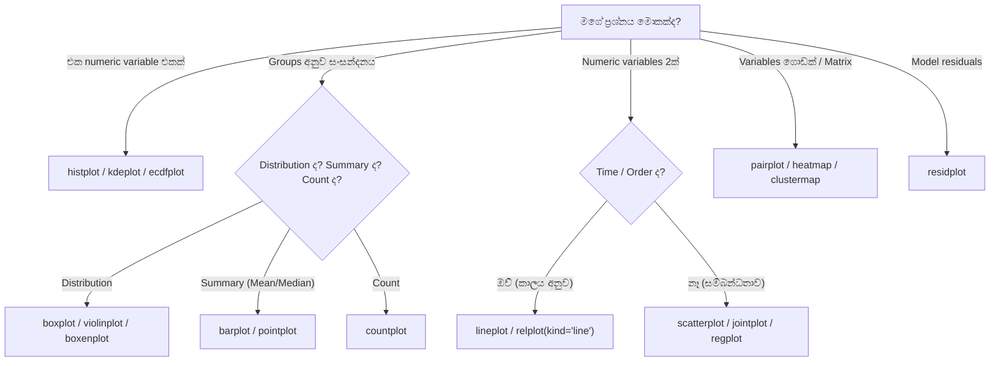
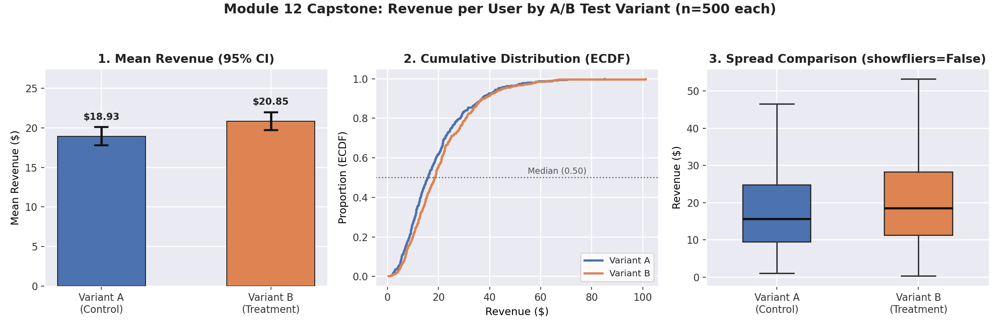

[🏠 Course Home](README.md) | [⬅️ Previous: 11 EDA Workflows & Performance](11_EDA_Workflows_and_Performance.md) | [➡️ Next: 13 Cheat Sheet, Pitfalls & Study Plan](13_Cheat_Sheet_Pitfalls_and_Study_Plan.md)

# පාඩම 12: Chart Selection Guide සහ Capstone Projects

දැන් ඔයා Seaborn වල හැම chart වර්ගයක්ම ඉගෙන ගෙන ඉවරයි! හැබැයි සැබෑ ලෝකයේ වැඩ කරනකොට තියෙන ලොකුම ප්‍රශ්නය තමයි **"මගේ ප්‍රශ්නයට හරියනම chart එක මොකක්ද?"** කියන එක. මේ පාඩමෙන් අපි සම්පූර්ණ **Chart Selection Guide** එකයි, Seaborn භාවිතා වෙන ක්ෂේත්‍ර ටිකයි බලලා, ඔයාගේ portfolio එකට එකතු කරගන්න පුළුවන් **Capstone Projects 6ක** සම්පූර්ණ walkthrough code එකත් එක්ක වැඩ කරමු!

---

## 🎯 මේ පාඩමෙන් ඔයා ඉගෙන ගන්න දේවල් (Learning Objectives)
- ඕනෑම data ප්‍රශ්නයකට තත්පර 5න් නිවැරදි Seaborn plot එක තෝරාගැනීම.
- Business, ML, Science, Healthcare, A/B Testing ක්ෂේත්‍රවල Seaborn පාවිච්චි වෙන විදිහ.
- Portfolio-ready **Capstone Projects 6** (EDA Report, A/B Test Summary, Classification Explorer, Time-Series Seasonality, Publication Figures, Objects-Interface Rebuild) ප්‍රායෝගිකව ගොඩනැගීම.

---

## 🧭 මොන Seaborn Plot එකද තෝරන්නේ? (Chart Selection Guide)



### සම්පූර්ණ Chart Selection වගුව

| ඔයාගේ ප්‍රශ්නය (Question) | තෝරාගත යුතු Plot එක | Seaborn Function එක |
| :--- | :--- | :--- |
| එක numeric variable එකක් විහිදිලා තියෙන්නේ කොහොමද? | Histogram, KDE, ECDF | `histplot`, `kdeplot`, `ecdfplot` |
| Groups අතර distributions සංසන්දනය කරන්නේ කොහොමද? | Box, violin, boxen, overlaid KDE | `boxplot`, `violinplot`, `boxenplot`, `kdeplot(hue=)` |
| Categories අතර summary value (mean/median) බලන්නේ කොහොමද? | Bar හෝ point (error bars එක්ක) | `barplot`, `pointplot` |
| හැම category එකේම observations කීයක් තියෙනවද? | Count bars | `countplot` |
| Numeric variables දෙකක් අතර සම්බන්ධය මොකක්ද? | Scatter, hex/2D histogram, regression | `scatterplot`, `jointplot`, `regplot` |
| කාලය හෝ අනුපිළිවෙළ අනුව අගය වෙනස් වෙන්නේ කොහොමද? | Line with uncertainty | `lineplot`, `relplot(kind='line')` |
| Variables ගොඩක් එකවර සම්බන්ධ වෙන්නේ කොහොමද? | Pair grid, correlation heatmap | `pairplot`, `heatmap` |
| මොන rows හෝ columns ද එකට cluster වෙන්නේ? | Clustered heatmap | `clustermap` |
| Segments අනුව ප්‍රතිඵල වෙනස් වෙන්නේ කොහොමද? | Faceted charts | `col=`, `row=`, `FacetGrid` |
| Model residuals random විදිහටද තියෙන්නේ? | Residual plot | `residplot` |

---

## 🌍 Seaborn භාවිතා වෙන ක්ෂේත්‍ර (Where Seaborn Is Used)

| ක්ෂේත්‍රය (Domain) | සාමාන්‍යයෙන් කරන වැඩ (Typical Work) |
| :--- | :--- |
| **Business analytics** | Segment comparisons, funnel සහ retention heatmaps, revenue distributions |
| **Data science and ML** | EDA, class අනුව feature distributions, confusion matrices, correlation screening |
| **Science and research** | Confidence intervals එක්ක experimental group comparisons, publication figures |
| **Healthcare** | Cohort distributions, group අනුව lab values, survival-style ECDFs |
| **A/B testing** | Variant එකෙන් එකට metric distributions සහ confidence intervals |
| **Teaching** | පාඨමාලා සඳහා ඉක්මන්, පැහැදිලි statistical graphics |

---

## 🖼️ Featured Capstone Visual: A/B Test Summary Figure



> [!NOTE]
> උඩ තියෙන 3-panel A/B test figure එක බලන්න! Panel 1 එකෙන් Variant B වල Mean Revenue එක වැඩි බවත් 95% CI overlap අඩු බවත් පේනවා. Panel 2 (ECDF) එකෙන් B වල curve එක දකුණට shift වෙලා තියෙන බව (හැම percentile එකකම B ඉහළයි) පේනවා. Panel 3 (Boxplot) එකෙන් median සහ IQR spread එක පැහැදිලිව සංසන්දනය වෙනවා!

---

## 🏆 Capstone Projects 6: සම්පූර්ණ Walkthroughs

පහළ තියෙන Capstone Projects 6ම ඔයාගේ GitHub portfolio එකට හෝ self-study notebook එකට අරගෙන run කරලා බලන්න!

### Project 1: Full EDA Report (Titanic / Retail Dataset)
- **Skills Tested:** Distribution, categorical, correlation, group plots.
- **Deliverable:** Charts 8ක් සහ written findings තියෙන Notebook එකක්.

```python
import seaborn as sns
import matplotlib.pyplot as plt

sns.set_theme(style="whitegrid", palette="colorblind")
titanic = sns.load_dataset("titanic")

fig, axs = plt.subplots(2, 2, figsize=(12, 8), constrained_layout=True)

# 1. Survival count
sns.countplot(data=titanic, x="survived", ax=axs[0, 0])
axs[0, 0].set_title("1. Overall Survival Count")

# 2. Age distribution by survival
sns.histplot(data=titanic, x="age", hue="survived", kde=True, element="step", ax=axs[0, 1])
axs[0, 1].set_title("2. Age Distribution by Survival")

# 3. Survival rate by Class & Sex
sns.barplot(data=titanic, x="class", y="survived", hue="sex", errorbar=("ci", 95), ax=axs[1, 0])
axs[1, 0].set_title("3. Survival Rate by Class & Sex (95% CI)")

# 4. Numeric correlation heatmap
corr = titanic.select_dtypes("number").corr()
sns.heatmap(corr, annot=True, fmt=".2f", cmap="vlag", center=0, ax=axs[1, 1])
axs[1, 1].set_title("4. Numeric Feature Correlations")

fig.suptitle("Capstone 1: Titanic EDA Dashboard", fontsize=14, fontweight="bold")
plt.show()
```

---

### Project 2: A/B Test Visual Summary (Module 12 Signature Code!)
- **Skills Tested:** `barplot` with 95% CI, `ecdfplot`, `boxplot(showfliers=False)`, multi-panel layout.
- **Deliverable:** මොන variant එකද දිනන්නේ සහ uncertainty එක කොච්චරද කියලා පෙන්නන one-page figure එකක්.

```python
import numpy as np
import pandas as pd
import seaborn as sns
import matplotlib.pyplot as plt

sns.set_theme(style="whitegrid")

ab = pd.DataFrame({
    "variant": np.repeat(["A", "B"], 500),
    "revenue": np.r_[
        np.random.default_rng(0).gamma(2, 10, 500),
        np.random.default_rng(1).gamma(2.2, 10, 500),
    ],
})

fig, axs = plt.subplots(1, 3, figsize=(13, 4), constrained_layout=True)
sns.barplot(data=ab, x="variant", y="revenue", errorbar=("ci", 95), ax=axs[0])
axs[0].set_title("Mean Revenue (95% CI)")

sns.ecdfplot(data=ab, x="revenue", hue="variant", ax=axs[1])
axs[1].set_title("ECDF Comparison")

sns.boxplot(data=ab, x="variant", y="revenue", showfliers=False, ax=axs[2])
axs[2].set_title("Distribution Spread (No Fliers)")

fig.suptitle("Revenue per user by variant", fontsize=13, fontweight="bold")
plt.show()
```

**කේතය පැහැදිලි කිරීම:**
- `np.random.default_rng(0).gamma(2, 10, 500)` සහ `gamma(2.2, 10, 500)`: Right-skewed revenue data simulate කරයි (Variant B සාමාන්‍යයෙන් ~10% වැඩියි).
- එකම `fig, axs = plt.subplots(1, 3, ...)` තුළ axes-level functions 3ක් (`barplot`, `ecdfplot`, `boxplot`) භාවිතා කර 3-angle summary එකක් සාදයි.

---

### Project 3: Penguins Classification Explorer
- **Skills Tested:** `pairplot`, `jointplot`, `clustermap`, palettes.
- **Deliverable:** Species වෙන් කරන්න හොඳම features මොනවාද කියලා පෙන්නන visual guide එකක්.

```python
import seaborn as sns
import matplotlib.pyplot as plt

penguins = sns.load_dataset("penguins").dropna()

# 1. Pairplot to see species separation
sns.pairplot(penguins, hue="species", corner=True, palette="Dark2", diag_kind="kde")
plt.suptitle("Capstone 3A: Feature Separation by Species", y=1.02)
plt.show()

# 2. Jointplot of the two strongest features
sns.jointplot(data=penguins, x="bill_length_mm", y="flipper_length_mm", hue="species", palette="Dark2")
plt.show()

# 3. Clustermap of standardised numeric features
num_cols = ["bill_length_mm", "bill_depth_mm", "flipper_length_mm", "body_mass_g"]
sns.clustermap(penguins[num_cols], standard_scale=1, cmap="vlag", figsize=(7, 6))
plt.show()
```

---

### Project 4: Time-Series Seasonality Study
- **Skills Tested:** `lineplot`, `heatmap`, `relplot`.
- **Deliverable:** Trend එකයි seasonality එකයි පෙන්නන dashboard figure එකක්.

```python
import seaborn as sns
import matplotlib.pyplot as plt

flights = sns.load_dataset("flights")
piv = flights.pivot(index="month", columns="year", values="passengers")

fig, axs = plt.subplots(1, 2, figsize=(13, 5), constrained_layout=True)

# 1. Overall growth trend + spread across months
sns.lineplot(data=flights, x="year", y="passengers", errorbar="sd", marker="o", ax=axs[0])
axs[0].set_title("Annual Trend (Mean ± SD across Months)")

# 2. Month-by-Year Seasonality Heatmap
sns.heatmap(piv, cmap="mako", annot=True, fmt="d", linewidths=0.4, ax=axs[1])
axs[1].set_title("Monthly Passenger Seasonality (1949–1960)")

fig.suptitle("Capstone 4: Airline Passengers Trend & Seasonality", fontsize=13, fontweight="bold")
plt.show()
```

---

### Project 5: Publication Figure Set (Journal Ready)
- **Skills Tested:** Themes, `context='paper'`, colourblind palettes, Matplotlib fine-tuning, vector export (`.pdf`/`.svg`).
- **Deliverable:** Journal size එකට හදපු consistent figures 3ක්.

```python
import seaborn as sns
import matplotlib.pyplot as plt

# Paper-ready theme & font scaling
sns.set_theme(style="ticks", context="paper", palette="colorblind", font_scale=1.1)
tips = sns.load_dataset("tips")

fig, ax = plt.subplots(figsize=(5.5, 3.6))  # Single-column / half-page journal width
sns.regplot(data=tips, x="total_bill", y="tip", scatter_kws={"alpha": 0.5, "s": 25}, ax=ax)
ax.set(xlabel="Total Bill (USD)", ylabel="Tip Amount (USD)", title="Linear Relationship Between Bill and Tip")
sns.despine(ax=ax)

# Export crisp vector PDF + high-res 300 DPI PNG
fig.savefig("capstone5_journal_fig1.pdf", bbox_inches="tight")
fig.savefig("capstone5_journal_fig1.png", dpi=300, bbox_inches="tight")
plt.show()
```

---

### Project 6: Objects-Interface Rebuild
- **Skills Tested:** `seaborn.objects` layers, facets, scales, labels.
- **Deliverable:** කලින් හදපු chart එකක් `seaborn.objects` වලින් නැවත ගොඩනැගීම.

```python
import seaborn as sns
import seaborn.objects as so

flights = sns.load_dataset("flights")

# Rebuilding a faceted seasonal trend chart in seaborn.objects
(
    so.Plot(flights, x="year", y="passengers", color="month")
    .add(so.Line(linewidth=1.8))
    .add(so.Dot(pointsize=4))
    .facet(col="month", wrap=4)
    .scale(color="crest")
    .label(x="Year", y="Passengers", title="Capstone 6: Flights Trend Rebuilt in seaborn.objects")
    .layout(size=(11, 6))
    .show()
)
```

---

## 🎯 Practice Sources (තවත් පුහුණු වෙන්න තැන්)
1. **Seaborn Example Gallery** (`seaborn.pydata.org/examples`) — Gallery එකෙන් charts 5ක් තෝරගෙන ඔයාම අතින් code කරලා recreate කරන්න.
2. **Built-in Datasets** — `sns.get_dataset_names()` ගහලා `penguins`, `diamonds`, `planets`, `mpg`, `exercise`, `fmri` වගේ datasets වලින් practice කරන්න.
3. **Kaggle Datasets** — Real-world messy CSV files අරගෙන 8-step EDA workflow එක කරන්න.
4. **Articles & Papers** — ඔයා කැමති blog/news article එකක chart එකක් දැක්කම ඒක Seaborn වලින් හදන්න try කරන්න!

---

## 🧠 මතක තබා ගැනීමට පහසු ක්‍රම (Memory Hacks)

1. **"1–2–Many" Chart Picker:**
   - **1 variable** → `histplot` / `ecdfplot` / `countplot`
   - **2 variables** → `scatterplot` (num+num), `boxplot` (cat+num), `lineplot` (time+num)
   - **Many variables** → `pairplot` / `heatmap` / `FacetGrid` (`col=`, `row=`)
2. **"A/B Test Trio" (Mean + ECDF + Box):**
   A/B test එකක් ඉදිරිපත් කරනකොට කවදාවත් barplot එකක් විතරක් පෙන්නන්න එපා! **Bar (Mean+CI) + ECDF + Boxplot** කියන 3ම එකට පෙන්නුවොත් stakeholders ලට සම්පූර්ණ කතාවම පේනවා.

---

## ⚠️ සාමාන්‍යයෙන් වෙන වැරදි (Common Pitfalls)

> [!WARNING]
> **වැරැද්ද:** Dashboard එකේ හැම තැනටම `plt.subplots()` ඇතුළේ `relplot`, `catplot`, `displot` දාන්න හදන එක!
> **නිවැරදි දේ:** Figure-level functions (`relplot`, `catplot`, `displot`, `lmplot`) වලට `ax=` parameter එක නෑ. Multi-panel dashboard හදනකොට **Axes-level functions** (`barplot`, `ecdfplot`, `boxplot`, `heatmap`, `scatterplot`) විතරක් `ax=axs[i]` එක්ක පාවිච්චි කරන්න.

---

## 🏋️ ප්‍රායෝගික අභ්‍යාස (Practical Exercises)

### අභ්‍යාසය 1: Chart Selection Quiz
පහළ ප්‍රශ්න 3ට හොඳම Seaborn function එක මොකක්ද?
1. කාර් වර්ග 5ක ඉන්ධන කාර්යක්ෂමතාවයේ (mpg) සම්පූර්ණ distribution එක සංසන්දනය කරන්න.
2. Linear regression model එකක errors (residuals) random ද කියලා බලන්න.
3. Rows 50ක් සහ columns 10ක් තියෙන gene expression matrix එකේ සමාන genes එකට group වෙන හැටි බලන්න.

<details>
<summary>✅ පිළිතුර බලන්න (Click to see Solution)</summary>

1. **`sns.violinplot`** හෝ **`sns.boxplot`** (groups 5ක distribution සංසන්දනයට).
2. **`sns.residplot`** (regression model residuals random ද බලන්න).
3. **`sns.clustermap`** (rows/columns hierarchical clustering එක්ක heatmap අඳින්න).
</details>

### අභ්‍යාසය 2: A/B Test Capstone එකට Median & Lift Annotation එකතු කිරීම
Project 2 (A/B test figure) එකේ පළවෙනි panel එකේ (barplot) හැම bar එකටම උඩින් එහි mean අගය `$XX.XX` විදිහට label කරන්න.

<details>
<summary>✅ පිළිතුර බලන්න (Click to see Solution)</summary>

```python
import numpy as np
import pandas as pd
import seaborn as sns
import matplotlib.pyplot as plt

ab = pd.DataFrame({
    "variant": np.repeat(["A", "B"], 500),
    "revenue": np.r_[
        np.random.default_rng(0).gamma(2, 10, 500),
        np.random.default_rng(1).gamma(2.2, 10, 500),
    ],
})

fig, ax = plt.subplots(figsize=(5, 4))
sns.barplot(data=ab, x="variant", y="revenue", errorbar=("ci", 95), ax=ax)

for container in ax.containers:
    ax.bar_label(container, fmt="$%.2f", padding=12)

ax.set_ylim(0, 30)
ax.set_title("Mean Revenue per User (95% CI)")
plt.show()
```
</details>

---

[🏠 Course Home](README.md) | [⬅️ Previous: 11 EDA Workflows & Performance](11_EDA_Workflows_and_Performance.md) | [➡️ Next: 13 Cheat Sheet, Pitfalls & Study Plan](13_Cheat_Sheet_Pitfalls_and_Study_Plan.md)
