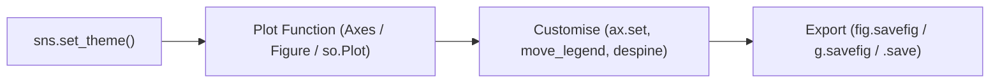
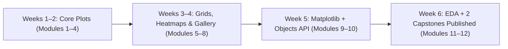

[🏠 Course Home](README.md) | [⬅️ Previous: 12 Chart Selection & Capstones](12_Chart_Selection_and_Capstone_Projects.md)

# පාඩම 13: Cheat Sheet, Common Pitfalls, 6-Week Plan & Mastery Checklist

මේ අවසාන පාඩම ඔයාගේ **Quick-Reference Handbook** එක! ඔයා ප්‍රොජෙක්ට් එකක් කරනකොට, exam එකකට පාඩම් කරනකොට හෝ interview එකකට සූදානම් වෙනකොට, මේ පිටුව bookmark කරලා තියාගත්තොත් Seaborn වල හැම වැදගත් function එකක්ම, වළක්වා ගත යුතු වැරදි 11ක්ම, සහ සති 6ක study plan එකම එක තැනකින් බලාගන්න පුළුවන්.

---

## ⚡ Quick Reference Cheat Sheet (කාර්යය අනුව)

| මට කරන්න ඕනේ... (I want to...) | පාවිච්චි කරන Seaborn Code එක |
| :--- | :--- |
| **Apply a look (Theme)** | `sns.set_theme(style=, context=, palette=)` |
| **Relationships** | `scatterplot`, `lineplot`, `relplot` |
| **Distributions** | `histplot`, `kdeplot`, `ecdfplot`, `displot`, `jointplot` |
| **Category comparisons** | `boxplot`, `violinplot`, `stripplot`, `swarmplot`, `barplot`, `pointplot`, `countplot`, `catplot` |
| **Fitted lines / Regression** | `regplot`, `lmplot`, `residplot` |
| **Matrices** | `heatmap`, `clustermap` |
| **Grids of plots** | `FacetGrid`, `PairGrid`, `pairplot`, `JointGrid`, හෝ `col=` / `row=` |
| **Pick colours** | `color_palette`, `diverging_palette`, `cubehelix_palette`, `palette=` |
| **Move the legend** | `sns.move_legend(ax_or_grid, 'upper left', bbox_to_anchor=(1, 1))` |
| **Remove borders** | `sns.despine()` |
| **Declarative plots** | `import seaborn.objects as so` → `so.Plot(...).add(...)` |
| **Save figure** | `fig.savefig('out.png', dpi=300, bbox_inches='tight')` හෝ `g.savefig(...)` |



---

## ⚠️ වළක්වා ගත යුතු ප්‍රධාන වැරදි 11 (11 Common Pitfalls & Fixes)

මේ වැරදි 11 තමයි ආධුනිකයෝ වගේම පළපුරුදු අයත් නිතරම කරන වැරදි. හැම එකක්ම කියවලා මතක තියාගන්න!

> [!WARNING]
> **Pitfall 1: Tidy long data වෙනුවට Wide / messy data දීම.**
> - ❌ අවුල: Columns ගොඩකට මාස (`Jan`, `Feb`, `Mar`) දාලා `hue=` පාවිච්චි කරන්න බෑ.
> - ✅ විසඳුම: මුලින්ම `df.melt(id_vars=..., var_name='month', value_name='sales')` වලින් tidy කරගන්න.

> [!WARNING]
> **Pitfall 2: Confidence Interval (`ci`) එක Data Spread එක කියලා වරදවා තේරුම් ගැනීම.**
> - ❌ අවුල: 95% CI එක දැකලා data වලින් 95% ක් එතන ඉන්නවා කියලා හිතීම.
> - ✅ විසඳුම: Data වල spread එක පෙන්නන්න නම් `errorbar='sd'` හෝ `errorbar=('pi', 95)` පාවිච්චි කරන්න.

> [!WARNING]
> **Pitfall 3: Data points දහස් ගාණකට `swarmplot` පාවිච්චි කිරීම.**
> - ❌ අවුල: ඉතා slow වෙනවා වගේම overlap warnings එනවා.
> - ✅ විසඳුම: `sns.stripplot(alpha=0.25)` හෝ `sns.violinplot()` පාවිච්චි කරන්න.

> [!WARNING]
> **Pitfall 4: Figure-level function එකකට `ax=` දීම.**
> - ❌ අවුල: `sns.catplot(..., ax=axs[0])` හෝ `sns.relplot(..., ax=ax)` වැඩ කරන්නේ නෑ — ඒවා තමන්ගේම අලුත් Figure එකක් හදනවා!
> - ✅ විසඳුම: Custom subplots ඇතුළේ අඳින්න Axes-level functions (`boxplot`, `scatterplot`, `histplot`) පාවිච්චි කරන්න.

> [!WARNING]
> **Pitfall 5: Bar charts වල y-axis එක බිංදුවෙන් (0) පටන් නොගැනීම.**
> - ❌ අවුල: Bar එකේ උසෙන් ප්‍රමාණය මනින නිසා 0න් පටන් නොගත්තොත් පොඩි වෙනසක් ලොකු වෙනසක් වගේ බොරුවට පේනවා.
> - ✅ විසඳුම: Bar charts හැමවෙලේම 0න් පටන් ගන්න. 0න් පටන් ගන්න බැරි නම් `pointplot` හෝ `lineplot` පාවිච්චි කරන්න.

> [!WARNING]
> **Pitfall 6: Seaborn හොරෙන්ම (silently) missing values drop කරන බව අමතක වීම.**
> - ❌ අවුල: Rows 50%ක් `NaN` වෙලා තිබුණත් Seaborn කිසිම error එකක් නැතුව chart එක අඳිනවා.
> - ✅ විසඳුම: Plot කරන්න කලින් `df.isna().sum()` සහ `sns.heatmap(df.isna(), cbar=False)` බලන්න.

> [!WARNING]
> **Pitfall 7: Alphabetical order එක නිසා logical පිළිවෙළ අවුල් වීම.**
> - ❌ අවුල: `High, Low, Medium` හෝ `Apr, Aug, Dec, Feb` වගේ අකාරාදී පිළිවෙළට categories ඇඳීම.
> - ✅ විසඳුම: `order=['Low', 'Medium', 'High']` දෙන්න, නැත්නම් `pd.Categorical(..., ordered=True)` හදන්න.

> [!WARNING]
> **Pitfall 8: `hue=` වලට categories 6කට වඩා දැමීම.**
> - ❌ අවුල: පාට 10–15ක් එක chart එකේ තිබ්බම ඇහැට වෙන් කරලා අඳුනගන්න බෑ ("spaghetti / rainbow mess").
> - ✅ විසඳුම: ඒ වෙනුවට `col=` / `row=` (faceting) පාවිච්චි කරන්න, නැත්නම් top 5 categories විතරක් තියලා අනිත් ඒවා `"Other"` කරන්න.

> [!WARNING]
> **Pitfall 9: Deprecated (පරණ) arguments / functions පාවිච්චි කිරීම.**
> - ❌ අවුල: `ci=95`, `sns.distplot()` වගේ පරණ APIs පාවිච්චි කිරීම.
> - ✅ විසඳුම: `ci=` වෙනුවට `errorbar=`, `distplot` වෙනුවට `histplot` හෝ `displot` පාවිච්චි කරන්න.

> [!WARNING]
> **Pitfall 10: Ordered / numeric data වලට Rainbow palette (`jet`, `rainbow`) දැමීම.**
> - ❌ අවුල: ඇහැට සමාන වෙනස්කම් වෙනස් විදිහට පේනවා, colourblind අයට කියවන්නත් බෑ.
> - ✅ විසඳුම: Sequential (`viridis`, `mako`, `rocket`) හෝ Diverging (`vlag`, `coolwarm`, `icefire`) palettes පාවිච්චි කරන්න.

> [!WARNING]
> **Pitfall 11: Regression plots (`regplot`, `lmplot`) formal statistical inference විදිහට ගැනීම.**
> - ❌ අවුල: `regplot` එකේ p-value, R-squared, heteroscedasticity checks නැහැ.
> - ✅ විසඳුම: ඒවා exploratory visuals විතරයි; formal statistical modelling සඳහා `statsmodels` හෝ `scikit-learn` පාවිච්චි කරන්න.

---

## 📅 සති 6ක ප්‍රායෝගික අධ්‍යයන සැලැස්ම (6-Week Practice Plan)

දවසට විනාඩි 45–60ක් වෙන් කරලා මේ පිළිවෙළට වැඩ කළොත් සති 6කින් ඔයා Seaborn expert කෙනෙක් වෙනවා:

| සති (Weeks) | දිනපතා පුරුද්ද (Daily Habit: 45–60 mins) | ඉලක්කය (Goal) |
| :--- | :--- | :--- |
| **Weeks 1 to 2** | Module 1–4 කියවන්න, හැම code example එකක්ම copy-paste නොකර අතින් type කරන්න, exercises කරන්න | Tidy data, Relational, Distribution, Categorical mastery |
| **Weeks 3 to 4** | Module 5–8 කරන ගමන්, දවසකට එක Seaborn Gallery example එක ගානේ වෙන dataset එකකින් recreate කරන්න | Regression, Heatmaps, Grids, Themes & Palettes mastery |
| **Week 5** | Module 9–10 ඉගෙන ගෙන, ඔයා කලින් හදපු charts 3ක් `seaborn.objects` interface එකෙන් නැවත හදන්න | Matplotlib tuning + Objects API fluency |
| **Week 6** | Module 11–12 කරලා, Capstone Projects 2ක් සම්පූර්ණ කරලා GitHub / blog එකක publish කරන්න | Real-world EDA + Portfolio showcase |



---

## ✅ Mastery Checklist (ඔයාගේ ප්‍රගතිය මැන බලන්න)

පාඨමාලාව ඉවර වෙද්දී මේ හැම එකකටම tick (✅) එකක් දාන්න පුළුවන්ද බලන්න:

- [ ] Figure-level සහ Axes-level functions අතර වෙනස පැහැදිලි කරලා නිවැරදි එක තෝරාගන්න පුළුවන්.
- [ ] Tidy data හදාගෙන columns ටික `x`, `y`, `hue`, `size`, `style`, `col`, `row` වලට map කරන්න පුළුවන්.
- [ ] ප්‍රශ්නයට හරියන distribution, categorical හෝ relational plot එක තෝරන්න පුළුවන්.
- [ ] Error bar එකකින් හෝ confidence band එකකින් හරියටම කියන්නේ මොකක්ද කියලා පැහැදිලි කරන්න පුළුවන්.
- [ ] Correlation tables හෝ pivot tables වලින් heatmaps සහ clustermaps හදන්න පුළුවන්.
- [ ] ඉක්මන් multivariate overview එකක් ගන්න faceted grids සහ pair plots හදන්න පුළුවන්.
- [ ] Theme එකක් සහ colourblind-safe palette එකක් හැම chart එකකටම consistent විදිහට යොදන්න පුළුවන්.
- [ ] ඕනෑම Seaborn chart එකක් Matplotlib වලින් customize කරලා print හෝ web වලට export කරන්න පුළුවන්.
- [ ] `seaborn.objects` interface එකෙන් declarative plot එකක් හදන්න පුළුවන්.

---

## 📚 තවදුරටත් ඉගෙන ගැනීමට සම්පත් (Resources & Next Steps)

- **Official Seaborn Documentation:** Tutorial, API reference සහ Example Gallery — `seaborn.pydata.org`
- **The Seaborn Paper:** Michael Waskom (2021), *Journal of Open Source Software (JOSS)* — Seaborn වල design philosophy එක තේරුම් ගන්න සුපිරි.
- **Fundamentals of Data Visualization** — Claus Wilke (නොමිලේ online කියවන්න පුළුවන්; හොඳ chart එකක් සහ නරක chart එකක් අතර වෙනස ඉගෙන ගන්න හොඳම පොත).
- **Python Data Science Handbook** — Jake VanderPlas (Visualization chapters, නොමිලේ online).
- **Next Steps:** මේ series එකේ **Matplotlib**, **pandas**, සහ **NumPy** courses සම්පූර්ණ කරන්න. ඊට පස්සේ interactive web charts හදන්න **Plotly** හෝ **Altair** ඉගෙන ගන්න!

---

## 🧠 මතක තබා ගැනීමට පහසු ක්‍රම (Final Memory Hack)

**"T–P–E–C–S" Workflow:**
1. **T**idy your DataFrame (`melt` / `Categorical`)
2. **P**ick the right plot (Axes-level for subplots, Figure-level for quick facets)
3. **E**stimate honestly (`errorbar='ci'` vs `'sd'` vs `'pi'`)
4. **C**ustomise cleanly (`set_theme`, colourblind palette, `despine`, `move_legend`)
5. **S**ave crisply (`dpi=300` PNG හෝ vector PDF with `bbox_inches='tight'`)

---

## 🏋️ අවසාන අභ්‍යාසය (Final Bug-Hunt Exercise)

පහළ තියෙන code කොටසේ **Pitfalls 4ක්** හැංගිලා තියෙනවා! ඒ 4 හොයාගෙන නිවැරදි code එක ලියන්න:

```python
fig, axs = plt.subplots(1, 2, figsize=(10, 4))
sns.catplot(data=tips, x="day", y="total_bill", kind="bar", ci="sd", ax=axs[0])
sns.distplot(tips["tip"], ax=axs[1])
axs[0].set_ylim(10, 25)
```

<details>
<summary>✅ පිළිතුර බලන්න (Click to see Solution)</summary>

**වැරදි 4:**
1. `sns.catplot` කියන්නේ figure-level function එකක් — ඒකට `ax=axs[0]` දෙන්න බෑ (ඒ වෙනුවට `sns.barplot` ගන්න).
2. `ci="sd"` deprecated — ඒ වෙනුවට `errorbar="sd"` දාන්න.
3. `sns.distplot` ඉවත් කරලා (deprecated) — ඒ වෙනුවට `sns.histplot(..., kde=True)` දාන්න.
4. `axs[0].set_ylim(10, 25)` — Bar chart එකක් 0න් පටන් නොගෙන 10න් පටන් ගැනීම වැරදියි (`set_ylim(0, ...)` විය යුතුයි).

**නිවැරදි කේතය:**
```python
import seaborn as sns
import matplotlib.pyplot as plt

tips = sns.load_dataset("tips")
fig, axs = plt.subplots(1, 2, figsize=(10, 4))

sns.barplot(data=tips, x="day", y="total_bill", errorbar="sd", ax=axs[0])
axs[0].set_ylim(0, 35)
axs[0].set_title("Mean Bill ± SD (Starts at 0)")

sns.histplot(data=tips, x="tip", kde=True, ax=axs[1])
axs[1].set_title("Tip Distribution")

plt.tight_layout()
plt.show()
```
</details>

---

[🏠 Course Home](README.md) | [⬅️ Previous: 12 Chart Selection & Capstones](12_Chart_Selection_and_Capstone_Projects.md)
