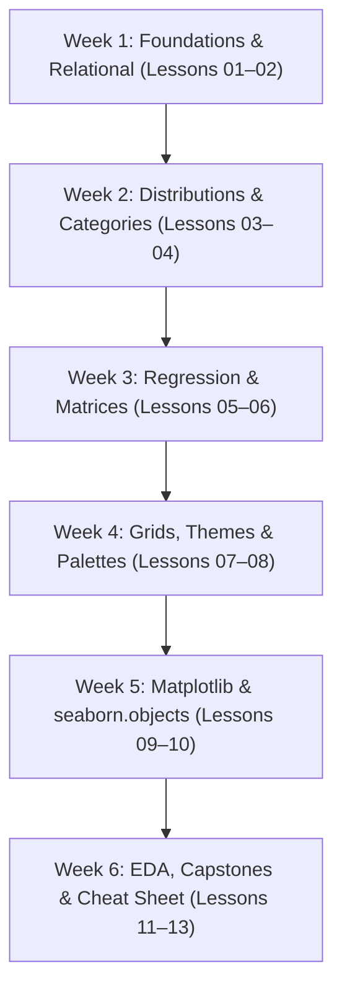

# 📊 Master Seaborn: සම්පූර්ණ සිංහල Self-Study පාඨමාලාව

ආයුබෝවන්! මේ සති 6ක සම්පූර්ණ self-study පාඨමාලාවෙන් ඔයාට පළවෙනි `sns.scatterplot()` එකේ ඉඳන් publication-ready, multi-panel statistical graphics සහ අලුත්ම `seaborn.objects` interface එක දක්වා සරල සිංහලෙන් පියවරෙන් පියවර ඉගෙන ගන්න පුළුවන්.

- **කාටද මේ පාඨමාලාව?** මූලික Python සහ pandas දන්න Data Analysts, Data Scientists සහ සිසුන් සඳහා.
- **Seaborn කියන්නේ මොකක්ද?** Matplotlib මත ගොඩනගපු high-level statistical visualization library එකක් — tidy DataFrame එකක් එක code පේළියකින් ලස්සන statistical chart එකක් කරනවා!
- **පූර්ව අවශ්‍යතා (Prerequisites):** Python, pandas basics සහ Matplotlib මූලික දැනුම.

---

## 🚀 Quick Start Setup

ඕනෑම පාඩමක් පටන් ගන්න කලින් ඔයාගේ notebook එකේ මේ ටික run කරන්න:

```python
import seaborn as sns
import matplotlib.pyplot as plt
import pandas as pd
import numpy as np

print(sns.__version__)
sns.set_theme()  # Seaborn වල default ලස්සන look එක apply කරයි
```

---

## 🗺️ Learning Path (පාඨමාලා මාර්ග සිතියම)



---

## 📅 සති 6ක මාර්ග සැලැස්ම (6-Week Roadmap)

| සතිය (Week) | පාඩම් (Lessons) | ප්‍රධාන ඉලක්කය (Milestone) |
| :---: | :---: | :--- |
| **Week 1** | 01 – 02 | Tidy data, function families සහ relational plots (`scatterplot`, `lineplot`, `relplot`) |
| **Week 2** | 03 – 04 | Distribution plots (`histplot`, `kdeplot`, `ecdfplot`) සහ categorical plots (`boxplot`, `violinplot`, `barplot`) |
| **Week 3** | 05 – 06 | Regression / residual plots (`regplot`, `lmplot`) සහ matrix plots (`heatmap`, `clustermap`) |
| **Week 4** | 07 – 08 | Multi-plot grids (`FacetGrid`, `pairplot`, `jointplot`), themes, contexts සහ colourblind-safe palettes |
| **Week 5** | 09 – 10 | Matplotlib integration, statistical `errorbar` estimation සහ `seaborn.objects` interface |
| **Week 6** | 11 – 13 | Real-world 8-step EDA workflow, performance tuning, chart selection, 6 Capstones සහ cheat sheet |

---

## 📚 සම්පූර්ණ පාඩම් මාලාව (All 13 Lessons)

| # | පාඩම (Lesson) | ආවරණය වන ප්‍රධාන මාතෘකා (Key Topics) |
| :---: | :--- | :--- |
| **01** | [01: Setup, Tidy Data & Function Families](01_Setup_Tidy_Data_and_Function_Families.md) | Tidy (long-form) data, `melt()`, Axes-level vs Figure-level functions, semantic mappings (`hue`, `size`, `style`) |
| **02** | [02: Relational Plots](02_Relational_Plots.md) | `scatterplot`, `lineplot`, `relplot`, time-series uncertainty bands, faceting |
| **03** | [03: Distribution Plots](03_Distribution_Plots.md) | `histplot`, `kdeplot`, `ecdfplot`, `rugplot`, `displot`, 2D bivariate distributions |
| **04** | [04: Categorical Plots](04_Categorical_Plots.md) | `stripplot`, `swarmplot`, `boxplot`, `violinplot`, `boxenplot`, `barplot`, `pointplot`, `countplot`, `catplot` |
| **05** | [05: Regression & Model Fit Plots](05_Regression_and_Model_Fit_Plots.md) | `regplot`, `lmplot`, `residplot`, polynomial (`order=`), `lowess`, `robust`, `logistic` fits |
| **06** | [06: Matrix Plots — Heatmap & Clustermap](06_Matrix_Plots_Heatmap_and_Clustermap.md) | Correlation heatmaps, upper-triangle masking, pivot tables, confusion matrices, `clustermap` |
| **07** | [07: Multi-Plot Grids](07_Multi_Plot_Grids.md) | `FacetGrid`, `PairGrid`, `pairplot`, `JointGrid`, `jointplot`, custom `.map_dataframe()` |
| **08** | [08: Themes, Styles, Contexts & Palettes](08_Themes_Styles_Contexts_and_Palettes.md) | `set_theme`, `axes_style`, `plotting_context`, qualitative / sequential / diverging / colourblind palettes |
| **09** | [09: Customisation & Matplotlib Integration](09_Customisation_and_Matplotlib_Integration.md) | `ax=`, `plt.subplots()`, `move_legend`, `despine`, `bar_label`, `FacetGrid` tuning, high-res export |
| **10** | [10: Statistical Estimation & `seaborn.objects`](10_Statistical_Estimation_and_Objects_Interface.md) | `errorbar` (`ci`, `se`, `sd`, `pi`), bootstrapping, `estimator`, `so.Plot`, Marks, Stats, Moves, Scales |
| **11** | [11: Real-World EDA Workflows & Performance](11_EDA_Workflows_and_Performance.md) | 8-step EDA workflow, missing-data map, seasonality heatmap, big-data performance tricks, `pd.Categorical` |
| **12** | [12: Chart Selection & Capstone Projects](12_Chart_Selection_and_Capstone_Projects.md) | Complete chart selection guide, real-world domains, 6 portfolio Capstone Projects + A/B test dashboard |
| **13** | [13: Cheat Sheet, Pitfalls & Study Plan](13_Cheat_Sheet_Pitfalls_and_Study_Plan.md) | Quick-reference cheat sheet, 11 common pitfalls & fixes, 6-week habit plan, mastery checklist & resources |

---

> [!TIP]
> **ඉගෙන ගන්න හොඳම විදිහ:** පාඩමක් කියවන ගමන් code copy-paste කරන්නේ නැතුව ඔයාම Jupyter Notebook එකක type කරලා run කරන්න. හැම පාඩමකම අවසානයේ තියෙන **ප්‍රායෝගික අභ්‍යාස (Exercises)** තනියම try කරලා පස්සේ solution එක බලන්න!

👉 පළවෙනි පාඩමෙන් පටන් ගන්න: **[01: Setup, Tidy Data & Function Families](01_Setup_Tidy_Data_and_Function_Families.md)**
